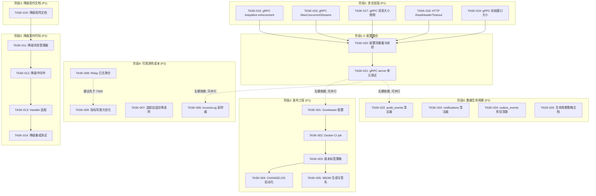
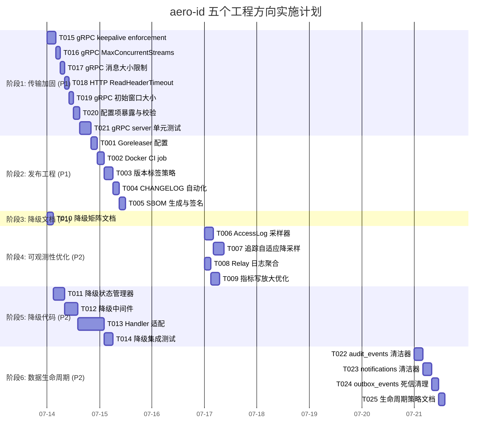

# 技术实现方案 — 五个工程方向

> 日期: 2026-07-12
> 基于: 2026-07-12 架构评估反馈
> 对应: 方向一~五（发布工程、可观测性成本、降级契约、传输协议加固、数据生命周期）

---

## 目录

1. [任务分解](#1-任务分解)
2. [执行顺序与依赖图](#2-执行顺序与依赖图)
3. [技术风险](#3-技术风险)
4. [资源评估](#4-资源评估)
5. [质量保证](#5-质量保证)
6. [实施计划](#6-实施计划)

---

## 1. 任务分解

### 1.1 任务总览

| 方向 | 任务数 | 预估总工时 | 优先级 |
|------|--------|-----------|--------|
| 四 — 传输协议加固 | 7 | 20h | **P1** |
| 一 — 发布工程 | 5 | 16h | P1 |
| 三 — 降级契约 | 5 | 30h | P1（文档）/ P2（代码） |
| 二 — 可观测性成本 | 4 | 16h | P2 |
| 五 — 数据生命周期 | 4 | 14h | P2 |
| **合计** | **25** | **96h (≈12人日)** | |

### 1.2 方向一：发布工程（Release Engineering）

**目标：** 建立自动化的 Docker 镜像构建/发布管道、CHANGELOG 自动化、版本标签策略。

| 任务 ID | 标题 | 涉及文件 | 前置依赖 | 工时 | 验收标准 |
|---------|------|---------|---------|------|---------|
| TASK-001 | Goreleaser 配置文件初始化 | `.goreleaser.yaml`, `Makefile` | 无 | 3h | `goreleaser build --snapshot` 成功输出 `dist/` 目录 |
| TASK-002 | Docker build CI job | `.github/workflows/docker.yml` | TASK-001 | 3h | PR merge 到 main 后自动构建 `aero-id:commit-sha` 并 push 到 registry |
| TASK-003 | 版本标签策略与稳定发布 | `.github/workflows/release.yml` | TASK-002 | 4h | `git tag v0.2.0 && git push --tags` 触发 Goreleaser 发布，产出 GitHub Release + Docker image tag |
| TASK-004 | CHANGELOG 自动化 | `.github/workflows/release.yml`, `docs/CHANGELOG.md` | TASK-003 | 3h | 发布时自动从 `docs/CHANGELOG.md`（切换到 `git-cliff`）生成 Release Notes |
| TASK-005 | SBOM 生成与签名 | `.goreleaser.yaml`, `Makefile` | TASK-003 | 3h | `goreleaser release` 产出的 artifact 含 `aero-id_*.sbom` 和 `aero-id_*.sbom.sig` |

**详细说明：**

- **TASK-001 — Goreleaser 配置：**
  - 使用 `goreleaser` v2.x
  - 配置 `before.hooks` 中执行 `go mod download`
  - `builds` 段使用与现有 Dockerfile 一致的 ldflags（`-s -w`）
  - 输出二进制到 `dist/`
  - 注意：不重复造 Dockerfile——Goreleaser 可以用 `dockers` 段直接使用现有 `deployments/Dockerfile`

- **TASK-002 — Docker CI job：**
  - 基于 `docker/build-push-action@v6`
  - 只构建，不发布 PR（避免浪费 CI 资源）
  - push 到 main 时构建并 push 到 `ghcr.io/aero/aero-id:${{ github.sha }}`
  - 同时更新 `latest` 标签（仅在 main 分支）

- **TASK-003 — 版本标签策略：**
  - 使用 SemVer 2.0（`v0.2.0`, `v0.3.0` 等）
  - `v0.x.y` 阶段：每 2~3 周一个 minor 版本
  - 预发布：`v0.2.0-rc.1`（可选）
  - Goreleaser release 触发条件：`git tag v*`

- **TASK-004 — CHANGELOG 自动化（与现有 `docs/CHANGELOG.md` 平滑过渡）：**
  - 初始阶段：从 `docs/CHANGELOG.md` 手动迁移到 `git-cliff` 配置的 `CHANGELOG.md`（仓库根目录）
  - `git-cliff` 配置 `cliff.toml`：按类型（feat/fix/perf/docs）分组
  - Goreleaser release 前自动运行 `git-cliff --unreleased --tag $TAG`
  - **不破坏现有文档**：保留 `docs/CHANGELOG.md` 直到下次大版本时归档

- **TASK-005 — SBOM 生成与签名：**
  - 使用 `syft` 在 Goreleaser 的 `choco`/`nfpm` 之前生成 SBOM（CycloneDX 格式）
  - 使用 `cosign` 对 SBOM 和镜像签名（需配置 cosign key pair）
  - 签名 key 通过 GitHub Secrets 注入（`COSIGN_PASSWORD`, `COSIGN_PRIVATE_KEY`）

### 1.3 方向二：可观测性成本（Observability Cost）

**目标：** 削减日志/追踪的写入放大，保护可观测性管道在高负载下不拖垮应用。

| 任务 ID | 标题 | 涉及文件 | 前置依赖 | 工时 | 验收标准 |
|---------|------|---------|---------|------|---------|
| TASK-006 | AccessLog 采样器 | `internal/middleware/access_log.go`, `internal/middleware/sample.go` | 无 | 4h | 配置 `log.sample_ratio: 0.1` 后，只有约 10% 请求产生日志行；健康检查路径 `/healthz` `/readyz` 不采样（始终记录） |
| TASK-007 | 追踪自适应降采样 | `internal/pkg/tracing/tracing.go`, `configs/config.yaml` | 无 | 5h | 当 span 导出失败率 > 10%（连续 3 个 10s 窗口）时自动将 `sample_ratio` 降至 0.1；恢复后逐步调回原值 |
| TASK-008 | Relay 日志聚合 | `internal/outbox/relay.go` | 无 | 3h | 每次 drain 周期只输出一行汇总日志（`handled=X, failed=Y, pending=Z`），而非每个事件一行 |
| TASK-009 | 指标写放大优化 | `internal/pkg/metrics/registry.go` | 无 | 4h | `ObserveOutboxDrain` 改用 atomic counter 积累，每 15s flush 一次（减少锁竞争） |

**详细说明：**

- **TASK-006 — AccessLog 采样：**
  - 新增 `middleware.Sample` 中间件，基于 `sample_ratio` 概率采样
  - 只对 `info` 级别的日志采样，`warn`/`error` 级别始终记录
  - 判断依据：`c.Writer.Status()` >= 400 时不采样（始终记录）
  - 配置：`log.sample_ratio`（新增 config 字段）
  - 在 `router.go` 中加入 `sample` 中间件（在 `AccessLog` 之前）

- **TASK-007 — 追踪自适应降采样：**
  - 在 `tracing.Init` 函数中添加一个监控 goroutine
  - 定期检查 `batchSpanProcessor` 的导出错误计数
  - 当连续 3 个窗口（每个 10s）的错误率 > 10% 时，触发降采样
  - 降采样策略：`sample_ratio = max(0.1, original / 10)`
  - 恢复策略：当 5 个连续窗口的错误率 < 2% 时，每 2 分钟增加 0.1，直到恢复原值
  - 通过 OTel `WithSampler(SDKSampler)` 动态切换（用 `ParentBased(RatioBased(sampleRatio))`）

- **TASK-008 — Relay 日志聚合：**
  - `drain` 方法结束时输出一行聚合日志
  - 格式：`outbox drain: handled=5 failed=1 pending=12 oldest_age=2m34s duration=45ms`
  - 注意：`r.log.Warn("outbox: handler failed; will retry", ...)` 仍保留在 warn 级别（不采样错误日志）

- **TASK-009 — 指标写放大优化：**
  - 当前 `ObserveOutboxDrain` 每次 drain 调用一次（5s 间隔 = 17,280 次/天）
  - 改为：在每个 drain pass 中，用 `sync/atomic` 累积 pending/oldestAge/duration 的中间值
  - 每 15s 执行一次 `flush()`，将累积值批量上报到 Prometheus 指标
  - 锁竞争从每 5s 一次减为每 15s 一次

### 1.4 方向三：降级契约（Degradation Contract）

**目标：** 建立规范性降级矩阵文档，并在每个 handler 中实现统一的降级行为。

| 任务 ID | 标题 | 涉及文件 | 前置依赖 | 工时 | 验收标准 |
|---------|------|---------|---------|------|---------|
| TASK-010 | 降级矩阵文档 | `docs/DEGRADATION_MATRIX.md` | 无 | 3h | 文档覆盖每个 API 端点在 DB/SSO/S3 故障时的行为；包含示例响应头和 HTTP 状态码 |
| TASK-011 | 降级状态管理器 | `internal/middleware/degradation.go`, `internal/config/config.go` | TASK-010 | 5h | 提供全局 `DegradationState` 单例，聚合 DB/SSO/S3 的健康状态；支持手动强制降级（通过 admin API） |
| TASK-012 | 降级中间件（HTTP + gRPC） | `internal/middleware/degradation.go`, `internal/handler/grpc/server.go` | TASK-011 | 6h | HTTP 端：在响应头写入 `X-Aero-Degraded`；gRPC 端：在 trailing metadata 写入 `x-aero-degraded` |
| TASK-013 | 每个 Handler 适配降级逻辑 | 8 个 HTTP handler + 8 个 gRPC handler | TASK-012 | 12h | 每个 handler 根据当前降级状态和契约决定：返回 503/429/200(stale) |
| TASK-014 | 降级集成测试 | `internal/middleware/degradation_test.go`, `internal/handler/*/*_test.go` | TASK-013 | 4h | 覆盖 3 种降级场景（DB 故障、SSO 故障、S3 故障）x 3 种端点类型（读/写/文件下载） |

**详细说明：**

- **TASK-010 — 降级矩阵文档：**
  - 表格格式，每行一个端点
  - 列：端点、依赖（DB/SSO/S3）、DB 故障行为、SSO 故障行为、S3 故障行为、已实现状态
  - 包含 `/files/dl`（HMAC 签名下载，完全不依赖 DB/SSO）作为"设计已存在但未文档化"的正面案例

- **TASK-011 — 降级状态管理器：**
  - 定义 `DegradationState` 结构体，包含三个布尔值：`dbDegraded`, `ssoDegraded`, `storageDegraded`
  - 提供 `Probe()` 方法在后台定期检查各个依赖的健康状态
  - 提供 `Status()` 方法返回当前降级摘要（用于响应头）
  - 支持 admin API 手动强制降级（模拟故障场景）

- **TASK-012 — 降级中间件：**
  - HTTP 端：在 gin.Context 的响应头写入 `X-Aero-Degraded`（值为 `db,sso` 或 `none`）
  - gRPC 端：在 `NewServerWithOptions` 中添加 streaming interceptor，在 trailing metadata 写入
  - 注意：中间件本身不应阻塞请求，仅注入降级信息

- **TASK-013 — Handler 适配（工作量最大的部分）：**
  - 每个 handler 需要读取 `DegradationState` 并按照契约决定行为
  - 示例：当 DB 故障时，读端点可以返回 stale 缓存数据（200），写端点返回 503
  - 需要统一辅助函数 `degradedResponse(ctx, state, deps)` 减少重复代码
  - 建议创建 `internal/middleware/degradation.go` 中的 `DegradedHandler` 包装器

### 1.5 方向四：传输协议加固（Transport Protocol Hardening）

**目标：** 修复 gRPC 和 HTTP 服务器配置中缺失的安全与资源限流参数。

| 任务 ID | 标题 | 涉及文件 | 前置依赖 | 工时 | 验收标准 |
|---------|------|---------|---------|------|---------|
| TASK-015 | gRPC 服务端 keepalive 强制执行策略 | `internal/handler/grpc/server.go` | 无 | 2h | `grpc.NewServer` 包含 `keepalive.EnforcementPolicy{MinTime: 10s, PermitWithoutStream: false}` |
| TASK-016 | gRPC MaxConcurrentStreams 限流 | `internal/handler/grpc/server.go`, `configs/config.yaml` | 无 | 2h | `grpc.NewServer` 设置 `MaxConcurrentStreams: 100`；config 可配置 |
| TASK-017 | gRPC 消息大小限制 | `internal/handler/grpc/server.go`, `configs/config.yaml` | 无 | 2h | `grpc.NewServer` 设置 `MaxRecvMsgSize: 4MB`, `MaxSendMsgSize: 4MB`；config 可配置 |
| TASK-018 | HTTP ReadHeaderTimeout 加固 | `internal/app/app.go`, `configs/config.yaml` | 无 | 2h | `http.Server.ReadHeaderTimeout: 10s`（防止 Slowloris） |
| TASK-019 | gRPC 初始窗口大小配置 | `internal/handler/grpc/server.go`, `configs/config.yaml` | 无 | 2h | `grpc.NewServer` 设置 `InitialWindowSize: 64KB`, `InitialConnWindowSize: 256KB` |
| TASK-020 | 配置项暴露与校验 | `internal/config/config.go`, `configs/config.yaml` | TASK-015~019 | 3h | 所有 gRPC server 参数可在 config.yaml 中设置并在启动时校验 |
| TASK-021 | gRPC server 单元测试 | `internal/handler/grpc/server_test.go` | TASK-020 | 5h | 测试 `NewServerWithOptions` 生成的 `grpc.Server` 包含正确的 option 值；mock 测试 keepalive 策略生效 |

**详细说明：**

- **TASK-015 — 安全风险（DoS 向量）：**
  - 当前 `grpc.NewServer(grpc.ChainUnaryInterceptor(interceptors...))` 无 keepalive enforcement
  - 客户端可以以任意频率发送 ping，消耗服务端资源
  - 1 个恶意客户端即可通过高频 ping 发起 DoS
  - 修复：`keepalive.EnforcementPolicy{MinTime: 10 * time.Second, PermitWithoutStream: false}`
  - 10s 是最小允许 ping 间隔；`false` 表示不允许 idle 连接 ping

- **TASK-016 — MaxConcurrentStreams：**
  - 当前无限制（默认 0 = unlimited）
  - 一个客户端可以打开大量 stream 消耗服务端内存
  - 建议值 100（可在 config 中调整）
  - 超限时新 stream 收到 `Unavailable` 状态码

- **TASK-017 — 消息大小限制：**
  - 当前使用默认值（`MaxRecvMsgSize = 4MB`, `MaxSendMsgSize` 无限制）
  - 明确设置 `MaxRecvMsgSize: 4MB`, `MaxSendMsgSize: 4MB`
  - 支持从 config 读取（`server.grpc.max_recv_msg_size`）

- **TASK-018 — ReadHeaderTimeout（HTTP）：**
  - 当前 `http.Server` 有 `ReadTimeout: 15s` 但**没有 `ReadHeaderTimeout`**
  - 缺少 `ReadHeaderTimeout` 是 Slowloris 攻击的入口（客户端缓慢发送 header 占用连接）
  - 修复：新增 `ReadHeaderTimeout: 10s`（默认值，config 可配置）

- **TASK-020 — 配置项暴露：**
  - 新增 `GRPCConfig` 字段：`KeepaliveMinPingInterval`, `MaxConcurrentStreams`, `MaxRecvMsgSize`, `MaxSendMsgSize`, `InitialWindowSize`, `InitialConnWindowSize`
  - HTTP 新增：`ReadHeaderTimeout`
  - validate() 中校验：
    - `KeepaliveMinPingInterval >= 1s`
    - `MaxConcurrentStreams >= 1`
    - `MaxRecvMsgSize >= 1KB`
    - `ReadHeaderTimeout >= 1s`

### 1.6 方向五：数据生命周期（Data Lifecycle）

**目标：** 为无边界增长的表添加 TTL 清理策略，控制存储成本。

| 任务 ID | 标题 | 涉及文件 | 前置依赖 | 工时 | 验收标准 |
|---------|------|---------|---------|------|---------|
| TASK-022 | audit_events 表 TTL 清洁器 | `internal/repository/audit.go`, `internal/app/app.go` | 无 | 4h | 每个小时清理超过 90 天的 audit_events 行；config 可配置 retention 和 interval |
| TASK-023 | notifications 表 TTL 清洁器 | `internal/repository/notification.go`, `internal/app/app.go` | 无 | 4h | 每个小时清理超过 30 天且已读的 notification 行；config 可配置 retention 和 interval |
| TASK-024 | outbox_events 死信清理 | `internal/outbox/repository.go`, `internal/outbox/relay.go`, `internal/app/app.go` | 无 | 3h | 每个小时清理 dead_letter = true 且超过 7 天的行；config 可配置 retention |
| TASK-025 | 生命周期策略文档 | `docs/DATA_RETENTION.md` | TASK-022~024 | 3h | 文档覆盖每个表的 retention 策略、清理实现方式、监控指标 |

**数据汇总与 retention 策略：**

| 表 | 当前行数（预估值） | 增长速率 | 建议 Retention | 建议清理间隔 | 清理条件 |
|----|-------------------|---------|---------------|-------------|---------|
| `idempotency_keys` | 已有 `RunCleaner` | 每个 idempotent 请求产生 1 行 | 24h（已有 TTL 字段） | 1h（已有） | `expires_at < NOW()` |
| `audit_events` | 每个审计操作 1 行 | 低（仅敏感操作） | 90 天 | 1h | `created_at < NOW() - 90d` |
| `notifications` | 每通知 1 行 | 中等 | 30 天（已读），90 天（未读） | 1h | `read_at IS NOT NULL AND read_at < NOW() - 30d`，或 `created_at < NOW() - 90d` |
| `outbox_events` | 每域事件 1 行 | 中高 | 7 天（dead_letter），30 天（已发布） | 1h | `(dead_letter = true OR published_at IS NOT NULL) AND created_at < NOW() - 7d` |
| `file_shares` | 每次分享 1 行 | 低 | 不清理（业务语义永久） | N/A | 无 |
| `user_blocks` | 每次屏蔽 1 行 | 低 | 不清理（业务语义永久） | N/A | 无 |
| `storage_refs` | 每文件引用 1 行 | 与文件数量相同 | 90 天（orphaned refs） | 1h | `file_id IS NULL AND created_at < NOW() - 90d` |
| `unread_counts` | 每用户 1 行 | 低（与用户数量相同） | 不清理（业务语义永久） | N/A | 无 |

**详细说明：**

- **TASK-022 — audit_events 清洁器：**
  - 新增 `auditRepo.PurgeOlderThan(ctx, time.Time) (int64, error)` 方法
  - 使用 `DELETE FROM audit_events WHERE created_at < ? AND id IN (SELECT id FROM audit_events WHERE ... ORDER BY id LIMIT 1000)` 分批删除（避免长事务）
  - 每批 1000 行，每批间隔 100ms（减少 IO 冲击）
  - 在 `app.go` 中启动清洁器 goroutine（类似于 idemStore.RunCleaner 模式）
  - 记录清理行数到日志（info 级别）

- **TASK-023 — notifications 清洁器：**
  - 新增 `notifRepo.PurgeReadOlderThan(ctx, time.Time) (int64, error)` 方法
  - 已读通知：`WHERE read_at IS NOT NULL AND read_at < ?`（保留 30 天）
  - 未读通知：`WHERE read_at IS NULL AND created_at < NOW() - 90d`（保留 90 天，超长未读说明用户不再活跃）
  - 同样分批删除（每批 500 行）

- **TASK-024 — outbox_events 死信清理：**
  - 新增 `outboxRepo.PurgeDeadLetters(ctx, time.Time) (int64, error)` 方法
  - `WHERE dead_letter = true AND created_at < ?`（保留 7 天）
  - 同时清理已发布事件（`published_at IS NOT NULL AND created_at < NOW() - 30d`）
  - 注意：清理死信**不应**影响仍在重试中的事件（`published_at IS NULL AND dead_letter = false`）

- **TASK-025 — 生命周期策略文档：**
  - 文档在 `docs/DATA_RETENTION.md`
  - 包含每个表的：业务用途、行数预估、retention 策略、清理 SQL、监控指标
  - 包含清理运行时指标：`aeroid_gc_rows_purged_total`（按表名标签）
  - 明确标注哪些表不清理（业务语义永久）

---

## 2. 执行顺序与依赖图

### 2.1 依赖关系总图



### 2.2 可并行执行的任务组

| 并行组 | 包含任务 | 前置条件 | 预计同时需要人数 |
|--------|---------|---------|----------------|
| **A** | T015, T016, T017, T018, T019 | 无 | 1 人（同一人依次完成更高效） |
| **B** | T001 | 无 | 1 人 |
| **C** | T006, T007, T008 | 无 | 1~2 人（可并行） |
| **D** | T010, T022, T023, T024 | 无 | 1~2 人（文档 + 代码可并行） |

### 2.3 关键路径

```
T015 → T016 → T017 → T018 → T019 → T020 → T021       (10h)
                                                  \
T001 → T002 → T003 → T004 → T005                     (13h)
                                                 /
T010 → T011 → T012 → T013 → T014                     (30h)
```

**关键路径最长：** T010 → T014（降级契约代码实现）共 **30h**。这是整个计划的瓶颈。

---

## 3. 技术风险

### 3.1 风险矩阵

| # | 风险描述 | 影响方向 | 概率 | 影响 | 应对策略 |
|---|---------|--------|------|------|---------|
| R1 | gRPC keepalive enforcement 导致现有客户端断开 | 四 | 中 | 高 | 先灰度发布，监控连接断开率；`MinTime` 从 30s 开始逐步降到 10s |
| R2 | 降级契约代码实现被低估（30h 可能不够） | 三 | 高 | 高 | 采用包装器模式减少每个 handler 的改动量；先实现核心路径（读+写），边缘路径后续迭代 |
| R3 | 追踪自适应降采样与 OTel SDK 的兼容性问题 | 二 | 中 | 中 | 使用 OTel 官方 `Sampler` 接口实现，不依赖内部 API；备选方案：固定采样率 |
| R4 | 数据清理在生产环境造成 IO 抖动 | 五 | 中 | 中 | 分批 + 间隔 + 可配置执行时间段（只在低峰期运行） |
| R5 | Goreleaser 与现有 `deployments/Dockerfile` 冲突 | 一 | 低 | 中 | 使用 `goreleaser` 的 `dockers` 段直接引用 Dockerfile，不重复定义构建逻辑 |
| R6 | 降级状态管理器的依赖探测本身可能成为新的故障点 | 三 | 中 | 高 | Probe 使用独立的超时和断路器；探测失败不影响业务路径（只标记降级状态） |

### 3.2 技术难点详解

#### R1: gRPC keepalive enforcement 兼容性

**问题：** 当前 gRPC 服务端没有 `keepalive.EnforcementPolicy`。加上 `MinTime: 10s` 后，如果现有客户端使用小于 10s 的 ping 间隔，连接会收到 `GOAWAY` 并断开。

**应对：**
1. 第一阶段：`MinTime: 30s`（宽松），运行 1 周观察客户端断开率
2. 第二阶段：降到 `15s`，再观察 1 周
3. 第三阶段：最终目标 `10s`
4. 每个阶段都要监控 `grpc_server_connections_dropped_total` 指标

#### R3: 追踪自适应降采样的 OTel 集成

**问题：** OTel Go SDK 的 `Sampler` 在 `TracerProvider` 创建时固定，无法运行时动态切换。

**应对：**
- 使用 `Sampler` 包装器模式：

```go
type DynamicSampler struct {
    ratio atomic.Float64
}

func (s *DynamicSampler) ShouldSample(p SamplingParameters) SamplingResult {
    r := s.ratio.Load()
    // 基于 r 实现 parent-based ratio sampler
}

func (s *DynamicSampler) SetRatio(r float64) {
    s.ratio.Store(r)
}
```

- 备选方案：如果动态 sampler 实现复杂，改用固定采样率（`sample_ratio: 0.1`）+ 手动配置。

#### R6: 降级状态探测的级联故障

**问题：** 如果降级状态管理器自身使用的探测（如 `sql.DB.PingContext`）实现不当，可能导致依赖探测也超时或阻塞。

**应对：**
- 每个探测使用独立的 `context.WithTimeout`（3s 超时）
- 探测结果通过 channel 异步传递，不阻塞业务路径
- 探测失败时只更新降级状态，不 panic 不 crash
- 断路器模式（类似 SSO 的 breaker）：连续 3 次探测失败后才标记为降级

### 3.3 外部依赖风险

| 依赖 | 方向 | 风险 |
|------|------|------|
| `goreleaser/goreleaser` | 一 | 版本兼容性（Goreleaser v2.x + Go 1.26） |
| `google.golang.org/grpc` | 四 | `keepalive.EnforcementPolicy` 是稳定 API，无风险 |
| `go.opentelemetry.io/otel` | 二 | 动态 Sampler 需要 `v1.30+`（需确认当前版本） |
| `cosign` + `syft` | 一 | CI pipeline 中需要安装这两个工具 |

---

## 4. 资源评估

### 4.1 团队配置建议

| 角色 | 人数 | 技能要求 | 负责方向 |
|------|------|---------|---------|
| 高级 Go 工程师 | 1 | 熟悉 gRPC 安全配置、GORM、中间件模式 | 四、三（代码部分） |
| DevOps/CI 工程师 | 1 | 熟悉 GitHub Actions、Goreleaser、Docker、cosign | 一 |
| 全栈工程师 | 1 | 熟悉可观测性、日志采样、Prometheus metrics | 二、三（文档部分） |
| 数据工程师 | 0.5 | 熟悉 SQL、数据清理策略 | 五 |

**最小团队：** 2 人（1 高级 Go + 1 DevOps），可容纳 3 人并行。

### 4.2 关键里程碑

| 里程碑 | 时间点 | 交付物 |
|--------|-------|--------|
| M1: 传输安全加固完成 | 第 3 天 | gRPC + HTTP 安全配置上线；`make test && make lint` 通过 |
| M2: Docker CI 流水线运行 | 第 5 天 | 每次 push 到 main 自动构建 Docker 镜像 |
| M3: 降级矩阵文档定稿 | 第 6 天 | `docs/DEGRADATION_MATRIX.md` 评审通过 |
| M4: 日志采样与追踪保护 | 第 8 天 | AccessLog 采样器 + 自适应降采样上线 |
| M5: 降级契约代码完成 | 第 14 天 | 所有 handler 适配降级逻辑；集成测试通过 |
| M6: 数据清洁器运行 | 第 16 天 | 3 个清洁器已在生产运行至少 1 周，指标正常 |

### 4.3 阻塞点（Blockers）

| # | 阻塞点 | 影响 | 解决策略 |
|---|-------|------|---------|
| B1 | gRPC keepalive enforcement 导致客户端断开 | 方向四进度 | 从宽松值开始 + 灰度发布；准备好回滚预案 |
| B2 | 降级契约实现中，每个 handler 的改动量分散在多个文件 | 方向三进度 | 使用包装器模式减少重复代码；先核心（读+写）后边缘 |
| B3 | 自适应降采样的 OTel Sampler 接口不支持动态切换 | 方向二进度 | 备选方案：固定采样率；或使用 DynamicSampler 包装器 |
| B4 | data cleanup 在大表上执行可能导致锁等待 | 方向五进度 | 分批处理（每批 500~1000 行）+ 使用 `id` 范围 + 低峰期运行 |

---

## 5. 质量保证

### 5.1 单元测试覆盖要求

| 方向 | 最低覆盖要求 | 关键测试文件 |
|------|------------|------------|
| 一 | 不适用（CI 配置，没有 Go 代码） | — |
| 二 | 85%+ | `internal/middleware/sample_test.go`, `internal/pkg/tracing/tracing_test.go` |
| 三 | 90%+ | `internal/middleware/degradation_test.go`（状态机 + 中间件） |
| 四 | 90%+ | `internal/handler/grpc/server_test.go`（options 验证） |
| 五 | 85%+ | `internal/repository/audit_test.go`, `internal/outbox/repository_test.go` |

### 5.2 集成测试策略

| 方向 | 集成测试类型 | 测试数据准备 |
|------|------------|------------|
| 二 | 端到端采样测试 | 用 mock HTTP 请求验证采样率统计 |
| 三 | 降级场景模拟 | 使用 mock 依赖 + `DegradationState` 强制降级 |
| 三 | 跨 transport 一致性 | 验证 HTTP 和 gRPC 在相同降级状态下行为一致 |
| 四 | gRPC 服务端配置验证 | 用 bufconn 创建 `grpc.Server`，验证 keepalive 策略生效 |
| 五 | 数据清理 SQL 验证 | 通过 `testpg` 创建测试表，验证清理 SQL 准确删除预期行 |

### 5.3 代码审查要点

| 方向 | 审查要点 |
|------|---------|
| **一** | `goreleaser.yaml` 中的 Dockerfile 路径是否正确；`docker build` 是否使用多阶段构建；SBOM 格式是否 CycloneDX |
| **二** | 采样器是否区分健康检查路径（始终记录）；降采样切换是否线程安全（atomic）；relay 日志聚合是否丢失错误信息 |
| **三** | 降级状态管理器是否线程安全（`sync.RWMutex`）；中间件是否在 `Abort()` 后正确写入响应头；handler 是否覆盖所有降级组合 |
| **四** | `grpc.NewServer` 传入的 option 是否与 config 一致；keepalive enforcement 是否从 config 读取；`ReadHeaderTimeout` 是否大于 0 |
| **五** | 清理 SQL 是否使用 `DELETE ... LIMIT` 分批；清洁器是否在 app shutdown 时优雅停止；是否记录清理行数的 metrics |

### 5.4 性能测试需求

| 场景 | 指标 | 目标 | 触发条件 |
|------|------|------|---------|
| 高并发日志写入 | P50/P99 请求延迟 | P50 增加 < 2ms | 1000 req/s, sample_ratio=0.1 |
| gRPC 流限制 | 连接拒绝率 | MaxConcurrentStreams=100 时第 101 个 stream 收到 `Unavailable` | 并发 150 stream |
| 数据清理 IO 影响 | DB 查询延迟 | 清理期间 DB 查询 P99 < 200ms | 清理运行 + 200 req/s 混合负载 |
| 降级状态切换 | 降级检测延迟 | 依赖故障后 < 5s 检测到 | SSO 端口关闭 |

---

## 6. 实施计划

### 6.1 甘特图



### 6.2 各阶段详细计划

#### 阶段 1: 传输协议加固（Day 1-3）

| 天 | 任务 | 产出 | 验证 |
|----|------|------|------|
| 1 | T015 + T016 + T017 | gRPC server 具备 keepalive enforcement、MaxConcurrentStreams、MaxRecvMsgSize | `make test` 通过，`make lint` 通过 |
| 2 | T018 + T019 | HTTP 具备 ReadHeaderTimeout；gRPC 具备 InitialWindowSize | `make run` 启动无报错 |
| 3 | T020 + T021 | 配置项完整暴露 + 单元测试覆盖 | `go test ./internal/handler/grpc/... -count=1 -race` 通过 |

**风险缓解：** gRPC keepalive enforcement 添加后，在 staging 环境观察 24h，确认无客户端断开。

#### 阶段 2: 发布工程（Day 3-6）

| 天 | 任务 | 产出 | 验证 |
|----|------|------|------|
| 3 | T001 | `.goreleaser.yaml` 配置完成 | `goreleaser build --snapshot` 成功 |
| 4 | T002 | CI 自动构建 Docker 镜像 | PR push → GitHub Actions 构建 `aero-id:sha-xxx` |
| 5 | T003 + T004 | `git tag v0.2.0` 触发发布 + CHANGELOG 自动生成 | GitHub Release 包含 changelog |
| 6 | T005 | SBOM + 签名在 release artifact 中 | `cosign verify ghcr.io/aero/aero-id:v0.2.0` 通过 |

**注意：** T003（版本标签策略）需要团队达成 SemVer 策略共识。建议在 sprint kickoff 时讨论。

#### 阶段 3: 降级矩阵文档（Day 1，可与阶段 1 并行）

| 天 | 任务 | 产出 | 验证 |
|----|------|------|------|
| 1 | T010 | `docs/DEGRADATION_MATRIX.md` | 技术团队 review 通过 |

**文档覆盖的端点：** `/healthz`, `/readyz`, `/files/dl`, `/v1/files/*`, `/v1/messages/*`, `/v1/comments/*`, `/v1/notifications/*`, `/v1/blocks/*`, gRPC 对应方法。

#### 阶段 4: 可观测性优化（Day 4-6，与阶段 2 并行）

| 天 | 任务 | 产出 | 验证 |
|----|------|------|------|
| 4 | T006 + T008 | AccessLog 采样器 + Relay 日志聚合 | 1000 req/s 下日志量减少约 90% |
| 5 | T007 | 自适应降采样 | OTel span 导出失败率 > 10% 时自动降采样 |
| 6 | T009 | 指标写放大优化 | `r.mu` 锁竞争从每 5s 一次减为每 15s 一次 |

**关键依赖：** T008（Relay 日志聚合）建议先于 T009（指标写放大优化），因为 relay 的日志和指标共享同一 drain 路径，先合并日志可以减少后续指标优化的改动冲突。

#### 阶段 5: 降级契约代码（Day 7-14）

| 天 | 任务 | 产出 | 验证 |
|----|------|------|------|
| 7 | T011 | `DegradationState` 管理器 + 后台探测 | 手动注入故障后 5s 内检测到 |
| 8 | T012 | HTTP + gRPC 降级中间件 | 响应头 `X-Aero-Degraded: db` 正确写入 |
| 9-12 | T013 | 8 个 handler 适配降级逻辑 | 每个 handler 在 3 种降级场景下行为符合契约 |
| 13-14 | T014 | 集成测试覆盖 | `make test-integration` 中降级场景测试通过 |

**最关键的阶段。** 需要预留足够时间给 T013。建议：
- 第 9 天：实现 FileHandler + MessageHandler（2 个核心 handler）
- 第 10 天：实现 CommentHandler + NotificationHandler（2 个 handler）
- 第 11 天：实现 BlockHandler + PreferenceHandler + AdminHandler（3 个 handler）
- 第 12 天：实现 SearchHandler + gRPC handler 适配 + 代码 review

#### 阶段 6: 数据生命周期（Day 8-11，与阶段 5 并行）

| 天 | 任务 | 产出 | 验证 |
|----|------|------|------|
| 8 | T022 | audit_events 清洁器运行 | `SELECT count(*) FROM audit_events WHERE created_at < NOW() - 90d` 为 0 |
| 9 | T023 | notifications 清洁器运行 | 已读超过 30 天的通知被清理 |
| 10 | T024 | outbox_events 死信清理 | `dead_letter = true` 超过 7 天的行被清理 |
| 11 | T025 | `docs/DATA_RETENTION.md` 文档完成 | 技术团队 review 通过 |

**重要说明：** 清洁器在 `app.go` 中的启动模式和 `idemStore.RunCleaner(time.Hour)` 一致：

```go
// 在 app.New 函数中新增
if cfg.DataRetention.AuditRetention > 0 {
    stopAuditClean := auditRepo.RunCleaner(cfg.DataRetention.AuditRetention, cfg.DataRetention.CleanInterval)
    app.stopAuditClean = stopAuditClean
}
```

---

## 7. 配套文档新增/修改清单

| 文件 | 动作 | 所属方向 |
|------|------|---------|
| `.goreleaser.yaml` | 新增 | 一 |
| `.github/workflows/docker.yml` | 新增 | 一 |
| `.github/workflows/release.yml` | 新增 | 一 |
| `cliff.toml` | 新增 | 一 |
| `docs/CHANGELOG.md` | 修改（切换到 git-cliff 格式） | 一 |
| `internal/middleware/sample.go` | 新增 | 二 |
| `internal/middleware/access_log.go` | 修改（集成采样器） | 二 |
| `internal/pkg/tracing/tracing.go` | 修改（添加自适应降采样） | 二 |
| `internal/outbox/relay.go` | 修改（聚合日志、metrics flush） | 二 |
| `internal/pkg/metrics/registry.go` | 修改（flush 模式） | 二 |
| `docs/DEGRADATION_MATRIX.md` | 新增 | 三 |
| `internal/middleware/degradation.go` | 新增 | 三 |
| `internal/handler/grpc/server.go` | 修改（降级 metadata） | 三 |
| `internal/handler/*/*.go` | 修改（降级适配） | 三 |
| `internal/handler/grpc/server.go` | 修改（keepalive, MaxConcurrentStreams 等） | 四 |
| `internal/app/app.go` | 修改（ReadHeaderTimeout 配置） | 四 |
| `internal/config/config.go` | 修改（新增配置项） | 四、五 |
| `configs/config.yaml` | 修改（新增默认值） | 四、五 |
| `internal/repository/audit.go` | 修改（新增 PurgeOlderThan） | 五 |
| `internal/repository/notification.go` | 修改（新增 PurgeReadOlderThan） | 五 |
| `internal/outbox/repository.go` | 修改（新增 PurgeDeadLetters） | 五 |
| `docs/DATA_RETENTION.md` | 新增 | 五 |

---

## 8. 总结与建议

### 8.1 推荐的第一次迭代范围（2 周 sprint）

如果在 2 周内需要交付最小可行价值，推荐按以下优先级执行：

| 优先级 | 任务 | 投入 | 价值 |
|--------|------|------|------|
| **P0** | T015+T016+T017（方向四前半） | 6h | 消除已知 DoS 向量，安全面必须修 |
| **P0** | T018（方向四 HTTP 部分） | 2h | Slowloris 防护 |
| **P0** | T020+T021（方向四测试） | 8h | 确保安全配置可验证 |
| **P0** | T010（降级矩阵文档） | 3h | 设计文档，后续实现的基石 |
| **P1** | T001+T002（Goreleaser + Docker CI） | 6h | CI/CD 基础，团队需要 |
| **P1** | T022（audit_events 清洁器） | 4h | 最刚需的数据清理 |
| **P2** | T006（日志采样） | 4h | 成本优化，可视需要推迟 |
| **P2** | T008（relay 日志聚合） | 3h | 噪音降低 |

**2 周可交付：** 35h（约 4.5 人日），2 人团队可在 1 周内完成核心部分。

### 8.2 最终建议

1. **方向四（传输加固）应当最先做**，因为它修复的是安全面缺口，且改动量最小（2 人日），没有外部依赖，可以在 sprint 前 2 天完成。
2. **方向一（发布工程）的 Docker CI 部分应在方向四之后立即做**，因为它直接提升团队效率（每次 merge 自动构建镜像）。
3. **方向三（降级契约）的代码部分建议拆成 2 个 sprint**：sprint 1 完成文档 + 状态管理器 + 中间件，sprint 2 完成 handler 适配 + 测试。这样 30h 的工作量更容易安排。
4. **方向五的数据清洁器可以零散插在任意 sprint 中**，每个清洁器独立、风险低、价值明确。
5. **所有配置项修改（方向四的 gRPC/HTTP 参数、方向五的 retention 参数）应当统一修改 `config.go` 和 `config.yaml`，一次性完成**，减少多次 PR 的 review 负担。
