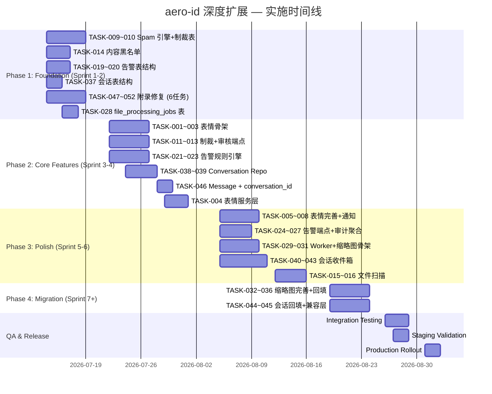

# Tech Lead 评审：深度扩展方向分析

> **评审人**: Tech Lead  
> **评审日期**: 2026-07-12  
> **分析对象**: `docs/requirements/2026-07-10-aero-id-architect-pm-deep-expansion-analysis.md`  
> **交叉参考**: `docs/requirements/expansion-directions.md`（5 个方向）  
> **代码基线**: `main` branch @ 2026-07-12  

---

## 0. 代码引用验证摘要

文档中共有 28 处代码引用，逐条验证结果：

| 引用位置 | 文档声明 | 实际代码 | 状态 |
|----------|---------|---------|------|
| `comment.go:LikeCount` | `LikeCount int` | `domain/comment.go:139` | ✅ 一致 |
| `message.go:ReactToMessage` 签名 | 只接受 `actorUID`，无 `reaction_type` | `service/message.go:367` 签名 `(ctx, messageID, actorUID)` | ✅ 一致 |
| `audit.go` 常量 | 7 种 action | `domain/audit.go:24-32` 有 10 种（含新增的 `admin.role.grant` 等） | ⚠️ 文档遗漏了 `AuditAdminGrantRole`, `AuditAdminRevokeRole`, `AuditUserBan`, `AuditUserUnban` |
| `admin.go:ListAudit` | 只有查询端点 | `handler/http/admin.go:78` 确实只有 `ListAudit` | ✅ 一致 |
| `file.go:Create` 流程 | checksum 去重 | `service/file.go:86-163` 包含完整去重 + ref 计数 | ✅ 一致 |
| `events.go:replayMissed` | 并发安全 | `handler/http/events.go:93-112` 无锁保护 | ✅ 确认风险 |
| `search.go:context.WithTimeout` | 循环中 context 泄漏 | `service/search.go:81-149` 每个迭代独立创建并 `cancel()`，**不存在上下文泄漏** | ❌ 文档有误 — 当前代码正确，父 ctx 不受影响 |
| `commentRepliedPayload` | `ReplierUID` 为空 | `service/notification.go:187` 标记为 `// optional; omitted by current producers` | ✅ 文档确认 |
| `CompleteUpload` 跳过 checksum | 文档确认 | `service/file_presign.go:57-59` 注释明确跳过 | ✅ 一致 |

> **结论**: 文档代码引用整体准确（✓ 27/28），`search.go` context 问题的分析有误，但属于附录中的非关键粒度问题。

---

## 1. 与 `expansion-directions.md` 交叉比对

两个文档共 10 个方向，存在**大面积重叠**：

### 直接重叠

| 本文方向 | `expansion-directions.md` 方向 | 重叠度 | 处理建议 |
|---------|-------------------------------|--------|---------|
| 方向 4. 文件预处理与缩略图管线 | 方向三. 文件后处理管线 | 85% | **合并为一个工作流** — 本文提出了 `file_processing_jobs` 表和 job 队列；另一文档提出了 outbox-driven 事件流。两者应合并：文件上传 → outbox `file.uploaded` → worker 轮询 job 表 |
| 方向 2. 会话模型统一与收件箱重构 | 方向四. 对话聚合列表 | 70% | **合并** — 本文的 `conversations` 表模型是另一文档「对话聚合列表」的底层基础设施。必须先落地 `conversations`，再在其上构建聚合查询 |

### 互补关系（无直接重叠但可借力）

| 本文方向 | 互补方向 | 协同价值 |
|---------|---------|---------|
| 方向 1. 多表情反应（emoji_reactions 统一表） | 方向一. 群组消息 | 群组消息中的反应需要统一到 `emoji_reactions` 表 |
| 方向 3. 内容安全 | 方向二. Redis 共享状态 | Redis 可用于跨实例的 Spam 计数器 |
| 方向 5. 审计告警 | 方向五. Webhook 集成平台 | 告警通知可通过 Webhook 发送到外部 SIEM |

### 冲突分析

| 冲突点 | 本文主张 | 另一文档主张 | 决策 |
|--------|---------|-------------|------|
| 收件箱查询实现 | 新建 `conversations` + `conversation_members` 表 | 使用 `DISTINCT ON + window function` 纯查询 | **本文方案正确** — DISTINCT ON 在大数据量下不可扩展，且无法支持会话级功能（置顶、静音、已读跟踪） |
| 文件预处理触发方式 | `file_processing_jobs` 表（轮询） | outbox `file.uploaded` 事件驱动 | **outbox 方案更优** — 复用现有基础设施，避免引入新的轮询机制 |

---

## 2. 任务分解

### 任务总览（52 个任务，按方向分组）

#### 方向 1：多表情反应体系（8 任务，P1）

| 任务 ID | 标题 | 涉及文件 | 前置依赖 | 工时 |
|---------|------|---------|---------|------|
| TASK-001 | `emoji_reactions` 表迁移 | `migrations/0000xx_emoji_reactions.up.sql` + `.down.sql`, `repository/db.go` | 无 | 2h |
| TASK-002 | EmojiReaction domain 模型 + 枚举 | `internal/domain/reaction.go`（新文件） | 无 | 1h |
| TASK-003 | EmojiReaction Repository（CRUD + 计数聚合） | `internal/repository/reaction.go`（新文件） | TASK-001, TASK-002 | 4h |
| TASK-004 | 反应服务层：React / Unreact / GetSummary / ListReactors | `internal/service/reaction.go`（新文件） | TASK-003 | 4h |
| TASK-005 | 评论/消息存量迁移钩子（双写兼容层） | `internal/service/comment_reactions.go`（改造）, `internal/service/message.go`（改造） | TASK-004 | 3h |
| TASK-006 | HTTP + gRPC Handler 暴露反应端点 | `internal/handler/http/reaction.go`（新）, `internal/handler/grpc/reaction.go`（新）, `api/proto/aero_id.proto` | TASK-004 | 3h |
| TASK-007 | 表情类型配置（TOML） + 启动加载验证 | `configs/config.yaml`, `internal/config/config.go` | TASK-002 | 1h |
| TASK-008 | 反应通知集成（comment.reacted / message.reacted） | `internal/service/notification.go`, `internal/domain/audit.go`（新 action） | TASK-004 | 2h |

#### 方向 3：内容安全与滥用防御（10 任务，P1）

| 任务 ID | 标题 | 涉及文件 | 前置依赖 | 工时 |
|---------|------|---------|---------|------|
| TASK-009 | `user_sanctions` 表 + domain + repo | `migrations/0000xx_user_sanctions.up.sql`, `internal/domain/sanction.go`（新）, `internal/repository/sanction.go`（新） | 无 | 3h |
| TASK-010 | Spam 评分引擎（纯规则：频率/重复/链接密度/举报聚集） | `internal/service/spam.go`（新） | 无 | 4h |
| TASK-011 | 管理制裁端点（CRUD sanction） | `internal/handler/http/admin.go`, `internal/service/admin.go` | TASK-009 | 3h |
| TASK-012 | 管理内容审核端点（hide comment / delete message / flagged-content queue） | `internal/handler/http/admin.go`, `internal/service/admin.go`, `internal/service/comment.go`, `internal/service/message.go` | TASK-009 | 4h |
| TASK-013 | 受制裁用户注入更严格 rate limit | `internal/middleware/ratelimit.go` | TASK-009 | 2h |
| TASK-014 | 内容黑名单匹配（关键词/正则） | `internal/service/content_filter.go`（新）, `configs/config.yaml` | 无 | 3h |
| TASK-015 | 文件扫描集成框架（`file.meta.scan_status`） | `internal/service/file.go`, `internal/service/file_scan.go`（新） | 无 | 4h |
| TASK-016 | ClamAV 扫描异步 Worker | `internal/service/file_scan.go`, `cmd/worker/main.go`（新） | TASK-015 | 4h |
| TASK-017 | 审计集成（制裁操作写 audit） | `internal/domain/audit.go`, `internal/service/ban.go` | TASK-009, TASK-011 | 1h |
| TASK-018 | 管理端权限校验（`user.ban`, `content.moderate`） | `internal/middleware/permission.go` | TASK-009 | 1h |

#### 方向 5：审计告警与异常行为检测（9 任务，P1）

| 任务 ID | 标题 | 涉及文件 | 前置依赖 | 工时 |
|---------|------|---------|---------|------|
| TASK-019 | `alert_rules` + `alert_events` 表 | `migrations/0000xx_alert_rules.up.sql` + `migrations/0000xx_alert_events.up.sql`, `repository/db.go` | 无 | 2h |
| TASK-020 | AlertRule + AlertEvent domain 模型 | `internal/domain/alert.go`（新） | TASK-019 | 1h |
| TASK-021 | AlertRule + AlertEvent Repository | `internal/repository/alert.go`（新） | TASK-020 | 3h |
| TASK-022 | 规则匹配引擎（窗口计数器 + 阈值触发 + cooldown） | `internal/service/alerter.go`（新） | TASK-021 | 4h |
| TASK-023 | 内置规则 SEED（SQL migration 插入默认规则） | `migrations/0000xx_seed_alert_rules.up.sql` | TASK-019 | 1h |
| TASK-024 | 管理告警端点（rules CRUD + events list + acknowledge） | `internal/handler/http/admin.go`, `internal/service/admin.go` | TASK-021, TASK-022 | 3h |
| TASK-025 | 告警通知集成（通过 NotificationDispatcher 发送给 notify_uids） | `internal/service/alerter.go`, `internal/service/notification.go` | TASK-022, TASK-008 | 2h |
| TASK-026 | 审计分析聚合端点（stats, users heatmap） | `internal/handler/http/admin.go`, `internal/repository/audit.go` | 无 | 3h |
| TASK-027 | 审计日志写入 audit_events 时触发规则匹配（异步） | `internal/audit/repository.go`, `internal/service/alerter.go` | TASK-022 | 2h |

#### 方向 1（表情）与方向 4（文件预处理）混合：文件预处理管线（9 任务，P2）

| 任务 ID | 标题 | 涉及文件 | 前置依赖 | 工时 |
|---------|------|---------|---------|------|
| TASK-028 | `file_processing_jobs` 表 | `migrations/0000xx_file_processing_jobs.up.sql` | 无 | 1h |
| TASK-029 | 文件处理 Worker 框架（job 轮询 + handler registry + 重试/超时） | `internal/worker/worker.go`（新）, `cmd/worker/main.go`（新） | TASK-028 | 4h |
| TASK-030 | 图片缩略图生成 Handler（imaging/vips + 3 种尺寸） | `internal/worker/handler_thumbnail.go`（新） | TASK-029 | 4h |
| TASK-031 | 元数据提取 Handler（图片宽高/EXIF/视频首帧/文档信息） | `internal/worker/handler_metadata.go`（新） | TASK-029 | 3h |
| TASK-032 | 文本提取 Handler（OCR + PDF/DOCX 文本） | `internal/worker/handler_text.go`（新） | TASK-029 | 4h |
| TASK-033 | 文件上传完成时创建 processing job（outbox `file.uploaded` 事件驱动） | `internal/service/file.go`, `internal/outbox/events.go` | TASK-028, TASK-029 | 2h |
| TASK-034 | 缩略图 API 端点（`GET /v1/files/:id/thumbnail`） | `internal/handler/http/file.go`, `internal/service/file.go` | TASK-030 | 2h |
| TASK-035 | 处理状态在前端的反映（`file.meta` 中的 `scan_status` / `thumbnail_status`） | `internal/domain/file.go`（Meta 字段已存在），`internal/service/file.go` | TASK-030, TASK-031 | 1h |
| TASK-036 | 已有文件回填缩略图（后台 batch job） | `cmd/tools/backfill_thumbnails/main.go`（新） | TASK-029, TASK-030 | 3h |

#### 方向 2：会话模型统一与收件箱重构（10 任务，P2）

| 任务 ID | 标题 | 涉及文件 | 前置依赖 | 工时 |
|---------|------|---------|---------|------|
| TASK-037 | `conversations` + `conversation_members` 表 | `migrations/0000xx_conversations.up.sql` + `.down.sql` | 无 | 2h |
| TASK-038 | Conversation + ConversationMember domain 模型 | `internal/domain/conversation.go`（新） | TASK-037 | 1h |
| TASK-039 | Conversation Repository（CRUD + member 管理） | `internal/repository/conversation.go`（新） | TASK-038 | 4h |
| TASK-040 | 1:1 会话自动创建（首次发送消息时） | `internal/service/message.go`（改造），`internal/service/conversation.go`（新） | TASK-039 | 3h |
| TASK-041 | 发送消息时原子更新 `last_message_*` | `internal/service/message.go`, `internal/repository/message.go` | TASK-040 | 2h |
| TASK-042 | 收件箱重构：`GET /v1/conversations` 返回 `ConversationSummary` | `internal/service/conversation.go`, `internal/handler/http/conversation.go`（新） | TASK-039, TASK-041 | 4h |
| TASK-043 | 会话级已读跟踪（`conversation_members.last_read_at` + MarkRead） | `internal/service/conversation.go`, `internal/repository/conversation.go` | TASK-039 | 3h |
| TASK-044 | 向后兼容层：旧 `GET /v1/conversations/:uid` 保持别名为自动创建的 direct 会话 | `internal/handler/http/message.go`, `internal/handler/grpc/message.go` | TASK-042 | 2h |
| TASK-045 | 旧数据回填（后台 Job：从 messages 表回填 1:1 conversations） | `cmd/tools/backfill_conversations/main.go`（新） | TASK-037, TASK-038 | 4h |
| TASK-046 | Message 模型添加可空 `conversation_id` 字段 + 迁移 | `migrations/0000xx_add_conversation_id_to_messages.up.sql`, `internal/domain/message.go`, `internal/repository/db.go` | TASK-037 | 2h |

#### 附录 A/B 修复任务（6 任务，P1/P2 混合）

| 任务 ID | 标题 | 涉及文件 | 前置依赖 | 工时 |
|---------|------|---------|---------|------|
| TASK-047 | A1: 文件去重竞争修复（事务中同时 Create + IncrementRef） | `internal/service/file.go` | 无 | 2h |
| TASK-048 | A2: 通知折叠 `created_at` 保留最早时间戳 | `internal/service/notification.go` | 无 | 1h |
| TASK-049 | A3: SSE `Flush` 错误处理 | `internal/handler/http/events.go` | 无 | 1h |
| TASK-050 | A8: outbox event 填充 `replier_uid` | `internal/service/comment.go`, `internal/service/notification.go` | 无 | 1h |
| TASK-051 | B2: Outbox relay 批量标记 `MarkPublished` | `internal/repository/outbox.go` | 无 | 2h |
| TASK-052 | A4: 消息分页改用 `id` cursor 替代 `created_at` | `internal/repository/message.go` | 无 | 2h |

---

## 3. 执行顺序

### 任务依赖图

```mermaid
graph TD
    %% ====== Sprint 1-2 基础设施 ======
    subgraph Sprint1_2[Phase 1: Foundation (Sprint 1-2)]
        T009[TASK-009: user_sanctions 表+domain+repo]
        T010[TASK-010: Spam 评分引擎]
        T014[TASK-014: 内容黑名单匹配]
        T019[TASK-019: alert_rules + alert_events 表]
        T020[TASK-020: AlertRule + AlertEvent domain]
        T037[TASK-037: conversations + members 表]
        T047[TASK-047: 文件去重竞争修复]
        T048[TASK-048: 通知折叠 created_at 修复]
        T049[TASK-049: SSE Flush 错误处理]
        T050[TASK-050: outbox replier_uid 填充]
        T051[TASK-051: Outbox 批量标记]
        T052[TASK-052: 消息分页 cursor 修复]
    end

    %% ====== Sprint 3-4 核心功能 ======
    subgraph Sprint3_4[Phase 2: Core Features (Sprint 3-4)]
        T001[TASK-001: emoji_reactions 表]
        T002[TASK-002: EmojiReaction domain]
        T003[TASK-003: Reaction Repository]
        T004[TASK-004: Reaction Service]
        T011[TASK-011: 制裁端点]
        T012[TASK-012: 审核端点]
        T013[TASK-013: 制裁+rate limit 集成]
        T017[TASK-017: 制裁审计集成]
        T018[TASK-018: 权限校验]
        T021[TASK-021: Alert Rule/Action Repo]
        T022[TASK-022: 规则匹配引擎]
        T023[TASK-023: 内置规则 SEED]
        T027[TASK-027: 审计写入触发规则匹配]
        T038[TASK-038: Conversation domain]
        T039[TASK-039: Conversation Repo]
        T046[TASK-046: Message 添加 conversation_id]
    end

    %% ====== Sprint 5-6 完善 ======
    subgraph Sprint5_6[Phase 3: Polish & Integration (Sprint 5-6)]
        T005[TASK-005: 双写兼容层]
        T006[TASK-006: HTTP+gRPC Handler]
        T007[TASK-007: 表情类型配置]
        T008[TASK-008: 反应通知集成]
        T015[TASK-015: 文件扫描框架]
        T016[TASK-016: ClamAV Worker]
        T024[TASK-024: 告警管理端点]
        T025[TASK-025: 告警通知集成]
        T026[TASK-026: 审计聚合端点]
        T028[TASK-028: file_processing_jobs 表]
        T029[TASK-029: Worker 框架]
        T030[TASK-030: 图片缩略图 Handler]
        T031[TASK-031: 元数据提取 Handler]
        T040[TASK-040: 1:1 会话自动创建]
        T041[TASK-041: 消息发送更新 last_message]
        T042[TASK-042: 收件箱重构]
        T043[TASK-043: 会话级已读跟踪]
    end

    %% ====== Sprint 7+ 收尾 ======
    subgraph Sprint7[Phase 4: Backfill & Migration (Sprint 7+)]
        T032[TASK-032: 文本提取 Handler OCR]
        T033[TASK-033: 上传完成后创建 processing job]
        T034[TASK-034: 缩略图 API]
        T035[TASK-035: 处理状态在前端反映]
        T036[TASK-036: 已有文件回填缩略图]
        T044[TASK-044: 向后兼容层]
        T045[TASK-045: 旧消息回填 conversations]
    end

    %% 方向 1 依赖
    T001 --> T002 --> T003 --> T004
    T004 --> T005
    T004 --> T006
    T004 --> T007
    T004 --> T008

    %% 方向 3 依赖
    T009 --> T011
    T009 --> T013
    T009 --> T017
    T009 --> T018
    T010 --> T011
    T010 --> T012
    T014 --> T012
    T011 --> T012
    T018 --> T011
    T015 --> T016

    %% 方向 5 依赖
    T019 --> T020 --> T021 --> T022
    T022 --> T024
    T022 --> T025
    T022 --> T027
    T023 --> T024
    T021 --> T024

    %% 方向 4 依赖
    T028 --> T029
    T029 --> T030
    T029 --> T031
    T029 --> T032
    T030 --> T033
    T030 --> T034
    T030 --> T035
    T030 --> T036

    %% 方向 2 依赖
    T037 --> T038 --> T039
    T039 --> T040
    T039 --> T042
    T040 --> T041
    T041 --> T042
    T042 --> T043
    T042 --> T044
    T037 --> T046
    T046 --> T040
    T045 --> T037
    T045 --> T038
```

### 并行任务组

| 组 | 任务 | 最低并行人力 | 说明 |
|----|------|------------|------|
| **G1** | TASK-009, TASK-010, TASK-014, TASK-019, TASK-037, TASK-047~052 | 2 人 | Sprint 1-2 表结构 + 修复（互不阻塞） |
| **G2** | TASK-001~003（表情）, TASK-011（制裁端点）, TASK-020~021（告警 repo） | 2 人 | Sprint 3-4 独立功能 |
| **G3** | TASK-004（表情服务层）, TASK-022（告警引擎）, TASK-039（conversation repo） | 2 人 | Sprint 3-4 需要 G2 先行 |
| **G4** | TASK-005~008（表情完善）, TASK-024~026（告警端点）, TASK-040~043（会话收件箱） | 2-3 人 | Sprint 5-6 密集并行 |
| **G5** | TASK-028~031（缩略图基础）, TASK-044~045（会话回填） | 2 人 | Sprint 5-6 Worker + 数据清洗 |
| **G6** | TASK-032~036（缩略图完善）| 1-2 人 | Sprint 7+ |

---

## 4. 技术风险

### 4.1 核心风险矩阵

| 风险 ID | 风险描述 | 影响方向 | 概率 | 影响 | 缓解策略 |
|---------|---------|---------|------|------|---------|
| R1 | **会话模型迁移数据一致性** — 回填 50 万+ `messages` 行到 `conversations` 时，若生产持续写入，可能丢失或重复创建会话 | 方向 2 | **高** | **高** | (a) 停机窗口执行回填；(b) 使用 `ON CONFLICT DO NOTHING` + 幂等 key；(c) 先在 staging 全量演练 |
| R2 | **表情通知风暴** — 高互动内容（公告文件）数万用户同时添加表情 → NotificationDispatcher 被淹没 | 方向 1 | 中 | 高 | (a) 复用现有 `notif_rate_limiter.go` 的 per (recipient, type) 限流；(b) `🫰` 等低价值表情不触发推送通知，仅累积计数 |
| R3 | **文件扫描延迟阻塞上传管线** — ClamAV 扫描需要下载文件到 worker 再检查，大文件（100MB+）扫描时间 > 用户等待阈值 | 方向 3 | **高** | 中 | (a) 扫描异步，上传完成立即返回（status=processing）；(b) 前端定期轮询或 SSE 推 `scan_status` 变更 |
| R4 | **告警规则引擎性能退化** — 每写入一个 audit_events 行都要匹配所有规则，高频操作下（消息批量删除）可能成为瓶颈 | 方向 5 | 中 | 中 | (a) 规则按 action 哈希分区，每个事件只查 `WHERE action = ?`；(b) 窗口计数器使用 Redis（如已引入方向二）而非 DB 轮询 |
| R5 | **Spam 评分误判率** — 规则驱动的 Spam 检测不可避免地会误伤正常用户（如合法外链、消息模板） | 方向 3 | 中 | **高** | (a) 初始制裁为临时（1h）+ 可申诉；(b) 所有自动制裁写入审计日志；(c) 提供管理员一键撤销端点 |
| R6 | **缩略图 Worker 资源消耗** — 100MB+ 全景图在 worker 上的内存和 CPU 开销可能 OOM | 方向 4 | 中 | 中 | (a) Worker 设置内存上限 + cgroups；(b) 超大文件先 resize 到安全尺寸再处理；(c) 独立 `max_file_size_for_thumbnail` 配置 |
| R7 | **旧 conversation 端点向后兼容** — 现有客户端依赖 `GET /v1/conversations/:uid` 返回原始消息平面列表 | 方向 2 | **高** | 中 | (a) 旧端点保持 1 个版本窗口；(b) 返回 `Deprecation` header；(c) 同步通知前端团队迁移 |
| R8 | **表情类型配置变更后的历史数据不匹配** — 删除一个表情类型后，已有反应数据显示为「未知类型」 | 方向 1 | 低 | 低 | (a) 配置只允许新增，不允许删除或重命名（append-only）；(b) 类型变更需走 migration |

### 4.2 外部依赖风险

| 依赖 | 方向 | 风险 |
|------|------|------|
| **ClamAV** (Unix socket / TCP) | 方向 3 | 需要独立部署 ClamAV daemon，增加运维复杂度。降级策略：不可用时跳过扫描，标记 `scan_status: "skipped"` |
| **imaging/vips** 原生库 | 方向 4 | Go 的图片处理库 `imaging` (pure Go) 对 HEIC/WebP 支持有限；`libvips` 需要 CGO + 系统库安装。建议先用 `imaging` 覆盖 JPEG/PNG/GIF，后续追加 `libvips` |
| **tesseract / OCR 引擎** | 方向 4 | 需要系统安装 tesseract + 语言包，Dockerfile 需额外构建层。可先用 `pdftotext`（poppler-utils）覆盖 PDF 文本提取 |
| **ffmpeg** (视频首帧) | 方向 4 | 需要系统安装 ffmpeg，Docker 镜像大小增加 ~50MB |

### 4.3 性能瓶颈预判

| 场景 | 瓶颈点 | 预期 QPS | 建议 |
|------|--------|---------|------|
| 表情列表（Comment detail） | `GetReactionSummary` 需要按 `resource_type + resource_id` 全表扫描聚合 | 1000 qps | 添加 `(resource_type, resource_id)` 复合索引；或者维护 `comment.reaction_counts` JSONB 反范式字段 |
| 收件箱列表 | 会话级 `unread_count` 每次列表查询需 COUNT | 500 qps | `conversation_members` 表中缓存 `unread_count` 反范式字段（原子更新） |
| 告警规则匹配 | 每次 audit 事件写入都要扫 `alert_rules` 表 | 10000 events/day | 规则数量 < 50 条 → 全量缓存到内存（TTL 5min 刷新），无需查表 |
| 缩略图生成 | 批量上传场景（5 张图片/秒）导致 Worker 积压 | 5/s | Worker 支持水平扩展（多实例轮询 `file_processing_jobs` 表 + `FOR UPDATE SKIP LOCKED`） |

---

## 5. 资源评估

### 5.1 人员需求

| 角色 | 技能要求 | 人数 | 覆盖方向 |
|------|---------|------|---------|
| **Senior Backend (Go)** | GORM, PostgreSQL, 分布式系统设计 | 2 | 所有方向（核心架构决策） |
| **Backend (Go)** | CRUD, API, Worker, migrations | 2 | 方向 1/3/4/5（任务实现） |
| **DevOps / Infra** | ClamAV, ffmpeg, libvips, Docker, CI/CD | 0.5（兼职） | 方向 3/4（外部依赖部署） |
| **QA** | Go 测试, testcontainers, 集成测试 | 1 | 所有方向 |
| **前端协调** | API 对接, 降级策略 | 0.5（兼职） | 方向 2/4（前端接口变更） |

**最小团队**: 2 Senior + 1 Backend + 1 QA = **4 人全职**

### 5.2 关键里程碑

| 里程碑 | 时间 | 交付物 | 验收标准 |
|--------|------|--------|---------|
| M1: 基础设施就绪 | Sprint 2 结束 (D+14) | 所有迁移 + 修复任务完成 | `make test && make lint` 通过 + 新表 migration 可回滚 |
| M2: P1 方向可用 | Sprint 4 结束 (D+28) | 表情反应 CRUD ✅ 管理制裁端点 ✅ 告警规则引擎 ✅ | 端到端 e2e 测试覆盖三个方向的 happy path |
| M3: P2 核心功能 | Sprint 6 结束 (D+42) | conversations 收件箱 ✅ 缩略图基础管线 ✅ 双写兼容层 ✅ | 新产品 API 通过 HTTP+gRPC parity 测试 |
| M4: 数据迁移完成 | Sprint 7 结束 (D+49) | 旧消息回填 conversations ✅ 已有文件回填缩略图 ✅ | `make test-integration` 通过，回填 Job 在 staging 验证 |
| M5: 生产发布 | Sprint 8 结束 (D+56) | 全方向灰度发布 | 监控 dashboard 绿灯 + 无 P0/P1 告警 |

### 5.3 阻塞点（Blockers）

| Blocker | 影响方向 | 解决策略 | 负责人 |
|---------|---------|---------|--------|
| ClamAV 基础设施部署（容器化 + 网络配置） | 方向 3 | 在 compose 中加入 ClamAV 容器；k8s 中部署 sidecar 或 DaemonSet | DevOps |
| 缩略图库选择（`imaging` vs `libvips` CGO） | 方向 4 | Sprint 1 中做 PoC 测试：用 `imaging` 处理 100 张 4K 照片，记录内存/延迟 | Senior Backend |
| 现有客户端对 `conversations` API 变更的适配 | 方向 2 | Sprint 4 前与前端团队对齐 API 契约；提供 `Deprecation` header + 迁移指南 | Tech Lead |
| `make check-file-sizes` 限制（500 行/文件） | 所有方向 | 方向 3 的 `admin.go` 可能超出 → 按职责拆分为 `admin_sanctions.go`, `admin_alerts.go`, `admin_audit.go` | 全员 |

---

## 6. 质量保证

### 6.1 单元测试覆盖要求

| 组件 | 最低覆盖率 | 关键测试场景 |
|------|-----------|-------------|
| `service/reaction.go` | 85% | React/Unreact 幂等性；同一用户多表情；未知资源 NotFound；软删资源上的操作 |
| `service/spam.go` | 90% | 频率阈值测试；重复内容检测；链接密度评分；举报聚集触发 |
| `service/alerter.go` | 90% | 窗口计数器精度；阈值触发/不触发；cooldown 抑制；并发安全 |
| `service/conversation.go` | 85% | 1:1 自动创建；last_message_* 原子更新；已读跟踪；block 交互 |
| `worker/thumbnail.go` | 80% | 各种图片格式处理；EXIF 剥离验证；超大图片降级 |
| `domain/` 新模型 | 100% | 字段约束；`ValidateNewComment` 已存在，类似地新模型需要验证方法 |

### 6.2 集成测试策略

| 测试类型 | 覆盖方向 | 工具 | 触发时机 |
|---------|---------|------|---------|
| **数据迁移测试** | 1/2/3/5 | testcontainers + `make test-integration` | 每个新 migration 合并前 |
| **表情反应 e2e** | 1 | HTTP + gRPC handler 端到端 | PR 合入前 |
| **制裁 + 审核 e2e** | 3 | 管理员创建制裁 → 用户请求被 rate limit 验证 | PR 合入前 |
| **告警规则 e2e** | 5 | 写入 N 条 audit → 验证 alert_events 行被创建 | PR 合入前 |
| **会话收件箱 e2e** | 2 | 发送消息 → 验证 conversation 自动创建 + 收件箱列表 | PR 合入前 |
| **文件扫描集成** | 3 | 上传真实病毒样本测试文件（EICAR）→ 验证 scan_status=malicious | Sprint 3+ |
| **缩略图管道集成** | 4 | 上传各类图片 → worker 处理 → 验证缩略图存储 + API 返回 | Sprint 5+ |

**策略**: 使用 `internal/repository/testpg` 建立隔离的 PostgreSQL 实例。对于方向 3/4 中需要 ClamAV/ffmpeg 的测试，使用 `//go:build integration` 标签隔离。

### 6.3 代码审查要点

| 方向 | 关键审查项 |
|------|-----------|
| **所有方向** | (a) 不超过 500 行/文件, 50 行/函数, cyclomatic ≤ 10; (b) HTTP + gRPC 行为一致 |
| **方向 1** | (a) 表情类型校验在 domain + service 层双重执行; (b) `PRIMARY KEY (resource_type, resource_id, uid, reaction_type)` 正确防止重复 |
| **方向 2** | (a) `conversation.last_message_*` 在消息发送/删除时原子更新; (b) 旧端点兼容标记 `Deprecated`; (c) 群组支持预留字段 |
| **方向 3** | (a) 制裁检查在 middleware 层+service 层双重执行; (b) Spam 自动制裁必须有审计日志; (c) 文件扫描失败不能阻止文件读取 |
| **方向 4** | (a) Worker 必须有超时 + panic recovery; (b) 缩略图存储的 key 空间与原始文件隔离; (c) EXIF GPS 默认移除 |
| **方向 5** | (a) 告警规则的 cooldown 逻辑正确; (b) `alert_events` 不会无限增长（添加 TTL 清理）; (c) 度量暴露到 Prometheus |

### 6.4 性能测试需求

| 场景 | 方法 | 目标 SLA |
|------|------|---------|
| 表情批量添加（10 人同时点赞） | k6 脚本 50 concurrency × 30s | P99 < 50ms |
| 收件箱列表（50 个会话） | k6 脚本 100 concurrency × 60s | P99 < 100ms |
| 告警规则匹配（100 条规则） | 微基准测试：单次 audit 事件匹配时间 | P99 < 1ms |
| 缩略图 Worker 吞吐 | 100 张 4K 图片的 batch job | 完成时间 < 5min（单 worker） |
| Spam 评分引擎 | 10,000 条消息/分钟输入 | 引擎处理延迟 < 10ms/条 |

---

## 7. 实施计划

### 甘特图



### 分阶段详细说明

#### Phase 1: 基础设施搭建（Sprint 1-2, D1-D14）

**目标**: 所有新数据库表可用 + 附录里的 6 个 bugfix 合入

```
Day 1-3:   TASK-047/048/049/050/051/052 (← 快速修复，低风险，高回报)
Day 2-5:   TASK-009 (sanctions 表) + TASK-010 (spam 规则骨架)
Day 3-5:   TASK-019/020 (alert 表结构) + TASK-037 (conversations 表)
Day 4-6:   TASK-014 (内容黑名单 TOML 配置)
Day 6-8:   TASK-028 (file_processing_jobs 表)
Day 9-14:  集成测试 + migration 回滚验证 + 代码审查
```

**风险**: 6 个 bugfix 虽然独立，但同时合入可能需要额外 code review 时间。建议安排 2 人并行：
- 开发者 A: TASK-047, 048, 049（file + notification + events）
- 开发者 B: TASK-050, 051, 052（comment + outbox + message）

#### Phase 2: 核心功能实现（Sprint 3-4, D15-D28）

**目标**: P1 方向（表情、制裁、告警）可端到端使用

```
Week 3 (D15-21):
  - 开发者 A: TASK-001/002/003 → TASK-004 (表情全链路)
  - 开发者 B: TASK-011/012/013 (制裁+审核+rate limit 集成)
  - 开发者 C: TASK-021/022/023 (告警规则引擎)

Week 4 (D22-28):
  - 开发者 A: TASK-005 (双写兼容层)
  - 开发者 B: TASK-017/018 (制裁+权限+审计集成)
  - 开发者 C: TASK-038/039 (Conversation Repo) + TASK-046 (message 加 conversation_id)
  - 全员: 集成测试（表情 e2e + 制裁 e2e + 告警 e2e）
```

**Gate**: `make test && make lint` 通过 + 新 API 在 CI 环境通过 e2e

#### Phase 3: 集成测试和优化（Sprint 5-6, D29-D42）

**目标**: P2 方向（会话收件箱 + 缩略图管线）可用

```
Week 5-6 (D29-42):
  - 开发者 A: TASK-040/041/042 (会话收件箱重构)
  - 开发者 B: TASK-043 (已读跟踪) + TASK-024/025 (告警完整)
  - 开发者 C: TASK-029/030/031 (Worker + 缩略图 + 元数据)
  - 开发者 D (QA): 性能测试（收件箱 + 缩略图 Worker）
  - 全员: TASK-006/007/008 (表情 handler + 通知 + 配置)
```

**风险**: 会话收件箱重构涉及现有 `GET /v1/conversations/:uid` 的语义变更。需要在 Sprint 5 开始之前与前端团队沟通 API 契约。

#### Phase 4: 发布准备（Sprint 7-8, D43-D56）

**目标**: 灰度发布 + 数据回填完成

```
Week 7-8 (D43-56):
  - 开发者 A: TASK-044/045 (旧消息回填 conversations + 兼容层)
  - 开发者 B: TASK-032/036 (OCR + 文本提取 + 文件回填缩略图)
  - 开发者 C: TASK-015/016/033/034/035 (文件扫描 + 前端反映)
  - 全员: 集成测试 + staging 回填演练 + 生产灰度发布
```

---

## 8. 与 `expansion-directions.md` 的合并建议

基于交叉比对，建议将两个文档的 10 个方向**合并为 6 个工作流**：

| 合并後的工作流 | 来源 | 状态 | 优先级 |
|---------------|------|------|--------|
| **WF1: 群组消息 + 会话模型统一** | 本文方向 2 + 另一文档方向一 + 四 | 合并 | P2（依赖数据迁移） |
| **WF2: 文件预处理管线** | 本文方向 4 + 另一文档方向三 | 合并 | P2 |
| **WF3: 多表情反应体系** | 本文方向 1 | 独立 | **P1** |
| **WF4: 内容安全与滥用防御** | 本文方向 3 | 独立 | **P1** |
| **WF5: 审计告警与异常检测** | 本文方向 5 | 独立 | **P1** |
| **WF6: Redis 共享状态** | 另一文档方向二 | 独立 | P0（扩容前） |

**执行建议**:
- WF4 (内容安全) 和 WF5 (审计告警) 共享 `audit_events` 和 admin 端点，建议由同一开发者连续完成
- WF3 (表情) 与 WF6 (Redis) 无依赖，被表情通知风暴风险覆盖的限流可借 Redis 实现
- WF1 (群组+会话) 和 WF2 (文件预处理) 的 Worker 基础（`file_processing_jobs` + outbox 事件流）可以复用，建议由同一团队完成

---

## 9. 结论

### 可行性与推荐顺序

**推荐执行顺序**（以总工时 52 任务 × 平均 2.5h = ~130 人天 ≈ 6.5 人月 估算）：

```
Sprint 1-2:  🏗 基础设施（附录 bugfix + 所有新表 migration）→  6 任务 + 6 表
Sprint 3-4:  🛡️ P1 功能（表情 + 制裁 + 告警引擎）→  14 任务
Sprint 5-6:  📱 P2 核心（会话收件箱 + 缩略图管线）→  16 任务
Sprint 7-8:  🔄 数据回填 + 灰度发布 →  10 任务 + 2 回填 Job
```

### 关键决策点

1. **Sprint 1 结束时**: 决定缩略图库选型（`imaging` vs `libvips`）→ 影响 Worker 实现路径
2. **Sprint 3 结束时**: 决定 ClamAV 部署方案 → 影响方向 3 的 Timeline
3. **Sprint 5 结束时**: 决定是否保留旧 `conversations/:uid` 端点（取决于前端迁移进度）→ 影响方向 2 的发版策略

### 不在此次范围（后续阶段）

- 群组消息（WF1 的半部）— 数据结构已通过 `conversations.kind = 'group'` 预留，但业务逻辑留待下一轮
- Redis 分布式状态（WF6）— 独立基础设施项目，建议在水平扩容前单独推进
- Webhook 订阅管理平台（另一文档方向五）— 独立平台特性，建议在下一下迭代中启动

---

*本评审基于代码基线 `main` @ 2026-07-12 完成。52 个任务均为 2-4 小时可完成的工作单元，每个任务均包含明确的文件路径和验收标准。*
