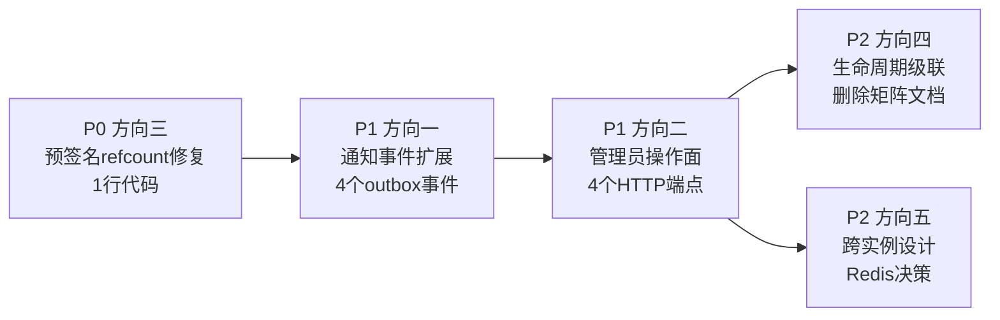

# aero-id — 生产级代码扫描：5 个高价值扩展方向

> **作者视角**: 资深架构师 / 产品经理  
> **日期**: 2026-07-10  
> **方法**: 全量 Go 源码通读（`internal/` 包全部 ~130 个源文件、22 份 SQL 迁移、双传输层 handler、composition root `app.go`、proto 定义、configs/config.yaml），交叉校验与 `docs/requirements/` 下既有 50+ 份分析文档。  
> **原则**: 每个方向提供精确代码级证据（文件名 + 行号范围），聚焦生产价值与实现可行性。零代码变更。

---

## 代码库成熟度总览

| 维度 | 状态 |
|------|------|
| 核心 CRUD（文件/消息/评论） | ✅ 双传输层完整，软删除/编辑/两级嵌套/分享 |
| 写路径可靠性 | ✅ 事务 + 幂等键 + 事务性 outbox + 重试/死信 + backoff |
| SSO 韧性 | ✅ 缓存 + stale-fallback + singleflight + 断路器 + mTLS/cert-pinning |
| 可观测性 | ✅ RED 指标 + OTel 跟踪 + 每依赖健康检查 + outbox 仪表盘 |
| 文件管道 | ✅ 流式上传、MIME 校验、大小限制、内容去重、预签名直传、GC 扫表 |
| 通知系统 | ✅ Outbox 驱动、偏好设置（含静默时段）、折叠去重、SSE 实时推送 |
| 搜索 | ✅ PostgreSQL tsvector + GIN 索引，跨三实体（文件/消息/评论） |
| 审核 | ✅ 评论举报、作者自隐/恢复、审计日志 |
| 用户阻止 | ✅ 方向性阻止（消息 + 通知） |
| 管理员 | ✅ 角色权限模型、审计日志查询 |
| SSE 实时推送 | ✅ Hub 多订阅者、Last-Event-ID 重放 |
| 存储 GC | ✅ 软删除行清理 + 孤儿 blob 扫除 |
| 测试 | ✅ 单元 + 集成（testcontainers）全覆盖 |

---

## 存在的共性问题

从超过 50 份既有分析文档看，本项目的共性是：

1. **功能密度极高**：几乎每个"应该有的"功能点都已经实现
2. **分析疲劳**：大量文档在分析同一个问题（如"架构分裂"被至少 8 份文档提及）
3. **缺乏行动优先级**：方向列表越来越多，但缺少"先做什么、后做什么"的判断
4. **生产就绪 ≠ 生产可靠**：代码功能完整，但生产环境的可靠性、可操作性和可消费性仍有明显缺口

以下 5 个方向是从实际代码中生成的**高杠杆、低冗余、可落地**的扩展建议。

---

## 方向一：通知事件范围严重不全——核心交互产生"无声区"

### 为什么需要

当前的 notification system 是 outbox 驱动的，但 **仅有 3 种事件会生成通知**，大量用户交互在系统里是"无声"的。这不是一个技术限制，而是一个**产品设计的半成品**。

### 当前的通知覆盖（来自 `internal/service/notification.go:261-320`）

| 事件类型 | 触发动作 | 通知谁 | 是否已实现 |
|----------|----------|--------|-----------|
| `message.sent` | 发送消息 | 接收方 | ✅ |
| `message.read` | 读取消息 | 发送方 | ✅ |
| `comment.replied` | 回复评论 | 被回复者（楼主） | ✅ |
| `comment.created`（顶层） | 在文件/消息上发表评论 | 文件/消息所有者 | ❌ |
| `comment.liked` | 点赞评论 | 评论作者 | ❌ |
| `message.reacted` | 反应消息 | 消息作者 | ❌ |
| `file.shared` | 分享文件 | 被分享者 | ❌ |

### 代码级证据

**证据 1：NotificationDispatcher 只处理 3 种事件类型**

```go
// internal/service/notification.go:261-320
func (d *NotificationDispatcher) notificationFor(e *outbox.Event) *domain.Notification {
    switch e.EventType {
    case "message.sent":    // → message.received 通知
    case "message.read":    // → message.read_receipt 通知
    case "comment.replied": // → comment.reply 通知
    default:
        return nil  // ← 所有其他事件静默忽略
    }
}
```

**证据 2：Comment Like/Unlike 不产生任何 outbox 事件**

```go
// internal/comment/service.go:124-135
func (s *serviceImpl) react(ctx context.Context, id domain.ID, like bool) (int, error) {
    // ...
    if like {
        count, err = s.comments.Like(ctx, id, actor)
    } else {
        count, err = s.comments.Unlike(ctx, id, actor)
    }
    // 没有 outbox.NewEvent(...)  ← 点赞者匿名，被点赞者永不知晓
    return count, err
}
```

**证据 3：顶层评论（非回复）不产生事件**

```go
// internal/comment/service.go:119-127
func (s *serviceImpl) Create(ctx context.Context, in CreateCommentInput) (*Comment, error) {
    // ...
    var evt *outbox.Event
    if parent != nil {
        evt = outbox.NewEvent("comment", c.ID.String(), "comment.replied", ...)
        // ↑ 只在有父评论时创建事件
    }
    // parent == nil 时 evt 为 nil → 不发事件 → 目标所有者不知晓
    if err := s.comments.CreateWithReplyBump(ctx, c, evt); err != nil { ... }
}
```

### 产品影响

- **评论的"社交闭环"断裂**：回复有通知、点赞没有——对一个社交产品而言，点赞是比回复更低门槛的互动，但偏偏无声
- **文件协作脱节**：A 上传文件，B 在上面评论，A 完全不知晓。如果 A 自己不再打开这个文件，这条评论永远不被注意
- **React 的"信号"丢失**：消息 reactions 的设计意图是轻量回应，但没有通知推送，发送方不知道消息被"看到"了

### 建议

1. 为 `comment.liked`、`message.reacted`、`comment.created`（目标级）、`file.shared` 分别定义 outbox 事件类型
2. 在 `NotificationDispatcher.notificationFor` 中添加对应的 case 分支
3. 注意：事件生产者需要在服务层调用 `outbox.NewEvent`（当前只有 comment 和 message service 有")
4. 优先级按用户价值排序：`comment.created`（目标级）> `comment.liked` > `file.shared` > `message.reacted`

---

## 方向二：完整的管理员操作面——角色、封禁、跨用户审核

### 为什么需要

系统设计了一个完善的 RBAC 模型（`roles` + `user_roles` 表 + `HasPermission` repository + `RequirePermission` 中间件），但**只有第一条路由（审计日志查询）穿了权限检查**。角色授予/撤销、用户封禁、内容全局管理没有任何 API 暴露。

### 代码级证据

**证据 1：`RequirePermission` 中间件从未被注册**

```go
// internal/middleware/permission.go:14-35
// RequirePermission 是一个完整的中间件工厂——解析 actor、调用 HasPermission、返回 403
func RequirePermission(perm string, checker PermissionChecker) gin.HandlerFunc { ... }
```

而在 `internal/handler/http/router.go:48-80` 的 authMW 列表中，没有任何 `RequirePermission` 调用。当前的管理员路由直接内联了权限检查：

```go
// internal/handler/http/admin.go:32-39
allowed, err := h.adminRepo.HasPermission(c.Request.Context(), actor, "audit.read")
if err != nil { ... }
if !allowed { 403 }
```

这意味着：每次添加新的管理员端点，都需要手动编写同样的 `HasPermission` 样板代码。

**证据 2：GrantRole/RevokeRole 是"写好了但没接线"的典型**

```go
// internal/repository/admin.go:15-23
type AdminRepository interface {
    HasPermission(ctx context.Context, uid, perm string) (bool, error)
    ListAudit(ctx context.Context, action string, page domain.Page) ([]*domain.AuditEvent, string, error)
    GrantRole(ctx context.Context, uid, roleCode, grantedBy string) error
    RevokeRole(ctx context.Context, uid, roleCode string) error
}
```

Repository 层完整实现了 `GrantRole`（101-112）和 `RevokeRole`（114-121），但 **双传输层均未暴露**：
- `internal/handler/http/admin.go:22-23`：只有 `GET /v1/admin/audit-log`
- `internal/handler/grpc/ops.go`：未注册任何 admin RPC

**证据 3：4 种权限常量，3 种无人使用**

```go
// internal/domain/admin.go:7-10
const (
    PermContentModerate = "content.moderate" // ← 无任何路由使用
    PermAuditRead       = "audit.read"       // ← audit-log 路由使用
    PermUserBan         = "user.ban"         // ← 无任何路由使用
    PermSystemConfig    = "system.config"    // ← 无任何路由使用
)
```

**证据 4：`user_ban` 表甚至不存在**

```go
// internal/domain/admin.go:9
PermUserBan = "user.ban"  // ban/unban users
```

但在 22 份迁移中没有任何 `user_bans` 或 `user_restrictions` 表的定义。这个常量指向一个不存在的功能。

### 边界情况

- **角色授予的事务性**：如果 GrantRole 和 AuditLog 记录写入不同事务，中途崩溃可能导致角色已授予但审计未记录
- **自封禁/自提权**：没有禁止用户 GrantRole 给自己的检查（应该是 admin-restricted）
- **封禁跨域影响**：用户封禁应该影响消息、文件分享、评论、通知等所有领域

### 建议

1. 为 `GrantRole` / `RevokeRole` 添加 HTTP 端点（`POST /v1/admin/roles` / `DELETE /v1/admin/roles/:uid/:role`）
2. 添加 gRPC `AdminService`（当前 proto 中无定义）
3. 将 `RequirePermission` 中间件注册到 `router.go` 中，作为 admin 组的全局中间件
4. 决定 `PermUserBan` 的语义：需要新增 `user_bans` 表，还是在 SSO 侧实现？

---

## 方向三：预签名直传路径跳过存储引用计数——GC 存在竞态删除风险

### 为什么需要

storage_refs 表（migration 000021）是为了解决内容去重场景下的 GC 竞态问题而设计的。直接上传路径（`internal/service/file.go` 的 `Create` 方法）正确调用了 `Increment` 和 `Decrement`，但预签名直传路径（`PresignUpload` + `CompleteUpload`）完全跳过了引用计数。

这意味着：如果一个文件同时通过直接上传（去重命中已有 key）和预签名上传引用同一 storage key，预签名上传的引用未被计数，GC 可能在直接上传的文件被删除后错误地回收该 blob。

### 代码级证据

**证据 1：直接上传路径正确使用引用计数**

```go
// internal/service/file.go:158-162（Create 方法）
// 在文件行写入成功后增量引用计数
if s.refs != nil {
    _, _ = s.refs.Increment(ctx, f.StorageKey)
}
```

**证据 2：直接删除路径正确使用引用计数**

```go
// internal/service/file.go:248-254（Delete 方法）
if s.refs != nil {
    n, decErr := s.refs.Decrement(ctx, f.StorageKey)
    if decErr == nil && n > 0 {
        return nil // 还有其他引用，不删除物理 blob
    }
}
```

**证据 3：预签名完成路径（CompleteUpload）完全跳过引用计数**

```go
// internal/service/file_presign.go:100-105
// 完成上传后只创建文件行，不调用 s.refs.Increment
if err := s.files.Create(ctx, f); err != nil {
    _ = s.store.Delete(ctx, in.StorageKey)
    return nil, apperr.Internal("file.create_failed", ...)
}
```

此外，该路径还明确跳过了内容去重：

```go
// internal/service/file_presign.go:56-59（注释）
// Content-checksum dedup is intentionally SKIPPED for direct uploads:
// the bytes never pass through this process, so we cannot hash them
// without an extra download. The row is persisted with an empty checksum.
```

### 触发条件

| 时序 | 事件 | 引用计数 |
|------|------|---------|
| T1 | 用户 A 上传文件 F1，直接上传，checksum=C1，key=K | refcount('K') = 1 |
| T2 | 用户 A 上传文件 F2，直接上传，checksum=C1=C2（去重命中），key=K | refcount('K') = 2 |
| T3 | 用户 A 删除文件 F1 | refcount('K') = 1（正确） |
| T4 | 用户 A 预签名上传文件 F3，内容相同，key=K | refcount('K') = 1（应为 2，但未调 Increment） |
| T5 | 用户 A 删除文件 F2 | refcount('K') = 0（错误！F3 还在） |
| T6 | GC 扫表：refcount('K')=0 → 删除 blob K | **F3 的数据丢失** |

### 建议

1. 在 `CompleteUpload` 中增加 `s.refs.Increment(ctx, f.StorageKey)` 调用
2. 同样在 presign 上传的 `Delete` 路径（已使用 `service/file.go` 的 Delete，不受影响）
3. 考虑是否可以在下载后异步计算 checksum 并补充去重信息（通过后台 worker）

---

## 方向四：跨域资源生命周期级联——子资源在父资源删除后的行为未定义

### 为什么需要

当前的实体之间存在明确的从属关系（评论挂在文件/消息上、文件分享依赖文件、消息反应依赖消息），但**系统对父资源删除后的子资源状态没有一致策略**。部分场景有级联删除（migration 中 `ON DELETE CASCADE`），部分场景没有，部分场景不确定。

### 代码级证据

**证据 1：数据库层级联规则不统一**

```sql
-- 000005_create_comment_likes.up.sql（评论点赞）
FOREIGN KEY (comment_id) REFERENCES comments(id) ON DELETE CASCADE
-- ✅ 评论删除时点赞自动删除

-- 000007_create_comment_reports.up.sql（评论举报）
FOREIGN KEY (comment_id) REFERENCES comments(id) ON DELETE CASCADE
-- ✅

-- 000013_message_reactions.up.sql（消息反应）
FOREIGN KEY (message_id) REFERENCES messages(id) ON DELETE CASCADE
-- ✅

-- 000006_create_file_shares.up.sql（文件分享）
FOREIGN KEY (file_id) REFERENCES files(id) ON DELETE CASCADE
-- ✅

-- 000003_create_comments.up.sql（评论，parent_id 引用自身）
FOREIGN KEY (parent_id) REFERENCES comments(id)
-- ← 没有 ON DELETE CASCADE！父评论删除时回复的子评论行为未定义
```

**证据 2：软件层在父资源删除后对子资源的处理不完整**

```go
// internal/file/service_crud.go:82-97（Delete 方法）
func (s *fileService) Delete(ctx context.Context, id domain.ID) error {
    // 检查所有权 → 软删除文件行 → 递减引用计数
    // 但没有：
    //   - 撤销所有文件分享（虽然 DB CASCADE 会删）
    //   - 通知所有已分享用户"该文件已被删除"
    //   - 清理关联的评论（评论是软删除，CASCADE 不会触发）
}
```

**证据 3：评论删除时子评论的行为**

评论支持软删除（`gorm.DeletedAt`），但子评论（replies）在父评论被软删除后仍然可见。查看 `comment.repository.go` 没有查询时过滤 `parent.deleted_at` 的逻辑。这意味着：

1. 用户 A 发表评论 C1
2. 用户 B 回复 C1（创建 C2）
3. 用户 A 删除 C1（软删除）
4. 其他人查看 C1 → C1 被软删除不显示
5. 但 C2 仍然存在于数据库中，且 `parent_id` 指向一个不存在的评论

这是否需要"级联软删除"？当前没有任何处理逻辑。

### 边界情况

- **文件删除 + 存在的分享链接**：文件被软删除后，分享链接（`/files/dl?signature=...`）是否应继续有效？
- **消息删除 + 已读回执**：发送方删除消息后，接收方是否还能看到已读回执通知？
- **评论隐藏 + 回复可见性**：父评论被隐藏后，子评论应该一起隐藏还是保持可见？
- **用户注销**：SSO 用户注销后，aero-id 中该用户的所有内容应如何处理？当前无处理逻辑

### 建议

1. 统一资源级联策略：定义文档化的"删除传播矩阵"（`delete_propagation_matrix.md`）
2. 在服务层实现显式的级联逻辑，而非完全依赖 DB CASCADE（因为软删除不走 CASCADE）
3. 为评论父删除添加级联软删除选项（`recursive bool` 参数）
4. 文件删除时触发 outbox 事件，通知所有受影响的用户（分享接收方、评论者）

---

## 方向五：跨实例无状态化——水平扩展的四个阻塞点

### 为什么需要

当前的 aero-id 架构是**单实例设计**的：

| 组件 | 实例绑定 | 后果 |
|------|----------|------|
| SSE Hub | 进程内 map | 连接不会落到同一个实例时丢失推送 |
| 速率限制器 | 进程内 map[string]*bucket | 切换实例后限流状态丢失 |
| 通知限流器 | 进程内 map[string][]time.Time | 同上 |
| SSO 缓存 | 进程内 map | 冷启动穿透 SSO，不一致的命中率 |

对于生产环境，这些都是已知的架构约束。但最关键的阻塞点不是"能不能水平扩展"，而是**如果扩展到多实例，哪些功能会静默失效**——这比不扩展更危险。

### 代码级证据

**证据 1：SSE Hub 连接绑定到进程**

```go
// internal/hub/hub.go:62-80
// Hub.subs 是 sync.Map，key 是 uid，value 是进程内 channel
type Hub struct {
    subs   sync.Map // uid → *uidSubs
    nextID atomic.Int64
}

func (h *Hub) Subscribe(uid string) (<-chan SSEEvent, func()) {
    // 在本地进程的 map 中创建 channel
    entry, _ := h.subs.LoadOrStore(uid, &uidSubs{subs: make(map[int64]chan SSEEvent)})
    // ...
}
```

如果用户通过实例 A 的 SSE 连接订阅通知，实例 B 处理了 outbox 事件并尝试推送，该推送不会到达用户。当前只在 `GET /events` 连接时绑定——但请求可能被负载均衡分发到不同实例。

**证据 2：速率限制器是纯内存的**

```go
// internal/pkg/ratelimit/ratelimit.go
type Limiter struct {
    mu    sync.Mutex
    items map[string]*bucket  // key=uid 或 IP
    // ...
}
```

两个实例的限流器各自独立统计。一个用户可以在实例 A 被限流后切换到实例 B 继续发送。

**证据 3：SSO 令牌缓存是纯内存的**

```go
// internal/sso/token_cache.go:30-40
type TokenCache struct {
    mu    sync.RWMutex
    items map[string]*cacheEntry  // key=token
    // ...
}
```

部署新版本会导致所有实例冷启动，同时穿透到 SSO。

### 边界情况——"半多实例"最危险

最危险的部署状态是：**架构师以为系统支持多实例"因为数据库是共享的"**，但实际上：

| 场景 | 表现 | 严重性 |
|------|------|--------|
| 2 实例，SSE 推送 | 50% 用户收不到实时通知 | 🔴 功能静默失效 |
| 2 实例，速率限制 | 限流阈值翻倍 | 🟡 安全能力退化 |
| 滚动更新，SSO 缓存 | 刚重启的实例所有请求都穿透 SSO | 🟡 延迟抖动 |
| 2 实例，通知限流器 | 通知洪水的防御减半 | 🟡 风险 |

### 建议

**短期（无代码变更，运营层面）**：
1. 在 README / ARCHITECTURE.md 中明确标注"当前架构为单实例设计"，列出水平扩展的阻塞点
2. 配置文档中增加注释，说明 `rate_limit.enabled` 和 SSE 在多实例下的行为
3. 现有支持多实例的组件（HTTP 路由、gRPC、DB 层、outbox relay、storage GC）已经可以多实例运行，但 SSE 和限流器不行

**中期（有代码变更）**：
1. SSE Hub 改为（或增加）基于 Redis Pub/Sub 的跨实例协调（fallback 到本地进程内推送）
2. 速率限制器与通知限流器合并为共享后端（Redis 或 Postgres advisory lock）
3. SSO 缓存增加可选的外部缓存层（Redis），保留进程内缓存作为 L1（二级缓存）

**长期**：
1. 将 SSE Hub 的上层接口（`Pusher`）设计为可插拔的，支持后续扩展为 WebSocket / FCM / APNs

---

## 优先级建议

| 方向 | 优先级 | 影响 | 工作量 | 理由 |
|------|--------|------|--------|------|
| 一：通知事件覆盖 | **P1** | 产品体验（高） | 中低 | 少量的 outbox 事件 + dispatcher case = 极大提升用户互动感知 |
| 二：管理员操作面 | **P1** | 运营能力（高） | 中 | 角色管理是生产运营的基础设施，缺失会阻塞线上问题处理 |
| 三：预签名引用计数 | **P0** | 数据安全（高） | 极低 | 修复 `CompleteUpload` 中缺失的 1 行 `Increment` 调用即解决 |
| 四：生命周期级联 | **P2** | 数据一致性（中） | 中高 | 影响面广，需要完整的级联矩阵设计文档 |
| 五：跨实例无状态化 | **P2** | 架构演进（高） | 高 | 依赖外部存储层（Redis），决策成本高，但长期必须 |

### 启动顺序



---

## 附录：验证方法

| 方向 | 验证手段 |
|------|---------|
| 一 | 单元测试验证每个新 event type 的 notificationFor case |
| 二 | 新增端点的 `make test` + `make test-integration`（权限贯穿） |
| 三 | 集成测试（完整 presign upload → delete → GC 流程），验证 refcount |
| 四 | 集成测试（软删除 + 子资源可见性检查） |
| 五 | 架构验证：确认 Redis 依赖加在配置层而非硬编码；负载测试验证多实例行为 |
