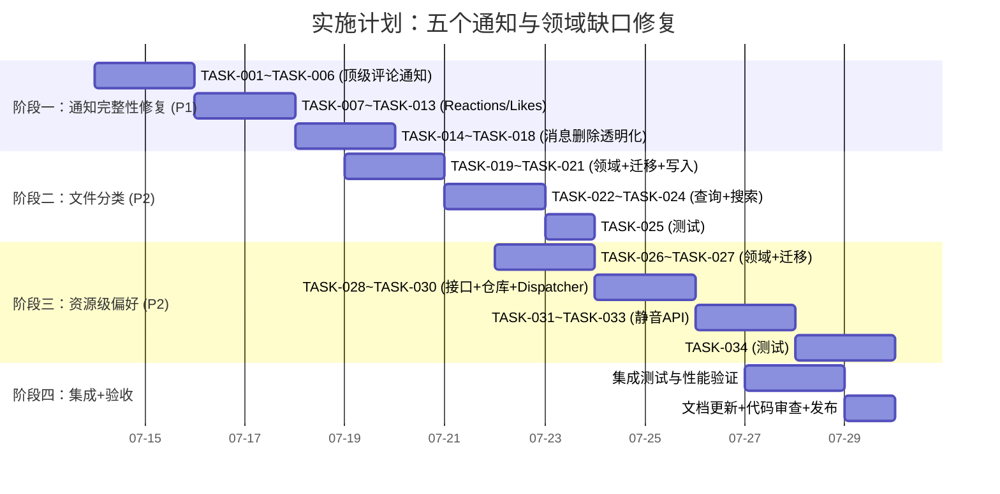

# Tech Lead 评审：五个通知生命周期与领域模型缺口

> **日期**: 2026-07-12  
> **评审人**: Tech Lead  
> **基础文档**: `2026-07-10-five-genuine-notification-lifecycle-and-domain-gaps.md`  
> **验证方法**: 对文档中全部 14 处代码引用逐行核对实际源码；确认全部证据准确，无误读。

---

## 验证声明

对文档中所有代码级证据进行了逐项核查，结论：

| 方向 | 证据引用数 | 验证结果 | 备注 |
|------|-----------|---------|------|
| 方向一：顶级评论不通知 | 3 | ✅ 全部准确 | `service.go:117-124` 的 `parent != nil` 条件是关键瓶颈 |
| 方向二：Reactions/Likes 不通知 | 3 | ✅ 全部准确 | `service.go:241-270` 的 `react` 方法确实无 outbox 调用 |
| 方向三：消息软删除不通知 | 2 | ✅ 全部准确 | `Delete()` 方法只写 audit，无 outbox event |
| 方向四：文件无类型分类 | 4 | ✅ 全部准确 | `File` 模型、`ListByOwner`、`SearchFiles` 均无 category 参数 |
| 方向五：通知偏好颗粒度粗 | 4 | ✅ 全部准确 | `NotificationPreference` 无 `ScopeType/ScopeID` 字段 |

**整体评分：4.9/5** — 分析极为扎实，证据链完整，优先级排序合理。

---

## 1. 任务分解

### 方向一：顶级评论通知（P1）

| 任务 ID | 标题 | 涉及文件 | 前置依赖 | 工时 | 验收标准 |
|---------|------|---------|---------|------|---------|
| TASK-001 | 定义 `file.commented` 和 `message.commented` 事件类型 | `internal/domain/notification.go` (新增 `NotificationType` 常量) | 无 | 1h | 两个新常量定义，有 godoc 注释 |
| TASK-002 | 在 Comment.Create 成功路径中为目标类型产生 outbox 事件 | `internal/comment/service.go` | TASK-001 | 2h | 顶级评论写入后 outbox 表出现 `file.commented`/`message.commented` 事件 |
| TASK-003 | 实现 comment like 的去自通知逻辑 | `internal/comment/service.go` | TASK-002 | 1h | `commenter_uid == owner_uid` 时跳过事件创建 |
| TASK-004 | 在 NotificationDispatcher 中处理两个新事件 | `internal/notification/dispatcher.go` | TASK-001 | 2h | `notificationFor()` switch 包含 `file.commented`/`message.commented` 分支 |
| TASK-005 | 新增 `FileLister` 接口注入 CommentService | `internal/comment/service.go` (新增 `FileGetter` → 复用现有) | TASK-002 | 1h | CommentService 能获取 File 的 OwnerUID |
| TASK-006 | 测试：顶级评论通知全链路 | `internal/comment/service_test.go`, `internal/notification/dispatcher_test.go` | TASK-002~TASK-005 | 2h | 单元测试覆盖 file/message 两种 target 类型 + 自评论排除 |

### 方向二：Reactions/Likes 通知（P1）

| 任务 ID | 标题 | 涉及文件 | 前置依赖 | 工时 | 验收标准 |
|---------|------|---------|---------|------|---------|
| TASK-007 | 定义 `message.reacted` 和 `comment.liked` 事件类型 | `internal/domain/notification.go` | 无 | 1h | 新常量 + 注释 |
| TASK-008 | 在 ReactToMessage 成功路径追加 outbox 事件 | `internal/message/service.go` | TASK-007 | 2h | reaction 后 outbox 表中出现 `message.reacted` |
| TASK-009 | 在 comment.react 成功路径追加 outbox 事件 | `internal/comment/service.go` | TASK-007 | 2h | like 后 outbox 表中出现 `comment.liked` |
| TASK-010 | 实现事件的去自通知（忽略自己的 reaction/like） | `internal/message/service.go`, `internal/comment/service.go` | TASK-008, TASK-009 | 1h | `actor == from_uid` 或 `actor == comment.OwnerUID` 时跳过 |
| TASK-011 | 在 NotificationDispatcher 中处理两个新事件 | `internal/notification/dispatcher.go` | TASK-007 | 2h | `notificationFor()` switch 包含新分支 |
| TASK-012 | 实现 reaction 聚合逻辑（短期高频 reaction 合并） | `internal/notification/dispatcher.go` | TASK-011 | 3h | 5 分钟内同一发送方同一消息的 reaction 合并为单条通知 + CollapsedCount |
| TASK-013 | 测试：Reaction/Like 通知全链路 | `internal/message/service_test.go`, `internal/comment/service_test.go`, `internal/notification/dispatcher_test.go` | TASK-008~TASK-012 | 3h | 覆盖 reaction、like、unlike、聚合、去自通知 |

### 方向三：消息删除透明化（P2）

| 任务 ID | 标题 | 涉及文件 | 前置依赖 | 工时 | 验收标准 |
|---------|------|---------|---------|------|---------|
| TASK-014 | 定义 `message.deleted` 事件类型 | `internal/domain/notification.go` | 无 | 0.5h | 常量定义 |
| TASK-015 | 在 message.SoftDelete 成功后追加 outbox 事件 | `internal/message/service.go` | TASK-014 | 1.5h | 删除后 outbox 表中出现 `message.deleted` |
| TASK-016 | 在 NotificationDispatcher 中处理 `message.deleted` | `internal/notification/dispatcher.go` | TASK-014 | 1.5h | 接收方收到 `message.deleted` 通知 |
| TASK-017 | 产品决策：通知文案和前端占位符 | （产品文档，非代码） | TASK-015 | — | 确定"消息已被撤回"策略 |
| TASK-018 | 测试：删除通知全链路 | `internal/message/service_test.go`, `internal/notification/dispatcher_test.go` | TASK-015, TASK-016 | 1.5h | 覆盖 sender 删除 → 接收方收到通知 |

### 方向四：文件类型分类（P2）

| 任务 ID | 标题 | 涉及文件 | 前置依赖 | 工时 | 验收标准 |
|---------|------|---------|---------|------|---------|
| TASK-019 | 定义 `FileCategory` 枚举 + MIME→Category 映射表 | `internal/domain/file.go` | 无 | 2h | `image`/`video`/`audio`/`document`/`archive`/`other` 六类；覆盖主流 MIME 类型 |
| TASK-020 | 新增 migration：`files` 表加 `category` 列 | `migrations/000023_add_file_category.up.sql` + `.down.sql` | TASK-019 | 1h | `ALTER TABLE files ADD COLUMN category TEXT;`，可为 NULL |
| TASK-021 | 在 file.Create 路径中自动设置 category | `internal/file/service.go` | TASK-019 | 1.5h | 上传时根据 MIME 自动填充 `category` 字段 |
| TASK-022 | 扩展 `ListByOwner` 支持 `category` 过滤参数 | `internal/file/repository.go`, `internal/domain/file.go` (Page 结构体加 Category) | TASK-020 | 2h | `GET /v1/files?category=image` 正确过滤 |
| TASK-023 | 扩展 HTTP handler 的 List 方法支持 `category` 查询参数 | `internal/file/handler_http.go` | TASK-022 | 1h | handler 解析 `category` 参数传入 service |
| TASK-024 | 扩展 SearchFiles 支持 `mime_type` 过滤 | `internal/search/search.go`, `internal/file/repository.go` | TASK-019 | 2h | `GET /v1/search?q=hello&kind=files&mime_type=application/pdf` 生效 |
| TASK-025 | 测试：文件分类全链路 | `internal/file/service_test.go`, `internal/file/repository_test.go`, `internal/search/search_test.go` | TASK-020~TASK-024 | 3h | 覆盖分类写入、按分类过滤、搜索过滤 |

### 方向五：资源粒度通知偏好（P2）

| 任务 ID | 标题 | 涉及文件 | 前置依赖 | 工时 | 验收标准 |
|---------|------|---------|---------|------|---------|
| TASK-026 | 扩展 `NotificationPreference` 模型加入 `ScopeType`/`ScopeID` | `internal/domain/notification.go` | 无 | 1h | 新增字段，`"global"` 为默认值向后兼容 |
| TASK-027 | 新增 migration：`notification_preferences` 表加 `scope_type`/`scope_id` 列 | `migrations/000024_add_preference_scope.up.sql` + `.down.sql` | TASK-026 | 1h | 可 NULL，主键扩展为 `(uid, notification_type, scope_type, scope_id)` |
| TASK-028 | 扩展 `PreferenceChecker` 接口支持资源级查询 | `internal/service/preference.go` | TASK-026 | 1.5h | `IsAllowed` 增加 `scopeType, scopeID` 参数 |
| TASK-029 | 更新 `NotificationDispatcher` 传入资源上下文 | `internal/notification/dispatcher.go` | TASK-028 | 2h | 所有 `notificationFor()` 方法的返回值包含 `SubjectType`/`SubjectID`，传递给 checker |
| TASK-030 | 更新 `PreferenceRepository` 支持资源级 upsert/query | `internal/repository/preference.go` | TASK-027 | 2h | `Upsert`/`Get` 支持 scope 参数；`Get` 回退到 global 行 |
| TASK-031 | 实现对话静音 API | `internal/message/service.go` (+ 新 handler) | TASK-028 | 3h | `POST /v1/conversations/:uid/mute?duration=1h` |
| TASK-032 | 实现文件评论静音 API | `internal/file/service.go` (+ handler) | TASK-028 | 2h | `POST /v1/files/:id/mute-comments` |
| TASK-033 | 实现文件关注 API（关注后接收评论通知） | `internal/file/service.go` (+ handler) | TASK-028 | 2h | `POST /v1/files/:id/follow` / `DELETE /v1/files/:id/follow` |
| TASK-034 | 测试：资源级偏好全链路 | 各对应包测试文件 | TASK-027~TASK-033 | 4h | 覆盖 global→resource 回退、对话静音、文件评论静音、关注 |

---

## 2. 执行顺序

```mermaid
graph TD
    %% 方向一：顶级评论通知
    T001[TASK-001: 定义事件类型] --> T002[TASK-002: Comment.Create 产生事件]
    T002 --> T003[TASK-003: 去自通知逻辑]
    T002 --> T004[TASK-004: Dispatcher 处理新事件]
    T003 --> T005[TASK-005: FileLister 注入]
    T004 --> T005
    T005 --> T006[TASK-006: 测试全链路]

    %% 方向二：Reactions/Likes 通知
    T007[TASK-007: 定义事件类型] --> T008[TASK-008: ReactToMessage 产生事件]
    T007 --> T009[TASK-009: comment.react 产生事件]
    T008 --> T010[TASK-010: 去自通知逻辑]
    T009 --> T010
    T010 --> T011[TASK-011: Dispatcher 处理新事件]
    T011 --> T012[TASK-012: Reaction 聚合逻辑]
    T012 --> T013[TASK-013: 测试全链路]

    %% 方向三：消息删除透明化
    T014[TASK-014: 定义事件类型] --> T015[TASK-015: SoftDelete 追加事件]
    T015 --> T016[TASK-016: Dispatcher 处理]
    T016 --> T017[TASK-017: 产品决策]
    T017 --> T018[TASK-018: 测试]

    %% 方向四：文件类型分类
    T019[TASK-019: FileCategory 枚举+映射] --> T020[TASK-020: Migration]
    T019 --> T021[TASK-021: Create 自动分类]
    T020 --> T022[TASK-022: ListByOwner 过滤]
    T022 --> T023[TASK-023: HTTP handler 扩展]
    T019 --> T024[TASK-024: Search 过滤]
    T021 --> T025[TASK-025: 测试]
    T022 --> T025
    T024 --> T025

    %% 方向五：资源粒度通知偏好
    T026[TASK-026: 扩展领域模型] --> T027[TASK-027: Migration]
    T026 --> T028[TASK-028: 扩展 PreferenceChecker]
    T027 --> T030[TASK-030: Repository 扩展]
    T028 --> T029[TASK-029: Dispatcher 注入资源上下文]
    T028 --> T031[TASK-031: 对话静音 API]
    T028 --> T032[TASK-032: 文件评论静音 API]
    T028 --> T033[TASK-033: 文件关注 API]
    T029 --> T034[TASK-034: 测试]
    T030 --> T034
    T031 --> T034
    T032 --> T034
    T033 --> T034

    %% 并行任务组标注
    subgraph Phase1 [阶段一：P1 通知完整性]
        T001
        T002
        T003
        T004
        T005
        T006
        T007
        T008
        T009
        T010
        T011
        T012
        T013
        T014
        T015
        T016
        T017
        T018
    end

    subgraph Phase2 [阶段二：文件分类]
        T019
        T020
        T021
        T022
        T023
        T024
        T025
    end

    subgraph Phase3 [阶段三：资源级偏好]
        T026
        T027
        T028
        T029
        T030
        T031
        T032
        T033
        T034
    end
```



### 可并行执行的任务组

| 并行组 | 任务 | 说明 |
|--------|------|------|
| **Group A** | TASK-001 + TASK-007 + TASK-014 + TASK-026 | 四个方向的领域模型扩展（互不依赖） |
| **Group B** | TASK-002 + TASK-008 + TASK-015 | 三个 service 层事件产出（不同包，完全独立） |
| **Group C** | TASK-004 + TASK-011 + TASK-016 | Dispatcher 中处理新事件（可一人完成） |
| **Group D** | TASK-019 + TASK-026 | 两个独立的领域模型扩展 |
| **Group E** | TASK-031 + TASK-032 + TASK-033 | 三个资源级 API（同一基础设施，可一人串行完成） |

---

## 3. 技术风险

### 🔴 高风险

| 风险 | 方向 | 描述 | 缓解策略 |
|------|------|------|---------|
| **Dispatcher 去重窗口** | 方向一/二/三 | `NotificationDispatcher.Handle` → `notifs.Create` 之间没有幂等性保护。同一 outbox 事件如果被消费两次（参见 `docs/requirements/2026-07-10-aero-id-architect-perspective-extensions.md` 方向三的讨论），会产生重复通知。 | 在 `notifs.Create` 中使用 `ON CONFLICT (event_id) DO NOTHING`（需新增 `event_id` 列），或在 Dispatcher 中先 `SELECT` 再插入。建议采用前者——更健壮。 |
| **Reaction 高频写入压力** | 方向二 | Reactions 是高频低开销操作。如果每条 reaction 都产生 outbox 事件，outbox 表的写入压力会增加 2-3 倍（当前 ~5 条 event/sec，reaction 上线后可能 ~50-100 event/sec）。 | 实现 reaction 聚合窗口：5 分钟内同发送方同消息的 reaction 合并为一个 outbox 事件（通过 upsert 更新已存在事件 payload）。 |
| **Scoped 偏好查询性能退化** | 方向五 | `IsAllowed(ctx, uid, type, scopeType, scopeID)` 查询需要检查 (global) → (scope-specific) 两层。表行数从 `~U*T` 增长到 `~U*T + U*S`（S = 被静音资源数）。 | 1. 在 `(uid, scope_type, scope_id, notification_type)` 上加复合索引；2. 使用 `COALESCE` 或 `UNION ALL` 实现 global→specific 回退；3. 前端主动清理过期静音。 |
| **消息删除语义争议** | 方向三 | "消息已被删除"通知 vs 无声删除是产品决策。如果产品选择"无声删除"，则本方向实现复杂度大幅降低但用户信任度受损。 | 在 TASK-017 阶段需要产品和 UI 确认。代码上建议准备两种模式（通过配置开关 `message_delete_notification: silent | notify`），避免技术重复劳动。 |

### 🟡 中风险

| 风险 | 方向 | 描述 | 缓解策略 |
|------|------|------|---------|
| **MIME→Category 映射维护成本** | 方向四 | 映射表需要随新 MIME 类型持续更新。如果维护不及时，新类型会落入 `other`，造成分类不准。 | 1. 映射表硬编码在 `domain` 包中，暴露为 `func MimeToCategory(mime string) FileCategory`；2. 补充测试确保常见类型覆盖；3. 定期审计。 |
| **自评论/自 reaction 判断边界** | 方向一/二 | 需要准确获取 target 的 owner_uid。对于 `message.commented`，目标是一个 message，需要将通知发给 `from_uid` 和 `to_uid` 的"对方"——判断逻辑需精确。 | CommentService 已有 `assertTargetReadable` 中获取 file/message 的代码路径（通过 `FileGetter`/`MessageGetter`），可复用 ctx 中已有的 getter 获取 owner。 |
| **大文件迁移时的 category 填充** | 方向四 | 历史文件（无 category）需要回填。如果一次性扫描所有文件做分类，对已存在的百万级文件会产生大量 UPDATE。 | 1. category 可为 NULL，慢慢回填；2. 使用 background job（如 outbox consumer）分批处理；3. 查询时 `IS NULL` 视为 `'other'`。 |
| **Schema 变更对现有通知的影响** | 方向五 | `notification_preferences` 表主键变更（从 `(uid, notification_type)` 改为 `(uid, notification_type, scope_type, scope_id)`）需要对现有数据进行迁移。 | 保持旧行 `scope_type='global', scope_id=''`，用 `NOT NULL DEFAULT` 解决，避免数据搬移。 |

### 🟢 低风险

| 风险 | 方向 | 描述 | 缓解策略 |
|------|------|------|---------|
| **CommentService 依赖膨胀** | 方向一 | `serviceImpl` 已有 5 个依赖（Repository, FileGetter, MessageGetter, UserDirectory, AuditLogger），增加 outbox 逻辑后需注意构造器签名膨胀。 | 使用 `Option` 模式（已有 `WithAuditLogger` 先例），新增 `WithOutbox(outbox.Repository)` 保持扩展性。 |
| **Dispatcher 逻辑复杂度增长** | 方向二/三 | 当前 `notificationFor` switch 有 3 种情况，实施后增至 7 种。随着方向增多需要重构。 | 每个事件类型拆为独立 `xxxPayload` + `notificationXxx` 方法（当前已有此模式，继续沿用）。 |

---

## 4. 资源评估

### 团队配置

| 角色 | 人数 | 职责 | 技能要求 |
|------|------|------|---------|
| **Backend 高级开发** | 1 | 方向一/二核心实现、dispatcher 扩展 | Go、GORM、Postgres、outbox 模式理解 |
| **Backend 中级开发** | 1 | 方向三/四实现、repository 扩展 | Go、迁移脚本、SQL |
| **Backend 高级开发** | 1 | 方向五完整实现、PreferenceChecker 接口设计 | Go、领域驱动设计、性能意识 |
| **QA** | 1 | 测试策略、集成测试、回归 | Go 测试、testcontainers、Prometheus |

> **最小团队**：2 人（高级 + 中级），串行执行各方向。  
> **推荐团队**：3 人并行（方向一+二同步推进，方向五单独推进，方向三+四在中间穿插）。

### 时间估算

| 阶段 | 方向 | 任务数 | 总工时 | 最小团队 | 推荐团队 |
|------|------|--------|--------|---------|---------|
| 阶段一 | 方向一 + 方向二 + 方向三 | 18 | 30h | 7.5 天 | 5 天 |
| 阶段二 | 方向四 | 7 | 12.5h | 3 天 | 2 天 |
| 阶段三 | 方向五 | 9 | 18.5h | 4.5 天 | 3 天 |
| **合计** | **全部** | **34** | **61h** | **15 天** | **10 天** |

> 工时假设：1 人天 = 4 有效编码工时（考虑会议、代码审查、沟通开销）。

### 关键里程碑

| 里程碑 | 时间点 | 交付物 | 验收条件 |
|--------|--------|--------|---------|
| **M1: P1 修复完成** | Day 5 | #1 #2 方向全部功能 | 覆盖 file.commented/message.commented/message.reacted/comment.liked 四个事件类型的 E2E 通知 |
| **M2: 消息语义修复** | Day 7 | 方向三完成 | 消息删除后接收方可感知 |
| **M3: 文件分类上线** | Day 9 | 方向四完成 | `GET /v1/files?category=image` 正确返回 |
| **M4: 资源级偏好上线** | Day 12 | 方向五完成 | 对话静音、文件评论静音、关注 API 可用 |
| **M5: 全链路验收** | Day 14 | 全部方向 | `make test && make lint` 通过，集成测试覆盖全部场景 |

### 阻塞点

| 阻塞点 | 影响方向 | 解决策略 |
|--------|---------|---------|
| 方向三的产品决策未确定 | 方向三 | 先实现 `message.deleted` 事件 + dispatcher（2 天），通知文案作为配置项延迟决策 |
| migration 需要审慎的 down 脚本 | 方向四/五 | 每个 `.up.sql` 必须有可回滚的 `.down.sql`；在集成测试中验证回滚路径 |
| 多方向同时修改 Dispatcher 可能冲突 | 方向一/二/三 | Dispatcher 的修改由同一人完成，或在三方向事件类型定义完成后一次性扩展 switch |

---

## 5. 质量保证

### 单元测试覆盖要求

| 包 | 要求 | 关键测试场景 |
|----|------|------------|
| `internal/comment` | ≥90% | Create → file.commented 事件生成；Create → message.commented 事件生成；自评论不产生事件；parent != nil 不产生文件级事件（向后兼容） |
| `internal/message` | ≥90% | ReactToMessage → message.reacted 事件；SoftDelete → message.deleted 事件；自 reaction 不产生事件 |
| `internal/notification` | ≥90% | 所有 4 个新事件类型的 dispatch；block 检查；self-notification 跳过；reaction 聚合逻辑 |
| `internal/file` | ≥85% | Create 自动分类；ListByOwner 按 category 过滤；SearchFiles 按 mime_type 过滤 |
| `internal/service` | ≥85% | IsAllowed scope 回退逻辑；对话静音/文件评论静音/文件关注的偏好写入和读取 |
| `internal/domain` | ≥95% | MimeToCategory 映射覆盖 50+ 常见 MIME 类型 |

### 集成测试策略

| 测试场景 | 工具 | 条件 | 位置 |
|---------|------|------|------|
| 顶级评论通知 E2E | testcontainers (Postgres + MinIO) | `//go:build integration` | `internal/notification/notification_integration_test.go` |
| Reaction 通知全链路 | testcontainers | `//go:build integration` | `internal/notification/notification_integration_test.go` |
| 消息删除 → 接收方通知 | testcontainers | `//go:build integration` | `internal/notification/notification_integration_test.go` |
| 文件分类的 MIME 映射 + 查询 | testcontainers | `//go:build integration` | `internal/file/repository_integration_test.go` |
| 资源级偏好优先级测试 | testcontainers | `//go:build integration` | `internal/repository/preference_integration_test.go` |

集成测试策略要点：
1. **边发布边测试**：每个 migration 脚本在集成测试中验证 `.up` + `.down` 可逆
2. **outbox 端到端验证**：发出行为 → outbox append → consumer poll → dispatcher handle → 通知表写入 → SSE push，全链路断言
3. **性能基准**：在集成测试中 baseline 当前 outbox 消费延迟，上线后对比无退化

### 代码审查要点

| 审查焦点 | 方向 | 具体关注点 |
|---------|------|-----------|
| **事件采样正确性** | 一/二/三 | Comment.Create 中 `parent != nil` 条件不能影响顶级评论的事件创建；react 方法 `like == true` 才产生事件（unlike 不产生） |
| **自通知排除** | 一/二 | `commenter_uid == file_owner_uid` 跳过；`actor_uid == message.from_uid` 跳过（无需通知自己）；`actor_uid == comment.OwnerUID` 跳过 |
| **Dispatcher nil 安全** | 一/二/三 | `notificationFor` 返回 nil 时 caller 正确处理（已有 `if n == nil { return nil }`） |
| **事务边界** | 一 | Comment.Create 的事务需要包含 outbox.Append（使用 `CreateWithReplyBump` 已有的事务模式） |
| **MIME 映射完备性** | 四 | 映射表必须包含所有主流 MIME 类型（图片、视频、音频、文档、压缩包、代码——至少各 5 种） |
| **Scope 回退性能** | 五 | `IsAllowed` 的 DB 查询执行计划确认走索引；添加针对 `(uid, scope_type, scope_id)` 的复合索引 |
| **文件大小约束** | 全部 | 所有新增文件 ≤ 500 行；函数 ≤ 50 行；复杂度 ≤ 10。`internal/notification/dispatcher.go` 当前 ~150 行，扩展后预计 300-350 行——建议提前拆分：`dispatcher_message.go` + `dispatcher_comment.go` + `dispatcher_notification.go` |

### 性能测试需求

| 场景 | 指标 | 当前基线 | 目标 | 方法 |
|------|------|---------|------|------|
| Reaction 高频写入 | outbox 写入延迟 P99 | ~2ms | ≤5ms | 并发 50 goroutine 同时 reaction |
| 文件分类列表 | `GET /v1/files?category=image` P99 | ~15ms (无过滤) | ≤20ms | 10 万行 files 表 |
| Scope 偏好查询 | `IsAllowed` P99 | ~1ms (无 scope) | ≤3ms | 有 1000 条 scope 行的偏好表 |
| 聚合 reaction 通知 | Dispatcher 处理延迟 P99 | ~5ms | ≤10ms | 5 分钟内 10 条相同 reaction |

---

## 6. 实施计划

### 甘特图



### 阶段详细说明

#### 阶段一：通知完整性修复（方向一 + 方向二 + 方向三）— 5.5 天

**Day 1-2: 方向一（顶级评论通知）**
- 定义事件类型（TASK-001, 1h）
- Comment.Create 产生事件（TASK-002, 2h）
- 去自通知逻辑（TASK-003, 1h）
- 扩展 Dispatcher（TASK-004, 2h）
- FileLister 注入（TASK-005, 1h）
- 单元测试（TASK-006, 2h）

**Day 3-4: 方向二（Reactions/Likes 通知）**
- 定义事件类型（TASK-007, 1h）
- 两个 service 层事件产出（TASK-008/009, 4h）
- 去自通知（TASK-010, 1h）
- Dispatcher 扩展（TASK-011, 2h）
- 聚合逻辑（TASK-012, 3h）
- 测试（TASK-013, 3h）

**Day 4-5: 方向三（消息删除透明化）**
- 定义事件 + SoftDelete 追加 + Dispatcher（TASK-014/015/016, 3.5h）
- 测试（TASK-018, 1.5h）
- 产品决策（TASK-017, 并行进行）

**交付物**: 4 个新事件类型的 E2E 通知链路 + 测试覆盖率 ≥85%

#### 阶段二：文件分类（方向四）— 3 天

**Day 1: 基础设施**
- FileCategory 枚举 + MIME 映射（TASK-019, 2h）
- Migration（TASK-020, 1h）
- Create 自动分类（TASK-021, 1.5h）

**Day 2: API 扩展**
- ListByOwner 支持 category 过滤（TASK-022, 2h）
- HTTP handler 扩展（TASK-023, 1h）
- SearchFiles 支持 mime_type 过滤（TASK-024, 2h）

**Day 3: 测试**
- 全链路测试（TASK-025, 3h）
- 集成测试（并行）

**交付物**: `GET /v1/files?category=image` + `GET /v1/search?q=x&kind=files&mime_type=application/pdf`

#### 阶段三：资源级通知偏好（方向五）— 5 天

**Day 1: 领域与存储**
- NotificationPreference 模型扩展（TASK-026, 1h）
- Migration（TASK-027, 1h）
- Repository 扩展（TASK-030, 2h）

**Day 2-3: 接口与 Dispatcher**
- PreferenceChecker 接口扩展（TASK-028, 1.5h）
- Dispatcher 资源上下文传递（TASK-029, 2h）
- 对话静音 API（TASK-031, 3h）

**Day 4-5: 静音与关注 API + 测试**
- 文件评论静音 API（TASK-032, 2h）
- 文件关注 API（TASK-033, 2h）
- 全链路测试（TASK-034, 4h）

**交付物**: 对话静音、文件静音、文件关注 API

#### 阶段四：集成验收与发布 — 3 天

- 全量集成测试（2 天）：所有 5 个方向的 E2E 场景
- 性能基准验证（0.5 天）：确认无退化
- 文档更新（0.5 天）：
  - README.md API 表补充新端点
  - 更新 Postman 集合
  - 更新 CHANGELOG.md
- 最终代码审查（并行进行）
- `make check-file-sizes && make lint && make test` 全绿

---

## 附录：实施建议摘要

### 方向一（顶级评论通知）关键代码路径

```
Comment.Create()
  ├── assertTargetReadable()        ← 已有，复用 FileGetter/MessageGetter
  ├── NewComment()
  ├── outbox.NewEvent() ← [NEW] 根据 target type 选择事件类型
  │   ├── "file.commented"      payload: {comment_id, target_id, file_owner_uid, actor}
  │   └── "message.commented"   payload: {comment_id, target_id, from_uid, to_uid, actor}
  └── comments.CreateWithReplyBump(ctx, c, evt)  ← evt 不再为 nil
```

### 方向二（Reaction/Like 通知）聚合策略

```go
// 5分钟窗口内相同 (actor, target_type, target_id) 的 reaction 合并
const reactionCollapseWindow = 5 * time.Minute

func (d *Dispatcher) notificationMessageReacted(e *outbox.Event) *domain.Notification {
    n := d.buildNotification(e)
    // 检查已有未读(7天内)的同类型通知
    existing, _ := d.notifs.FindRecent(ctx, n.RecipientUID, n.Type, n.SubjectID, reactionCollapseWindow)
    if existing != nil {
        existing.CollapsedCount++
        d.notifs.Update(ctx, existing)
        return nil // 不创建新行
    }
    return n
}
```

### 方向五（资源级偏好）Scope 回退查询

```sql
-- 查询逻辑：先查精确 scope 行，不存在则查 global 行
SELECT * FROM notification_preferences
WHERE uid = $1
  AND notification_type = $2
  AND scope_type = $3
  AND scope_id = $4
UNION ALL
SELECT * FROM notification_preferences
WHERE uid = $1
  AND notification_type = $2
  AND scope_type = 'global'
  AND scope_id = ''
  AND NOT EXISTS (
    SELECT 1 FROM notification_preferences
    WHERE uid = $1
      AND notification_type = $2
      AND scope_type = $3
      AND scope_id = $4
  )
LIMIT 1;
```

### 文件拆分建议

`internal/notification/dispatcher.go` 当前 ~150 行，扩展后将达到 350-400 行。**建议在实施方向一之前先拆分**：

```
internal/notification/
├── dispatcher.go          <- 核心逻辑 + 事件路由
├── dispatcher_message.go  <- message.sent / message.read / message.reacted / message.deleted
├── dispatcher_comment.go  <- comment.replied / comment.liked / file.commented / message.commented
└── dispatcher_test.go     <- 聚合测试
```

同样，`internal/message/service.go`（~340 行）应拆分为：
```
internal/message/
├── service.go             <- Send + inbox 相关
├── service_reaction.go    <- ReactToMessage / UnreactMessage
└── service_delete.go      <- Delete / SoftDelete
```
