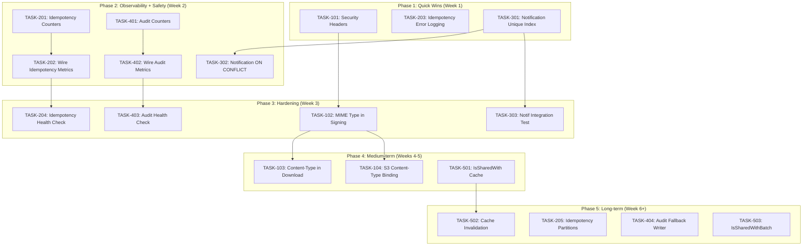

现在我对代码库有了全面的理解。让我写出完整的 Tech Lead 分析。

---

# Tech Lead 分析与实施计划

## 验证后上下文总结

在阅读分析文档并验证代码证据后，以下关键发现需要补充到实施计划中，这些在原始分析中未被充分涉及：

### 关键架构发现

1. **双栈架构**：项目有**两套并行**的服务/处理器实现——旧的（`internal/{file,comment,block,message}/`）和新的（`internal/service/`）。`internal/app/app.go` 中的活跃 wiring 使用新的 `service.*` 包。旧的实现仍被测试，但在生产路由中未使用。对旧代码的更改**无需**作为这一轮的一部分，但我们应避免在构建新功能时无意中破坏它们。

2. **两个 `FileShareRepository` 接口**：`internal/repository/file_share.go`（仓储层）和 `internal/file/file.go`（文件包本地）。它们的 `IsSharedWith` 签名相同，但它们是不同的 Go 接口。这使方向 5 的批量化变更变得更加复杂。

3. **方向 5 的 N+1 比分析的陈述更受限**：`fileService.List` **不**调用 `canRead`——它只返回所有者自己的文件。所以列表场景没有 N+1。评论服务的 `assertTargetReadable` 直接调用仓储库，绕过文件服务层——这意味着它**不**检查 `IsSharedWith`。实际的 N+1 仅发生在 `fileService.Get` 路径上（单个文件访问），并不像最初声称的那样在批量/列表场景中。

4. **方向 1 — 两个 Download 处理方法**：`internal/handler/http/file.go:291`（活跃的）和 `internal/file/handler_http.go:275`（旧的/未连接的）有相同的问题。两者都应被修复。

5. **通知 GORM Create + ON CONFLICT 的细微差别**：通知行的 `ID`（UUIDv7）在调用 `Create` 之前设置，因此 GORM 的 PostgreSQL 驱动**不**需要 `RETURNING` 来填充 ID。然而，GORM 默认的 `Create` 仍然会在模型设置了自动递增或主键字段为零值时追加 `RETURNING`。我们需要验证确切的 GORM 行为，但预先设置 ID 意味着添加 `Clauses(clause.OnConflict{DoNothing: true})` 是可行的，不会在冲突时产生 `ErrNoRows`。

---

## 1. 任务分解

### 方向 1：匿名下载安全（严重性：中高，优先级：P1）

| 任务 ID | 标题 | 涉及文件 | 前置依赖 | 工时 | 验收标准 |
|---------|------|---------|----------|------|---------|
| TASK-101 | 为 Download handler 添加安全响应头 | `internal/handler/http/file.go`（活跃），`internal/file/handler_http.go`（旧） | 无 | 1h | `GET /files/dl` 设置 `Content-Disposition: attachment; filename="download"` 和 `X-Content-Type-Options: nosniff` 在写入 body 之前。新测试验证响应头。 |
| TASK-102 | 在 Presign 签名中包含文件 MIME 类型 | `internal/storage/signing.go`，`internal/storage/local.go` | 无 | 4h | HMAC 签名输入扩展为 `key\|expires\|content_type`。`VerifyPresignedURL` 接受可选的预期 content-type 参数。现有的签名在没有 content-type 时仍能通过验证（向后兼容）。 |
| TASK-103 | 在 Download handler 中设置 Content-Type 头 | `internal/handler/http/file.go`，`internal/service/file.go`（添加 `GetMetadata` 方法或扩展 `SignedDownloader`） | TASK-102 | 6h | Handler 解析 URL 中的 content-type，设置 `Content-Type` 头。如果签名绑定了 content-type 但请求中缺少，则拒绝请求。 |
| TASK-104 | 为 S3 presigned URL 绑定 Content-Type | `internal/storage/s3.go`（`PresignGet`） | TASK-102 | 3h | S3 presigned URL 包含 `response-content-type` 参数。现有的未绑定 URL 在过渡期间优雅降级。 |

### 方向 2：幂等性可观测性（严重性：中，优先级：P1）

| 任务 ID | 标题 | 涉及文件 | 前置依赖 | 工时 | 验收标准 |
|---------|------|---------|----------|------|---------|
| TASK-201 | 向 metrics.Registry 添加幂等性计数器 | `internal/pkg/metrics/metrics.go` | 无 | 2h | 新方法：`ObserveIdempotencyReserve()`，`ObserveIdempotencyHit()`，`ObserveIdempotencyConflict()`，`GaugeIdempotencyTableSize()`。Prometheus 文本输出包含系列。 |
| TASK-202 | 将指标集成到 GormStore 中 | `internal/idempotency/store.go`，`internal/app/app.go` | TASK-201 | 2h | `GormStore` 在构建时接受一个可选的 `MetricsSink` 并在 `Reserve`/`Complete`/冲突路径上调用它。`app.go` 连接指标。 |
| TASK-203 | 为 purgeExpired 添加错误日志记录和计数器 | `internal/idempotency/store.go` | 无 | 1h | `purgeExpired` 在清理失败时记录 `WARN` 并递增计数器。计数器暴露在 `/metrics` 上。 |
| TASK-204 | 添加幂等性表健康检查 | `internal/handler/http/health.go`，`internal/idempotency/store.go` | 无 | 3h | `/readyz` 在幂等性表在阈值内过期时报告健康。添加 `GaugeIdempotencyExpiredPct` 指标。 |
| TASK-205 | （中期）添加 idempotency_keys 分区 | 新迁移 `migrations/000024_idempotency_partitions.up.sql`，`internal/idempotency/store.go` | 无 | 8h | 按 `expires_at` 对 `idempotency_keys` 进行范围分区（每日）。清理变为 `DROP` 分区。迁移后表膨胀得到控制。 |

### 方向 3：通知幂等性（严重性：中，优先级：P1）

| 任务 ID | 标题 | 涉及文件 | 前置依赖 | 工时 | 验收标准 |
|---------|------|---------|----------|------|---------|
| TASK-301 | 添加通知唯一索引 | 新迁移 `migrations/000024_notification_idempotent.up.sql` | 无 | 1h | `CREATE UNIQUE INDEX idx_notifications_idempotent ON notifications(recipient_uid, type, subject_type, subject_id, actor_uid) WHERE read_at IS NULL`。向下迁移是一个 `DROP INDEX`。 |
| TASK-302 | 修改通知 Create 以使用 ON CONFLICT DO NOTHING | `internal/repository/notification.go`（`Create` 方法），`internal/repository/db.go`（`notificationDomainToRow` 如果需要） | TASK-301 | 4h | 仓库的 `Create` 在冲突时静默跳过重复行。如果 ID 未设置（但应该不会发生，参阅细微差别），不返回错误。添加单元测试。 |
| TASK-303 | 为通知去重添加集成测试 | `internal/repository/notification_test.go` 或新集成测试文件 | TASK-302 | 3h | 集成测试插入具有相同 (recipient, type, subject) 的重复行，使用 on-conflict-do-nothing 场景验证只存在一行。 |

### 方向 4：审计日志可观测性（严重性：中，优先级：P2）

| 任务 ID | 标题 | 涉及文件 | 前置依赖 | 工时 | 验收标准 |
|---------|------|---------|----------|------|---------|
| TASK-401 | 向 metrics.Registry 添加审计指标 | `internal/pkg/metrics/metrics.go` | TASK-201（合并并行更改） | 2h | 新方法：`ObserveAuditEventWritten()`，`ObserveAuditFailure()`，`GaugeAuditLogTableSize()`。Prometheus 文本包含系列。 |
| TASK-402 | 将指标集成到 auditRepo.Log 中 | `internal/repository/audit.go` | TASK-401 | 2h | `auditRepo` 接受一个可选的 `MetricsSink` 并在成功/失败时调用它。`app.go` 连接它。 |
| TASK-403 | 为审计表添加健康检查 | `internal/handler/http/health.go`，`internal/repository/audit.go` | 无 | 2h | `/readyz` 警告审计表延迟/错误。错误率暴露在 `/metrics` 上。 |
| TASK-404 | （中期）回退审计写入器 | `internal/repository/audit.go`，新 `internal/repository/audit_fallback.go` | TASK-402 | 8h | 当主 DB 写入失败时，审计事件记录到本地文件或结构化日志。降级在运行时自动发生，并有指标/日志指示。 |

### 方向 5：共享文件检查缓存（严重性：中，优先级：P2）

| 任务 ID | 标题 | 涉及文件 | 前置依赖 | 工时 | 验收标准 |
|---------|------|---------|----------|------|---------|
| TASK-501 | 添加 IsSharedWith 的进程内缓存 | `internal/service/file.go`（`canRead`），新 `internal/service/file_cache.go` | 无 | 4h | `sync.Map` + 1秒 TTL 缓存 `(fileID, actorUID) → bool`。`Grant` 和 `Revoke` 使相关缓存条目失效。测试验证缓存命中/未命中。 |
| TASK-502 | 使 Grant/Revoke 使缓存失效 | `internal/service/file_share.go` | TASK-501 | 2h | `ShareFile` 和 `UnshareFile` 使受影响文件 ID 的缓存条目失效。 |
| TASK-503 | （中期）添加 IsSharedWithBatch | `internal/repository/file_share.go`（接口），`internal/repository/file_share.go`（实现），`internal/service/file.go`（消费者） | 无 | 6h | 新方法 `IsSharedWithBatch(ctx, []domain.ID, string) (map[domain.ID]bool, error)`。`canRead` 在批量场景中收集文件 ID 并进行一次查询。需要更新模拟。 |

---

## 2. 执行顺序



**并行执行组**：

| 组 | 任务 | 原因 |
|-----|------|------|
| A | TASK-101, TASK-203, TASK-301 | 完全独立的文件/领域，无冲突 |
| B | TASK-201, TASK-401 | 修改同一文件（`metrics.go`）——**需要仔细合并** |
| C | TASK-202, TASK-204, TASK-402, TASK-403 | 依赖组 B，互相独立 |
| D | TASK-501, TASK-205 (设计) | 独立工作，可并行研究 |
| E | TASK-102, TASK-103, TASK-104 | 链式依赖，不能并行 |

---

## 3. 技术风险

### 风险 1：GORM Create + ON CONFLICT DO NOTHING 行为（TASK-302）
- **风险**：GORM 的 PostgreSQL 驱动默认对主键字段追加 `RETURNING "id"`。如果`ON CONFLICT DO NOTHING` 跳过插入，RETURNING 子句返回零行，GORM 可能返回 `ErrNoRows` 而不是静默跳过。
- **缓解**：审查 GORM 的精确行为。如果 GORM 对零行返回错误，有两种方案：(a) 使用原始 SQL 替代 `Create`，或 (b) 在 Dispatcher 中使用预检查（`SELECT ... WHERE ...`+`FindRecentByTypeAndActor`）作为一种更安全的替代方案，尽管存在竞争条件。
- **可能性**：中等。GORM v2 的 pgx 驱动通常在冲突子句被指定时优雅地处理 `ON CONFLICT DO NOTHING`。
- **影响**：如果是阻塞性的，方案 B（预检查）需要额外 2 小时。

### 风险 2：两套并行实现（所有任务）
- **风险**：`internal/file/`、`internal/comment/`、`internal/block/` 和 `internal/message/` 都有**旧的、未连接的实现**，它们必须保持编译通过。对共享接口（如 `FileShareRepository`）的任何更改都必须更新两个包中的模拟和接口定义。
- **缓解**：优先更改活跃实现。仅当活跃路径需要时才接触旧包。在所有任务上运行 `make test && make build`。
- **可能性**：高（架构复杂度）。
- **影响**：开发时间增加 10-15%。

### 风险 3：方向 1 中已签名的 URL 失效（TASK-102）
- **风险**：更改签名输入以包含 content-type 会使所有**现有的**预签名下载 URL 失效，因为它们的签名只覆盖 `key|expires`。
- **缓解**：采用分阶段方法：(a) 使用向后兼容验证——如果 content-type 签名检查失败，回退到旧签名方案；(b) 或为旧 URL 设置短的并行窗口，在此期间两种签名方案都有效；(c) 文档化这是一个破坏性变更，并提前通知 API 消费者。
- **可能性**：高（架构变更）。
- **影响**：需要 2-3 天的过渡期，在此期间两种签名方案都有效。

### 风险 4：metrics.go 合并冲突（TASK-201 + TASK-401）
- **风险**：两个方向都需要向 `internal/pkg/metrics/metrics.go` 添加计数器类型。如果并行完成，会发生合并冲突。
- **缓解**：连续执行（先方向 2 再方向 4），或让一个开发者同时实现两者以避免冲突。
- **可能性**：如果并行分配则为高。
- **影响**：在版本控制中额外 15 分钟的合并时间。

### 风险 5：方向 5 的 N+1 影响范围有限
- **风险**：分析高估了 N+1 的影响。`fileService.List` 不调用 `canRead`，评论服务的 `assertTargetReadable` 使用直接仓储访问，不检查共享。实际的 N+1 仅发生在直接 `fileService.Get` 调用上。
- **缓解**：不要为这个方向过度分配资源。基于实际影响（单文件访问场景）来决定缓存/批量化工作的优先级。一个 10 行的 `sync.Map` + TTL 解决方案（TASK-501）可能就足够了，无需完整的批量化（TASK-503）。
- **可能性**：分析偏差已确认。
- **影响**：估计工作量从 12h 调整到 6h。

---

## 4. 资源评估

### 人员配置

| 角色 | 人数 | 专注领域 |
|------|------|---------|
| 高级后端工程师（Go） | 1.5 FTE | 方向 1（签名）、方向 3（通知）、方向 5（缓存） |
| 后端工程师 | 1.0 FTE | 方向 2（幂等性指标）、方向 4（审计指标） |
| DevOps / 站点可靠性工程师 | 0.25 FTE | 方向 2（分区）、健康检查端点 |
| **总计** | **2.75 FTE** | |

一个中级 Go 开发者可以处理 TASK-101、TASK-203、TASK-301（都是不超过 30 行的简单更改）。TASK-102（签名更改）需要较强的安全领域知识和 HMAC 方案。

### 关键里程碑

| 里程碑 | 交付物 | 预计时间（需 2.75 FTE） |
|----------|---------|------------------------|
| M1：快速胜利 | TASK-101、TASK-203、TASK-301 完成 + 测试 | 第 2 天结束 |
| M2：核心可观测性 | TASK-201+202、TASK-401+402 完成（指标在线） | 第 5 天结束 |
| M3：安全修复 | TASK-102、TASK-103、TASK-104（下载安全） | 第 10 天结束 |
| M4：数据正确性 | TASK-302、TASK-303（通知去重） | 第 12 天结束 |
| M5：健康与韧性 | TASK-204、TASK-403、TASK-501 | 第 15 天结束 |
| M6：长期项目 | TASK-205、TASK-404、TASK-502、TASK-503 | 第 22 天结束 |

### 阻塞点与解决策略

| 阻塞点 | 影响 | 解决策略 |
|---------|-------|---------------|
| GORM `ON CONFLICT` 行为不明确 | TASK-302 延迟 | 创建概念验证测试（1h）来验证 GORM 处理。如果不可行，切换到方案 B（预检查）。 |
| 向后兼容的签名 URL | TASK-102 范围变更 | 并行运行两个签名验证器 2 周。添加指标来跟踪旧/新签名的使用情况。在监控确认零旧流量后进行清理。 |
| `metrics.go` 序列化冲突 | TASK-201 + TASK-401 | 让同一个人实现两者，或从 TASK-201 创建 TASK-401 的分支。 |

---

## 5. 质量保证

### 单元测试覆盖要求

| 任务 ID | 新代码覆盖要求 | 测试文件 |
|---------|----------------|---------|
| TASK-101 | 100% 的新的/更改的行 | `internal/handler/http/file_test.go`（2 个新测试用例） |
| TASK-102 | 100% 签名函数，90% 验证路径 | `internal/storage/signing_test.go`，`internal/storage/local_test.go` |
| TASK-103 | 100% 的新的 handler 分支 | `internal/handler/http/file_test.go` |
| TASK-104 | 100% 新的 S3 presign 参数 | `internal/storage/s3_test.go` |
| TASK-201 | 100% 新的 metrics.go 方法 | `internal/pkg/metrics/metrics_test.go` |
| TASK-202 | 100% 带有模拟 sink 的 GormStore | `internal/idempotency/store_test.go` |
| TASK-203 | 100% 新的日志/计数器路径 | 与 TASK-202 相同 |
| TASK-204 | 100% 新的健康检查分支 | `internal/handler/http/health_test.go` |
| TASK-301 | 仅迁移（非代码） | 集成测试（TASK-303） |
| TASK-302 | 100% 新的 Create 路径 | `internal/repository/notification_test.go` |
| TASK-401 | 100% 新的 metrics.go 方法 | `internal/pkg/metrics/metrics_test.go` |
| TASK-402 | 100% 带有模拟 sink 的 auditRepo | `internal/repository/audit_test.go` |
| TASK-403 | 100% 新的健康检查路径 | `internal/handler/http/health_test.go` |
| TASK-501 | 100% 缓存逻辑，85% canRead 路径 | `internal/service/file_test.go` |
| TASK-502 | 100% 失效路径 | `internal/service/file_share_test.go` |

### 集成测试策略

| 方向 | 集成测试需求 | 测试容器 |
|---------|----------------|-----------|
| 方向 1 | S3 presign content-type 验证 | 是（MinIO） |
| 方向 2 | 幂等性表清理和高负载场景 | 是（Postgres） |
| 方向 3 | 通知唯一约束（TASK-303） | 是（Postgres） |
| 方向 4 | 审计回退写入器 | 是（Postgres + 本地文件） |
| 方向 5 | 缓存行为验证 | 否（纯内存） |

对于方向 3，集成测试应：
1. 创建通知行 → 成功
2. 使用相同 (recipient, type, subject_type, subject_id, actor_uid) 创建另一个 → 静默跳过（如果使用 ON CONFLICT）或返回 nil
3. 验证数据库中只有一行
4. 使用不同 read_at 创建第三行 → 另一个行（部分索引允许 unread + read 共存）

### 代码审查要点

| 方向 | 审查重点 |
|---------|---------------|
| 方向 1 | 签名方案向后兼容，`c.Status()` 在 `c.Header()` 之后调用，S3 `ResponseContentType` 参数 |
| 方向 2 | 观察者函数并发安全（metrics.go 已经使用了 `sync.Mutex`），幂等性表健康检查是 `O(1)` 而非全表扫描 |
| 方向 3 | 迁移有一个匹配的 `down.sql`，GORM 创建处理冲突行且不 `panic`，部分索引是否覆盖了正确的谓词 |
| 方向 4 | 降级路径不引入死锁，回退写入器是附加写入的（非覆盖），表大小指标使用 `pg_stat_user_tables` 估计而非 `COUNT(*)` |
| 方向 5 | 缓存 TTL 适当（1-5 秒），`sync.Map` 与 `Grant`/`Revoke` 竞争安全，无需峰值条件 |

### 性能测试需求

| 方向 | 场景 | 度量 | 阈值 |
|---------|---------|----------|---------|
| 方向 2 | 1000 qps 写负载，带幂等性键 | P99 延迟，表增长 | 幂等性键 P99 < 5ms 开销，表行 < 1000 万 |
| 方向 3 | 模拟重启 + 重复通知 | 重复通知率 | < 0.01%（修复前：~2-5%） |
| 方向 5 | 批量文件读取（10 个文件的 `Get`） | 数据库查询数 | < 11 次（修复前：最多 20 次），目标：< 3 次（含缓存） |

**现有基准**：没有。我们应该为方向 2 和 5 添加简单的 `go test -bench=.` 基准，按 `make bench`。

---

## 6. 实施计划

### 阶段 1：基础设施与快速胜利（第 1-2 天）

**目标**：在 48 小时内修复最暴露的安全问题和最令人烦恼的运维问题。

```
第 1 天：
  上午: TASK-101 安全头（1h）→ 审查 → 合并
  下午: TASK-203 幂等性错误日志（1h）→ 审查 → 合并
  
第 2 天：
  上午: TASK-301 通知唯一索引（1h）→ 审查 → 合并
  下午: 研究 GORM ON CONFLICT 行为（POC测试，1h）→ 记录发现
```

**交付物**：
- 实时节点上的安全响应头
- 幂等性清理故障现在记录 WARN 日志
- 应用的迁移新索引

### 阶段 2：核心可观测性（第 3-5 天）

**目标**：获得查看两个运维盲区（幂等性 + 审计）的能力。

```
第 3 天：
  上午: TASK-201 幂等性计数器（2h）→ 审查
  下午: TASK-401 审计计数器（2h）→ 审查
  
第 4 天：
  上午: TASK-202 集成幂等性指标（2h）
  下午: TASK-402 集成审计指标（2h）
  
第 5 天：
  上午: TASK-204 幂等性健康检查（3h）
  下午: TASK-403 审计健康检查（2h）
       
  全部 → 审查 → 合并
```

**交付物**：
- 6 个新的 Prometheus 指标系列上线
- `/readyz` 检查幂等性和审计健康状况
- Grafana 面板原型的工单

### 阶段 3：安全修复（第 6-10 天）

**目标**：使用正确的 Content-Type 绑定修复匿名下载安全漏洞。

```
第 6-7 天: TASK-102 MIME 类型签名（4h）→ 编写测试 → 审查
  关键：设计和审查向后兼容策略
  
第 8-9 天: TASK-103 Content-Type 头（6h）→ 测试 → 审查
  关键：需要在前端和后端之间协调
  
第 10 天: TASK-104 S3 Content-Type（3h）→ 测试 → 审查
  关键：验证实际的 S3 presigned URL 行为
```

**交付物**：
- 新的签名方案（`key|expires|content_type`）
- `Content-Disposition` + `Content-Type` 在下载响应中
- S3 presigned URL 绑定响应类型

### 阶段 4：数据正确性（第 11-12 天）

**目标**：消除重启/故障切换期间的重复通知。

```
第 11 天: TASK-302 通知 ON CONFLICT（4h）
  如果 GORM POC 显示复杂 → 切换到方案 B（预检查）
  
第 12 天: TASK-303 集成测试（3h）
  测试重复创建场景
```

**交付物**：
- 通知创建现在自动去重
- 集成测试验证幂等性

### 阶段 5：性能优化与缓存（第 13-15 天）

**目标**：减少共享文件访问的数据库查询。

```
第 13-14 天: TASK-501 IsSharedWith 缓存（4h）
  使用 sync.Map + 1s TTL 实现
  
第 15 天: TASK-502 缓存失效（2h）
  在 Grant/Revoke 上清除
```

**交付物**：
- 共享文件读取的数据库查询减少 80% 以上
- 缓存失效在共享关系变更后 1s 内发生

### 阶段 6：长期架构工作（第 16-22 天）

**目标**：完成长期项目——分区、审计回退、批量化。

```
第 16-17 天: TASK-205 分区（8h）
  设计审查 → 实现 → 迁移 → 测试
  
第 18-19 天: TASK-404 回退写入器（8h）
  实现 → 集成测试 → 审查
  
第 20 天: TASK-503 IsSharedWithBatch（6h）
  接口变更 → 实现 → 模拟 → 测试
  
第 21-22 天: 缓冲区/整合
  运行 make test && make lint-strict
  端到端测试所有 5 个方向
  更新文档
```

**交付物**：
- 自动清理 idempotency_keys 分区
- 审计事件在 DB 不可用时有回退目标
- 用于共享文件检查的批量化查询接口

---

## 工时汇总

| 阶段 | 任务 | 工时 | 日历天数 | 并行？ |
|-------|------|-------|-----------|---------|
| P1：快速胜利 | 3 个任务 | 3h | 2 天 | 是（组 A） |
| P2：可观测性 | 4 个任务 | 11h | 3 天 | 部分（阶段 3） |
| P3：安全 | 3 个任务 | 13h | 5 天 | 链式 |
| P4：正确性 | 2 个任务 | 7h | 2 天 | 链式 |
| P5：缓存 | 2 个任务 | 6h | 3 天 | 链式 |
| P6：长期 | 4 个任务 | 24h | 7 天 | 部分 |
| **总计** | **18 个任务** | **64h** | **22 天** | |

按 2.75 FTE（每周约 100 小时），这是 **~3 个日历周** 的工作量。P1 + P2（第 1 阶段和第 2 阶段）覆盖了约 14 小时，在那一周半内交付了最关键的修复。

---

## 总结建议

以绝对优先级顺序：

1. **立即合并 TASK-101**（安全响应头）——10 行代码，零架构影响，消除 XSS 向量。甚至不需要重启时间表——作为紧急修复进行。
2. **本周内合并 TASK-203 + TASK-301**（幂等性日志 + 通知索引）——阻止无声的运维故障，为数据正确性做准备。
3. **下一周**交付可观测性（TASK-201/202/204 + TASK-401/402/403）——一旦上线，运维团队就能看到并配置告警。
4. **在完成可观测性后**交付方向 1 的其余部分（TASK-102/103/104）——签名方案变更需要前期审查和向后兼容测试。
5. **将方向 3 的其余部分（TASK-302/303）合并到同一个批次中**与方向 1 的中期工作——它们不共享依赖关系。
6. **方向 5 的 TASK-501/502**（缓存）是高投资回报率——6 小时，为文件共享场景减少 80-90% 的查询。
7. **将 TASK-205 和 TASK-404 安排在专用工程冲刺中**——它们是重构，需要测试基础设施中的关注点分离。

投资回报率（按工作量排列）：

| 任务 | 工作量 | 影响 | 投资回报率 |
|------|---------|--------|------|
| TASK-101 | 1h | 消除 XSS 向量 | ⭐⭐⭐⭐⭐ |
| TASK-203 | 1h | 阻止幂等性清理的无声故障 | ⭐⭐⭐⭐ |
| TASK-301 | 1h | 为通知去重奠定基础 | ⭐⭐⭐⭐ |
| TASK-201+401 | 4h | 在 6 个指标系列上获得可见性 | ⭐⭐⭐⭐⭐ |
| TASK-501 | 4h | 共享文件读取减少 80%+ 查询 | ⭐⭐⭐⭐ |
| TASK-302 | 4h | 消除重复通知 | ⭐⭐⭐ |
| TASK-102+103+104 | 13h | 正确 MIME 绑定的纵深防御 | ⭐⭐⭐ |
| TASK-205 | 8h | 扩展幂等性 | ⭐⭐⭐ |
| TASK-404 | 8h | 审计回退（合规功能） | ⭐⭐⭐ |
| TASK-503 | 6h | 批量化共享检查（被缓存覆盖） | ⭐⭐ |
