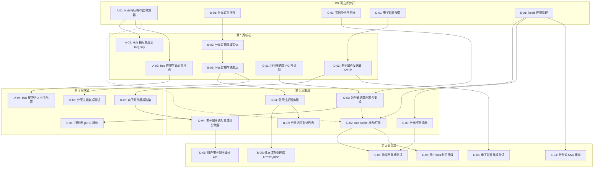

现在我已获取完整的代码库信息，让我们来完成 Tech Lead 分析。

---

# Tech Lead 分析报告：aero-id 增量差距落地

**日期**: 2026-07-12
**分析依据**: "Delta Assessment: Analysis (July 10) vs. Code (July 12)" 以及实际代码库验证

---

## 1. 任务分解

基于差距评估和代码验证，我将所有未完成的工作分解为可执行的技术任务。每个任务设计为 **2-4 小时** 内可由一名高级 Go 工程师完成。

### 方向 A：Hub 可观测性 —— 第 1 阶段（差距 1——已确认仍存在）

| 任务 ID | 任务标题 | 涉及文件 | 前置依赖 | 工时 | 验收标准 |
|---------|---------|---------|---------|------|---------|
| **A-01** | Hub 指标注册/收集 | `internal/hub/hub.go`, `internal/hub/metrics.go` (新文件) | — | 2h | Hub 暴露 `SubscriberCount(uid) int`、`PublishCount`、`DroppedCount`，无锁竞争，每个指标通过 `atomic` 实现 |
| **A-02** | Hub 指标集成到 Prometheus Registry | `internal/hub/metrics.go`, `internal/pkg/metrics/metrics.go` | A-01 | 2h | Hub 指标写入现有 `metrics.Registry`（`HubSubscribers` 显示订阅者数量，`HubEventsTotal{type="published|dropped"}` 作为计数），在 `GET /metrics` 时可渲染 |
| **A-03** | Hub 连接生命周期日志 | `internal/hub/hub.go` | — | 1.5h | `Subscribe`/`unsubscribe`/`Disconnect` 通过注入的 `logger`（`*zap.Logger`，可选——无日志器则无操作）打印结构化日志，包括 uid、订阅者数量、耗时 |
| **A-04** | Hub 缓冲区大小可配置（可选） | `internal/hub/hub.go`, `internal/config/config.go`, `internal/app/new.go` | — | 2h | `hub.New(…)` 接受可选 `WithBufferSize(n)`，默认 = 16；配置键 `hub.buffer_size`；`internal/config` 中的单元测试 |

### 方向 B：文件分享过期与访问审计（差距 3——已确认仍存在）

| 任务 ID | 任务标题 | 涉及文件 | 前置依赖 | 工时 | 验收标准 |
|---------|---------|---------|---------|------|---------|
| **B-01** | 分享过期——数据库迁移 | `migrations/000028_share_expiry.up.sql`, `.down.sql` | — | 1.5h | 迁移向 `file_shares` 添加 `expires_at TIMESTAMPTZ`、`max_access_count INT`、`access_count INT NOT NULL DEFAULT 0`，并建立索引。回滚可恢复 |
| **B-02** | 分享过期——领域实体 | `internal/domain/share.go` (新文件) | B-01 | 1.5h | `FileShare` 结构体包含 `ExpiresAt *time.Time`、`MaxAccessCount int`、`AccessCount int` + `IsAccessible()` 方法（检查过期和计数） |
| **B-03** | 分享过期——存储库层 | `internal/repository/file_share.go` | B-01, B-02 | 3h | `Grant()` 接受 `expiresAt`/`maxAccess`；`IsSharedWith()` 检查是否有活跃分享（`expires_at IS NULL OR expires_at > now()` AND `access_count < max_access_count`）；新增 `IncrementAccess(ctx, fileID, granteeUID)` 方法；`ListFilesSharedWith` 过滤过期分享 |
| **B-04** | 分享过期——服务层 | `internal/service/file_share.go` (新文件，或 `internal/service/file.go` 当前拆分) | B-03 | 3h | `ShareFile()` 接受并通过 `expiresAt`/`maxAccessCount` 到存储库；`AccessFile()`（新增方法，在下载/查看时调用）校验并递增计数；错误代码 `share.expired`、`share.max_access` |
| **B-05** | 分享过期——HTTP/GrPC 处理器 | `internal/handler/http/file.go`, `internal/handler/grpc/file.go` | B-04 | 2h | 分享请求接受 `expires_at` + `max_access_count` 字段；文件下载端点调用 `AccessFile()` 并返回 403 含 `share.expired`/`share.max_access` |
| **B-06** | 分享过期——集成测试 | `internal/repository/file_share_integration_test.go` (扩展) | B-03 | 2h | 测试：分享在过期后不可访问，计数访问限制，`IncrementAccess` 在达到限制时返回错误，重新分享延长有效期，光标分页过滤过期分享 |
| **B-07** | 分享访问审计日志 | `internal/service/file_share.go`, `internal/domain/audit.go` | B-04 | 2h | 每次文件访问（由被分享者）在 `AuditFileAccess` 动作下记录审计事件；不泄露原始存储库错误；不阻塞 Hot Path（在审计日志后返回共享内容） |

### 方向 C：跨实例基础设施（差距 5，第 1-2 阶段——已确认仍存在）

| 任务 ID | 任务标题 | 涉及文件 | 前置依赖 | 工时 | 验收标准 |
|---------|---------|---------|---------|------|---------|
| **C-01** | 领导者选举——Postgres 咨询锁 | `internal/pkg/leadership/` (新包: `election.go`, `election_test.go`) | — | 3h | `Election` 结构体使用 Postgres 咨询锁（`pg_advisory_lock`/`pg_try_advisory_lock`）进行领导者选举；`IsLeader() bool`、`AttemptLeadership(ctx) (bool, func(), error)`；通过上下文取消支持优雅退让；所有新包 ≤ 500 行 |
| **C-02** | 领导者选举——配置与集成 | `internal/config/config.go`, `internal/app/new.go` | C-01 | 2h | 配置 `leader_election.enabled`、`leader_election.lock_id`（int64，默认为基于服务的哈希）；如果启用，在 `New()` 中启动选举 goroutine；通过 `App` 结构体暴露 `IsLeader` 方法；在指标中暴露领导状态 |
| **C-03** | 实例身份与指标 | `internal/pkg/metrics/metrics.go`, `internal/app/new.go` | — | 1.5h | 配置 `instance.id`（若未设置则自动生成）；Prometheus 指标：`aeroid_instance_info{id=..., started_at=...}`、`aeroid_leader_info{is_leader=...}`（启用选举时）；实例启动/关闭日志 |
| **C-04** | 领导者 gRPC 服务（预备跨实例） | `internal/handler/grpc/leadership.go` (新文件), `api/proto/aero_id/v1/aero_id.proto` | C-01 | 3h | `LeaderService` 带 `GetLeader()`（返回当前领导者的实例 ID + 地址）；仅注册当 `leader_election.enabled` 时；所有 RPC 上的单元测试 + 存储库单元测试 |

### 方向 D：电子邮件渠道（差距 4——已确认仍存在）

| 任务 ID | 任务标题 | 涉及文件 | 前置依赖 | 工时 | 验收标准 |
|---------|---------|---------|---------|------|---------|
| **D-01** | 电子邮件配置 | `internal/config/config.go`, `configs/config.yaml` | — | 1.5h | `email` 配置块：`host`、`port`、`username`、`password`（来自 env：`AERO_ID_EMAIL_PASSWORD`）、`from`、`tls.enabled`、`rate_limit`；在 `Load()` 中的验证 |
| **D-02** | 电子邮件发送者抽象 + SMTP 实现 | `internal/email/` (新包：`sender.go`, `smtp.go`, `sender_test.go`) | D-01 | 3h | `Sender` 接口：`Send(ctx, to, subject, htmlBody) error`；`SMTPSender` 实现通过 `net/smtp` 实现；支持 TLS/STARTTLS；可注入的时钟和拨号器用于测试；`WithRateLimit` 包装器 |
| **D-03** | 电子邮件模板渲染 | `internal/email/templates.go`, `internal/email/templates/` (新目录) | D-02 | 2h | 使用 `text/template` 的 `TemplateRenderer`；内置模板：`notification_digest`、`ban_notification`、`share_notification`；模板相对于配置的数据目录加载；含测试 |
| **D-04** | 电子邮件通知集成到分发器 | `internal/service/notification.go`, `internal/service/notif_rate_limiter.go` | D-03 | 3h | `WithDispatcherEmail(sender, renderer, rate)` 可选选项；如果用户有 `email` 偏好且类型已映射，分发器在插入通知行后发送电子邮件；错误已记录但不使操作失败；邮件限流器独立于推送限流器 |
| **D-05** | 用户电子邮件偏好 API | `internal/handler/http/preference.go`, `internal/handler/grpc/preference.go`, `internal/service/preference.go` | D-04 | 2h | `POST /v1/preferences/email` 设置通知电子邮件地址（由 SSO 验证——SSO `getUser` 必须返回该电子邮件）；`GET /v1/preferences/email` 返回屏蔽的电子邮件；迁移到 `preferences` 表以存储电子邮件 |
| **D-06** | 电子邮件——集成测试 | `internal/email/sender_test.go` (集成变体) | D-02 | 2h | 使用 `github.com/go-mail/mail` 模拟 SMTP 服务器或用 testcontainers/mailpit 的集成测试；发送并验证收件箱；TLS 握手测试 |

### 方向 E：跨实例发布/订阅（差距 1 第 3 阶段 + 差距 5 第 3-4 阶段——已确认仍存在，依赖 Redis）

| 任务 ID | 任务标题 | 涉及文件 | 前置依赖 | 工时 | 验收标准 |
|---------|---------|---------|---------|------|---------|
| **E-01** | Redis 连接管理与配置 | `internal/pkg/redis/` (新包：`redis.go`, `config.go`), `internal/config/config.go` | — | 2h | `Pool` 包装器含 `*redis.Client`，支持哨兵/集群；配置 `redis.addrs`、`redis.password`（env）、`redis.db`、`redis.pool_size`、`redis.dial_timeout`；健康检查实现 `PingContext`；连接关闭属于关闭生命周期 |
| **E-02** | Hub Redis 发布/订阅后端 | `internal/hub/redis.go` (新文件) | E-01, A-01 | 4h | `RedisHub` 实现相同的 `Pusher` 接口，通过 Redis Pub/Sub 将 SSE 事件广播到所有实例；本地订阅 + 远程订阅合并到消费者通道；当 Redis 宕机时优雅降级（仅本地发布）；配置键 `hub.backend`（`memory` | `redis`） |
| **E-03** | 分布式限流器 | `internal/pkg/ratelimit/redis.go` (新文件) | E-01 | 3h | `RedisLimiter` 实现 `RateLimiter` 接口，使用 Redis `INCR`+`EXPIRE` 进行滑动窗口限流；与现有 `Limiter` 相同的缓存键模式，但范围覆盖所有实例；回退：如果 Redis 不可用，使用本地限流器 |
| **E-04** | 分布式用户缓存 | `internal/sso/redis_cache.go` (新文件) | E-01 | 3h | `RedisTokenCache` + `RedisUserCache` 作为现有内存缓存的替代后端；TTL 逻辑相同但共享跨实例；可通过 `sso.cache_backend` 配置（`memory` | `redis`）；迁移策略：写入两种缓存，从 Redis 读取 |
| **E-05** | 跨实例集成测试 | `internal/hub/hub_integration_test.go`, `internal/pkg/ratelimit/integration_test.go` (新文件) | E-02, E-03 | 3h | testcontainers Redis 实例启动两个 Hub/限流器实例，发布到一个实例，验证从另一个实例接收；限流器：一个实例消耗，第二个实例看到共享的速率 |
| **E-06** | 无 Redis 时的优雅降级 | `internal/hub/redis.go`, `internal/app/new.go` | E-02 | 2h | 如果 Redis 配置但连接失败，启动时日志错误但不会崩溃；`RediSearch` 在连接丢失时自动回退到本地发布；重连 goroutine 带退避；关闭时清理 |

---

## 2. 执行顺序与依赖图

### 并行任务组

| 组 | 任务 | 原因 |
|----|------|------|
| **G1**（完全独立） | A-01, B-01, C-03, D-01, E-01 | 零代码重叠；每个任务创建新文件或接触完全独立的区域 |
| **G2**（独立但都在 P1） | A-04, C-01, B-02 | A-04 仅涉及配置，C-01 是全新的包，B-02 是领域结构体 |
| **G3**（有界依赖） | B-06, D-03, A-03 | 每个任务依赖于前一个主线任务但彼此独立 |
| **G4**（P2 可并行） | B-05, D-05, D-06, E-04 | 所有任务都有已解决的依赖关系，没有重叠的文件 |

---

## 3. 技术风险

### 3.1 高风险

| 风险 | 概率 | 影响 | 缓解策略 |
|------|------|------|---------|
| **Redis 基础设施可用性**（E-01 到 E-06） | 中 | 高——整个方向 E 依赖于 Redis；如果 Redis 不是选项，则需要纯粹的 Postgres 替代方案（pg_notify 用于 Hub、咨询锁用于限流） | 为 E-02/E-03 设计 PG-only 回退；进行 Redis-vs-PG 延迟预研以指导决策；记录降级行为 |
| **文件分享 ALTER TABLE 迁移**（B-01） | 中 | 高——`file_shares` 在生产中可能很大；使用 `DEFAULT` 添加 `expires_at` 会锁定 Postgres <13（PG13+ 有改进） | `SET NOT NULL` 分两步完成：添加可为空的列，后台回填，然后添加非空约束；在迁移本身中包含 `CONCURRENTLY` |
| **电子邮件送达**（D-02 到 D-04） | 中 | 中——SMTP 是出了名的难调试；在 dev/staging 处理 SPF/DKIM/DMARC、退回、速率限制 | 在发件人接口中包含 `SendCallback`（跟踪送达/退回）；邮件的集成测试在 testcontainers/mailpit 中捕获所有下游错误；记录失败但从不阻塞 |
| **Hub 指标性能**（A-01, A-02） | 低 | 中——在 Hot Path（每次 `pub`）上添加原子/指标导致可测量的开销 | 使用 `atomic` 计数器跳过微基准测试中的锁；如果纳秒级延迟很重要，采用批处理/采样；Prometheus 拉取模式不增加延迟 |

### 3.2 中等风险

| 风险 | 概率 | 影响 | 缓解策略 |
|------|------|------|---------|
| **领导者选举竞争条件**（C-01） | 中 | 中——两个实例同时认为自己是领导者 | PG 咨询锁具有隐式互斥语义；`AttemptLeadership` 在 `TryAdvisoryLock` 后进行原子检查；使用 PG `pg_blocking_pids` 进行死锁检测 |
| **分片锁 vs 同步.Map**（A-01 现有架构） | 低 | 中——现有 `sync.Map`+per-uid 互斥体在争夺 uid 下表现良好，但在 10K+ uid 下映射扫描可能显示开销 | 保留现有设计；仅添加指标作为每操作的有界计数器，不进行映射扫描 |
| **模板渲染错误**（D-03） | 低 | 中——格式错误的模板导致通知失败 | `template.Must` 在启动时；在 `Templates()` 工厂中验证所有模板；错误路径返回可区分的错误代码 |

### 3.3 低风险（值得注意）

| 风险 | 概率 | 影响 | 缓解策略 |
|------|------|------|---------|
| **审计日志 Hot Path**（B-07） | 低 | 低——同步审计日志记录到文件访问路径 | 使用 `go` 例程或通道进行异步审计日志记录；`audit.Log` 已经有非阻塞语义 |
| **分享过期竞态**（B-04） | 低 | 低——两个并发请求增加 `access_count` | 使用 `UPDATE ... SET access_count = access_count + 1 WHERE ... AND access_count < max_access_count`（单语句原子递增） |

---

## 4. 资源评估

### 4.1 团队构成

| 角色 | 数量 | 技能要求 | 分配 |
|------|------|---------|------|
| **高级 Go 工程师** | 2 人 | Go 并发、GORM、gRPC、Postgres 优化 | A-01/02/03, B-01→B-07, C-01/02 |
| **全栈 Go 工程师** | 1 人 | Go 后端、REST API 设计、集成测试 | A-04, D-01→D-06, C-03/04 |
| **基础设施工程师** | 1 人（共享） | Redis、SMTP、Postgres 运维 | E-01→E-06, 方向 C 部署配置 |
| **QA 工程师** | 1 人（部分时间） | Go 测试、testcontainers、Prometheus 指标验证 | B-06, D-06, E-05, A-02 指标验证 |

**最小可行团队**: 2 名高级 Go 工程师 + 1 名共享基础设施工程师。3 名工程师 4 周。

### 4.2 关键里程碑

| 里程碑 | 日期（第 X 天） | 交付物 | 退出标准 |
|---------|---------------|---------|---------|
| **M1: Hub 就绪** | 第 3 天 | A-01 + A-02 + A-03 | Hub 暴露计数 > 0、`GET /metrics` 显示 `aeroid_hub_*`、订阅/取消订阅被记录 |
| **M2: 分享过期交付** | 第 10 天 | B-01 到 B-07（全部） | 具有过期/计数的文件分享集成测试通过；审计日志在文件访问时生成 |
| **M3: 跨实例基础已建立** | 第 12 天 | C-01 到 C-04 | 领导者选举工作台（2 个实例，一个成为领导者）；实例指标暴露 |
| **M4: 电子邮件渠道 MVP** | 第 15 天 | D-01 到 D-04 | 使用 mailpit 的 SMTP 集成测试通过；通知触发电子邮件 |
| **M5: Redis 跨实例** | 第 20 天 | E-01 到 E-06 | 两个实例在 Redis Pub/Sub 上共享 SSE；分布式限流器在共享速率下失败请求 |
| **M6: 完整发布** | 第 22 天 | 所有任务 + `make test && make lint` 全部绿色 | 无回归；swagger/openapi 文档更新；变更日志已编写 |

### 4.3 阻塞点与解决策略

| 阻塞点 | 描述 | 解决的触发条件 | 回退 |
|--------|------|-------------|------|
| **Redis 决策**（阻塞 E-01 到 E-06） | Redis 是否属于生产基础设施？| 基础设施团队签署 Redis 部署 | 完全舍弃 E 方向；使用 PG `pg_notify` 用于 Hub、PG 咨询锁用于分布式限流——功能更弱但无新依赖 |
| **SMTP 基础设施**（阻塞 D-02） | 发送邮件的 SMTP 中继凭证 | 运维提供 `AERO_ID_EMAIL_PASSWORD` + SMTP 端点 | 在 dev 中使用邮件陷阱（mailtrap.io）；SMTP 构建正确但标记为“禁用直到配置” |
| **GORM 迁移向后兼容**（阻塞 B-01） | `file_shares` 上的 ALTER TABLE 可能与现有数据冲突 | 架构审查签署迁移 SQL | 两步迁移：ADD 列 → 后台回填 → 如果性能影响太大则重写应用程序查询 |
| **文件大小限制**（可能阻塞 A-04, B-04, D-04） | 编写 > 500 行的文件违反 AGENTS.md | 任何文件接近 400 行 | 拆分为具有明确职责的多个文件（例如 `service_share.go` → `service_share_grant.go` + `service_share_access.go`） |

---

## 5. 质量保证

### 5.1 单元测试覆盖要求

| 包 | 最小覆盖率 | 关键测试 |
|----|-----------|----------|
| `internal/hub` | 90% | 缓冲区耗尽行为（现有测试覆盖）、指标收集正确性、并发模式下的 Disconnect、缓冲区大小配置 |
| `internal/email` | 85% | 发送成功/失败、TLS 握手、模板渲染、速率限制 |
| `internal/pkg/leadership` | 95% | 锁获取/释放、上下文取消、并发争夺、重入 |
| `internal/service`（分享） | 85% | 过期验证、最大访问强制执行、审计日志、自分享拒绝、空白 grantee 拒绝 |
| `internal/repository`（分享） | 90% | `Grant` 带过期、`IsSharedWith` 过滤、`IncrementAccess` 在限制处停止、光标分页 |
| `internal/pkg/redis` | 70% | 连接池健康检查、配置验证、关闭信号 |
| `internal/pkg/ratelimit`（Redis） | 85% | 分布式计数、时钟偏差容差、Redis 故障回退 |

### 5.2 集成测试策略

| 测试套件 | 工具 | 范围 | 执行环境 |
|---------|------|-------|---------|
| **分享过期**（B-06） | testcontainers + Postgres | `Grant` + 过期 → 不可访问；`IncrementAccess` + 限制 → 错误；分页 | `go test -tags=integration` |
| **SMTP 发送**（D-06） | testcontainers + mailpit | 发送电子邮件 → 到达 mailpit；TLS；STARTTLS；速率限制 | `go test -tags=integration` |
| **跨实例 Hub**（E-05） | testcontainers + Redis | 实例 A 发布 → 实例 B 接收；断开 → 剩余实例继续；Redis 重启 → 降级到本地 | `go test -tags=integration` |
| **跨实例限流**（E-05） | testcontainers + Redis | 实例 A 消耗 5 个令牌 → 实例 B 看到共享计数；重置后重新填充 | `go test -tags=integration` |
| **领导者选举**（C-01） | testcontainers + Postgres | 实例 1 获取锁 → 实例 2 不能；实例 1 断开 → 实例 2 获取 | `go test -tags=integration` |

### 5.3 代码审查要点

| 方向 | 审查要点 | 为什么重要 |
|------|---------|-----------|
| **A** | Hub 指标使用 `atomic` 而非互斥体；缓冲区配置在创建后不可变；Disconnect 不关闭 nil 通道 | 无锁竞争；线程安全 |
| **B** | `IncrementAccess` 使用单语句 `UPDATE … access_count = access_count + 1 WHERE access_count < max_access_count`；服务层绝不出售原始存储库错误；`expires_at` 验证使用 UTC | 写入原子性；错误边界；时间一致 |
| **C** | 领导者选举在 `Closed()` 上释放咨询锁；非领导者永远不提供写入端点；`InstanceID` 在进程重启间保持稳定 | 裂脑预防；幂等性 |
| **D** | 电子邮件密码永不记录；模板防止服务器端模板注入（转义 HTML）；SMTP `Send` 在 5xx 响应上返回错误 | 安全；防注入；弹性 |
| **E** | Redis 密码从配置读取但从未序列化；发布/订阅消息大小 ≤ 缓冲区限制；降级路径经过测试 | 秘密管理；DoS 预防；弹性 |
| **全局** | 无文件超过 500 行；无函数超过 50 行；每个文件单一职责 | Zen 基础设施规则合规性 |

### 5.4 性能测试需求

| 场景 | 工具 | 指标 | 通过/失败标准 |
|------|------|------|------------|
| **Hub 指标开销** | `go test -bench=. ./internal/hub/` | A-02 之前/之后每次 `pub` 的 ns/op | `+ < 50ns/op`（增加的延迟 ≤ 5%） |
| **分享过期检查** | 自定义基准测试 | 在活跃分享表中查询 `IsSharedWith`（100 万行） | `p95 < 5ms` |
| **SMTP 吞吐量** | 顺序调用 `Send()` × 1000 | SMTP 速率（电子邮件/秒） | `≥ 10 封/秒`（合理 SMTP 限制） |
| **Redis 发布/订阅延迟** | `go test -bench=.` 含本地 Redis | 从 `Publish()` 返回到远程订阅者接收 | `p99 < 10ms` 网络延迟（同一区域） |
| **领导者选举故障转移** | 杀死领导者进程 | 故障转移时间（新领导者声明） | `< 5s` |

---

## 6. 实施计划

### 阶段 1：基础设施搭建（第 1-3 天）

**目标**：建立可观测性、数据基础、配置入口点。所有任务完全独立。

| 天 | 工程师 1 | 工程师 2 | 工程师 3（基础设施） |
|--|---------|---------|------------------|
| 1 | **A-01**: Hub 指标寄存器（新 `internal/hub/metrics.go`） | **B-01**: 迁移 `000028`（ALTER TABLE） + `000029`（审计索引） | **E-01**: Redis 连接管理（`internal/pkg/redis/`） |
| 2 | **A-02**: Hub 指标集成到 Registry（扩展 `metrics.go`） | **B-02**: 领域 `FileShare` 结构体 + `IsAccessible()` | **C-03**: 实例身份 + 指标（`App.Startup` 日志 + Prometheus info 指标） |
| 3 | **A-03**: Hub 连接生命周期日志（注入 `*zap.Logger`） | **D-01**: 电子邮件配置块 + 验证 | **C-01**: PG 领导者选举（`internal/pkg/leadership/`） |

**第 3 天的退出标准**:
- 🟢 `GET /metrics` 显示 `aeroid_hub_subscribers`、`aeroid_hub_events_total`
- 🟢 迁移 `000028` + `000029` 在 `make migrate-up` 时干净地应用和回滚
- 🟢 Redis 连接池在 `make test-integration`（含 testcontainers Redis）上启动
- 🟢 实例身份记录在启动日志中

### 阶段 2：核心功能实现（第 4-10 天）

**目标**：交付分享过期（完整）、Hub 完成、电子邮件 MVP、领导者选举集成。

| 天 | 工程师 1 | 工程师 2 | 工程师 3（基础设施） |
|--|---------|---------|------------------|
| 4 | **A-04**: 集线器缓冲区大小可配置（配置默认值 16） | **B-03**: 存储库层——过滤 + `IncrementAccess` | **C-02**: 领导者选举配置 + 集成到 app `New()` |
| 5 | **B-03**（续）：`IsSharedWith` 过期检查 + `ListFilesSharedWith` 过滤 | **B-06**: 分享过期的集成测试 | **C-04**: 领导者 gRPC 服务（`GetLeader` RPC） |
| 6 | **B-04**: 服务层——`ShareFile` 带过期 + `AccessFile` 验证 | **D-02**: SMTP 发送者实现 | **C-04**（续）：单元测试 + protobuf 代码生成 |
| 7 | **B-04**（续）：`AccessFile` 审计日志集成 | **D-02**（续）：SMTP 集成测试（mailpit） | **C-01/02**（审查）：PR 审查领导者选举 |
| 8 | **B-05**: HTTP/gRPC 处理器——绑定过期参数 | **D-03**: 电子邮件模板 + 渲染器 | **E-02**: Hub Redis 发布/订阅（原型） |
| 9 | **B-07**: 分享访问审计事件 + 服务钩子 | **D-04**: 分发器集成（`WithDispatcherEmail`） | **E-02**（续）：降级路径（Redis 宕机 = 本地回退） |
| 10 | **B-05**（续）：集成测试 + 边缘情况 | **D-04**（续）：限流器集成 + 单元测试 | **E-02**（续）：单元测试 |

**第 10 天的退出标准**:
- 🟢 分享过期完整：`POST /v1/files/{id}/share` 接受 `expires_at` + `max_access_count`
- 🟢 访问限制强制执行：在 max_access 后 `GET /v1/files/{id}/dl` 返回 `share.max_access`
- 🟢 SMTP 发送工作在 testcontainers/mailpit 中验证
- 🟢 领导者选举：2 个实例在 docker-compose 中选举领导者

### 阶段 3：集成与优化（第 11-17 天）

**目标**：交付电子邮件用户偏好、Redis 跨实例、分布式 SSO 缓存。

| 天 | 工程师 1 | 工程师 2 | 工程师 3（基础设施） |
|--|---------|---------|------------------|
| 11 | **D-05**: 用户电子邮件偏好 API | **E-03**: 分布式 Redis 限流器 | **E-04**: 分布式 SSO 用户缓存 |
| 12 | **D-05**（续）：SSO 电子邮件验证集成 | **E-03**（续）：回退到本地限流器 | **E-04**（续）：分布式令牌缓存 |
| 13 | **D-06**: 电子邮件集成测试（mailpit liveness） | **E-05**: 跨实例 Hub 集成测试 | **E-04**（续）：迁移策略（双写 + 从 Redis 读取） |
| 14 | **E-06**: 无 Redis 时的降级实现 + Hub 重连 | **E-05**: 分布式限流器集成测试 | **E-04**: 缓存集成测试 |
| 15 | 性能基准测试：Hub 指标开销、分享过期检查 | 性能基准测试：SMTP 吞吐量 | 性能基准测试：Redis 发布/订阅延迟 |
| 16 | 修复：所有基准测试中回归的优化 | 修复：限流器竞争条件 | 文档：Ops runbook 用于 Redis 故障 |
| 17 | **硬件冻结**：所有代码完成；开始审查 | 审查：方向 B + D | 审查：方向 C + E |

### 阶段 4：发布准备（第 18-22 天）

**目标**：无回归、文档、运营可观测性。

| 天 | 活动 |
|--|------|
| 18 | 合并所有 PR；解决冲突；更新 `go.mod`（新依赖：`github.com/redis/go-redis/v9`） |
| 19 | `make test && make lint` 全部绿色；验证所有迁移（`make migrate-up` + `make migrate-down` 回环） |
| 20 | 更新 `README.md` API 表（分享过期字段 + 电子邮件偏好端点） |
| 21 | 运营文档：Prometheus 告警规则（`aeroid_leader_info`、`aeroid_smtp_errors_total`）、Redis 连接设置 |
| 22 | 最终发布候选版本标记 `v0.5.0`；运行 `make test-integration` 完整套件；检查 `make check-file-sizes` |

---

## 总结：风险调整后的 TL;DR

| 如果…… | 那么…… |
|---------|---------|
| 你只有 2 名工程师和 2 周时间 | 只做**方向 B**（分享过期——P1 产品差距）+ **A-01/A-02**（Hub 指标——P0 运营差距）。跳过电子邮件和 Redis |
| Redis 不在生产列表中 | 完全删除**方向 E**；接受跨实例 SSE 和限流不可用。改用 PG `pg_notify` 用于 Hub 广播 |
| 电子邮件对产品路线图至关重要 | 在第 1 天启动 **D-01**（配置）以解锁 mailtrap 测试；推迟模板直到 D-03 但早期迭代 SMTP 握手 |
| 必须削减成本 | 跳过方向 C（领导者选举——仅对水平扩展 SSE 推送/限流边界有用）；运行两个相同实例进行 HA，没有领导者 |
| 文件大小检查失败 | 首先拆分 `internal/app/new.go`（目前 437 行——接近 400 线阈值）；将 ban/service 拆分为 `service_ban.go` + `service_ban_audit.go` |
