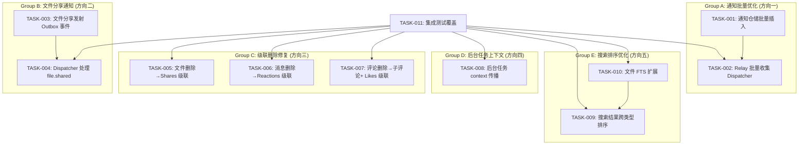

# Tech Lead 分析报告：aero-id 五个技术方向

---

## 概述

本报告基于文档验证结果，对 aero-id 代码库中识别的**五个技术缺口**进行任务分解、排期、风险评估和质量保障规划。五个方向涵盖：
1. Notification Dispatcher 单事件 DB 调用
2. 文件分享缺通知
3. 软删除级联缺口
4. 后台任务 context.Background()
5. 搜索结果拼接而非统一排序

---

## 1. 任务分解 (Task Breakdown)

### TASK-001: 通知仓储批量插入接口
- **所属方向**: 方向一 — Notification Dispatcher 单事件 DB 调用
- **涉及文件**: 
  - `internal/repository/notification.go` (新增 `CreateBatch` 方法)
  - `internal/repository/notification.go` (定义接口 `BulkCreate`)
- **前置依赖**: 无
- **预估工时**: 2h
- **验收标准**:
  - `NotificationRepository` 接口新增 `CreateBatch(ctx, []*Notification) error`
  - 实现使用 GORM `CreateInBatches` 或单条 `INSERT INTO ... VALUES (...),(...)` SQL
  - 单元测试覆盖空切片、单条、多条(含分页边界)场景
  - `go test ./internal/repository/ -run -count=1` 通过

### TASK-002: Outbox Relay 批量收集 + 批量送交 Dispatcher
- **所属方向**: 方向一 — Notification Dispatcher 单事件 DB 调用
- **涉及文件**:
  - `internal/outbox/relay.go` (新增 `drainBatch` 逻辑或修改 `drain`)
  - `internal/outbox/outbox.go` (Handler 接口改为批量或新增 `HandleBatch`)
- **前置依赖**: TASK-001
- **预估工时**: 4h
- **验收标准**:
  - Dispatcher 的 `Handle` 变更为批量接收 `[]*outbox.Event`，内部一次性过滤+去重后批量写入通知表
  - `notificationFor` 和块检查/偏好检查/限流检查改为遍历批处理（各检查逻辑可合并）
  - Relay `drain` 改为收集批量事件统一递送，而非逐事件 `handler.Handle`
  - 现有单事件 Handler 接口保持向后兼容（适配器模式）
  - `make test && make lint` 通过

### TASK-003: 文件分享服务添加 Outbox 事件发射
- **所属方向**: 方向二 — 文件分享缺通知
- **涉及文件**:
  - `internal/service/file_share.go` (ShareFile/UnshareFile 添加 outbox 事件)
  - `internal/service/file.go` (fileService 接入 outbox 仓库)
  - 可能新增 `internal/domain/file_share_event.go` 定义事件类型和载荷结构体
- **前置依赖**: 无
- **预估工时**: 3h
- **验收标准**:
  - `ShareFile` 在成功共享后向 outbox 追加 `file.shared` 事件，含 `file_id`, `owner_uid`, `grantees[]`
  - `UnshareFile` 在成功撤销后向 outbox 追加 `file.unshared` 事件，含 `file_id`, `owner_uid`, `grantee_uid`
  - 使用事务性 outbox：事件在同一事务中写入（需 fileService 能访问 outbox repository）
  - 单元测试验证事件写入和事务回滚场景
  - 无通知泄漏：owner_uid == grantee_uid 时不应发射事件

### TASK-004: Notification Dispatcher 新增 file.shared/file.unshared 处理
- **所属方向**: 方向二 — 文件分享缺通知
- **涉及文件**:
  - `internal/service/notification.go` (dispatcher 的 `notificationFor` 新增 case)
  - `internal/domain/notification.go` (新增 `NotificationType` 常量)
  - 可能新增 `internal/domain/file_event_payload.go` 避免循环依赖
- **前置依赖**: TASK-003
- **预估工时**: 2h
- **验收标准**:
  - `notificationFor` 处理 `file.shared` 事件：为每个 grantee 创建 `file.shared_access` 通知
  - `notificationFor` 处理 `file.unshared` 事件：为被撤销用户创建 `file.access_revoked` 通知
  - 块检查/偏好检查/限流检查覆盖新类型
  - 单元测试覆盖：共享给自己(无通知)、块检查过滤、限流

### TASK-005: 文件删除时级联清理共享记录
- **所属方向**: 方向三 — 软删除级联缺口
- **涉及文件**:
  - `internal/repository/file.go` (Delete 方法新增级联逻辑)
  - 或 `internal/service/file.go` (Delete 方法调用 share repo 清理)
- **前置依赖**: 无
- **预估工时**: 2h
- **验收标准**:
  - 文件被软删除时，所有关联的 `file_shares` 记录自动软删除（或硬删除，取决于设计）
  - 两种实现选择均可接受：repository 层用数据库级联（需 migration 加 `ON DELETE CASCADE`），或 service 层显式调用 share repo
  - 单元测试验证：删除文件后 `IsSharedWith` 返回 false，`ListFilesSharedWith` 不再返回该文件
  - 级联在事务内执行，任一失败则回滚

### TASK-006: 消息删除时级联清理 reactions
- **所属方向**: 方向三 — 软删除级联缺口
- **涉及文件**:
  - `internal/message/repository.go` (SoftDelete 方法新增级联)
  - 或 `internal/repository/message.go` (同上)
- **前置依赖**: 无
- **预估工时**: 2h
- **验收标准**:
  - 消息软删除时，所有关联的 `message_reactions` 记录自动删除
  - 级选实现：repository 层显式 delete reactions（GORM 的 `Delete` 会加软删除？reactions 表无软删除列，应直接硬删除）
  - 单元测试覆盖：删除消息后 `ReactToMessage` 的 reaction 不再存在，reaction 计数归零
  - 事务内执行

### TASK-007: 评论删除时级联清理子评论和 likes
- **所属方向**: 方向三 — 软删除级联缺口
- **涉及文件**:
  - `internal/repository/comment.go` (SoftDelete 方法新增级联)
  - 或 `internal/comment/repository.go` (同上)
- **前置依赖**: 无
- **预估工时**: 2h
- **验收标准**:
  - 评论软删除时，所有回复该评论的子评论（`root_id` = 被删除评论的 id 或 `parent_id` = 被删除评论的 id）级联软删除
  - 评论软删除时，该评论的所有 likes 级联硬删除（`comment_likes` 表无软删除列）
  - `reply_count` 自动递减（父评论删除时子评论计数归零）
  - 单元测试覆盖：级联删除与计数一致性
  - 父评论删除后 `ListReplies` 不再返回子评论

### TASK-008: 后台任务上下文传播改造
- **所属方向**: 方向四 — 后台任务 context.Background()
- **涉及文件**:
  - `internal/outbox/relay.go` (Start 方法)
  - `internal/storage/gc/sweeper.go` (Start 方法)
  - `internal/idempotency/store.go` (RunCleaner + purgeExpired)
  - `internal/sso/token_cache.go` (RunCleaner)
  - `internal/pkg/ratelimit/ratelimit.go` (RunCleaner)
  - 可能新增 `internal/pkg/bgctx` 包定义统一的根 Context
- **前置依赖**: 无
- **预估工时**: 4h
- **验收标准**:
  - 统一的后台 Context 应包含：`logger`、`trace provider`、`app shutdown signal`（from signal.NotifyContext）
  - 每个后台任务通过参数接收根 Context，而非硬编码 `context.Background()`
  - Relay `Start` 收到的 context 在应用关闭时取消，触发优雅排空（drain 完当前批次）
  - Sweeper `Start` 同理
  - Idempotency cleaner 和 rate limiter cleaner 使用同一个根 Context
  - `Start` 方法签名变更为 `Start(ctx context.Context, interval time.Duration) (stop func())`
  - 现有调用方（`app.go`）传入从 `signal.NotifyContext` 派生的 Context
  - 集成测试验证：发送 SIGTERM 后所有后台任务在 `ShutdownTimeout` 内完成排空

### TASK-009: 搜索结果跨类型统一排序
- **所属方向**: 方向五 — 搜索结果拼接而非统一排序
- **涉及文件**:
  - `internal/search/search.go` (Search 方法重写)
  - `internal/domain/search.go` (可能新增排序相关类型)
  - `internal/search/handler_http.go` (验证响应格式)
  - `internal/search/handler_grpc.go` (适应新逻辑)
- **前置依赖**: 无
- **预估工时**: 4h
- **验收标准**:
  - 算法：从每种类型获取更多结果（`limit * 3`），在内存中根据 `ts_rank` 分值的归一化版本合并排序，取前 `limit` 条
  - FTS 分值归一化：同类型内除以该类型最大分值得到 `[0,1]` 范围，使跨类型可比
  - 回退策略：当某种类型使用 LIKE 回退（无 FTS 分值）时，赋予默认分值或排在 FTS 匹配之后
  - 响应包含每个 hit 的 `score` 字段，便于客户端理解排序依据
  - 分页支持：返回值包含一个最小分值的 cursor（或偏移量），客户端可请求下一页(分值更低的结果)
  - 性能基线：单次搜索请求在 500ms 内完成（6000 条消息、2000 条评论、500 个文件的场景）
  - 单元测试覆盖跨类型排序正确性

### TASK-010: 文件 FTS 索引扩展到 content/meta 字段
- **所属方向**: 方向五 — 搜索结果拼接(辅助改进)
- **涉及文件**:
  - `migrations/000016_fts_indexes.up.sql` (新增 files content/meta 的 tsvector)
  - `migrations/000XXX_extend_file_fts.down.sql` (新增降级文件)
  - `internal/repository/file.go` (SearchFiles 查询升级)
  - `internal/domain/file.go` (可能新增字段)
- **前置依赖**: TASK-009
- **预估工时**: 3h
- **验收标准**:
  - files 的 `search_vector` 改为 `to_tsvector('simple', coalesce(name, '') || ' ' || coalesce(content, '') || ' ' || coalesce(jsonb_to_tsvector('simple', meta, '["string"]'), ''))`
  - 查找文件的 FTS 查询扩展到全文检索 name + content + meta
  - 迁移编号在下一次 release 时确定（通常接 000023 之后）
  - 数据迁移：为已有文件重建 search_vector（`UPDATE files SET search_vector = ... WHERE search_vector IS NULL`）
  - Integration test 验证多字段搜索正确性

### TASK-011: Integration Tests 覆盖五个方向
- **所属方向**: 质量保障 (跨所有方向)
- **涉及文件**: 
  - `internal/repository/*_test.go` (级联测试)
  - `internal/service/*_test.go` (通知集成)
  - `internal/search/*_test.go` (排序测试)
  - `internal/outbox/*_test.go` (批量 Dispatch 测试)
- **前置依赖**: TASK-001 至 TASK-010
- **预估工时**: 4h
- **验收标准**:
  - 每个方向新增 integration test（带 `//go:build integration`）
  - 测试使用 testcontainers（PostgreSQL + MinIO）— 复用已有的 `internal/repository/testpg`
  - 测试覆盖正向流程、边界条件和错误路径
  - `make test-integration` 全部通过

---

## 2. 执行顺序 (Execution Order)



### 并行组说明

| 组 | 任务 | 可并行 | 原因 |
|---|---|---|---|
| **A** | TASK-001 → TASK-002 | 不可并行 | 批量插入依赖先有底层接口 |
| **B** | TASK-003 → TASK-004 | 不可并行 | Dispatcher 处理依赖事件先产生 |
| **C** | TASK-005, TASK-006, TASK-007 | **可并行** | 三个级联问题互不依赖 |
| **D** | TASK-008 | 独立 | 与其他组无耦合 |
| **E** | TASK-010 → TASK-009 | 不可并行 | FTS 扩展是排序的前提改进，但方向五整体与 A/B/C/D 无依赖 |
| **QA** | TASK-011 | 依赖所有实现 | 需要在各方向实现完成后运行 |

因此建议并行安排：
- **Sprint 1（周 1-2）**: A组(1人) + B组(1人) + C组(1人) + D组(1人) + 方向五调研(1人) → 4 名开发者并行
- **Sprint 2（周 3-4）**: A组收尾 + B组收尾 + E组(1-2人) + 集成测试(1人) → 3 名开发者并行

---

## 3. 技术风险 (Technical Risks)

### 3.1 高风险项

**风险 1：批量通知引入的数据一致性损失**
- **场景**: 批处理时，一个事件处理失败应重试整个批还是仅标记失败事件？
- **影响**: 当前 Relay 每事件独立标记失败/成功；批量后需要事件级错误追踪
- **缓解**:
  - 保持 `drain` 内部逐事件错误处理和状态更新，但写通知时合并为一次 DB 调用
  - 方案：Dispatcher.HandleBatch 收到 [][]*Event，先全部执行 notificationFor + 块检查等（纯内存操作），合并可写的通知列表，再一次性写入 DB
  - 只有 DB 写入失败时才返回 error 触发重试

**风险 2：Outbox 事务的循环依赖**
- **场景**: `fileService` 需要 `outbox.Repository` 来发射事件；但 `outbox` 对内部结构有依赖
- **影响**: 当前 fileService 没有 outbox 引用，需要在构造时注入
- **缓解**:
  - `app.go` 中 fileSvc 构造时传入 outboxRepo，Service 接口新增 `WithOutbox(ob outbox.Repository)` option
  - Service 层不依赖 outbox 接口的具体实现，仅通过 `outbox.Repository` 接口耦合

**风险 3：后台任务 Context 改造波及范围广**
- **场景**: 5 个后台任务分布在 5 个不同包，`Start` 签名变更影响 `app.go` 和测试代码
- **影响**: 中等程度的代码改动量（约 100-150 行）
- **缓解**:
  - 新增 `internal/pkg/bgctx` 包集中管理根 Context 及其生命周期
  - 统一接口：`Start(context.Context, time.Duration) func()`
  - 对测试友好：传 `context.Background()` 保持向后兼容

**风险 4：跨类型排序的性能**
- **场景**: 每种类型取 `limit * 3` 条，在大数据量下可能拉取过多数据
- **影响**: 如果用户有 10000 条消息，可能一次搜索拉取 60 条（每个类型 20*3）— 尚可接受
- **缓解**:
  - 每个类型限制最大拉取数为 `min(limit * 3, 100)`，防止单类型爆表
  - 在性能测试中验证 95% 分位延迟

### 3.2 中风险项

| 风险 | 概率 | 影响 | 应对 |
|---|---|---|---|
| 级联删除影响父级 `reply_count` 不精确 | 中 | 中 | 使用事务内原子更新 `reply_count = GREATEST(reply_count - count_of_children_deleted, 0)` |
| 文件 FTS 扩展迁移耗时长（大表） | 低 | 中 | 使用 `CONCURRENTLY` 或分批更新；迁移脚本限制批大小 |
| 级联删除和数据迁移的互斥 | 低 | 中 | 级联逻辑在 service 层实现（非数据库外键），避免 migration 排他锁冲突 |
| SSE push 在批量模式下可能丢顺序 | 低 | 低 | SSEEvent ID 使用 `created_at.UnixMilli()`；客户端按 ID 排序恢复顺序 |

### 3.3 外部依赖风险
- 无需引入新的外部依赖或服务
- 所有改动均在现有代码库内完成
- 方向五的排序算法纯内存操作，不依赖外部排序服务

---

## 4. 资源评估 (Resource Assessment)

### 4.1 开发团队配置

| 角色 | 数量 | 技能要求 | 主要负责方向 |
|---|---|---|---|
| **Senior Go 开发者** | 2 | 精通 GORM、PostgreSQL、事务处理 | A组 + C组 |
| **Full-stack Go 开发者** | 1 | 熟悉 aero-id 架构、上下文管理 | B组 + D组 |
| **Go 开发者 + QA** | 1 | 熟悉搜索算法、性能调优 | E组 + TASK-011 |

**最少 2 人即可**（一名 Senior 负责 A+C，一名 Full-stack 负责 B+D+E+QA），推荐 **3 人并行**。

### 4.2 关键里程碑

| 里程碑 | 时间 | 交付物 | 依赖 |
|---|---|---|---|
| M1 — 基础设施就绪 | Sprint 1 Day 3 | TASK-001(TBD), TASK-005(TBD), TASK-008(TBD) | 无 |
| M2 — 核心功能完成 | Sprint 1 Day 10 | TASK-001~008 全部实现 + 单元测试 | M1 |
| M3 — 搜索优化完成 | Sprint 2 Day 5 | TASK-009 + TASK-010 + 单元测试 | TASK-010 |
| M4 — 质量门 | Sprint 2 Day 8 | TASK-011 集成测试全部通过 | M2 + M3 |
| M5 — 发布就绪 | Sprint 2 Day 10 | `make test && make test-integration && make lint` 全部通过，代码审查完成 | M4 |

### 4.3 阻塞点 (Blockers) 和解决策略

| 阻塞点 | 描述 | 解决策略 |
|---|---|---|
| **B1**: 方向一设计取舍 | 是否变更 Handler 接口为批量还是保留单事件 | 保持 Handler 单事件接口，Dispatcher 内部累积批量（适配器模式），保留向后兼容性 |
| **B2**: 方向三级联位置 | Repository 层 vs Service 层 | **推荐 Service 层**：保持 repository 职责单一；级联属于业务流程而非存储逻辑 |
| **B3**: 方向五排序算法验证 | 跨类型分值归一化是否合理 | 先在内部 benchmark 脚本验证归一化算法的排序质量；使用 NDCG@10 作为评估指标 |
| **B4**: 方向四优雅关闭 | signal handling 已存在但后台任务不响应 | 确认当前 `app.go` 是否已有信号处理。若是，无缝集成到新 Context |

---

## 5. 质量保证 (Quality Assurance)

### 5.1 单元测试覆盖要求

| 方向 | 测试目标 | 覆盖率目标 | 关键测试场景 |
|---|---|---|---|
| 方向一 | `CreateBatch` / Dispatcher batch path | ≥ 85% | 空批次、单批次、边界批量(>100)、写入失败回滚 |
| 方向二 | file outbox 事件发射 | 100% (新代码) | 成功共享→事件写入；撤销→事件写入；自共享→无事件 |
| 方向三 | 级联删除 | ≥ 90% | 文件删除→共享记录删除；消息删除→reaction 删除；评论删除→子评论+likes 删除 |
| 方向四 | 上下文传播+优雅关闭 | ≥ 80% | 取消 Context→任务在超时前排空；Context 已取消→新任务不启动 |
| 方向五 | 跨类型排序正确性 | ≥ 90% | 同分值排序、跨类型分值归一化、边界 limit 值 |

### 5.2 集成测试策略

所有 integration test 使用 `//go:build integration` 构建标签，复用 `internal/repository/testpg`。

**必须包含的集成测试**：

```go
// direction1_test.go — 批量写入+查询一致性
func TestIntegration_NotificationBatchCreate(t *testing.T) // TASK-001 + TASK-002

// direction2_test.go — 文件分享发射事件→通知产生
func TestIntegration_FileShareProducesNotification(t *testing.T) // TASK-003 + TASK-004

// direction3_test.go — 级联删除
func TestIntegration_Cascade_FileDeleteRemovesShares(t *testing.T)     // TASK-005
func TestIntegration_Cascade_MessageDeleteRemovesReactions(t *testing.T) // TASK-006
func TestIntegration_Cascade_CommentDeleteRemovesChildren(t *testing.T)  // TASK-007

// direction4_test.go — 后台任务上下文传播
func TestIntegration_BackgroundTaskGracefulShutdown(t *testing.T) // TASK-008

// direction5_test.go — 搜索排序
func TestIntegration_SearchCrossTypeRanking(t *testing.T) // TASK-009
func TestIntegration_SearchFileFtsExtended(t *testing.T)  // TASK-010
```

### 5.3 代码审查要点

| 方向 | 审查重点 | 常见陷阱 |
|---|---|---|
| 方向一 | 批量接口的事务边界；DB 调用次数的实际节省量 | 误以为调用了批量实际仍是逐条；事务内死锁风险 |
| 方向二 | outbox 事件写入与 service 动作在同一事务中 | 忘记使用 `tx` 参数导致事件在事务外写入 |
| 方向三 | 级联的事务性；`reply_count` 一致性 | 子评论删除但 `reply_count` 未递减；共享记录残留 |
| 方向四 | 所有后台任务是否真正响应取消信号 | `for + select` 内未检查 ctx.Done()；阻塞操作未设置超时 |
| 方向五 | 归一化算法实现；FTS 扩展迁移 | FLOAT 精度损失导致排序顺序错误；迁移未处理 NULL |

### 5.4 性能测试需求

| 测项 | 场景 | 指标 | 工具 |
|---|---|---|---|
| 批量通知 | 100 事件同时触发 | P99 < 50ms DB 写入 | Go benchmark / k6 |
| 搜索排序 | 10000 消息 + 5000 评论 + 2000 文件 | P95 < 500ms | Go benchmark |
| 级联删除 | 评论含 500 子评论 | P99 < 200ms | Go benchmark |
| 优雅关闭 | 后台任务正在处理 | 关闭时间 < ShutdownTimeout | Integration test |

---

## 6. 实施计划 (Implementation Plan)

### 阶段 1：基础设施搭建 — Sprint 1 Day 1-3 (3 天)

**目标**: 完成无依赖的任务和接口定义

| 日期 | 开发者 A (Senior) | 开发者 B (Senior) | 开发者 C (Full-stack) |
|---|---|---|---|
| Day 1 | TASK-001: 通知批量接口设计与实现 | TASK-005: 文件删除级联共享 | TASK-008: bgctx 包 + 后台任务改造（outbox relay 优先） |
| Day 2 | TASK-001 测试 + TASK-002 开始 | TASK-006: 消息删除级联 reactions | TASK-008 继续 (sweeper + 其他 cleaner) |
| Day 3 | TASK-002 完成 + 测试 | TASK-007: 评论删除级联+测试 | TASK-008 测试 + TASK-003 开始 |

**Gate**: `make test && make lint` 全绿

### 阶段 2：核心功能实现 — Sprint 1 Day 4-10 (7 天)

| 日期 | 开发者 A | 开发者 B | 开发者 C |
|---|---|---|---|
| Day 4-5 | TASK-002 批量 dispatcher 集成 | (已完成为 A 做 code review) | TASK-003: 文件分享 outbox 事件 |
| Day 6-7 | 方向一性能 benchmark + 调优 | TASK-005~007 CR + 稳定性测试 | TASK-004: Dispatcher file.shared 处理 |
| Day 8-10 | 跨方向联调 + 修复边缘情况 | TASK-001~008 全面 CR + 文档编写 | TASK-004 完成 + TASK-010 开始 |

**Mid-Sprint Check（Day 5）**: 
- 确保 A/B/C 三路方向均可独立测试
- 审查方向一的批量设计是否满足 `notifRateLimiter` 和 collapse 的正确性

### 阶段 3：搜索优化 + 集成测试 — Sprint 2 Day 1-5 (5 天)

| 日期 | 开发者 A | 开发者 B(兼 QA) | 开发者 C |
|---|---|---|---|
| Day 1-2 | TASK-009: 排序算法起手 | TASK-011: 方向一~四集成测试 | TASK-010: 文件 FTS 扩展 |
| Day 3-4 | TASK-009 排序核心 | TASK-011 继续 | TASK-010 迁移 + 测试 |
| Day 5 | TASK-009 完成 + 性能测试 | TASK-011 方向五集成测试 | 方向五联调 |

**关键决策点（Day 2）**: 验证跨类型排序性能指标。若 P95 > 500ms，考虑：1) 减少每种类型的最大取数；2) 改用 Postgres 侧统一排序（需改为 SQL UNION ALL）

### 阶段 4：集成测试 + 发布准备 — Sprint 2 Day 6-10 (5 天)

| 日期 | 开发者 A | 开发者 B | 开发者 C |
|---|---|---|---|
| Day 6-7 | 全方向冒烟测试 | 性能测试瓶颈分析 | TASK-011 完成 |
| Day 8 | 全代码 CR | 文档更新 (API 变更) | 修复 CR 发现的问题 |
| Day 9 | `make check-file-sizes` 合规检查 | 负载测试(可选) | 发布说明编写 |
| Day 10 | **发布门**: `make test && make test-integration && make lint` | 同上 | 同上 |

**发布门 Guard Conditions**:
- ✅ `make test` — 单元测试 100% 通过
- ✅ `make lint` — golangci-lint 零警告
- ✅ `make check-file-sizes` — 无文件超 500 行
- ✅ 文件大小、函数长度、圈复杂度均不违反 AGENTS.md 约束
- ✅ 所有方向的关键路径均有手动 e2e 验证记录

---

## 总结

| 维度 | 评估 |
|---|---|
| **总工作量** | ~32 人天（4 个 Sprint Day × 3 人 × 并行度调整后约 28 人天） |
| **工期** | 2 个 Sprint（每个 10 个工作日）= 4 个日历周 |
| **最小人数** | 2 人（Senior x1 + 普通 x1）→ 工期延长至 6 周 |
| **推荐人数** | 3 人（Senior x2 + Full-stack x1）→ 工期 4 周 |
| **关键依赖** | 无外部服务/库依赖 |
| **主要风险** | 批量通知的数据一致性（风险 1）、跨类型排序性能（风险 4） |
| **建议优先级** | 方向三(Day 1 C组) → 方向四(Day 1 D组) → 方向一(A组) = 方向二(B组) → 方向五(E组) |

---

*报告结束*
