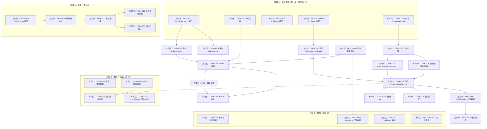

现在我对代码库有了全面的了解。以下是我的完整技术负责人分析。

---

# Tech Lead 分析：aero-id 演进架构

## 目录

1. [任务分解](#1-任务分解)
2. [执行顺序](#2-执行顺序)
3. [技术风险](#3-技术风险)
4. [资源评估](#4-资源评估)
5. [质量保证](#5-质量保证)
6. [实施计划](#6-实施计划)

---

## 1. 任务分解

### 方向一：群组会话（Group Conversations）

| 任务 ID | 标题 | 涉及文件 | 前置依赖 | 预估 |
|---------|------|---------|---------|------|
| TASK-001 | **添加 `conversation_id` 到域模型** — 向 `domain.Message` 添加可选的 `ConversationID` 字段 | `internal/domain/message.go` | 无 | 1h |
| TASK-002 | **创建 `conversations` 和 `conversation_members` 表迁移** | `migrations/000024_create_conversations.up.sql`, `migrations/000024_create_conversations.down.sql`, `migrations/000025_create_conversation_members.up.sql`, `migrations/000025_create_conversation_members.down.sql` | TASK-001 | 2h |
| TASK-003 | **实现 `ConversationRepository`** — 包含 CRUD、成员管理和页游查询的 GORM 实现 | `internal/repository/conversation.go`, `internal/repository/conversation_test.go` | TASK-002 | 4h |
| TASK-004 | **在 `MessageRepository` 中添加按会话查询** — `ListConversationByID` 方法，以及向现有 `ListInbox`/`ListConversation` 添加会话感知 | `internal/repository/message.go` | TASK-002 | 3h |
| TASK-005 | **定义 `GroupConversationService` 接口** — 包含在 `service.go` 中的 `CreateConversation`、`SendGroupMessage`、`ListGroupMessages`、`AddMember`、`RemoveMember` | `internal/service/service.go` | TASK-001 | 2h |
| TASK-006 | **实现 `GroupConversationService`** — 所有业务逻辑：会话创建、成员管理、发送/列出群消息、权限验证 | `internal/service/conversation.go`, `internal/service/conversation_test.go` | TASK-004, TASK-005 | 6h |
| TASK-007 | **在 `MessageService.Send` 中添加群组路由** — 当 `SendMessageInput.ConversationID` 为非零值时，分支逻辑路由到群组而非个人收件箱 | `internal/service/message.go`, `internal/service/service.go` | TASK-006 | 2h |
| TASK-008 | **适配搜索以考虑会话 ID** — 迁移 `SearchMessages` 以接受可选的 `conversation_id` 过滤器，以及在搜索结果中不将群组消息暴露为个人消息 | `internal/repository/message.go`, `migrations/000026_conversation_fts.up.sql` | TASK-002, TASK-003 | 3h |
| TASK-009 | **群组消息的 HTTP/gRPC 处理程序** — 新端点：`POST /v1/conversations`、`POST /v1/conversations/:id/messages`、`GET /v1/conversations/:id/messages`、`POST /v1/conversations/:id/members` | `internal/handler/http/conversation.go`, `internal/handler/grpc/conversation.go` (+ proto) | TASK-006 | 4h |
| TASK-010 | **在应用组合中注入 ConversationService** | `internal/app/app.go` | TASK-009 | 1h |

**总方向一：约 28 小时**

### 方向五：分布式原语（Distributed Primitives）

| 任务 ID | 标题 | 涉及文件 | 前置依赖 | 预估 |
|---------|------|---------|---------|------|
| TASK-011 | **定义 `CacheBackend` 接口** — 新包 `internal/pkg/cache`，包含 `Get`、`Set`、`Delete`、`SweepExpired` | `internal/pkg/cache/cache.go` | 无 | 1h |
| TASK-012 | **将现有内存缓存迁移到 `CacheBackend`** — 将 `TokenCache` 的内部 `map` 封装到 `MemoryBackend` 实现中 | `internal/pkg/cache/memory.go`, `internal/pkg/cache/cache_test.go` | TASK-011 | 2h |
| TASK-013 | **重构 `TokenCache` 以依赖 `CacheBackend`** — 不直接拥有 `map[string]tokenEntry`，而是通过接口 | `internal/sso/token_cache.go`, `internal/sso/token_cache_test.go` | TASK-012 | 3h |
| TASK-014 | **重构 `UserCache` 以依赖 `CacheBackend`** — 遵循与 TokenCache 相同的模式 | `internal/sso/user_cache.go`, `internal/sso/user_cache_test.go` | TASK-012 | 2h |
| TASK-015 | **添加 Redis `CacheBackend` 实现** — 使用 go-redis/redis 的 `internal/pkg/cache/redis.go` | `internal/pkg/cache/redis.go`, `internal/pkg/cache/redis_test.go` | TASK-011 | 3h |
| TASK-016 | **向 `configs/config.yaml` + config.go 添加 Redis 配置段** | `internal/config/config.go`, `configs/config.yaml` | 无 | 1h |
| TASK-017 | **在 app.go 中初始化 Redis 后端** — 基于配置条件初始化，并传递到 SSO 客户端 | `internal/app/app.go` | TASK-015, TASK-016 | 1h |
| TASK-018 | **在 hub 中提取 `Publisher` 接口** — `Publisher` 接口，Hub 实现它；当前内存实现，Redis pub/sub 作为替代 | `internal/hub/hub.go`（添加 `Publisher` 接口），`internal/hub/redis_publisher.go` | 无 | 2h |
| TASK-019 | **向 Hub.Publish 添加接口抽象** — 当前的 `Hub.Publish` 直接调用 `pub()` → 改为在 `hub.Hub` 中委托给 `Publisher` 字段 | `internal/hub/hub.go`, `internal/hub/adapter.go` | TASK-018 | 1h |
| TASK-020 | **将速率限制器重构为使用 `CacheBackend`** — 可选的 Redis 后端，用于分布式速率限制的计数值 | `internal/pkg/ratelimit/ratelimit.go`, `internal/pkg/ratelimit/redis.go` | TASK-011 | 3h |

**总方向五：约 19 小时**

### 方向二：资源级联（Resource Cascade Deletion）

| 任务 ID | 标题 | 涉及文件 | 前置依赖 | 预估 |
|---------|------|---------|---------|------|
| TASK-021 | **向 `ListByTarget` 添加目标实体活性检查** — 在返回评论之前 JOIN 活动文件/消息 | `internal/repository/comment.go` | 无 | 2h |
| TASK-022 | **级联删除消息 → 评论** — 当一条消息被软删除时，其评论也变为隐藏/删除 | `internal/service/message.go`, `internal/repository/comment.go`, `migrations/000027_cascade_messages.up.sql` | 无 | 3h |
| TASK-023 | **级联删除文件 → 评论 + 文件共享** — 当文件被删除时，其评论被标记为隐藏，共享被撤销 | `internal/service/file.go`, `internal/repository/comment.go`, `internal/repository/file_share.go` | 无 | 3h |
| TASK-024 | **添加级联删除的集成测试** — 在消息/文件删除后，验证评论/共享处于预期状态 | `internal/repository/comment_integration_test.go`, `internal/service/service_integration_test.go` | TASK-022, TASK-023 | 3h |

**总方向二：约 11 小时**

### 方向三：可编程 Webhook（Programmable Webhook）

| 任务 ID | 标题 | 涉及文件 | 前置依赖 | 预估 |
|---------|------|---------|---------|------|
| TASK-025 | **为 Webhook 端点注册添加事件类型过滤器** — 当前 webhook 处理程序已经存在；需要基于事件类型的选择性注册 | `internal/outbox/webhook.go`, `internal/config/config.go` | 无 | 2h |
| TASK-026 | **为 webhook 失败添加指数退避重试** — 当前 webhook 处理程序失败会丢弃事件；添加退避重试 | `internal/outbox/webhook.go` | 无 | 3h |
| TASK-027 | **添加 webhook 指标/监控** — 成功的投放、失败、延迟的计数器 | `internal/outbox/webhook.go`, `internal/pkg/metrics/metrics.go` | 无 | 2h |
| TASK-028 | **向 webhook 端点添加 HMAC 签名验证命令** — 与 outbox 匹配 `aero-id verify-webhook` CLI 命令 | `cmd/aero-id/main.go`, `internal/outbox/verify.go` | 无 | 2h |

**总方向三：约 9 小时**

### 方向四：文件变换（File Transforms）

| 任务 ID | 标题 | 涉及文件 | 前置依赖 | 预估 |
|---------|------|---------|---------|------|
| TASK-029 | **定义 `FileTransformer` 接口** — `Transform(ctx, src storageKey, opts TransformOptions) ([]TransformResult, error)` | `internal/domain/file.go`, `internal/storage/transformer.go` | 无 | 2h |
| TASK-030 | **实现图像缩略图生成** — 使用 `imaging` 或 `nhooyr.io` 库进行大小调整和裁剪 | `internal/storage/thumbnail.go`, `internal/storage/thumbnail_test.go` | TASK-029 | 4h |
| TASK-031 | **在 FileService 中集成变换管线** — 上传完成后，根据 MIME 类型触发变换；将缩略图存储为依赖文件 | `internal/service/file.go`, `internal/service/file_presign.go` | TASK-030 | 3h |
| TASK-032 | **添加上传完成后的异步变换队列** — 在 outbox 事件中触发以减少上传延迟 | `internal/service/file.go`, `internal/outbox/events.go` | TASK-031 | 3h |
| TASK-033 | **添加 REST 端点以请求并获取变换后的变体** — `GET /v1/files/:id/thumb`、`GET /v1/files/:id/raw` | `internal/handler/http/file.go`, `internal/handler/grpc/file.go` | TASK-031 | 3h |

**总方向四：约 15 小时**

---

## 2. 执行顺序



### 并行执行组

| 组 | 方向 | 任务 | 模式 |
|----|------|------|------|
| **组 A** | 方向五 | TASK-011–012, 018–019 | 基线接口工作，无外部依赖 |
| **组 B** | 方向一 | TASK-001–002 | 域+迁移，仅限代码 |
| **组 C** | 方向二 | TASK-021–024 | 完全独立于方向一/五 |
| **组 D** | 方向三 | TASK-025–028 | 独立，需要方向五用于重试存储（可选） |
| **组 E** | 方向四 | TASK-029–033 | 完全独立 |

**建议的人员分配**：
- **工程师 A**：方向一（所有任务）—— 28 小时
- **工程师 B**：方向五（第一周），然后方向三（第二周）—— 总共 28 小时
- **工程师 C**：方向二（第一周），然后方向四（第二周 +）—— 总共 26 小时

---

## 3. 技术风险

### 高影响风险

| 风险 | 方向 | 可能性 | 影响 | 缓解措施 |
|------|------|--------|------|---------|
| **现有消息的迁移复杂性** | 方向一 | 中 | 高 | 惰性分配模式：首次从个人收件箱查询时检测到 `conversation_id` 为 NULL → 自动创建对应用户的会话并分配。对于现有消息，无需立即进行大批量回填。 |
| **群组消息权限模型** | 方向一 | 中 | 高 | 谁可以发送到群组？只有成员？管理员？需要服务层的严格入会检查。SSO 层没有群组概念 → 我们必须在 aero-id 内部管理成员资格。 |
| **SSO 缓存 + 速率限制器热升级** | 方向五 | 低 | 中 | TokenCache 和 UserCache 是包内部细节，仅供 sso.Client 使用。重构它们以使用 `CacheBackend` 不会影响外部契约。速率限制器是中间件：更换后端是一个简单的插入式替换。 |
| **Redis 宕机影响** | 方向五 | 低 | 高 | `CacheBackend` 实现应将 Redis 故障视为降级而非崩溃 — 回退到空缓存（每次都去 SSO），或可选地回退到内存兜底。 |
| **缩略图 MIME 类型覆盖范围** | 方向四 | 中 | 中 | 图像类型很多（HEIC、WebP、AVIF 等）。从 JPEG/PNG/WebP 开始，将不支持的格式作为无操作。将转换器定义为一个可插拔的列表，以便稍后添加新格式。 |
| **SSE Hub 到分布式 Pub/Sub 的演变** | 方向一 + 五 | 低 | 高 | 向 `Hub.Publish()` 添加 `Publisher` 接口（已在 TASK-019 中完成）。一旦方向五完成，交换机 Redis Pub/Sub 就像交换 `publisher` 字段一样简单。事件流数据量较小，因此延迟不是问题。 |

### 中等影响风险

| 风险 | 方向 | 影响 | 缓解措施 |
|------|------|------|---------|
| **群组搜索污染个人结果** | 方向一 | 中 | 在 `SearchMessages` 中添加可选的 `conversation_id` 过滤器。向搜索 API 添加一个查询参数。 |
| **通知推送到群组成员** | 方向一 | 中 | 利用现有的 outbox 模式：群组消息会生成通知事件；`NotificationDispatcher` 会为每个成员生成一行。每个会话的速率限制可防止洪水。 |
| **级联删除中的并发** | 方向二 | 低 | 使用数据库级外键（ON DELETE CASCADE）或应用程序级事务。应用程序级可以更好地审计。Aero-id 已经对所有写操作使用事务。 |
| **测试 Redis 实现** | 方向五 | 中 | 使用 miniredis 进行单元测试（无外部依赖）或 testcontainers 进行集成测试。miniredis 足以满足缓存语义。 |

### 外部依赖

| 依赖 | 方向 | 原因 | 替代方案 |
|------|------|------|---------|
| Redis v7+ | 方向五 | 分布式缓存/PubSub | 带有 `CacheBackend` 的 Dragonfly/KV 回退到内存 |
| `protoc` + 生成器 | 方向一 | 群组会话的 gRPC 定义 | 已安装并在 `go.mod` 中锁定 |
| 图像处理库 | 方向四 | 缩略图生成 | `github.com/disintegration/imaging`（纯 Go，无 CGo） |
| SSO 层 | 方向一 | 用户解析（成员邀请） | 已通过 `UserDirectory` 接口存在 |

---

## 4. 资源评估

### 团队构成

| 角色 | 技能要求 | 负责方向 | 分配 |
|------|---------|---------|------|
| **后端工程师 A**（高级） | Go、GORM、Postgres、gRPC、事务语义 | 方向一（群组会话）+ 方向二（级联） | 全职，持续 3 周 |
| **后端工程师 B**（高级） | Go、Redis、系统设计、接口设计 | 方向五（分布式原语）+ 方向三（Webhook） | 全职，持续 2 周 |
| **后端工程师 C**（中高级） | Go、图像处理、存储系统、测试 | 方向四（文件变换）+ 方向二协助 | 兼职，持续 2 周 |

### 里程碑

| 里程碑 | 截止日期 | 交付物 | 验收标准 |
|---------|---------|---------|---------|
| **M1：接口层** | 第 1 周末 | `CacheBackend` 接口、内存实现、`Publisher` 接口、`domain.Message.ConversationID` | `make test && make lint` 通过；所有现有测试绿色通过，无回归 |
| **M2：群组 MVP** | 第 2 周末 | 会话创建、成员管理、通过 HTTP 和 gRPC 发送/列出群消息、搜索过滤器 | 集成测试覆盖 3 人群组的消息发布-列出-搜索流程 |
| **M3：Redis 上线** | 第 2 周末 | Redis `CacheBackend`、SSO 缓存迁移、Redis 速率限制器、Redis PubSub for Hub | 使用重置的 Redis 启动，所有缓存在重启后可用 |
| **M4：级联 + Webhook** | 第 3 周末 | 评论目标活性检查、消息/文件级联删除、Webhook 重试+指标 | 删除文件后，集成测试验证评论被隐藏，共享被撤销 |
| **M5：文件变换** | 第 4 周末 | 图像缩略图生成、上传后变换管线、`GET /v1/files/:id/thumb` | 上传 png 后，`GET .../thumb?w=200` 返回 200px 宽的 webp 缩略图 |

### 阻塞点

| 阻塞点 | 影响的方向 | 阻塞者 | 解决策略 |
|---------|-----------|---------|---------|
| SSO 不提供群组/空间概念 | 方向一 | 架构 | 在 aero-id 内部管理群组会话成员资格（`conversation_members` 表）。SSO 仅提供身份验证。在未来的迭代中，SSO 可以添加群组概念，我们可以迁移。 |
| 生产中没有 Redis | 方向五 | 基础设施 | 所有内容首先在内存中实现（TASK-012、TASK-019）。Redis 是可选的增强。`CacheBackend` 接口允许在部署 Redis 之前使用内存运行。 |

---

## 5. 质量保证

### 单元测试覆盖要求

| 包 | 目录 | 目标覆盖率 | 关键测试场景 |
|----|------|-----------|-------------|
| `domain` | 实体 | 100% | 不变式（嵌套深度、消息类型有效性） |
| `repository` | GORM 查询 | > 85% | 每个 CRUD 操作 + 分页 + 事务回滚 |
| `service` | 业务逻辑 | > 90% | 每个输入变体的授权决策、错误翻译、边界情况 |
| `pkg/cache` | 缓存抽象 | > 95% | 设置后获取、过期、陈旧回退、并发安全 |
| `pkg/ratelimit` | 速率限制器 | > 90% | 每次允许/拒绝计数、Redis 与内存奇偶校验 |
| `hub` | SSE 发布 | > 90% | 订阅 → 发布 → 取消订阅 → 无泄漏 |
| `handler/*` | 传输层 | > 80% | 请求编码/解码、错误 HTTP 状态码映射 |

### 集成测试策略

| 测试套件 | 工具 | 涵盖内容 | 何时运行 |
|---------|------|---------|---------|
| `*_integration_test.go`（现有） | testcontainers + Postgres/MinIO | 存储库查询、事务行为 | `make test-integration` |
| `redis_integration_test.go` | testcontainers + Redis | CacheBackend 过期、并发 | 方向五合并后 |
| `conversation_integration_test.go` | testcontainers + Postgres | 群组消息 CRUD、成员管理 | 方向一合并后 |
| `cascade_integration_test.go` | testcontainers + Postgres | 软删除后的级联删除状态 | 方向二合并后 |

**集成测试的新内容**：
- `internal/repository/conversation_integration_test.go`
- `internal/pkg/cache/redis_integration_test.go`
- `internal/hub/redis_publisher_integration_test.go`
- `internal/service/message_integration_test.go`（群组发送 + 列出）

### 代码审查要点

| 关注领域 | 需要寻找的内容 |
|---------|-------------|
| **群组会话** | GC 后的权限检查（非成员是否可以读取？）、所有写操作的事务边界、成员资格变更的并发安全性 |
| **分布式原语** | Redis 连接管理（连接池、重试、超时）、回退到内存的优雅降级、密钥前缀以避免与 Redis 实例中的其他应用程序冲突 |
| **级联删除** | 事务一致性（所有级联效果都发生在同一个 tx 中）、禁令中的死锁预防、审计日志记录 |
| **Webhook** | HMAC 签名（密钥轮换支持）、目标端点超时、幂等性（重试键）、数据泄露预防 |
| **文件变换** | 临时文件清理、消耗（DoS）的速率限制、不支持的图像格式的优雅降级 |

### 性能测试要求

| 场景 | 负载 | 可接受的延迟 P99 | 工具 |
|------|------|-----------------|------|
| 群组消息发送（3 人） | 100 RPS，持续 5 分钟 | < 100ms | k6 / ghz |
| 群组消息列出（50 条消息历史） | 200 RPS，持续 5 分钟 | < 50ms | k6 / ghz |
| SSO 缓存命中（Redis） | 500 RPS，持续 10 分钟 | < 5ms | 内部测试 |
| SSO 缓存未命中（Redis 回退到 SSO） | 50 RPS | < 200ms（SSO 延迟） | 内部测试 |
| 图像缩略图生成 | 10 RPS（CPU 受限） | < 500ms（256x256） | k6 |
| Webhook 投放 | 50 RPS | < 1s（端到端） | 内部 + mock 服务器 |

---

## 6. 实施计划

### 时间线

```
周：      1          2          3          4          5          6          7          8
          ┌──────────┬──────────┬──────────┬──────────┬──────────┬──────────┬──────────┐
工程师 A  │ 方向一 M1│ 方向一 M2│ 方向一 M3│ 方向二    │ 方向二    │ 方向二    │ 稳定     │ 缓冲区    │
          │ (基础)    │ (核心)    │ (集成)    │ (级联)    │ (级联)    │ (测试)    │ (修复)    │          │
          └──────────┴──────────┴──────────┴──────────┴──────────┴──────────┴──────────┴──────────┘
          ┌──────────┬──────────┬──────────┬──────────┬──────────┬──────────┬──────────┬──────────┐
工程师 B  │ 方向五 M1│ 方向五 M2│ 方向五 M3│ 方向三    │ 方向三    │ 稳定     │ 缓冲区   │ 缓冲区    │
          │ (接口)    │ (Redis)   │ (迁移)    │ (Webhook) │ (Webhook) │ (修复)    │          │          │
          └──────────┴──────────┴──────────┴──────────┴──────────┴──────────┴──────────┴──────────┘
          ┌──────────┬──────────┬──────────┬──────────┬──────────┬──────────┬──────────┬──────────┐
工程师 C  │ 方向二 M1│ 方向四 M1│ 方向四 M2│ 方向四 M3│ 方向四 M4│ 稳定     │ 缓冲区   │ 缓冲区    │
          │ (级联)    │ (基础)    │ (缩略图)  │ (集成)    │ (端点)    │ (修复)    │          │          │
          └──────────┴──────────┴──────────┴──────────┴──────────┴──────────┴──────────┴──────────┘
里程碑：    M1         M2         M3         M4                   M5
```

### 详细阶段分解

#### 阶段 1：基础设施搭建（第 1 周）

**目标**：接口稳定；没有功能，只有架构

| 天 | 工程师 A | 工程师 B | 工程师 C |
|---|---------|---------|---------|
| 第 1 天 | TASK-001（域模型）+ TASK-002（迁移存根） | TASK-011（CacheBackend 接口）+ TASK-012（内存后端） | TASK-021（目标活性检查） |
| 第 2 天 | TASK-002（迁移） | TASK-013（TokenCache 重构）+ TASK-014（UserCache 重构） | TASK-021（测试）+ TASK-022（级联消息→评论，前半部分） |
| 第 3 天 | TASK-003（ConversationRepository，前半部分） | TASK-018（Publisher 接口）+ TASK-019（Hub 委托） | TASK-022（级联完成）+ 测试 |
| 第 4 天 | TASK-003（完成）+ TASK-004（按会话查询消息） | TASK-016（配置）+ TASK-015（Redis 实现，前半部分） | TASK-023（文件→级联）+ 测试 |
| 第 5 天 | TASK-005（定义接口） | TASK-015（Redis 完成 + 测试） | TASK-024（集成测试） |

**验收标准**：`make test && make lint` 为所有工程师通过。方向五的集成测试显式使用 Redis 后端运行。

#### 阶段 2：核心功能实现（第 2-3 周）

**目标**：群组会话 MVP 上线 + Redis 原生

| 天 | 工程师 A | 工程师 B | 工程师 C |
|---|---------|---------|---------|---------|
| 第 6 天 | TASK-006（ConversationService：创建/成员） | TASK-017（app.go 初始化）+ TASK-020（分布式速率限制器） | 方向四：TASK-029（Transformer 接口） |
| 第 7 天 | TASK-006（发送/列出群组消息） | TASK-020（继续 + 测试） | TASK-030（缩略图生成，前半部分） |
| 第 8 天 | TASK-006（测试）+ TASK-007（群组路由） | 回顾 + 分布式原语的负载测试 | TASK-030（完成）+ 单元测试 |
| 第 9 天 | TASK-008（搜索适配） | 支持方向一获取 Redis SSO 缓存 | TASK-031（FileService 集成） |
| 第 10 天 | TASK-009（HTTP/gRPC 处理程序） | 支持方向一 | TASK-031（测试）+ TASK-032（异步队列） |
| 第 11 天 | TASK-009（测试） | 方向三：TASK-025（事件类型过滤器） | TASK-032（测试） |
| 第 12 天 | TASK-010（app 组合）+ 集成测试 | TASK-026（Webhook 重试） | TASK-033（REST 端点） |
| 第 13 天 | 方向一的缺陷修复 + 负载测试 | TASK-027（Webhook 指标） | TASK-033（测试）+ 文件变换调试 |
| 第 14 天 | **M2 里程碑审查** | TASK-028（CLI 验证命令） | **M4 里程碑审查**（级联完成） |

**验收标准**：集成测试涵盖完整的群组消息流程。Redis 启动并提供 SSO 缓存。速率限制在重启后持续有效。

#### 阶段 3：集成测试和优化（第 4 周）

| 天 | 所有工程师 | 活动 |
|---|-----------|------|
| 第 15-16 天 | 一起 | 跨方向集成测试：群组消息 + Redis 缓存 + Webhook 投放 |
| 第 17 天 | 工程师 B + C | 性能测试：100 RPS 群组消息发送，SSO 缓存未命中风暴，缩略图生成 |
| 第 18 天 | 所有 | 根据负载测试结果进行优化：连接池调优、事务边界审查、查询计划检查 |
| 第 19 天 | 所有 | 跨方向的错误修复 |
| 第 20 天 | 所有 | 完整的回归测试 + 文档更新 |

#### 阶段 4：发布准备（第 5 周）

| 活动 | 持续时间 | 细节 |
|------|---------|------|
| 代码冻结 + 最终审查 | 1 天 | 重构检查（文件大小 < 500 行，复杂性 < 10） |
| 在暂存环境中的金丝雀部署 | 2 天 | 启用了群组会话但没有 Redis 的暂存环境（内存回退） |
| 生产部署计划（Redis） | 1 天 | 迁移：首先部署方向五（只是接口，未使用 Redis）→ 然后部署 Redis → 然后在配置中翻转 `cache_backend: redis` |
| 回滚测试 | 0.5 天 | 验证禁用群组会话后，个人消息回退功能完美 |
| 文档 + 变更日志 | 0.5 天 | API 文档、配置参考、迁移指南 |

### 发布序列

```
第 1 步：部署方向五接口（无 Redis）        → 零变化，只是代码结构
第 2 步：部署方向二（级联）                → 安全的后端改进
第 3 步：部署方向三（Webhook 增强）         → 独立于其他方向
第 4 步：部署 Redis infra + 翻转 SSO 缓存  → 可逆：回到内存配置中
第 5 步：部署方向一（群组会话）             → 主要功能版本
第 6 步：部署方向四（文件缩略图）           → 独立
```

每一步都包含 `make test && make lint && make test-integration` 的绿色通道，然后才能合并。
