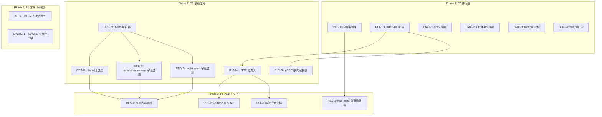

Now I have a thorough understanding of the document and codebase. Let me produce the analysis.

---

# Tech Lead 分析报告：aero-id 生产级 API 可消费性优化

> **分析日期**: 2026-07-12
> **分析文档**: `docs/requirements/2026-07-10-aero-id-prod-api-consumability.md`
> **代码基线**: `main` 分支

---

## 0. 代码级证据验证结果

在开始分析前，我对文档中的引用行号进行了代码级验证：

| 文档断言 | 实际代码 | 验证结果 |
|---------|---------|---------|
| `router.go:72` — 无压缩中间件 | 行72是 `e.GET("/metrics")`，整个 `NewRouter` 无 gzip/brotli | ✅ **准确**（虽行72本身是 metrics，但整体无压缩） |
| `Allow(key string) bool` — 仅返回 bool | 行53 `func (l *Limiter) Allow(key string) bool` | ✅ **准确** |
| 429 时"无 `Retry-After`" | `middleware/ratelimit.go:45-51` 设置了 `Retry-After` 头 | ❌ **不准确** — 已实现 |
| 文件列表暴露 `storage_key`、`checksum` | `fileResponse` 不包含这些字段 | ❌ **不准确** — 但 `PresignUpload` 返回 `storage_key`（行120-121） |
| `comment.go ListComments` 返回"全部字段" | 返回 `commentResponse` 11个字段（合理子集） | ⚠️ **部分准确** — 不包含 `UpdatedAt` |
| 无 pprof 端点 | `go.mod` 无 `net/http/pprof`，router 无 `/debug/pprof/` | ✅ **准确** |
| 无 `SlowThreshold` | `db.go` 未配置 | ✅ **准确** |
| 无运行时 metrics | `metrics.go` 仅 RED 指标 | ✅ **准确** |
| 无 `has_more` | List 响应仅 `next_cursor` | ✅ **准确** |
| health 不暴露连接池 | `health.go` 仅 probe 检查 | ✅ **准确** |

> **结论**: 文档主体结论可靠，仅两处具体细节需修正（`Retry-After` 已实现、文件返回字段不包含敏感内部字段）。不影响方向优先级判断。

---

## 1. 任务分解

### 方向一：移动端 API 响应优化

| 任务 ID | 标题 | 涉及文件 | 前置依赖 | 预估工时 | 验收标准 |
|---------|------|---------|---------|---------|---------|
| **RES-1** | 启用 HTTP 压缩中间件 | `internal/handler/http/router.go`, `go.mod` (+ `gin-contrib/gzip`) | 无 | 2h | `curl -H "Accept-Encoding: gzip"` 返回 gzip 压缩体；`Content-Encoding: gzip` 头正确；<1KB 响应跳过压缩 |
| **RES-2a** | 实现 `fields` 查询参数解析器 | `internal/pkg/httpx/httpx.go` (新增 `ParseFields` 函数) | 无 | 3h | `?fields=id,name` 解析为 `map[string]bool{"id":true,"name":true}`；非法字段名被忽略（非报错） |
| **RES-2b** | 为 fileResponse 添加字段过滤 | `internal/handler/http/file.go` (`toFileResponse` → 有条件输出) | RES-2a | 4h | `GET /v1/files?fields=id,name` 只输出 `id` 和 `name`；不传 fields 时行为不变（兼容） |
| **RES-2c** | 为 commentResponse / messageResponse 添加字段过滤 | `internal/handler/http/comment.go`, `message.go` | RES-2a | 4h | 同上，覆盖全部 List 和 Get 端点 |
| **RES-2d** | 为 notificationResponse 添加字段过滤 | `internal/handler/http/notification.go` | RES-2a | 2h | 同上 |
| **RES-3** | 分页响应增加 `has_more` 字段 | `internal/service/comment.go`, `message.go`, `file.go`, `notification.go` → 各自 `*List` 结构体 + handler render 函数 | 无 | 4h | `next_cursor` 存在时 `has_more: true`；最后一页 `has_more: false`；不需要 COUNT 查询 |
| **RES-4** | 审查并清理响应中的内部字段 | `internal/handler/http/*.go` 逐 handler 审查 | 无 | 3h | 移除或 `json:"-"` 屏蔽 `StorageType` 等内部字段（如有）；确认无兼容性破坏 |

**方向一小计：22h（约 3 人/天）**

### 方向二：限流透明度与客户端协作协议

| 任务 ID | 标题 | 涉及文件 | 前置依赖 | 预估工时 | 验收标准 |
|---------|------|---------|---------|---------|---------|
| **RLT-1** | Limiter 接口扩展 — 返回 `Result` 结构体 | `internal/pkg/ratelimit/ratelimit.go` | 无 | 6h | `Allow(key) (bool, int, time.Time)` 或 `AllowInfo(key) Result{Allowed, Remaining, ResetAt}`；旧 `Allow` 保持向后兼容 |
| **RLT-2a** | HTTP 限流响应头 — `X-RateLimit-*` | `internal/middleware/ratelimit.go` | RLT-1 | 3h | 每次响应含 `X-RateLimit-Limit`, `X-RateLimit-Remaining`, `X-RateLimit-Reset`；429 时额外 `Retry-After`（已有） |
| **RLT-2b** | gRPC 限流元数据 — trailer 传递 | `internal/handler/grpc/server.go` (限流拦截器) | RLT-1 | 3h | gRPC 响应 trailer 含 `X-RateLimit-Limit`, `X-RateLimit-Remaining`, `X-RateLimit-Reset`；proto 新增注释说明 |
| **RLT-3** | 限流状态查询 API | 新文件 `internal/handler/http/ratelimit.go` + `service` 层方法 | RLT-1 | 4h | `GET /v1/rate-limit` 返回 `{global: {limit, remaining, reset_at}, per_endpoint: {...}}` |
| **RLT-4** | 限流行为文档 | `README.md` 或 `docs/api-rate-limiting.md` | RLT-2a | 2h | 文档明确：阈值、窗口期、响应头格式、客户端重试策略建议 |

**方向二小计：18h（约 2.5 人/天）**

### 方向三：运行时诊断基础设施

| 任务 ID | 标题 | 涉及文件 | 前置依赖 | 预估工时 | 验收标准 |
|---------|------|---------|---------|---------|---------|
| **DIAG-1** | pprof 端点挂载 | `internal/handler/http/router.go`, `go.mod` (import `net/http/pprof`) | 无 | 2h | `GET /debug/pprof/` → pprof index；`/debug/pprof/heap` → heap profile；端点受管理员 RBAC 保护 |
| **DIAG-2** | 数据库连接池状态端点 | 新文件 `internal/handler/http/debug.go` | 无 | 2h | `GET /debug/db` → `{open_connections, in_use, idle, wait_count, wait_duration, max_open}` |
| **DIAG-3** | Go runtime 指标注册 | `internal/pkg/metrics/metrics.go` (新增 runtime metrics gauge) | 无 | 4h | `/metrics` 中 `go_goroutines`、`go_memstats_alloc_bytes`、`go_gc_duration_seconds` 等指标可见 |
| **DIAG-4** | GORM 慢查询日志 | `internal/pkg/db/db.go` (新增 `SlowThreshold` 配置) | 无 | 3h | 查询超过阈值（config `database.slow_threshold`，默认 200ms）→ zap warn 日志 + OTel span annotation；可配置关闭 |
| **DIAG-5** | goroutine dump 端点 | 在 DIAG-1 范围内（`net/http/pprof` 自带 goroutine profile） | DIAG-1 | 1h | 含在 DIAG-1 中，无需单独 |

**方向三小计：12h（约 1.5 人/天）**

### 方向四 & 五（P1，略缩）

| 任务 ID | 标题 | 预估工时 |
|---------|------|---------|
| INT-1 | 引用存在性预检 — Delete 操作前检查被引用实体 | 24h (3天) |
| INT-2 | "已删除"占位符机制 — 引用失效时返回 `{id, deleted: true}` | 16h (2天) |
| INT-3 | 文件删除前引用警告 — 响应中返回 `referenced_by` | 8h (1天) |
| INT-4 | 通知目标存在性检查 — 友好降级而非 404 | 8h (1天) |
| INT-5 | 数据库外键约束迁移 | 8h (1天) |
| CACHE-1 | 只读端点 `Cache-Control` 头 | 16h (2天) |
| CACHE-2 | ETag / 304 条件响应（单实体 GET） | 8h (1天) |
| CACHE-3 | `Last-Modified` 头 | 4h (0.5天) |
| CACHE-4 | 写操作 `Cache-Control: no-cache` | 4h (0.5天) |

**方向四小计：64h（约 8 人/天）；方向五小计：32h（约 4 人/天）**

---

## 2. 执行顺序



**并行执行组**（互无依赖，可分配不同开发者）：

| 并行组 | 任务 | 开发者 |
|--------|------|--------|
| **Group A** | RES-1, RES-2a | 开发者甲（方向一核心） |
| **Group B** | RLT-1 | 开发者乙（方向二核心） |
| **Group C** | DIAG-1, DIAG-2, DIAG-3, DIAG-4 | 开发者丙（方向三核心） |

---

## 3. 技术风险

### 🔴 高风险

| 风险 | 方向 | 说明 | 缓解措施 |
|------|------|------|---------|
| **RLT-1 接口兼容性破坏** | 方向二 | `Allow(key string) bool` 被 `internal/middleware/ratelimit.go` 和 `internal/handler/grpc/server.go` 同时调用。接口变更需同步更新两处调用方+测试 | 保留旧方法作为薄包装；或一次性重构所有调用点。建议采用 `AllowInfo` 而不修改 `Allow` 签名 |
| **gRPC trailer 传递限流元数据** | 方向二 | gRPC 客户端需要显式读取 trailer，proto 注释不足时消费者不知如何处理 | 在 proto 文件中为每个 RPC 增加限流元数据注释；生成标准的 gRPC 客户端示例 |
| **部分响应反射性能** | 方向一 | 使用 `reflect` 做字段选择，高频接口路径上可能增加数 ms 延迟 | 策略：用 `map[string]any` + 白名单枚举，避免反射；或者生成代码（`go generate`） |

### 🟡 中风险

| 风险 | 方向 | 说明 | 缓解措施 |
|------|------|------|---------|
| **压缩与 SSE/WebSocket 冲突** | 方向一 | 如果将来添加 SSE 端点，gzip 中间件可能错误压缩 `text/event-stream` | 压缩中间件配置排除 `text/event-stream`；当前无 SSE，但需预留 |
| **pprof 的安全暴露** | 方向三 | pprof 端点若未经认证保护，等于将运行时全貌暴露给攻击者 | 绑定 localhost 或通过 `RequirePermission("system.config")` 保护；部署时通过 SSH 隧道或 k8s `kubectl proxy` 访问 |
| **慢查询配置默认值** | 方向三 | 200ms 阈值对某些查询（如搜索 FTS）是正常值，对简单 `GetByID` 则已过慢 | 阈值设为可配置而非硬编码；初期用 200ms + Zap warn，上线后根据 P99 调整 |

### 🟢 低风险

| 风险 | 方向 | 说明 |
|------|------|------|
| **`has_more` 与现有分页兼容** | 方向一 | 当前代码已使用 n+1 模式，`has_more` 只需暴露 `len(results) > limit`。零风险 |
| **`Cache-Control: private` 数据隐私** | 方向五 | 当前所有数据都是用户级，`private` 正确。无需额外处理 |
| **限流头信息泄漏** | 方向二 | `X-RateLimit-Remaining` 可能泄漏限流策略边界。但该信息通过实验可探测 | 建议公开精确值，保密收益 < DX 收益 |

---

## 4. 资源评估

### 推荐团队配置

| 角色 | 技能要求 | 分配方向 | 工作量 |
|------|---------|---------|-------|
| **开发者甲**（Backend API） | 熟悉 Gin 框架、HTTP 协议、中间件模式 | 方向一（RES-1 ~ RES-4） | 22h（约 3 天） |
| **开发者乙**（Infra / 系统） | 熟悉 Go 并发、接口设计、gRPC | 方向二（RLT-1 ~ RLT-4） | 18h（约 2.5 天） |
| **开发者丙**（Observability） | 熟悉 pprof、Prometheus 指标、GORM 配置 | 方向三（DIAG-1 ~ DIAG-4） | 12h（约 1.5 天） |

> **可并行度**: 三个方向零代码路径依赖 → 3 人可完全并行。
> **最少人员**: 1 人也可串行完成，顺序建议 方向三 → 方向一 → 方向二。

### 关键时间节点（3 人并行）

| 里程碑 | 时间点 | 交付物 | 依赖 |
|--------|-------|--------|------|
| M1: 基础设施完成 | Day 1 (午后) | DIAG-1 ~ DIAG-4 全部 PR 合并 | 无 |
| M2: 响应优化核心完成 | Day 2 (午后) | RES-1, RES-2a, RES-3 PR 合并 | 无 |
| M3: 限流透明度完成 | Day 2 (午后) | RLT-1, RLT-2a, RLT-2b PR 合并 | 无 |
| M4: 全部 P0 PR 合并 | Day 3 (午后) | 全部 P0 任务 PR 合并，`make test && make lint` 通过 | M1, M2, M3 |
| M5: 集成测试 + 文档 | Day 4 (午后) | 集成测试覆盖、限流文档发布 | M4 |

### Blocker & 解决策略

| Blocker | 影响 | 解决策略 |
|---------|------|---------|
| `gin-contrib/gzip` 与现有 `gin` 版本兼容性 | RES-1 | 优先使用 `github.com/gin-gonic/contrib/gzip`；若不兼容则手写 `compress/gzip` 中间件（50 行） |
| gRPC 限流拦截器当前实现位置 | RLT-2b | 需要找到 `server.go` 中限流拦截器位置，确认 trailer 写入时机 |
| 部署环境是否需要额外权限 | DIAG-1 | pprof 默认只监听 localhost，生产环境通过 k8s `kubectl exec` 或 SSH 隧道访问 |

---

## 5. 质量保证

### 单元测试覆盖要求

| 任务 | 测试文件 | 覆盖内容 | 最低覆盖率 |
|------|---------|---------|----------|
| **RLT-1** | `internal/pkg/ratelimit/ratelimit_test.go` | `AllowInfo` 返回值正确性（剩余 token、reset 时间）；`Allow` 向后兼容 | ≥ 90% |
| **RES-2a** | `internal/pkg/httpx/httpx_test.go` | `ParseFields` 解析的字段集合正确性；非法字段被忽略；空字符串处理 | 100% |
| **RES-3** | `internal/service/*_test.go` | `has_more` 在最后一页为 false；中间页为 true；limit=0 边界 | ≥ 90% |
| **DIAG-4** | `internal/pkg/db/db_test.go` | `SlowThreshold` 配置生效；低于阈值不日志 | 逐条测试 |

### 集成测试策略

| 场景 | 方向 | 测试方式 |
|------|------|---------|
| 压缩响应 | 方向一 | `make test-integration` 中新增：HTTP 请求带 `Accept-Encoding: gzip`，验证响应头 + 解压后内容正确 |
| 部分响应 | 方向一 | 同上：`GET /v1/files?fields=id,name` → JSON 仅含 `id` 和 `name` 键 |
| 限流头 | 方向二 | `make test-integration`：连续请求触发限流 → 验证 `X-RateLimit-Remaining` 递减 → 429 时含 `Retry-After` |
| 分页元数据 | 方向一 | 插入 N+2 条数据 → 请求 limit=N → `has_more: true`；再请求 cursor → `has_more: false` |
| pprof 认证保护 | 方向三 | 无 token → 401；普通 token → 403；admin token → 200 + profile |

### 代码审查要点

| 关注点 | 理由 |
|--------|------|
| **压缩中间件配置** | 确保 `Content-Type` 白名单（仅 `application/json`），排除极小 payload（<1KB），兼容 `304 Not Modified` |
| **RLT-1 接口设计** | 新方法不应破坏现有调用。`AllowInfo` 作为扩展方法，`Allow` 保留 |
| **部分响应白名单** | 每个 handler 的 field whitelist 必须与 DTO 字段同步维护——新增字段时需同时决定是否默认暴露 |
| **DIAG-1 安全** | pprof 必须通过 middleware 认证，不应暴露在公网。验证路由注册顺序（认证中间件在 pprof 之前） |
| **DIAG-4 配置** | `SlowThreshold` 需要同时更新 `configs/config.yaml` 的文档和默认值 |

### 性能测试需求

| 测试 | 方向 | 方法 |
|------|------|------|
| 压缩中间件 CPU 开销 | 方向一 | `wrk -H "Accept-Encoding: gzip"` vs 无压缩，对比 P99 延迟和 CPU 增量 |
| 部分响应反射开销 | 方向一 | 对比 `?fields=id,name` vs 全量响应的吞吐差异 |
| 慢查询日志对性能影响 | 方向三 | 启用慢查询日志后对比 P99 延迟（预期零影响，因只在慢查询时触发） |
| 限流头写入开销 | 方向二 | 基准测试 `RLT-2a` 响应头设置对吞吐的影响（预期 <1%） |

---

## 6. 实施计划

### Gantt 图（3 人并行方案）

```mermaid
gantt
    title aero-id P0 API Consumability Implementation Plan
    dateFormat  YYYY-MM-DD
    axisFormat  %m-%d

    section 甲-方向一
    RES-1 压缩中间件           :a1, 2026-07-14, 4h
    RES-2a fields 解析器       :a2, after a1, 4h
    RES-2b file 字段过滤       :a3, after a2, 4h
    RES-2c comment/message 字段 :a4, after a2, 4h
    RES-2d notification 字段   :a5, after a4, 2h
    RES-3 has_more 分页元数据   :a6, 2026-07-14, 4h
    RES-4 内部字段审查         :a7, after a3, 3h

    section 乙-方向二
    RLT-1 Limiter 扩展         :b1, 2026-07-14, 6h
    RLT-2a HTTP 限流头         :b2, after b1, 3h
    RLT-2b gRPC 限流元数据     :b3, after b1, 3h
    RLT-3 限流状态 API         :b4, after b2, 4h
    RLT-4 文档                 :b5, after b2, 2h

    section 丙-方向三
    DIAG-1 pprof 端点          :c1, 2026-07-14, 2h
    DIAG-2 DB 连接池端点       :c2, 2026-07-14, 2h
    DIAG-3 runtime 指标        :c3, 2026-07-14, 4h
    DIAG-4 慢查询日志          :c4, after c3, 3h
    DIAG-5 goroutine dump      :c5, with c1, 1h

    section 集成与发布
    集成测试                  :d1, after a7 b5 c4, 8h
    文档更新 + CHANGELOG      :d2, after d1, 4h
    发布 v1.x                 :d3, after d2, 2h
```

### 阶段规划

#### 阶段 1：基础设施搭建（Day 1 — 2026-07-14）

**目标**: 方向三完成 + 方向一/二中无依赖部分启动

| 时间 | 开发者甲 | 开发者乙 | 开发者丙 |
|------|---------|---------|---------|
| 9:00-11:00 | RES-1 压缩中间件 PR | RLT-1 Limiter 接口设计 | DIAG-1 pprof 端点 |
| 11:00-13:00 | RES-2a fields 解析器 | RLT-1 实现 + 测试 | DIAG-2 DB 连接池端点 |
| 14:00-16:00 | RES-2a 测试 + 审查 | RLT-1 测试 + 审查 | DIAG-3 runtime 指标 |
| 16:00-18:00 | RES-3 has_more | RLT-2a HTTP 限流头 | DIAG-4 慢查询日志 |

**交付物**: 
- RES-1 合并 → 生产服务器已有压缩
- DIAG-1 ~ DIAG-4 全部合并 → 诊断端点可用
- RLT-1 评审通过

#### 阶段 2：核心功能实现（Day 2 — 2026-07-15）

**目标**: 方向一/二核心功能完成

| 时间 | 开发者甲 | 开发者乙 | 开发者丙 |
|------|---------|---------|---------|
| 9:00-12:00 | RES-2b, RES-2c 字段过滤 | RLT-2b gRPC 限流元数据 | 集成测试编写 |
| 13:00-16:00 | RES-2d + RES-4 审查 | RLT-3 限流状态 API | 集成测试完善 |
| 16:00-18:00 | 修复测试/合并 | RLT-3 测试 | E2E 测试 |

**交付物**:
- 全部 P0 功能 PR 合并
- `make test && make lint` 绿色

#### 阶段 3：集成测试和优化（Day 3 — 2026-07-16）

**目标**: 集成测试通过 + 性能验证

| 活动 | 负责人 | 工时 |
|------|-------|------|
| 集成测试覆盖全部 P0 方向 | 全组 | 8h |
| wrk 基准测试：压缩 vs 无压缩 | 开发者甲 | 2h |
| 基准测试：部分响应延迟优化 | 开发者甲 | 2h |
| 限流头写入基准测试 | 开发者乙 | 2h |
| pprof 安全验证 | 开发者丙 | 1h |
| 慢查询配置验证 | 开发者丙 | 1h |

#### 阶段 4：发布准备（Day 4 — 2026-07-17）

| 活动 | 负责人 | 工时 |
|------|-------|------|
| RLT-4 限流文档 | 开发者乙 | 2h |
| README 更新（CHANGELOG + API 变更） | 开发者甲 | 2h |
| 运维手册更新（诊断端点使用说明） | 开发者丙 | 2h |
| 性能调优报告 | 全组 | 2h |
| `make check-file-sizes && make lint-strict` 验证 | 全组 | 1h |

---

## 7. 补充建议

### 7.1 文档中 `Retry-After` 已实现的更正

文档方向二声称"无 `Retry-After`"，但 `internal/middleware/ratelimit.go:45-51` 已实现。建议：

1. 更新文档方向二的"代码级证据"表，删除"无 `Retry-After`"条目
2. `RLT-2a` 的重点应放在 `X-RateLimit-*` 三头的添加上，而非 `Retry-After`

### 7.2 建议调整的优先级

| 方向 | 文档建议 | Tech Lead 建议 | 理由 |
|------|---------|---------------|------|
| DIAG-1 ~ DIAG-4 | P0 | **P0** | 运维刚需，且工程量最小（12h），建议 Day 1 完成 |
| RES-1 | P0 | **P0** | 2 小时实现，85% 带宽节省，ROI 极高 |
| RES-2 部分响应 | P0 | **P0** 但可分阶段 | 需额外移动端 SDK 配合；后端先实现，前端落地可延后 |
| RLT-2a | P0 | **P0** | 提升 DX 刚需 |
| RLT-3 状态查询 API | P2 | **P1** | 内省能力对生产运维有价值，建议提升 |
| RES-3 has_more | P1 | **P0** | 实现成本极低（4h），消除客户端"多请求一次"的判断，价值高 |

### 7.3 工程约束合规检查

实施过程中需关注 AGENTS.md 的硬约束：

```
当前文件大小 (见上文 wc 输出):
internal/handler/http/comment.go:      366 ✅ < 500
internal/handler/http/message.go:      279 ✅
internal/handler/http/file.go:         357 ✅
internal/handler/grpc/server.go:       371 ✅

新增文件需注意:
- new handler files 不应超过 500 行
- Limiter 接口扩展后的 ratelimit.go (~137行) 需监控 < 500 行约束
```

当 `internal/pkg/ratelimit/ratelimit.go` 经过 RLT-1 扩展后预估增加 ~80 行，仍在 250 行以内，安全。

每个 handler 加 fields 过滤后，预估每个文件增加 ~30-50 行，仍在安全范围内。

### 7.4 长期技术债务

1. **部分响应字段白名单维护** — 新增 DTO 字段时需要同步更新 whitelist。建议：所有 DTO 定义在一个位置 + `go generate` 生成 whitelist 映射
2. **压缩中间件对 SSE 的兼容** — 虽然目前无 SSE，但 route 设计应预留排除路径
3. **ETag/304 的高投资回报率** — P1 阶段建议优先 CACHE-2，尤其对文件元数据 GET 端点（`GET /v1/files/:id`）


> **总评估**: P0 三个方向合计 52 小时（~3 人/2 天），工程风险可控。两个已发现文档细节错误不影响方向判断。建议今日（2026-07-14）启动，7月17日前发布包含诊断 + 压缩 + 限流透明度的版本。
