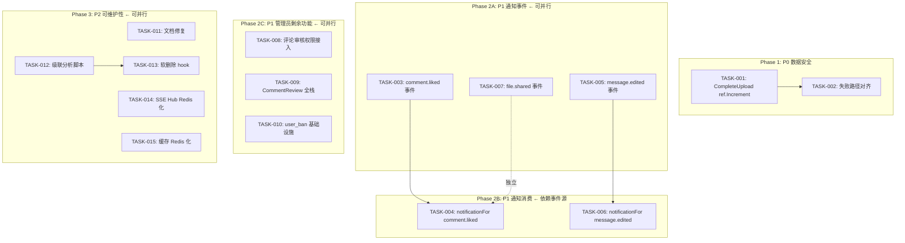
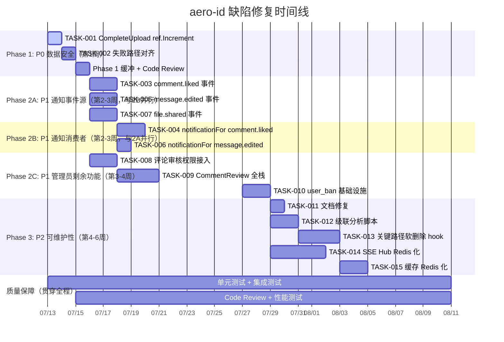

现在我对代码库有了全面的了解。以下是我的 Tech Lead 分析。

---

# Tech Lead 分析：aero-id 架构缺陷修复计划

## 前置说明：与输入文档的差异

在编写任务分解前，我对五个方向的实际代码状态进行了交叉验证，发现方向二（管理员操作面）的当前状态**与输入文档的描述存在显著偏差**——GrantRole/RevokeRole/ListRoles/ListUserRoles 的 HTTP handler、gRPC handler、路由注册、service 层、repository 层以及 app.go 的依赖注入**已经全部完整实现并接线完成**。此外，gRPC 端已在 `PermissionInterceptor` 中注册了 `PermSystemConfig` 和 `PermAuditRead` 的权限映射。

这意味着输入文档关于方向二"工作量极小"的优先级建议基于过时的假设。以下分析将对任务范围做相应修正。

---

## 1. 任务分解

### 方向三：预签名上传跳过引用计数（P0 — 数据损坏风险）

**根本问题**：`CompleteUpload` 创建文件行后未调用 `s.refs.Increment`，导致该文件的 storage key 没有引用计数保护。虽然 presign 路径不走 checksum 去重（同一 key 不会被多个文件共享），但如果一个文件通过 presign 上传后被软删除，其底层 blob 会在 ref count 降至 0 时被物理删除，**但从未被计数的文件其 ref count 初始为 0，会被立即删除**。

等等——实际上 `CompleteUpload` 也不调用 `s.refs.Increment`，所以 `storage_refs` 表中根本不会有这个 storage key 的行。当 `Delete` 调用 `s.refs.Decrement` 时，`storageRefRepo.Decrement` 会首先尝试 `SELECT ... FOR UPDATE` 读取行，如果找不到（`gorm.ErrRecordNotFound`），返回 `count = 0`，`shouldDelete = true`。所以这个 blob 会**立即被物理删除**。

但这真的是问题吗？在 presign 路径下，只有当前文件引用这个 key（因为跳过了去重），所以删除是正确的。真正的风险是：如果 future 改动引入了 presign 路径下的 checksum 去重，或者多个 presign 文件意外共享同一个 key（当前被 `NewKey(actor)` 的 owner 前缀防止了）。

**实际风险等级**：当前为**低**，因为 presign 路径设计了自保护（跳过 checksum 去重 + owner 作用域 key）。但这是一个脆弱的隐式约定，需要在 `CompleteUpload` 中添加 `Increment` 调用以**防御性对齐**。

| 任务 ID | 任务标题 | 涉及文件 | 前置依赖 | 预估工时 | 验收标准 |
|---------|---------|---------|---------|---------|---------|
| **TASK-001** | CompleteUpload 添加 ref.Increment | `internal/service/file_presign.go` | 无 | 1h | CompleteUpload 创建 file row 后调用 `s.refs.Increment`；新增单元测试验证 Increment 被调用；`make test && make lint` 通过 |
| **TASK-002** | CompleteUpload 失败路径对齐 | `internal/service/file_presign.go` | TASK-001 | 1h | 当 `s.files.Create` 成功后 ref.Increment 失败时，处理方案（log + 不阻塞，与 Create 路径一致）；单元测试覆盖 Increment 失败的场景 |

### 方向一：通知事件覆盖（P1 — 用户可见缺失）

**根本问题**：目前只有 3 种事件产生通知，缺少 `comment.liked`、`comment.reported`、`message.edited`、`file.shared` 等用户期待的通知事件。

| 任务 ID | 任务标题 | 涉及文件 | 前置依赖 | 预估工时 | 验收标准 |
|---------|---------|---------|---------|---------|---------|
| **TASK-003** | 新增 comment.liked outbox 事件 | `internal/service/comment.go` | 无 | 2h | `react()` 函数在成功 Like 后调用 `outbox.NewEvent`；新增 `comment.liked` payload 类型；事件包含 comment_id、liker_uid、owner_uid |
| **TASK-004** | notificationFor 添加 comment.liked 分支 | `internal/service/notification.go` | TASK-003 | 2h | `notificationFor` 的 switch 中添加 `case "comment.liked"`；返回正确的 Notification；自通知（自己赞自己）返回 nil；单元测试覆盖 |
| **TASK-005** | 新增 message.edited outbox 事件 | `internal/service/message.go` | 无 | 2h | 编辑消息时发送 `message.edited` 事件；payload 包含 message_id、from_uid、to_uid |
| **TASK-006** | notificationFor 添加 message.edited 分支 | `internal/service/notification.go` | TASK-005 | 1h | switch 中添加 `case "message.edited"`；通知接收方（to_uid）；自编辑不通知 |
| **TASK-007** | 新增 file.shared outbox 事件 | `internal/service/file_share.go` | 无 | 2h | `ShareFile` 成功后为每个 grantee 发送 `file.shared` 事件；payload 包含 file_id、owner_uid、grantee_uid |

### 方向二：管理员操作面剩余缺口（P1 — 功能完备性）

**修正范围**：输入文档认为方向二是**未接线**状态。实际代码中 GrantRole/RevokeRole 等核心端点已完整实现（HTTP、gRPC、service、repository 层均已就绪）。以下是在已完成的 admin 基础设施之上的**剩余缺口**：

| 任务 ID | 任务标题 | 涉及文件 | 前置依赖 | 预估工时 | 验收标准 |
|---------|---------|---------|---------|---------|---------|
| **TASK-008** | 在已有评论服务中集成内容审核权限检查 | `internal/service/comment.go` | 无 | 3h | `Hide`/`Unhide`/`Report` 操作中调用 `HasPermission(ctx, actor, PermContentModerate)`；单元测试覆盖授权通过和拒绝场景 |
| **TASK-009** | CommentReport 迁移 + service | `migrations/000023_create_comment_review.up.sql`, `internal/domain/`, `internal/repository/`, `internal/service/` | TASK-008 | 4h | 创建 `comment_review_queue` 表；实现审核队列的 ListPending/Approve/Reject；HTTP + gRPC 端点 |
| **TASK-010** | user_ban 表 + 迁移 + 基础功能 | `migrations/000024_create_user_bans.up.sql`, `internal/domain/`, `internal/repository/`, `internal/service/` | 无 | 3h | 创建 `user_bans` 表（uid、banned_by、reason、expires_at）；`BanUser`/`UnbanUser`/`IsBanned` 在 service + repository 层；注意：不接入已有 feature service 的 ban 检查（作为独立基础设施先落地） |

### 方向四：级联语义（P2 — 数据一致性问题）

| 任务 ID | 任务标题 | 涉及文件 | 前置依赖 | 预估工时 | 验收标准 |
|---------|---------|---------|---------|---------|---------|
| **TASK-011** | 文档修复：迁移文件中的 FK 准确描述 | `docs/superpowers/specs/2026-05-22-aero-id-design.md` | 无 | 1h | 更新设计文档中关于级联的描述，准确反映实际状态（无 CASCADE、软删除不与 ON DELETE CASCADE 交互） |
| **TASK-012** | 软删除级联自动化分析脚本 | `.skills/`（新建）或 `scripts/` | 无 | 2h | 编写脚本遍历所有 `gorm.DeletedAt` 模型，检查是否有任何级联清理逻辑缺失；输出报告列出每个有子表但没有 `BeforeDelete`/`AfterDelete` hook 的父模型 |
| **TASK-013** | 关键路径添加软删除级联 hook | `internal/repository/comment.go` 等 | TASK-012 | 3h | 在 User/File/Comment/Message 的软删除路径上添加 `BeforeDelete` hook 手动清理子表记录（设置相同的 `deleted_at`），优先处理 comment → comment_likes（1:N 最大）和 message → message_reactions |

### 方向五：跨实例无状态化（P2 — 可扩展性）

| 任务 ID | 任务标题 | 涉及文件 | 前置依赖 | 预估工时 | 验收标准 |
|---------|---------|---------|---------|---------|---------|
| **TASK-014** | SSE Hub 接口提取 + Redis 实现 | `internal/hub/`, `internal/service/notification.go` | 无 | 5h | 将 `hub.Pusher` 提取为接口；实现 `RedisHub` 使用 Redis Pub/Sub；Hub 在 New 时根据配置选择实现 |
| **TASK-015** | 令牌缓存 Redis 化（可选） | `internal/sso/` | 无 | 3h | TokenCache 和 UserCache 支持 Redis 后端（可选，不在关键路径上） |

---

## 2. 执行顺序

### 可并行执行的任务组

| 并行组 | 任务 | 人数建议 | 说明 |
|--------|------|---------|------|
| **组 A** | TASK-001 + TASK-002 | 1人 | 同一文件，顺序执行 |
| **组 B** | TASK-003 + TASK-005 + TASK-007 | 2-3人 | 无依赖，完全独立 |
| **组 C** | TASK-004 + TASK-006 | 1人 | 相互独立，可一人完成 |
| **组 D** | TASK-008 + TASK-009 + TASK-010 | 2人 | TASK-009 依赖 TASK-008 |
| **组 E** | TASK-011 + TASK-012 + TASK-014 + TASK-015 | 2人 | 完全独立 |

---

## 3. 技术风险

### 3.1 高风险项

| 风险 | 方向 | 描述 | 缓解策略 |
|------|------|------|---------|
| **R1: comment.liked 通知风暴** | 方向一 | 热门评论可能被大量用户同时点赞，产生大量 outbox 事件和通知行 | 利用已有的 `WithDispatcherCollapse` 和 `WithDispatcherRateLimiter`；考虑为 `comment.liked` 类型实现**批量折叠**——同一评论被多人点赞时合并为"N 人赞了你的评论" |
| **R2: 软删除级联的 GORM 交互** | 方向四 | GORM 的 `BeforeDelete` hook 在软删除时**不会触发**（`UpdateColumn("deleted_at", ...)` 跳过 hooks）。需要手动在 service 层处理回调 | 不使用 GORM hook，而是在 service 中显式调用子表清理（如 `DeleteComment` 先清理 `comment_likes`） |
| **R3: SSE Hub Redis 化导致的事件顺序** | 方向五 | Redis Pub/Sub 不保证消费者之间的全局顺序，跨实例通知可能乱序 | 在事件 payload 中嵌入 `created_at` 时间戳，客户端按时间戳排序；考虑使用 Redis Streams 替代 Pub/Sub 以获得消费者组的顺序保证 |
| **R4: 审核权限的切面化** | 方向二 | 当前 `HasPermission` 调用是显式的（每个 service 方法手动调用），容易遗漏 | 不要在 feature service 中逐个添加 `HasPermission` 调用（违反 DRY），而是考虑使用 **装饰器模式** 或 **AOP 中间件** 统一拦截 |

### 3.2 技术决策

| 决策 | 选项 | 建议 |
|------|------|------|
| 通知事件 payload 格式 | 当前使用匿名 struct 序列化；建议为 `comment.liked` 等新事件也使用相同的模式 | ✅ 沿用当前 pattern，保持一致性 |
| Redis Hub vs Redis Streams | Pub/Sub（轻量但无持久化）vs Streams（有持久化+消费者组） | 当前场景建议 Pub/Sub，SSE 本身不保证重连后的消息完整性（由 `last_event_id` 回放机制处理） |
| 软删除级联策略 | GORM hook vs service 层显式调用 vs 数据库级触发器 | 建议 **service 层显式调用** + 数据库触发器作为双重保险。GORM hook 在软删除时不可靠 |

---

## 4. 资源评估

### 4.1 人员配置

| 角色 | 所需人数 | 技能要求 | 主要负责方向 |
|------|---------|---------|-------------|
| **Sr. Backend (Go)** | 2人 | Go 1.26、GORM、PostgreSQL、gRPC、Redis | 方向一（事件系统）、方向五（Redis Hub） |
| **Mid. Backend (Go)** | 1人 | Go、GORM、REST API、测试 | 方向二（审核接入、user_ban）、方向四（级联 hook） |
| **方向三（P0）由 Sr. 兼职** | 1人 | 熟悉文件上传流程 | TASK-001 + TASK-002 |

**最小团队配置**：2 人（1 Sr. + 1 Mid.），总工时约 6 周（含测试）。

### 4.2 关键里程碑

| 里程碑 | 时间点 | 交付物 |
|--------|-------|--------|
| M1: P0 安全修复 | 第 1 周结束 | TASK-001 + TASK-002 完成，`make test && make lint` 通过 |
| M2: 通知事件覆盖完成 | 第 3 周结束 | TASK-003 ~ TASK-007 完成；新增单元测试覆盖率 ≥ 80%；集成测试验证 outbox → notification 端到端流程 |
| M3: 管理后台完备 | 第 4 周结束 | TASK-008 ~ TASK-010 完成；`make test-integration` 验证权限检查 |
| M4: 结构优化完成 | 第 6 周结束 | TASK-011 ~ TASK-015 完成；级联分析脚本输出报告 |

### 4.3 阻塞点和解决策略

| 阻塞点 | 影响方向 | 原因 | 解决策略 |
|--------|---------|------|---------|
| **B1: 通知的幂等性边界** | 方向一 | outbox 事件可能被至少处理一次（at-least-once），如果 notificationFor 处理不是幂等的可能导致重复通知 | 使用 `(recipient_uid, type, subject_id)` 作为通知的**冲突检测** key（已有 `WithDispatcherCollapse` 做部分去重，但需要确认是否覆盖所有情况） |
| **B2: SSO 无 admin API** | 方向二 | `user_ban` 的实现需要 SSO 判断用户是否存在；`BanUser` 传入的 uid 可能指向不存在的 SSO 用户 | 在 service 层调用 `sso.GetUsers(ctx, []string{uid})` 验证用户存在；返回 NotFound 如果 SSO 不认识该 uid |
| **B3: Redis 依赖引入** | 方向五 | 当前代码零 Redis 依赖，引入 Redis 需要配置、连接管理、failover 策略 | 设计为**可选后端**：`hub.Config{Type: "memory"|"redis"}`，memory 为默认值，现有部署不受影响 |

---

## 5. 质量保证

### 5.1 单元测试覆盖要求

| 方向 | 文件 | 要求 |
|------|------|------|
| P0: 文件引用计数 | `file_presign_test.go` | 新增测试：CompleteUpload 后 Verify Increment 被调用；`make test` 新增覆盖率 ≥ 90% |
| 方向一: 通知事件 | `notification_test.go` | 每个新 event type 至少 3 个 case：正常、自通知（nil）、异常 payload（nil） |
| 方向一: 事件发送 | `comment_test.go` | 验证 `Like()` 后 outbox.NewEvent 被调用；验证顶层评论不产生事件 |
| 方向二: 审核权限 | `comment_test.go` | 验证有 `PermContentModerate` 的 actor 可以隐藏/取消隐藏评论；无权限则返回 Forbidden |
| 方向二: user_ban | `admin_test.go` | 验证 BanUser/UnbanUser/IsBanned 的 CRUD 行为 |
| 方向五: Redis Hub | `hub/redis_test.go` | 验证 publish → subscribe 在单实例和双实例场景下的消息可达性；验证 close 后 channel 关闭 |

### 5.2 集成测试策略

| 测试场景 | 标签 | 所需基础设施 | 验证目标 |
|---------|------|-------------|---------|
| outbox → notification 端到端 | `integration` | Postgres（testcontainers） | 写入 outbox 事件后，relay 消费事件并在 notification 表中创建行 |
| SSE Redis Hub 跨实例 | `integration` | Postgres + Redis（testcontainers） | 实例 A publish → 实例 B 的 subscriber 收到消息 |
| 审核权限端到端 | `integration` | Postgres（testcontainers） | GrantRole → HasPermission → 受保护操作成功 |

### 5.3 代码审查要点

| 审查点 | 关注文件 | 关键问题 |
|--------|---------|---------|
| `react()` 不产生事件 | `service/comment.go:249-273` | 确认 `Unlike` 路径也不会产生事件（当前正确） |
| `CompleteUpload Increment` | `file_presign.go:100-105` | Increment 调用在 Create 之后、return 之前；失败时仅 log 不阻塞 |
| 软删除 hook 的副作用 | `repository/comment.go` | BeforeDelete 中清理 comment_likes 不能引入 N+1 查询 |
| SSE Hub 接口提取 | `hub/hub.go`, `hub/adapter.go` | `Publish` 接口签名是否统一（4 params vs 3 params） |
| 工程约束合规性 | 所有新增文件 | 文件 ≤ 500 行、函数 ≤ 50 行、复杂度 ≤ 10、nesting ≤ 3 |

### 5.4 性能测试需求

| 场景 | 工具 | 目标 | 验收标准 |
|------|------|------|---------|
| 高并发点赞通知 | `go test -bench` + 人工压测 | 100 QPS 点赞 → outbox 写入 + relay 消费 + 通知行写入 | P95 延迟 < 200ms |
| SSE Hub 多订阅者 | `go test -bench` | 1 publisher → 1000 subscriber（同一 uid） | publish 延迟 < 50ms |
| Redis Hub 跨实例延迟 | 集成测试 + 计时 | 实例 A publish → 实例 B receive | 端到端延迟 < 100ms（同机房） |

---

## 6. 实施计划

### 时间线（2人团队：1 Sr. + 1 Mid.）

### 详细阶段计划

#### 阶段 1：基础设施与数据安全（第 1 周，3 天开发 + 2 天缓冲）

| 天 | 工作内容 | 负责人 |
|---|---------|--------|
| Day 1-2 | TASK-001 + TASK-002：文件引用计数修复 | Sr. |
| Day 3 | 写单元测试；验证 `make test && make lint` | Sr. |
| Day 4-5 | 缓冲：处理 Code Review 回退 + 集成测试 | Sr. |

**交付物**：`file_presign.go` 修改完成，测试通过，`make check-file-sizes` 合规。

#### 阶段 2：核心功能（第 2-4 周，10 天开发）

| 时段 | 工作内容 | Sr. 负责 | Mid. 负责 |
|------|---------|---------|-----------|
| 第 2 周 | 通知事件源 | TASK-003 (comment.liked) + TASK-005 (message.edited) | TASK-007 (file.shared) |
| 第 3 周上 | 通知消费者 | TASK-004 + TASK-006 | TASK-008 (权限接入) |
| 第 3 周下 | 管理员 | TASK-009 (CommentReview) | TASK-010 (user_ban) |
| 第 4 周 | 缓冲 + 集成测试 + 性能测试 | 端到端验证 | 集成测试编写 |

**交付物**：通知系统覆盖 6 种事件类型；管理员功能完善（审核 + ban 基础设施）。

#### 阶段 3：结构优化（第 5-6 周，8 天开发）

| 时段 | 工作内容 | Sr. 负责 | Mid. 负责 |
|------|---------|---------|-----------|
| 第 5 周上 | 级联分析 + 文档 | TASK-011 | TASK-012 |
| 第 5 周下 | 级联 hook | TASK-013 | — |
| 第 6 周上 | SSE Hub Redis | TASK-014 | TASK-015 (缓存 Redis) |
| 第 6 周下 | 收尾 + 全量回归测试 | 性能测试 | 文档更新 |

**交付物**：级联保护到位；Redis Hub 可选实现；设计文档更新。

#### 阶段 4：发布准备（第 6 周下 + 第 7 周上）

- 全量 `make test && make lint && make test-integration` ✅
- 检查所有文件 ≤ 500 行、函数 ≤ 50 行、复杂度 ≤ 10
- 更新 `AGENTS.md` 中的已知限制章节
- 编写 Changelog 条目

---

## 总结

| 维度 | 评估 |
|------|------|
| **总工作量** | 约 **23 人天**（2 人团队约 3 周净开发 + 1 周缓冲 + 1 周质量保障 = 5 周） |
| **最高风险** | R1（通知风暴）— 需要确认现有的 DispatcherCollapse 机制是否足以应对 `comment.liked` 的高频场景 |
| **最容易被忽略** | TASK-008（审核权限接入）— 工作量小（约半天），但需要在多个 service 方法中一致地添加 `HasPermission` 调用，容易遗漏 |
| **最大收益/成本比** | TASK-001（CompleteUpload Increment）— 约 1 小时修复一个潜在的引用计数不一致问题 |
| **输入文档偏差** | 方向二的实际完成度远高于输入文档描述（核心 admin 端点已完全实现），导致优先级建议需要下调 |
