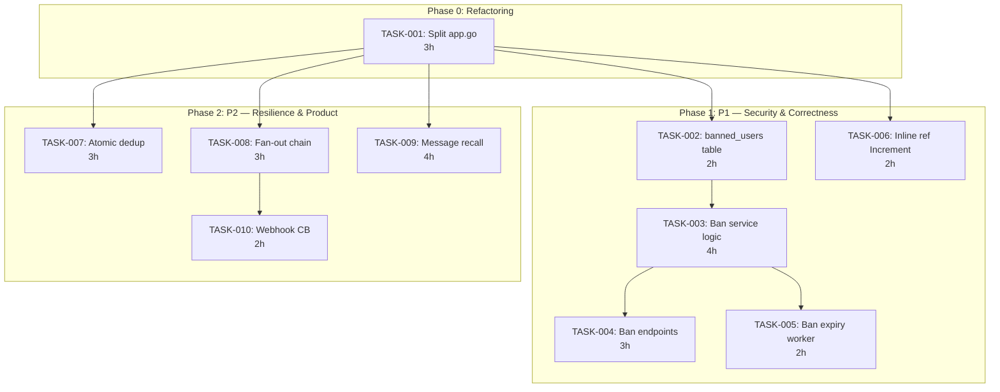
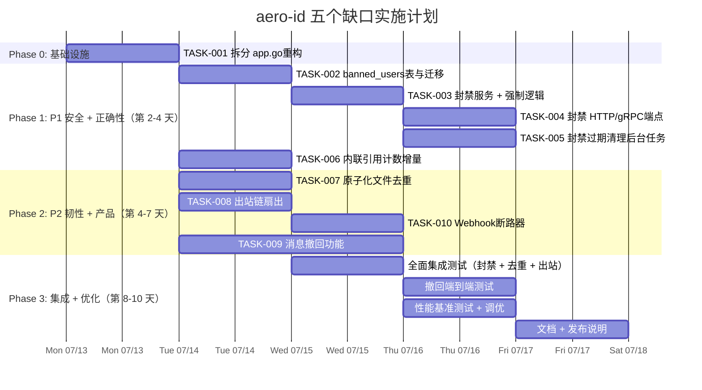

现在我已全面了解代码库。以下是 Tech Lead 深度分析。

---

# Tech Lead 分析报告：aero-id 五个待解决的缺口

## 执行摘要

五个确认的方向构成了三个安全/正确性缺口（P1）和两个产品/韧性缺口（P2）。在开始新功能之前，**`internal/app/app.go`（516 行）已经违反了 500 行的文件大小限制**——这是项目约定规定的硬性拦截项。该违规必须在新增工作之前解决。

---

## 1. 任务分解

### TASK-001：拆分 `app.go`（预先重构）
- **方向**：约束治理（AGENTS.md 第 14 行）
- **涉及文件**：`internal/app/app.go` → 拆分为 `app.go`（核心）+ `app_storage.go` + `app_services.go` + `app_migrations.go`
- **前置依赖**：无
- **预估工时**：3 小时
- **验收标准**：`make check-file-sizes` 通过；`make test && make lint` 通过；行为无变化

### TASK-002：添加 `banned_users` 表及迁移
- **方向**：1 — 用户封禁生命周期（P1）
- **涉及文件**：
  - 新增 `migrations/000024_banned_users.up.sql` / `.down.sql`
  - 新增 `internal/domain/ban.go`（实体 + 枚举）
  - 新增 `internal/repository/ban.go`（接口 + GORM 实现）
- **前置依赖**：TASK-001
- **预估工时**：2 小时
- **验收标准**：迁移向上/向下正常工作；`BannedUser` 域实体存在，包含 `UID`、`Reason`、`BannedBy`、`BannedAt`、`ExpiresAt`（可为空，表示永久）

### TASK-003：实现封禁/解封服务逻辑
- **方向**：1 — 用户封禁生命周期（P1）
- **涉及文件**：
  - 新增 `internal/service/ban.go`（`BanService` 接口 + `banService` 实现）
  - 修改 `internal/service/service.go`（将 `BanService` 添加到接口定义）
  - 修改 `internal/service/notification.go`（`NotificationDispatcher` 中添加封禁查询）
  - 修改 `internal/service/comment.go`（写入前检查封禁）
  - 修改 `internal/service/message.go`（发送前检查封禁）
  - 修改 `internal/service/file.go`（创建前检查封禁）
- **前置依赖**：TASK-002
- **预估工时**：4 小时
- **验收标准**：被封禁用户的写入操作被`Forbidden`拒绝；`BanService.IsBanned(uid)` 对封禁返回 true；所有写入服务路径都强制执行

### TASK-004：封禁/解封 HTTP + gRPC 端点
- **方向**：1 — 用户封禁生命周期（P1）
- **涉及文件**：
  - 修改 `internal/handler/http/admin.go`（添加 `POST /v1/admin/ban`、`POST /v1/admin/unban`、`GET /v1/admin/banned-users`）
  - 修改 `internal/handler/grpc/admin.go`（添加 `BanUser`、`UnbanUser`、`ListBanned`）
  - 可能更新 `api/proto/**/*.proto`
  - 修改 `internal/app/app_services.go`（将 BanService 接入）
- **前置依赖**：TASK-003
- **预估工时**：3 小时
- **验收标准**：管理员可以封禁/解禁用户；封禁操作记录到审计日志；`RequirePermission(domain.PermUserBan)` 保护端点

### TASK-005：自动过期封禁后台任务
- **方向**：1 — 用户封禁生命周期（P1）
- **涉及文件**：
  - 新增 `internal/service/ban_expiry.go`（清理过期封禁的后台工作器）
  - 修改 `internal/app/app_services.go`（启动清理 goroutine）
- **前置依赖**：TASK-003
- **预估工时**：2 小时
- **验收标准**：过期封禁自动移除；清理间隔可配置；无手动干预

### TASK-006：在文件创建事务中内联 storage_ref 增量
- **方向**：5 — 引用计数原子性缺口（P1）
- **涉及文件**：
  - 修改 `internal/service/file.go`（将 `s.refs.Increment` 移入上传+创建的同一事务中，或至少在返回成功给用户前执行）
  - 可能需要修改 `internal/repository/file.go`（添加事务性 Create+Increment 方法）
- **前置依赖**：TASK-001
- **预估工时**：2 小时
- **验收标准**：`Increment` 在返回成功给用户之前执行；T0'（并发删除）不能在 T1（增量）之前观察到 ref_count=0

### TASK-007：使用 `ON CONFLICT DO UPDATE` 使文件创建中的 FindByChecksum→Create 原子化
- **方向**：2 — 内容去重竞态（P2）
- **涉及文件**：
  - 修改 `internal/service/file.go`（用 `INSERT … ON CONFLICT DO NOTHING` + 后续 SELECT 替换 `FindByChecksum`+`Create`）
  - 修改 `internal/repository/file.go`（添加 `CreateIfNotExists` 方法）
- **前置依赖**：TASK-001
- **预估工时**：3 小时
- **验收标准**：并发上传相同校验和的同一文件会产生且仅产生一条记录；存在重复的存储键被优雅处理；无 `DuplicateKey` 错误泄漏

### TASK-008：将 Outbox 链改为扇出模式（并发处理程序）
- **方向**：3 — Webhook 级联故障（P2）
- **涉及文件**：
  - 修改 `internal/outbox/chain.go`（添加 `FanOut` 处理程序，以独立超时并发运行处理程序；成功视为全部成功；单个失败不阻止其他操作）
  - 修改 `internal/app/app.go`（使用 `FanOut` 代替 `NewChain`）
- **前置依赖**：TASK-001
- **预估工时**：3 小时
- **验收标准**：Webhook 超时不会阻塞调度程序或 SSE 推送；配置可设置并发和每个处理程序的超时

### TASK-009：添加消息撤回（Recall）功能
- **方向**：4 — 消息撤回（P2）
- **涉及文件**：
  - 新增 `migrations/000025_message_recalls.up.sql` / `.down.sql`
  - 新增 `internal/domain/message_recall.go`（实体）
  - 新增 `internal/repository/message_recall.go`
  - 修改 `internal/service/message.go`（`Recall` 方法：双方均可见，但内容替换为 "[this message has been recalled]" 或类似信息）
  - 修改 `internal/handler/http/message.go`（`POST /v1/messages/:id/recall`）
  - 修改 `internal/handler/grpc/message.go`（`RecallMessage` RPC）
  - 修改 `internal/service/service.go`（将 `Recall` 添加到 `MessageService` 接口）
- **前置依赖**：TASK-001
- **预估工时**：4 小时
- **验收标准**：发送者可以撤回 5 分钟内的消息；撤回的消息对双方显示为 "[recalled]"；原始内容被覆写（无取证残留）；超过 5 分钟撤回失败

### TASK-010：为出站级联故障添加断路器
- **方向**：3 — Webhook 级联故障（P2）- 韧性增强
- **涉及文件**：
  - 修改 `internal/outbox/webhook.go`（在 `WebhookHandler` 中添加断路器；连续 N 次失败后跳过递送，冷却后恢复）
  - 修改 `internal/app/app.go`（配置断路器阈值）
- **前置依赖**：TASK-008
- **预估工时**：2 小时
- **验收标准**：5 次连续失败后，后续事件立即跳过（无 HTTP 调用）；冷却期后恢复；指标暴露断路状态

---

## 2. 执行顺序

**并行组**：
- **组 A**（Phase 1 后）：T004 + T005 + T006 — 可以在 T003 完成后并行推进
- **组 B**（Phase 1 后）：T007 + T008 + T009 — 与组 A 并行（属于不同领域）

---

## 3. 技术风险

### 风险 1：TASK-003 中现有写入路径的封禁强制覆盖
- **风险**：每个写入服务（消息、评论、文件）都必须检查 `IsBanned`。在 `service.go` 中缺少集中式中间件——每个服务方法都必须手动且一致地添加检查。
- **缓解**：创建一个 `service.BanGuard` 依赖项（类似 `BlockChecker`），注入到每个服务中，并在每个创建/发送入口处调用。不要创建会在重构时遗漏的全局变量。
- **测试难点**：每个服务组合的测试（文件创建 + 封禁，消息发送 + 封禁等）——大约 6 个测试文件，每个有 2-3 个测试用例。

### 风险 2：TASK-006 中文件创建的事务边界
- **风险**：`file.go:Create` 当前在 GORM 的事务领域之外跨存储库操作（`s.store.Put`，然后 `s.files.Create`）。将 `Increment` 移入事务需要仔细排序，以避免在 blob 落地前就获取存储键锁。
- **缓解**：不要跨后端事务边界包装——只需将 `Increment` 从第 148-150 行移到第 123 行的 `s.files.Create` 成功后立即执行，但仍在前面的存储删除之前。更安全的方法：将整个 create+increment 包装在数据库事务中，接受如果后续 Increment 因数据库错误失败，blob 可能会泄露。
- **性能**：可忽略。

### 风险 3：TASK-007 中 FindByChecksum→Create 的原子性
- **风险**：Postgres 的 `INSERT … ON CONFLICT (checksum, owner_uid) DO NOTHING` 需要一个唯一约束。当前 `files` 表在 `(owner_uid, checksum)` 上没有唯一索引——添加一个是一项需要迁移的模式变更。现有行可能已经有重复（尽管是该 bug 的产物），需要在添加约束前清理。
- **缓解**：
  1. 迁移以清理 `(owner_uid, checksum)` 上的重复项（保留最新）
  2. 迁移以添加唯一索引
  3. 将服务逻辑从读-写改为写-读
- **回滚**：如果重复清理很复杂，备选方案是带重试的 `SELECT FOR UPDATE`，但唯一索引更简洁。

### 风险 4：TASK-008 中消息排序的扇出顺序
- **风险**：使用扇出时，SSE 推送（调度程序）和 Webhook 递送并发运行。Webhook 可能比 SSE 推送花费的时间长得多的含义是：推送不会延迟，但 Webhook 失败仍会阻止 `MarkPublished`。
- **缓解**：从不同错误处理角度将管道从链改为扇出：每个处理程序独立；`MarkPublished` 在所有处理程序完成后发生。或者，将 webhook 完全移出 relay → 在单独的 goroutine 中使用独立的专用 relay（如文档提示的那样更好的架构）。对于 3h 的任务，扇出变体更简单。

### 风险 5：TASK-009 中消息撤回的去向
- **风险**：撤回后，双方都必须看到规范内容。如果接收者离线，撤回后的通知版本必须被抑制。如果使用软删除，撤回的消息会从收件箱计数中消失。
- **缓解**：不要在撤回时删除。用占位符文本更新消息内容，设置 `recalled_at` 时间戳。所有查询排除 `recalled_at IS NOT NULL`（除非是消息参与者）。时限（例如 5 分钟）在服务层强制，而不是数据库层。

### 风险 6：`app.go` 已经超过 500 行
- **风险**：这是 **AGENTS.md 下的硬性拦截项**。添加任何新路由或服务之前，必须进行重构。现有的 516 行（加上 TASK-004 将添加更多代码）使得这个重构不可协商。
- **缓解**：按关注点拆分——存储构建、服务构建、服务器启动。每种新服务类型减少约 40 行。

---

## 4. 资源评估

### 人员配置

| 角色 | 技能要求 | 数量 |
|------|----------|------|
| **高级 Go 工程师** | Go 1.26、GORM、Postgres、gRPC、并发 | 1 |
| **中级 Go 工程师** | Go、REST API、测试 | 1（或由高级兼任 TASK-007/008/010） |

一名高级工程师可在 10-12 个工作日内完成所有 10 个任务。两名工程师（高级 + 中级）可将工期缩短至 6-8 个工作日。

### 关键里程碑

| 里程碑 | 截止日 | 交付物 |
|----------|--------|----------|
| M0：重构完成 | 第 1 天结束 | `app.go` 拆分；`make check-file-sizes` 通过 |
| M1：封禁上线 | 第 3 天结束 | 封禁表 + 服务 + 端点 + 强制 + 过期；`make test && make lint` 通过 |
| M2：正确性修复 | 第 5 天结束 | 原子化去重 + 内联引用计数；`make test-integration` 通过 |
| M3：韧性 | 第 6 天结束 | 扇出链 + Webhook 断路器 |
| M4：消息撤回 | 第 8 天结束 | 撤回端点 + 测试 |
| M5：集成 + 发布 | 第 10 天结束 | 全面集成测试、性能基准测试、文档 |

### 阻塞点及解决策略

| 阻塞点 | 影响 | 策略 |
|----------|--------|----------|
| TASK-007 前需要在 `(owner_uid, checksum)` 上建立唯一索引 | 阻止原子化去重 | 作为 TASK-007 的一部分运行数据迁移以清理然后添加索引。如果副本计数较大，可能需要在生产环境短暂锁定 |
| TASK-007 中清理重复项 | 可能存在需要合并的损坏数据 | 保留每个 `(owner_uid, checksum)` 的最新文件；将较旧文件的 storage_key 重新指向幸存的文件；在数据迁移中执行 |
| 外部 webhook 端点在开发/测试中不可用 | 阻止 TASK-008/010 集成测试 | 为 webhook 处理程序编写仅单元测试（模拟 HTTP 服务器）；扇出链的集成测试使用模拟处理程序 |

---

## 5. 质量保证

### 单元测试覆盖要求

| 方向 | 最低覆盖率（新代码） | 关键测试场景 |
|----------|---------------------|-----------------|
| TASK-001（重构） | 无变化 — 无新代码 | 确保 `app.go` 的行为（`New`、`Run`、`shutdown` 等）在拆分后可观察无变化。重构后运行整个测试套件 |
| TASK-003（封禁服务） | 90% | `IsBanned` 对封禁用户返回 true；对未封禁用户返回 false；过期封禁返回 false；空 UID 边缘情况 |
| TASK-004（封禁端点） | 85% | 具有 `user.ban` 权限的管理员可以封禁；无权限的管理员被拒绝；自封禁被拒绝；审计日志记录 |
| TASK-006（内联引用） | 95% | 创建 + 增加序列化；并发删除在增加之前看不到 0 |
| TASK-007（原子化去重） | 90% | 并发相同上传产生 1 行；存储键正确重用 |
| TASK-008（扇出） | 90% | 处理程序并发运行；单个失败不会阻止 MarkPublished；超时适当处理 |
| TASK-009（消息撤回） | 90% | 发送者可以在 5 分钟内撤回；接收者看到占位符；原始内容不可恢复；超过 5 分钟撤回失败；撤回后通知抑制 |
| TASK-010（断路器） | 85% | N 次失败后跳闸；冷却后恢复；指标更新 |

### 集成测试策略

| 测试 | 涉及的任务 | 工具 |
|------|-------------|------|
| 封禁 + 写入强制（文件、消息、评论） | TASK-003 | `make test-integration`（Docker Postgres + MinIO） |
| 事务性文件创建 + 引用计数 | TASK-006 | `make test-integration` |
| 并发去重在 Postgres 下 | TASK-007 | 使用 `testpg` 的并发 goroutine 测试 |
| 出站链扇出 | TASK-008 | `internal/outbox` 集成测试带真实 postgres |
| 撤回 + 通知抑制 | TASK-009 | `make test-integration` |
| 断路器 | TASK-010 | `internal/outbox` 集成测试（模拟 HTTP 返回 500） |

### 代码审查要点

1. **TASK-003**：所有写入路径必须一致调用 `IsBanned`。不要在 `service.go` 中漏掉一个。
2. **TASK-006**：`Increment` 必须相对于 `Create` 在时间上安全放置，即使不在同一个 DB 事务中。
3. **TASK-007**：迁移脚本必须正确处理现有重复项。唯一索引不应添加为 `CONCURRENTLY`（对于小型表）以等待锁。
4. **TASK-008**：扇出链中处理程序的错误语义——如果调度程序失败但 webhook 成功，应该发生什么？
5. **TASK-009**：撤回的消息不得泄漏原始内容（在 HTTP 和 gRPC 响应中）。测试取证重建。
6. **`app.go` 拆分**：提取的文件不应重新引入违反 `funlen` / `cyclop` 的行为。

### 性能测试需求

| 方向 | 场景 | 指标 |
|----------|-------|--------|
| TASK-006 | 文件创建并发 = 100，无去重冲突 | P99 延迟 < 基线 + 5ms |
| TASK-007 | 文件创建并发 = 100，冲突率 20% | 0 个重复行 |
| TASK-008 | 2k 事件/秒的出站 | 没有单个 webhook 慢速事件使吞吐量降至 < 1k/秒 |
| TASK-009 | 撤回时消息速率 = 100/秒 | 撤回延迟 < 100ms |

---

## 6. 实施计划

### 按日冲刺计划

| 天 | 冲刺 | 内容 |
|-----|-------|----------|
| **第 1 天** | 冲刺 1 | TASK-001（重构 `app.go`） + TASK-002（`banned_users` 迁移） |
| **第 2 天** | 冲刺 2 | TASK-003（封禁服务 + 强制） + TASK-006（内联引用计数） |
| **第 3 天** | 冲刺 3 | TASK-004（封禁端点） + TASK-005（过期清理） |
| **第 4 天** | 冲刺 4 | TASK-007（原子化去重 — 迁移 + 服务更改） |
| **第 5 天** | 冲刺 5 | TASK-008（扇出链） + TASK-010（Webhook 断路器） |
| **第 6 天** | 冲刺 6 | TASK-009（消息撤回 — DB + 服务 + 端点） |
| **第 7 天** | 冲刺 7 | 撤回完成 + 额外测试 |
| **第 8 天** | 冲刺 8 | 集成测试 + 性能基准测试 |
| **第 9 天** | 冲刺 9 | 修复 + 调优 + 文档 |
| **第 10 天** | 冲刺 10 | 最终 `make test && make lint` 门控 + PR |

### 每日节奏

每个任务后运行 `make test && make lint`。阶段结束（第 3 天、第 7 天）时运行 `make check-file-sizes`。第 8 天运行 `make test-integration`。在合并之前，`make build` 必须成功且无 vet 警告。

---

## 总结建议

1. **立即停止新功能**，执行 TASK-001（`app.go` 拆分）。该违规已经存在，并且每添加一个以 `app.go` 为目标的 TASK（TASK-004、TASK-008、TASK-010）都会加剧问题。

2. **按此顺序攻击 P1 方向**：封禁（方向 1）先于引用计数（方向 5），因为封禁是一个安全缺口（任何用户都可以写入，无论账户状态如何），而引用计数是数据完整性优化（错误的删除使引用计数归零可能破坏存储数据—严重但非安全）。

3. **将 P2 方向重叠到 P1 之后**：方向 2（去重竞态）、方向 3（级联故障）和方向 4（消息撤回）可以并行处理，因为它们涉及不同的代码区域。

4. **不要一次性完成所有工作**：在发布 P1 修复后考虑一个中间发布版本，以缩短安全问题的上市时间。
