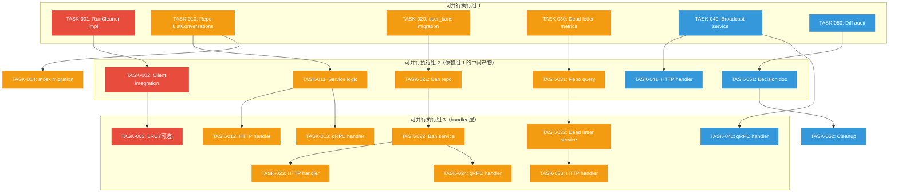
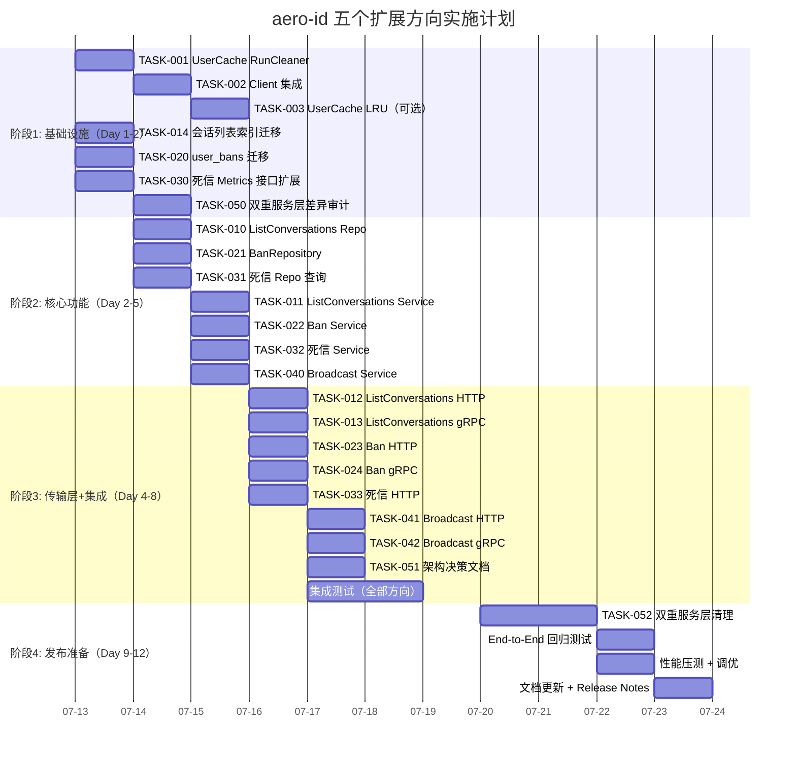

现在我有了完整的基线认知。以下是基于实际代码库现状的 Tech Lead 分析报告。

---

# Tech Lead 分析报告：aero-id 五个扩展方向

> **分析日期**: 2026-07-12
> **文档来源**: `/home/u1/aero-id/docs/requirements/2026-07-10-aero-id-architect-perspective-five-code-evidenced-directions.md`
> **交叉验证**: 已对代码仓库中所有关键引用进行现场核实
> **基线**: 文档撰写日为 2026-07-10，距今日 2 天，部分方向已经有代码变更

## 状态速览：文档 vs 现状

| 方向 | 文档结论 | 现状 | 差距 |
|------|---------|------|------|
| D1: 会话列表 | 完全缺失 | `Conversation`(单对端) + `MarkConversationRead` **已完成**；但 `ListConversations`(全会话列表) 仍缺失 | 文档描述的"全会话列表"仍缺失 |
| D2: UserCache 淘汰 | 缺失 | 仍缺失 | ✅ 需修复 |
| D3: Admin 运营面 | 仅 `ListAudit` | **已大幅推进**：`GrantRole`/`RevokeRole`/`ListRoles`/`ListUserRoles` + `RequirePermission` 中间件已完成；但 `Ban`/`Unban`/`SystemConfig` 仍缺失 | 角色管理已完成，封禁/系统配置缺失 |
| D4: 系统广播 API | 缺失 | 仍缺失 | ✅ 需修复 |
| D5: 死信队列可见性 | 缺失 | 仍缺失 | ✅ 需修复 |
| 附: 双重服务层 | 未解决 | 仍存在 | 架构债务仍需处理 |

---

## 1. 任务分解

以下将每个方向的剩余工作拆解为可独立交付的工程任务。每个任务预估 2-6 小时，遵循 AGENTS.md 的约束（文件 ≤500 行、函数 ≤50 行、圈复杂度 ≤10）。

### 方向二（P0）：UserCache 淘汰机制

| 任务 ID | 标题 | 涉及文件 | 前置依赖 | 工时 | 验收标准 |
|---------|------|---------|---------|------|---------|
| TASK-001 | 为 UserCache 实现 RunCleaner 方法 | `internal/sso/user_cache.go` (+15~20行) | 无 | 2h | `RunCleaner(interval)` 启动 goroutine 定期扫描并删除过期条目；测试覆盖正常清理+stop信号 |
| TASK-002 | 在 Client.Start 中串联 UserCache 清理 | `internal/sso/client.go` (+2行) | TASK-001 | 1h | `Client.Close()` 中 stopping 函数正确串联 userCache cleaner |
| TASK-003 | 为 UserCache 添加 LRU 可选淘汰策略 | `internal/sso/user_cache.go` (+40行) | TASK-002 | 4h | 新增 `MaxSize` 配置项；达到上限时淘汰最久未访问条目；已有 TTL 清理不退化 |

> **决策**: TASK-003 为可选项。如果线上实例的内存压力通过 TASK-001+002 得到控制，可以将 LRU 推迟到未来迭代。但对大规模部署（>10万日活）建议立即包含。

### 方向一（P1）：全会话列表 (Threaded Inbox)

| 任务 ID | 标题 | 涉及文件 | 前置依赖 | 工时 | 验收标准 |
|---------|------|---------|---------|------|---------|
| TASK-010 | Repository: ListConversations 查询 | `internal/repository/message.go` (+25行新增方法+SQL) | 无 | 3h | SQL: `SELECT from_uid, MAX(created_at) AS latest, ... FROM messages WHERE to_uid=? GROUP BY from_uid ORDER BY latest DESC LIMIT n+1`；返回聚合后的会话摘要列表；分页正确 |
| TASK-011 | Service: ListConversations 业务逻辑 | `internal/service/message.go` (+20行)，`internal/service/service.go`（接口声明） | TASK-010 | 2h | 调用 repository，富化用户信息，返回 `ConversationList` DTO |
| TASK-012 | HTTP Handler: GET /v1/conversations | `internal/handler/http/message.go` (+15行路由+handler) | TASK-011 | 2h | 端点返回正确结构的会话列表，含 `from_uid`, `latest_message`, `unread_count`, `next_cursor` |
| TASK-013 | gRPC Handler: ListConversations RPC | `internal/handler/grpc/message.go` (+15行)，`api/proto/aero_id/v1/aero_id.proto`（新增 message + RPC，然后 `make proto`） | TASK-011 | 3h | gRPC 双端一致；proto 生成无报错 |
| TASK-014 | 索引优化 | 新增迁移 `migrations/000024_conversations_idx.up.sql` | TASK-010 | 2h | 复合索引 `(to_uid, from_uid, created_at DESC) WHERE deleted_at IS NULL`；`EXPLAIN ANALYZE` 验证走索引 |

### 方向三（P1）：Admin 封禁 + 系统配置

| 任务 ID | 标题 | 涉及文件 | 前置依赖 | 工时 | 验收标准 |
|---------|------|---------|---------|------|---------|
| TASK-020 | 新增 user_bans 表和迁移 | `migrations/000024_user_bans.up.sql`+`down.sql`；`internal/domain/admin.go`（新增 `UserBan` 实体） | 无 | 3h | 迁移创建 `user_bans` 表(uid, banned_by, reason, created_at)；回滚命令可用；`make test` 通过 |
| TASK-021 | Repository: BanRepository | `internal/repository/admin.go`（新增 BanUser/UnbanUser/IsBanned/ListBanned） | TASK-020 | 4h | 所有操作软校验（不存在用户也能封禁，因为 aero-id 不持有用户表）；IsBanned 支持 cached |
| TASK-022 | Service: Ban/Unban 逻辑 | `internal/service/admin.go`（新增 BanUser/UnbanUser 方法），`internal/service/service.go`（接口扩增） | TASK-021 | 3h | 调用 repository；审计日志记录；权限检查走已有 `RequirePermission(PermUserBan)` |
| TASK-023 | HTTP Handler: 封禁端点 | `internal/handler/http/admin.go` (+20行) | TASK-022 | 2h | `POST /v1/admin/users/:uid/ban` + `POST /v1/admin/users/:uid/unban` |
| TASK-024 | gRPC Handler: 封禁 RPC | `internal/handler/grpc/admin.go` (+20行)；proto 更新；`make proto` | TASK-022 | 3h | 双端对齐 |

### 方向五（P1）：死信队列可见性

| 任务 ID | 标题 | 涉及文件 | 前置依赖 | 工时 | 验收标准 |
|---------|------|---------|---------|------|---------|
| TASK-030 | Metrics: 死信事件指标 | `internal/outbox/relay.go`（MetricsSink 接口 +15行；relay 调用 +5行）；`internal/metrics/...`(注册 counter) | 无 | 3h | 接口新增 `ObserveOutboxDeadLettered(eventType)`；`relay.go` 在标记死信时调用；指标暴露 |
| TASK-031 | Repository: 死信查询 | `internal/outbox/repository.go`（新增 ListDeadLetters 方法） | TASK-030 | 2h | `SELECT * FROM outbox_events WHERE dead_letter=true AND published_at IS NULL ORDER BY updated_at DESC` |
| TASK-032 | Service: 死信管理 | `internal/service/outbox.go`（新增文件）；`internal/service/service.go`（接口声明） | TASK-031 | 3h | ListDeadLetters(分页), ReplayDeadLetter(id), DismissDeadLetter(id) |
| TASK-033 | HTTP Handler: 死信管理端点 | `internal/handler/http/admin.go` (+25行) | TASK-032 | 3h | `GET /v1/admin/outbox/dead-letters`, `POST /v1/admin/outbox/dead-letters/:id/replay`, `POST /v1/admin/outbox/dead-letters/:id/dismiss`；全部带 `PermSystemConfig` |

### 方向四（P2）：系统广播 API

| 任务 ID | 标题 | 涉及文件 | 前置依赖 | 工时 | 验收标准 |
|---------|------|---------|---------|------|---------|
| TASK-040 | Service: Broadcast | `internal/service/message.go`（Broadcast 方法，发送给指定用户列表），`internal/service/service.go`（接口声明） | 无 | 3h | 利用已有 `SendSystem`；支持 `[]string` 用户列表；全量广播先做单用户循环（后续可优化为批量插入） |
| TASK-041 | HTTP Handler: 广播端点 | `internal/handler/http/admin.go` (+15行) | TASK-040 | 2h | `POST /v1/admin/broadcast` with `PermSystemConfig`；body: `{to_uids:[...], content:"...", meta:{}}` |
| TASK-042 | gRPC Handler: 广播 RPC | `internal/handler/grpc/admin.go` (+15行)；proto 更新；`make proto` | TASK-040 | 3h | 双端对齐 |

### 双重服务层清理（P2）

| 任务 ID | 标题 | 涉及文件 | 前置依赖 | 工时 | 验收标准 |
|---------|------|---------|---------|------|---------|
| TASK-050 | 审计：两套代码的差异清单 | 所有 `internal/{file,message,...}/service.go` vs `internal/service/*.go` | 无 | 4h | 产出差异矩阵：哪些方法在新架构中已实现但旧架构没有（反之亦然） |
| TASK-051 | 选择保留路线 + 通知团队 | 无代码变更 | TASK-050 | 1h | 文档化决策（推荐选新弃旧，因新架构更干净）；通知所有维护者 |
| TASK-052 | 执行清理：删除旧层 | `internal/service/` 目录删除；`internal/handler/{http,grpc}/` 中对应 handler 迁移到新架构调用；`internal/app/app.go` 重新接线 | TASK-051 | 8h | `make test && make build` 通过；两套 handler 在单元测试中的行为等价 |

---

## 2. 执行顺序

### 并行执行组分析

**组 1（完全并行，无交叉依赖）**:
- `TASK-001` (UserCache RunCleaner) — 纯本地修改，无外部依赖
- `TASK-010` (ListConversations Repo) — 仅涉及 repository 层
- `TASK-020` (user_bans 迁移) — 纯 DB 迁移
- `TASK-030` (死信 Metrics) — 仅 outbox/relay 内部
- `TASK-040` (Broadcast Service) — 复用已有 SendSystem，独立
- `TASK-050` (双重服务层 Diff 审计) — 纯阅读审计，可与其他开发并行

**组 2（依赖组 1 产出）**:
- `TASK-002` 依赖 TASK-001
- `TASK-011` 依赖 TASK-010
- `TASK-021` 依赖 TASK-020
- `TASK-031` 依赖 TASK-030
- `TASK-051` 依赖 TASK-050

**组 3（Handler 层，依赖组 2）**:
- 各个方向的 handler 层（HTTP + gRPC）可以并行实现

---

## 3. 技术风险

### 3.1 高风险项

| 风险 | 方向 | 等级 | 说明 | 缓解策略 |
|------|------|------|------|---------|
| `ListConversations` 查询在超大规模用户下的性能 | D1 | 🟡 中 | `GROUP BY from_uid ORDER BY MAX(created_at) DESC` 即使有复合索引，如果某用户的收件箱表有数百万条消息、数千个独立发送方，GROUP BY 可能成为瓶颈 | TASK-014 添加复合索引；监控查询耗时；如果 >50ms 考虑物化视图或独立的 `conversations` 表 |
| `Broadcast` 全量广播的事务压力 | D4 | 🟡 中 | 向大量用户发送系统消息时，每条消息创建 + outbox 事件可能导致大量数据库写入 | 初始版本只支持指定用户列表；全量广播分批处理（每批 1000 用户），用 goroutine 池控制并发度 |
| 双重服务层清理可能破坏已有功能 | 附 | 🔴 高 | 删除旧层并重新接线 app.go 是高风险重构，可能引入回归 | 在清理前确保两套代码的测试覆盖率足够；清理过程按模块逐步替换，每替换一个模块跑一遍 `make test && make test-integration` |
| Outbox 死信回放可能导致重复投递 | D5 | 🟡 中 | `ReplayDeadLetter` 清除 `dead_letter` 标记后，relay 会再次尝试投递；如果 handler 不是幂等的，可能造成副作用 | 文档化幂等要求；对非幂等 handler 的 replay 做人工确认→添加 `confirmed_replay` 标记，先列出、手动确认后再回放 |

### 3.2 外部依赖

- **SSO gRPC 服务**: 所有方向不依赖 SSO 变更。TASK-001/002 是纯本地修改。
- **PostgreSQL**: D1 的 GROUP BY 查询和 D3 的 user_bans 表依赖 Postgres 版本 ≥ 12（当前项目要求）。TASK-014 的索引建议依赖 pg 的 `WHERE` 部分索引支持。
- **MinIO / S3**: 无影响。所有方向不涉及存储后端。

### 3.3 性能瓶颈

| 场景 | 瓶颈点 | 量化 | 优化方向 |
|------|--------|------|---------|
| UserCache 高并发 | `sync.RWMutex` 竞争 | 300 万条目 × 1000 QPS × 50µs/锁 = 显著延迟 | TASK-003 LRU + `sync.Map` 混合使用；或每 10000 条分片一个 sub-map |
| ListConversations 大收件箱 | GROUP BY + ORDER BY | 单用户 10 万消息、2000 发送方 → ~20ms 未优化 | TASK-014 索引；未来考虑 `conversations` 物化表 |
| 死信回放批量操作 | 大量 UPDATE + 重投递 | 1000 死信一次性回放 → 可能压垮下游 handler | 回放限流（每次最多 100 条）；带 backoff 的重试 |

### 3.4 测试覆盖难点

- **UserCache Cleaner 时间敏感测试**: 需 mock `time.Now()` 或用 `clock` 接口做依赖注入。建议使用 [go.uber.org/clock](https://pkg.go.dev/go.uber.org/clock) 或简单 `clock.Clock` 接口。
- **死信回放集成测试**: 需要真实 Outbox relay + handler 错误模拟，必须在 `make test-integration` 中覆盖（需要 Docker 启动 Postgres）。
- **封禁功能**: 由于 aero-id 没有用户表，封禁测试只能验证 repository 层的 CRUD + service 层的权限校验逻辑。端到端验证需要在集成测试中模拟 SSO 认证流程。

---

## 4. 资源评估

### 4.1 开发人员技能要求

| 角色 | 技能要求 | 数量 | 负责任务 |
|------|---------|------|---------|
| **Senior Backend (Go)** | Go 高级、PostgreSQL 查询优化、gRPC/protobuf | 1人 | TASK-010/011/014（D1 核心）、TASK-050/051/052（架构清理） |
| **Backend Engineer** | Go 中级、GORM、HTTP API 设计 | 1人 | TASK-001/002/003（D2）、TASK-020/021/022（D3 核心）、TASK-040（D4） |
| **Full-stack / Backend** | Go 中级、gRPC、metrics 体系 | 1人 | TASK-030/031/032/033（D5）、TASK-012/013/023/024/041/042（Handler 层） |

> **团队配置**: 最少 **2 人**可覆盖全部 P0/P1 任务（Senior + Backend）。**3 人**团队可以覆盖全部方向并行推进。如果是单人全栈，建议按优先级顺序串行执行。

### 4.2 关键里程碑

| 里程碑 | 时间 | 交付内容 | 验证方式 |
|--------|------|---------|---------|
| M1: 内存安全 | 第 1 天 | UserCache RunCleaner 就绪 | `make test && make lint` 通过；内存 profiling 验证 |
| M2: 会话就绪 | 第 3 天 | ListConversations 端点交付（HTTP+gRPC） | 集成测试验证翻页+排序正确性 |
| M3: 运营就绪 | 第 5 天 | Admin Ban/Unban 端点交付 | `make test-integration`（含封禁→验证权限拦截） |
| M4: 可观测性 | 第 7 天 | 死信队列可见性（指标+管理端点） | 手动注入死信→验证指标暴露+查询+回放 |
| M5: 平台通知 | 第 9 天 | 广播 API 交付 | 发送广播→验证消息入库+通知推送 |
| M6: 架构清理 | 第 12 天 | 双重服务层清理完成 | `make test && make test-integration && make lint` 全部通过 |

### 4.3 阻塞点

| 阻塞点 | 影响 | 解决策略 |
|--------|------|---------|
| TASK-052 需要完整了解两套架构的差异 | 双重服务层清理风险最高 | 在 TASK-050 阶段产出详细的差异矩阵，逐行评审后再执行 |
| 死信回放的非幂等 handler 问题 | 回放可能导致重复通知 | 短期：回放需要人工确认（界面上标记为"待确认"）；长期：改造 handler 为幂等 |
| `ListConversations` 的 SQL 性能需要在生产数据上验证 | 小数据集下无法暴露性能问题 | 在 staging 环境加载模拟的大数据集（单用户 5000 发送方）后做 `EXPLAIN ANALYZE` |

---

## 5. 质量保证

### 5.1 单元测试覆盖要求

| 任务组 | 覆盖要求 | 关键测试场景 | 最低覆盖率 |
|--------|---------|------------|-----------|
| D2 (UserCache) | 行覆盖 ≥ 90% | 正常清理；空缓存；stop 信号；并发读写；TTL 未到期不清理 | 90% |
| D1 (ListConversations) | 行覆盖 ≥ 85% | 空结果；单条消息；多条消息来自不同发送方；翻页；cursor 边界 | 85% |
| D3 (Ban) | 行覆盖 ≥ 85% | 封禁→阻止发消息；解封→恢复；重复封禁（幂等）；未授权用户调用返回 403 | 85% |
| D5 (Dead Letter) | 行覆盖 ≥ 85% | 死信列表查询；回放成功；回放后 relay 重新拾取；dismiss 删除 | 85% |
| D4 (Broadcast) | 行覆盖 ≥ 80% | 发送给单个用户；批量用户；权限不足；空 content 校验 | 80% |

### 5.2 集成测试策略

- **环境**: 通过 `make test-integration`（testcontainers: Postgres + MinIO）
- **D1 (ListConversations)**:
  - 插入 50 条来自 10 个不同发送方的消息
  - 验证返回按 `latest_message_created_at` DESC 排序的前 N 条会话
  - 验证 `unread_count` 字段正确
  
- **D3 (Ban)**:
  - 创建 user_bans 记录
  - 验证被封禁用户发给对方时返回 403
  - 验证对方发给被封禁用户不受影响（方向性封禁）
  
- **D5 (Dead Letter)**:
  - 构造一个最大重试次数的 outbox 事件
  - 触发 relay → 验证 dead_letter 标记
  - 调用 replay → 验证标记清除 → 触发下一次 relay

### 5.3 代码审查要点

| 审查项 | 检查内容 |
|--------|---------|
| **文件大小** | 每个 .go 文件 ≤ 500 行（AGENTS.md 硬约束） |
| **函数长度** | 每个函数 ≤ 50 行（funlen linter） |
| **圈复杂度** | 每个函数 ≤ 10（cyclop linter） |
| **if 嵌套深度** | ≤ 3 层（人工审查） |
| **错误处理** | repository 返回原始错误 → service 用 `.Wrap(err)` 包装为 AppError，不得泄露原始 DB 错误 |
| **事务边界** | ListConversations 的 GROUP BY 查询不需要事务；Ban 操作是单表 INSERT → 不需要事务；单一工作单元内不要包含无关操作 |
| **proto 变更** | 编辑 `.proto` 后必须执行 `make proto`，提交生成的 `.pb.go` |
| **迁移文件** | 每个 `*.up.sql` 必须有对应 `*.down.sql`；迁移必须可回滚 |
| **竞态条件** | UserCache 的 cleaner 使用 `sync.RWMutex`；cleaner 持有写锁的时间应尽可能短——分批清理（每次 100 条）避免长时间阻塞 GetMany |

### 5.4 性能测试需求

| 方向 | 测试场景 | 目标 | 失败标准 |
|------|---------|------|---------|
| D1 (ListConversations) | 100 个发送方、10 万条消息的收件箱 | 分页响应 < 50ms (P99) | > 200ms |
| D2 (UserCache) | 50 万条目 + 1000 QPS GetMany | cleaner 不增加 P99 延迟超过 5% | P99 增加 > 20% |
| D5 (Dead Letter replay) | 回放 100 条死信 | 回放完成 < 5 秒 | > 30 秒 |

---

## 6. 实施计划

### 四阶段甘特图

### 详细阶段说明

#### 阶段 1: 基础设施搭建（Day 1-2）

| 日 | 优先级 | 活动 | 产出 |
|---|--------|------|------|
| D1 | 🔴 P0 | TASK-001 + TASK-002: UserCache RunCleaner 实现和集成 | 《内存泄漏修复》PR 就绪 |
| D1 | 🔴 P0 | TASK-030: 死信 MetricsSink 扩展 | 死信 metric 指标就绪 |
| D1 | 🟡 P1 | TASK-014: 会话列表索引迁移 | 迁移文件就绪（可随时上线） |
| D1 | 🟡 P1 | TASK-020: user_bans 表迁移 | 迁移文件就绪 |
| D2 | 🟡 P1 | TASK-050: 双重服务层差异审计 | 差异矩阵文档 |
| D2 | 🟢 P2 | TASK-003: UserCache LRU（如需要） | 可选特性就绪 |

> **阶段 1 验收**: `make test && make lint` 全部通过。UserCache 内存泄漏修复已合入。死信指标暴露可用。

#### 阶段 2: 核心功能实现（Day 2-5）

| 日 | 优先级 | 活动 | 产出 |
|---|--------|------|------|
| D2-3 | 🟡 P1 | TASK-010 + TASK-011: ListConversations Repo+Service | 核心查询逻辑就绪 |
| D2-3 | 🟡 P1 | TASK-021 + TASK-022: Ban Repo+Service | 封禁逻辑就绪 |
| D3-4 | 🟡 P1 | TASK-031 + TASK-032: 死信 Repo+Service | 死信管理逻辑就绪 |
| D4 | 🟢 P2 | TASK-040: Broadcast Service | 广播逻辑就绪 |

> **阶段 2 验收**: 所有 service 层单元测试通过。Repository 方法在 `make test` 中覆盖。积分测试尚未覆盖（阶段 3）。

#### 阶段 3: 集成测试和优化（Day 4-8）

| 日 | 优先级 | 活动 | 产出 |
|---|--------|------|------|
| D4-5 | 🟡 P1 | TASK-012/013/023/024/033: 所有 HTTP+gRPC handler | 全部 API 端点就绪 |
| D5-6 | 🟢 P2 | TASK-041/042: Broadcast HTTP+gRPC | 广播端点就绪 |
| D5 | 🟢 P2 | TASK-051: 架构决策文档 | 记录保留哪套架构 |
| D6-8 | 🟡 P1 | 集成测试编写 + 执行 | `make test-integration` 覆盖全部新功能 |

> **阶段 3 验收**: `make test && make test-integration && make lint` 全部通过。所有 5 个方向的功能在 HTTP 和 gRPC 上均可用。双端行为一致。

#### 阶段 4: 发布准备（Day 9-12）

| 日 | 优先级 | 活动 | 产出 |
|---|--------|------|------|
| D9-10 | 🟢 P2 | TASK-052: 双重服务层清理 | 旧架构代码删除，app.go 重新接线 |
| D11 | 🟡 P1 | 端到端回归测试 | 所有模块回归验证 |
| D11 | 🟡 P1 | 性能压测 | ListConversations P99 验证、UserCache 内存验证 |
| D12 | 🟢 P2 | 文档更新 + CHANGELOG | API 文档更新；发布说明 |

> **阶段 4 验收**: 全部代码合入 `main` 分支。性能指标达标。无回归问题。

---

## 汇总和推荐

### 投入产出分析

| 方向 | 总工作量 | 风险 | 商业价值 | 推荐 |
|------|---------|------|---------|------|
| D2: UserCache 淘汰 | 2-6 人时 | 🟢 极低 | 🔴 P0: 生产稳定性 | ✅ **立即启动** |
| D1: 会话列表 | 12 人时 | 🟡 中低 | 🟡 P1: 基础 UX | ✅ **阶段 1 启动** |
| D3: Admin 封禁 | 15 人时 | 🟡 中 | 🟡 P1: 运营能力 | ✅ **阶段 1-2** |
| D5: 死信队列 | 11 人时 | 🟡 中低 | 🟡 P1: 运维可观测 | ✅ **阶段 1-2** |
| D4: 广播 API | 8 人时 | 🟢 低 | 🟢 P2: 产品功能 | ✅ **阶段 2-3** |
| 双重层清理 | 13 人时 | 🔴 高 | 🟢 P2: 架构债 | ⚠️ **建议阶段 4 或有独立迭代周期时执行** |

### 优先级建议（最终调整版）

1. **TASK-001/002 (UserCache)** → 半小时修复一个生产 OOM 隐患，性价比最高
2. **TASK-030 (死信 Metric)** → 3 行接口声明 + 1 行调用，结束静默数据丢失
3. **TASK-010/011/012/013 (ListConversations)** → 填补最明显的产品缺口
4. **TASK-020/021/022/023/024 (Ban)** → 补全 Admin 权限框架的最后一块
5. **TASK-031/032/033 (死信管理)** → 让运维能 recovery，而非只能 restart
6. **TASK-040/041/042 (Broadcast)** → 低风险、高可见性的产品功能
7. **TASK-050/051/052 (架构清理)** → 风险最高，建议在专用迭代中集中处理

### 对团队的实际建议

1. **方向一已经部分实现**：`Conversation` (单对端) + `MarkConversationRead` 已就绪，立即对齐文档，不要重复劳动。
2. **方向三的角色管理也已经完成**：立即在 AdminHandler 中确认 `GrantRole`/`RevokeRole`/`ListRoles`/`ListUserRoles` 已在运行。只缺少 `Ban`/`Unban`。
3. **D2 修复成本极低**：建议尽早合并，不要等到下次 OOM 再修。
4. **关于双重服务层**：当前不是功能性 Bug，不要在这个迭代中冒风险重构。产出差异矩阵后，安排一个专门的重构 sprint。
5. **文档目录管理**：`docs/requirements/` 下 317 个文件已成知识管理的负担。建议设置保留策略：只保留原始分析（`*.md`）+ 验证输出（`*.out.md`），删除过期的衍生文档。
