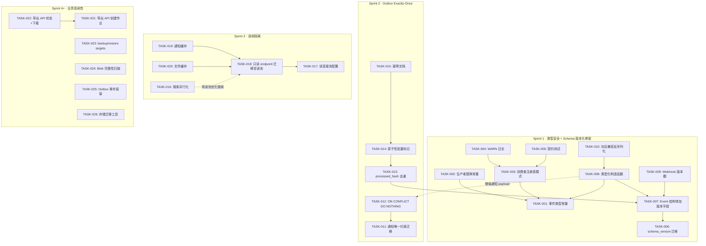
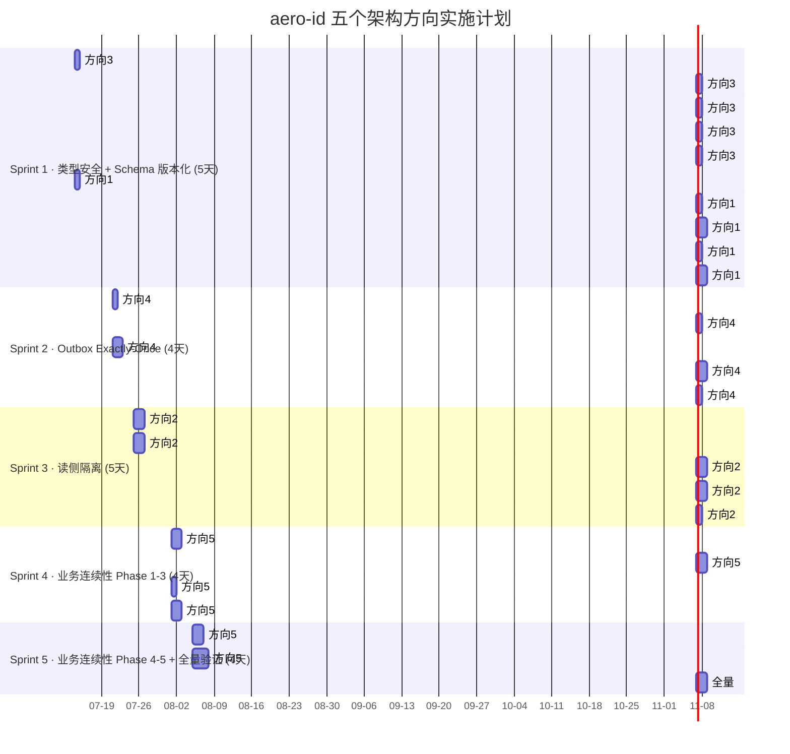

现在我已拿到完整的分析文档。以下是我作为 Tech Lead 的深度实现分析。

---

# Tech Lead 实现分析：aero-id 五个架构扩展方向

## 概述

本文档基于 `docs/requirements/2026-07-10-aero-id-uncovered-architectural-extension-directions.md`，将五个架构方向拆解为可执行任务、标识依赖关系和风险、并制定分阶段实施计划。

**核心约束**（来自 `AGENTS.md`）：
- 文件 ≤ 500 行（非测试/生成代码），函数 ≤ 50 行，圈复杂度 ≤ 10
- 所有软删除、UUIDv7 主键、分层架构（handler → service → repository）
- 无 accounts 表，SSO 持有身份
- 迁移不自动应用，需 `make migrate-up`

---

## 1. 任务分解

### 方向 3 — 领域事件类型安全（建议 Sprint 1，低工作量）

| 任务 ID | 标题 | 涉及文件 | 前置依赖 | 预估工时 | 验收标准 |
|---------|------|---------|---------|---------|---------|
| **TASK-001** | 定义事件类型和聚合类型常量 | `internal/domain/events.go`（新文件） | 无 | 1h | `EventTypeMessageSent = "message.sent"` 等常量定义，编译器可引用 |
| **TASK-002** | 替换生产者侧裸字符串 | `internal/message/service.go`，`internal/comment/service.go`，`internal/file/service.go` | TASK-001 | 1h | 所有 `outbox.NewEvent` 调用使用域常量而非字符串字面量 |
| **TASK-003** | 替换消费者侧 switch 为注册表模式 | `internal/notification/dispatcher.go` | TASK-001 | 2h | `notificationFor` 改为 `map[string]HandlerFunc` 注册表；启动时若缺失 handler 则 panic（快速失败） |
| **TASK-004** | 添加未知事件类型的 WARN 日志 | `internal/notification/dispatcher.go` | TASK-003 | 0.5h | 收到未注册事件类型时记录 `WARN` + 事件 ID，不再静默丢弃 |
| **TASK-005** | 编写生产者-消费者契约测试 | `internal/notification/dispatcher_test.go`（新测试文件） | TASK-003 | 2h | 测试枚举所有已注册事件类型并验证各类型有 handler；CI 中断步 |

**方向 3 总工时：6.5h**

### 方向 1 — Outbox 事件 Schema 版本化（建议 Sprint 1，低工作量骨架）

| 任务 ID | 标题 | 涉及文件 | 前置依赖 | 预估工时 | 验收标准 |
|---------|------|---------|---------|---------|---------|
| **TASK-006** | 添加 `schema_version` 迁移 | `migrations/000024_add_outbox_schema_version.up.sql` + `.down.sql` | 无 | 0.5h | `outbox_events` 表新增 `schema_version INT NOT NULL DEFAULT 1` |
| **TASK-007** | Event 结构体加版本字段 | `internal/outbox/outbox.go` | TASK-006 | 1h | `Event` struct 新增 `SchemaVersion int`；序列化/反序列化兼容旧数据（默认 1） |
| **TASK-008** | 添加类型化事件构造函数 | `internal/outbox/events.go`（新文件）+ 修改 `internal/outbox/outbox.go` | TASK-001, TASK-007 | 2h | `NewMessageSentEvent()` 等构造函数自动注入 `SchemaVersion`；取消裸 `outbox.NewEvent` |
| **TASK-009** | Webhook 载荷添加版本戳 | `internal/outbox/webhook.go` | TASK-007 | 0.5h | `webhookPayload` 增加 `SchemaVersion` 字段 |
| **TASK-010** | 向后兼容反序列化器 | `internal/outbox/dispatcher.go`（提取/增强） | TASK-008 | 2h | dispatcher 先按当前版本解析，回退到旧 schema；注册新 payload 版本 |

**方向 1 总工时：6h**

### 方向 4 — Outbox At-Least-Once → Exactly-Once（建议 Sprint 2）

| 任务 ID | 标题 | 涉及文件 | 前置依赖 | 预估工时 | 验收标准 |
|---------|------|---------|---------|---------|---------|
| **TASK-011** | notifications 添加唯一约束迁移 | `migrations/000025_add_notifications_unique.up.sql` + `.down.sql` | 无 | 0.5h | `UNIQUE (recipient_uid, type, subject_id, COALESCE(actor_uid, ''))` |
| **TASK-012** | 通知 Create 使用 `ON CONFLICT DO NOTHING` | `internal/notification/repository.go` | TASK-011 | 1h | 重复事件不报错、不插入重复行 |
| **TASK-013** | 添加 outbox 事件处理去重标记（`processed_hash`） | `internal/outbox/outbox.go`, migration `000026` | TASK-007 | 2h | 新增 `processed_hash TEXT` 列；handler 处理前检查哈希去重 |
| **TASK-014** | relay 使用原子性批量标记 | `internal/outbox/relay.go` | TASK-013 | 2h | 在单个事务中完成 Handle + MarkPublished（降低崩溃窗口） |
| **TASK-015** | 更新所有 handler 文档/注释为"必须幂等" | `internal/outbox/relay.go`, `internal/notification/dispatcher.go` | TASK-014 | 0.5h | 代码注释和 README 明确幂等要求 |

**方向 4 总工时：6h**

### 方向 2 — 读侧隔离 / CQRS-lite（建议 Sprint 3）

| 任务 ID | 标题 | 涉及文件 | 前置依赖 | 预估工时 | 验收标准 |
|---------|------|---------|---------|---------|---------|
| **TASK-016** | 搜索接口并行化 | `internal/search/search.go` | 无 | 2h | `Search` 用 `errgroup` 并发执行三种 kind 查询；单个超时不阻塞其他 |
| **TASK-017** | 添加独立读连接池配置 | `configs/config.yaml`，`internal/config/config.go`，`internal/app/app.go` | 无 | 2h | `database.reader_dsn` 配置项；`ReadDB()` 返回只读 `*gorm.DB` |
| **TASK-018** | 只读 endpoint 迁移至读池 | `internal/repository/*.go`（逐个调整 GET/LIST/Search handler） | TASK-017 | 3h | 所有 GET/LIST/Search 仓库方法使用读池；写操作使用写池 |
| **TASK-019** | 通知列表内存缓存 | `internal/notification/service.go` + `cache` 子包 | TASK-018 | 3h | 最近 N 条未读通知 LRU 缓存；outbox 写入后失效 |
| **TASK-020** | 文件元数据内存缓存 | `internal/file/repository.go`（+ cache 拦截层） | TASK-018 | 2h | `GetFile` LRU 缓存；`Update`/`Delete` 时失效 |

**方向 2 总工时：12h**

### 方向 5 — 业务连续性与数据可移植性（建议 Sprint 4+）

| 任务 ID | 标题 | 涉及文件 | 前置依赖 | 预估工时 | 验收标准 |
|---------|------|---------|---------|---------|---------|
| **TASK-021** | 数据导出 API（创建作业） | `internal/handler/http/export.go`，`internal/service/export.go`，`internal/repository/export.go` | 无 | 4h | `POST /v1/export` 创建异步导出作业；返回 job_id |
| **TASK-022** | 数据导出 API（状态+下载） | `internal/handler/http/export.go` | TASK-021 | 2h | `GET /v1/export/:job_id/status` + `/download` |
| **TASK-023** | 添加 `make backup` / `make restore` | `Makefile`，`scripts/backup.sh`，`scripts/restore.sh` | 无 | 1h | `make backup` 执行 pg_dump + blob snapshot |
| **TASK-024** | Blob 完整性扫描 | `internal/storage/gc/sweeper.go`（增强） | 无 | 2h | GC sweeper 可选通道：重新计算 SHA-256 并与 `files.checksum` 比较 |
| **TASK-025** | Outbox 事件保留策略 | `internal/outbox/repository.go`，`configs/config.yaml` | 无 | 2h | 可配置保留期（默认 7 天）；定时清理已发布事件 |
| **TASK-026** | 存储迁移工具 | `cmd/storage-migrate/main.go` | 无 | 4h | 双向 local↔S3 迁移；以 files 表为事实源 |

**方向 5 总工时：15h**

---

## 2. 执行顺序

### 依赖图



### 可并行执行的任务组

| 组 | 任务 | 说明 |
|----|------|------|
| **组 A** | TASK-001, TASK-006 | 常量定义和 schema 迁移互不依赖 |
| **组 B** | TASK-002, TASK-003 | 可并行替换生产者和消费者端（均依赖 TASK-001） |
| **组 C** | TASK-011, TASK-017, TASK-016, TASK-023, TASK-024, TASK-025 | 独立基础设施任务，可在任意 Sprint 并行 |
| **组 D** | TASK-021, TASK-026 | 导出 API 和存储迁移工具无依赖关系 |

---

## 3. 技术风险

### 3.1 高风险项

| 风险 | 方向 | 描述 | 缓解策略 |
|------|------|------|---------|
| **R1: 向后兼容反序列化** | 方向 1 | 事件 payload 可能跨多个版本演化，Go 的 `json.Unmarshal` 静默忽略未知字段，难以检测版本不匹配 | 在 dispatcher 中检查 `json.Unmarshal` 后关键字段是否为零值；记录结构化日志；开发版本迁移测试 |
| **R2: 读/写连接池数据一致性** | 方向 2 | 使用读副本时，刚写入的数据读不到（副本延迟），导致 GET-after-write 返回 404 | 读取连接写后强制路由到主库（`context` 传递 `usePrimary`）；文档明确最终一致性语义 |
| **R3: 原子性批量标记的性能开销** | 方向 4 | 每次 relay tick 在单个事务中执行 N 个 Handle + 批量 MarkPublished，N 较大时事务持锁时间长 | 设置 `relay.batch` 上限（当前默认值？）；考虑分片提交 |
| **R4: 数据导出大文件内存压力** | 方向 5 | 用户有大量文件时，zip 生成可能耗尽内存 | 流式写入暂存文件（而非内存 buffer）；大小限制（如单次导出 ≤ 2GB）；分块导出 |

### 3.2 外部依赖

| 依赖 | 影响 |
|------|------|
| **Postgres** — 所有迁移、唯一约束、ttsvector 搜索 | 无新外部依赖；但读副本需要额外 Postgres 实例（方向 2） |
| **SSO** — gRPC 令牌验证+用户解析 | 不变；无需修改 |
| **MinIO/S3** — 文件存储 | 方向 5 的 blob 完整性扫描需读取存储中的对象，增加 GET 请求量 |

### 3.3 性能瓶颈与优化策略

| 瓶颈 | 当前表现 | 优化策略 |
|------|---------|---------|
| 搜索串行查询（方向 2） | 三顺序 FTS，慢表拖慢所有 | `errgroup` + 超时 → P50 搜索时间降低 3x（预估） |
| 通知表读写争用（方向 2） | 列表与插入竞争同一 B-tree | 读池分配后，读负载转移到副本 |
| Outbox relay 批量处理（方向 4） | 事务长度随 batch 线性增长 | batch 上限设为 50；监控 `tps_per_relay_tick` |

### 3.4 测试难点

| 方向 | 难点 | 策略 |
|------|------|------|
| 方向 1 | schema 版本演化场景的集成测试 | 写一个测试 helper，构造旧版本 payload → `outbox.NewEvent` → 验证反序列化成功 |
| 方向 4 | 模拟 relay 崩溃场景验证 exactly-once | `context` 取消模拟崩溃；检查通知表不存在重复行 |
| 方向 5 | 数据导出完整性验证 | 创建用户、写入数据、导出、导入新实例、比对哈希树 |

---

## 4. 资源评估

### 4.1 开发人员

| 角色 | 数量 | 所需技能 | 负责方向 |
|------|------|---------|---------|
| **资深 Go 后端工程师** | 1 | GORM、gRPC、Postgres、并发模式 | 方向 1/3（串联） + 方向 4 |
| **全栈/后端工程师** | 1 | HTTP API、Postgres 优化、缓存模式 | 方向 2 + 方向 5 |
| **SRE/DevOps（兼职）** | 0.2 | Postgres 复制、备份策略 | 方向 5（backup/restore/读副本） |

**最优配置**：2 名开发人员，Sprint 1-2 背靠背工作，Sprint 3-4 并行。

### 4.2 关键里程碑

| 里程碑 | 时间 | 交付物 |
|--------|------|--------|
| **M1** | 第 1 周结束 | 方向 3 完成（事件类型安全） + 方向 1 骨架（schema 版本化） |
| **M2** | 第 2 周结束 | 方向 4 完成（exactly-once outbox） |
| **M3** | 第 3 周结束 | 方向 2 完成（搜索并行化 + 读池 + 缓存） |
| **M4** | 第 4 周结束 | 方向 5 Phase 1-3（导出 API + backup/restore + blob 完整性） |
| **M5** | 第 5 周结束 | 方向 5 Phase 4-5（事件保留 + 存储迁移工具）+ 全量集成测试+性能回归 |

### 4.3 阻塞点与解决策略

| 阻塞点 | 影响 | 策略 |
|--------|------|------|
| **无读副本可用** | 方向 2 读池无法测试 | Sprint 3 前在 docker-compose 中添加一个 Postgres 只读副本容器（一个 `pg_basebackup` + `hot_standby = on`）；本地集成测试可用 |
| **方向 5 导出需要大量存储** | 导出的存档需要临时存储空间 | 复用用户的文件存储空间：存档作为用户 `files` 表中的条目，利用 GC 自动清理临时导出 |
| **方向 4 事务持锁时间** | 高 throughput 下 relay 可能成为瓶颈 | 监控 `relay_duration_ms`，动态调整 batch 大小 |

---

## 5. 质量保证

### 5.1 单元测试覆盖要求

| 包 | 现有覆盖基准 | 新增覆盖目标 | 关键测试场景 |
|----|------------|-------------|------------|
| `internal/outbox` | 中 | ≥ 80% | 新旧版本反序列化、去重哈希碰撞、MarkPublished 失败回滚 |
| `internal/notification` | 高 | ≥ 85% | `ON CONFLICT DO NOTHING` 重复抑制、缓存失效 |
| `internal/search` | 低（当前无缓存在此层） | ≥ 70% | errgroup 超时/取消、部分结果返回 |
| `internal/service/export` | 新 | ≥ 80% | 作业创建/状态转换/完成；权限校验（仅自己的数据） |
| `internal/domain` | 中 | ≥ 90% | 事件类型常量正确性 |

### 5.2 集成测试策略

| 测试 | 工具 | 覆盖范围 | 执行时间 |
|------|------|---------|---------|
| **方向 1 + 3 集成** | testcontainers + 真实 Postgres | 构造旧版 outbox event → 部署新版代码 → 验证通知正确创建 | ~5s |
| **方向 4 集成** | testcontainers + 模拟 relay 崩溃 | 杀死 relay 进程 → 重启 → 检查无重复通知 | ~3s |
| **方向 2 集成** | docker-compose primary + replica | 写后立即读（走副本）→验证读延迟在可接受范围内 | ~10s |
| **方向 5 集成** | testcontainers + MinIO | 创建用户 + 导出 + 下载 + 解压 → 对比原始数据 | ~15s |

**现有测试基础设施**：`internal/repository/testpg` 已提供 Postgres testcontainer。方向 5 需要同时启动 MinIO testcontainer。

### 5.3 代码审查要点

| 审查重点 | 对应任务 | 检查项 |
|---------|---------|--------|
| **事件类型注册表设计** | TASK-003 | map 是否在 `init()` 中填充？缺失 handler 是否在启动时 panic？ |
| **向后兼容性** | TASK-010 | 旧 payload 反序列化是否保留所有必要字段？放弃未知字段是否记录日志？ |
| **幂等性正确性** | TASK-012~TASK-014 | `processed_hash` 使用完整 payload 还是仅 event ID？哈希冲突概率？ |
| **读池切换精确性** | TASK-018 | 没有写操作漏到读池（GORM 的 `Create`/`Save`/`Update`）；没有 GET 遗漏在写池 |
| **缓存失效正确性** | TASK-019~TASK-020 | 写操作后缓存是否及时失效？是否存在 race condition？ |
| **导出权限检查** | TASK-021 | `POST /v1/export` 是否校验 actor == 导出的用户？提取的文件 content 是否过滤可见性？ |

### 5.4 性能测试需求

| 测试 | 触发条件 | 度量指标 | 目标 |
|------|---------|---------|------|
| 搜索并行化回归 | `make test-integration` + 1k 条数据 | P50/P99 搜索延迟 | 比串行降低 ≥ 40% |
| Outbox relay 压力 | 批量注入 10k 事件 | 处理吞吐量 (events/s)、最大延迟 | 与当前持平或更好 |
| 通知唯一约束插入 | 10k 重复事件 (100 个唯一) | 插入时间、死锁计数 | 无死锁，≤ 200ms |
| 数据导出 1GB 场景 | 1GB 文件用户 | 总时间、内存峰值、磁盘使用 | ≤ 30s，≤ 512MB RAM，流式 |

---

## 6. 实施时间表



### 阶段摘要

| 阶段 | 持续时间 | 人工日 | 交付物 |
|------|---------|--------|--------|
| **Sprint 1** 基础设施 + 类型安全 | 5 天 | 10 人日 | 事件类型安全、Schema 版本化骨架、契约测试 |
| **Sprint 2** Exactly-Once | 4 天 | 5.5 人日 | 通知去重、outbox 原子性处理 |
| **Sprint 3** 读侧隔离 | 5 天 | 8.5 人日 | 搜索并行化、读池分离、缓存层 |
| **Sprint 4** 业务连续性 P1-3 | 4 天 | 6 人日 | 数据导出 API、backup/restore、blob 校验 |
| **Sprint 5** 业务连续性 P4-5 + 集成 | 4 天 | 6 人日 | 事件保留、迁移工具、全量集成测试 |
| **合计** | **22 天** | **36 人日** | 5 方向全部完成 |

### 压缩选项（如果急迫）

- **并行 Sprint 1 与 Sprint 2**：方向 1（TASK-006~TASK-010）与方向 4（TASK-011~TASK-015）内容上几乎独立，只是都依赖 TASK-001（事件常量）和 TASK-007（Event 结构体）。如果 2 名开发人员背靠背，可将总工期从 22 天压缩到 **14-15 天**。
- **方向 5 拆为独立轨道**：方向 5 是唯一没有前置依赖其他方向的任务组，可在 Sprint 1-2 期间由第二位开发人员并行推进，总工期进一步压缩到 **12 天**。

---

## 总结优先级

```
Sprint 1 → 方向 3 (类型安全) + 方向 1 (Schema 版本化)
            理由：非侵入、低风险、高维护性收益

Sprint 2 → 方向 4 (Exactly-Once)
            理由：修复数据正确性 bug，直接影响用户体验

Sprint 3 → 方向 2 (读侧隔离)
            理由：为 10 万+ 用户做准备，搜索并行化低门槛高回报

Sprint 4-5 → 方向 5 (业务连续性)
            理由：合规要求高，但实现工作量最大且影响面最小
```

**建议的起点**：TASK-001（事件类型常量）和 TASK-006（schema 版本迁移）。这两项彼此独立，20 分钟即可完成，为后续所有任务奠定基础。完成后运行 `make test && make lint` 确保不会破坏现有代码。
