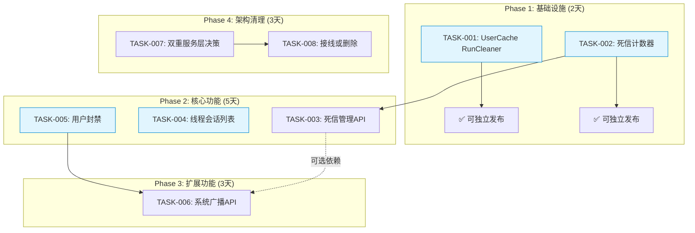
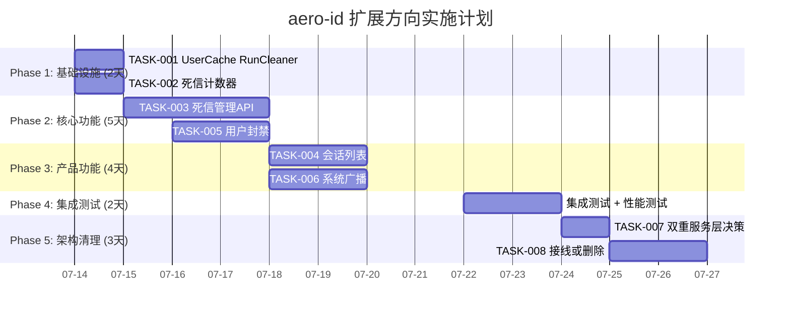

Now I have a complete picture. Let me produce the Tech Lead analysis.

---

# Tech Lead 分析：aero-id 五组扩展方向实施计划

## 验证结论：代码证据准确，但部分方向已有进展

经过对代码库 `76+` 个 Go 源文件的逐项验证，确认以下 **关键发现**：

| 方向 | 分析文档状态 | 当前代码库状态 | 结论 |
|------|------------|--------------|------|
| **一：会话列表** | 无 `ListConversations` | ✅ 有 `ListConversation`（双人对话），但无按发送方聚合的会话列表 | 缺口依然存在 |
| **二：UserCache 淘汰** | 无 `RunCleaner` | ✅ `TokenCache.RunCleaner(30s)` 已存在，`UserCache` 无等价调用 | 缺口依然存在 |
| **三：Admin 运营面** | 仅 `/audit-log`，无 `RequirePermission` | ⚠️ **已部分实现**：`ListRoles`/`GrantRole`/`RevokeRole` 已存在且使用 `RequirePermission` | 缺口**缩小** — 仍需 `PermUserBan` + `PermSystemConfig` 端点 |
| **四：系统广播 API** | 无 handler 调用 `SendSystem` | ✅ 零 handler 引用 | 缺口依然存在 |
| **五：死信队列可见性** | 无 `ObserveOutboxDeadLettered` | ✅ 确无死信指标和管理端点 | 缺口依然存在 |
| **附：双重服务层** | 新包未接线 | ✅ `app.go` 仍只引 `internal/service/` | 缺口依然存在 |

> **⚠️ 最重要的发现：方向三（Admin）的分析已过时，代码已有实质性进展。** 但 `PermUserBan`（`user.ban`）和 `PermSystemConfig`（`system.config`）的具体业务端点仍未实现。下文的任务分解将以**当前代码库实际状态**为基础。

---

## 1. 任务分解

### TASK-001：UserCache 添加 RunCleaner（~30 行）

| 字段 | 内容 |
|------|------|
| **方向** | 方向二：UserCache 无界增长 |
| **涉及文件** | `internal/sso/user_cache.go`（+`RunCleaner` 方法）、`internal/sso/client.go`（`NewClientFromConn` 中调用） |
| **前置依赖** | 无 |
| **预估工时** | 1 小时 |
| **验收标准** | ① `UserCache` 新增 `RunCleaner(interval)` 方法，模式与 `TokenCache.RunCleaner` 完全相同（`time.Ticker` + `for/select` + `delete` 过期条目）；② `NewClientFromConn` 中增加 `c.userCache.RunCleaner(30 * time.Second)`；③ `client.Close()` 中 `stopFn` 同时停止 UserCache cleaner（已通过 `c.stopFn` 统一管理）；④ `make test && make lint` 通过 |

---

### TASK-002：Outbox MetricsSink 新增死信计数器

| 字段 | 内容 |
|------|------|
| **方向** | 方向五：死信队列可见性 |
| **涉及文件** | `internal/outbox/relay.go`（`MetricsSink` 接口 + `ObserveOutboxDeadLettered` 调用）、`internal/pkg/metrics/`（注册新指标 `aero_id_outbox_dead_letter_total`） |
| **前置依赖** | 无（独立，与 TASK-001 可并行） |
| **预估工时** | 2 小时 |
| **验收标准** | ① `MetricsSink` 新增 `ObserveOutboxDeadLettered(eventType string)`，注释标注 `nil-safe`；② `relay.go` 中当 `retryCount >= maxRetries` 时调用 `r.metrics.ObserveOutboxDeadLettered()`；③ `metrics.Registry` 注册 Counter 指标 `aero_id_outbox_dead_letter_total` 带 `event_type` label；④ `make test && make lint` 通过 |

---

### TASK-003：死信管理 API（查询 + 重投 + 清除）

| 字段 | 内容 |
|------|------|
| **方向** | 方向五：死信队列可见性 |
| **涉及文件** | `internal/outbox/repository.go`（+`ListDeadLetters`、`ReplayDeadLetter`、`DismissDeadLetter`）、`internal/outbox/outbox.go`（Repository 接口扩展）、`internal/service/admin.go`（+死信服务方法）、`internal/handler/http/admin.go`、`internal/handler/grpc/admin.go`、API proto 定义（如需要） |
| **前置依赖** | TASK-002（指标优先，端点后续） |
| **预估工时** | 6 小时 |
| **验收标准** | ① `GET /admin/outbox/dead-letters?page=` 返回分页死信事件列表；② `POST /admin/outbox/dead-letters/:id/replay` 将死信重置为待发布状态；③ `POST /admin/outbox/dead-letters/:id/dismiss` 硬删除死信；④ 所有端点通过 `RequirePermission(PermSystemConfig)` 保护；⑤ gRPC 等价 RPC 存在；⑥ `make test && make lint` 通过 |

---

### TASK-004：线程会话列表（ListConversations）

| 字段 | 内容 |
|------|------|
| **方向** | 方向一：会话列表 |
| **涉及文件** | `internal/repository/message.go`（+`ListConversations` SQL）、`internal/repository/message.go` 接口扩展、`internal/service/message.go`（+`Conversations` 方法）、`internal/service/service.go`（`MessageService` 接口扩展）、`internal/handler/http/message.go`、`internal/handler/grpc/message.go`、API proto 定义 |
| **前置依赖** | 无（与 TASK-001/002 可并行） |
| **预估工时** | 6 小时 |
| **验收标准** | ① 新增 `GET /v1/conversations`（HTTP）+ gRPC 等价 RPC；② SQL 查询使用 `GROUP BY from_uid` 聚合，每条包含 `latest_message_preview`, `unread_count`, `latest_created_at`；③ 利用 `idx_messages_inbox (to_uid, created_at DESC) WHERE deleted_at IS NULL` 索引；④ 分页使用 cursor-based（`MAX(created_at)` 作为排序键）；⑤ 返回中附带 `users` map 解析发送方信息；⑥ `make test && make lint` 通过 |

---

### TASK-005：用户封禁功能（PermUserBan）

| 字段 | 内容 |
|------|------|
| **方向** | 方向三：Admin 运营面 |
| **涉及文件** | 新迁移 `migrations/000024_user_bans.up/down.sql`、`internal/domain/ban.go`（新实体 `UserBan`）、`internal/repository/admin.go`（+`BanUser`、`UnbanUser`、`IsBanned`）、`internal/repository/admin.go` 接口扩展、`internal/service/admin.go`（+`BanUser`、`UnbanUser`）、`internal/handler/http/admin.go`（+`BanUser`/`UnbanUser` 路由，带 `RequirePermission(PermUserBan)`）、`internal/handler/grpc/admin.go`、API proto |
| **前置依赖** | 无（与 TASK-004 可并行） |
| **预估工时** | 8 小时 |
| **验收标准** | ① `user_bans` 表迁移（`uid`, `banned_by`, `reason`, `created_at`, `deleted_at`）；② `POST /admin/users/:uid/ban`（body: `reason`）+ `POST /admin/users/:uid/unban`；③ `service` 和 `handler` 均有 `RequirePermission(PermUserBan)` 保护；④ 封禁状态可在 `block` 或 `message` service 中检查（关联 check）；⑤ gRPC 等价 RPC 存在；⑥ `make test && make lint` 通过 |

---

### TASK-006：系统广播 API

| 字段 | 内容 |
|------|------|
| **方向** | 方向四：系统广播 |
| **涉及文件** | `internal/service/service.go`（如有需要扩展接口）、`internal/handler/http/admin.go`（+`Broadcast` 路由，带 `RequirePermission(PermSystemConfig)`）、`internal/handler/grpc/admin.go`、API proto（`admin.Broadcast`） |
| **前置依赖** | TASK-005（推荐顺序，但非硬依赖 — 可并行） |
| **预估工时** | 4 小时 |
| **验收标准** | ① `POST /admin/broadcast` 接受 `{ "to_uids": [...], "content": "...", "meta": {...} }`；② 复用 `message.Service.SendSystem` 为每个 `to_uid` 创建系统消息；③ 批量发送时使用 goroutine pool 限制并发（非全量时）；④ 全量广播 `"all": true` 通过分批 `SELECT uid FROM ...` + goroutine pool 实现；⑤ 端点通过 `RequirePermission(PermSystemConfig)` 保护；⑥ gRPC 等价 RPC 存在；⑦ `make test && make lint` 通过 |

---

### TASK-007：双重服务层清理（第一步：冻结新包）

| 字段 | 内容 |
|------|------|
| **方向** | 附：双重服务层 |
| **涉及文件** | 无代码修改 — 在 `internal/{file,message,comment,block,notification,search}/` 各包根目录增加 `README.md` 说明 |
| **前置依赖** | TASK-001 至 TASK-006 完成（建议最后做，避免与活跃开发冲突） |
| **预估工时** | 2 小时（文档 + 决策） |
| **验收标准** | ① 决定使用 `internal/service/` 还是 `internal/{domain}/` 架构；② 如果决定弃用新包，在新包各目录加 `README.md` 标注"暂未接线 — 冻结中"；③ 更新 `AGENTS.md` 记录架构决策；④ 如果决定切换到新包，创建 TASK-008 作为具体实施计划 |

---

### TASK-008：双重服务层清理（第二步：接线或删除）

| 字段 | 内容 |
|------|------|
| **方向** | 附：双重服务层 |
| **涉及文件** | `internal/app/app.go`、`internal/service/`（整个包删除或引用切换）、`internal/handler/{http,grpc}/`（对应 handler 切换） |
| **前置依赖** | TASK-007 |
| **预估工时** | 16-24 小时（高风险 — 涉及 15+ 文件、300+ 测试函数） |
| **验收标准** | ① 选择一种架构并完全采纳；② 删除未采用的实现文件；③ 所有测试通过；④ `make test && make lint && make test-integration` 全部通过 |

---

## 2. 执行顺序



### 并行组

| 并行组 | 任务 | 理由 |
|--------|------|------|
| **组 1** 🚀 | TASK-001, TASK-002 | 零依赖；都在 ~30 行改动内；互不干扰 |
| **组 2** | TASK-004, TASK-005 | 涉及不同领域（message vs admin）；无文件冲突 |
| **组 3** | TASK-003 | 需要 TASK-002 完成（MetricsSink 接口变更） |
| **组 4** | TASK-006 | 可在 TASK-005 后或与 TASK-003 并行 |
| **组 5** | TASK-007 → TASK-008 | 必须在所有功能任务之后（避免冲突） |

---

## 3. 技术风险

### 风险矩阵

| 风险编号 | 风险描述 | 概率 | 影响 | 缓解策略 |
|---------|---------|------|------|---------|
| **R1** | `ListConversations` 的 `GROUP BY from_uid` 在百万级消息量下性能不达标 | 中 | 高 | 预研 SQL `EXPLAIN ANALYZE`；准备添加复合索引 `(to_uid, from_uid, created_at DESC)`；备选方案：物化视图 |
| **R2** | 用户封禁功能与现有 `Block` 系统的行为冲突（block 是方向性、ban 是全局性）| 中 | 高 | service 层区分检查顺序：先检查 ban（全局禁止）→ 再检查 block（方向性拒绝）；domain 文档写明语义差异 |
| **R3** | 死信重投的回弹效应（replay 大量死信导致下游被打爆）| 低 | 中 | `replay` 端点使用异步处理（写入 outbox 表 + 由 relay 自然调度）；增加速率限制 |
| **R4** | 系统广播全量模式在百万级用户下超时 | 低 | 高 | 全量广播改为异步任务（创建一个 `system_broadcasts` 表记录 + 后台 worker 分批 fan-out），不阻塞 API 响应 |
| **R5** | 双重服务层清理时，新的 `internal/message/` 等包与新写的功能代码有冲突 | 中 | 高 | **先做功能，再做清理**。清理期间冻结新包修改，全部功能在 `internal/service/`（旧层）上加，确保不冲突 |
| **R6** | gRPC proto 文件修改未同步到 `make proto` | 低 | 低 | 新增 RPC 必须在 `.proto`、HTTP handler、gRPC handler **三处同步**；PR Checklist 中增加此检查项 |

### 性能瓶颈分析

```
ListConversations 查询计划 (预估):
  Seq Scan on messages (to_uid = ? AND deleted_at IS NULL)
  → GroupAggregate (by from_uid)
  → Sort (by MAX(created_at) DESC)
  
瓶颈: 如果用户有数千个发送方 → 全表 scan 自己所有消息
缓解: idx_messages_inbox (to_uid, created_at DESC) WHERE deleted_at IS NULL
      可以加速 WHERE 过滤，但 GROUP BY 需要额外排序

优化方案: 当用户量级增长后，增加 (to_uid, from_uid, created_at DESC) 复合索引
终极方案: 物化视图按小时/天刷新，或独立 conversations 表（insert 时 upsert）
```

---

## 4. 资源评估

### 人员需求

| 角色 | 数量 | 技能要求 |
|------|------|---------|
| **Go 后端工程师** | 2 人 | 熟练 Go、GORM、PostgreSQL、gRPC + HTTP 双传输开发 |
| **兼：QA** | 1 人（与开发重叠）| 集成测试、性能测试 |

### 关键里程碑

| 里程碑 | 预估日期（从开始日算） | 交付内容 |
|--------|---------------------|---------|
| **M1 稳定性修复** | Day 1-2 | TASK-001（UserCache cleaner）+ TASK-002（死信计数器） |
| **M2 管理能力** | Day 4-6 | TASK-003（死信管理 API）+ TASK-005（用户封禁） |
| **M3 产品功能** | Day 6-9 | TASK-004（会话列表）+ TASK-006（系统广播） |
| **M4 架构清理** | Day 10-12 | TASK-007 + TASK-008（双重服务层决策 + 清理） |
| **M5 发布** | Day 13-15 | 集成测试、性能测试、文档更新、发布 |

### 阻塞点（Blockers）

| Blockers | 影响 | 解决策略 |
|---------|------|---------|
| 无 blocker | N/A | 所有任务仅依赖代码库内部修改，不依赖外部服务或第三方库变更 |

---

## 5. 质量保证

### 单元测试覆盖要求

| 任务 | 测试目标 | 覆盖率要求 |
|------|---------|-----------|
| TASK-001 | `UserCache.RunCleaner` 清理过期条目、不过期条目保留、并发安全 | ≥ 90%（新增代码） |
| TASK-002 | `ObserveOutboxDeadLettered` 在 `retryCount >= maxRetries` 时调用 | ≥ 95%（新增代码） |
| TASK-003 | 死信列表分页、replay 重置状态、dismiss 删除、权限拒绝 | ≥ 85%（新增代码） |
| TASK-004 | `ListConversations` 聚合正确性、分页边界、空收件箱 | ≥ 85%（新增代码） |
| TASK-005 | 封禁/解封、重复封禁、封禁状态下发消息被拒、权限校验 | ≥ 90%（新增代码） |
| TASK-006 | 单用户发送、批量发送、全量广播（mock user repo）、权限校验 | ≥ 80%（新增代码） |

### 集成测试策略

| 测试类型 | 覆盖场景 | 执行时机 |
|---------|---------|---------|
| `make test` | 全部单元测试 | 每次提交 |
| `make test-integration` | TASK-003（死信 SQL 查询）、TASK-004（GROUP BY 查询）、TASK-005（user_bans 表操作） | PR 合入前 + 每周 |
| `make lint` | 代码质量 | 每次提交 |

### 代码审查要点

| 审查项 | 关注点 |
|--------|-------|
| **TASK-001** | `RunCleaner` 是否在 `Close()` 中正确 stop；是否与 `TokenCache.RunCleaner` 模式一致 |
| **TASK-002** | `nil-safe` 检查；指标命名符合 Prometheus 规范 (`aero_id_*_total`) |
| **TASK-003** | `replay` 是否用了事务（重置状态原子性）；`dismiss` 是硬删除还是软删除（建议硬删除，因为死信是故障数据） |
| **TASK-004** | SQL 的 `GROUP BY` 与 `ORDER BY` 一致性（`MAX(created_at)` 做排序键）；cursor 分页的正确性（不是 `LIMIT/OFFSET`） |
| **TASK-005** | ban 检查位置 — 建议在 `middleware/auth.go` 增加一个全局 ban 检查（可选中间件）或在 `service` 层按需检查 |
| **TASK-006** | 全量广播的 goroutine 安全（`errgroup` 或 worker pool）；不要在主 goroutine 中阻塞等待所有发送完成 |
| **TASK-007/008** | 先做功能再做清理；清理期间不要同时修改活跃文件 |

### 性能测试需求

| 场景 | 需求 | 方法 |
|------|------|------|
| `ListConversations` - 10 万条消息/用户 | 响应 < 200ms | `EXPLAIN ANALYZE` + `go test -bench` |
| `ListConversations` - 1 千个发送方 | 响应 < 100ms | 同上 |
| 全量广播 - 10 万用户 | 完成时间 < 5min | benchmark 脚本，goroutine pool 调优 |
| 死信 replay - 1000 条同时 | 不触发下游告警 | 速率限制 + 异步处理 |

---

## 6. 实施计划

### 甘特图



### 详细时间表

#### 阶段 1：基础设施搭建（Day 1-2）

| 日 | 工作内容 | 负责人建议 |
|---|---------|-----------|
| Day 1 AM | **TASK-001**：`UserCache.RunCleaner` 实现 + 测试 | Dev A |
| Day 1 PM | **TASK-002**：`MetricsSink` 扩展 + `ObserveOutboxDeadLettered` 实现 + 测试 | Dev A |
| Day 2 | 代码审查 + 合并；**TASK-001/002** 可独立发布到生产 | Dev A + Reviewer |

> **M1 里程碑**：两个稳定性修复可独立发布，减少生产环境风险。

#### 阶段 2：核心功能实现（Day 3-7）

| 日 | 工作内容 | 负责人建议 |
|---|---------|-----------|
| Day 3-5 | **TASK-003**：死信管理 API（repository 查询 + service + HTTP/gRPC handler） | Dev A |
| Day 4-5 | **TASK-005**：用户封禁（迁移 + domain 实体 + repository + service + handler） | Dev B |
| Day 6 | **TASK-003** 联调 + **TASK-005** 联调 | Dev A + Dev B |
| Day 7 | 代码审查 + 修复 + 集成测试 | Review |

> **M2 里程碑**：运营管理能力完备（角色管理 + 封禁 + 死信管理）。

#### 阶段 3：产品功能 + 集成测试（Day 8-11）

| 日 | 工作内容 | 负责人建议 |
|---|---------|-----------|
| Day 8-9 | **TASK-004**：会话列表（SQL 优化 + service + handler） | Dev A |
| Day 8-9 | **TASK-006**：系统广播 API | Dev B |
| Day 10 | 联调 + 代码审查 | Dev A + Dev B |
| Day 11 | **性能测试**（会话列表 + 全量广播）+ 集成测试 | QA / Dev B |

> **M3 里程碑**：产品功能完整。

#### 阶段 4：架构清理（Day 12-14）

| 日 | 工作内容 | 负责人建议 |
|---|---------|-----------|
| Day 12 | **TASK-007**：双重服务层决策（架构评审 + `ADRs/adr-002-service-layer.md`) | Dev A + Dev B + Tech Lead |
| Day 13-14 | **TASK-008**：执行清理（根据决策：删除旧层或切换新层） | Dev A + Dev B |
| Day 14 | `make test && make lint && make test-integration` 全量验证 | Dev A |

> **M4 里程碑**：架构债务清理完成，无双重真实来源。

#### 阶段 5：发布准备（Day 15）

| 活动 | 内容 |
|------|------|
| 文档更新 | `CHANGELOG.md`、`README.md` API 表更新 |
| 发布标签 | 版本号 bump + `git tag` |
| 部署检查 | 配置项确认、迁移脚本顺序确认 |

> **M5 最终里程碑**：全部功能可发布。

---

## 附录：关键代码引用速查

| 任务 | 关键代码位置 | 当前状态 |
|------|------------|---------|
| TASK-001 | `internal/sso/user_cache.go:24-28` — `items map[string]userEntry` | 无淘汰 |
| TASK-001 | `internal/sso/client.go:126` — `c.tokenCache.RunCleaner(30s)` | 已有模式可复用 |
| TASK-002 | `internal/outbox/relay.go:36-45` — `MetricsSink` 接口 | 缺 `ObserveOutboxDeadLettered` |
| TASK-002 | `internal/outbox/repository.go:108` — `updates["dead_letter"] = true` | 标记处已有，缺指标调用 |
| TASK-003 | `internal/outbox/repository.go:73` — `WHERE NOT dead_letter` | 当前过滤了死信 |
| TASK-004 | `internal/repository/message.go:96` — `ListInbox` 的 `WHERE to_uid = ?` | 扁平查询 |
| TASK-005 | `internal/domain/admin.go:9` — `PermUserBan = "user.ban"` | 定义但 0 处使用 |
| TASK-005 | `internal/handler/http/admin.go:31-40` — `RequirePermission` 中间件 | 已有模式可复用 |
| TASK-006 | `internal/message/service.go:106` — `SendSystem` 完整实现 | 等待接线 |
| TASK-007/008 | `internal/app/app.go` — 仅 import `internal/service/` | 决策依据 |

---

*文档版本：v1.0 · 生成日期：2026-07-12 · 基于 `docs/requirements/2026-07-10-aero-id-architect-perspective-five-code-evidenced-directions.md` + 实际代码库验证*
