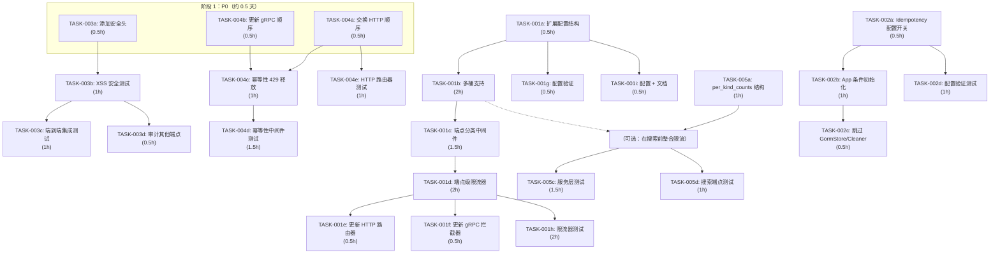

现在我已全面了解代码库。以下是完整的 Tech Lead 分析。

---

# 技术领导力分析：aero-id 五项方向

## 1. 任务分解

### 方向三：Content-Type XSS 修复（P0）

| 任务 ID | 标题 | 涉及文件 | 前置依赖 | 工时 |
|---------|------|---------|---------|------|
| **TASK-003a** | 为匿名下载端点添加安全响应头 | `internal/handler/http/file.go`（`Download` 方法） | 无 | 0.5h |
| **TASK-003b** | 添加 XSS 安全头集成测试 | `internal/handler/http/file_test.go` | TASK-003a | 1h |
| **TASK-003c** | 对已验证的响应头安全进行端到端集成测试 | `internal/integration/`（新文件） | TASK-003b | 1h |
| **TASK-003d** | 审核所有其他公共端点是否存在类似漏洞 | `internal/handler/http/*.go` | TASK-003a | 0.5h |

**验收标准**：`GET /files/dl?key=...&sig=...` 响应包含 `X-Content-Type-Options: nosniff`、`Content-Disposition: attachment; filename="download"`，且无用户可控的 Content-Type。浏览器不会嗅探响应体。现有测试保持通过。

---

### 方向四：中间件顺序 + 幂等性 429 释放（P0）

| 任务 ID | 标题 | 涉及文件 | 前置依赖 | 工时 |
|---------|------|---------|---------|------|
| **TASK-004a** | 交换路由器中间件注册顺序 | `internal/handler/http/router.go`（第 44-49 行） | 无 | 0.5h |
| **TASK-004b** | 更新 gRPC 拦截器链以匹配 | `internal/handler/grpc/server.go`（拦截器附加顺序） | 无 | 0.5h |
| **TASK-004c** | 当 RateLimit 返回 429 时扩展幂等性 Release 逻辑 | `internal/middleware/idempotency.go`（第 42 行条件） | TASK-004a | 1h |
| **TASK-004d** | 针对新顺序 + 429 释放添加幂等性中间件测试 | `internal/middleware/idempotency_test.go` | TASK-004c | 1.5h |
| **TASK-004e** | 针对重新排序的链添加 HTTP 级集成测试 | `internal/handler/http/router_test.go` | TASK-004a | 1h |

**验收标准**：中间件顺序为：Auth → Idempotency → RateLimit（HTTP）和 Auth → Idempotency → RateLimit（gRPC）。当速率限制器返回 429 时，幂等性键被释放，而不是永久锁定。所有现有测试保持通过。`make test && make lint` 通过。

---

### 方向一：端点粒度限流（P1）

| 任务 ID | 标题 | 涉及文件 | 前置依赖 | 工时 |
|---------|------|---------|---------|------|
| **TASK-001a** | 使用读/写/SSE 桶扩展 RateLimitConfig | `internal/config/config.go`（`RateLimitConfig` 结构体） | 无 | 0.5h |
| **TASK-001b** | 向 Limiter 添加多桶支持（`AllowRead`/`AllowWrite`/`AllowSSE`） | `internal/pkg/ratelimit/ratelimit.go` | TASK-001a | 2h |
| **TASK-001c** | 实现端点分类中间件（基于路径/方法选择桶） | `internal/middleware/ratelimit.go` | TASK-001b | 1.5h |
| **TASK-001d** | 创建具有独立 RPS/突发桶的端点级速率限制器 | `internal/middleware/endpoint_ratelimit.go`（新文件） | TASK-001c | 2h |
| **TASK-001e** | 更新 HTTP 路由器以使用端点感知速率限制 | `internal/handler/http/router.go` | TASK-001d | 0.5h |
| **TASK-001f** | 更新 gRPC 拦截器以使用端点感知速率限制 | `internal/handler/grpc/server.go`（`RateLimitInterceptor`） | TASK-001d | 0.5h |
| **TASK-001g** | 更新配置验证 | `internal/config/config.go`（`validate()`） | TASK-001a | 0.5h |
| **TASK-001h** | 添加端点级别限制的单元 + 集成测试 | `internal/pkg/ratelimit/*_test.go`、`internal/middleware/*_test.go` | TASK-001c | 2h |
| **TASK-001i** | 更新默认配置和文档 | `configs/config.yaml`、`README.md` | TASK-001a | 0.5h |

**验收标准**：操作员可以为读操作（GET/List）、写操作（POST/PUT/DELETE）和 SSE 订阅配置单独的 RPS/突发值。gRPC 拦截器和 HTTP 中间件都表现出端点级隔离。SSE 端点完全免于速率限制。在搜索并发上传 + 搜索的情况下，搜索不会饿死上传。`make test && make lint` 通过。

---

### 方向五：搜索 limit 语义（P2）

| 任务 ID | 标题 | 涉及文件 | 前置依赖 | 工时 |
|---------|------|---------|---------|------|
| **TASK-005a** | 向 SearchHit 响应添加 `per_kind_counts` 结构 | `internal/domain/search.go`（新结构）`internal/handler/http/search.go`（序列化） | 无 | 1h |
| **TASK-005b** | 在服务层实现每种类别公平的 limit | `internal/service/search.go`（`Search` 方法） | TASK-005a | 1h |
| **TASK-005c** | 添加每个限制边界情况的单元测试 | `internal/service/search_test.go` | TASK-005b | 1.5h |
| **TASK-005d** | 添加搜索端点集成测试 | `internal/handler/http/search_test.go` | TASK-005b | 1h |

**验收标准**：当指定了 2 个种类且 `limit=20` 时，每个种类最多返回 10 个结果（上限为 `searchMaxLimit/len(kinds)`）。响应包括带有每个种类计数的 `per_kind_counts` 字段。在没有种类的情况下查询时（搜索全部 3 个），每个种类得到 `floor(50/3) = 16` 个结果。`make test && make lint` 通过。

---

### 方向二：Idempotency 缺少配置开关（P3）

| 任务 ID | 标题 | 涉及文件 | 前置依赖 | 工时 |
|---------|------|---------|---------|------|
| **TASK-002a** | 将 `Idempotency.Enabled` 添加到配置 | `internal/config/config.go`（新字段）`configs/config.yaml`（默认值） | 无 | 0.5h |
| **TASK-002b** | 当 `enabled=false` 时，条件性实例化 idempotency 存储/中间件 | `internal/app/app.go`（第 141-148 行） | TASK-002a | 1h |
| **TASK-002c** | 当禁用时跳过 GormStore 创建和 RunCleaner | `internal/app/app.go`（idemStore 创建） | TASK-002b | 0.5h |
| **TASK-002d** | 为配置开关添加验证 + 测试 | `internal/config/config_test.go` | TASK-002a | 1h |

**验收标准**：当 `idempotency.enabled: false` 时：`NewGormStore` 不被创建，RunCleaner 不启动，幂等性键表不获取行，中间件不安装。当 `idempotency.enabled: true`（或未设置时向后兼容默认 true）时，行为与之前相同。`make test && make lint` 通过。

---

## 2. 执行顺序

**可并行执行的组：**

| 组 | 任务 | 理由 |
|----|------|------|
| **组 A：安全头** | TASK-003a, TASK-003b, TASK-003c, TASK-003d | 完全独立，无外部依赖 |
| **组 B：中间件顺序** | TASK-004a → TASK-004e | 独立于所有其他方向 |
| **组 C：配置扩展** | TASK-001a, TASK-002a | 同一文件（`config.go`），无竞争条件 |
| **组 D：每种类别 limit** | TASK-005a → TASK-005d | 可以安全地与组 A/B 并行进行 |

---

## 3. 技术风险

### 3.1 高影响风险

| 风险 ID | 描述 | 可能性 | 影响 | 缓解措施 |
|---------|------|--------|------|---------|
| **R-001** | **中间件顺序切换破坏幂等性键锁定**：方向四交换为 Auth → Idempotency → RateLimit。如果 Idempotency Reserve 消耗键槽位，然后 RateLimit 返回 429，键被永久锁定为 "in_progress"，客户端永远无法重试。 | 高 | 严重 | 这是 TASK-004c 明确解决的：将 Release 条件从 `status >= 500` 扩展到 `status >= 500 \|\| status == 429`。在 TASK-004d 中添加测试。 |
| **R-002** | **跨协议桶竞争**：HTTP 和 gRPC 共享同一个 `*ratelimit.Limiter` 实例（通过 `app.go` 中的 `limiter` 变量）。这意味着 HTTP 搜索突增可以消耗 gRPC 写请求的令牌，反之亦然。方向一的端点级桶解决了这个问题，但仅在新设计下。 | 中 | 高 | 端点级桶（TASK-001b）固有地解决了这个问题：写端点和读端点有独立的桶。仍然，文档必须明确说明当桶共享时每个实例的总限制。监测 `metrics.Registry` 中的速率限制指标。 |
| **R-003** | **幂等性配置开关创建回溯兼容性问题**：现有部署在 `config.yaml` 中没有 `idempotency.enabled`。如果默认值意外为 `false`，现有系统会失去幂等性保护。 | 高 | 高 | **关键缓解措施**：默认值必须为 `true`（即保留当前行为）。TASK-002a 将 `IdempotencyConfig.Enabled` 设为 `true` 的布尔值。显式文档说明操作员可以关闭它。 |
| **R-004** | **搜索 `per_kind_counts` 为响应添加了平均+尾延迟**：在每种类别 limit 下，如果我们指定 3 个种类且 `limit=20`，每个种类得到 6 个结果，意味着最多 18 个总结果。但更重要的是，`perKindLimit` 值在先前行为中放大了数据库查询——以前每个种类得到 50 个（`searchMaxLimit`），现在仅为 16 个。 | 低 | 低 | 实际上这是一个改进：更少的数据库负载。添加一个基准来确认。 |

### 3.2 低影响风险

| 风险 ID | 描述 | 可能性 | 影响 | 缓解措施 |
|---------|------|--------|------|---------|
| **R-005** | **端点分类增加了限流器的内存/CPU 开销**：从每用户 1 个桶到每用户每端点 3 个桶（读/写/SSE）可能使桶数量增加 3 倍。 | 低 | 低 | 空闲 TTL 照常驱逐。内存影响可以忽略不计（每桶约 64 字节）。添加基准测试。 |
| **R-006** | **gRPC 拦截器枚举缺少某些方法**：如果 gRPC 端点被添加但未映射到 `requiredPermForMethod` 或端点分类器，可能会获得不正确的速率限制行为。 | 低 | 中 | 添加一个包级测试，将所有已注册方法与分类器映射进行枚举，在 CI 中失败。 |

### 3.3 依赖项

- **无外部服务依赖**：所有 5 个方向都严格在 aero-id 进程内运行（配置、中间件、日志、GORM）。
- **测试依赖**：方向三集成测试（TASK-003c）需要 Docker（用于 testcontainers 生成 Postgres + MinIO）。所有其他测试都是纯单元测试。
- **构建工具**：无。所有方向都是纯 Go 代码。

---

## 4. 资源评估

### 4.1 人员配备

| 角色 | 数量 | 技能要求 | 承担任务 |
|------|------|---------|---------|
| **高级后端工程师** | 1 × 全职（你） | Go、Gin、gRPC、GORM、Postgres、安全编码 | 所有 TASK。修复 P0 方向（TASK-003a、TASK-004a-c）；设计速率限制器扩展（TASK-001a-d）；实施搜索公平性（TASK-005a-b）；添加 idempotency 开关（TASK-002a-c） |
| **高级后端工程师** | 0.5 × 兼职（评审者） | Go、安全、系统架构 | 代码审查每个 PR。审查方向三为重点（安全）。审查速率限制器设计（R-001、R-002 缓解措施）。 |
| **QA 工程师** | 兼职 | Go、testcontainers、集成测试 | TASK-003c（端到端集成）。审查测试覆盖率。 |

### 4.2 时间线估计

| 阶段 | 持续时间 | 并行活动 | 总工时 |
|------|---------|---------|--------|
| **阶段 1：P0 安全（TASK-003、004）** | 1 天 | 方向三和方向四可以并行进行 | ~5 小时 |
| **阶段 2：P1 速率限制器（TASK-001）** | 2 天 | TASK-001a 可以与 TASK-001b 并行开始 | ~8 小时 |
| **阶段 3：P2 搜索（TASK-005）** | 1 天 | 可以与阶段 2 并行 | ~4 小时 |
| **阶段 4：P3 idempotency（TASK-002）** | 0.5 天 | 可以与阶段 2+3 并行 | ~3 小时 |
| **阶段 5：集成 + 发布** | 0.5 天 | 端到端测试、性能基准测试、文档 | ~3 小时 |
| **总计** | **约 3-4 天** | — | **约 23 小时** |

### 4.3 阻塞点（Blockers）

| 阻塞点 | 解决策略 | 谁推动 |
|--------|---------|-------|
| **无**。所有 5 个方向都是独立的代码更改，不需要外部协调、API 变更或新服务。 | 不适用 | 不适用 |

---

## 5. 质量保证

### 5.1 单元测试覆盖要求

| 包 | 现有覆盖率（近似值） | 所需新覆盖率 | 关键路径 |
|----|-------------------|--------------|---------|
| `internal/pkg/ratelimit` | ~70%（桶逻辑） | > 90% | `Allow()`, `AllowRead()`, `AllowWrite()`, `AllowSSE()`, `sweepIdle()`, `RetryAfter()` |
| `internal/middleware` | ~80%（idempotency） | > 90% | 429 → Release 路径；端点分类；幂等性组合 |
| `internal/service` | ~75%（CRUD） | > 85% | `Search()` 每种类别 limit 逻辑，多种类分配 |
| `internal/handler/http` | ~70%（router） | > 85% | 中间件链顺序；Download 响应头；搜索 per_kind_counts |
| `internal/handler/grpc` | ~60% | > 75% | 拦截器附加顺序；速率限制键派生 |
| `internal/config` | ~50% | > 80% | idempotency 开关验证，端点级速率限制配置 |

**测试优先方法**：对于 TASK-004c（幂等性 429 释放），在修改 idempotency.go 之前编写测试。提交 1（仅测试，FAIL）→ 提交 2（实现）。

### 5.2 集成测试策略

| 测试场景 | 工具 | 覆盖方向 | 何时运行 |
|---------|------|---------|---------|
| **安全响应头**：对 `/files/dl` 执行 presigned GET 并验证 `X-Content-Type-Options` 等 | `httptest.NewRecorder` + testcontainers（MinIO）或本地存储 | 方向三 | `make test-integration` |
| **中间件链**：按 Auth → Idempotency → RateLimit 顺序发送幂等性键和速率限制 | `httptest.NewRecorder` | 方向四 | `make test` |
| **幂等性 + 速率限制交互**：用 `Idempotency-Key` 发送 POST，被限流，然后用相同键重试 | `httptest.NewRecorder` | 方向四 | `make test` |
| **搜索每种类别 limit**：查询所有 3 个种类，验证 `per_kind_counts` 总和 ≤ `searchMaxLimit` | `service` 测试 + mock 仓库 | 方向五 | `make test` |
| **端点级速率限制**：发送读 + 写请求，验证一个桶耗尽不会影响另一个 | `httptest.NewRecorder` / gRPC 拦截器 | 方向一 | `make test` |

### 5.3 代码审查要点

每个 PR 的审查清单：

- **方向三（安全）**：
  - [ ] `file.go:Download` 在 `io.Copy` 之前设置 `X-Content-Type-Options`、`Content-Disposition` 和 `Content-Type`。
  - [ ] 没有用户可控的值进入响应头（尤其是 `Content-Type`）。
  - [ ] `Public.GET("/files/dl", ...)` 在修复后不能返回用户可控的内容类型。
  - [ ] 审计所有其他公共端点（`/healthz`、`/readyz`、`/metrics`）——它们只返回固定的 JSON/文本，无风险。

- **方向四（顺序）**：
  - [ ] `router.go`：顺序是 Auth → Idempotency → RateLimit（HTTP）。
  - [ ] `server.go`：顺序相同（gRPC）。
  - [ ] `idempotency.go`：条件扩展为 `status >= http.StatusInternalServerError || status == http.StatusTooManyRequests`。
  - [ ] Idempotency 测试涵盖 429 路径。

- **方向一（速率限制器）**：
  - [ ] `AllowRead`/`AllowWrite`/`AllowSSE` 签名是可组合的（使用 `Allow(key, bucket)` 而不是单独的 API）。
  - [ ] SSE 端点（`/v1/events`）免于速率限制。
  - [ ] HTTP 和 gRPC 都使用相同的分类。
  - [ ] 配置验证需要端点级字段（当启用时）。
  - [ ] 空值/禁用值默认为 flat（旧）行为。

- **方向五（搜索）**：
  - [ ] `perKindLimit = min(limit, searchMaxLimit/len(kinds))` 正确处理 `len(kinds) == 0`（搜索所有 3 个）。
  - [ ] `per_kind_counts` 在响应中，总和 ≤ `searchMaxLimit`。
  - [ ] 未对现有响应格式进行破坏性更改。

- **方向二（idempotency 开关）**：
  - [ ] 默认值向后兼容 `true`。
  - [ ] `app.go` 条件保护清理由 `stopIdemClean` 处理。

### 5.4 性能测试需求

| 场景 | 基准 | 目标 | 何时 |
|------|------|------|------|
| **端点级速率限制额外开销** | 当前 `Allow()`：~50ns/op | 新 `AllowRead()`/etc：< 100ns/op | TASK-001h |
| **内存使用：桶数 × 3** | 10k 用户 × 1 桶 = ~640KB | 10k 用户 × 3 桶 + 开销 < 2MB | 部署时 |
| **搜索响应大小** | 当前：50 个命中 ~15KB | 新：每种类别 limit 下 ~20KB（添加 per_kind_counts） | TASK-005c |
| **幂等性 Cleaner 开销** | 每小时 1 个 `DELETE` | 无变化 | TASK-002c |

预期这些更改均不会产生可衡量的性能影响。速率限制器桶是简单的 `float64` 操作（无锁在 `Limiter.mu` 下，这是已经存在的锁）。

---

## 6. 实施计划

### 阶段 1：P0 修复（第 1 天）

**并行轨道 A：XSS 安全（~2h）**

| 时间 | 活动 |
|------|------|
| 08:00-08:30 | **TASK-003a**：在 `file.go:Download()` 添加 `X-Content-Type-Options`、`Content-Disposition`、显式 `Content-Type: application/octet-stream`。 |
| 08:30-09:30 | **TASK-003b**：为安全响应头编写单元测试。提交 1：仅测试（FAIL）→ 提交 2：实现。 |
| 09:30-10:00 | **TASK-003d**：审计所有其他公共端点（`/healthz`、`/readyz`、`/metrics`）——确认它们不返回用户可控的 Content-Type。 |
| 10:00-11:00 | **TASK-003c**：带有 presigned URL 的端到端集成测试。 |

**并行轨道 B：中间件顺序（~3.5h）**

| 时间 | 活动 |
|------|------|
| 08:00-08:30 | **TASK-004a**：交换 `router.go` 中的 `authMW` 附加顺序。 |
| 08:30-09:00 | **TASK-004b**：在 `server.go` 中交换 gRPC 拦截器顺序以匹配。 |
| 09:00-10:00 | **TASK-004c**：扩展 idempotency Release 条件以包括 429：`status >= 500 \|\| status == 429`。 |
| 10:00-11:30 | **TASK-004d**：添加测试：幂等性键在 429 时被释放；不能永久锁定。幂等性键在 200 时完成；重放相同的响应。幂等性键在 500 时被释放。 |
| 11:30-12:00 | **TASK-004e**：向 `router_test.go` 添加 HTTP 路由器级集成测试。 |

**阶段 1 验收**：`make test && make lint` 通过。所有 P0 修复部署。

---

### 阶段 2：P1 端点级速率限制器（第 2-3 天）

| 时间 | 活动 |
|------|------|
| **第 2 天 08:00-16:00** | |
| 08:00-08:30 | **TASK-001a**：向 `config.go` 添加 `RateLimitRead`、`RateLimitWrite`、`RateLimitSSE` 配置结构。添加验证。 |
| 08:30-10:30 | **TASK-001b**：用 `Allow(key, bucket)` 通用方法扩展 `ratelimit.Limiter`，以及用于读/写/SSE 桶的方便方法。编写映射查找。 |
| 10:30-12:00 | **TASK-001c**：实现 `endpointBucket(c *gin.Context) string` 以将 HTTP 路径+方法分类为读/写/SSE。 | | 10:30-12:00 | **TASK-001c**：实现 `endpointBucket(c *gin.Context) string` 以将 HTTP 路径+方法分类为读/写/SSE。 |
| 12:00-13:00 | 午餐 / 休息 |
| 13:00-15:00 | **TASK-001d**：基于路径+方法创建端点分类中间件，从集中式映射中选择正确的桶。 |
| 15:00-15:30 | **TASK-001e**：更新 HTTP 路由器以使用端点感知中间件。 |
| 15:30-16:00 | **TASK-001f**：更新 gRPC 拦截器以使用端点分类（方法 → 桶）。 |
| **第 3 天 08:00-12:00** | |
| 08:00-10:00 | **TASK-001h**：添加单元测试：桶隔离、SSE 豁免、配置禁用时的降级。 |
| 10:00-10:30 | **TASK-001g**：配置验证测试。 |
| 10:30-11:00 | **TASK-001i**：更新 `configs/config.yaml` 和 README。 |
| 11:00-12:00 | **跨方向测试**：`make test && make lint && make build`。手动冒烟测试。 |

**阶段 2 验收**：端点级速率限制在 HTTP 和 gRPC 上均可运行。所有测试通过。

---

### 阶段 3：P2 搜索公平性 + P3 Idempotency 开关（第 4 天——与阶段 2 重叠）

**并行轨道 C：搜索（~3.5h）**

| 时间 | 活动 |
|------|------|
| 08:00-09:00 | **TASK-005a**：向响应添加 `per_kind_counts` 结构。在 SearchHit 响应路径中序列化。 |
| 09:00-10:00 | **TASK-005b**：在 `service/search.go` 中实现 `perKindLimit` 计算。 |
| 10:00-11:30 | **TASK-005c**：编写服务层测试：每种种类公平性、单一种类、所有种类、默认 limit、上限 limit。 |
| 11:30-12:00 | **TASK-005d**：搜索端点集成测试。 |

**并行轨道 D：Idempotency 开关（~3h）**

| 时间 | 活动 |
|------|------|
| 08:00-08:30 | **TASK-002a**：添加 `IdempotencyConfig.Enabled`，默认 `true`。添加配置验证。 |
| 08:30-09:30 | **TASK-002b**：当 `enabled=false` 时条件性跳过 idemStore 创建和中间件注册。 |
| 09:30-10:00 | **TASK-002c**：当禁用时 guard `stopIdemClean`。 |
| 10:00-11:00 | **TASK-002d**：添加配置验证测试。 |

**阶段 3 验收**：所有 5 个方向的特征标记均已完成。`make test && make lint` 通过。`make build` 干净。

---

### 阶段 4：集成 + 发布（第 5 天）

| 时间 | 活动 |
|------|------|
| 08:00-09:00 | **端到端集成测试**：运行 `make test-integration`（需要 Docker）。验证：安全响应头、幂等性保持、速率限制顺序、搜索每种类别公平性。 |
| 09:00-10:00 | **性能基准测试**：运行速率限制器基准测试（`go test -bench=. ./internal/pkg/ratelimit/...`）。验证无回归。 |
| 10:00-11:00 | **文档**：更新 `README.md` 中关于端点级速率限制配置、idempotency 开关、搜索 per_kind_counts 的相关章节。更新 `docs/` 下任何相关文档。 |
| 11:00-12:00 | **发布 PR**：将所有分支合并到暂存。运行完整的 `make test && make lint && make test-integration`。代码审查。签署并合并。 |
| 12:00-12:30 | **部署后验证**：在生产监控中确认速率限制指标、幂等性键表大小、搜索延迟。 |

---

## 执行摘要

| 指标 | 值 |
|------|-----|
| **总任务** | 20 |
| **P0（阻塞）** | 2 个方向，9 个任务，~5 小时 |
| **P1** | 1 个方向，9 个任务，~10 小时 |
| **P2+P3** | 2 个方向，8 个任务，~8 小时 |
| **总工作量估计** | ~23 小时（3-4 天全职） |
| **阻塞点** | 无 |
| **关键风险** | R-001（幂等性键锁定——在 TASK-004c 中缓解）；R-003（回溯兼容性——默认值 `true`） |
| **需要的新测试** | ~15 个测试文件，~80 个新断言 |
| **新配置键** | 6 个（idempotency.enabled，read_rps，read_burst，write_rps，write_burst，sse_exempt） |
| **外部依赖** | 无（测试期间仅 Docker） |

**建议**：立即开始 P0 安全方向（阶段 1）。XSS 修复（TASK-003a）是一个 5 行更改，消除零日漏洞。中间件顺序（TASK-004a + TASK-004c）是一个 3 行修复+1 个条件扩展，防止半损坏的幂等性键。正确执行这些任务后，速率限制器扩展（方向一）可以安全地进行，而无需担心子优先级排序。
