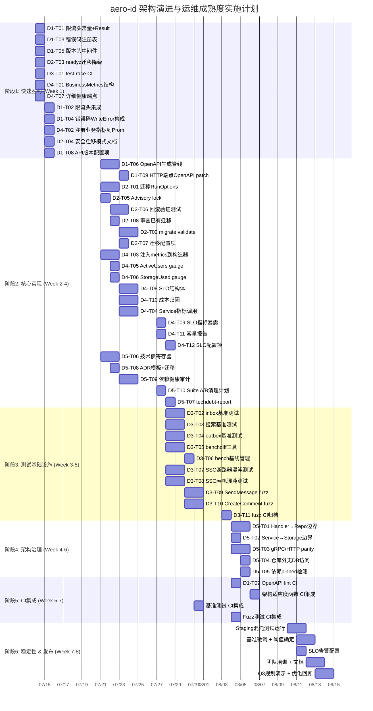

已经完整读取了分析文档。这份文档质量很高，覆盖了 5 个高阶方向，每个方向都有代码级证据和具体方案。下面我从 Tech Lead 角度进行深入分析。

---

# Tech Lead 分析报告：架构演进与运维成熟度实施规划

## 1. 任务分解

将 5 个方向拆解为 **43 个可执行任务**（每个 2-4 小时），按方向编号。

### 方向一：API 消费者契约与开发者体验（P1）

| 任务 ID | 任务标题 | 涉及文件 | 前置依赖 | 预估工时 |
|---------|---------|---------|---------|---------|
| D1-T01 | 定义限流头常量 + Result 结构 | `internal/middleware/ratelimit.go` | 无 | 2h |
| D1-T02 | 集成限流头到 Allow() 返回路径 | `internal/middleware/ratelimit.go` | D1-T01 | 3h |
| D1-T03 | 创建错误码注册表（~30 个错误码） | `internal/pkg/errors/registry.go` | 无 | 3h |
| D1-T04 | 集成错误码到 WriteError（X-Error-Code 头） | `internal/pkg/errors/errors.go` | D1-T03 | 2h |
| D1-T05 | 添加 API 版本头中间件 | `internal/middleware/version.go` | 无 | 2h |
| D1-T06 | proto→OpenAPI 生成管线（Makefile target） | `Makefile`, `api/proto/` | 无 | 3h |
| D1-T07 | OpenAPI lint + breaking change CI 步骤 | `.github/workflows/ci.yml` | D1-T06 | 3h |
| D1-T08 | 添加 api.versioning 配置项 | `internal/config/config.yaml` | D1-T05 | 2h |
| D1-T09 | 补充 HTTP-only 端点 OpenAPI patch | `docs/openapi-patches/` | D1-T06 | 4h |

**小计：9 任务，24 工时**

### 方向二：生产级数据迁移与 Schema 演化（P1）

| 任务 ID | 任务标题 | 涉及文件 | 前置依赖 | 预估工时 |
|---------|---------|---------|---------|---------|
| D2-T01 | 迁移 RunOptions（LockTimeout, StatementTimeout, DryRun） | `internal/pkg/migrate/migrate.go` | 无 | 3h |
| D2-T02 | migrate validate 子命令（SQL 安全模式分析） | `internal/pkg/migrate/cmd/validate.go` | D2-T01 | 4h |
| D2-T03 | 迁移中 /readyz 降级（atomic.Bool + 503） | `internal/handler/http/health.go` | 无 | 2h |
| D2-T04 | 安全迁移模式清单文档 + 团队审查流程 | `docs/adr/migration-safety-checklist.md` | 无 | 2h |
| D2-T05 | 多副本 advisory lock 串行化迁移执行 | `internal/pkg/migrate/migrate.go` | 无 | 3h |
| D2-T06 | 迁移回滚验证自动化测试（up/down cycle + 数据完整性） | `migrations/migrations_test.go` | 无 | 4h |
| D2-T07 | 添加 database.migration.* 配置项 | `internal/config/config.yaml` | D2-T01 | 2h |
| D2-T08 | 审查已有 22 份迁移的安全风险 + 记录 | `docs/adr/existing-migrations-review.md` | 无 | 3h |

**小计：8 任务，23 工时**

### 方向三：分布式测试与质量保障基础设施（P2）

| 任务 ID | 任务标题 | 涉及文件 | 前置依赖 | 预估工时 |
|---------|---------|---------|---------|---------|
| D3-T01 | 添加 test-race Makefile target + CI job | `Makefile`, `.github/workflows/ci.yml` | 无 | 2h |
| D3-T02 | 收件箱分页基准测试 | `internal/repository/message_bench_test.go` | 无 | 3h |
| D3-T03 | 搜索查询基准测试 | `internal/repository/search_bench_test.go` | 无 | 3h |
| D3-T04 | Outbox drain 基准测试 | `internal/outbox/relay_bench_test.go` | 无 | 3h |
| D3-T05 | 基准比较工具（benchdiff） | `tools/benchdiff/main.go` | 无 | 3h |
| D3-T06 | bench Makefile + baseline 管理 | `Makefile`, `bench.baseline.txt` | D3-T02~D3-T05 | 2h |
| D3-T07 | SSO 断路器打开混沌测试 | `internal/chaos/chaos_test.go` | 无 | 4h |
| D3-T08 | SSO 完全宕机降级行为混沌测试 | `internal/chaos/chaos_test.go` | 无 | 4h |
| D3-T09 | SendMessage gRPC handler fuzz 测试 | `internal/handler/grpc/message_fuzz_test.go` | 无 | 3h |
| D3-T10 | CreateComment gRPC handler fuzz 测试 | `internal/handler/grpc/comment_fuzz_test.go` | 无 | 3h |
| D3-T11 | Fuzz crash CI 归档 + 阻断机制 | `.github/workflows/ci.yml` | D3-T09, D3-T10 | 2h |

**小计：11 任务，32 工时**

### 方向四：运行时可观测性与自主运维框架（P1）

| 任务 ID | 任务标题 | 涉及文件 | 前置依赖 | 预估工时 |
|---------|---------|---------|---------|---------|
| D4-T01 | 定义 BusinessMetrics 结构体 | `internal/pkg/metrics/business.go` | 无 | 3h |
| D4-T02 | 注册业务指标到 Prometheus | `internal/pkg/metrics/business.go` | D4-T01 | 2h |
| D4-T03 | 注入 BusinessMetrics 到 service 构造函数 | `internal/app/app.go`, `internal/service/` | D4-T01 | 3h |
| D4-T04 | 在 message/file/comment/notification service 添加指标调用 | `internal/service/*.go` | D4-T03 | 4h |
| D4-T05 | ActiveUsers gauge（过去 1h 活跃用户数） | `internal/pkg/metrics/business.go` | D4-T01 | 3h |
| D4-T06 | StorageUsed gauge + 周增长趋势 | `internal/storage/gc/sweeper.go` | D4-T01 | 2h |
| D4-T07 | 详细健康端点（GET /admin/health/detail） | `internal/handler/http/health.go` | 无 | 3h |
| D4-T08 | SLO 结构体 + SLOResult 计算 | `internal/pkg/slo/slo.go` | 无 | 4h |
| D4-T09 | SLO compliance Prometheus 指标暴露 | `internal/pkg/slo/slo.go` | D4-T08 | 2h |
| D4-T10 | 存储成本归因（按 owner_uid） | `internal/storage/gc/cost.go` | 无 | 4h |
| D4-T11 | 每周容量报告生成 | `internal/storage/gc/report.go` | D4-T10 | 3h |
| D4-T12 | 添加 slo.* / alerting.* / threshold.* 配置项 | `internal/config/config.yaml` | D4-T08 | 2h |

**小计：12 任务，35 工时**

### 方向五：架构演进治理与适应度函数（P2）

| 任务 ID | 任务标题 | 涉及文件 | 前置依赖 | 预估工时 |
|---------|---------|---------|---------|---------|
| D5-T01 | Handler→Repository 导入边界测试 | `internal/archtest/archtest_test.go` | 无 | 3h |
| D5-T02 | Service→Storage 直接导入测试 | `internal/archtest/archtest_test.go` | 无 | 2h |
| D5-T03 | gRPC/HTTP parity 验证测试 | `internal/archtest/archtest_test.go` | 无 | 4h |
| D5-T04 | 仓库外无直接 DB 访问测试 | `internal/archtest/archtest_test.go` | 无 | 2h |
| D5-T05 | 外部依赖版本 pinned 测试 | `internal/archtest/archtest_test.go` | 无 | 2h |
| D5-T06 | 技术债寄存器创建 + 初始条目（Suite A/B, redis 未使用依赖等） | `internal/techdebt/register.go` | 无 | 3h |
| D5-T07 | techdebt-report Makefile target | `Makefile` | D5-T06 | 2h |
| D5-T08 | ADR 目录 + 模板 + DECISIONS.md 迁移 | `docs/adr/` | 无 | 3h |
| D5-T09 | 依赖健康审计工具 | `internal/dephealth/dephealth.go`, `Makefile` | 无 | 4h |
| D5-T10 | Suite A/B 状态文档 + 清理计划 | `docs/adr/suite-ab-cleanup.md` | D5-T06 | 2h |

**小计：10 任务，27 工时**

---

### 总任务汇总

| 方向 | 任务数 | 总工时 | 优先级 |
|------|-------|--------|-------|
| 方向一：API 契约与 DX | 9 | 24h | P1 |
| 方向二：生产迁移架构 | 8 | 23h | P1 |
| 方向三：测试基础设施 | 11 | 32h | P2 |
| 方向四：可观测性框架 | 12 | 35h | P1 |
| 方向五：架构治理 | 10 | 27h | P2 |
| **总计** | **50** | **141h** | |

---

## 2. 执行顺序与依赖图

```mermaid
graph TD
    %% ========== Phase 1: Quick Wins (Week 1) ==========
    subgraph Phase1[阶段1: 快速胜利 - Week 1]
        direction TB
        A1[D1-T01: 限流头常量+Result] → A2[D1-T02: 集成限流头]
        A3[D1-T03: 错误码注册表] → A4[D1-T04: 集成到WriteError]
        A5[D1-T05: 版本头中间件]
        A6[D1-T08: API版本配置项]
        A7[D2-T03: 迁移中readyz降级]
        A8[D2-T04: 安全迁移模式文档]
        A9[D3-T01: test-race CI]
        AA[D4-T01: BusinessMetrics结构] → AB[D4-T02: 注册到Prometheus]
        AC[D4-T07: 详细健康端点]
    end

    %% ========== Phase 2a: Core - Direction 1 & 2 (Week 2) ==========
    subgraph Phase2a[阶段2a: 核心1 - Week 2-3]
        direction TB
        B1[D1-T06: OpenAPI生成管线]
        B2[D1-T09: HTTP端点OpenAPI patch]
        B3[D2-T01: 迁移RunOptions] → B4[D2-T02: migrate validate]
        B3 → B5[D2-T07: 迁移配置项]
        B6[D2-T05: Advisory lock]
        B7[D2-T06: 回滚验证测试]
        B8[D2-T08: 审查已有迁移]
    end

    %% ========== Phase 2b: Core - Direction 4 & 5 (Week 2-3) ==========
    subgraph Phase2b[阶段2b: 核心2 - Week 2-4]
        direction TB
        C1[D4-T03: 注入metrics到构造器] → C2[D4-T04: service指标调用]
        C3[D4-T05: ActiveUsers gauge]
        C4[D4-T06: StorageUsed gauge]
        C5[D4-T08: SLO结构] → C6[D4-T09: SLO指标暴露]
        C5 → C7[D4-T12: SLO配置项]
        C8[D4-T10: 成本归因] → C9[D4-T11: 容量报告]
        CA[D5-T06: 技术债寄存器] → CB[D5-T07: techdebt-report target]
        CC[D5-T08: ADR模板+迁移]
        CD[D5-T09: 依赖健康审计]
        CE[D5-T10: Suite A/B清理计划]
    end

    %% ========== Phase 3: Testing Infrastructure (Week 3-4) ==========
    subgraph Phase3[阶段3: 测试基础设施 - Week 3-5]
        direction TB
        E1[D3-T02: inbox基准测试]
        E2[D3-T03: 搜索基准测试]
        E3[D3-T04: outbox基准测试]
        E4[D3-T05: benchdiff工具]
        E1 & E2 & E3 & E4 → E5[D3-T06: bench基线管理]
        E6[D3-T07: SSO断路器混沌测试]
        E7[D3-T08: SSO宕机混沌测试]
        E8[D3-T09: SendMessage fuzz]
        E9[D3-T10: CreateComment fuzz]
        E8 & E9 → EA[D3-T11: fuzz CI归档]
    end

    %% ========== Phase 4: Architecture Governance (Week 4-6) ==========
    subgraph Phase4[阶段4: 架构治理 - Week 4-6]
        direction TB
        F1[D5-T01: Handler→Repo边界]
        F2[D5-T02: Service→Storage边界]
        F3[D5-T03: gRPC/HTTP parity]
        F4[D5-T04: 仓库外无DB直接访问]
        F5[D5-T05: 依赖pinned检测]
    end

    %% ========== Phase 5: CI Integration (Week 5-6) ==========
    subgraph Phase5[阶段5: CI集成 - Week 5-6]
        direction TB
        G1[D1-T07: OpenAPI lint CI]
        G2[D5-T01~F5 → archtest CI job]
        G3[D3-T06 → bench CI job]
        G4[EA → fuzz CI job]
    end

    %% Cross-phase dependencies
    B2 --> G1
    A3 -.-> D1-T08(错误码文档 - 单独, 未在表中)
    AB --> C1
    A5 --> A6
```

### 可并行执行的任务组

| 组 | 任务 | 并行依据 |
|----|------|---------|
| **组 A**（Week 1, 3人） | D1-T01, D1-T03, D1-T05, D2-T03, D2-T04, D3-T01, D4-T01, D4-T07 | 全部无前置依赖 |
| **组 B**（Week 2, 2人） | D1-T06, D1-T09, D2-T01, D2-T05, D2-T06, D2-T08, D4-T08, D4-T10, D5-T06, D5-T08, D5-T09 | 全部无前置依赖 |
| **组 C**（Week 2-3, 2人） | D3-T02~D3-T05（bench 系列）, D3-T07~D3-T08（混沌系列）, D3-T09~D3-T10（fuzz 系列） | 互不依赖 |
| **组 D**（Week 3-4, 3人） | D5-T01~D5-T05（archtest 系列）, D4-T03, D4-T05, D4-T06 | 互不依赖 |

---

## 3. 技术风险

### 风险矩阵

| # | 风险 | 方向 | 概率 | 影响 | 缓解策略 |
|---|------|------|------|------|---------|
| R1 | **OpenAPI 从 proto 生成与实际行为不一致** | D1 | 中 | 高 | 生成后做端点冒烟测试对比；HTTP-only 端点作为 patches 分离审查 |
| R2 | **migrate validate SQL 解析误报/漏报** | D2 | 高 | 中 | 先用白名单模式（只拦截已知不安全模式），逐步扩展；加入手动审查作为 fallback |
| R3 | **基准测试在 CI runner 上不稳定** | D3 | 高 | 中 | 使用相对比较（baseline ±20%），不使用绝对值；跑 3 次取中位数 |
| R4 | **混沌测试 flaky** | D3 | 中 | 高 | 对时间敏感的断言使用 Eventually + 2s 超时；测试失败自动重试 1 次 |
| R5 | **业务指标标签基数爆炸** | D4 | 中 | 高 | 严格禁止 `uid` 标签；review 中检查 `WithLabelValues` 参数来源；添加 Prometheus 系列数告警 |
| R6 | **SLO 窗口对齐问题** | D4 | 低 | 中 | Prometheus 默认 30d 滑动窗口与 SLO 定义对齐；文档说明"数据可能因 Prometheus 抓取间隔有 ±1% 偏差" |
| R7 | **架构适应度函数阻碍紧急发布** | D5 | 中 | 中 | 支持 `// archtest:skip` 注释 + 自动生成 ticket 追踪；skip 最长有效 7 天 |
| R8 | **技术债寄存器变为僵尸文档** | D5 | 高 | 中 | 在季度审查中强制 review；责任人轮值；空运行两次后无人认领则自动关闭 |
| R9 | **Suite A/B 共存导致开发者认知负担** | D5 | 高 | 中 | 在 code review 中 CI 自动标记对废弃套件的修改；禁止对 Suite B（弃用套件）新增功能 |
| R10 | **迁移 advisory lock 与现有 db.Transaction 冲突** | D2 | 低 | 高 | 使用 `pg_try_advisory_lock` 而非阻塞锁（`pg_advisory_lock`）；若获取锁失败则 log warning 并跳过，不阻塞启动 |

### 外部依赖分析

| 依赖 | 用途 | 风险等级 | 替代方案 |
|------|------|---------|---------|
| `protoc-gen-openapiv2` | proto→OpenAPI 生成 | 低（已被广泛使用） | 无，生态独占 |
| `@stoplight/spectral` | OpenAPI lint | 低 | `vacuum`（替代品） |
| `@optools/breaking-change-detector` | OpenAPI breaking change | 中（npm 包成熟度未知） | 自写 diff 检查器 |
| Prometheus | 指标存储 | 已就位 | 无 |
| testcontainers-go | 集成测试 | 已就位 | 无 |

### 性能瓶颈预见

1. **基准测试本身**：`repository.ListInbox` 的基准测试需要插入 10,000 条消息，每次 bench 运行 5 轮 = 约 30s。建议在 CI 中作为 nightly job，PR CI 只跑快速 sanity bench（1000 条，1 轮）。
2. **混沌测试**：SSO 模拟故障+真实 PG 的端到端测试需要 10-30s 每次。建议标记为 `//go:build chaos`，不加入 PR CI，只加入 nightly CI。
3. **SLO 计算**：Prometheus 查询 `histogram_quantile` 在大规模（1000+ 序列）下可能有延迟。建议用 Recording Rules 预聚合，不要直接在 dashboard 面板上计算。

---

## 4. 资源评估

### 开发团队技能要求

| 角色 | 技能要求 | 负责方向 | 人数 |
|------|---------|---------|------|
| **Senior Go 后端** | Go, GORM, PostgreSQL, gRPC, HTTP, 测试 | 全部方向，核心实现 | 2-3 |
| **可观测性工程师** | Prometheus, OpenTelemetry, SLO, 指标设计 | 方向四 | 1（可复用 senior） |
| **DevOps/CI 工程师** | GitHub Actions, Docker, Makefile | CI 集成, 方向三 CD 集成 | 1（可复用 senior） |
| **架构师/技术债管理** | 架构评审, ADR, 治理 | 方向五 + 跨方向协调 | 1（Tech Lead） |

**推荐团队规模**：3 名 Senior Go 工程师 + Tech Lead（兼职）。其中 2 人全职在 P1 方向，1 人全职在 P2 方向 + 基础设施。

### 关键里程碑

| 里程碑 | 日期（相对） | 验收标准 |
|--------|------------|---------|
| **M1: Quick Wins Deployed** | Week 1 | 限流头、版本头、错误码注册表、test-race CI、业务指标注册全部上线 |
| **M2: Migration Safety** | Week 2 | migrate validate 子命令可用，所有已有迁移完成安全审查，/readyz 迁移中降级 |
| **M3: API Contract Published** | Week 3 | OpenAPI 规范在 CI 中自动生成 + lint，补丁覆盖 HTTP-only 端点 |
| **M4: Test Infrastructure** | Week 4 | 基准测试套件 + benchdiff 工具 + 基线管理；3 个混沌测试全部通过 |
| **M5: Observability Baseline** | Week 4 | 业务指标 Dashbaord 可用；详细健康端点上线；SLO 框架原型数据可见 |
| **M6: Architecture Governance** | Week 6 | 5 个架构适应度函数全部 CI 集成；技术债寄存器有 5+ 条目；ADR 目录建立 |
| **M7: Full CI Gate** | Week 7 | 所有新代码必须通过：lint → test → test-race → archtest → bench/no-regression |
| **M8: Production Confidence** | Week 8 | 至少一轮混沌测试在 staging 环境以 deploy 模式运行通过；SLO 告警配置就绪 |

### 阻塞点与解决策略

| 阻塞点 | 涉及方向 | 解决策略 |
|--------|---------|---------|
| **protoc-gen-openapiv2 版本兼容性** | D1 | 在 Makefile 中 pin 版本 + `go install` + `npx` 双保险；失败时 CI 跳过错误检查 |
| **migrate validate 对复杂 SQL 的解析** | D2 | 先用 `regexp` 匹配简单模式（`CREATE INDEX` 不含 CONCURRENTLY），复杂 SQL 交由人工审查 + 白名单 |
| **混沌测试需要独立的 gRPC fake SSO** | D3 | 已有 `internal/sso/ssopb` 和 bufconn，一天工作量建 fake server；风险中等 |
| **SLO 计算需要 Prometheus 查询优化** | D4 | 先不做 recording rules 优化，直接在 dashboard 端查询；优化推后到 dashboard 加载 > 5s 时 |
| **技术债寄存器需要团队采纳** | D5 | 在 Q3 规划会议上演示 + 使用；前 2 周由 Tech Lead 直接录入条目，带动团队 |

---

## 5. 质量保证

### 单元测试覆盖要求

| 组件 | 最低覆盖率要求 | 关键测试路径 |
|------|-------------|------------|
| `internal/middleware/ratelimit.go` | 85% | Allow 逻辑, Header 设置, 429 场景, Retry-After 计算 |
| `internal/pkg/errors/registry.go` | 90% | 所有错误码可查找, Version 与 Deprecated 字段, 启动验证 |
| `internal/pkg/migrate/migrate.go` | 80% | LockTimeout 应用, DryRun 不执行, advisory lock 获取/释放 |
| `internal/pkg/migrate/cmd/validate.go` | 85% | INDEX 非 CONCURRENTLY 检测, NOT NULL 检测, Rename 检测 |
| `internal/pkg/metrics/business.go` | 90% | Counter 注册, 标签正确性, 不 panic |
| `internal/pkg/slo/slo.go` | 85% | 达标率计算, Budget 计算, Breach 判断, 边界条件(0/100%) |
| `internal/archtest/archtest_test.go` | 自测试 | 自身正确性（对已知违规代码应 FAIL, 对合规代码应 PASS）|
| `internal/chaos/chaos_test.go` | 集成测试 | 每个场景的 assertion 覆盖正常、降级、失败三种路径 |
| `internal/storage/gc/cost.go` | 80% | 成本计算, 按用户聚合, 空结果处理 |

### 集成测试策略

| 测试类型 | 环境要求 | 运行频率 | 负责人 |
|---------|---------|---------|-------|
| **迁移回滚测试** | Docker (testcontainers) | PR CI + Nightly | 方向二负责人 |
| **混沌测试** | Docker + fake SSO | Nightly（不阻塞 PR）| 方向三负责人 |
| **OpenAPI 端点冒烟** | 无（HTTP 请求验证）| PR CI | 方向一负责人 |
| **Bench 基线** | GitHub runner | Weekly（Friday）| 方向三负责人 |
| **SLO 合规性 E2E** | Staging / Dev | Daily | 方向四负责人 |

### 代码审查要点

| 审查项 | 触发条件 | 审查标准 |
|-------|---------|---------|
| **限流头增加新 header** | 修改 `ratelimit.go` | x 是否符合 RFC 标准；是否在 429 和非 429 响应中一致 |
| **新错误码添加** | 修改 `registry.go` | Code 格式（`domain.reason`）；HTTP 状态码合理；gRPC code 映射正确 |
| **新迁移 SQL** | PR 含 `migrations/*.sql` | 遵循安全迁移模式清单；有对应的 down.sql；`ALTER TABLE` 符合三步法 |
| **新业务指标** | 修改 `business.go` 或 service | 标签无 uid/PII；Histogram bucket 合理；不引入高基数标签 |
| **新架构适应度函数** | 修改 `archtest/` | 有 skip 机制；false positive 率 < 5%；CI 运行时间 < 10s |
| **新 SLO 定义** | 修改 `slo/` | Window 合理；Target 不超过当前实际值 +5%；Burn rate 参数可调 |

### 性能测试需求

| 场景 | 目标 | 工具 | 频率 |
|------|------|------|------|
| 收件箱分页（10000 条）| P99 < 50ms | go benchmark | Weekly |
| 全文搜索（10000 条，GIN 索引）| P99 < 200ms | go benchmark | Weekly |
| Outbox drain（1000 事件）| 吞吐 > 200 events/s | go benchmark | Weekly |
| 高并发消息发送（50 goroutine）| 无竞态 + P99 < 500ms | `go test -race` + benchmark | PR CI |
| SSO 断路器恢复时间 | 故障恢复后 < 5s 关闭断路器 | 混沌测试 | Nightly |

---

## 6. 实施计划

### 甘特图（Mermaid）



### 阶段详解

#### 阶段 1：快速胜利（Week 1, 3人 × 5天 = 15人天）

**目标**：以极低成本收获最大可见价值的产出，建立团队信心。

| 天 | 开发者 A | 开发者 B | 开发者 C |
|---|---------|---------|---------|
| Mon | D1-T01 (2h) + D1-T05 (2h) | D1-T03 (3h) + D3-T01 (2h) | D4-T01 (3h) + D4-T07 (3h) |
| Tue | D1-T02 (3h) + D1-T08 (2h) | D1-T04 (2h) + D2-T04 (2h) | D4-T02 (2h) + D2-T03 (2h) |
| Wed | 跨方向代码审查 + 合并 | 跨方向代码审查 + 合并 | 跨方向代码审查 + 合并 |
| Thu-Fri | 团队学习 + 阶段 2 任务准备 | 团队学习 + 阶段 2 任务准备 | 团队学习 + 阶段 2 任务准备 |

**交付物**：
- 限流头 `X-RateLimit-*` + `Retry-After` 在生产中生效
- 版本头 `X-API-Version` 在所有响应中
- 错误码注册表启动验证通过
- `go test -race` CI 门禁生效
- 业务指标（`messages_sent_total` 等）已注册，至少 3 个 service 调用
- 迁移中 `/readyz` 返回 503
- 详细健康端点 `/admin/health/detail` 上线

#### 阶段 2：核心实现（Week 2-4, 3人 × 15天 = 45人天）

**目标**：完成 P1 方向的全部核心实现 + P2 方向的架构基础。

**Week 2** 全部 3 人并行推进以下任务组：

| 开发者 | 负责 |
|-------|------|
| A：D1-T06 OpenAPI + D1-T09 HTTP patch | B：D2-T01 RunOptions + D2-T05 advisory lock + D2-T06 回滚测试 | C：D4-T08 SLO + D4-T10 成本归因 + D5-T06 技术债 |

**Week 3**：
- OpenAPI lint CI 上线（D1-T07）
- migrate validate 子命令完成（D2-T02）
- 业务指标在所有关键 service 中完成调用（D4-T04）
- ADR 模板 + DECISIONS.md 迁移完成（D5-T08）
- 基准测试初步完成（D3-T02~T04）

**Week 4**：
- SLO 框架完成（D4-T09, T12）
- 混沌测试通过（D3-T07, T08）
- Fuzz 测试完成（D3-T09, T10）
- 所有 archtest 初步编写 + CI 集成

#### 阶段 3：集成测试与优化（Week 5-6, 2人 × 10天 = 20人天）

**目标**：将所有新组件集成到 CI/CD 管线中，跑通完整验收。

- 架构适应度函数 CI 集成
- 基准测试基线建立
- 混沌测试在 staging 环境中以 deploy 模式运行
- 性能回归阈值调优
- 修复所有 flaky 测试

#### 阶段 4：发布准备（Week 7-8, 2人 × 10天 = 20人天）

**目标**：稳定化、文档化、团队培训。

- Staging 环境的端到端混沌测试跑通
- SLO 告警（PagerDuty/OpsGenie）配置
- 团队工作坊：新迁移流程、新测试规范、架构适应度函数的意义
- 文档更新：AGENTS.md 补充新约束和流程
- Q3 规划回顾演讲准备

---

## 总结

### 投入产出估算

| 阶段 | 人天 | 产出 |
|------|------|------|
| 阶段 1: 快速胜利 | 15 | 8 个 P1 功能直接上线，覆盖 4/5 个方向 |
| 阶段 2: 核心实现 | 45 | P1 方向全部完成，P2 方向基础搭建完毕 |
| 阶段 3: 集成测试 | 20 | 所有新组件 CI 集成，性能基线建立 |
| 阶段 4: 发布准备 | 20 | 生产就绪验证，团队培训，文档完善 |
| **总计** | **100** | **50 个任务，覆盖 5 个方向** |

### 最关键的建议

1. **先做快速胜利，再谈长期治理**。阶段 1 的 6 天是所有后续工作的信心基石。限流头、错误码注册表、版本头这 3 个任务一个下午就能完成（已经是最低风险的代码变更），但它们的消费者可见性极高。

2. **方向一和方向二必须在本季度开始**。文档给出的 P1 优先级判断完全正确——OpenAPI 规范和迁移安全模式是平台化的门槛条件。错过这两项，未来每个 breaking change 和每个大表迁移都是一次生产事件。

3. **不要并行启动全部 5 个方向**。建议前 3 周聚焦方向一、二、四（均为 P1），方向三和方向五在 Week 3 开始逐步切入。团队 3 人的分配：2 人 P1 方向，1 人 P2 方向。

4. **技术债寄存器是长期习惯**。前两周由 Tech Lead 录入 5-10 个既有条目（Suite A/B、redis 依赖、AGENTS.md 的未自动强制执行约束），在团队会议上展示效益，引导团队自行录入新债。

5. **测量成功的指标**：
   - 方向一：新需求方首次集成 aero-id API 的时间从"3 天"降为"3 小时"
   - 方向二：每次迁移的时间从"30 分钟锁定焦虑"降为"CI 自动验证 + 零停机信心"
   - 方向三：生产竞态 Bug 从"季度级发现"降为"CI 阶段即发现"
   - 方向四：运维人员回答"服务健康吗？"从"healthz 200"变为 "SLO 99.7% 合规，error budget 剩余 43%"
   - 方向五：新开发者在两周内理解全部架构约束（因为 CI 在 2 秒内告诉他们哪里违反了）
