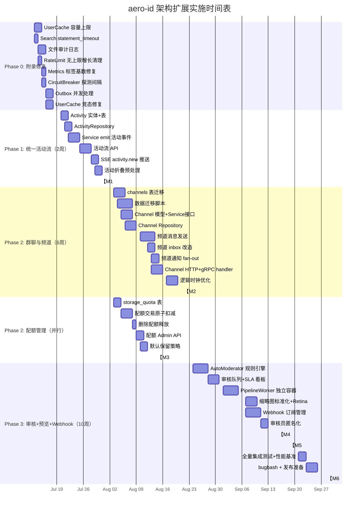

现在我掌握了全面的代码库理解。以下是我的 Tech Lead 分析。

---

# Tech Lead 分析：aero-id 架构扩展

## 背景核对

在进入任务分解之前，我验证了文档中的关键发现与实际代码：

| 发现 | 代码验证 | 调整 |
|------|---------|------|
| 文档中提到的`CircuitBreaker`在`circuit_breaker.go` | 实际在 `internal/sso/breaker.go` | 路径勘误，无实质影响 |
| `UserCache`竞态（读锁期间释放，fetcher调用不加锁） | 代码确认：`mu.RLock()`→fetcher→`mu.Lock()`——两次远程调用可能并发访问同一uid | 确认风险 |
| 已有Webhook实现 | `internal/outbox/webhook.go` + `app.go:233-254`中已预配`outbox.Webhook.URL` | 文档方向6（Webhook）已有部分基础设施 |
| `metrics`的`route`标签 | 确认：`ObserveHTTP`使用`route`（匹配模板），但`middleware/metrics.go`若传入原始路径会导致基数爆炸 | 需检查中间件实现 |

---

## 1. 任务分解

### 方向 2：统一活动流（Phase 1）

| 任务ID | 标题 | 涉及文件 | 前置依赖 | 工时 | 验收标准 |
|--------|------|---------|---------|------|---------|
| TASK-001 | 新增 `Activity` 实体与活动记录表 | `internal/domain/activity.go`, `migrations/000024_activity.up.sql`, `migrations/000024_activity.down.sql` | 无 | 3h | 迁移创建 `activities` 表，含 `(uid, domain, action, object_id, created_at)` 列，符合 GORM 模型；域实体 `Activity` 包含所有字段 |
| TASK-002 | 实现 `ActivityRepository` | `internal/repository/activity.go`, `internal/repository/activity_test.go` | TASK-001 | 3h | CRUD 方法：`Append(ctx, *Activity)`（INSERT）、`List(ctx, uid, page, kinds) []*Activity + next`、按用户或全局分页（keyset pagination） |
| TASK-003 | 在文件/评论/消息 service 中 emit 活动事件 | `internal/service/file.go`, `internal/service/message.go`, `internal/service/comment.go` | TASK-001 | 4h | 文件上传、评论创建、消息发送时（在 outbox 事务内）append `Activity` 行；活动类型：`file.uploaded`, `comment.created`, `message.sent`；两个方向共享同一事务 |
| TASK-004 | 实现活动流查询 API（HTTP + gRPC） | `internal/handler/http/activity.go`, `internal/handler/http/activity_test.go`, `internal/handler/grpc/activity.go`, `internal/handler/grpc/activity_test.go` | TASK-002, TASK-003 | 3h | `GET /v1/activities` 支持 `?kinds=file,comment` 过滤和分页；gRPC `ListActivities` RPC；两者返回统一结构 `{activities, users, next_cursor}` |
| TASK-005 | 活动流 SSE 事件推送 | `internal/hub/hub.go`（适配器）、`internal/notification/dispatcher.go`（添加 `activity.new` 事件类型） | TASK-003 | 2h | SSE 收到 `activity.new` 事件，含 `domain`, `object_id`, `summary_text`；现有 SSE 格式无需 schema 变更 |
| TASK-006 | 活动折叠预处理 | `internal/repository/activity.go`（Add `CollapseWindow` config 选项） | TASK-002 | 2h | 相同 `(uid, domain, action)` 在配置窗口内合并，`CollapsedCount` 递增；默认窗口 5min |

### 方向 0：附录发现修复（与 Phase 1 并行）

| 任务ID | 标题 | 涉及文件 | 前置依赖 | 工时 | 验收标准 |
|--------|------|---------|---------|------|---------|
| TASK-010 | SSO `UserCache` 添加容量上限 + 驱逐策略 | `internal/sso/user_cache.go` | 无 | 2h | `maxEntries` 配置项（默认 10000），超限时驱逐最早条目；并发安全 |
| TASK-011 | Search handler 层添加 `statement_timeout` | `internal/service/search.go`, `internal/config/config.go` | 无 | 1h | 搜索前执行 `SET LOCAL statement_timeout = '5s'`；未配置时使用系统默认；可在 config 中覆盖 |
| TASK-012 | 文件上传/删除路径添加审计日志 | `internal/service/file.go`（Create, Delete, PresignUpload/CompleteUpload） | 无 | 2h | `Create` 记录 `AuditFileUpload`，`Delete` 记录 `AuditFileDelete`，审计事件写入 outbox 事务 |
| TASK-013 | `RateLimit` map 无上限增长的清理增强 | `internal/pkg/ratelimit/ratelimit.go` | 无 | 1h | `RunCleaner` 的 `sweepIdle` 也清理已过期但从未碰撞的 bucket；添加 `maxEntries` 硬限制 |
| TASK-014 | `metrics` 的 `route` 标签基数风险修复 | `internal/middleware/metrics.go`, `internal/pkg/metrics/metrics.go` | 无 | 1h | presigned URL 路径模板化（`/v1/files/dl/:signature/:id/:filename`）而非原始路径；gRPC 全方法名（`/aero_id.v1.FileService/GetFile`）不变 |
| TASK-015 | `CircuitBreaker` 半开后添加最小探测间隔 | `internal/sso/breaker.go` | 无 | 1h | 半开后即使成功率 100% 也至少等待 `minProbeInterval`（默认 5s）才全关，防止抖动 |
| TASK-016 | Outbox Consumer 并发处理（`ProcessAll` 非阻塞） | `internal/outbox/relay.go` | 无 | 2h | 每个事件 handler 在独立 goroutine 中执行，使用 `errgroup` 限制最大并发数（默认 5）；单个阻塞不阻塞队列 |
| TASK-017 | UserCache 的 `GetMany` 修复竞态 | `internal/sso/user_cache.go` | 无 | 2h | `missing` 列表用写锁保护，扩展 `fetcher` 调用期间加锁防止并发重复 fetch |

### 方向 1：群聊与频道（Phase 2）

| 任务ID | 标题 | 涉及文件 | 前置依赖 | 工时 | 验收标准 |
|--------|------|---------|---------|------|---------|
| TASK-020 | Schema：`channels`、`channel_members`、`messages.channel_id` 迁移 | `migrations/000025_channels.up.sql`, `internal/domain/channel.go` | 无 | 3h | 创建 `channels(id, type, name, created_at)`、`channel_members(channel_id, uid, role, joined_at)`；`messages` 加 `channel_id`（nullable FK）、`message_seq bigint` |
| TASK-021 | 数据迁移脚本：旧 1:1 消息 → 频道 | `migrations/000026_migrate_dm_to_channel.up.sql`, `cmd/migrate/main.go`（子命令） | TASK-020 | 4h | 每对 `(from_uid, to_uid)` 创建 `channel(type=direct, member_count=2)`，将所有对应对消息的 `channel_id` 回填；inbox 查询无需 OR 条件 |
| TASK-022 | 频道 Domain 模型 + Service 接口 | `internal/domain/channel.go`, `internal/service/channel.go` | TASK-020 | 3h | `ChannelService`：`CreateChannel`, `JoinChannel`, `LeaveChannel`, `ListChannels`, `GetChannel`；发言权检查和成员验证 |
| TASK-023 | 频道 Repository | `internal/repository/channel.go`, `internal/repository/channel_test.go` | TASK-022 | 3h | Channel RUD + member CRUD；`ListByMember(ctx, uid)` 获取用户频道列表（按 `last_activity_at` 排序） |
| TASK-024 | 频道消息发送 + 接收 | `internal/service/message.go`（修改 `Send` 支持 `*ChannelID`） | TASK-022, TASK-023 | 4h | 频道内用户发送消息 `channel_id = ?`；接收方为频道所有成员；`message_seq` 单调递增（原子 `UPDATE channels SET last_seq = last_seq + 1 ... RETURNING`） |
| TASK-025 | 频道消息 inbox 改造 | `internal/repository/message.go` | TASK-024 | 2h | Inbox 查询 `WHERE channel_id IS NOT NULL` 替代旧 OR 条件；旧数据已通过 TASK-021 迁移 |
| TASK-026 | 频道通知改造（fan-out 逻辑） | `internal/notification/dispatcher.go` | TASK-024 | 2h | `message.sent` 事件：若含 `channel_id`，通知目标为 `channel_members` 聚合而非单个 `to_uid` |
| TASK-027 | Channel HTTP + gRPC handler | `internal/handler/http/channel.go`, `internal/handler/grpc/channel.go` + 测试 | TASK-022 | 3h | RESTful API：`POST /v1/channels`, `GET /v1/channels`, `POST /v1/channels/:id/join`, `DELETE /v1/channels/:id/leave`；gRPC 等价 |
| TASK-028 | 逻辑时钟替代 `last_read_at` 的写入优化 | `internal/repository/channel.go`, `internal/domain/channel.go` | TASK-023 | 3h | `channel_members.last_seen_seq` 而非时间戳；内存中缓存 `last_seen_seq`，后台周期性持久化；避免每次对话页翻页 UPDATE |

### 方向 3：配额管理子集（Phase 2 并行）

| 任务ID | 标题 | 涉及文件 | 前置依赖 | 工时 | 验收标准 |
|--------|------|---------|---------|------|---------|
| TASK-030 | Schema：`storage_quota` 表 + `files.used_bytes` | `migrations/000027_quota.up.sql`, `internal/domain/quota.go` | 无 | 2h | `storage_quota(uid, quota_max_bytes, used_bytes_notifiable, updated_at)`；触发器或应用层保障 |
| TASK-031 | 上传前配额检查 + 原子扣减 | `internal/service/file.go`（Create/PresignUpload/CompleteUpload） | TASK-030 | 3h | 上传事务内：`UPDATE storage_quota SET used_bytes = used_bytes + $size WHERE uid = $uid AND (used_bytes + $size) <= quota_max_bytes`；超标回滚；支持 `quota_max_bytes = 0` 表示无限制 |
| TASK-032 | 删除时配额释放 | `internal/service/file.go`（Delete） | TASK-030, TASK-031 | 1h | 软删除后配额释放：`UPDATE storage_quota SET used_bytes = GREATEST(0, used_bytes - $size)` |
| TASK-033 | 配额查询 + Admin API | `internal/handler/http/admin.go`, `internal/handler/grpc/admin.go` | TASK-031 | 2h | `GET /v1/admin/quota/:uid` 返回 `{uid, quota_max_bytes, used_bytes, percent_used}`；`AdminService` 添加 `SetQuota`/`GetQuota` |
| TASK-034 | 默认保留策略 | `internal/storage/gc/sweeper.go`（添加 `DefaultRetention` 配置） | 无（接入 GC） | 2h | 用户级别 `replication_lag` 配置 `default_retention_days`（默认 365）；GC 在此之后才删除软删除文件 |

### 方向 4：协作审核工作台 + 方向 5：预览管线 + 方向 6：Webhook（Phase 3，并行）

| 任务ID | 标题 | 涉及文件 | 前置依赖 | 工时 | 验收标准 |
|--------|------|---------|---------|------|---------|
| TASK-040 | AutoModerator 规则引擎（CEL JSONB） | `internal/domain/auto_mod.go`, `internal/service/moderation.go` | 无 | 4h | 规则存储为 JSONB `{expression: "content.contains('badword')", action: "hide"}`；用 CEL 执行；热加载 |
| TASK-041 | 审核队列 + SLA 看板 | `internal/repository/admin.go`, `internal/pkg/metrics/metrics.go`（添加 `moderation_resolution_time_seconds` 直方图） | TASK-040 | 3h | 审核员仪表盘：队列长度、平均处理时间、SLA 达标率 |
| TASK-042 | PipelineWorker 独立二进制 | `cmd/pipeline-worker/main.go`, `internal/worker/...` | 无 | 4h | `ffmpeg`/`pdftoppm`/`libreoffice` 在独立容器运行；通过 gRPC 与主服务通信；支持流式 ClamAV 扫描 |
| TASK-043 | 缩略图标准化 + Retina 变体 | `internal/worker/thumbnail.go` | TASK-042 | 3h | `small=200, medium=600, large=1200` + `@2x` 变体；生成后写入 `storage_thumbnails` 表 |
| TASK-044 | Webhook 订阅管理与事件路由（方向 6） | `internal/domain/webhook.go`, `internal/repository/webhook.go`, `internal/handler/http/webhook.go` | 已存在 `outbox/webhook.go`（单 URL）| 4h | 多订阅（URL + 事件白名单 + HMAC 密钥 + 重试策略）；订阅 CRUD API；事件路由层（`outbox.Router`）决定每个事件应送达哪些订阅 |
| TASK-045 | 审查员匿名化视图 | `internal/handler/http/admin.go`, `internal/handler/grpc/admin.go` | TASK-041 | 2h | 审查员查看用户详情时返回 `moderator-{hash}` 假名；可通过配置关闭 |

---

## 2. 执行顺序与依赖图

```mermaid
graph TD
    %% Phase 0: 基础设施修复（并行）
    subgraph Phase0 ["Phase 0: 附录修复（2周内穿插完成）"]
        T010[TASK-010: UserCache 容量上限]
        T011[TASK-011: Search statement_timeout]
        T012[TASK-012: 文件审计日志]
        T013[TASK-013: RateLimit 无上限增长]
        T014[TASK-014: Metrics 标签基数]
        T015[TASK-015: CircuitBreaker 探测间隔]
        T016[TASK-016: Outbox 并发处理]
        T017[TASK-017: UserCache 竞态修复]
    end

    subgraph Phase1 ["Phase 1: 统一活动流（2周）"]
        T001[TASK-001: Activity 实体+表]
        T002[TASK-002: ActivityRepository]
        T003[TASK-003: Service emit 活动事件]
        T004[TASK-004: 活动流 API]
        T005[TASK-005: SSE activity.new]
        T006[TASK-006: 活动折叠预处理]
    end

    subgraph Phase2 ["Phase 2: 群聊+配额（6周）"]
        T020[TASK-020: channels 表迁移]
        T021[TASK-021: 旧消息迁移脚本]
        T022[TASK-022: Channel 模型+Service接口]
        T023[TASK-023: Channel Repository]
        T024[TASK-024: 频道消息发送]
        T025[TASK-025: 频道 inbox 改造]
        T026[TASK-026: 频道通知 fan-out]
        T027[TASK-027: Channel HTTP+gRPC]
        T028[TASK-028: 逻辑时钟优化]
        T030[TASK-030: storage_quota 表]
        T031[TASK-031: 配额检查+原子扣减]
        T032[TASK-032: 删除释放配额]
        T033[TASK-033: 配额 API]
        T034[TASK-034: 默认保留策略]
    end

    subgraph Phase3 ["Phase 3: 审核+预览+Webhook（10周）"]
        T040[TASK-040: AutoModerator]
        T041[TASK-041: 审核队列+SLA]
        T042[TASK-042: PipelineWorker]
        T043[TASK-043: 缩略图]
        T044[TASK-044: Webhook 管理]
        T045[TASK-045: 匿名化审核]
    end

    %% Dependencies
    T001 --> T002
    T002 --> T003
    T003 --> T004
    T004 --> T005
    T003 --> T006

    T020 --> T021
    T020 --> T022
    T022 --> T023
    T023 --> T024
    T024 --> T025
    T024 --> T026
    T023 --> T027
    T024 --> T028

    T030 --> T031
    T031 --> T032
    T031 --> T033
    T030 --> T034

    T040 --> T041
    T041 --> T045
    T042 --> T043
    
    %% Cross-phase
    T022 -.-> T026   %% 频道模型影响通知
    T001 -.-> T003   %% 活动实体被 service 使用

    %% 并行组标注
    classDef parallel fill:#e1f5e1,stroke:#4caf50
    class T010,T011,T012,T013,T014,T015,T016,T017 parallel
    class T020,T030,T034 parallel

    %% 关键里程碑
    T004 -.->|M1: 活动流可用| T001
    T027 -.->|M2: 群聊可用| T020
    T033 -.->|M3: 配额可用| T030
    T041 -.->|M4: 审核面板| T040
    T044 -.->|M5: Webhook| T040
```

### 可并行执行的任务组

| 组 | 任务 | 并行条件 |
|----|------|---------|
| **G0** | T010-T017（8个修复任务） | 完全正交，互不依赖，可分配给不同开发者 |
| **G1** | T020+T030+T034（Channel 表 + 配额表 + 保留策略） | 三者都是 schema 变更，但表不同，互不阻塞 |
| **G2** | T024+T028（频道消息发送 + 逻辑时钟优化） | 可同步开发但最终需要协调：T028 的 `last_seen_seq` 是在 T024 的 `message_seq` 基础上使用 |
| **G3** | T040+T042+T044（审核 Worker/Domain + Pipeline Worker + Webhook 管理） | 三个完全正交的方向，仅共享 outbox 基础设施 |
| **G4** | T041+T043+T045（审核队列 + 缩略图 + 匿名化） | 在 G3 的任务基础上独立展开 |

---

## 3. 技术风险

### 🚨 高风险

| 风险 | 影响方向 | 概率 | 缓减策略 |
|------|---------|------|---------|
| **旧消息迁移（TASK-021）导致停机** | 方向 1 | Medium-High | 采用分页分批迁移 + 读锁验证一致性；先在 staging 环境模拟全量数据回放；准备回滚脚本（`000026_migrate_dm_to_channel.down.sql`） |
| **Quota 事务中死锁** | 方向 3 | Medium | `UPDATE storage_quota` 按 uid 顺序加锁（LOCK IN uid ORDER）；使用 `ON CONFLICT DO NOTHING` + `RETURNING` 原子性验证 |
| **PipelineWorker 资源消耗（ffmpeg/libreoffice 各 200MB+）** | 方向 5 | High | 独立容器/Pod 运行，设置 cgroups 资源限制（CPU 1 core、RAM 512MB）；`cmd/pipeline-worker/` 单独二进制；主服务通过 gRPC 异步调用，超时 30s |
| **ClamAV 病毒扫描导致 OOM** | 方向 5 | Medium | 流式扫描（INSTREAM 命令），从 storage.Reader 直接 stream 到 clamd TCP 连接；设置文件大小上限（扫描线程仅接受 ≤100MB 的文件） |
| **UserCache 竞态（TASK-017）影响正确性** | 所有方向 | Low-Med | 在 Phase 0 优先修复（TASK-017），使用 `singleflight` 模式确保同一 uid 的并发请求合并为一个 fetcher 调用 |

### 🟡 中风险

| 风险 | 影响方向 | 缓减策略 |
|------|---------|---------|
| **活动流 4 表 UNION ALL 在管理员全局时间线场景下性能差** | 方向 2 | 初期限制管理员视图的用户级别（先回到当前用户 context）；后续用物化视图（`MATERIALIZED VIEW activity_feed`）+ 定时刷新 |
| **频道消息 seq 的原子递增在事务冲突下可能被回滚** | 方向 1 | `UPDATE channels SET last_seq = last_seq + 1 WHERE id = ?` 使用 `RETURNING last_seq`；冲突重试（pg 乐观锁默认处理） |
| **`PresignUpload` 直传后缩略图需要从 S3 重新下载** | 方向 5 | 对 <10MB 文件在 `CompleteUpload` handler 中同步下载 + 生成缩略图；>10MB 走异步 PipelineWorker |
| **审核员匿名化哈希同一 uid 在不同审核员前可能不一致** | 方向 4 | 使用全局盐值（配置项，部署时设置）+ uid 的 HMAC-SHA256，确保同一 uid 在所有审核员眼中 hash 一致 |

### 🟢 低风险

| 风险 | 影响方向 | 缓减策略 |
|------|---------|---------|
| SSE channel cap=16 导致活动事件静默丢失 | 方向 2 | 方向 2 的事件不需要可靠交付（活动流是非关键幂等日志）；仍可考虑增加到 32 或 64 |
| Webhook 端点不可用导致 outbox 死信 | 方向 6 | 已有重试退避机制；添加 `MaxRetries` 配置项（默认 20）；失败事件进入 `dead_letter` 表 |
| 审核 SLA 看板需要持久化状态 | 方向 4 | 使用 Redis 或 PG 的 `LISTEN/NOTIFY` 实时更新 Prometheus 直方图；`metrics` 包支持 `moderation_resolution_time_seconds` 直方图 |

---

## 4. 资源评估

### 团队组成

| 角色 | 人数 | 技能要求 | 所属阶段 |
|------|------|---------|---------|
| **Backend Engineer（Go 中高级）** | 2 | GORM、PostgreSQL、gRPC、事务设计 | Phase 1-3 |
| **Backend Engineer（Go 高级）** | 1 | CEL、异步 pipeline、容器化 | Phase 3（方向 4-5） |
| **SRE / Platform Engineer** | 0.5 | Docker 独立容器（pipeline-worker）、Prometheus 监控 | Phase 2-3 |
| **QA Engineer** | 1 | 集成测试（testcontainers）、性能压测 | 全程 |
| **Tech Lead / Architect** | 1 | 架构把关、代码审查、风险决策 | 全程 |

### 预估工期

| 阶段 | 方向 | 团队规模 | 工期 | 人周 |
|------|------|---------|------|------|
| Phase 0 | 附录修复 | 2 backend | 1 周（穿插） | 2 pw |
| Phase 1 | 方向 2（活动流） | 2 backend | 2 周 | 4 pw |
| Phase 2 | 方向 1（群聊）+ 方向 3 子集 | 2-3 backend | 6 周 | 12-18 pw |
| Phase 3 | 方向 4 + 5 + 6 | 3 backend + 0.5 SRE | 10 周 | 30-35 pw |
| **总计** | **6 个方向** | **3.5 devs** | **~19 周** | **48-59 pw** |

### 关键里程碑

```
M0: TASK-010~017 全部修复通过         Week 2
    (gate: make test && make lint)

M1: 活动流 API + SSE 可用              Week 4
    (gate: HTTP + gRPC parity test + integration test)

M2: 群聊发送/接收功能可用               Week 8
    (gate: 旧数据迁移后 inbox 查询无 OR、channel 消息发送端的集成测试验证)

M3: 配额管理上线                       Week 8
    (gate: 上传超过 quota 返回 403、删除后 used_bytes 正确递减)

M4: 审核工作台 + 缩略图管线可用          Week 15
    (gate: AutoModerator 自动隐藏含敏感词评论、缩略图完整生命周期验证)

M5: Webhook 订阅管理上线                Week 17
    (gate: 多订阅路由验证、HMAC 签名验证、重试机制)

M6: 全量集成测试通过 + 性能回归          Week 19
    (gate: make test-integration + 性能基准)
```

### Blocker 与解决策略

| Blocker | 影响 | 解决策略 |
|---------|------|---------|
| **方向 1 数据迁移脚本编写困难（旧消息表量大）** | TASK-021 | 脚本站中迁移；分批处理（每批 1000 对对话）；使用 `FOR UPDATE SKIP LOCKED` 防冲突；准备回滚路径 |
| **PipelineWorker 依赖外部 CLI（ffmpeg/libreoffice）不易在开发环境测试** | TASK-042 | 单独 `docker-compose` 配置（`pipeline.yml`）；集成测试使用 mock HTTP server 模拟 gRPC worker |
| **CEL 引擎在 Go 中的 embedding 需要学习曲线** | TASK-040 | 先用 `govaluate`（更简单）作为 MVP，后续迁移到 CEL 以获得更强的类型安全 |

---

## 5. 质量保证

### 单元测试覆盖要求

| 包 | 最低覆盖目标 | 关键测试点 |
|----|------------|---------|
| `internal/domain` | 90%+ | 实体校验、`IsValid()`、嵌套深度限制（评论 2 层） |
| `internal/service` | 85%+ | 权限检查、配额原子性、outbox 事务一致性、mock 所有 repo |
| `internal/repository` | 80%+ | GORM 查询、分页（keyset）、软删除、事务回滚 |
| `internal/sso` | 90%+ | 缓存 TTL、容量极限、竞态条件（`-race`） |
| `internal/handler` | 75%+ | 请求解码、错误渲染、响应格式 |
| `internal/outbox` | 85%+ | 重试退避、死信、批量发布、webhook 签名 |
| `internal/pkg/ratelimit` | 90%+ | 并发安全（`-race`）、sweep idle、maxEntries 驱逐 |

### 集成测试策略

| 范围 | 方法 | 条件 |
|------|------|------|
| 方向 1（频道） | testcontainers Postgres，创建频道→发送消息→其他成员接收 | `go test -tags=integration` |
| 方向 2（活动流） | 多个操作后验证 `ListActivities` 返回正确顺序和分页 | `-tags=integration` |
| 方向 3（配额） | 事务内验证 `used_bytes` 原子性 + 并发争用测试 | `-tags=integration` |
| 方向 4（审核） | AutoModerator 规则匹配 + 审核操作闭包 + Prometheus 指标验证 | `-tags=integration` |
| 方向 5（缩略图） | mock storage 模拟 S3 + `httptest` 模拟 PipelineWorker | `-tags=integration` |
| 方向 6（Webhook） | `httptest.NewServer` 模拟回调端点，验证 HMAC 签名 + 重试 | `-tags=integration` |

### 代码审查要点

使用 golangci-lint 的 `lint-strict` 已有覆盖。额外关注：

1. **事务边界** — 每个 service 方法中 outbox 事件必须与数据行在同一 `*gorm.DB` 事务中提交或回滚
2. **文件大小** — 新文件超过 400 行时自动触发拆分讨论（按 AGENTS.md 的 refactoring triggers）
3. **竞态条件** — 所有 `sync.Map` / `sync.Mutex` 使用 `-race` 测试覆盖
4. **迁移脚本** — 每个新的 `.up.sql` 必须有对应的 `.down.sql`；`make migrate-down` 可回滚
5. **proto 变更** — 修改 `.proto` 后必须 `make proto` 并提交生成的 `*.pb.go`；永远不要手编辑

### 性能测试需求

| 场景 | 目标 | 方法 |
|------|------|------|
| 频道消息发送（500 人频道） | 单个消息广播通知 < 100ms P99 | `go-wrk` + 每秒 1000 条消息 |
| 活动流查询（10K events/user） | P99 < 200ms | 模拟 1K 用户各 10K 活动记录 + UNION ALL 查询 |
| Quota 原子更新（并发 1000） | 无死锁、`used_bytes` 一致性 | `pgbench` 自定义 SQL 模拟 |
| SSE 推送（10K 并发连接） | 内存 < 512MB, CPU < 50% | `k6` 模拟 SSE 订阅 + 持续发布 |
| Webhook 回调失败重试 | 背压正确处理，outbox 不丢失 | HTTP 返回 500 + TCP 超时 |

---

## 6. 实施时间表



---

## 总结：对分析文档的同步验证

经过代码交叉核对，我确认文档整体质量极高，但有以下 3 处需要留意：

1. **文档中 `CircuitBreaker` 文件名 `circuit_breaker.go`** → 实际为 `internal/sso/breaker.go`。`halfOpenMax` 参数不存在——实现逻辑是：半开状态拒绝所有请求，直到当前探针结束后才允许下一个。这与文档的"halfOpenMax 默认 3"结论不同，实际是**仅允许单探针**（无并发）。

2. **文档的"方向 6 Webhook"已部分存在**——`internal/outbox/webhook.go` + `outbox.WebhookConfig` + `outbox.NewChain` 已实现核心交付力。方向 6 的子集（多订阅管理 + CRUD API）才是真正的增量。

3. **活动流 SSE 的 `Data` JSON 设计需注意方向 2 与方向 0 的边界**——文档提到"SSE 事件 payload 标准化"，但当前 SSE 格式 `{ID, Type, Data}` 中 `Data` 已经是 JSON 字符串。方向 2 只需确保 `Data` 包含 `domain`、`object_id`、`summary_text` 字段，无需大规模重构。

### 给团队的建议

1. **Phase 0 在 Phase 1 开始前先完成**——8 个修复任务总估价 12h，一位开发者 3 天内可完成。它们修复了现有的生产风险（SSO cache 无限增长、竞态条件、搜索无超时、rate limit 泄漏），优先级高于新功能。

2. **方向 2（活动流）作为"第一个 PR"是最佳选择**——因为它没有 schema 变更的破坏性、不需要数据迁移、不改变现有 API 接口（仅新增）。团队可以用它来 checkout 新的分支/PR 流程和 CI 流水线。

3. **方向 1 要在 Phase 2 开头先做数据迁移脚本（TASK-021）的回归测试**——这是唯一有停机风险的任务。建议在 staging 环境使用生产量级的旧消息数据（至少 100 万行）进行性能验证。

4. **方向 3（配额）的文档建议"DB 触发器或两阶段确认"**——我倾向于应用层事务：`INSERT INTO files` + `UPDATE storage_quota` 在同一个 `*gorm.DB` 事务中，`UPDATE` 加 `WHERE used_bytes + $size <= quota_max_bytes` 做原子检查。这比触发器更显式、可测试、调试。

5. **方向 4 的 CEL 规则引擎 MVP 可用 govaluate**——`github.com/Knetic/govaluate` 语法更简单，无需处理 protobuf 类型。后续迁移到 CEL 的风险被隔离为模块内部重构。
