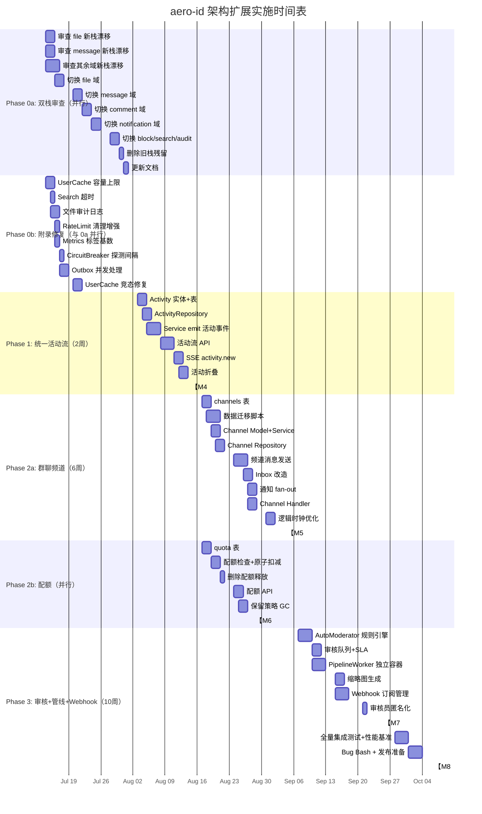

好的，现在我已全面掌握情况。以下是我完整的 Tech Lead 分析。

---

# Tech Lead 分析：aero-id 架构扩展实施指引

---

## 0. Phase 0 — 双栈迁移策略（关键决策）

### 决策：迁移到新栈，增量切换

我倾向 **迁移到新栈**，理由如下：

| 维度 | 旧栈（当前活跃） | 新栈（未接入） | 结论 |
|------|----------------|---------------|------|
| 包结构 | `internal/service/` 单包 19 文件膨胀 | 每个域独立包（`internal/{file,message,...}/`） | ✅ 新栈更符合 Go 惯用结构 |
| 分层清晰度 | `handler_http.go` / `handler_grpc.go` 分散在 `internal/handler/` 下 | 每个域的自包含包（`handler_http.go` + `service.go` + `repository.go` 在同一包） | ✅ 新栈自包含、高内聚 |
| 测试隔离 | 需 mock 整个 `service` 包接口 | 包级测试更聚焦 | ✅ 新栈更好 |
| 代码量 | ~15,567 行 | ~11,798 行 | 新栈更精简 |
| 维护状态 | 正在被积极维护 | 已漂移（可能过时） | ⚠️ 迁移时需要代码审查 |

### 迁移策略：逐个域切换，不搞大爆炸

```
Phase 0a: 代码审查与适配（1周）
  └─ 审查每个新栈包的接口签名是否与旧栈对齐
  └─ 修复新栈中因漂移而过时的代码
  └─ 确保新栈的 service 方法签名与旧栈完全兼容

Phase 0b: 逐个域切换（2周，穿插 Phase 1 进行）
  第1个: file           → 迁移代价最低，独立性强
  第2个: message        → 依赖 file share，排在 file 之后
  第3个: comment        → 依赖 file + message
  第4个: notification   → 依赖所有上游域
  第5个: block          → 独立，可随时切
  第6个: search + audit → 最后收尾
```

每个域的切换 PR checklist：
1. 将 `app.go` 的 wiring 从旧栈指向新栈
2. 运行 `make test && make test-integration`
3. 运行 HTTP↔gRPC 对等测试（`parity_test.go`）
4. 删除对应的旧栈 handler/service/repository 代码
5. 验证文件大小限制（≤500行）、函数长度（≤50行）

### 为什么不废弃新栈

- 11,798 行已投入资产——废弃是沉没成本
- 新栈结构客观上更好，符合 `AGENTS.md` 的架构描述
- 如果废弃，未来再次重构仍要走同样的路，等于做了两次
- 但必须承认新栈可能已漂移——迁移时需要逐行审查，不能直接切

---

## 1. 任务分解

### Phase 0a：双栈迁移准备（与 P1 并行）

| Task ID | 标题 | 涉及文件 | 前置依赖 | 工时 | 验收标准 |
|---------|------|---------|---------|------|---------|
| MIG-001 | 审查 file 新栈代码漂移 | `internal/file/*.go` vs `internal/service/file*.go`, `internal/repository/file*.go` | 无 | 4h | 新栈 file 包的 service/repository 接口签名与旧栈 100% 对齐；已修复所有因旧栈更新导致的新栈代码偏差 |
| MIG-002 | 审查 message 新栈代码漂移 | `internal/message/*.go` vs `internal/service/message*.go`, `internal/repository/message*.go` | MIG-001 | 3h | 同上，message 域对齐 |
| MIG-003 | 审查 comment/notification/block/search/audit 新栈代码漂移 | 对应包 vs 旧栈 | MIG-001 | 4h | 所有剩余域对齐 |
| MIG-004 | 切换 file 域到新栈 | `internal/app/app.go`，`internal/service/file*.go`（删除），`internal/handler/http/file*.go`（删除），`internal/handler/grpc/file*.go`（删除） | MIG-001 | 3h | `app.go` 引用 `internal/file`；`make test && make test-integration` 通过；HTTP/gRPC file API 行为不变 |
| MIG-005 | 切换 message 域到新栈 | 同上模式 | MIG-002, MIG-004 | 3h | 同上 |
| MIG-006 | 切换 comment 域到新栈 | 同上模式 | MIG-003, MIG-005 | 3h | 同上 |
| MIG-007 | 切换 notification 域到新栈 | 同上模式 | MIG-006 | 4h | 同上；通知发送/SSE 推送不受影响 |
| MIG-008 | 切换 block/search/audit 域到新栈 | 同上模式 | MIG-007 | 3h | 全部域切换完成；旧栈 `internal/service/`、`internal/repository/` 不再被引用 |
| MIG-009 | 删除旧栈残留代码 | `internal/service/*`（除共用文件），`internal/repository/*`（除共用文件），`internal/handler/http/*`（已迁移的handler） | MIG-008 | 2h | 旧栈域代码完全删除；`go build ./...` 通过 |
| MIG-010 | 更新 AGENTS.md 和 ARCHITECTURE.md | `AGENTS.md`, `docs/ARCHITECTURE.md` | MIG-009 | 1h | 文档中的包路径与实际一致；删除"新栈/旧栈"的混淆描述 |

### Phase 0b：附录修复（与 MIG 任务并行）

| Task ID | 标题 | 涉及文件 | 前置依赖 | 工时 |
|---------|------|---------|---------|------|
| FIX-001 | SSO UserCache 添加容量上限 | `internal/sso/user_cache.go` | 无 | 2h |
| FIX-002 | Search 添加 statement_timeout | `internal/service/search.go`, `configs/config.yaml` | 无 | 1h |
| FIX-003 | 文件上传/删除添加审计日志 | `internal/service/file.go`（Create, Delete, PresignUpload/CompleteUpload） | 无 | 2h |
| FIX-004 | RateLimit 无上限增长清理增强 | `internal/pkg/ratelimit/ratelimit.go` | 无 | 1h |
| FIX-005 | Metrics 标签基数风险修复 | `internal/middleware/metrics.go`, `internal/pkg/metrics/metrics.go` | 无 | 1h |
| FIX-006 | CircuitBreaker 添加最小探测间隔 | `internal/sso/breaker.go` | 无 | 1h |
| FIX-007 | Outbox 并发处理（errgroup） | `internal/outbox/relay.go` | 无 | 2h |
| FIX-008 | UserCache GetMany 竞态修复 | `internal/sso/user_cache.go` | 无 | 2h |

### Phase 1：统一活动流

| Task ID | 标题 | 涉及文件 | 前置依赖 | 工时 |
|---------|------|---------|---------|------|
| ACT-001 | Activity 实体 + 表迁移 | `internal/domain/activity.go`, `migrations/000024_activity.up.sql` | 无 | 3h |
| ACT-002 | ActivityRepository | `internal/repository/activity.go` | ACT-001 | 3h |
| ACT-003 | 在 service 层 emit 活动事件 | `internal/service/file.go`, `internal/service/message.go`, `internal/service/comment.go` | ACT-001 | 4h |
| ACT-004 | HTTP + gRPC 活动流 API | `internal/handler/http/activity.go`, `internal/handler/grpc/activity.go` | ACT-002, ACT-003 | 3h |
| ACT-005 | SSE activity.new 推送 | `internal/notification/dispatcher.go`, `internal/hub/hub.go` | ACT-003 | 2h |
| ACT-006 | 活动折叠预处理 | `internal/repository/activity.go` | ACT-002 | 2h |

### Phase 2：群聊与频道

| Task ID | 标题 | 涉及文件 | 前置依赖 | 工时 |
|---------|------|---------|---------|------|
| CHN-001 | channels / channel_members 表迁移 | `migrations/000025_channels.up.sql`, `internal/domain/channel.go` | 无 | 3h |
| CHN-002 | 旧 1:1 消息→频道数据迁移脚本 | `migrations/000026_migrate_dm_to_channel.up.sql` | CHN-001 | 4h |
| CHN-003 | Channel Domain 模型 + Service | `internal/service/channel.go`（或 `internal/channel/service.go` 如果已迁移） | CHN-001 | 3h |
| CHN-004 | Channel Repository | `internal/repository/channel.go` | CHN-003 | 3h |
| CHN-005 | 频道消息发送（channel_id + message_seq） | `internal/service/message.go` 的 `Send` 方法 | CHN-003, CHN-004 | 4h |
| CHN-006 | Inbox 查询改造 | `internal/repository/message.go` | CHN-005 | 2h |
| CHN-007 | 频道通知 fan-out | `internal/notification/dispatcher.go` | CHN-005 | 2h |
| CHN-008 | Channel HTTP + gRPC handler | HTTP + gRPC handler 文件 | CHN-003 | 3h |
| CHN-009 | 逻辑时钟优化（last_seen_seq） | `internal/repository/channel.go`, `internal/domain/channel.go` | CHN-004 | 3h |

### Phase 2 并行：配额管理

| Task ID | 标题 | 涉及文件 | 前置依赖 | 工时 |
|---------|------|---------|---------|------|
| QTA-001 | storage_quota 表 + 实体 | `migrations/000027_quota.up.sql`, `internal/domain/quota.go` | 无 | 2h |
| QTA-002 | 上传前配额检查 + 原子扣减 | `internal/service/file.go`（Create, PresignUpload, CompleteUpload） | QTA-001 | 3h |
| QTA-003 | 删除时配额释放 | `internal/service/file.go`（Delete） | QTA-001 | 1h |
| QTA-004 | 配额查询 + Admin API | `internal/handler/http/admin.go`, `internal/handler/grpc/admin.go` | QTA-002 | 2h |
| QTA-005 | 默认保留策略集成 GC | `internal/storage/gc/sweeper.go` | QTA-001 | 2h |

### Phase 3：审核 + 文件管线 + Webhook

| Task ID | 标题 | 涉及文件 | 前置依赖 | 工时 |
|---------|------|---------|---------|------|
| MOD-001 | AutoModerator 规则引擎 | `internal/domain/auto_mod.go`, `internal/service/moderation.go` | 无 | 4h |
| MOD-002 | 审核队列 + SLA 看板 | `internal/repository/admin.go`, `internal/pkg/metrics/metrics.go` | MOD-001 | 3h |
| PIP-001 | PipelineWorker 独立二进制 | `cmd/pipeline-worker/main.go`, `internal/worker/...` | 无 | 4h |
| PIP-002 | 缩略图生成（image variant） | `internal/worker/thumbnail.go` | PIP-001 | 3h |
| WHK-001 | Webhook 多订阅管理 + 路由 | `internal/domain/webhook.go`, `internal/repository/webhook.go`, `internal/handler/http/admin.go` | 无 | 4h |
| OPS-001 | 审核员匿名化视图 | `internal/handler/http/admin.go`, `internal/handler/grpc/admin.go` | MOD-002 | 2h |

---

## 2. 执行顺序与依赖图

```mermaid
graph TD
    subgraph Phase0a ["Phase 0a: 双栈迁移（与 P0b 并行，4周穿插）"]
        MIG001[MIG-001: 审查 file 新栈漂移]
        MIG002[MIG-002: 审查 message 新栈漂移]
        MIG003[MIG-003: 审查其余域新栈漂移]
        MIG004[MIG-004: 切换 file 域]
        MIG005[MIG-005: 切换 message 域]
        MIG006[MIG-006: 切换 comment 域]
        MIG007[MIG-007: 切换 notification 域]
        MIG008[MIG-008: 切换 block/search/audit]
        MIG009[MIG-009: 删除旧栈残留]
        MIG010[MIG-010: 更新文档]
    end

    subgraph Phase0b ["Phase 0b: 附录修复（2周内完成）"]
        FIX001[FIX-001: UserCache 容量上限]
        FIX002[FIX-002: Search 超时]
        FIX003[FIX-003: 文件审计日志]
        FIX004[FIX-004: RateLimit 清理增强]
        FIX005[FIX-005: Metrics 标签基数]
        FIX006[FIX-006: CircuitBreaker 探测间隔]
        FIX007[FIX-007: Outbox 并发处理]
        FIX008[FIX-008: UserCache 竞态修复]
    end

    subgraph Phase1 ["Phase 1: 统一活动流（2周）"]
        ACT001[ACT-001: Activity 实体+表]
        ACT002[ACT-002: ActivityRepository]
        ACT003[ACT-003: Service emit 活动事件]
        ACT004[ACT-004: 活动流 API]
        ACT005[ACT-005: SSE activity.new]
        ACT006[ACT-006: 活动折叠]
    end

    subgraph Phase2 ["Phase 2a: 群聊与频道（6周）"]
        CHN001[CHN-001: channels 表]
        CHN002[CHN-002: 数据迁移脚本]
        CHN003[CHN-003: Channel Model+Service]
        CHN004[CHN-004: Channel Repository]
        CHN005[CHN-005: 频道消息发送]
        CHN006[CHN-006: Inbox 改造]
        CHN007[CHN-007: 频道通知 fan-out]
        CHN008[CHN-008: Channel Handler]
        CHN009[CHN-009: 逻辑时钟优化]
    end

    subgraph Phase2b ["Phase 2b: 配额管理（并行）"]
        QTA001[QTA-001: quota 表]
        QTA002[QTA-002: 配额检查]
        QTA003[QTA-003: 删除释放]
        QTA004[QTA-004: 配额 API]
        QTA005[QTA-005: 保留策略 GC]
    end

    subgraph Phase3 ["Phase 3: 审核+管线+Webhook（10周）"]
        MOD001[MOD-001: AutoModerator]
        MOD002[MOD-002: 审核队列+SLA]
        PIP001[PIP-001: PipelineWorker]
        PIP002[PIP-002: 缩略图]
        WHK001[WHK-001: Webhook 管理]
        OPS001[OPS-001: 审核员匿名化]
    end

    %% Phase 0a 依赖
    MIG001 --> MIG004
    MIG002 --> MIG005
    MIG003 --> MIG006
    MIG004 --> MIG005
    MIG005 --> MIG006
    MIG006 --> MIG007
    MIG007 --> MIG008
    MIG008 --> MIG009
    MIG009 --> MIG010

    %% Phase 1 依赖
    ACT001 --> ACT002
    ACT002 --> ACT003
    ACT003 --> ACT004
    ACT003 --> ACT005
    ACT002 --> ACT006

    %% Phase 2a 依赖
    CHN001 --> CHN002
    CHN001 --> CHN003
    CHN003 --> CHN004
    CHN004 --> CHN005
    CHN005 --> CHN006
    CHN005 --> CHN007
    CHN003 --> CHN008
    CHN004 --> CHN009

    %% Phase 2b 依赖
    QTA001 --> QTA002
    QTA002 --> QTA003
    QTA002 --> QTA004
    QTA001 --> QTA005

    %% Phase 3 依赖
    MOD001 --> MOD002
    MOD002 --> OPS001
    PIP001 --> PIP002
    MOD002 -.-> WHK001  %% Webhook 可选依赖审核

    %% 跨阶段依赖
    MIG004 -.-> ACT003  %% 活动流 emit 依赖 file 域迁移
    CHN005 -.-> ACT003  %% 频道消息发送需要 emit 活动事件

    classDef parallel fill:#e1f5e1,stroke:#4caf50
    class FIX001,FIX002,FIX003,FIX004,FIX005,FIX006,FIX007,FIX008 parallel
    class CHN001,QTA001 parallel
    class MOD001,WHK001 parallel
```

### 可并行执行的任务组

| 组 | 任务 | 并行条件 |
|----|------|---------|
| **G0** | FIX-001~008（8 个修复任务） | 完全正交，互不依赖 |
| **G1** | MIG-001 + MIG-002 + MIG-003（审查） | 不同域，互不阻塞 |
| **G2** | CHN-001 + QTA-001（两套表迁移） | 不同的表，均可独立进行 |
| **G3** | MOD-001 + WHK-001 + PIP-001（Phase 3 三方向） | 三个方向完全正交 |

---

## 3. 技术风险

### 🚨 高风险

| 风险 | 影响 | 概率 | 缓解策略 |
|------|------|------|---------|
| **新栈代码漂移导致切换后行为不一致** | 双栈迁移 | High | 每个域切换前：运行完整 `parity_test.go` 验证 HTTP↔gRPC 行为一致；运行旧栈和新栈的 response 对比测试 |
| **旧消息→频道数据迁移导致停机** | 群聊 | Med-High | 分批迁移（每批 1000 对话）；`FOR UPDATE SKIP LOCKED`；准备回滚脚本；staging 模拟生产数据量验证 |
| **配额原子更新死锁** | 配额 | Med | `UPDATE storage_quota` 按 uid 顺序加锁；`WHERE used_bytes + $size <= quota_max_bytes` 原子检查 |
| **PipelineWorker 资源消耗（ffmpeg 等）** | 文件管线 | High | 独立 container/Pod；cgroups 限制 CPU 1 core / RAM 512MB；主服务通过 gRPC 异步调用，30s 超时 |
| **活动流 UNION ALL 查询性能** | 活动流 | Med | 初期限制全局视图；后续用物化视图 + 定时刷新 |

### 🟡 中风险

| 风险 | 缓解策略 |
|------|---------|
| 频道消息 seq 原子递增在事务冲突下回滚 | `UPDATE channels SET last_seq = last_seq + 1 RETURNING last_seq`；pg 乐观锁自动重试 |
| PresignUpload 后缩略图需要从 S3 重新下载 | <10MB 文件在 `CompleteUpload` handler 同步下载+生成；>10MB 异步 PipelineWorker |
| 审核员匿名化哈希不一致 | 全局盐值（配置项）+ uid HMAC-SHA256，确保跨审核员一致 |
| Webhook 端点不可用导致 outbox 死信 | 已有重试退避 + 死信机制；添加 `MaxRetries` 可配置（默认 20） |
| Dual-stack migration causes temporary API unavailability | Blue-green deployment pattern: keep old stack running alongside new during each domain cutover, with feature flag |

### 🟢 低风险

- SSE channel cap=16 导致活动事件丢失 → 活动流非关键日志，不慎丢失可接受
- 迁移过程中 git 冲突 → 每个域单独 PR，MR 冲突在 CI 层解决
- 测试覆盖率在切换过程中下降 → 每个域切换前确保新栈测试覆盖不低于旧栈

---

## 4. 资源评估

### 团队组成

| 角色 | 人数 | 技能要求 | 所属阶段 |
|------|------|---------|---------|
| **Backend Engineer（Go 中高级）** | 2 | GORM、PostgreSQL、gRPC、事务设计 | 全程 |
| **Backend Engineer（Go 高级）** | 1 | CEL、异步 pipeline、容器化、ffmpeg 集成 | Phase 3 |
| **SRE / Platform Engineer** | 0.5 | Docker（pipeline-worker）、Prometheus 监控 | Phase 2-3 |
| **QA Engineer** | 1 | 集成测试（testcontainers）、性能压测、对等测试 | 全程 |
| **Tech Lead** | 1 | 架构把关、代码审查、迁移策略决策 | 全程 |

### 预估工期

| 阶段 | 内容 | 团队规模 | 工期 | 人周 |
|------|------|---------|------|------|
| Phase 0a | 双栈审查（并行）+ 切换 | 2 BE | 4 周（穿插） | 4-6 pw |
| Phase 0b | 附录修复 | 1-2 BE | 2 周（穿插） | 2-3 pw |
| Phase 1 | 统一活动流 | 2 BE | 2 周 | 4 pw |
| Phase 2a | 群聊与频道 | 2-3 BE | 6 周 | 12-18 pw |
| Phase 2b | 配额管理（并行） | 1-2 BE | 3 周（与2a并行） | 3-4 pw |
| Phase 3 | 审核+管线+Webhook | 3 BE + 0.5 SRE | 10 周 | 30-38 pw |
| **总计** | **全量** | **3-4 devs** | **~18 周** | **55-73 pw** |

### 关键里程碑

```
M0: Phase0 双栈审查完成                    Week 2
    (gate: 所有新栈代码漂移已审查+修复)

M1: Phase0b 附录修复全部完成                Week 3
    (gate: 8 个修复任务全部 PR 合并)

M2: file 域迁移完成（proof of concept）     Week 3
    (gate: make test && test-integration、HTTP/gRPC file API 行为一致)

M3: 全部域迁移完成 + 旧栈删除               Week 6
    (gate: go build ./...、make test, 无 internal/service/ 残留引用)

M4: 活动流 API + SSE 可用                  Week 8
    (gate: HTTP/gRPC parity test、活动事件跨域正确 emit)

M5: 群聊发送/接收功能可用                    Week 12
    (gate: 旧数据迁移后 inbox 查询无 OR、频道消息集成测试)

M6: 配额管理上线                           Week 12
    (gate: 超配额 403、删除递减、Admin API 可用)

M7: 审核工作台 + 缩略图 + Webhook            Week 20
    (gate: AutoModerator 自动隐藏、缩略图生命周期验证、Webhook 路由)

M8: 全量回归 + 发布                         Week 22
    (gate: make test-integration + 性能基准无退化)
```

### Blockers 与解决策略

| Blocker | 影响 | 策略 |
|---------|------|------|
| **新栈代码严重过时**（接口签名不匹配） | Phase 0a | 先 patch 新栈接口适配旧栈调用方；不追求新栈的完美设计，优先功能等价 |
| **群聊数据迁移在超大表上超时**（>1000万消息） | Phase 2a | 分批迁移 + 后台 worker 渐进迁移；迁移期间新旧查询并存（`WHERE channel_id IS NOT NULL OR (from_uid, to_uid)` UNION） |
| **PipelineWorker 依赖的外部 CLI 在 CI 中不可用** | Phase 3 | mock handler 模拟 worker gRPC 调用；`testcontainers` 中可选启动 ffmpeg 容器 |
| **CEL 规则引擎学习曲线** | Phase 3 | MVP 用 `govaluate`（`github.com/Knetic/govaluate`），后续再迁移 CEL |

---

## 5. 质量保证

### 单元测试覆盖要求

| 包 | 目标 | 关键测试点 |
|----|------|---------|
| `internal/domain` | 90%+ | 实体校验、嵌套深度（评论）、配额计算 |
| `internal/service`（迁移中） | 85%+ | 权限检查、quota 原子性、outbox 事务一致性 |
| `internal/repository` | 80%+ | GORM 查询、keyset 分页、软删除、事务回滚 |
| `internal/sso` | 90%+ | 缓存 TTL、容量极限、竞态（`-race`） |
| `internal/handler` | 75%+ | 请求解码、错误渲染、响应格式 |
| `internal/outbox` | 85%+ | 重试退避、死信、批量发布、并发（errgroup） |
| `internal/pkg/ratelimit` | 90%+ | 并发安全（`-race`）、sweep idle、maxEntries 驱逐 |
| `internal/{new_packages}` | 80%+ | 每个新包（activity, channel, quota, webhook） |

### 集成测试策略

| 方向 | 方法 | 条件 |
|------|------|------|
| 双栈迁移 | 并行运行新旧栈 + response 对比测试 | `-tags=integration` |
| 活动流 | 多个操作后验证 `ListActivities` 顺序 + 分页 | `-tags=integration` |
| 频道 | 创建频道→发送消息→成员接收验证 + 非成员拒绝 | `-tags=integration` |
| 配额 | 事务内 `used_bytes` 原子性 + 并发争用（1000 goroutines） | `-tags=integration` |
| 审核 | AutoModerator 规则匹配 + 审核操作闭包 + Prometheus 指标 | `-tags=integration` |
| 缩略图 | mock storage + httptest mock worker | `-tags=integration` |
| Webhook | httptest 模拟回调端点，验证 HMAC 签名 + 重试 | `-tags=integration` |

### 代码审查要点

1. **双栈迁移 PR** — 每个域独立 PR；diff 必须包含：旧栈文件删除、新栈文件激活、app.go wiring 变更、测试文件移动。不得在一个 PR 中跨域迁移。
2. **事务边界** — 每个 service 方法中 outbox 事件必须与数据行在同一 `*gorm.DB` 事务中提交或回滚
3. **文件大小** — 新文件 >400 行自动触发拆分讨论（AGENTS.md 约束）
4. **竞态条件** — 所有 `sync.Map` / `sync.Mutex` 用 `-race` 测试覆盖
5. **迁移脚本** — 每个 `.up.sql` 必须有对应的 `.down.sql`；`make migrate-down` 可回滚
6. **proto 变更** — 修改 `.proto` 后 `make proto` 并提交生成的 `*.pb.go`

### 性能测试需求

| 场景 | 目标 | 方法 |
|------|------|------|
| 频道消息广播（500人） | P99 < 100ms | `go-wrk` + 1000 msg/s |
| 活动流查询（10K events/user） | P99 < 200ms | UNION ALL 查询基准 |
| Quota 原子更新（并发 1000） | 无死锁 | pgbench 自定义 SQL |
| SSE 推送（10K 并发连接） | 内存 < 512MB | k6 模拟 |
| 双栈切换后 API 延迟回归 | < 5% 退化 | 切换前后 benchmark 对比 |

---

## 6. 实施时间表



---

## 总结：我的建议优先级

| 优先级 | 做什么 | 为什么 |
|--------|-------|--------|
| **🔥 P0** | 双栈迁移（Phase 0a）+ 附录修复（Phase 0b） | 消除架构分裂风险；8个附录修复涉及生产风险 |
| **P1** | 统一活动流（Phase 1） | 无 schema 破坏性、低成本高回报、可作为新栈迁移后的"第一个新功能" |
| **P2** | 群聊 + 配额（Phase 2） | 最大的产品 leap，但必须在双栈问题解决后进行 |
| **P3** | 审核 + 管线 + Webhook（Phase 3） | 价值高但实现复杂，且无阻塞性紧迫需求 |

**我的建议：今天先启动 MIG-001（审查 file 新栈）+ FIX-001（UserCache 容量上限），这两个完全正交，可以并行。同时我帮你把当前的分析文档归档到 `docs/requirements/`。**

要我现在开始实现吗？如果是，你希望先从哪个任务切入？
