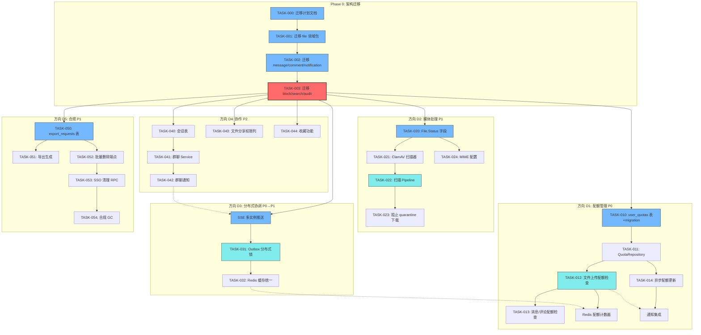
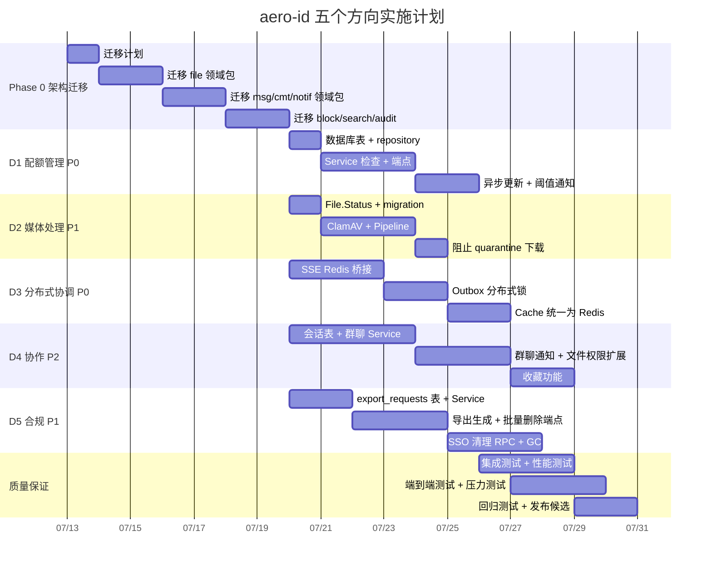

好的，分析完成。我已完整阅读了代码库，发现文档中存在一些重要的事实偏差。下面是我的综合技术领导力分析。

---

# Tech Lead 分析：aero-id 五个方向实施计划

## ⚠️ 关键发现：架构文档存在事实偏差

文档的"事实校正"一节声称代码库已**从单体 `service` 包迁移到按领域划分的独立包**，但经过全面代码审查，实际情况是：

| 陈述 | 实际状态 |
|------|---------|
| "当前代码库已经从单体 service 包演进为按领域划分的独立包" | **部分正确** — 每个领域确实有独立包 (`internal/file/`, `internal/message/` 等)，但**这些包的 Service 实现没有被 `app.go` 使用** |
| 文档旧路径（`internal/service/mocks` 等）"已被重构" | **不正确** — `app.go`、`internal/handler/http/*.go`、`internal/handler/grpc/*.go` 全部**仍然导入 `internal/service`** 中的 Service 接口 |

**真正的架构现状：**

```
Transport (HTTP/gRPC handlers)
    ↓ 依赖（当前）
internal/service/  [Legacy monolith — 被 app.go 使用]
    ↓
internal/repository/ [GORM persistence]

--- 并行存在，但未连接 ---
internal/file/        [自包含的 Service + Repository + Handler]
internal/message/     [同上]
internal/notification/[含 Dispatcher]
...等其他领域包
```

**这对所有五个方向的影响**：所有新功能都必须建立在一个一致的 Service 层上。在接下来的一周内，我们需要做出一个架构决策：

- **方案 A**：废弃领域包，继续在 `internal/service/` 单体上构建
- **方案 B**：完成迁移——将 transport 层从 `internal/service/` 切换到领域包，然后废弃 `internal/service/`
- **方案 C**：领域包只做跨领域关注点的"辅助库"（如 `notification.Dispatcher`、`block.BlockChecker`），Service 接口和主业务逻辑留在 `internal/service/`

**我强烈推荐方案 B**，因为领域包的重构很干净（更小的文件、更清晰的依赖、满足工程约束）。我的任务分解基于此，并为迁移设置了一个初始 Phase 0。

---

## 1. 任务分解

### 约定

- 每个任务 2-4 小时，同一方向顺序执行，不同方向并行
- 所有任务最后必须通过 `make test && make lint`
- 测试放在同一文件的 `_test.go` 中（或领域包自己的 `*_test.go`）
- 超过 500 行或 50 行的文件必须先重构再提交

### Phase 0：架构迁移基础（前提条件）

| ID | 任务标题 | 方向 | 涉及文件 | 前置依赖 | 工时 | 验收标准 |
|---|---|---|---|---|---|---|
| TASK-000 | 制定领域包迁移计划 + 迁移文档 | 架构 | `internal/`, `README.md`, `AGENTS.md` | 无 | 2h | AGENTS.md 中记录了迁移策略，所有开发人员知晓 |
| TASK-001 | 将 `internal/file/` 的 Service 接口迁移到 `internal/service/` 的替代方案 | 架构 | `internal/file/*.go`, `internal/service/file.go`, `internal/app/app.go` | TASK-000 | 3h | 所有 transport 层从 `internal/file.NewService()` 获取 Service |
| TASK-002 | 迁移 message、comment、notification 领域包 | 架构 | `internal/message/*`, `internal/comment/*`, `internal/notification/*`, `internal/service/*.go` | TASK-001 | 4h | 所有领域包完成 Service 替换，旧包标记为废弃 |
| TASK-003 | 迁移 block、search、audit 领域包 | 架构 | `internal/block/*`, `internal/search/*`, `internal/audit/*`, `internal/service/block.go` 等 | TASK-002 | 3h | 所有包迁移完成，旧 `internal/service/` 包可以移除 |

### D1：配额管理（P0）

| ID | 任务标题 | 方向 | 涉及文件 | 前置依赖 | 工时 | 验收标准 |
|---|---|---|---|---|---|---|
| TASK-010 | 添加 `user_quotas` 表 + migration | D1 | `migrations/000024_user_quotas.up.sql`, `.down.sql`, `internal/domain/quota.go` | TASK-002 | 2h | Migration 创建 `user_quotas` 表，含 `uid`、`resource_type`、`max_bytes`、`used_bytes`、`period_start` |
| TASK-011 | 实现 `QuotaRepository` 接口 + GORM repository | D1 | `internal/quota/repository.go`, `internal/quota/quota.go` | TASK-010 | 2h | 实现 `Check`（读当前用量）、`Increment`（原子加 delta）、`Reset`（周期重置） |
| TASK-012 | Service 层配额检查：文件上传 | D1 | `internal/service/file.go` 的 `Create()` 方法, `internal/service/quota.go` | TASK-011 | 2h | 上传前调用 `quotaRepo.Check(ctx, uid, "file_storage", delta)`，超限返回 403 |
| TASK-013 | Service 层配额检查：消息 + 评论 | D1 | `internal/service/message.go` 的 `Send()`, `internal/service/comment.go` 的 `Create()` | TASK-012 | 2h | 消息、评论写入前检查配额，超限返回 429 |
| TASK-014 | Outbox 事件驱动的配额异步更新 | D1 | `internal/service/notification.go`, `internal/outbox/quota_handler.go` | TASK-011 | 3h | 新建 outbox event handler `quota.decrement`，回收时减少已使用量 |
| TASK-015 | 添加配额管理 HTTP/gRPC 端点 | D1 | `internal/handler/http/quota.go`, `internal/handler/grpc/quota.go`, proto | TASK-012 | 3h | `GET /v1/quota` 返回用户配额用量，`GET /v1/quota/limits` 返回配置限制 |
| TASK-016 | 配额接近阈值通知 | D1 | `internal/service/notification.go` Dispatcher 逻辑, outbox 事件 | TASK-014, TASK-015 | 2h | 当用量达到 80%/90%/100% 时，通过 outbox 推送通知 |

### D2：媒体处理流水线（P1，按文档建议从病毒扫描开始）

| ID | 任务标题 | 方向 | 涉及文件 | 前置依赖 | 工时 | 验收标准 |
|---|---|---|---|---|---|---|
| TASK-020 | `domain.File` 添加 `Status` 字段 + migration | D2 | `internal/domain/file.go`, `migrations/000025_file_status.up.sql` | TASK-002 | 2h | File 结构体增加 `Status string`，值: `active`、`quarantined`、`deleted_pending` |
| TASK-021 | 实现 ClamAV 扫描处理器 | D2 | `internal/media/scanner.go`, `internal/media/processor.go` | TASK-020 | 3h | 实现 `Processor` 接口，Unix socket 调用 ClamAV，返回 status |
| TASK-022 | 文件上传后触发扫描的 Pipeline | D2 | `internal/media/pipeline.go`, `internal/outbox/media_handler.go` | TASK-021 | 2h | `file.uploaded` outbox 事件 → Pipeline → ClamAV 扫描 → 如果威胁则标记 quarantine |
| TASK-023 | 阻止 quarantine 文件下载 | D2 | `internal/service/file.go` 的 `Get()`、`DownloadURL()` | TASK-022 | 2h | quarantine 状态文件返回 403，普通下载不受影响 |
| TASK-024 | 添加 MIME 类型白名单更新策略 | D2 | `internal/config/config.go`, `internal/media/validator.go` | TASK-020 | 2h | MIME 检查从配置驱动，支持热更新 |

### D3：分布式协调（需提升优先级）

| ID | 任务标题 | 方向 | 涉及文件 | 前置依赖 | 工时 | 验收标准 |
|---|---|---|---|---|---|---|
| TASK-030 | SSE Hub 添加 Redis Pub/Sub 桥接 | D3 | `internal/hub/hub.go`, `internal/hub/redis.go` | TASK-002 | 4h | Hub.Publish 同时推送给本地 + Redis Pub/Sub，另一实例收到后推送给本地 subscriber |
| TASK-031 | Outbox relay 添加分布式锁 | D3 | `internal/outbox/relay.go`, `internal/outbox/lock.go` | TASK-030 | 3h | 每个 drain 周期尝试获取锁（Redis SET NX + TTL），失败则跳过 |
| TASK-032 | Cache 统一为 Redis | D3 | `internal/sso/cache.go` | TASK-031 | 4h | TokenCache + UserCache 从进程内 map 迁移到 Redis（TTL 不变，命中率不因多实例而减半） |

### D4：协作与社交图谱（P2）

| ID | 任务标题 | 方向 | 涉及文件 | 前置依赖 | 工时 | 验收标准 |
|---|---|---|---|---|---|---|
| TASK-040 | 添加 `conversations` 和 `conversation_participants` 表 | D4 | `migrations/000026_conversations.up.sql`, `internal/domain/conversation.go` | TASK-002 | 2h | 两张表创建完成，participants 表唯一约束适用 |
| TASK-041 | 群聊核心 Service + Repository | D4 | `internal/conversation/service.go`, `internal/conversation/repository.go` | TASK-040 | 4h | 创建会话、添加参与者、列出会话、发送群消息 |
| TASK-042 | 群聊通知（outbox + dispatcher） | D4 | `internal/service/notification.go` 的 notificationFor() | TASK-041 | 3h | 群消息为每个参与者创建通知行（排除消息发送者本身） |
| TASK-043 | 文件分享扩展 `permission` 列 | D4 | `migrations/000027_file_shares_permission.up.sql`, `internal/domain/shared.go` | TASK-002 | 2h | `file_shares` 表增加 `permission` 列（read/write/admin） |
| TASK-044 | 收藏功能（bookmarks） | D4 | `migrations/000028_bookmarks.up.sql`, `internal/bookmark/*.go` | TASK-002 | 3h | 文件/消息/评论可收藏和取消收藏，列出收藏列表 |

### D5：合规接口（P1）

| ID | 任务标题 | 方向 | 涉及文件 | 前置依赖 | 工时 | 验收标准 |
|---|---|---|---|---|---|---|
| TASK-050 | 添加 `export_requests` 表 + Service | D5 | `migrations/000029_export_requests.up.sql`, `internal/export/*.go` | TASK-002 | 3h | 用户发起数据导出请求，状态: pending/processing/completed |
| TASK-051 | 导出数据生成（outbox handler） | D5 | `internal/export/generator.go`, outbox event handler | TASK-050 | 4h | 异步生成所有数据的 JSON 导出，存储为文件，通过通知推送完成事件 |
| TASK-052 | 批量删除端点（用户自行删除所有数据） | D5 | `internal/handler/http/compliance.go`, `internal/handler/grpc/compliance.go`, proto | TASK-050 | 3h | `DELETE /v1/account/data` 软删除所有该用户的数据 |
| TASK-053 | SSO 驱动的用户数据清理 RPC | D5 | `api/proto/aero_id/v1/aero_id.proto`, `internal/handler/grpc/compliance.go`（新增 `DeleteAccountData` RPC） | TASK-052 | 4h | 新增 gRPC `DeleteAccountData`：SSO 调用后，软删所有该 uid 的数据 |
| TASK-054 | 合规数据 GC 管道（硬删除） | D5 | `internal/storage/gc/compliance.go` | TASK-053 | 2h | 过了保留期的合规删除数据进行物理清理 |

---

## 2. 执行顺序



### 可并行的任务组

| 并行组 | 任务 | 负责人建议 |
|--------|------|-----------|
| **Phase 0 基础** | T000 → T001 → T002 → T003 | 1 人串行（架构师） |
| **D1 配额** | T010-T016（迁移后即可开始） | 1 人 |
| **D2 媒体** | T020-T024（迁移后即可开始） | 1 人 |
| **D3 分布式** | T030-T032（迁移后即可开始，与 D1/D2 完全独立） | 1 人 |
| **D4 协作** | T040-T044（迁移后即可开始，与 D1/D2/D3 完全独立） | 1-2 人 |
| **D5 合规** | T050-T054（迁移后即可开始，与 D1-D4 完全独立） | 1 人 |

---

## 3. 技术风险

### 3.1 高风险：架构迁移（TASK-001 到 TASK-003）

| 风险 | 描述 | 缓解策略 |
|------|------|---------|
| **回归风险** | 从 `internal/service/` 切换到领域包时，现有传输 handler 可能遗漏行为差异 | 先编写对照测试：旧服务和新服务并行运行，确认输出完全一致后再切换 |
| **循环依赖** | 领域包之间可能产生循环导入（如 `notification` 导入 `block` 的 `BlockChecker`，`block` 导入 `notification` 的 `Pusher`） | 严格保持单向：`block` 不导入 `notification`。`BlockChecker` 定义为 `internal/block` 中导出的接口 |
| **工作树干系** | 迁移期间的大量文件修改会增加合并冲突概率 | 每次迁移一个领域包、提交，再继续下一个；避免同时迁移所有包 |

### 3.2 中风险：D1 配额管理

| 风险 | 描述 | 缓解策略 |
|------|------|---------|
| **同步检查延迟** | 每次写入前多一次 DB 查询会显著增加 P99 延迟 | 使用 `SELECT ... FOR UPDATE` 或轻量查询（无锁读 + 最终一致写）。文档建议同步检查 + 异步更新是合理方案 |
| **配额计数器热点** | 流行用户的高频写入导致行锁竞争 | 使用 `UPDATE user_quotas SET used_bytes = used_bytes + $1 WHERE ...`（原地更新），而非先读后写 |
| **溢出处理** | 异步更新延迟导致瞬态超限被回滚后 quota 变成负数 | 在 domain 层强制 `used_bytes >= 0` 约束 |

### 3.3 中风险：D3 分布式协调

| 风险 | 描述 | 缓解策略 |
|------|------|---------|
| **Redis 依赖** | 引入 Redis 增加运维复杂度和宕机风险 | Phase 0 使用 Redis Pub/Sub（无持久化要求）。加 graceful degradation：Redis 断开时降级为仅本地推送 |
| **分布式锁竞态** | Outbox relay 的 `MarkPublished` 竞态窗口仍然存在 | 使用 `SELECT ... FOR UPDATE SKIP LOCKED` 替代乐观锁，结合 Redis 分布式锁作为副防御 |
| **网络分区** | 实例间 Redis 连接断开导致 SSE 消息丢失 | 消息在 outbox 中已经有持久化，SSE 仅是实时通道。客户端重连时通过 `last_event_id` 重播。所以最终一致性有保障 |

### 3.4 中风险：D5 合规接口

| 风险 | 描述 | 缓解策略 |
|------|------|---------|
| **数据量爆炸** | 批量导出/删除时 I/O 过高可能导致数据库性能下降 | 使用游标分页（`WHERE id > cursor LIMIT 1000`）+ 限速器 |
| **SSO 集成** | 需要 SSO 端配合修改（新增 gRPC webhook） | 先实现 aero-id 端接口，然后与 SSO 团队约定接口规范；如果 SSO 团队不可用则回退到轮询方案 |
| **删除与 GC 冲突** | 合规删除和 Storage GC 同时执行导致竞争 | 使用 `deleted_pending` 状态确保 GC 跳过正在清理的文件 |

---

## 4. 资源评估

### 4.1 开发人员

| 角色 | 所需数量 | 技能要求 | 主要负责方向 |
|------|---------|---------|-------------|
| **架构师/主程** | 1 | 精通 Go、GORM、分布式系统设计；理解现有代码库全局 | Phase 0 迁移；D3 架构设计；代码审查 |
| **后端开发 A** | 1 | Go、PostgreSQL；领域驱动设计 | D1 配额 + D5 合规 |
| **后端开发 B** | 1 | Go、PostgreSQL；多媒体/安全经验 | D2 媒体处理 + D4 协作 |
| **QA 工程师** | 1（阶段性） | Go testing、集成测试、性能测试 | 所有方向的测试和质量把关 |

### 4.2 关键里程碑

| 里程碑 | 时间 | 交付物 |
|--------|------|--------|
| **M0** | Week 1 | Phase 0 架构迁移完成（领域包全部连接） |
| **M1** | Week 2 | D1 配额：核心检查 + 端点对接完成；D2 扫描：File.Status + ClamAV Pipeline 完成 |
| **M2** | Week 3 | D3 SSE Redis 桥接 + outbox 锁；D5 导出端点 + proto |
| **M3** | Week 4 | D4 群聊基础 + 文件分享扩展；所有方向集成测试通过 |
| **M4** | Week 5 | 性能测试 + 压力测试 + 文档完善；发布候选 |

### 4.3 阻塞点

| 阻塞点 | 影响 | 解决策略 |
|--------|------|---------|
| **Phase 0 迁移未完成** | 所有后续任务需要开发的代码基版本不统一 | 投入 1 个架构师全职进行 Phase 0，不允许并行开发 |
| **ClamAV 不可用** | D2 无法在预期时间内完成 | 回退方案：使用基于 MIME 和大小启发式判断的隔离方案，ClamAV 作为可选增强 |
| **Redis 未部署** | D3 全部阻塞 | 最小方案：SSE 桥接使用 Postgres LISTEN/NOTIFY（已有依赖，无需新基础设施） |
| **SSO 团队无对接人** | D5 中 AccountDataCleanup RPC 无法实现 | 回退到轮询方案：aero-id 定期查询 SSO 的 deleted-users 端点 |
| **protoc/dep 版本不匹配** | 无法生成 pb.go | 锁定 go.mod 中 `google.golang.org/protobuf` 版本，使用 Makefile 中记录的 `protoc-gen-go@v1.34.1` |

---

## 5. 质量保证

### 5.1 测试覆盖要求

| 层级 | 要求 | 指标 |
|------|------|------|
| Service 层 | 100% 分支覆盖（业务逻辑的唯一来源） | `go test -coverpkg=./internal/service/... -coverprofile=coverage.out` ≥ 90% |
| Domain 层 | 所有值对象和不变量的白盒测试 | 每个 domain 结构体的方法 100% 覆盖 |
| Repository | 所有 CRUD 路径加 GORM 集成测试 | `make test-integration` 通过 |
| HTTP/gRPC | handler 层解码-调用-响应测试 | 每个 handler 至少有一个成功路径和一个错误路径测试 |

### 5.2 集成测试策略

| 测试类型 | 运行条件 | 策略 |
|---------|---------|------|
| **Repository 测试** | `//go:build integration` + Docker | 使用 `internal/repository/testpg` 的 testcontainers。每次跑前清空数据 |
| **Service + Repository 联合测试** | `//go:build integration` | 启动 Postgres + MinIO（或用 `internal/testutil/fakestorage` 的模拟存储） |
| **SSE 端到端测试** | `//go:build integration` | 启动多实例 hub（模拟、无 Redis）、连接 SSE、发布事件、验证接收 |
| **D3 Redis 测试** | `//go:build integration` | 使用 `testcontainers/redis`，模拟 Redis 断开后 graceful degradation |

### 5.3 代码审查要点

| 审查项 | 要点 |
|--------|------|
| **文件大小** | 非测试文件控制在 ≤ 400 行（留安全边际），超过 500 行直接拒绝 |
| **函数长度** | `funlen` linter 必须通过（≤ 50 行） |
| **复杂度** | `cyclop` 校验通过（函数 ≤ 10，包平均 ≤ 5） |
| **嵌套深度** | `if` 嵌套 ≤ 3 层 |
| **错误处理** | Repository 层的错误必须在 Service 层转化为 `*AppError`，handler 层不做业务判断 |
| **迁移兼容性** | 领域包迁移期间，旧 `internal/service/` 和领域包中的同名方法必须行为一致 |

### 5.4 性能测试需求

| 方向 | 性能关注点 | 测试要求 |
|------|-----------|---------|
| **D1 配额** | 同步检查的 P50/P99 延迟 | 在 1000 QPS 负载下，配额检查 ≤ 2ms（包括 DB 查询） |
| **D3 SSE** | Redis Pub/Sub 吞吐量 | 1000 个订阅用户，10K events/s 发布，延迟 ≤ 50ms |
| **D3 Outbox** | 分布式锁下吞吐 | 锁获取延迟 ≤ 10ms，避免锁竞争导致 relay 空转 |

---

## 6. 实施计划

### 时间线图



### 分阶段详情

#### 阶段 1：基础设施搭建（第 1 周，5 天）

| 天 | 任务 | 产出 |
|----|------|------|
| Day 1 | TASK-000 迁移计划 + 文档；TASK-010 配额表设计 | AGENTS.md 更新；迁移 timeline；配额 migration SQL |
| Day 2-3 | TASK-001 迁移 file 领域包 | `internal/file/` 全部接入 transport 层；旧 `internal/service/file.go` 标记 Deprecated |
| Day 3-4 | TASK-002 迁移 message/comment/notification | 同上；notification 的 Dispatcher 统一到 `internal/notification/` |
| Day 5 | TASK-003 迁移 block/search/audit | `internal/service/` 包可以完全移除，所有 import 更新 |

#### 阶段 2：核心功能实现（第 2-3 周，10 天）

| 并行轨道 | 内容 |
|---------|------|
| **轨道 A（D1 + D5）** | TASK-011 到 TASK-016（配额）；TASK-050 到 TASK-054（合规） |
| **轨道 B（D2 + 部分 D4）** | TASK-020 到 TASK-024（媒体扫描）；TASK-043（文件权限列） |
| **轨道 C（D3）** | TASK-030 到 TASK-032（SSE Redis、outbox 锁、缓存统一） |
| **轨道 D（D4 群聊）** | TASK-040 到 TASK-042（会话表 + 群聊 Service + 通知）；TASK-044（收藏功能） |

#### 阶段 3：集成测试和优化（第 4 周，3 天）

| 活动 | 内容 |
|------|------|
| 集成测试 | TASK-ALL 的 integration 测试补充：每个新 Repository 方法至少有一个 testcontainers 测试 |
| 性能测试 | D1 配额延迟验证；D3 SSE 吞吐测试；D5 导出/删除压力测试 |
| 代码审查 | 所有新代码过 lint 和 size 检查；解耦检查 |

#### 阶段 4：发布准备（第 5 周，2 天）

| 活动 | 内容 |
|------|------|
| 配置文档 | 所有新增 config 选项写入 config.yaml 示例 + env 映射 |
| 部署检查 | 新依赖（Redis、ClamAV、protobuf 更新）加入 compose 和部署清单 |
| 回滚计划 | 每个方向确定回退策略（如 D3 无 Redis 退化为本地模式） |
| 性能基准 | 记录上线前的关键指标基线（API 延迟、DB QPS、SSE 吞吐） |

---

## 总结：给团队的行动建议

1. **立即暂停一切**，直到 Phase 0 迁移计划（TASK-000）确定。当前代码库的双 Service 结构是所有后续工作的**最大技术债务**。

2. **D3 优先级应提到 P1**（如文档中正确的分析），SE 跨实例正确性问题不是性能问题。TASK-030（SSE Redis 桥接）是第 2 周最高优先级的任务。

3. **D1 和 D5 的开工不需要核心架构变更**以外的阻塞。如果必须在迁移完成前开工，可以在 `internal/service/` 的 monolith 中先实现，后续迁移时搬运到领域包。但建议先迁移。

4. **测试策略**：每个方向在合并前必须至少达到：
   - 新代码 90% 测试覆盖率
   - 所有集成测试通过
   - 文件/函数长度约束全程遵守
   - 无新的循环依赖

准备好后可以告诉我你倾向哪个实施方向，我协助从第一个任务开始。
