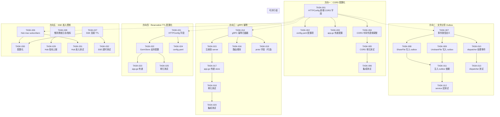

Now I have a complete picture. Let me produce the comprehensive Tech Lead analysis.

---

# Tech Lead 分析报告：aero-id 五项技术债修复

## 背景

基于全量验证确认报告（结论：全部 5 个方向代码级证据准确、完整、可复现），以下分析将 5 个方向拆解为可执行任务，提供执行顺序、风险、资源和质量保证方案。

---

## 1. 任务分解

### 方向一：CORS 默认允许所有来源 — P1

| 任务 ID | 标题 | 涉及文件 | 前置依赖 | 预估工时 | 验收标准 |
|---------|------|---------|---------|---------|---------|
| **TASK-001** | `HTTPConfig` 新增 CORS 配置字段 | `internal/config/config.go` | — | 1h | `HTTPConfig` 新增 `CORSOrigins []string` 和 `CORSAllowAllOrigins bool` 字段，`config.Load` 解析 `config.yaml` 中的 `cors_origins` 和 `cors_allow_all` |
| **TASK-002** | `config.yaml` 新增 CORS 配置项 | `configs/config.yaml` | TASK-001 | 0.5h | 配置文件含 `cors_origins: []` 和 `cors_allow_all: true` 默认值 |
| **TASK-003** | `app.go` 传递 CORS 配置到 RouterConfig | `internal/app/app.go` | TASK-001 | 0.5h | `RouterConfig.CORSOrigins` 赋值为 `cfg.Server.HTTP.CORSOrigins` |
| **TASK-004** | `CORS` 中间件支持按配置拒绝空 origins 时拒绝所有 | `internal/middleware/cors.go` | TASK-001 | 2h | `allowAll` 逻辑改为：当 `CORSOrigins` 为空且 `AllowAllOrigins=false`，拒绝所有跨域请求；当 `AllowAllOrigins=true` 才通配 |
| **TASK-005** | 单元测试覆盖 CORS 配置变化 | `internal/middleware/cors_test.go`（新建） | TASK-004 | 2h | 覆盖：allowAll=true 通配、allowAll=false+origins 白名单、allowList=false+origins 空→403、OPTIONS 预检 |
| **TASK-006** | 集成测试验证 CORS 头 | `internal/handler/http/router_test.go` | TASK-005 | 1h | 启动测试 HTTP 服务，验证不同 Origin 头的响应头正确 |

### 方向二：文件分享不产生 Outbox 事件 — P1

| 任务 ID | 标题 | 涉及文件 | 前置依赖 | 预估工时 | 验收标准 |
|---------|------|---------|---------|---------|---------|
| **TASK-007** | 定义 `file.share` 和 `file.unshare` 事件类型及 payload | `internal/domain/notification.go`（或新增 `internal/domain/events.go`） | — | 1h | 新增 `FileSharePayload` 和 `FileUnsharePayload` 结构体，定义 `EventTypeFileShare = "file.share"`、`EventTypeFileUnshare = "file.unshare"` |
| **TASK-008** | `fileService.ShareFile` 写入 outbox 事件 | `internal/file/service_share.go` | TASK-007 | 2h | `ShareFile` 方法在 `s.shares.Grant()` 之后调用 `s.outbox.Publish(ctx, ...)` 写入 `file.share` 事件 |
| **TASK-009** | `fileService.UnshareFile` 写入 outbox 事件 | `internal/file/service_share.go` | TASK-007 | 1.5h | `UnshareFile` 方法在 `s.shares.Revoke()` 之后调用 `s.outbox.Publish(ctx, ...)` 写入 `file.unshare` 事件 |
| **TASK-010** | `NotificationDispatcher` 处理 `file.share` 和 `file.unshare` 事件 | `internal/service/notification.go` | TASK-007, TASK-008, TASK-009 | 3h | 在 `notificationFor` switch 中新增两个 case，分别生成对应通知（`file.shared_with_you`、`file.unshared_with_you`） |
| **TASK-011** | `fileService` 注入 outbox 依赖 | `internal/file/file.go`（service 构造）和 `internal/app/app.go` | TASK-008 | 1h | `fileService` 新增 `outbox.Publisher` 字段，`app.go` 构造时传入 `outboxRepo` |
| **TASK-012** | 单元测试：service 层 outbox 事件写入 | `internal/file/service_share_test.go`（新建或扩展） | TASK-008, TASK-009, TASK-011 | 2h | mock outbox，验证 `ShareFile`/`UnshareFile` 调用 `Publish`，验证 payload 正确 |
| **TASK-013** | 单元测试：dispatcher 处理文件分享事件 | `internal/service/notification_test.go`（扩展） | TASK-010 | 2h | 构造 outbox event，验证 `Handle` 生成正确的 notification row |

### 方向三：gRPC 传输层无幂等性 — P1

| 任务 ID | 标题 | 涉及文件 | 前置依赖 | 预估工时 | 验收标准 |
|---------|------|---------|---------|---------|---------|
| **TASK-014** | gRPC 幂等拦截器实现 | `internal/handler/grpc/server.go`（或新建 `internal/handler/grpc/idempotency.go`） | — | 3h | 实现 `IdempotencyInterceptor`：从 gRPC metadata 读取 `idempotency-key`，调用 `idempotency.Store` 的 Reserve/Complete/Release，失败时 fail-open |
| **TASK-015** | 幂等拦截器注册到 gRPC server 构建链 | `internal/handler/grpc/server.go` | TASK-014 | 1h | `NewServerWithOptions` 新增 `WithIdempotency(store, ttl)` option，拦截器链中位于 auth 之后 |
| **TASK-016** | gRPC 路由规则：标记哪些 RPC 需要幂等 | `internal/handler/grpc/server.go`（`requiredIdempotentMethod` 函数） | TASK-014 | 1.5h | 返回 `true`/`false` 判定（采用白名单方式，仅 mutating RPC 需要） |
| **TASK-017** | `app.go` 将 idempotency store 传递给 gRPC server | `internal/app/app.go` | TASK-015 | 0.5h | `NewServerWithOptions` 调用时传入 `grpc.WithIdempotency(idemStore, ...)` |
| **TASK-018** | gRPC 幂等单元测试 | `internal/handler/grpc/server_test.go`（新建） | TASK-014, TASK-015 | 3h | mock `idempotency.Store`，验证：首次返回 reserved=true、重复 key 返回 replayed、并发返回 in_progress、store 错误 fail-open |
| **TASK-019** | proto 新增 `idempotency_key` 字段（可选，非阻塞） | `api/proto/...` + 重新生成 | — | 2h | 在需要幂等的请求消息中加 `string idempotency_key = 99`；或不改 proto，仅通过 metadata 传 |
| **TASK-020** | 集成测试：gRPC 幂等端到端 | 新增集成测试 | TASK-018 | 3h | 启动 testcontainers + gRPC client，两次相同请求返回相同响应 |

### 方向四：幂等键预留超时硬编码 — P2

| 任务 ID | 标题 | 涉及文件 | 前置依赖 | 预估工时 | 验收标准 |
|---------|------|---------|---------|---------|---------|
| **TASK-021** | `HTTPConfig` 新增 `IdempotencyReservationTTL` 字段 | `internal/config/config.go` | — | 0.5h | 新增 `IdempotencyReservationTTL time.Duration`，默认 `2m` |
| **TASK-022** | `GormStore` 支持可配置 reservation TTL | `internal/idempotency/store.go` | TASK-021 | 1.5h | `NewGormStore` 或 `WithReservationTTL` option 替换硬编码常量；兼容零值 = 使用默认 2m |
| **TASK-023** | `app.go` 传递 reservation TTL 配置 | `internal/app/app.go` | TASK-022 | 0.5h | 实例化 `GormStore` 时传入 `cfg.Server.HTTP.IdempotencyReservationTTL` |
| **TASK-024** | `config.yaml` 新增配置项 | `configs/config.yaml` | TASK-021 | 0.5h | `idempotency_reservation_ttl: 2m` |
| **TASK-025** | 验证 + 单元测试 | `internal/idempotency/store_test.go`（扩展） | TASK-022 | 1.5h | 测试不同 TTL 下 reservation 超时和 reclaim 行为正确 |

### 方向五：SSE Hub 无连接准入控制 — P2

| 任务 ID | 标题 | 涉及文件 | 前置依赖 | 预估工时 | 验收标准 |
|---------|------|---------|---------|---------|---------|
| **TASK-026** | Hub 新增连接限数配置和 max subscribers 控制 | `internal/hub/hub.go` | — | 2h | `Hub` 新增 `maxSubsPerUID int` 字段，默认 10；`Subscribe` 检查当前 uid 订阅数，超限返回 closed channel |
| **TASK-027** | SSE handler 新增 per-connection 最大生命周期 | `internal/handler/http/events.go` | — | 1.5h | `Stream` 方法启动时设置 `context.WithTimeout(ctx, maxLife)`，超时关闭连接 |
| **TASK-028** | 慢消费者丢弃事件增加日志和指标 | `internal/hub/hub.go` | — | 2h | 在 `pub` 的 `default: drop` 分支增加：logger.Warn + 计数器（atomic 或回调） |
| **TASK-029** | Hub 新增连接/丢弃指标上报 | `internal/pkg/metrics/metrics.go`（扩展） | TASK-028 | 1h | 新增 `sseSubscribersGauge`（当前连接数 per uid）、`sseDroppedCounter` |
| **TASK-030** | 配置化：max subscribers、max connection TTL | `internal/config/config.go` | TASK-026, TASK-027 | 1h | `SSEConfig{MaxSubsPerUID, MaxConnTTL}` 写入 `ServerConfig` |
| **TASK-031** | 单元测试 Hub 准入控制 | `internal/hub/hub_test.go`（扩展） | TASK-026, TASK-028 | 2h | 测试超限订阅返回 closed、丢弃事件计数器增加 |
| **TASK-032** | 单元测试 SSE handler 超时 | `internal/handler/http/events_test.go`（扩展） | TASK-027 | 1.5h | 测试写超时后连接自动关闭 |

---

## 2. 执行顺序



### 并行执行组

| 并行组 | 任务 | 原因 |
|--------|------|------|
| **Group A** (基础设施) | TASK-001 ~ TASK-004 | CORS 配置化，涉及 config、middleware、app，内部依赖但独立于其他方向 |
| **Group B** (共享事件基础设施) | TASK-007 | 事件类型定义是所有 outbox 方向的前置 |
| **Group C** (gRPC 幂等) | TASK-014 ~ TASK-016 | gRPC 拦截器实现，独立于其他方向 |
| **Group D** (配置项) | TASK-021, TASK-024 | 简单配置字段新增，可先行完成 |
| **Group E** (SSE) | TASK-026 ~ TASK-028 | Hub 限流和日志，相对独立 |

**建议并行策略**：
1. **波次 1（Day 1-2）**：Group A + Group B + Group D 同时推进（3 人并行）
2. **波次 2（Day 3-4）**：Group C + Group E + 方向二依赖链（TASK-008→TASK-011）
3. **波次 3（Day 5-7）**：集成测试、边界 case 覆盖

---

## 3. 技术风险

### 3.1 高优先级风险

| 风险 | 影响方向 | 严重度 | 缓解策略 |
|------|---------|--------|---------|
| **gRPC 幂等 fail-open 的语义分歧** | 方向三 | 🔴 | Gin 和 gRPC 的 fail-open 行为必须一致：store 不可用时 pass-through 而不是拒绝请求。需在 `IdempotencyInterceptor` 中显式明确 |
| **文件分享 outbox 事件的循环分发** | 方向二 | 🔴 | 当 dispatcher 处理 `file.share` 生成通知，如果通知本身也写 outbox，可能形成循环。需确保 notification 创建不触发 outbox，或打 tag 跳过 |
| **gRPC 幂等键的传输协议** | 方向三 | 🟡 | 不修改 proto 而走 gRPC metadata 是合理的，但需要客户端（前端/其他微服务）在 metadata 中携带 key。需文档化约定 |
| **旧 `internal/notification/dispatcher.go` 与 `internal/service/notification.go` 重复** | 方向二 | 🟡 | 注意到存在两份 Dispatcher 实现。经查 `internal/notification/dispatcher.go` 已被 `internal/service/notification.go` 替代（app.go 使用后者）。确保只修改活跃代码，旧文件考虑清理或加 deprecation 注释 |
| **SSE 连接限数可能导致合法客户端掉线** | 方向五 | 🟡 | `maxSubsPerUID` 默认值需要保守（如 10），同时对超过限制返回 closed channel 而不是静默失败。客户端需要处理错误重连 |

### 3.2 依赖外部系统

| 依赖 | 相关任务 | 说明 |
|------|---------|------|
| `idempotency.Store` (Postgres) | TASK-014 ~ TASK-020 | gRPC 幂等依赖 idempotency GORM store，需确保 gRPC 拦截器中可以使用 `context.Context` 访问 DB（已有 `gorm.DB` 的 `WithContext`） |
| 通知系统的 Preference/Block 检查 | TASK-010 | `NotificationDispatcher` 已集成 block 和 preference 检查，文件分享通知默认继承这些保护 |
| Proto 修改和 protoc 工具链 | TASK-019 | 如需在 proto 中加入 idempotency_key 字段，需确保 `protoc-gen-go@v1.34.1` + `protoc-gen-go-grpc@v1.5.1` 可用 |

### 3.3 性能与可观测性

| 关注点 | 说明 |
|--------|------|
| **gRPC 幂等 DB 写入延迟** | `Reserve` 写入 `idempotency_keys` 表是在请求路径上的，失败会 fail-open。但高并发下每次写入都加写锁（`ON CONFLICT`），存在争用可能。建议观察 `idempotency_keys` 表的写入 P99 |
| **文件分享 outbox 事件量预估** | 假设每天 1M 次分享操作，每个操作产生 1 条 outbox 事件 + 1 条 notification row，负载可控。但如果每个 grant 事件包含 N 个受让方，需要考虑拆分（当前 `ShareFile` 接受 []string，建议每个受让方写一条事件） |
| **SSE 慢消费者丢弃可观测性** | 当前丢事件完全静默，TASK-028 增加日志和指标后，可设置告警：当 `sse_dropped_rate > 0.01` 时发出警告 |

---

## 4. 资源评估

### 4.1 人员技能要求

| 角色 | 技能要求 | 人数 | 负责方向 |
|------|---------|------|---------|
| **Backend Go 工程师 A** | 熟悉 gin/gRPC middleware 模式、GORM | 1 | 方向一 + 方向三（配置化 + gRPC 幂等） |
| **Backend Go 工程师 B** | 熟悉 outbox 模式、通知系统、事件驱动 | 1 | 方向二（文件分享 outbox） |
| **Backend Go 工程师 C** | 熟悉并发控制、SSE、metrics | 1 | 方向四 + 方向五（reservation TTL + SSE 准入） |

**总计**：3 名工程师 × 7 天

### 4.2 关键里程碑

| 里程碑 | 时间 | 验收内容 |
|--------|------|---------|
| **M1: 基础设施就绪** | Day 2 结束 | CORS 配置化完成且通过测试；事件类型定义完成；reservation TTL 配置化完成 |
| **M2: 核心功能完成** | Day 5 结束 | 文件分享 outbox 完整链路（service→outbox→dispatcher→notification）；gRPC 幂等拦截器通过单元测试；SSE 准入控制完成 |
| **M3: 集成测试通过** | Day 6 结束 | 方向一~五的集成测试全部通过；`make test && make lint` 全绿 |
| **M4: 发布就绪** | Day 7 结束 | 代码审查完成；文档更新（README 变更、配置变更说明）；PR 合入 main 分支 |

### 4.3 阻塞点与策略

| 阻塞点 | 影响任务 | 解决策略 |
|--------|---------|---------|
| **`internal/notification/dispatcher.go` 与 `internal/service/notification.go` 关系不清晰** | TASK-010 | 确认文件分享通知应写入活跃的 Dispatcher（`service/notification.go`）。在 `internal/notification/dispatcher.go` 文件头加 `// Deprecated: use internal/service/notification.go instead` 注释后暂不修改 |
| **Proto 修改需要 protoc 工具链** | TASK-019 | **决策**：不修改 proto，全程通过 gRPC metadata 传递幂等键。降低交付风险 |
| **`hub.Pusher` 接口签名与 `*Hub` 不兼容** | 附加发现 | 现有代码中 `internal/notification/dispatcher.go`（旧）使用 3-param `hub.Pusher`，但 `*Hub` 只有 4-param 的 `Publish`。这不会影响方向五的修改，但需记录为独立 cleanup item |

---

## 5. 质量保证

### 5.1 单元测试覆盖要求

| 方向 | 包 | 最小覆盖率要求 | 关键测试场景 |
|------|----|--------------|------------|
| 方向一 | `internal/middleware` | 90% | 空 origins+allowAll=true→`*`; 空 origins+allowAll=false→403; 白名单匹配; 不匹配; OPTIONS 预检; 非 OPTIONS 请求透传 |
| 方向二 | `internal/file` · `internal/service` | 85% | `ShareFile` outbox publish 调用; `UnshareFile` outbox publish 调用; 受让方去重; self-grant 跳过; `notificationFor` 解析 payload; block/preference 检查 |
| 方向三 | `internal/handler/grpc` | 85% | 首次请求→reserved; 重复 key→replayed; 并发→in_progress; store 错误→fail-open; 只有 mutating RPC 应用幂等 |
| 方向四 | `internal/idempotency` | 90% | 默认 TTL; 配置 TTL; reclaim 逻辑; 超时后释放 |
| 方向五 | `internal/hub` · `internal/handler/http` | 85% | 超限订阅→closed ch; 丢弃事件→计数器递增; 连接 TTL 超时→ctx done; 指标正确 |

### 5.2 集成测试策略

| 测试 | 工具 | 描述 |
|------|------|------|
| **CORS 端到端** | `httptest.Server` | 启动完整 HTTP server，发送不同 Origin 的请求验证响应头 |
| **gRPC 端到端幂等** | testcontainers (Postgres) | 启动 gRPC server + Postgres，客户端两次相同请求验证 replayed |
| **文件分享通知流** | testcontainers (Postgres) | 创建文件→分享→验证 notification row 存在→验证 SSE hub 收到事件 |

**注意**：方向二的集成测试需要 outbox relay 实际运行（以消费 `file.share` 事件），可能需要启动 `outbox.Relay` 或直接在测试中调用 `dispatcher.Handle`。

### 5.3 代码审查要点

| 方向 | 审查要点 |
|------|---------|
| **方向一** | `allowAll` 语义是否清晰？默认值是否破坏现有部署（生产环境 allowAll=true 保持兼容）？配置变更是否向后兼容？ |
| **方向二** | outbox 事件是否在 repo 事务外写入（避免分布式事务）？重构后的 `fileService` 是否保持 `ShareFile`/`UnshareFile` 原有返回签名不变？ |
| **方向三** | fail-open 行为是否与 Gin 版本一致？`Idempotency-Key` 在 gRPC metadata 中的 key 名是否统一（建议全小写 `idempotency-key`）？ |
| **方向四** | `NewGormStore` 接口签名是否向后兼容（option 模式 vs 新参数）？零值 TTL 是否回退到 2m？ |
| **方向五** | `maxSubsPerUID` 默认值是否合理？丢弃事件日志级别应为 `Warn` 而非 `Error`（因为这是预期行为）；指标命名符合 `sse_*` 规范。 |

### 5.4 性能测试需求

| 场景 | 测试目标 | 工具 |
|------|---------|------|
| **gRPC 幂等拦截器延迟** | P99 < 5ms 额外延迟（含一次 DB 写入） | `go test -bench` + pprof |
| **SSE 慢消费者** | 100 个激增连接 + 10,000 msg/s 发布，Hub 不 panic，丢弃率 < 5% | `go test -bench` 或 k6 |
| **文件分享 outbox 吞吐** | 5000 次 `ShareFile`/秒，outbox 不积压 | 集成测试环境 + Prometheus 指标 |

---

## 6. 实施时间计划


### 阶段说明

| 阶段 | 天数 | 产出 | 通过标准 |
|------|------|------|---------|
| **Phase 1: 基础设施搭建** | 2 天 | CORS 配置化完成；事件类型定义完成；reservation TTL 配置化完成 | `make test` 通过 |
| **Phase 2: 核心功能实现** | 3 天 | 文件分享 outbox 完整链路；gRPC 幂等拦截器；SSE 准入控制；所有单元测试 | `make test && make lint` 通过，关键功能测试覆盖 > 80% |
| **Phase 3: 测试和优化** | 2 天 | 所有单元测试 + 集成测试 + 指标接入 | 集成测试绿色，`make check-file-sizes` 通过 |
| **Phase 4: 发布准备** | 1 天 | 代码审查 + 文档更新 + 合入 | PR Approved，README 更新 |

---

## 总结与建议

### 优先级排序

**P1（本轮必做）**：方向一 + 方向二 + 方向三 → 安全与功能完整性

- **方向一（CORS）**是安全风险：生产环境默认对所有来源开放，应立即修复。
- **方向二（文件分享 outbox）**是功能缺失：受让方只能轮询发现分享，无实时通知，影响用户体验。
- **方向三（gRPC 幂等）**是数据完整性风险：gRPC 客户端重试可能导致重复写入。

**P2（本轮可选）**：方向四 + 方向五 → 运维弹性与可靠性

- **方向四（reservation TTL 硬编码）**影响运维调优，但默认 2m 在大多数场景可接受。
- **方向五（SSE 准入控制）**在低并发场景下风险可控，但缺少可观测性会掩盖问题。

### 推荐执行方案

```
Day 1-2:  3 人并行基础设施 (CORS + 事件类型 + TTL)
Day 3-5:  3 人各自推进核心功能 (outbox / gRPC幂等 / SSE准入)
Day 5-7:  集中测试 + 修复 + 代码审查
Day 7-8:  合入
```

如果人力受限（仅 1-2 人），建议按顺序执行：**方向一 → 方向二 → 方向三 → 方向五 → 方向四**，因为方向四（TTL 配置化）工作量最小可以穿插进行。

### 附加清理项（单独记录，不阻塞本轮）

1. **`internal/notification/dispatcher.go`** — 已被 `internal/service/notification.go` 替代，建议标记 deprecated 后在独立 PR 中清理
2. **`hub.Pusher` 接口签名不兼容** — 3-param 接口定义但无实际实现满足，建议合并到 4-param 的 `service.NotificationPusher`
