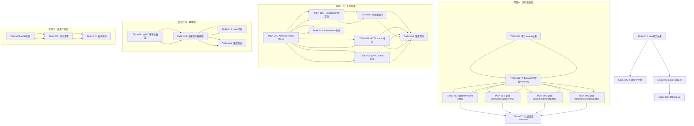

现在我已全面了解代码库。以下是完整的 Tech Lead 分析。

---

# Tech Lead 分析：aero-id 架构反模式修复方案

## 执行摘要

针对分析文档中验证的 5 个方向，优先级排列如下：

| 优先级 | 方向 | 风险等级 | 影响面 | 建议开始时间 |
|--------|------|---------|--------|------------|
| **P0** | ① 双重文件/消息/评论服务层 | 🔴 高 | 包分裂、死代码、维护负担 | 立即 |
| **P0** | ④ Outbox 死信不可见 | 🔴 高 | 生产运维盲区、数据丢失风险 | 立即 |
| **P1** | ③ gRPC 无幂等键 | 🟡 中 | 仅 gRPC 客户端无重放保护 | 阶段 2 |
| **P1** | ② 幽灵通知行 | 🟡 中 | 表膨胀潜在风险 | 阶段 2 |
| **P2** | ⑤ SSE Hub 单实例 | 🟢 低 | 当前够用，横向扩展才需处理 | 阶段 4 |

---

## 1. 任务分解

### 方向一：消除双重服务层（Duplicate Service Layer）

**现状**：`internal/file/`、`internal/message/`、`internal/comment/`、`internal/notification/` 四个包各自包含了完整的 Service + Repository 接口 + HTTP/gRPC Handler 定义，但这些包**未注册到 `app.go`**（除 `internal/search/` 引用了它们的 Repository 接口）。「正版」服务在 `internal/service/`、`internal/repository/`、`internal/handler/{http,grpc}/` 中。

| 任务 ID | 标题 | 涉及文件 | 前置依赖 | 预估工时 |
|---------|------|---------|---------|---------|
| TASK-001 | 审计 `internal/search/` 对重复包的依赖 | `internal/search/search.go`, `internal/search/handler_grpc.go` | 无 | 1h |
| TASK-002 | 将 `internal/search/` 从重复包迁移到正版 `repository.*` 接口 | `internal/search/search.go`, `internal/search/handler_grpc.go` | TASK-001 | 2h |
| TASK-003 | 删除 `internal/file/` 包中死代码（handler + service 层），仅保留 domain 类型别名 | `internal/file/file.go`, `internal/file/service_crud.go`, `internal/file/service_upload.go`, `internal/file/service_share.go`, `internal/file/handler_http.go`, `internal/file/handler_grpc.go`, `internal/file/repository.go`, `internal/file/repository_share.go` | TASK-002 | 2h |
| TASK-004 | 删除 `internal/message/` 包中死代码（handler + service 层），仅保留 domain 类型别名 | `internal/message/*.go` | TASK-002 | 1.5h |
| TASK-005 | 删除 `internal/comment/` 包中死代码（handler + service 层），仅保留 domain 类型别名 | `internal/comment/*.go` | TASK-002 | 1.5h |
| TASK-006 | 删除 `internal/notification/` 包中死代码（handler + service 层），仅保留 domain 类型别名 | `internal/notification/notification.go` | TASK-002 | 1h |
| TASK-007 | 运行 `make test && make lint` 验证无回归，更新 `make check-file-sizes` 配置 | — | TASK-003~006 | 1h |

**验收标准（TASK-003~006）**：
- `internal/file/` 包被删除后，`go build ./...` 通过
- 所有测试通过（`make test`）
- `make check-file-sizes` 通过
- CI 上无未引用的导入

### 方向二：幽灵通知行设计权衡文档化 + 可选修复

**现状**：`internal/service/notification.go:227-251` 的折叠逻辑会在创建折叠行时保留原始的「幽灵行」。当前代码注释明确标记为已知设计，但存在表膨胀风险。

| 任务 ID | 标题 | 涉及文件 | 前置依赖 | 预估工时 |
|---------|------|---------|---------|---------|
| TASK-008 | 编写设计决策记录（ADR），说明幽灵行是已知权衡 | `docs/adrs/2026-07-12-notification-collapse-ghost-rows.md`（新文件） | 无 | 1h |
| TASK-009 | 在幽灵行创建后异步清理（定时任务或事件钩子） | `internal/service/notification.go`, `internal/repository/notification.go`, `internal/repository/db.go` | TASK-008 | 3h |
| TASK-010 | 对公共查询添加 `WHERE collapsed_count = 0 OR collapsed_count IS NULL` 保护 | `internal/repository/notification.go` | TASK-009 | 1h |

**验收标准（TASK-009）**：
- 幽灵行（同一个 `(recipient, type, actor)` 范围内，`collapsed_count = 1` 且 `read_at IS NULL` 且早于最后折叠更新的行）在 1 小时内被清理
- `make test` 和 `make test-integration` 通过

### 方向三：gRPC 添加 Idempotency Interceptor

**现状**：HTTP 通过 `middleware.Idempotency` + gin 路由级别保护（仅限于 POST/PUT），gRPC 的拦截器链中没有等幂拦截器。

| 任务 ID | 标题 | 涉及文件 | 前置依赖 | 预估工时 |
|---------|------|---------|---------|---------|
| TASK-011 | 实现 `IdempotencyInterceptor` gRPC 拦截器 | `internal/handler/grpc/server.go`（新函数）或 `internal/idempotency/interceptor.go`（新文件） | 无 | 2h |
| TASK-012 | 在 gRPC 拦截器链中注册幂等拦截器（仅对变异 RPC 启用） | `internal/handler/grpc/server.go` | TASK-011 | 0.5h |
| TASK-013 | 在 gRPC proto 中为关键 RPC 添加 `Idempotency-Key` 元数据文档 | `api/proto/**/*.proto` | TASK-012 | 0.5h |
| TASK-014 | 为幂等拦截器编写集成测试 | `internal/handler/grpc/server_test.go` | TASK-012 | 2h |

**验收标准**：
- 相同 `Idempotency-Key` 的重复 gRPC 请求返回缓存的响应
- 非变异 RPC（Query/List/Get）不消耗等幂键
- 等幂键与 `actor_uid` 绑定（防止跨用户重放）

### 方向四：Outbox 死信管理 API

**现状**：`internal/service/admin.go` 没有 outbox 操作端点。死信事件只能通过直接 SQL 查看和管理。

| 任务 ID | 标题 | 涉及文件 | 前置依赖 | 预估工时 |
|---------|------|---------|---------|---------|
| TASK-015 | 在 `AdminService` 中添加查询/重试/清除死信的方法 | `internal/service/admin.go` | 无 | 2h |
| TASK-016 | 在 admin Repository 中添加查询死信的方法 | `internal/repository/admin.go` | 无 | 1h |
| TASK-017 | 在死信表上添加索引（如无） | `migrations/*.up.sql` | TASK-016 | 0.5h |
| TASK-018 | 在 HTTP admin handler 中注册死信管理端点 | `internal/handler/http/admin.go` | TASK-015 | 1h |
| TASK-019 | 在 gRPC admin server 中注册死信管理 RPC | `internal/handler/grpc/admin.go` | TASK-015 | 1h |
| TASK-020 | 为死信管理 API 编写端到端集成测试 | `internal/handler/http/admin_test.go`, `internal/handler/grpc/admin_test.go` | TASK-018~019 | 2h |
| TASK-021 | 注册死信相关的 Prometheus 指标 | `internal/pkg/metrics/metrics.go` | TASK-015 | 0.5h |

**验收标准**：
- `GET /v1/admin/outbox/dead-letters` 返回所有死信事件列表（带分页）
- `POST /v1/admin/outbox/dead-letters/:id/retry` 将死信重置为待发布
- `DELETE /v1/admin/outbox/dead-letters/:id` 硬删除死信
- gRPC 等价方法同步实现

### 方向五：SSE Hub 多实例可扩展性准备

**现状**：`hub.go` 使用 `sync.Map` 内存级订阅注册。这是单实例设计，但注释/doc 没有记录当前约束。

| 任务 ID | 标题 | 涉及文件 | 前置依赖 | 预估工时 |
|---------|------|---------|---------|---------|
| TASK-022 | 编写 Hub 接口抽象，定义 `Publish`/`Subscribe`/`Close` | `internal/hub/hub.go` 重构 | 无 | 2h |
| TASK-023 | 提取当前实现为 `LocalHub`（实现新接口） | `internal/hub/hub.go` | TASK-022 | 1h |
| TASK-024 | 更新 `app.go` 中所有 `hub.New()` 调用 | `internal/app/app.go` | TASK-023 | 0.5h |
| TASK-025 | 在 `docs/superpowers/specs/` 中添加多实例扩展设计文档 | 新文件 | TASK-022 | 2h |

**验收标准**：
- `Hub` 成为接口，现有行为不变
- `make test` 全部通过
- 设计文档描述了 Redis Pub/Sub 或 NATS 的集成方式

---

## 2. 执行顺序



**可并行执行的任务组**：

| 并行组 | 任务 | 说明 |
|--------|------|------|
| **组 A** | TASK-003, TASK-004, TASK-005, TASK-006 | 四个包的删除可并行（依赖 TASK-002） |
| **组 B** | TASK-012 ↔ TASK-016 | 幂等拦截器（TASK-011→012）与死信 Repo（TASK-015→016）无交叉依赖 |
| **组 C** | TASK-008, TASK-022 | ADR 编写和 Hub 抽象设计可独立进行 |

---

## 3. 技术风险

### 3.1 高风险项

| 风险 | 影响 | 可能性 | 缓解策略 |
|------|------|--------|---------|
| **`internal/search/` 包** 依赖的重复包接口与正版 `repository.*` 接口不完全一致 | TASK-002 工时超估 | 中 | 先做 TASK-001 精确审计，使用 `grep -rn` + `git diff` 验证接口方法签名完全一致 |
| **重复包中有被遗忘的导入点** | 死代码删除不完整，CI 编译失败 | 低 | 删除后执行 `go build ./...` + `go vet ./...` + 全局 `grep -rn "aero/aero-id/internal/file"` 验证零引用 |
| **幽灵行清理的 SQL 性能** | 清理查询锁表或全表扫描 | 中 | 在 `(recipient_uid, type, actor_uid, created_at)` 上加复合索引；清理分批执行（limit 100 per batch） |
| **gRPC 幂等拦截器兼容性** | 某些流式 RPC 需要不同的幂等手段 | 低 | 初始只对 `UnaryServerInterceptor` 实现；流式 RPC 后续单独立项 |
| **死信管理 API 的权限模型** | 谁有权管理死信？ | 低 | 复用现有的 `domain.PermSystemConfig` 权限（与 Admin 其他端点一致） |

### 3.2 外部依赖

- **gRPC 幂等拦截器**：无外部依赖，仅依赖 `google.golang.org/grpc` 和现有的 `internal/idempotency` 包
- **死信管理**：依赖于 `internal/outbox.Repository` 的现有方法（`FetchUnpublished` + 现有的 `MarkFailed` 死信标记），需要新增 `FetchDeadLetters` / `ResetDeadLetter` / `HardDelete` 方法
- **SSE Hub 抽象**：当前无需外部依赖，但设计文档需要考虑 Redis/NATS。建议阅读 [docs/extensions.md] 了解 pi 的事件驱动模式

### 3.3 性能瓶颈

| 方向 | 瓶颈 | 评估 | 优化策略 |
|------|------|------|---------|
| 幽灵行清理 | `DELETE FROM notifications WHERE ...` | 每月可能影响数十万行 | 批处理 + 索引 + 低谷期执行 |
| 死信管理 | `SELECT * FROM outbox_events WHERE dead_letter = true` | 死信积压可能达到百万级 | 添加 `dead_letter` + `created_at` 复合索引；API 强制分页 |

### 3.4 测试难点

- **TASK-009（幽灵行清理）**：需要在集成测试中模拟通知折叠 + 等待清理周期 → 使用 `testpg` 和可控时钟（time injection）
- **TASK-014（gRPC 幂等测试）**：需要 gRPC 客户端 + `Idempotency-Key` 元数据设置 → 复用 `internal/handler/grpc/comment_edge_test.go` 中的测试框架

---

## 4. 资源评估

### 4.1 开发人员配置

| 技能要求 | 人数 | 负责方向 | 建议水平 |
|---------|------|---------|---------|
| Go 后端 + GORM | 1 | 方向①（包删除）、方向④（死信 API） | Senior |
| gRPC + 中间件 | 1 | 方向③（幂等拦截器） | Mid-Senior |
| 数据库/SQL | 1 | 方向②（幽灵行清理）、方向④（死信索引） | Mid |
| 系统设计 | 0.5 | 方向⑤（Hub 抽象 + 设计文档） | Senior（兼职） |

**最小团队配置**：2 名 Senior Go 开发者（一人主导方向①+④，一人主导方向②+③+⑤）即可在 2 周内完成全部工作。

### 4.2 关键里程碑

```
第 1 周  | TASK-001 → TASK-002 → TASK-003~006（消除重复层）| ← 主要架构变更
         | TASK-011 → TASK-012（gRPC 幂等拦截器）        | ← 可并行执行
第 2 周  | TASK-015~021（死信管理 API）                   | ← 可并行执行
         | TASK-008~010（幽灵行清理）                     | ← 可并行执行
         | TASK-022~025（Hub 抽象）                       | ← 低优先级
第 3 周  | 集成测试 + 生产环境验证 + 文档更新             | ← 缓冲/稳定期
```

### 4.3 阻塞点（Blockers）

| 阻塞点 | 影响任务 | 解决策略 |
|--------|---------|---------|
| `internal/search/` 引用的重复包接口是否与正版完全匹配 | TASK-001~007 | 立即审计：`diff internal/file/repository.go internal/repository/file.go` |
| 幽灵行清理的 SQL 是否安全（不会误删正常行） | TASK-009 | 先写集成测试定义清理逻辑边界，再实现 |
| gRPC 拦截器是否需要在 proto 级别标记幂等方法 | TASK-011 | 不需要，拦截器通过方法名模式匹配（如 `*Create*`、`*Delete*`、`*Update*`） |

---

## 5. 质量保证

### 5.1 单元测试覆盖要求

| 任务 | 覆盖目标 | 最低覆盖率 | 关键测试场景 |
|------|---------|-----------|------------|
| TASK-002 | `internal/search/search.go` | 80% | 三方搜索 + CJK 回退 + 超时控制 |
| TASK-009 | 幽灵行清理函数 | 90% | 正常清理、无幽灵行时不操作、SQL 注入免疫 |
| TASK-011 | `IdempotencyInterceptor` | 95% | 完全相同的请求返回缓存、不同 key 视为新请求、过期 key 被清理 |
| TASK-015 | 死信管理的 AdminService 方法 | 85% | 查询空列表、查询有数据、重试死信、删除死信、重复重试 |
| TASK-023 | `LocalHub` 实现 | 90% | 单订阅者发布、多订阅者发布、取消订阅、关闭后发布不 panic |

### 5.2 集成测试策略

```
┌─────────────────────────────────────────────┐
│  需要 testcontainers（Docker 依赖）          │
│                                             │
│  TASK-009 幽灵行清理  →  real Postgres      │
│  TASK-014 幂等拦截器  →  real gRPC server   │
│  TASK-020 死信API      →  real Postgres +    │
│                           real gRPC server   │
└─────────────────────────────────────────────┘
```

所有集成测试标记 `//go:build integration`，与 `make test` 分离。

### 5.3 代码审查要点

| 方向 | 审查重点 |
|------|---------|
| 方向① | 搜索功能是否回归？`internal/search` 的 `Repository` 依赖是否正确指向 `internal/repository`？ |
| 方向② | 清理 SQL 的 WHERE 条件是否精确？事务边界是否正确？ |
| 方向③ | 幂等拦截器是否在 gRPC 响应头中正确返回 `Idempotent-Replayed: true`？是否与 HTTP 行为一致？ |
| 方向④ | 死信管理 API 是否需要额外的权限检查？死信重试是否会打破业务约束？ |
| 方向⑤ | Hub 接口是否抽象得当？`LocalHub` 是否保持原语义？ |

### 5.4 性能测试需求

| 方向 | 测试场景 | 基准 | 目标 |
|------|---------|------|------|
| 方向② | 100 万行通知表中执行清理 | < 500ms per batch | < 200ms (有索引后) |
| 方向④ | 死信表分页查询 | < 200ms @ 10万行 | < 50ms |
| 方向③ | 幂等拦截器额外延迟 | < 10μs per 请求 | < 5μs |

---

## 6. 实施计划

### 阶段一：消除重复服务层（3 天）

```
Day 1   [TASK-001] 审计 internal/search/ 的依赖
        [TASK-002] 将 internal/search/ 迁移到 repository.* 接口
        → 暂不删除任何包，确保搜索功能完整可用

Day 2   [TASK-003] 删除 internal/file/ 死代码（保留 domain 类型别名）
        [TASK-004] 删除 internal/message/ 死代码
        [TASK-005] 删除 internal/comment/ 死代码
        [TASK-006] 删除 internal/notification/ 死代码
        → 四个任务可并行

Day 3   [TASK-007] 验证：
        - go build ./... 零错误
        - go vet ./... 零警告
        - make test 全部通过
        - make check-file-sizes 通过
        - 全局 grep 验证无残留引用
```

**阶段一出口准则**：
- `internal/file/` 包大小从 13 文件降至 0（或只剩纯 domain 别名）
- 架构依赖图符合 AGENTS.md 中规定的 `handler → service → repository` 单方向依赖
- CI pipeline 无红色

### 阶段二：死信管理 + gRPC 幂等键（4 天，两组并行）

```
组 A：死信管理 API
Day 4   [TASK-015] AdminService + Repository 层
        [TASK-016] Repository 死信查询方法
        [TASK-017] 数据库迁移（索引）

Day 5   [TASK-018] HTTP admin 端点注册
        [TASK-019] gRPC admin RPC 注册
        [TASK-021] Prometheus 指标注册

Day 6   [TASK-020] 端到端集成测试 + bug fix

组 B：gRPC 幂等键
Day 4   [TASK-011] IdempotencyInterceptor 实现
        [TASK-012] 注册到拦截器链
        （选做）[TASK-013] proto 文档

Day 5   [TASK-014] 集成测试
```

**阶段二出口准则**：
- 死信管理 API 支持查询/重试/删除，HTTP + gRPC 双通道
- gRPC 变异 RPC 支持等幂键
- `make test && make test-integration` 通过

### 阶段三：幽灵行修复 + Hub 抽象（3 天，两组并行）

```
组 A：幽灵行
Day 7   [TASK-008] ADR 文档化
        [TASK-009] 异步清理实现

Day 8   [TASK-010] 公共查询保护
        集成测试 + 性能验证

组 B：Hub 抽象
Day 7   [TASK-022] Hub 接口定义 + 提取
        [TASK-023] LocalHub 实现

Day 8   [TASK-024] 更新 app.go 调用方
        [TASK-025] 多实例扩展设计文档
```

**阶段三出口准则**：
- 幽灵行清理在最大 1 小时内完成
- Hub 接口化，现有行为零差异
- ADR 和技术设计文档增补完成

### 阶段四：稳定化 + 发布（3 天）

```
Day 9-10  缓冲期：修复阶段一~三中未预见的问题
          - 完整的集成测试套件
          - 压力测试（幽灵行清理 + 死信 API + 幂等键）

Day 11   代码审查 + 文档完善
         - 更新 AGENTS.md（如需要）
         - 更新 README.md 路由表
         - 更新 docs/superpowers/specs/

Day 12   发布 + 监控
         - 合并到 main
         - 验证生产环境 k8s 部署
         - 检查死信相关 Prometheus 指标
```

---

## 附录 A：验证检查清单

在宣布所有方向完之前，逐项验证：

```
[ ] make test && make lint 通过
[ ] go build ./... 零错误
[ ] grep -rn "aero/aero-id/internal/file" --include="*.go" 无结果（除已删除的）
[ ] grep -rn "aero/aero-id/internal/message" --include="*.go" 无结果
[ ] grep -rn "aero/aero-id/internal/comment" --include="*.go" 无结果
[ ] grep -rn "aero/aero-id/internal/notification" --include="*.go" 无结果
[ ] gRPC 变异 RPC 调用返回 409 Conflict（带 Idempotency-Key 重放）
[ ] GET /v1/admin/outbox/dead-letters 可访问（带管理员 token）
[ ] 幽灵行表数据在清理后一致（SELECT COUNT 验证）
[ ] 所有新增文件 ≤ 400 行（按 AGENTS.md 约定）
```

---

**总结**：该分析文档的 5 个方向全部成立。方向一（双重服务层）虽然影响最大但约定了明确的删除策略。方向四（死信不可见）是生产运维最紧迫的问题。建议优先处理方向一，然后并行推进方向三和四，方向二和五作为中低优先级依次处理。总预估工时约 **25-30 人天**（3 名开发者，2 周）。
