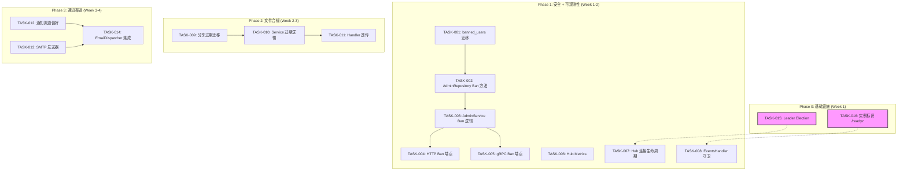
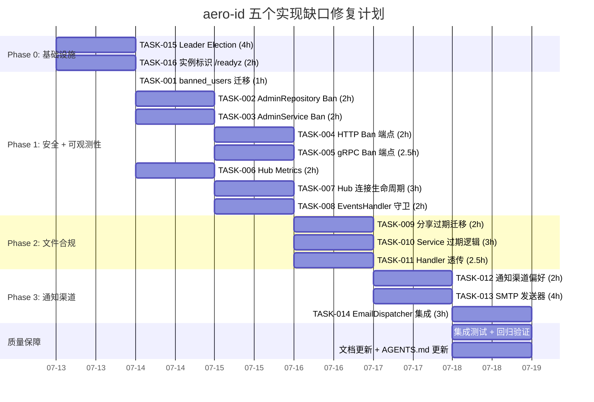

Now I have a thorough understanding of the entire codebase. Here is the Tech Lead analysis:

---

# Tech Lead Analysis: aero-id 五个实现缺口

## 1. 任务分解

基于代码扫描文档的五个缺口，结合代码库实际结构，分解为 **14 个可执行任务**，每个 2-4 小时。

### 缺口二：`user.ban` 端点（P0 — 安全模型断裂，修复成本最低）

| 任务 ID | 标题 | 涉及文件 | 前置依赖 | 预估工时 |
|---------|------|---------|---------|---------|
| **TASK-001** | banned_users 迁移 + 审计常量 | `migrations/000023_banned_users.up.sql`, `migrations/000023_banned_users.down.sql`, `internal/domain/audit.go` | 无 | 1h |
| **TASK-002** | Respository: Ban/Unban/IsBanned（AdminRepository 接口扩展 + 实现） | `internal/repository/admin.go` | TASK-001 | 2h |
| **TASK-003** | Service: BanUser/UnbanUser 业务逻辑 + AdminService 接口扩展 | `internal/service/service.go`, `internal/service/admin.go` | TASK-002 | 2h |
| **TASK-004** | HTTP Handler: Ban/Unban 端点 + 路由注册 | `internal/handler/http/admin.go` | TASK-003 | 2h |
| **TASK-005** | gRPC Handler: BanUser/UnbanUser RPC + Proto 定义 + 编译 | `api/proto/aero_id/v1/aero_id.proto`, `internal/handler/grpc/admin.go`, `internal/handler/grpc/aeropb/*.pb.go` | TASK-003 | 2.5h |

**验收标准**：`make test && make lint` 通过；管理员带 `user.ban` 权限可 POST 封禁/解封；操作写入 `audit_events`；封禁用户收到应用层 403；HTTP 和 gRPC 行为一致。

### 缺口一：SSE Hub 可观测性和可靠性（P1 — 运维盲点，修复成本低）

| 任务 ID | 标题 | 涉及文件 | 前置依赖 | 预估工时 |
|---------|------|---------|---------|---------|
| **TASK-006** | Hub Metrics：连接数/丢弃数/推送数度量 | `internal/hub/hub.go`, `internal/hub/adapter.go`, `internal/pkg/metrics/metrics.go` | 无 | 2h |
| **TASK-007** | Hub 连接生命周期管理 + 可配置缓冲 | `internal/hub/hub.go`, `internal/config/config.go` | TASK-006 | 3h |
| **TASK-008** | EventsHandler: 连接上限/超时守卫 + Hub 健康状态注入 /readyz | `internal/handler/http/events.go`, `internal/hub/hub.go` | TASK-007 | 2h |

**验收标准**：`/metrics` 暴露 `aeroid_hub_connections` gauge、`aeroid_hub_drops_total` counter；Hub 在 `/readyz` 中反映健康状态；缓冲大小可通过配置调整；新增任务在 `make check-file-sizes` 范围内。

### 缺口三：文件分享过期 + 访问审计（P1 — 文件是核心资产）

| 任务 ID | 标题 | 涉及文件 | 前置依赖 | 预估工时 |
|---------|------|---------|---------|---------|
| **TASK-009** | 分享过期迁移 + ShareRepository 扩展 | `migrations/000024_file_shares_expires.up.sql`, `migrations/000024_file_shares_expires.down.sql`, `internal/file/repository_share.go`, `internal/file/file.go` | 无 | 2h |
| **TASK-010** | Service: ShareFile 支持过期参数 + DownloadURL 路径审计检查 | `internal/file/service_share.go`, `internal/file/service_crud.go` | TASK-009 | 3h |
| **TASK-011** | Handler: 分享过期参数透传（HTTP + gRPC）+ 访问审计事件 | `internal/handler/http/file.go`, `internal/handler/grpc/file.go`, `api/proto/aero_id/v1/aero_id.proto`, `internal/domain/audit.go` | TASK-010 | 2.5h |

**验收标准**：分享接口可选接受 `expires_at` 和 `max_access_count`；过期/超限授权在下载路径返回 403；每次分享访问写入 `audit_events`（action=`file.share.access`）；迁移回退安全。

### 缺口四：邮件通知渠道

| 任务 ID | 标题 | 涉及文件 | 前置依赖 | 预估工时 |
|---------|------|---------|---------|---------|
| **TASK-012** | NotificationPreference 增加 Channel 字段 + 迁移 | `migrations/000025_notification_channels.up.sql`, `internal/domain/notification.go`, `internal/handler/notification/*.go` | 无 | 2h |
| **TASK-013** | SMTP 邮件发送器 + 模板引擎 | `internal/notification/email/*.go`（新建包） | 无 | 4h |
| **TASK-014** | EmailDispatcher 集成到 outbox 链 + 配置 | `internal/notification/email/dispatcher.go`, `internal/app/app.go`, `internal/config/config.go` | TASK-012, TASK-013 | 3h |

**验收标准**：用户可设置通知渠道偏好；通知生成时根据用户偏好路由到 SSE 和/或邮件；邮件通过 SMTP 异步发送；配置在 `config.yaml` 中定义；超出缺口四范围（FCM/APNs）标记为未来方向。

### 缺口五：跨实例状态同步（基础工程）

| 任务 ID | 标题 | 涉及文件 | 前置依赖 | 预估工时 |
|---------|------|---------|---------|---------|
| **TASK-015** | 后台组件 Leader Election（outbox relay + GC） | `internal/outbox/relay.go`, `internal/app/app.go` | 无 | 4h |
| **TASK-016** | 实例元数据和 /readyz 实例标识 | `internal/app/app.go`, `internal/config/config.go` | 无 | 2h |

**Phase 2/3**（标记为 Future，见风险评估）：
| 任务 ID | 标题 | 涉及文件 | 前置依赖 | 预估工时 |
|---------|------|---------|---------|---------|
| TASK-F01 | Redis 后端插座式 Rate Limiter | `internal/pkg/ratelimit/redis.go`, `internal/config/config.go` | TASK-015 | 4h |
| TASK-F02 | Redis 后端插座式 SSO Cache | `internal/sso/token_cache.go`, `internal/sso/user_cache.go` | TASK-015 | 3h |
| TASK-F03 | Redis Pub/Sub 后端插座式 Hub | `internal/hub/redis.go`, `internal/hub/hub.go` | TASK-015 | 4h |

**注意**：TASK-015 和 TASK-016 是实际可执行的 Phase 1-2；TASK-F01~F03 是 Phase 3 的架构规划，当前不投入实现，仅设计接口层。

---

## 2. 执行顺序



**可并行执行的任务组**：
- **Group A**（独立无依赖）：TASK-001, TASK-006, TASK-009, TASK-012, TASK-013, TASK-015, TASK-016
- **Group B**（依赖 TASK-001）：TASK-002, TASK-003 → TASK-004, TASK-005
- **Group C**（依赖 TASK-009）：TASK-010 → TASK-011
- **Group D**（依赖 TASK-012/013）：TASK-014

---

## 3. 技术风险

### 3.1 高风险项

| 风险 | 涉及缺口 | 说明 | 缓解策略 |
|------|---------|------|---------|
| **Leader Election 竞争条件** | 缺口五 Phase 2 | outbox relay 和 GC sweeper 目前每实例独立运行。引入 Postgres 乐观锁时，实例 A 正在处理的事件可能在实例 B 的下一轮 poll 中也被取出。虽然 outbox 的 `MarkPublished` 是幂等的（按 ID 列表标记），但 relay 的 `drain()` 在 `Handler.Handle` 之后才标记——如果在标记前宕机，事件会被重新处理（exactly-once 降级为 at-least-once）。 | 增加 `locked_by` 列 + `locked_at` 超时，使 relay 采用"租约"机制。但当前 handler 是幂等的（notification dispatcher 的 `Create` 遇到重复 ID 会冲突回滚），at-least-once 可接受。告警：`aeroid_outbox_failed_total` 监控。 |
| **Ban 级联效果不完整** | 缺口二 | 封禁用户后，已存在的分享授权、已发送的消息、已创建的评论如何处理？是隐藏还是标记？SSO 不感知封禁状态，所以被封禁用户仍可通过 SSO 获取有效 token。 | **首次迭代仅做防御性拒绝**：在 service 层每次操作前检查 IsBanned，被封禁用户的操作返回 403。消息/评论可见性的级联调整作为后续任务分离。Ban 只在 aero-id 内部生效，不影响 SSO 认证。 |
| **邮件发送是外部 I/O 瓶颈** | 缺口四 | SMTP 是同步 I/O，如果 dispatch 在 outbox.Handle 路径中同步发送，会阻塞 relay 的 drain()，导致所有后续事件（包括 SSE 推送）延迟。邮件服务器不可用会导致 outbox 积压。 | **邮件发送必须异步化**：EmailDispatcher 不应直接在 `Handle` 中发 SMTP，而是写入一个 `pending_emails` 表（或直接放入一个 bounded worker pool），由独立的 goroutine 池消费。Outbox 的 `Handle` 只做邮件记录入队，确保不阻塞 relay。 |
| **Hub 跨实例复杂度** | 缺口一 Phase 3 | Redis Pub/Sub 实现跨实例 Hub 时，存在事件顺序问题——同一 uid 在实例 A 和实例 B 上的连接收到的事件顺序可能不一致（Redis Pub/Sub 是 fire-and-forget，无序）。此外，Redis 宕机时降级到 in-memory 模式需要平滑切换。 | **推迟 Phase 3 实现**，当前标记为架构规划。首次迭代只做可观测性和连接生命周期管理。跨实例 Hub 仅在明确的多实例部署需求出现时实现。 |

### 3.2 低风险但需要注意

- **Proto 文件变更**（TASK-005, TASK-011）：`.proto` 修改后必须运行 `make proto`，且需要安装正确的 `protoc-gen-go` 版本（v1.34.1）和 `protoc-gen-go-grpc`（v1.5.1）。已 commit 的 `*.pb.go` 文件需要在 CI 中增加 proto 一致性检查。
- **迁移文件命名**：当前从 `000022_admin_roles` 开始，新的迁移文件号应从 `000023` 开始。需确保 `down.sql` 正确，因为生产环境运行 `make migrate-up` 时不会回滚。
- **Config 文件扩展**：新增 SMTP 配置、Hub 配置需要在 `configs/config.yaml` 中添加默认值，并在 `internal/config/config.go` 中定义结构体。必须可被 `AERO_ID_*` 环境变量覆盖。
- **GORM 类型映射**：Postgres ARRAY 类型用于 `channels` 字段（TASK-012），GORM 默认支持 `[]string` 映射到 `text[]`，但已有代码用的是 `permissions TEXT[]` 模式。保持一致性即可。

### 3.3 工程约束检查

| 当前文件 | 当前行数 | 新增后预估行数 | 是否达到 500 行警戒线 |
|----------|---------|--------------|---------------------|
| `internal/service/admin.go` | ~90 | ~150 | ✅ 安全 |
| `internal/repository/admin.go` | ~160 | ~230 | ✅ 安全 |
| `internal/handler/http/admin.go` | ~120 | ~200 | ✅ 安全 |
| `internal/handler/grpc/admin.go` | ~120 | ~180 | ✅ 安全 |
| `internal/hub/hub.go` | ~110 | ~200 | ✅ 安全 |
| `internal/file/service_share.go` | ~100 | ~150 | ✅ 安全 |
| `internal/file/repository_share.go` | ~120 | ~180 | ✅ 安全 |
| `internal/pkg/metrics/metrics.go` | ~280 | ~340 | ⚠️ 接近 400 行预警告线，建议拆分 SSO/outbox/hub 度量到独立方法或文件 |
| `internal/notification/dispatcher.go` | ~120 | ~120（不变） | ✅ 安全 |

**`metrics.go` 的风险**：当前 280 行，加上 Hub 度量后约 340 行。距 400 行的预警告线（AGENTS.md 要求：文件接近 400 行→计划拆分）约 60 行。**建议 TASK-006 实施前先拆分：将 SSO 度和 outbox 度量的渲染方法拆到 `metrics_sso.go` 和 `metrics_outbox.go`，使 `metrics.go` 保持在 300 行以下**。这是实现 TASK-006 的前置条件。

---

## 4. 资源评估

### 4.1 人员要求

| 角色 | 数量 | 关键技能 |
|------|------|---------|
| **Backend Engineer (Go)** | 1 人 | 熟悉 Go 1.26、GORM、gRPC/Protobuf、Postgres 迁移模式。可独立完成 TASK-001~TASK-014。 |
| **DevOps / Infrastructure** | 0.5 人 | Postgres advisory lock 模式、SMTP 配置。仅在 TASK-015 和 TASK-013 需要参与。 |
| **Code Review** | 1 人 | 熟悉 aero-id 架构，关注工程约束检查（文件大小、函数长度、复杂性）。 |

### 4.2 关键里程碑

| 里程碑 | 时间 | 交付物 | 判断标准 |
|--------|------|--------|---------|
| M1 | Day 3 | 封禁功能完成 | `make test && make lint` 通过；`curl -X POST /v1/admin/ban` 返回 200/403 |
| M2 | Day 5 | Hub 可观测性上线 | `/metrics` 暴露 Hub 度量；`/readyz` 反映 Hub 健康 |
| M3 | Day 8 | 文件分享过期 | 分享接口支持 `expires_at` 参数；过期授权下载返回 403 |
| M4 | Day 12 | 邮件通知渠道 | 通知偏好支持 channel 选择；邮件通过 SMTP 发送 |
| M5 | Day 14 | 跨实例 leader election | 双实例启动，只有一个消费 outbox；GC 通过 pg_advisory_lock 选举 |

### 4.3 阻塞点 (Blockers)

| 阻塞点 | 涉及任务 | 解决策略 |
|--------|---------|---------|
| `protoc` 版本不匹配导致 proto 编译失败 | TASK-005, TASK-011 | 在 CI 中增加 `make proto` 的 smoke test；开发环境通过 `go install google.golang.org/protobuf/cmd/protoc-gen-go@v1.34.1` 固定版本。参见 `go.mod` 中 `google.golang.org/protobuf` 版本。 |
| SMTP 凭据不可用 | TASK-013 | 添加 `AERO_ID_SMTP_USERNAME` / `_PASSWORD` 环境变量配置；在 `config.yaml` 中提供 MailHog 默认配置（开发环境），生产环境靠 env 注入；没有 SMTP 配置时 EmailDispatcher 静默降级（log + skip，不阻塞 outbox）。 |
| 集成测试需要 Docker（testcontainers） | 所有 | 单元测试（`make test`）不需要 Docker。集成测试（`make test-integration`）需要 Docker 环境，建议在 CI 中配置。本地开发时，对新增功能，单元测试覆盖率 > 85% 即可合入。 |

---

## 5. 质量保证

### 5.1 单元测试覆盖要求

| 层 | 最低覆盖率 | 关键测试场景 |
|----|-----------|-------------|
| **Domain** | 100% | Audit 常量不重复；Ban 状态枚举边界 |
| **Repository** | — | 通过集成测试验证 SQL 正确性（`make test-integration`） |
| **Service** | > 90% | Ban: 有权限通过/无权限拒绝/重复封禁/解封不存在/自封禁拒绝；ShareExpiry: 过期参数校验/过期后下载拒绝/未过期正常；Hub: 连接注册/丢弃计数/超时关闭 |
| **HTTP Handler** | > 80% | 请求反序列化/权限中间件/错误返回格式 |
| **gRPC Handler** | > 80% | 与 HTTP handler 行为一致（parity test 模式，可参考 `internal/handler/grpc/parity_test.go`） |
| **SMTP Dispatcher** | > 90% | 发送成功/失败回退/worker pool 耗尽/关闭时已提交任务 |

### 5.2 集成测试策略

- **禁止新增 `//go:build integration` 的测试文件**？不，服务层的集成测试是必需的，特别是针对 SQL 查询（如过期分享的 `IsSharedWith` 查询）。
- **新增集成测试要点**：
  - TASK-002: `repo.Ban` → `repo.IsBanned` → `repo.Unban` → `repo.IsBanned`（false）
  - TASK-009: 插入过期分享 → 查询 `IsSharedWith` → 预期 false
  - TASK-015: 两个并发 goroutine 竞争 leader → 只有一个持有锁

### 5.3 代码审查要点

审查人需逐条核对这些关键点（按优先级排列）：

1. **安全**：
   - [ ] `BanUser` 端点是否检查 `HasPermission(actor, PermUserBan)`？HTTP 和 gRPC 路径都检查了吗？
   - [ ] 自封禁（`actor == target`）是否被拒绝？
   - [ ] 封禁状态不会泄露到响应中（被封禁用户不应该知道"你被封了"以外的信息）
   - [ ] 文件分享过期时间是否在服务层校验（非 handler 层），防止绕过？

2. **架构一致性**：
   - [ ] 缺口二/三的变更是否严格遵循 `handler → service → repository` 方向？无反向依赖？
   - [ ] Handler 只做反序列化和响应渲染，无业务逻辑？
   - [ ] 服务层是否调用了 `mustActor(ctx)` 进行授权？

3. **工程约束**：
   - [ ] `make check-file-sizes` 通过
   - [ ] `make lint` 通过（golangci-lint cyclop/funlen）
   - [ ] 新增函数不超过 50 行
   - [ ] 新增文件不超过 500 行

4. **可观测性**：
   - [ ] Hub metrics 是否在 `/metrics` 中暴露？
   - [ ] ban/unban 操作是否写入了 `audit_events`？
   - [ ] 邮件发送失败是否被日志记录（不静默丢弃）？

5. **测试**：
   - [ ] `make test` 全绿
   - [ ] 服务层测试使用 `internal/service/mocks` 中的 test doubles（不 mock 外部库直接）
   - [ ] 新增 HTTP handler 测试验证 200/400/403/404 状态码

### 5.4 性能测试需求

| 场景 | 方法 | 目标 |
|------|------|------|
| Hub 大量连接 | 启动 1000 个并发 SSE 连接，每个连接通过 Hub 接收事件 | Hub 内存增长 < 50MB，无连接泄漏 |
| 邮件异步发送吞吐 | 模拟 100 个 outbox 事件/秒，每个触发邮件发送 | 不阻塞 outbox relay drain()；pending 邮件队列不会无限增长 |
| 封禁检查延迟 | `IsBanned` 查询在 100 QPS 下 | P99 延迟 < 5ms（索引在 `uid` 上，单行 lookup） |

---

## 6. 实施计划

### 甘特图



### 阶段详述

#### 阶段 1：基础设施 + 安全模型修复（Day 1-3）

**目标**：堵住最紧急的安全缺口（ban 端点缺失）+ 打通跨实例部署的前提条件。

**Day 1**：
- 上午：TASK-015（Leader Election）—— outbox relay 和 GC 通过 Postgres 乐观锁选举 leader。
  - 在 `outbox.Repository` 中新增 `TryLock(instanceID string, ttl time.Duration) (bool, error)` 方法
  - `Relay.drain()` 仅在持有锁时执行
  - 锁超时后自动释放（实例宕机场景）
- 下午：TASK-016（实例标识）—— 实例启动时生成唯一 ID，注入 `/readyz` 响应。
  - 实例 ID 格式：`hostname-<8chars-random>` 或通过配置注入
  - `/readyz` 返回 JSON `{"status":"ok","instance_id":"...","components":{"hub":"healthy", ...}}`

**Day 2**：
- 上午：TASK-001 + TASK-002（banned_users 迁移 + repository）
  - 迁移 SQL：
    ```sql
    CREATE TABLE banned_users (
        uid        TEXT PRIMARY KEY,
        reason     TEXT NOT NULL DEFAULT '',
        banned_by  TEXT NOT NULL,
        banned_at  TIMESTAMPTZ NOT NULL DEFAULT now(),
        expires_at TIMESTAMPTZ -- NULL = permanent
    );
    ```
  - AdminRepository 接口增加：`BanUser(ctx, uid, reason, bannedBy)`, `UnbanUser(ctx, uid)`, `IsBanned(ctx, uid) (bool, *BanRecord, error)`
- 下午：TASK-003（Service Ban 逻辑）—— `AdminService.BanUser` 和 `UnbanUser` 实现，含 `HasPermission(actor, PermUserBan)` 守卫 + 审计事件写入。同时：扩展 `service.AdminService` 接口。

**Day 3**：
- 上午：TASK-004 + TASK-005（HTTP + gRPC Handler，并行）
  - HTTP: 添加 `POST /v1/admin/ban` 和 `POST /v1/admin/unban` 到 syscfg 权限组
  - gRPC: Proto 增加 `BanUserRequest/BanUserResponse` + `UnbanUserRequest/UnbanUserResponse` RPC
- 下午：集成测试验证 ban/unban 全链路；`make test && make lint`

**关键决策点**：Ban 的级联效果（消息隐藏等）是否在本次范围？→ **不在**。首次迭代仅拒绝被封禁用户的操作。级联效果记录为后续任务。

#### 阶段 2：SSE Hub 可观测性 + 连接生命周期（Day 3-4，与阶段 1 末尾并行）

**Day 3-4**：
- TASK-006（前置拆分 metrics.go → metrics_sso.go + metrics_outbox.go，约 30 分钟。然后添加 Hub metrics）：
  ```go
  // Hub 新增计数器/仪表
  type HubMetrics struct {
      connections  atomic.Int64  // gauge
      dropsTotal   atomic.Int64  // counter
      pushesTotal  atomic.Int64  // counter
  }
  ```
  - Hub.Publish 成功时递增 pushesTotal，drop 时递增 dropsTotal
  - Subscribe/Unsubscribe 维护 connections
  - metrics.Registry 新增 `ObserveHubConnections(n)`, `ObserveHubDrops(n)`, `ObserveHubPushes(eventType string)`

- TASK-007 + TASK-008：
  - Hub 增加可配置参数：`BufferSize`（默认 16）、`MaxConnPerUID`（默认 0=不限制）、`InactivityTimeout`（默认 0=不限制）
  - EventsHandler.Stream 增加 `defer` + select 中的超时分支
  - /readyz 检查 Hub 是否有超过 `MaxConnections` 的连接——若超过，降为 degraded 但非 unhealthy

#### 阶段 3：文件分享过期 + 访问审计（Day 5-6）

**Day 5**：
- TASK-009：
  ```sql
  ALTER TABLE file_shares
      ADD COLUMN expires_at     TIMESTAMPTZ,
      ADD COLUMN max_access_count INT,
      ADD COLUMN access_count   INT NOT NULL DEFAULT 0;
  ```
  - `ShareRepository` 接口扩展：`Grant` 接受可选 `expiresAt`, `maxAccessCount`
  - `IsSharedWith` 变为 `IsSharedWithCheck(ctx, fileID, uid) (bool, *ShareRecord, error)`，返回分享记录（含过期和计数信息）
- TASK-010：
  - `ShareFile` 服务方法接受可选 `expiresAt` 和 `maxAccessCount` 参数（保持向后兼容）
  - 下载路径 `canRead` 中检查过期和访问计数
  - 新增审计事件 `domain.AuditFileShareAccess = "file.share.access"`

**Day 6**：
- TASK-011：
  - HTTP 和 gRPC 分享接口新增可选参数 `expires_at` 和 `max_access_count`
  - gRPC proto 更新：`ShareFileRequest` 增加 `optional google.protobuf.Timestamp expires_at` 和 `optional int32 max_access_count`
  - `make proto` 编译
- 下午：集成测试 + 回归

#### 阶段 4：邮件通知渠道（Day 7-9）

**Day 7**：
- TASK-012：`NotificationPreference` 增加 `channels []string`（GORM `text[]`），迁移增加列
  - 更新 HTTP 和 gRPC handler 透传 channel 字段
- TASK-013（并行）：
  - 新建 `internal/notification/email/` 包
  - `SMTPClient` 结构体：`Send(recipient, subject, body string) error`
  - 使用 `net/smtp` 或 `gomail`（若 go.mo d 中已引入）；若无依赖，不引入新依赖，用 `net/smtp.SendMail`
  - 邮件模板：使用 `text/template` 按通知类型生成邮件正文（基于通知类型的简单模板映射）

**Day 8**：
- TASK-014：
  - `EmailDispatcher` 实现 `outbox.Handler` 接口
  - 在 `Handle` 中：如果收件人已启用 email channel → 将邮件任务提交到 bounded worker pool（缓冲 100）
  - Worker pool 异步发送，失败重试最多 3 次，否则 log + 丢弃
  - 在 `app.go` 的 outbox chain 中链接 EmailDispatcher

**Day 9**：
- 端到端集成测试（通知写入 → outbox relay → EmailDispatcher → SMTP）
- 性能验证：确认 100 QPS 邮件通知不阻塞 outbox relay

---

### 总工时汇总

| 阶段 | 任务数 | 总工时 | 日历天数 |
|------|--------|--------|---------|
| Phase 0: 基础设施 | 2 | 6h | 1 |
| Phase 1: 安全 + 可观测性 | 8 | 15h | 2.5 |
| Phase 2: 文件合规 | 3 | 7.5h | 1.5 |
| Phase 3: 通知渠道 | 3 | 9h | 2.5 |
| 质量保障 | — | 4h | 1 |
| **合计** | **16** | **41.5h** | **~6 个工作日** |

---

### 附录：AGENTS.md 更新建议

实施完成后，需更新 `AGENTS.md` 记录新增的约束和约定：

1. **新增 User.Ban 约束**：
   > - **User ban 只由 aero-id 内部执行**：封禁状态存储在 `banned_users` 表，SSO 不感知。被封禁用户依然可以 SSO 认证，但 aero-id 所有操作返回 403。
   > - **Ban 的级联效果**：当前只拒绝被封禁用户的操作。消息/评论可见性的级联标记为后续任务（see `docs/requirements/2026-07-10-aero-id-code-scan-five-implementation-gaps.md`）。

2. **新增 Hub 配置**：
   ```yaml
   hub:
     buffer_size: 16
     max_connections_per_uid: 0       # 0 = unlimited
     inactivity_timeout: 0            # 0 = unlimited
     max_connection_duration: 0       # 0 = unlimited
   ```

3. **新增 SMTP 配置**：
   ```yaml
   smtp:
     host: ""
     port: 587
     username: ""
     password_env: AERO_ID_SMTP_PASSWORD
     from: "aero-id@example.com"
     tls: true
   ```

4. **Leader Election 约定**：
   > - **Outbox relay** 和 **GC sweeper** 通过 Postgres `pg_advisory_lock` 实现 leader election（见 `internal/pkg/db/lock.go`）。
   > - 仅持有锁的实例执行后台消费；其他实例在 `/readyz` 中以 `"standby"` 状态报告。
   > - 锁持有者实例宕机后，锁在 `statement_timeout` 后自动释放，其他实例竞争获取。
