现在我已拥有完整的代码库图景。以下是全面的技术主管分析。

---

# Tech Lead 分析：aero-id 技术债务补救

## 1. 任务分解

以下将分析文档的五个方向分解为可执行的技术工单。每个任务应为 **2-4 小时**。估算基于代码库的当前规模、测试基础设施的完备程度以及团队对代码库的熟悉程度。

### 方向一：存储配额

| 任务 ID | 标题 | 涉及文件 | 前置依赖 | 工时 | 验收标准 |
|---------|-------|-----------|-------------|-------|------------------|
| TASK-001 | 定义 `StorageUsage` 领域模型 | `internal/domain/storage.go` (新增) | 无 | 1h | 带有 `OwnerUID`、`TotalBytes`、`UpdatedAt` 的 `StorageUsage` 结构体。零值方法。 |
| TASK-002 | 创建 `000024_storage_usage.up.sql`/`.down.sql` 迁移 | `migrations/000024_storage_usage.up.sql`, `.down.sql` | TASK-001 | 1h | 迁移向上创建 `storage_usage` 表（PK on `owner_uid`），向下删除。 |
| TASK-003 | 将 `CountSizeByOwner` 添加到 `FileRepository` | `internal/repository/file.go` | TASK-001 | 2h | 新的接口方法 `CountSizeByOwner(ctx, ownerUID) (int64, error)`，包含实现，测试通过 `make test`。 |
| TASK-004 | 实现 `StorageUsageRepository`（GORM） | `internal/repository/storage_usage.go` (新增) | TASK-002 | 2h | 包含 `Upsert(ctx, ownerUID, deltaBytes)` 和 `Get(ctx, ownerUID)` 的接口/实现。单元测试。 |
| TASK-005 | 将配额配置添加到 `config.go` | `internal/config/config.go` | 无 | 1h | `Storage.MaxBytesPerUser` 配置字段，带默认值 + 验证。 |
| TASK-006 | 将配额检查添加到 `fileService.Create` | `internal/service/file.go` | TASK-003, TASK-004, TASK-005 | 3h | 文件上传前检查当前使用 + 新大小是否超过限制。返回 `apperr.BadRequest("file.quota_exceeded")`。 |
| TASK-007 | 删除时递减配额 | `internal/service/file.go` | TASK-004, TASK-006 | 1h | `Delete` 方法使用负增量调用 `StorageUsageRepository.Upsert`。 |
| TASK-008 | 配额耗尽时拒绝文件共享上传 | `internal/service/file_share.go` | TASK-006 | 1h | 共享文件的接收者消耗配额？*架构决策：配额按所有者计算。共享是可读访问，不是重新上传。* 不需要额外变更。 |
| TASK-009 | 添加配额端点（GET/POST 管理） | `internal/handler/http/quota.go`, `internal/handler/grpc/quota.go` (新增) | TASK-006 | 3h | `GET /v1/quota` 返回使用量/限制。可选的 `POST /v1/admin/users/{uid}/quota` 进行管理覆盖。 |

**方向一总计：14 小时**

### 方向二：生命周期级联

| 任务 ID | 标题 | 涉及文件 | 前置依赖 | 工时 | 验收标准 |
|---------|-------|-----------|-------------|-------|------------------|
| TASK-020 | 添加 `CascadeDeleteFile` 服务方法 | `internal/service/file.go` | 无 | 4h | 删除文件时，清理 `file_shares` + 评论 + 通知。创建审计事件。 |
| TASK-021 | 文件删除时级联文件共享 | `internal/service/file.go`, `internal/repository/file_share.go` | TASK-020 | 2h | `RevokeAllByFileID` 添加到 `FileShareRepository`，在文件软删除时调用。 |
| TASK-022 | 文件删除时级联评论 + 评论点赞 | `internal/service/file.go`, `internal/service/comment.go`, `internal/repository/comment.go` | TASK-020 | 3h | 删除文件时，软删除其所有评论。级联删除 `comment_likes` 行。 |
| TASK-023 | 消息软删除时级联消息反应 | `internal/service/message.go`, `internal/repository/message.go` | 无 | 2h | `SoftDelete` 后，添加 `CleanupReactions` → 删除 `message_reactions`。 |
| TASK-024 | 消息删除时级联通知 | `internal/service/message.go`, `internal/repository/notification.go` | TASK-023 | 2h | 消息删除后，删除引用该消息 ID 的通知。使用 `SubjectType='message' AND SubjectID=?`。 |
| TASK-025 | 评论删除时级联评论点赞 + 报告 | `internal/service/comment.go`, `internal/repository/comment.go` | 无 | 2h | `SoftDelete` 后，级联删除 `comment_likes` + `comment_reports`。 |
| TASK-026 | 添加级联审计日志记录 | `internal/service/file.go`, `internal/service/message.go`, `internal/service/comment.go` | TASK-020—TASK-025 | 2h | 每次级联删除事件都写入审计日志。 |
| TASK-027 | 为 `comment_reports` 和 `file_shares` 添加迁移以添加 ON DELETE CASCADE FK | `migrations/000025_cascade_fixes.up.sql` | 无 | 1h | 向 `comment_reports.comment_id` 和 `file_shares.file_id` 添加 FK，带 `ON DELETE CASCADE`。 |

**方向二总计：18 小时**

### 方向三：分布式限流

| 任务 ID | 标题 | 涉及文件 | 前置依赖 | 工时 | 验收标准 |
|---------|-------|-----------|-------------|-------|------------------|
| TASK-030 | 定义 `RateLimitBackend` 接口 | `internal/pkg/ratelimit/backend.go` (新增) | 无 | 1h | 用于 `Allow(key string) bool` 和 `RetryAfter() time.Duration` 的接口。 |
| TASK-031 | 提取内存后端为接口实现 | `internal/pkg/ratelimit/memory.go` (新增), `internal/pkg/ratelimit/ratelimit.go` | TASK-030 | 2h | 当前逻辑移到 `MemoryBackend implements RateLimitBackend`。`Limiter` 委托给后端。 |
| TASK-032 | 添加 Redis 滑动窗口后端 | `internal/pkg/ratelimit/redis.go` (新增), `go.mod` 增加 `go-redis` | TASK-030 | 4h | 使用带 `INCR` + `EXPIRE` 的 Redis 排序集合或固定窗口。等幂，支持原子操作。 |
| TASK-033 | 添加 Redis 连接配置 | `internal/config/config.go` | TASK-032 | 1h | `RateLimit.Backend` 枚举 (`memory|redis`)。`Redis` 子配置（地址、密码、池大小）。 |
| TASK-034 | 将 `Limiter` 注入 app 构造函数 | `internal/app/app.go` | TASK-031, TASK-032 | 2h | 基于配置选择后端。保留现有内存行为作为默认。 |
| TASK-035 | 为分布式限流添加集成测试 | `internal/pkg/ratelimit/redis_test.go` (新增) | TASK-032 | 3h | Testcontainers Redis 集成测试，验证跨 goroutine 共享状态。标记为 `//go:build integration`。 |

**方向三总计：13 小时**

### 方向四：推送可靠性

| 任务 ID | 标题 | 涉及文件 | 前置依赖 | 工时 | 验收标准 |
|---------|-------|-----------|-------------|-------|------------------|
| TASK-040 | 将 Hub 通道缓冲区设为可配置，支持有界丢弃 | `internal/hub/hub.go` | 无 | 1h | `Subscribe` 接受缓冲区大小参数。默认保留 16 以保持向后兼容。 |
| TASK-041 | 添加 Hub 丢弃计数器指标 | `internal/hub/hub.go`, `internal/pkg/metrics/metrics.go` | TASK-040 | 2h | 在 `Registry` 中添加 `ObserveHubDrop(uid)`。Hub 在 `default:` 分支计数丢弃。 |
| TASK-042 | 在 hub 发布中添加非阻塞重试（带 backpressure 信号） | `internal/hub/hub.go` | TASK-040 | 3h | 当 `len(ch) >= cap(ch)*0.75` 时选择性慢速消费者断开？*替代方案*：为慢速消费者添加带 backpressure 的二级缓冲通道。 |
| TASK-043 | 扩展回放窗口超出 50 条限制 | `internal/handler/http/events.go` | 无 | 1h | 使回放限制可配置（默认 50）。添加 `?max_replay=N` 查询参数。 |
| TASK-044 | 添加带指数退避的 SSE 推送重试包装器 | `internal/service/notification.go`, `internal/hub/hub.go` | TASK-041 | 3h | `RetryingPusher` 包装器在 `NotificationDispatcher` 中：最多重试 3 次，间隔 100ms/200ms/400ms。 |
| TASK-045 | 实现通知持久化 + 确认机制 | `internal/hub/hub.go`, `internal/service/notification.go` | TASK-044 | 4h | 客户端发送 `ack: <event_id>`。未确认的事件在回放窗口内重播。*技术说明：需要检查此内容的 SSE 规范兼容性——大多数客户端通过 Last-Event-ID 隐式确认。* |
| TASK-046 | 为离线路由添加可选的 APNs/FCM 桥接 | `internal/service/push/bridge.go` (新增), `internal/config/config.go` | TASK-044 | 0h | **已暂停** — 基础架构层面。标记为未来工作。 |

**方向四总计：14 小时**（+ APNs/FCM 待定）

### 方向五：业务指标

| 任务 ID | 标题 | 涉及文件 | 前置依赖 | 工时 | 验收标准 |
|---------|-------|-----------|-------------|-------|------------------|
| TASK-050 | 向 `Registry` 添加业务指标方法 | `internal/pkg/metrics/metrics.go` | 无 | 2h | `ObserveFileUploaded(ownerUID)`、`ObserveFileDownloaded`、`ObserveMessageSent`、`ObserveCommentPosted`、`ObserveCommentLiked`、`ObserveNotificationPushed`、`ObserveNotificationDropped`、`ObserveRateLimited(uid)`。 |
| TASK-051 | 向指标注册表添加业务计数器 | `internal/pkg/metrics/metrics.go` | TASK-050 | 2h | 带 `map[string]uint64` 的内部计数器。用于 `/metrics` 文本呈现的 `WriteBusinessText(w)`。 |
| TASK-052 | 在文件服务上传/下载处埋入指标 | `internal/service/file.go` | TASK-050 | 1h | 调用 `r.ObserveFileUploaded(actor)` 和 `r.ObserveFileDownloaded(actor)`。 |
| TASK-053 | 在消息服务发送处埋入指标 | `internal/service/message.go` | TASK-050 | 0.5h | 在 `Send` 中调用 `r.ObserveMessageSent(actor)`。 |
| TASK-054 | 在评论服务创建/点赞处埋入指标 | `internal/service/comment.go` | TASK-050 | 1h | 在 `Create` 中调用 `r.ObserveCommentPosted`，在 `react` 中调用 `ObserveCommentLiked`。 |
| TASK-055 | 在通知调度程序中埋入指标 | `internal/service/notification.go` | TASK-050 | 1h | 推送时调用 `ObserveNotificationPushed`，限流丢弃时调用 `ObserveNotificationDropped`。 |
| TASK-056 | 在限流中间件中埋入限流指标 | `internal/middleware/ratelimit.go`, `internal/service/notification.go` (notifRateLimiter) | TASK-050 | 1h | 每次 `rateLimitExceeded` 响应时调用 `ObserveRateLimited`。 |
| TASK-057 | 添加按 uid 划分的请求指标（可选，带基数保护） | `internal/pkg/metrics/metrics.go`, `internal/middleware/metrics.go` | TASK-050 | 3h | 受限的按 uid RED 指标，最多 10 个活跃 uid 以避免基数爆炸。使用 LRU 集合和回退到 `uid:other`。 |

**方向五总计：11.5 小时**

---

## 2. 执行顺序

```mermaid
graph TD
    %% 方向五：业务指标（零依赖 — 可以立即开始）
    subgraph Phase0 ["阶段 0 — 基础设施（3 天）"]
        T050[TASK-050: 向 Registry 添加业务指标方法]
        T051[TASK-051: 添加业务计数器渲染]
    end
    
    %% 方向一：存储配额
    subgraph Phase1a ["阶段 1a — 配额模型（2 天）"]
        T001[TASK-001: 定义 StorageUsage 领域模型]
        T002[TASK-002: 创建 storage_usage 迁移]
        T005[TASK-005: 添加配额配置]
    end
    
    %% 方向二基础
    subgraph Phase1b ["阶段 1b — 级联基础（2 天）"]
        T027[TASK-027: 添加 ON DELETE CASCADE 迁移]
    end

    %% 方向三基础
    subgraph Phase1c ["阶段 1c — 限流接口（2 天）"]
        T030[TASK-030: 定义 RateLimitBackend 接口]
        T031[TASK-031: 提取内存后端]
        T033[TASK-033: 添加 Redis 连接配置]
    end

    %% 方向四基础
    subgraph Phase1d ["阶段 1d — 推送基础（2 天）"]
        T040[TASK-040: 使 Hub 缓冲区可配置]
        T041[TASK-041: 添加 Hub 丢弃计数器]
        T043[TASK-043: 扩展回放窗口]
    end

    %% 阶段 2 — 核心实现（并行轨道）
    subgraph Phase2a ["阶段 2a — 配额逻辑（3 天）"]
        T001 --> T003
        T002 --> T004
        T003 --> T006
        T004 --> T006
        T005 --> T006
        T006 --> T007
        T007 --> T009
    end

    subgraph Phase2b ["阶段 2b — 级联清理（5 天）"]
        T020[TASK-020: 添加 CascadeDeleteFile]
        T021[TASK-021: 文件共享级联]
        T022[TASK-022: 文件→评论级联]
        T023[TASK-023: 消息反应清理]
        T024[TASK-024: 消息→通知级联]
        T025[TASK-025: 评论点赞+报告清理]
        T026[TASK-026: 级联审计日志]
        
        T020 --> T021
        T020 --> T022
        T021 --> T026
        T022 --> T025
        T022 --> T026
        T023 --> T024
        T023 --> T026
        T024 --> T026
        T025 --> T026
    end

    subgraph Phase2c ["阶段 2c — 分布式限流（3 天）"]
        T030 --> T032
        T031 --> T032
        T032 --> T034
        T033 --> T034
        T034 --> T035
    end

    subgraph Phase2d ["阶段 2d — 推送可靠性（4 天）"]
        T040 --> T042
        T041 --> T044
        T043 --> T045
        T042 --> T044
        T044 --> T045
    end

    %% 业务指标埋点——在整个阶段 2 中交错进行
    T050 --> T052
    T050 --> T053
    T050 --> T054
    T050 --> T055
    T050 --> T056
    T050 --> T057

    T052 --> T006
    T053 --> T023
    T054 --> T025
    T055 --> T044
    T056 --> T034

    %% 阶段 3 — 集成测试和完成
    subgraph Phase3 ["阶段 3 — 集成测试（3 天）"]
        T009 --> T100[TASK-100: 配额集成测试]
        T026 --> T101[TASK-101: 级联合集成测试]
        T035 --> T102[TASK-102: 分布式限流集成测试]
        T045 --> T103[TASK-103: 推送可靠性集成测试]
        T052 --> T104[TASK-104: 业务指标正确性测试]
    end

    T100 --> T110[TASK-110: 端到端负载测试 + 回归]
    T101 --> T110
    T102 --> T110
    T103 --> T110
    T104 --> T110
```

### 并行执行组

| 组 | 方向 | 可并行化？ | 原因 |
|-----|-----------|----------------|--------|
| **组 A** | 五（业务指标 — 模型） | 是 — 立即 | 零依赖。只修改 `metrics.go`。 |
| **组 B** | 三（分布式限流 — 接口） | 与组 A、组 D 并行是 | 只修改 `ratelimit` 包。 |
| **组 C** | 一（存储配额 — 模型/迁移） | 与组 A、组 B、组 D 并行是 | 新增领域文件 + 迁移。不接触现有服务。 |
| **组 D** | 四（推送可靠性 — 基础） | 与组 A、组 B、组 C 并行是 | 只修改 `hub.go` + `events.go`。 |
| **组 E** | 二（级联清理 — 基础） | 与组 B、组 C、组 D 并行是 | `000025_cascade_fixes` 迁移可以独立应用。 |
| **组 F** | 一 + 五项指标埋点 | 等待组 C | 需要在配额的 `fileService` 中埋入指标点。 |
| **组 G** | 二（实际级联逻辑） | 等待组 E | 需要级联基础迁移。 |
| **组 H** | 三（Redis 实现） | 等待组 B | 需要接口就位。 |

**关键见解**：所有五个方向的工作在前 1.5 周内可以完全并行化，因为它们的初始接触点（配置、领域模型、存储库接口）是独立的文件。瓶颈出现在第 2 周，届时指标埋点（方向五）需要所有服务级别的变更已完成；但指标可以通过在阶段 2 中按服务交错进行来解耦。

---

## 3. 技术风险

### 3.1 高风险项目

| 风险 | 方向 | 级别 | 缓解措施 |
|------|-----------|-------|-------------|
| **配额竞争条件**：根据定义，配额检查 + upsert 不是原子的。两个并发上传可能都通过检查，然后都写入，使总使用量超出配额。 | 一 | **高** | 在 `storage_usage` 行上使用 `SELECT ... FOR UPDATE`（悲观锁），或使用 PostgreSQL `UPDATE ... WHERE total_bytes + :delta <= max_bytes RETURNING *`。在负载测试下测试。或者，选择最终一致性配额（允许偶尔超出），接受在 3 倍 RTT 内收敛。*建议*：在 upsert 中使用带有 `max_bytes` 检查的数据库级 `CHECK` 约束作为硬边界，并将乐观检查作为软边界。 |
| **级联性能**：级联删除一个拥有 10K+ 评论 + 点赞 + 报告 + 通知的文件，如果一次性完成，可能会阻塞连接。 | 二 | **中** | 使用分批在后台作业中执行级联删除（通过 outbox/工作队列），而不是在请求路径中。前端的 `SoftDelete` 立即返回；后台级联最终一致性。或者对此数据库使用 `ON DELETE CASCADE` FK，委托给 PostgreSQL 进行高效删除。 |
| **Redis 限流器故障转移**：如果 Redis 宕机，所有请求都失败（硬依赖），或回退到内存（不一致的状态）。 | 三 | **中** | 实现断路器模式：如果 Redis 连续 3 秒不可用，回退到内存限流（降级模式）。记录降级。当 Redis 恢复时，无缝切换回来。 |
| **SSE 回放语义**：`Last-Event-ID` 恢复依赖于通知创建时间戳单调递增。时钟偏差或进程重启可能导致重复或丢失事件。 | 四 | **低-中** | 使用单调递增的序列 ID（如 Redis `INCR` 或 PostgreSQL 序列），而不是 `created_at` 毫秒时间戳，作为 SSE `id:` 字段。这保证了严格的顺序和至少一次交付。 |
| **指标基数爆炸**：`ObserveFileUploaded(ownerUID)` 中的 `ownerUID` 标签可能导致 Prometheus 基数爆炸。 | 五 | **中** | 永远不要在 Prometheus 标签中使用用户 ID。聚合到 `< 20` 个桶（例如 `files_uploaded_total{tenant="internal"}`），或使用结构化日志记录进行按用户分析。建议：维护一个单独的、非 Prometheus 的 `map[uid]uint64` 用于内部仪表板，最多保留 100 个条目，并在顶部使用 LRU 驱逐。 |

### 3.2 低风险但需注意的项目

| 风险 | 方向 | 说明 |
|------|-----------|-------|
| **GORM 范围过滤**：软删除的 GORM 范围可能干扰级联查询。在包含 `deleted_at IS NULL` 的查询中，`Unscoped()` 是必要的。 | 二 | 在级联查询中添加明确的 `Unscoped()` 调用或自定义 `Where` 子句。 |
| **迁移排序**：`000025_cascade_fixes` 依赖于现有的表和 FK。如果迁移 000024（配额）是新的，它会在 000025 之前应用。 | 一、二 | 分配迁移编号，使得 `000024_storage_usage` 和 `000025_cascade_fixes` 按顺序应用。 |
| **消息反应中的 ON DELETE CASCADE**：迁移 000013 已经包含 `ON DELETE CASCADE`，但 GORM 的 `SoftDelete` 不触发它。 | 二 | 级联必须发生在服务层。或者对于消息，考虑硬删除反应行。 |
| **配置兼容性**：添加新的配置键（Redis、配额限制）必须不能破坏现有的 `configs/config.yaml`。使用合理的默认值。 | 所有 | 所有新配置键都应具有零值 = 禁用/默认行为。 |

### 3.3 外部依赖

| 依赖 | 方向 | 关键程度 | 注意 |
|------------|-----------|----------|-------|
| Redis 7+ | 三 | 高（如果启用） | 需要运营支持。对于没有 Redis 的部署来说是可选的。生产就绪需要 Redis Sentinel/Cluster。 |
| go-redis v9 | 三 | 中 | 在 `go.mod` 中增加 ~50K LOC。审计间接依赖。 |
| testcontainers-go | 三、四 | 低 | 仅集成测试。开发人员需要 Docker。 |

---

## 4. 资源评估

### 4.1 团队规模和构成

| 角色 | 数量 | 覆盖方向 | 理由 |
|------|-------|----------------|---------|
| **高级后端工程师**（Go） | 2 | 一（配额）、二（级联）、四（推送） | 需要深厚的 GORM、PostgreSQL 和并发经验。级联工作需要仔细的事务管理。 |
| **全栈/基础设施工程师** | 1 | 三（限流 Redis）、五（指标） | Redis 集成、Prometheus 指标、配置管理。 |
| **质量保证工程师** | 1 | 全部 — 集成测试 | 编写 testcontainers 集成测试。可以与前 2 名开发人员的工作重叠。 |
| **技术主管**（兼职） | 1 | 全部 — 架构监督 | 代码审查、迁移策略、冒烟测试验证。估计每周 5 小时。 |

**总计**：3-4 名全职工程师 + 1 名兼职主管，为期 **4-5 周**。

### 4.2 里程碑时间表

| 里程碑 | 截止日期 | 交付物 | 关键依赖 |
|-----------|------------|-----------|-------------------|
| **M0：规划结束** | 第 0 天 | 任务分解经团队同意。方向五、一、三、四、二的初始分支已创建。 | 无 |
| **M1：基础设施就绪** | 第 3 天 | Redis 集群（如果启用）已配置。指标基础设施已部署。`make check-file-sizes` 对新的计费文件通过。 | DevOps 用于 Redis |
| **M2：核心功能完成** | 第 15 天 | 所有 5 个方向的核心实现已合并到 `main`。单元测试通过（`make test && make lint`）。 | TASK-006， TASK-020—TASK-026， TASK-032， TASK-044 |
| **M3：集成测试完成** | 第 20 天 | `make test-integration` 通过所有测试。Redis 限流器在暂存环境中使用 2 个副本验证。 | TASK-035， TASK-100—TASK-104 |
| **M4：性能验证** | 第 23 天 | 负载测试配额，级联删除 10K 评论，分布式限流。达到 p99 < 200ms。 | M3 |
| **M5：发布** | 第 25 天 | 代码冻结。文档更新（`README.md`、`AGENTS.md`）。金丝雀部署。 | M4 |

### 4.3 阻塞点和解决策略

| 阻塞点 | 影响 | 解决策略 |
|---------|--------|----------------|
| **Redis 运营设置**（Sentinel/Cluster） | 如果选择 Redis 限流器，则在生产环境中阻塞 | 首先实现内存后端。Redis 是可选的。从内存开始，在 M2 之后添加 Redis。 |
| **配额原子性**（`SELECT ... FOR UPDATE` 与 `UPDATE ... WHERE`） | 阻塞 TASK-006 实现策略 | 在第 2 天进行技术探针：对两种方法进行基准测试，选择性能更好且正确的方法。建议：使用带有 `max_bytes` 检查的 PostgreSQL `UPDATE`，以避免在热路径中使用事务锁。 |
| **级联性能**（10K 评论文件） | 阻塞 TASK-022 | 决定：同步还是异步？建议：从同步开始，因为对于典型的文件（< 100 条评论）来说更简单且足够。添加一个 `CascadeLimit` 配置参数；超过此限制时，溢出到异步后台作业。 |
| **服务文件大小限制** (`app.go` 为 516 行) | 违反 AGENTS.md | 在开始功能工作之前，将 `app.go` 拆分为 `app.go`（核心）+ `app_wiring.go`（服务构造）+ `app_storage.go`（存储构建）。这是 AGENTS.md 中要求的强制性重构。 |

---

## 5. 质量保证

### 5.1 单元测试覆盖要求

| 包 | 覆盖阈值 | 关键路径 |
|-----|----------------|----------------|
| `internal/service/file.go` | ≥ 85% | `Create`（配额拒绝）、`Delete`（级联）、`Get`（权限） |
| `internal/service/message.go` | ≥ 85% | `Delete`（反应清理）、`Send`（配额？仅限附件——未触及） |
| `internal/service/comment.go` | ≥ 85% | `Delete`（点赞/报告清理）、`Create`（嵌套规则——不变） |
| `internal/domain/storage.go` | ≥ 95% | 零值、验证 |
| `internal/repository/storage_usage.go` | ≥ 85% | `Upsert` 并发、`Get` 未找到 |
| `internal/repository/file_share.go` | ≥ 80% | `RevokeAllByFileID`（新方法） |
| `internal/hub/hub.go` | ≥ 90% | 带背压的 `Publish`、丢弃计数器、带 `Subscribe` 的 `Close` |
| `internal/pkg/ratelimit/redis.go` | ≥ 75% | `Allow` 单键、`Allow` 并发键、TTL 过期 |
| `internal/pkg/metrics/metrics.go` | ≥ 90% | 每个 `Observe*` 方法、文本渲染、并发热点 |

### 5.2 集成测试策略

| 测试套件 | 方向 | 方法 | 环境 |
|-----------|-----------|---------|-------------|
| `TestStorageQuotaIntegration` | 一 | 启动 Postgres testcontainer → 上传 3 个文件，第 4 个超出配额 → 断言 413/429 | `//go:build integration` |
| `TestCascadeDeleteIntegration` | 二 | 启动 Postgres → 创建带 5 条评论和点赞的文件 → 删除文件 → 验证所有级联行都已消失 | `//go:build integration` |
| `TestDistributedRateLimit` | 三 | 启动 Postgres + Redis → 创建 2 个 HTTP 服务器连接到同一 Redis → 从两个服务器触发速率限制 → 验证共享状态 | `//go:build integration` |
| `TestSSEPushReliability` | 四 | 创建 Hub + 订阅者 → 发布 20 个事件 → 断开 → 重新连接（模拟 Last-Event-ID） → 验证回放 | 单元测试（不需要 Docker） |
| `TestBusinessMetrics` | 五 | 创建 Registry → 调用每个 `Observe*` 方法 → 渲染文本 → 通过正则表达式 grep 验证输出 | 单元测试（不需要 Docker） |

### 5.3 代码审查要点

每次审查都应检查：

1. **AGENTS.md 约束合规性**：
   - 文件 < 500 行（注意：`app.go` 是 516 行——**在开始功能工作之前重构**）
   - 函数 < 50 行
   - 圈复杂度 < 10
   - `app.go` 中的 `stopRateLimit` 等关闭钩子已正确链式调用

2. **特定于方向的检查**：
   - **配额**（方向一）：并发上传是否安全？当两个请求同时通过检查时，是否违反配额？使用 `UPDATE ... WHERE` 原子模式或 `SELECT FOR UPDATE`。
   - **级联**（方向二）：级联是否在事务中发生？部分级联（评论已删除但点赞未删除）会使系统处于不一致状态。
   - **限流**（方向三）：基于 uid 的限流是否适用于经过身份验证和未经身份验证的请求？当 Redis 宕机时，key 前缀（`uid:` / `ip:`）是否仍能防止冲突？
   - **推送**（方向四）：订阅者断开连接后，`unsub` 函数是否保证被调用？通道关闭后是否仍可能发生 `Publish`？
   - **指标**（方向五）：标签基数是否得到控制？`uid` 标签是否被硬编码忽略？

3. **错误处理**：
   - 所有新的 `AppError` 代码都已记录（如在其他服务错误中）。
   - 数据库错误永远不会传播超过服务层。

4. **迁移**：
   - 每个 `*.up.sql` 都有一个匹配的 `*.down.sql`。
   - 迁移是幂等的（`CREATE TABLE IF NOT EXISTS` 或带有 `IF NOT EXISTS` 的等效项）。
   - `ON DELETE CASCADE` 添加在事务安全迁移中。

### 5.4 性能测试需求

| 场景 | 工具 | 目标 | 通过标准 |
|---------|------|--------|----------------|
| **带配额的并发上传** | `wrk` / `hey` | 20 个并发上传者，每个 1MB | 无数据竞争，无配额违背超出 5%。吞吐量 > 50 req/s。 |
| **带 10K 评论的级联删除** | 直接 curl + 时间测量 | 删除一个拥有 10K 评论的文件 | 在同步模式下 < 5 秒。在异步模式下 < 100 毫秒 API 响应。 |
| **分布式限流准确性** | 自定义 Go 客户端 | 2 个服务器副本，共享 Redis | 在 5% 误差范围内，每秒速率恒定在配置的 RPS。 |
| **SSE 推送吞吐量** | 自定义 Go 客户端 | 1K 个并发 SSE 连接 | 无事件丢弃（长度 0-50% 通道容量）。在 1K 连接下延迟 < 10 毫秒。 |
| **指标渲染延迟** | `go benchmark` | 用 10K 个计数器 + 100 个直方图渲染 `/metrics` | 在单次渲染中 < 50 毫秒。 |

---

## 6. 实施计划

### 阶段 1：基础设施（第 1-3 天）

**并行轨道 A — 指标模型**（方向五）
- **第 1 天**：TASK-050 — 将业务指标方法添加到 Registry（4 个计数器类型：`ObserveFileUploaded`、`ObserveMessageSent`、`ObserveCommentPosted`、`ObserveNotificationPushed` + 2 个丢弃类型）
- **第 2 天**：TASK-051 — 业务计数器文本渲染。编写单元测试以验证 Prometheus 文本输出。
- **第 3 天**：TASK-057 — 可选的按 uid RED 跟踪（基数保护），如果被认为有价值的话。

**并行轨道 B — 配额基础**（方向一）
- **第 1 天**：TASK-001 — `StorageUsage` 领域模型。TASK-002 — 迁移 000024。
- **第 2 天**：TASK-005 — 配额配置。
- **第 3 天**：TASK-003 — 向 `FileRepository` 添加 `CountSizeByOwner`。

**并行轨道 C — 级联基础**（方向二）
- **第 1-2 天**：TASK-027 — 迁移 000025（向 `comment_reports` + `file_shares` 添加 FK CASCADE）。审查现有 `message_reactions` CASCADE。
- **第 3 天**：TASK-020 — 设计 `CascadeDeleteFile` 接口契约。编写骨架 + 单元测试（无实现——仅接口）。

**并行轨道 D — 限流接口**（方向三）
- **第 1 天**：TASK-030 — `RateLimitBackend` 接口。
- **第 2 天**：TASK-031 — 将现有内存逻辑提取到 `MemoryBackend`。
- **第 3 天**：TASK-033 — Redis 配置。

**并行轨道 E — 推送基础**（方向四）
- **第 1 天**：TASK-040 — 可配置的通道缓冲区。
- **第 2 天**：TASK-041 — Hub 丢弃计数器（指标 + 计数器）。
- **第 3 天**：TASK-043 — 可配置的回放限制。

### 阶段 2：核心功能（第 4-12 天）

**第 4-5 天 — 配额实现**
- TASK-004：`StorageUsageRepository`（GORM 实现 + 单元测试）。
- TASK-006：配额检查集成到 `fileService.Create` 中。这涉及：
  - 从存储库获取当前使用量。
  - 检查 `current + size <= max`。
  - 在**同一事务**中创建文件 + 更新使用量。
  - *决策*：使用原子 `UPDATE storage_usage SET total_bytes = total_bytes + :size WHERE owner_uid = :uid AND total_bytes + :size <= :max RETURNING *` 以避免竞争条件。
- TASK-052：在上传/下载时埋入文件指标。

**第 6-8 天 — 级联实现**
- TASK-021：`RevokeAllByFileID` + 在文件删除时调用。
- TASK-022：文件→评论级联（软删除评论 + 级联点赞）。
- TASK-023：消息→反应清理（在 `SoftDelete` 之后删除 `message_reactions`）。
- TASK-024：消息→通知级联（删除引用已删除消息的通知）。
- TASK-025：评论→点赞/报告级联。
- TASK-026：所有级联操作的审计日志记录。
- TASK-053、TASK-054：在沿途的消息/评论服务中埋入指标。

**第 9-10 天 — 分布式限流**
- TASK-032：Redis 滑动窗口后端（Redis `INCR` + `EXPIRE` 或 Lua 脚本用于原子性）。
- TASK-034：将后端注入 `app.go`（基于 `rate_limit.backend` 配置键）。
- TASK-056：在限流中间件中埋入限流指标。
- TASK-035：Redis 集成测试。

**第 10-12 天 — 推送可靠性**
- TASK-042：慢速消费者背压处理（断开策略或二级缓冲）。
- TASK-044：带重试的 `RetryingPusher` 包装器。
- TASK-045：客户端确认 + 持久未确认事件。
- TASK-055：在调度程序中埋入推送丢弃指标。

### 阶段 3：集成测试和优化（第 13-17 天）

- TASK-100：配额集成测试（testcontainers Postgres）。
- TASK-101：级联合集成测试。
- TASK-102：分布式限流集成测试（testcontainers Postgres + Redis）。
- TASK-103：推送可靠性集成测试（模拟断开/重新连接）。
- TASK-104：业务指标正确性测试。

**错误修复和优化**（第 15-17 天）：
- 重构接近 400 行标记的任何文件。
- `app.go` **必须**被拆分（当前 516 行 > 500 行限制）。建议：
  - `app.go` — 核心 `App` 结构体 + `New` 函数（≈300 行）
  - `app_wiring.go` — 所有服务/存储库/处理程序构造（≈200 行）
  - `app_storage.go` — `buildStorage` 函数（≈50 行）
- 运行全面性能测试。优化 `StorageUsageRepository.Upsert` 处的配额竞争条件热点。

### 阶段 4：发布准备（第 18-20 天）

- **第 18 天**：配置文档（`configs/config.yaml` 注释 + `README.md` 更新）。
- **第 19 天**：回滚测试（验证所有迁移的可逆性）。
- **第 20 天**：金丝雀部署（1 个实例，5% 流量，监控 24 小时）。

**发布检查清单**：
- [ ] `make test && make lint` 通过
- [ ] `make check-file-sizes` 通过（所有文件 < 500 行）
- [ ] 所有集成测试通过（`make test-integration`）
- [ ] 迁移 000024（配额）和 000025（级联）已准备就绪
- [ ] Redis（如果启用）集群配置经过验证
- [ ] 业务指标出现在 `/metrics` 端点上
- [ ] `rate_limit.enabled: false` 保持行为不变（向后兼容）
- [ ] 级联审计事件以正确的 `actor_uid` 记录

---

## 总结

**总体工作量估计**：**19-20 个开发人日**（跨 3 名工程师约 4 周），不包括 Redis 运营设置。

| 方向 | 总工时 | 比例 | 风险调整 | 优先级 |
|-----------|-----------|----------|---------------|----------|
| 一（配额） | 14h | 20% | +30%（并发/原子性） | **高**（直接收入影响） |
| 二（级联） | 18h | 26% | +20%（数据完整性） | **关键**（数据损坏风险） |
| 三（限流） | 13h | 19% | +20%（Redis 运维） | **中**（默认关闭，因此可以等待） |
| 四（推送） | 14h | 20% | +15%（SSE 规范细微之处） | **中**（降级体验，无数据丢失） |
| 五（指标） | 11.5h | 17% | +10%（基数管理） | **高**（可观察性差距，影响所有方向） |
| **总计** | **70.5h** | **100%** | **~85h 风险调整后** | |

**建议的执行顺序**（针对业务风险优化）：
1. **从第 1 天开始**：方向五（指标）— 零风险，高可见性，实现成本低，为所有其他方向提供可观察性基础。
2. **第 1 天并行**：方向一（配额）— 收入保护。通过原子 upsert 正确处理竞争条件。
3. **第 2 天并行**：方向二（级联）— 数据完整性。在阶段 1 中从级联基础迁移开始，为阶段 2 中的实现铺平道路。
4. **第 1 天并行**：方向三（限流接口）+ 方向四（推送基础）— 两者都是纯重构/提取，没有新依赖。
5. **第 2 周**：合并实现。指标埋点交错在服务逻辑变更中。
6. **第 3 周**：集成测试。在暂存环境中使用 2 个副本验证分布式限流。
7. **第 4 周**：发布。金丝雀部署，监控业务指标以验证正确性。

**强制性重构**：`app.go`（516 行）必须在任何功能工作之前拆分，以符合 AGENTS.md 的 500 行限制。这是一个硬性约束——如果被违反，`make check-file-sizes` 将失败。
