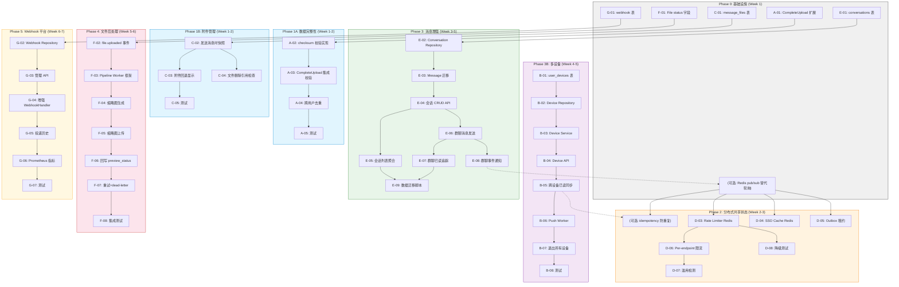
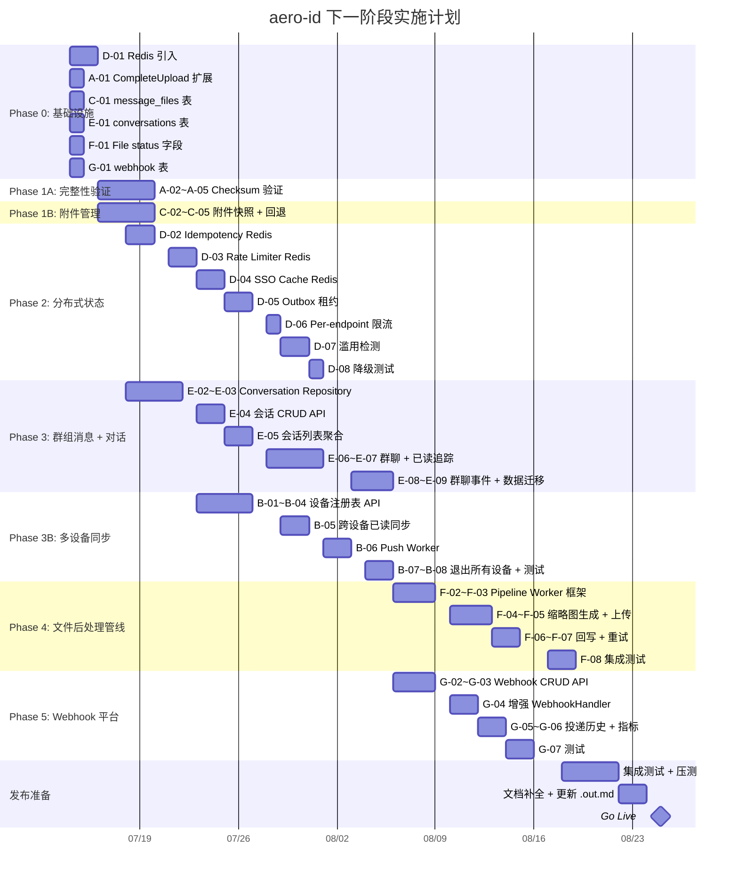

好，现在我有完整的图景了。这两份文档共覆盖 **8 个独特的扩展方向**（方向有部分重叠但视角不同）。既然没有粘贴进来的内容，我将以这两份文档作为分析基础，给出 Tech Lead 的评审。

---

# 🏗️ Tech Lead 评审：aero-id 下一阶段扩展方向

**分析基准**：`2026-07-12-aero-id-extension-analysis-pm-architect.md` + `2026-07-12-aero-id-high-level-extension-directions.md`

---

## 0. 范围界定与文档质量评估

### 总体评价

两份文档质量很高，有明确的代码引用、边界情况分析和基础设施复用路径。但作为 Tech Lead，我需要指出几个结构性问题：

**问题 1：方向重叠未归并**
| 主题 | 文档 1 中的表述 | 文档 2 中的表述 |
|------|----------------|----------------|
| 群组消息 | 方向 #5「对话抽象与群组消息」 | 方向 #1「群组/多方消息」 |
| 分布式状态 | 方向 #4「分布式速率限制」 | 方向 #2「Redis 共享状态」 |
| 对话列表 | 方向 #5 子集 | 方向 #4「对话聚合列表」 |

**建议**：合并为 6 个独立方向，去除冗余。我的分析将按 **6 个正交方向** 重组。

**问题 2：优先级建议冲突**
- 文档 1 推荐 P0 为「大文件完整性验证」+「分布式速率限制」
- 文档 2 推荐 P0 为「Redis 共享状态」
- 两者未做交叉引用决策

**问题 3：缺少工时估算和依赖分析**
两份文档都只有方向和价值判断，没有给出每个方向的实现工作量估算。这是 Tech Lead 必须补上的。

### 重组后的 6 个正交方向

```
A. 大文件端到端完整性验证      ← Doc1-#1
B. 多设备同步与 Push 通知       ← Doc1-#2
C. 消息附件生命周期管理          ← Doc1-#3
D. 分布式共享状态 (Redis)       ← Doc1-#4 + Doc2-#2 合并
E. 群组消息 + 对话抽象          ← Doc1-#5 + Doc2-#1 + Doc2-#4 合并
F. 文件后处理管线               ← Doc2-#3
G. Webhook 事件平台             ← Doc2-#5
```

---

## 1. 任务分解

### 方向 A：大文件端到端完整性验证

| 任务 ID | 标题 | 涉及文件 | 前置依赖 | 工时 |
|---------|------|---------|---------|------|
| A-01 | 扩展 `CompleteUploadRequest` 支持 `expected_checksum` 字段 | `api/proto/aero/v1/file.proto`, `internal/domain/file.go` | 无 | 2h |
| A-02 | 实现服务端 checksum 校验：从 S3 读取 ETag/范围读取计算 SHA-256 | `internal/service/file.go`, `internal/storage/s3.go` | A-01 | 3h |
| A-03 | 在 `CompleteUpload` 流程中集成校验，失败返回 400 + 触发 GC | `internal/service/file.go`, `internal/handler/http/file.go` | A-02 | 2h |
| A-04 | 实现跨用户去重：checksum 匹配后复用已有 storage_ref | `internal/service/file.go`, `internal/repository/file.go` | A-03 | 3h |
| A-05 | 添加 checksum 相关测试（单元 + 集成） | `internal/service/file_test.go`, `internal/repository/file_test.go` | A-04 | 2h |

**小计：12h（2人日）**

### 方向 B：多设备同步与 Push 通知

| 任务 ID | 标题 | 涉及文件 | 前置依赖 | 工时 |
|---------|------|---------|---------|------|
| B-01 | 新增 `user_devices` 表迁移 + domain 模型 | `migrations/*.up.sql`, `internal/domain/device.go` | 无 | 2h |
| B-02 | 实现设备 CRUD Repository | `internal/repository/device.go`, `internal/repository/device_test.go` | B-01 | 3h |
| B-03 | 实现设备注册/列表/删除 Service + 幂等性 | `internal/service/device.go` | B-02 | 3h |
| B-04 | HTTP + gRPC handler 设备管理 API | `internal/handler/http/device.go`, `internal/handler/grpc/device.go` | B-03 | 3h |
| B-05 | 跨设备已读同步：扩展 outbox 事件 + SSE relay | `internal/outbox/events.go`, `internal/service/message.go` | B-04 | 4h |
| B-06 | Push Notification worker（FCM/APNs 抽象接口 + 初始实现） | `internal/notifier/push.go`, `configs/config.yaml` | B-05 | 4h |
| B-07 | "退出所有设备"实现 + 设备 token 过期处理 | `internal/service/device.go` | B-06 | 2h |
| B-08 | 集成测试 + 边界用例 | `internal/service/mocks/`, `*_test.go` | B-07 | 3h |

**小计：24h（3人日）**

### 方向 C：消息附件生命周期管理

| 任务 ID | 标题 | 涉及文件 | 前置依赖 | 工时 |
|---------|------|---------|---------|------|
| C-01 | 新增 `message_files` 快照表 + domain 模型 | `migrations/*.up.sql`, `internal/domain/message_file.go` | 无 | 2h |
| C-02 | 发送消息时自动创建附件快照（复制文件元数据） | `internal/service/message.go`, `internal/repository/message.go` | C-01 | 3h |
| C-03 | 消息展示附件时回退：文件已删则显示占位信息 | `internal/handler/http/message.go`, `internal/handler/grpc/message.go` | C-02 | 2h |
| C-04 | 文件删除时检查引用 → 409 Conflict 或标记 orphan | `internal/service/file.go` | C-02 | 2h |
| C-05 | 添加测试 | `internal/service/message_test.go` | C-04 | 2h |

**小计：11h（1.5人日）**

### 方向 D：分布式共享状态 (Redis)

| 任务 ID | 标题 | 涉及文件 | 前置依赖 | 工时 |
|---------|------|---------|---------|------|
| D-01 | 引入 Redis 客户端依赖 + 配置（可切换/可降级） | `go.mod`, `configs/config.yaml`, `internal/config/config.go` | 无 | 3h |
| D-02 | Idempotency store Redis 实现 + 迁移（保留 GORM fallback） | `internal/repository/idempotency/redis.go`, `internal/repository/idempotency/store.go` | D-01 | 4h |
| D-03 | Rate limiter Redis 后端（滑动窗口/GCRA）+ 配置切换 | `internal/middleware/ratelimit/redis.go`, `internal/middleware/ratelimit/limiter.go` | D-02 | 4h |
| D-04 | SSO 缓存改为 Redis L2 + 内存 L1 多级缓存 | `internal/sso/token_cache.go`, `internal/sso/user_cache.go` | D-03 | 4h |
| D-05 | Outbox relay 租约机制（`SELECT ... FOR UPDATE SKIP LOCKED`） | `internal/outbox/relay.go` | D-01 | 3h |
| D-06 | Per-endpoint 速率限制配置 | `configs/config.yaml`, `internal/middleware/ratelimit/endpoint.go` | D-03 | 2h |
| D-07 | 滥用检测：举报频率限制 + Spam 评分接口 | `internal/service/comment.go`, `internal/service/report.go` | D-06 | 4h |
| D-08 | 降级与容错测试（Redis 断连→memory fallback） | `*_test.go` | D-07 | 3h |

**小计：27h（3.5人日）**

### 方向 E：群组消息 + 对话抽象

| 任务 ID | 标题 | 涉及文件 | 前置依赖 | 工时 |
|---------|------|---------|---------|------|
| E-01 | 新增 `conversations` + `conversation_members` 表迁移 | `migrations/*.up.sql` | 无 | 2h |
| E-02 | Conversation domain 模型 + Repository | `internal/domain/conversation.go`, `internal/repository/conversation.go` | E-01 | 4h |
| E-03 | `Message.conversation_id` 迁移 + 兼容层（后向兼容 1:1） | `migrations/*.up.sql`, `internal/domain/message.go`, 数据迁移脚本 | E-02 | 4h |
| E-04 | 会话 CRUD Service + Handler（HTTP/gRPC） | `internal/service/conversation.go`, `internal/handler/{http,grpc}/conversation.go` | E-03 | 4h |
| E-05 | 会话列表（聚合视图，含最后一条消息摘要 + 未读数） | `internal/service/message.go`, `internal/repository/message.go` | E-04 | 3h |
| E-06 | 群聊消息发送/接收 + ACL 校验（成员身份） | `internal/service/message.go`, `internal/service/conversation.go` | E-05 | 4h |
| E-07 | 群聊已读追踪（`conversation_read_cursors`） | `migrations/*.up.sql`, `internal/repository/conversation.go` | E-06 | 3h |
| E-08 | 群聊事件（成员加入/退出/改名）→ outbox → SSE + 通知 | `internal/outbox/events.go`, `internal/service/notification.go` | E-07 | 3h |
| E-09 | 现有 1:1 数据迁移脚本 + 测试 | `scripts/migrate-conversations.sql`, 集成测试 | E-08 | 4h |

**小计：31h（4人日）**

### 方向 F：文件后处理管线

| 任务 ID | 标题 | 涉及文件 | 前置依赖 | 工时 |
|---------|------|---------|---------|------|
| F-01 | `File` 模型增加 `status`/`processing_error` 字段 | `migrations/*.up.sql`, `internal/domain/file.go` | 无 | 2h |
| F-02 | 新增 `file.uploaded` outbox 事件 | `internal/outbox/events.go` | F-01 | 1h |
| F-03 | 实现 Pipeline Worker 框架（事件消费 → 处理 → 回写） | `internal/pipeline/worker.go`, `internal/pipeline/thumbnail.go` | F-02 | 4h |
| F-04 | 图片缩略图生成（128×128 / 256×256）+ EXIF 剥离 | `internal/pipeline/thumbnail.go` | F-03 | 3h |
| F-05 | 缩略图上传到 storage + 引用计数 | `internal/pipeline/upload.go`, `internal/storage/` | F-04 | 2h |
| F-06 | `meta.preview_status` 回写 + outbox `file.preview_ready` 事件 | `internal/pipeline/worker.go` | F-05 | 2h |
| F-07 | 时间窗口 + 重试机制 + dead-letter | `internal/pipeline/worker.go` | F-06 | 2h |
| F-08 | 集成测试（真实图片上传→触发管线→验证缩略图存在） | `*_test.go` | F-07 | 3h |

**小计：19h（2.5人日）**

### 方向 G：Webhook 事件平台

| 任务 ID | 标题 | 涉及文件 | 前置依赖 | 工时 |
|---------|------|---------|---------|------|
| G-01 | `webhook_subscriptions` + `webhook_deliveries` 表迁移 | `migrations/*.up.sql` | 无 | 2h |
| G-02 | Webhook subscription domain + Repository + CRUD | `internal/domain/webhook.go`, `internal/repository/webhook.go` | G-01 | 3h |
| G-03 | Webhook subscription 管理 API（HTTP/gRPC） | `internal/service/webhook.go`, `internal/handler/{http,grpc}/webhook.go` | G-02 | 3h |
| G-04 | 增强 WebhookHandler：多订阅者路由 + 签名密钥轮换 + 幂等投递 | `internal/outbox/webhook.go` | G-03 | 4h |
| G-05 | 投递历史查询 API + admin audit | `internal/service/webhook.go`, `internal/repository/webhook.go` | G-04 | 2h |
| G-06 | Prometheus 指标（投递成功率、P99 延迟、dead-letter） | `internal/outbox/webhook.go`, `internal/observability/metrics.go` | G-05 | 2h |
| G-07 | 测试 + 错误场景覆盖 | `*_test.go` | G-06 | 3h |

**小计：19h（2.5人日）**

---

## 2. 执行顺序与依赖图



### 并行执行组

| 组 | 方向 | 可以并行？ |
|----|------|-----------|
| **组 1** | D-01 + A-01 + C-01 + E-01 + F-01 + G-01 | ✅ 完全并行（都是预备性表迁移/配置） |
| **组 2** | Phase 1A + Phase 1B | ✅ 独立，无共享代码 |
| **组 3** | Phase 2 | ⛔ 内部串行（Redis 引入后逐步迁移各组件） |
| **组 4** | Phase 3 + Phase 3B | ⚠️ 部分并行（B-01~B-04 可并行于 E-01~E-04，但 B-05 依赖消息层稳定） |
| **组 5** | Phase 4 + Phase 5 | ✅ 完全并行（管线与 Webhook 无代码交集） |

---

## 3. 技术风险

### 🔴 高风险

| 风险 | 涉及方向 | 影响 | 缓解策略 |
|------|---------|------|---------|
| **Redis 成为单点故障** | D | 所有分布式状态依赖 Redis；Redis 宕机 → 限流失效、幂等性失效、缓存冷启动 | 优雅降级：memory fallback + 断路器 + `redis_fallback_to_memory: true` 配置 |
| **群组消息数据迁移复杂度过高** | E | 现存生产数据需要无损迁移，`conversation_id` 不能为空；原地修改 `messages` 表可能导致长时间锁表 | 采用 zero-downtime 迁移策略：新增可空列 → 后台填充 → 设为 NOT NULL → 旧字段标记 deprecated |
| **Push Notification 通道不稳定** | B | FCM/APNs 可能被屏蔽、限流、证书过期 | 设计为抽象接口（`PushProvider`）+ 静默降级：Push 失败不阻塞核心业务流，仅记录告警 |

### 🟡 中风险

| 风险 | 涉及方向 | 影响 | 缓解策略 |
|------|---------|------|---------|
| **大文件 checksum 计算性能** | A | S3 上 5GB+ 文件 multipart upload 的 ETag 不是 MD5，需要额外计算 | 客户端必须在上传前计算 SHA-256 并通过 `x-amz-tagging` 传入；服务端只做验证不做全量下载 |
| **缩略图管线存储成本** | F | 每张原图产生 2 个缩略图 variant，存储成本翻倍 | 缩略图设置独立生命周期（30天后转为冷存储或清理）；低频访问的预览产物 GC 清理 |
| **SSO 缓存多级一致性** | D | 内存 L1 与 Redis L2 可能存在短暂不一致 | 接受秒级不一致（SSO 用户信息变化不频繁）；设置 L1 TTL 短（30s） |

### 🟢 低风险（但需注意）

| 风险 | 涉及方向 | 缓解策略 |
|------|---------|---------|
| protobuf 生成流程工具链问题 | 所有涉及 API 变更的方向 | 已 pin 版本：`protoc-gen-go@v1.34.1`, `protoc-gen-go-grpc@v1.5.1` |
| 工程约束违例（文件 >500行） | E（Conversation service 可能膨胀） | 提前规划拆分：`service/conversation_crud.go`、`service/conversation_group.go`、`service/conversation_read.go` |
| 过期 .out.md 不更新 | 方向评审文档 | 每个方向完成后更新对应 .out.md |

---

## 4. 资源评估

### 团队建议

| 角色 | 人数 | 重点负责 |
|------|------|---------|
| **Senior Backend (Go)** | 2人 | Phase 2 (Redis)、Phase 3 (消息) — 复杂度最高 |
| **Mid-level Backend (Go)** | 1人 | Phase 1A/1B (完整性 + 附件) — 独立性强、边界清晰 |
| **Mid-level Backend (Go/Infra)** | 1人 | Phase 4 (文件管线) + Phase 5 (Webhook) |
| **DevOps** (兼职) | 0.5人 | Redis 基础设施、CI/CD 调整、监控 |

**最少可行团队**：2 人（1 Senior + 1 Mid），但周期会拉长到 9-10 周。

### 关键里程碑

```
Week 0:  团队就绪 + 基础设施代码审查（Redis 选型 + 表设计 Review）
Week 2:  ✅ Phase 0 交付（表迁移、Redis 引入、CompleteUpload 扩展）
Week 4:  ✅ Phase 1A/1B 交付（完整性验证 + 附件管理）
         ✅ Phase 2 D-01~D-04 交付（Idempotency + Rate Limiter Redis）
Week 6:  ✅ Phase 2 D-05~D-08 交付（Outbox 租约 + 滥用检测）
         ✅ Phase 3 E-01~E-05 交付（Conversation 基础设施 + 会话列表）
Week 8:  ✅ Phase 3 E-06~E-09 交付（群聊功能 + 数据迁移）
         ✅ Phase 3B B-01~B-05 交付（设备管理 + 跨设备已读同步）
Week 10: ✅ Phase 3B B-06~B-08 交付（Push Notification）
         ✅ Phase 4 + Phase 5 交付（管线 + Webhook）
Week 11: 🧪 集成测试 + 性能压测 + 文档补全
Week 12: 🚀 发布
```

### 阻塞点 (Blockers)

| Blocker | 影响 | 解决策略 |
|---------|------|---------|
| **Redis 不可用**（团队无运维经验） | 方向 D 无法启动 | 提前部署开发环境 Redis（Docker compose）；生产环境选托管 Redis（ElastiCache/Upstash） |
| **Push Notification 证书/密钥** | B-06 阻塞 | 提前注册 Firebase/APNs 开发者账号；开发阶段用 `logPushProvider`（只打日志）走通流程 |
| **Protobuf 版本冲突** | 所有 API 方向 | 锁定 `go.mod` 中的 protobuf 版本；`make proto` 在 CI 中验证 |

---

## 5. 质量保证

### 单元测试覆盖

| 组件 | 最低覆盖要求 | 关键测试场景 |
|------|------------|------------|
| Service 层 | ≥ 80% | 所有业务逻辑分支（成功/失败/授权拒绝） |
| Repository 层 | ≥ 70% | CRUD + 边界查询（空结果、大结果集） |
| Pipeline worker | ≥ 75% | 正常处理、处理失败、重试、超时 |
| 所有 mock 测试 | Service 测试使用 `internal/service/mocks/` | 不允许 mock 遗漏 |

### 集成测试策略

| 方向 | 集成测试要求 | 基础设施 |
|------|------------|---------|
| A（完整性验证） | 上传文件 → 验证 checksum → 验证去重 | testcontainers: Postgres + MinIO |
| D（Redis） | Redis 操作 → 断连 → fallback → 恢复 | testcontainers: Postgres + Redis |
| E（群组消息） | 创建群 → 发消息 → 成员退出 → 验证已读 | testcontainers: Postgres |
| F（文件管线） | 上传图片 → 等待管线完成 → 验证缩略图存在 | testcontainers: Postgres + MinIO |
| B（Push Notification） | 注册设备 → 验证 SSE 收到同步事件 | testcontainers: Postgres |

### 代码审查要点

每次 PR 必须检查：

1. **工程约束**：文件 ≤ 500 行、函数 ≤ 50 行、cyclomatic ≤ 10
2. **错误处理链**：repo raw error → service `.Wrap()` → handler render（禁止裸奔 DB error）
3. **事务边界**：涉及 outbox 的操作必须是事务性的
4. **幂等性**：所有写 API 应支持幂等键（existing idempotency store）
5. **授权检查**：所有 Service 入口做 ownership/membership 验证（不依赖 handler 层）
6. **降级路径**：Redis 操作必须处理连接失败（timeout → fallback → log）

### 性能测试需求

| 测试场景 | 工具 | 目标 | 触发条件 |
|---------|------|------|---------|
| Redis 限流 QPS 测试 | `wrk2` / `ghz` | 确认分布式限流 RPS 准确（误差 <5%） | D-03 交付后 |
| 群聊消息 Fan-out 延迟 | `k6` | P99 延迟 <500ms（100 成员群） | E-06 交付后 |
| 文件管线吞吐 | 批量上传图片 | 管线处理速率 ≥ 上传速率的 80% | F-03 交付后 |
| Push Notification 并发 | 模拟 1000 设备在线 | SSE Hub 不丢事件，内存稳定 | B-05 交付后 |
| Webhook 投递可靠性 | 模拟目标 5xx | dead-letter + 重试覆盖率 100% | G-04 交付后 |

---

## 6. 实施时间表（甘特图）



---

## 7. 总结建议

### 优先级推荐（按 ROI 排序）

| 优先级 | 方向 | 价值 | 风险 | 工时 | ROI 判断 |
|--------|------|------|------|------|---------|
| **P0** | **D: 分布式共享状态 (Redis)** | 多副本部署的前提条件；当前限流形同虚设 | 中 | 27h | **必须先做** |
| **P0** | **A: 大文件完整性验证** | 文件服务的核心数据正确性保证 | 低 | 12h | 低成本高影响 |
| **P1** | **C: 消息附件生命周期** | 直接改善生产环境数据完整性问题 | 低 | 11h | 成本低收益明确 |
| **P1** | **B: 多设备同步** | 产品化必经之路；Push 是移动端必要条件 | 中 | 24h | 用户感知强 |
| **P1** | **F: 文件后处理管线** | 缩略图/预览是用户刚需 | 中 | 19h | 用户体验改善 |
| **P2** | **E: 群组消息 + 对话** | 架构变更最大，但产品价值最高 | 高 | 31h | 建议储备需求，延后启动 |
| **P2** | **G: Webhook 平台** | 平台化能力，但当前阶段非必需 | 低 | 19h | 可延迟至下一迭代 |

### 推荐启动策略

1. **立即启动**（Week 1-2）：Phase 0 + Phase 1A + Phase 1B（2 人并行）
   - 工程师 A：方向 A + 方向 C（完整性 + 附件，共 23h）
   - 工程师 B：方向 D 的 D-01~D-04（Redis 引入 + Idempotency + 限流，共 11h）

2. **第 3 周起**：扩展到 3-4 人并行
   - Phase 2 剩余 + Phase 3 开始
   - Phase 3B 设备注册表（独立于群组消息）

3. **第 6 周起**：Phase 4 + Phase 5 并行

### 需要你确认的关键决策

1. **Redis 选型**：自建 vs 托管（ElastiCache Serverless / Upstash）？这会直接影响 D-01 的配置设计
2. **群组消息的范围裁剪**：最小可行群聊只需要「发消息 + 读消息 + 成员管理」，是否先不做「已读追踪」和「静音/置顶」以降低 Phase 3 的首发范围？
3. **这份分析是否写入磁盘**：如果你需要，我可以将以上分析保存为 `docs/requirements/2026-07-12-tech-lead-analysis.out.md`

请确认你实际想讨论的文档方向（是以上 8 个方向的全集，还是其中某个子集），我据此深化对应部分。
