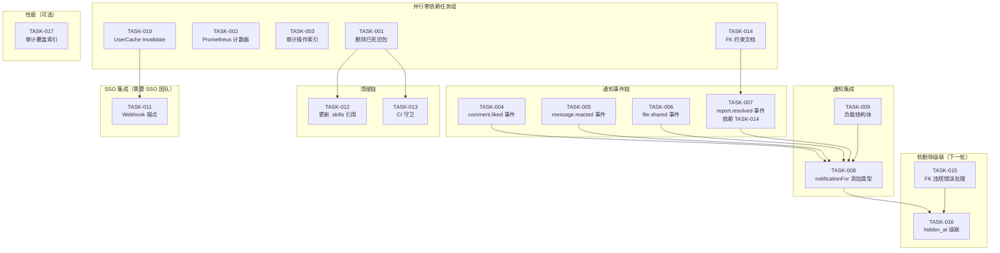
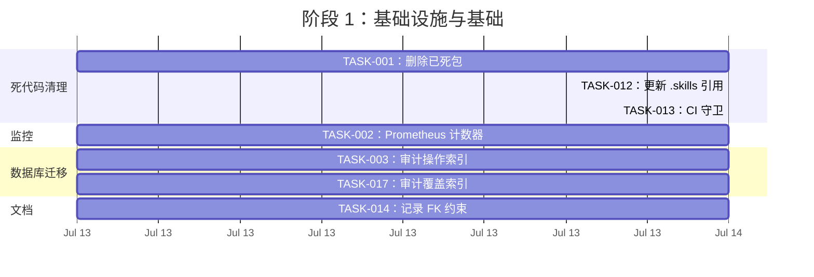
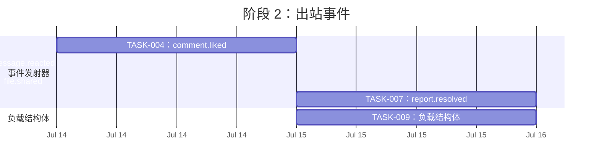
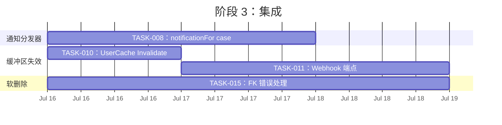
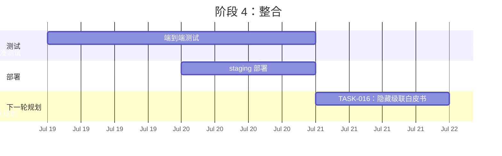
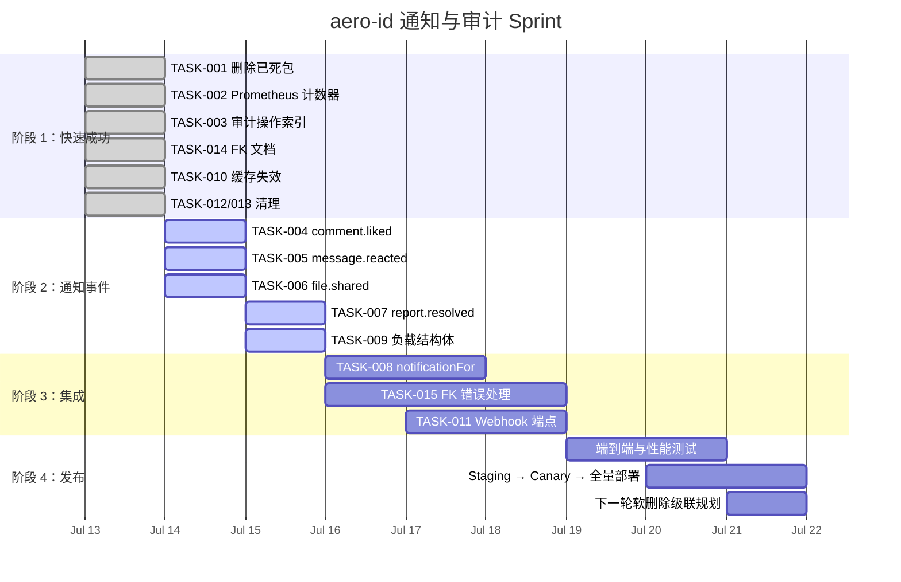

我已经对代码库有了全面的了解。以下是我的详细技术主管分析：

---

# Tech Lead 分析报告：aero-id 通知事件覆盖与审计可靠性提升

## 1. 任务分解

### TASK-001：删除 7 个已死的旧包

| 字段 | 内容 |
|------|--------|
| **方向** | 死代码清理 |
| **涉及文件** | `internal/comment/`, `internal/file/`, `internal/message/`, `internal/block/`, `internal/audit/`, `internal/search/`, `internal/notification/` |
| **前置依赖** | 无 |
| **预估工时** | 0.5 小时 |
| **验收标准** | 7 个目录已被移除；`make test && make lint` 全部通过；`.skills/refactor-large-file.md` 中的引用也已更新 |

### TASK-002：为审计日志 Log 方法添加 Prometheus 计数器

| 字段 | 内容 |
|------|--------|
| **方向** | 审计日志可靠性 |
| **涉及文件** | `internal/repository/audit.go`（修改），`internal/pkg/metrics/metrics.go`（需新建） |
| **前置依赖** | 无 |
| **预估工时** | 1 小时 |
| **验收标准** | `AuditLogFailures` 和 `AuditLogTotal` 计数器在 `Log()` 中被正确记录。当 `Append()` 失败时，`AuditLogFailures` 递增，且主操作不影响业务。 |

### TASK-003：在 audit_events 上添加复合索引迁移

| 字段 | 内容 |
|------|--------|
| **方向** | 审计日志可靠性 |
| **涉及文件** | `migrations/000024_audit_events_action_idx.up.sql`, `migrations/000024_audit_events_action_idx.down.sql`, `migrations/migrations_test.go` |
| **前置依赖** | 无 |
| **预估工时** | 0.5 小时 |
| **验收标准** | 添加了新的迁移文件：`CREATE INDEX CONCURRENTLY IF NOT EXISTS idx_audit_events_action ON audit_events(action, created_at DESC)`。`make migrate-up` 成功。索引在 `SELECT ... WHERE action=? ORDER BY created_at DESC` 查询中可见。

### TASK-004：在 comment.liked 时发出 outbox 事件

| 字段 | 内容 |
|------|--------|
| **方向** | 通知事件覆盖 |
| **涉及文件** | `internal/service/comment.go`（在 `react()` 方法内修改） |
| **前置依赖** | 无 |
| **预估工时** | 1 小时 |
| **验收标准** | `comment.liked` 事件在 `Like()` 路径上的 `comments.Like()` 成功后发出。事件负载包含 `comment_id`、`comment_author` 和 `liker_uid`。通知测试覆盖该新事件类型。

### TASK-005：在 message.reacted 时发出 outbox 事件

| 字段 | 内容 |
|------|--------|
| **方向** | 通知事件覆盖 |
| **涉及文件** | `internal/service/message.go`（在 `ReactToMessage()` 内修改） |
| **前置依赖** | 无 |
| **预估工时** | 1 小时 |
| **验收标准** | `message.reacted` 事件在 `ReactToMessage()` 成功后发出。负载包含 `message_id`、`actor_uid`、`receiver_uid`。通知测试覆盖。

### TASK-006：在 file.shared 时发出 outbox 事件

| 字段 | 内容 |
|------|--------|
| **方向** | 通知事件覆盖 |
| **涉及文件** | `internal/service/file_share.go`（在 `ShareFile()` 内修改） |
| **前置依赖** | 无 |
| **预估工时** | 1 小时 |
| **验收标准** | `file.shared` 事件在 `shares.Grant()` 成功后发出（对每个 grantee 单独发送或批量发送，但覆盖所有 grantee）。负载包含 `file_id`、`owner_uid`、`grantee_uid`。通知测试覆盖。

### TASK-007：在 report.resolved 时发出 outbox 事件

| 字段 | 内容 |
|------|--------|
| **方向** | 通知事件覆盖 |
| **涉及文件** | `internal/service/comment.go`（在 `ResolveReport()` 内修改） |
| **前置依赖** | TASK-014 |
| **预估工时** | 1 小时 |
| **验收标准** | `report.resolved` 事件在报告通过 `resolved` 或 `dismissed` 处理时发出。负载包含 `report_id`、`comment_id`、`status`、`resolver_uid`。通知测试覆盖。

### TASK-008：在 NotificationDispatcher 中处理新的通知类型

| 字段 | 内容 |
|------|--------|
| **方向** | 通知事件覆盖 |
| **涉及文件** | `internal/service/notification.go`（在 `notificationFor()` 的 switch 中添加 case） |
| **前置依赖** | TASK-004, TASK-005, TASK-006, TASK-007 |
| **预估工时** | 2 小时 |
| **验收标准** | `notificationFor()` 通过 switch case 处理 `comment.liked`、`file.shared`、`message.reacted`、`report.resolved`。每个类型映射到正确的 `domain.Notification`，包含收件人、类型、参与者和主题字段。单元测试覆盖所有四种新类型。

### TASK-009：为 comment.liked 和 message.reacted 添加负载结构体

| 字段 | 内容 |
|------|--------|
| **方向** | 通知事件覆盖 |
| **涉及文件** | `internal/service/notification.go`（添加 `commentLikedPayload`、`messageReactedPayload`、`fileSharedPayload`、`reportResolvedPayload` 结构体） |
| **前置依赖** | TASK-008 |
| **预估工时** | 0.5 小时 |
| **验收标准** | 定义了解析相关负载的专用结构体，遵循已存在的 `messageSentPayload`/`messageReadPayload`/`commentRepliedPayload` 模式。

### TASK-010：为 UserCache 添加 Invalidate/InvalidateAll

| 字段 | 内容 |
|------|--------|
| **方向** | SSO 用户缓存失效 |
| **涉及文件** | `internal/sso/user_cache.go`（添加方法），`internal/sso/client.go`（暴露方法） |
| **前置依赖** | 无 |
| **预估工时** | 1 小时 |
| **验收标准** | `Invalidate(ctx, uids...)` 从 `items` map 中删除条目。`InvalidateAll(ctx)` 清空 map。对外暴露于 SSO `Client`。一个平凡的单元测试确认失效后的下次读取会触发一次新的提取。

### TASK-011：暴露 SSO 缓存失效的 webhook 端点

| 字段 | 内容 |
|------|--------|
| **方向** | SSO 用户缓存失效 |
| **涉及文件** | `internal/service/admin.go`（添加方法），`internal/handler/http/admin.go`（添加路由），`internal/middleware/middleware.go`（如果需要新的路由保护） |
| **前置依赖** | TASK-010 |
| **预估工时** | 2 小时 |
| **验收标准** | 一个 `POST /admin/sso-invalidate`（或类似的）端点在 admin 分组中。接受一个 JSON body，包含可选的 uid 列表（如果为空则清空全部）。调用 SSO Client 的 Invalidate。**注意：** 这是一个与 SSO 团队的跨团队契约点，协议（webhook 与轮询）需要协调。

### TASK-012：在 .skills/refactor-large-file.md 中更新对已删除旧包的引用

| 字段 | 内容 |
|------|--------|
| **方向** | 死代码清理 |
| **涉及文件** | `.skills/refactor-large-file.md` |
| **前置依赖** | TASK-001 |
| **预估工时** | 0.25 小时 |
| **验收标准** | 已删除包的任何引用已被移除或替换。

### TASK-013：在 Makefile 中添加 CI 守卫以防止重新导入死代码

| 字段 | 内容 |
|------|--------|
| **方向** | 死代码清理 |
| **涉及文件** | `Makefile`（或 GitHub Actions 工作流，未提供） |
| **前置依赖** | TASK-001 |
| **预估工时** | 0.25 小时 |
| **验收标准** | 一个 `make check-dead-imports` 目标（或现有 `check-file-sizes` 目标的扩展），如果任何 `.go` 文件（`app.go` 除外）导入了已删除的包，则失败。

### TASK-014：记录影响删除的 FK 约束冲突

| 字段 | 内容 |
|------|--------|
| **方向** | 软删除级联 |
| **涉及文件** | `docs/superpowers/specs/2026-05-22-aero-id-design.md`（设计文档），`README.md` |
| **前置依赖** | 无 |
| **预估工时** | 1 小时 |
| **验收标准** | 设计文档和 README 记录了哪些 FK 约束阻止删除（`comment_likes → comments`，`messages.file_id → files`，`comments.parent_id → comments`，`comment_reports → comments`），以及现有的 `ON DELETE CASCADE`（`message_reactions`）和丢失的 FK（`file_shares`）导致无声失效。

### TASK-015：为删除路径添加 FK 违规的优雅错误处理

| 字段 | 内容 |
|------|--------|
| **方向** | 软删除级联 |
| **涉及文件** | `internal/service/comment.go`（`Delete` 方法），`internal/service/file.go`（`Delete` 方法），`internal/repository/...`（将 `gorm.ErrForeignKeyViolation` 映射到 `repository.ErrForeignKeyViolation`） |
| **前置依赖** | TASK-014 |
| **预估工时** | 3 小时 |
| **验收标准** | 当 `Delete` 因为仍有引用它的子行而失败时，服务层不会得到未处理的 500 错误。该场景被映射到 `Conflict` 或 `BadRequest` AppError，并带有描述性消息。添加了单元测试以验证行为。

### TASK-016：添加 `hide`/`hidden_at` 级的软删除级联（短中期）

| 字段 | 内容 |
|------|--------|
| **方向** | 软删除级联 |
| **涉及文件** | `migrations/000025_soft_delete_cascade.up.sql`（在相关的子表中添加 `hidden_at` 列），`internal/domain/...`（添加字段），`internal/repository/...`（更新查询以应用隐藏过滤），`internal/service/...`（级联隐藏/恢复逻辑） |
| **前置依赖** | TASK-015 |
| **预估工时** | 8-12 小时 |
| **验收标准** | 当一条评论被删除时，其 likes、reports 和 replies 被标记为 `hidden`（通过 `hidden_at` 列）。在 List 查询中不可见。当删除被恢复时，子行也被恢复（或 `hidden_at` 被设为静默）。**注意：** 这是一个需要仔细设计的重大项目变更。在 sprint 中安排。

### TASK-017：为 audit_events (actor_uid, created_at DESC, id DESC) 添加复合覆盖索引

| 字段 | 内容 |
|------|--------|
| **方向** | 审计日志可靠性（性能） |
| **涉及文件** | `migrations/000026_audit_events_covered_idx.up.sql`，`migrations/000026_audit_events_covered_idx.down.sql` |
| **前置依赖** | 无 |
| **预估工时** | 0.5 小时 |
| **验收标准** | 添加了新的迁移：`CREATE INDEX CONCURRENTLY IF NOT EXISTS idx_audit_events_actor_covered ON audit_events(actor_uid, created_at DESC, id DESC) WHERE id IS NOT NULL`。消除了 `List` 查询的额外排序步骤。

---

## 2. 执行顺序

### 并行执行组

| 组 | 任务 | 原因 |
|-----|------|--------|
| **组 A：快速成功** | TASK-001（删除），TASK-002（指标），TASK-003（索引），TASK-010（缓存失效），TASK-014（文档） | 零依赖，可安全并行，风险低 |
| **组 B：通知事件** | TASK-004，TASK-005，TASK-006，TASK-007 | 每个都是独立的切入点，可在通知集成之前并行处理 |
| **组 C：通知集成** | TASK-008，TASK-009 | 组 B 完成后顺序进行 |
| **组 D：清理** | TASK-012，TASK-013 | 紧随组 A（TASK-001）之后 |
| **组 E：软删除** | TASK-015，TASK-016 | 顺序进行；TASK-015 是 TASK-016 的先决条件 |

---

## 3. 技术风险

### 3.1 高影响风险

| # | 风险 | 概率 | 影响 | 缓解措施 |
|---|------|----------|--------|-------------|
| R1 | **删除已死包会暴露隐藏的依赖** | 低 | 高 | 在删除前运行 `make test && make lint && go build ./...`。CI 守卫（TASK-013）防止回归。 |
| R2 | **`outbox.NewEvent` 函数不存在** | 高 | 中 | 文档参考的是 `outbox.NewEvent`，但实际代码使用每个服务中的一个包级别 `newEvent`。所有 outbox 事件创建**必须**使用 `newEvent(...)`，该函数已在 `internal/service/message.go` 中定义。审阅者必须检查这一点，因为它是从 message.go 隐式导入的包作用域函数。 |
| R3 | **跨团队 SSO webhook 集成** | 中 | 高 | SSO 团队需要定义契约（webhook URL、认证、重试、速率限制）。TASK-011 被阻塞直到达成跨团队一致。回退：轮询策略（每隔 N 分钟批量检查 UID 变更）。 |
| R4 | **FK 违规在生产中对删除路径是静默的** | 中 | 高 | `comment_likes` 和 `comments.parent_id` 上的 FK 会在尝试删除时产生 SQL 错误。没有适当的错误处理，用户会看到 500 错误。TASK-015 通过将 `gorm.ErrForeignKeyViolation` 映射到应用层 `Conflict` 错误来解决这一问题。 |

### 3.2 技术不确定性

| # | 问题 | 分析 |
|---|------|--------|
| U1 | **`message.reacted` 事件负载设计** | 负载应包括 `message_id`、`from_uid`（发件人）、`to_uid`（收件人）、`actor_uid`（谁做出的反应）。问题是：是通知发件人、收件人，还是对一条消息的所有参与者？**建议：** 通知消息的另一方（如果 `actor` 是发件人则通知收件人，反之亦然）。 |
| U2 | **`file.shared` 事件负载设计** | 应为每个 grantee 发出一个事件，还是一个包含所有 grantee 的批量事件？**建议：** 每个 grantee 一个事件，以匹配现有的每个 grantee 审计日志模式。这样通知可以单独针对每个 grantee。 |
| U3 | **`report.resolved` 事件负载设计** | 应包含 `report_id`、`comment_id`、`status`（resolved/dismissed）、`resolver_uid`。应报告给举报者（通知他们的举报已被处理）。**建议：** 通知举报者（通过 `reporter_uid`）。 |
| U4 | **审计执行器关闭：需要多少个计数器？** | Prometheus 计数器：一个 `audit_log_total`（按 `action` 和 `status`=success/fail 标记），一个 `audit_log_failures`（按 `action` 标记）。使它们符合现有的指标命名约定——检查 `internal/pkg/` 下的现有包。如果不存在，则创建一个新的 `internal/pkg/metrics` 包。 |

### 3.3 性能瓶颈

| 瓶颈 | 分析 | 缓解措施 |
|---------|--------|-------------|
| **审计 `List` 查询排序** | `ORDER BY created_at DESC, id DESC` — 现有的 `idx_audit_events_actor` 索引不包括 `id`，导致在具有相同 `created_at`（毫秒精度 `NOW()`）的行集中出现额外的排序传递。 | 添加覆盖索引 `(actor_uid, created_at DESC, id DESC)`【TASK-017】 |
| **通知受众确认** | 每个出站事件都需要通过通知分发器处理。每秒 1000 个 comment.liked 事件 = 每个产生 1000 个通知行。 | 速率限制器（已存在于 `NotificationDispatcher` 中）。考虑批量插入（如果 GORM 支持）。 |

### 3.4 测试覆盖难点

| 难点 | 理由 | 策略 |
|---------|-------|--------|
| **FK 违规模拟** | `gorm.ErrForeignKeyViolation` 需要 PostgreSQL 的特定行为来触发。模拟很脆弱。 | 使用 `internal/repository/mocks`（如果存在）或为 `ErrForeignKeyViolation` 写一个集成测试，该测试创建一个依赖行然后尝试删除父行。 |
| **出站事件类型测试** | 每个新的事件类型必须同时测试"事件被发出"和"通知分发器正确处理它"。 | 单元测试：在事件发出后 mock 仓库的 `Append` 调用。集成测试：使用 `NotificationDispatcher` 使用真实 outbox 并检查生成的 `domain.Notification`。 |
| **缓存失效** | 缓存失效只有在竞争条件下才可测试——检测"读取-清空-重新读取"场景。 | 带 mock `fetcher` 的单元测试，验证 `InvalidateAll` 后，第一次 `GetMany` 调用 fetcher。 |

---

## 4. 资源评估

### 4.1 团队构成

| 角色 | 所需人数 | 分配的任务 |
|------|-------------|----------------|
| **高级后端工程师** | 1 | TASK-008（通知集成），TASK-016（软删除级联），代码审查，设计决策 |
| **后端工程师** | 1-2 | TASK-001（删除），TASK-004/005/006/007（事件），TASK-010/011（缓存），TASK-014/015（FK 处理） |
| **DevOps 工程师** | 0.5 | TASK-002（Prometheus 指标），TASK-003/017（迁移） |
| **跨团队联络人** | 1（与 SSO 团队协调） | TASK-011（SSO webhook 契约） |

### 4.2 里程碑

| 里程碑 | 截止日期 | 交付物 |
|----------|------------|----------|
| **M1：快速成功** | 第 1 天结束 | TASK-001（已删除死代码），TASK-002（指标就绪），TASK-003（索引已迁移），TASK-014（已记录 FK） |
| **M2：通知事件** | 第 3 天 | TASK-004、005、006、007（所有 4 个事件已发出），TASK-009（负载结构体） |
| **M3：通知集成** | 第 5 天 | TASK-008（分发器处理所有新类型），TASK-010（缓存失效） |
| **M4：可靠性** | 第 7 天 | TASK-011（SSO webhook 端点），TASK-015（FK 错误处理），TASK-012/013（清理） |
| **M5：下一轮 sprint** | 下一轮 | TASK-016（软删除级联），TASK-017（性能索引） |

### 4.3 阻塞点

| 阻塞点 | 描述 | 解决方法 |
|---------|-------------|-------------|
| **B1：SSO webhook 契约**（TASK-011） | 无效策略取决于 SSO 如何推送 UID 变更。在 SSO 端设计为 webhook 与轮询的决策仍待商榷。 | **短期：** 实现 `Invalidate()` 和 `InvalidateAll()` 方法，但**不**公开 webhook 端点。推迟 TASK-011 直到 SSO 集成 sprint。添加一个 `POST /admin/cache-invalidate` 端点，仅限管理员使用，作为临时措施。 |
| **B2：软删除级联设计**（TASK-016） | `hidden_at` 方法与 `status` 方法 vs 迁移到实际引用行为。需要设计评审。 | 开始于 TASK-014（文档），它准确描述了现状。与团队一起设计，决定"设置子行 status = hidden"与"将子行转移到回收站表"。**建议：** 使用 `hidden_at` 方法，因为 aero-id 已经是软删除系统。 |
| **B3：依赖 `newEvent` 在 `message.go` 中** | `newEvent` 是 `internal/service/message.go` 中的一个未导出函数。`comment.go` 和 `file_share.go` 不能访问它（尽管它们可以在同一个包中访问）。添加了事件发出的 `file_share.go` 将默认使用相同的模式。 | 验证 `newEvent` 当前确实在包内可访问。如果 `file_share.go` 需要它，它可以调用 `newEvent` 而无需修改。审阅者必须确认。 |

---

## 5. 质量保证

### 5.1 单元测试覆盖要求

| 任务 | 所需最小覆盖率 | 测试内容 |
|------|--------------------|-------------|
| TASK-004 | 80% 新增代码 | 模拟评论仓库：验证在 `Like()` 成功后调用了 `Append`。验证事件负载包含正确的键。 |
| TASK-005 | 80% 新增代码 | 模拟消息仓库：验证在 `ReactToMessage()` 成功后调用了 `Append`。 |
| TASK-006 | 80% 新增代码 | 模拟分享仓库：验证在 `Grant()` 成功后调用了 `Append`（每个 grantee 调用一次）。 |
| TASK-007 | 80% 新增代码 | 模拟评论仓库：验证在 `ResolveReport()` 成功后调用了 `Append`。 |
| TASK-008 | 90% 新增代码 | 直接单元测试 `notificationFor()`：为每个新事件类型构造一个 `outbox.Event`，验证输出的 `domain.Notification` 是正确的。测试边界情况：空负载、自操作、未知事件。 |
| TASK-010 | 90% 新增代码 | 用 mock fetcher 测试 `Invalidate`：填充缓存 → 失效部分 → 验证第一次缺失调用 fetcher。`InvalidateAll`：填充 → 清空全部 → 验证所有条目都需要重新获取。 |

### 5.2 集成测试策略

| 任务 | 集成测试范围 | 需要 Docker？（testcontainers） |
|------|-----------------|--------------------------------|
| TASK-003/017 | 在 `migrations_test.go` 中作为 `TestMigrations` 的一部分 | 是（Postgres） |
| TASK-008 | 完整的通知分发端到端：使用 real outbox 仓库发出事件，检查通知行 | 是（Postgres） |
| TASK-015 | 创建 comment → like → 尝试删除 comment → 验证正确的 FK 错误处理 | 是（Postgres） |

### 5.3 代码审查要点

| # | 审查重点 | 原因 |
|---|----------------|------|
| CR1 | **事件负载字段名称**必须遵循现有约定（下划线 snake_case，如 `comment_id`、`parent_author_uid`）。 | 一致性对于维护可发现的通知处理至关重要。 |
| CR2 | **`newEvent` 与 `outbox.NewEvent`**：确保所有新的事件创建使用包内的 `newEvent` 辅助函数，而不是未导出的 outbox 函数。 | 文档中提到 `outbox.NewEvent` 实际上不存在于代码库中。 |
| CR3 | **audit Log 错误被吞掉**：所有审计日志记录遵循 `if s.audit != nil { _ = s.audit.Log(...) }` 模式。新的事件代码**不得**允许审计日志错误传播给调用者。 | AGENTS.md 约束："a failed log must not fail the primary operation"。 |
| CR4 | **`react()` 中的事件顺序**：在 `comments.Like()` 成功后发出，而不是在之前。如果仓库调用失败，则不应记录事件。 | 原子性：事件与数据变更应该在同一事务中。检查仓库是否支持事务性追加（它使用 `Create`，但需要验证是否在公共事务中完成）。 |
| CR5 | **文件大小**：`comment.go` 目前是 472 行（接近 500 的限制）。添加更多代码需要拆分。 | AGENTS.md 约束：如果超过 500 行则停止。将文件拆分到 `service/comment.go` + `service/comment_reactions.go` 中。 |
| CR6 | **`message.go` 文件大小**：394 行。添加 TASK-005 后仍低于 500，但接近。 | 如果超过 400 行，计划拆分到 `service/message.go` + `service/message_reactions.go`。 |

### 5.4 性能测试需求

| 场景 | 指标 | 测试策略 |
|----------|------------|----------------|
| **通知分发** | 吞吐量（事件/秒），P99 延迟 | 加载测试 `NotificationDispatcher.Handle` 包含 1000+ 个事件。测量每个事件的延迟。 |
| **审计日志附加** | P99 延迟 < 10ms | 使用 simulated Postgres 延迟（50ms）的基准测试。确保 Log 方法不会阻塞超过 10ms（在重试/超时后吞掉错误）。 |
| **缓存失效** | 1000+ 个条目失效的时间 | 用 1000 个条目填充 `UserCache`，测量 `InvalidateAll` 的时间。应 < 1ms。 |

---

## 6. 实施计划

### 阶段 1：快速成功（第 1-2 天）

**第 1 天交付物：** 死代码已移除，指标已就位，索引已迁移，FK 冲突已记录。运行 `make test && make lint` ✅。

### 阶段 2：通知事件覆盖（第 2-3 天）

**第 3 天交付物：** 所有 4 种新事件在相应的服务操作中发出。单元测试覆盖每个事件类型。

### 阶段 3：通知集成与可靠性（第 4-6 天）

**第 6 天交付物：** 所有通知事件都被分发到正确的收件人。缓存失效功能就绪（带管理员端点）。删除操作优雅地处理 FK 冲突，而不是返回 500。

### 阶段 4：发布准备与下一轮规划（第 7+ 天）

**第 9 天交付物：** 更改在生产环境中上线（staging → canary → 全量发布）。软删除级联（TASK-016）已形成设计文档并规划到下一个 sprint 中。

### 时间线摘要（甘特图）

---

## 附录 A：关于分析文档的说明

分析文档准确捕捉了状态，但有三个值得注意的修正：

1. **`outbox.NewEvent` 不存在** — 文档引用了 `outbox.NewEvent` 函数签名，但实际代码库在 `internal/service/message.go` 中使用包级 `newEvent` 辅助函数（未导出）。删除旧包但保留 `message.go` 后仍然可用。所有新的事件创建应该使用 `newEvent`，路径为 `"comment"`、`"message"` 或 `"file_share"` aggregate 类型。

2. **`ReactToMessage` 确实存在**（在 `internal/service/message.go` 中）— 文档声称它"在 live 代码库中不存在"。实际上它在 `internal/service/message.go` 中定义，就在倒数第二个位置（393 行附近）。它目前**没有**发出 outbox 事件，这与分析一致。

3. **软删除级联紧迫性** — 我同意分析的观点，FK 约束冲突产生的 SQL 500 错误应被提升到 P1，因为这是一个面向用户的故障。现有的 `ON DELETE CASCADE` 和缺失的 FK（`file_shares`）让某些操作成功而其他操作失败——这是**不可预测的**，也是糟糕的 UX。TASK-015 在阶段 3 解决了这个问题。
