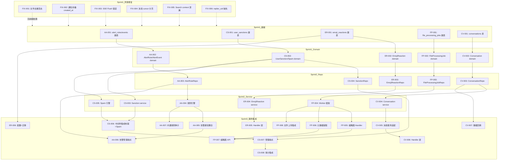
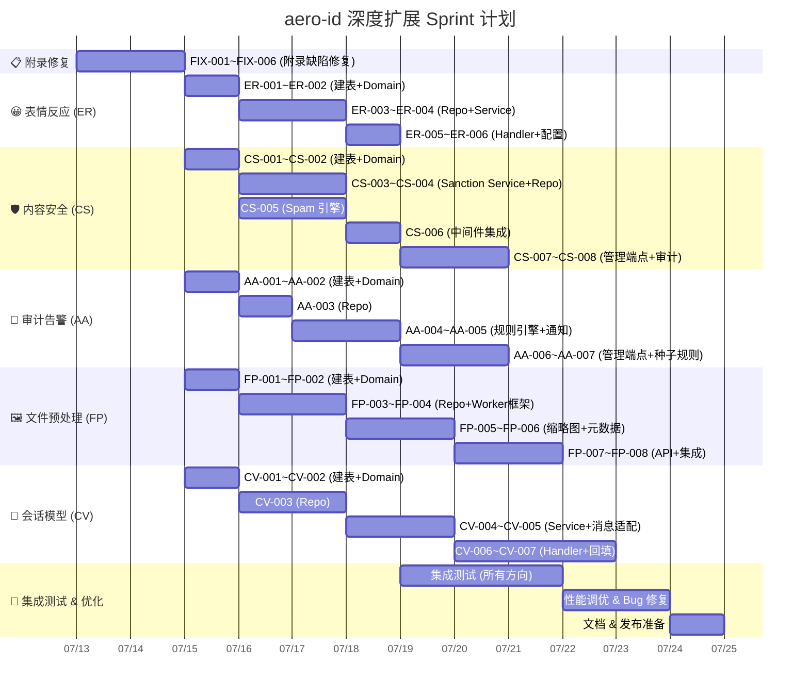

现在我有了全面的理解。让我输出完整的 Tech Lead 分析。

---

# Tech Lead 分析报告：aero-id 深度扩展方向

## 1. 任务分解

以下将 5 个方向拆解为 23 个可执行任务，每个 2–4 小时。任务编号按方向分组（`ER`=表情反应，`CV`=会话，`CS`=内容安全，`FP`=文件预处理，`AA`=审计告警）。

### 方向 1：多表情反应体系 (ER)

| 任务 ID | 标题 | 涉及文件 | 前置 | 工时 |
|---|---|---|---|---|
| **ER-001** | Migration: 创建 `emoji_reactions` 统一表 | `migrations/000023_emoji_reactions.up.sql`, `.down.sql` | — | 2h |
| **ER-002** | Domain: 新增 `EmojiReaction` 实体 + `ReactionSummary` DTO | `internal/domain/emoji_reaction.go` | ER-001 | 2h |
| **ER-003** | Repository: `EmojiReactionRepository` CRUD + 计数查询 | `internal/repository/emoji_reaction.go`, `internal/repository/emoji_reaction_test.go` | ER-002 | 3h |
| **ER-004** | Service: 表情反应业务逻辑（`React`/`Unreact`/`GetSummary`）+ 通知事件 | `internal/service/emoji_reaction.go`, `internal/service/emoji_reaction_test.go` | ER-003 | 4h |
| **ER-005** | Handler: HTTP + gRPC 端点（`POST /v1/reactions`、`DELETE /v1/reactions`、`GET /v1/reactions/summary`） | `internal/handler/http/emoji_reaction.go`, `internal/handler/http/emoji_reaction_test.go`, `internal/handler/grpc/emoji_reaction.go` | ER-004 | 3h |
| **ER-006** | 配置: 表情类型白名单 + 迁移旧 `comment_likes` / `message_reactions` 后台任务 | `configs/config.yaml`, `internal/service/emoji_reaction.go` | ER-001 | 2h |

> **合计：16h (≈2人·天)**

### 方向 2：会话模型统一与收件箱重构 (CV)

| 任务 ID | 标题 | 涉及文件 | 前置 | 工时 |
|---|---|---|---|---|
| **CV-001** | Migration: 创建 `conversations` + `conversation_members` 表 | `migrations/000024_conversations.up.sql`, `.down.sql` | — | 2h |
| **CV-002** | Domain: 新增 `Conversation` + `ConversationMember` + `ConversationSummary` 实体 | `internal/domain/conversation.go` | CV-001 | 2h |
| **CV-003** | Repository: `ConversationRepository`（创建/查询/更新 last_message）+ `ConversationMemberRepository`（加入/离开/已读标记） | `internal/repository/conversation.go`, `internal/repository/conversation_test.go` | CV-002 | 4h |
| **CV-004** | Service: 会话业务逻辑（1:1 自动创建、last_message 更新、收件箱改为聚合视图） | `internal/service/conversation.go`, `internal/service/conversation_test.go` | CV-003 | 4h |
| **CV-005** | 服务适配: 修改 `MessageService.Inbox` + `MessageService.Send` 以写入会话 | `internal/service/message.go` | CV-004 | 3h |
| **CV-006** | Handler: HTTP `GET /v1/conversations` + `GET /v1/conversations/:id/messages`，gRPC 对应端点 | `internal/handler/http/conversation.go`, `internal/handler/http/conversation_test.go`, `internal/handler/grpc/conversation.go`, `internal/handler/http/router.go` | CV-005 | 3h |
| **CV-007** | 数据回填: 后台 Job 扫描 `messages` 表回填已有 1:1 会话 + migration 脚本 | `internal/service/conversation_backfill.go` | CV-001, CV-003 | 4h |

> **合计：22h (≈3人·天)**

### 方向 3：自动化内容安全与滥用防御 (CS)

| 任务 ID | 标题 | 涉及文件 | 前置 | 工时 |
|---|---|---|---|---|
| **CS-001** | Migration: 创建 `user_sanctions` 表 + 制裁状态索引 | `migrations/000025_user_sanctions.up.sql`, `.down.sql` | — | 2h |
| **CS-002** | Domain: 新增 `UserSanction` + `SanctionType` + Spam 评分模型 | `internal/domain/sanction.go`, `internal/domain/spam.go` | CS-001 | 2h |
| **CS-003** | Service: 制裁核心逻辑（创建/解除/查询活跃制裁）+ 自动过期 | `internal/service/sanction.go`, `internal/service/sanction_test.go` | CS-002 | 3h |
| **CS-004** | Repository: `SanctionRepository`（CRUD + 活跃查询） | `internal/repository/sanction.go`, `internal/repository/sanction_test.go` | CS-002 | 2h |
| **CS-005** | Spam 引擎: 纯规则 Spam 评分器（频率/重复内容/链接密度/举报聚集），无需外部依赖 | `internal/service/spam.go`, `internal/service/spam_test.go` | CS-002 | 4h |
| **CS-006** | 中间件集成: Rate limiter 读取活跃制裁 + Spam 评分注入消息/评论/文件创建管线 | `internal/middleware/ratelimit.go`, `internal/service/message.go`, `internal/service/comment.go`, `internal/service/file.go` | CS-005, CS-003 | 3h |
| **CS-007** | 管理端点: 管理员制裁 CRUD + 内容隐藏/删除 + 待审核队列 | `internal/handler/http/admin.go`, `internal/service/admin.go`, `internal/handler/http/admin_test.go`, `internal/service/admin_test.go` | CS-003, CS-004 | 4h |
| **CS-008** | 审计集成: 制裁操作写入 audit log + 管理端点权限检查 | `internal/service/admin.go`, `internal/service/sanction.go` | CS-007 | 2h |

> **合计：22h (≈3人·天)**

### 方向 4：文件预处理与缩略图管线 (FP)

| 任务 ID | 标题 | 涉及文件 | 前置 | 工时 |
|---|---|---|---|---|
| **FP-001** | Migration: 创建 `file_processing_jobs` 表 + `files.meta` 索引 | `migrations/000026_file_processing_jobs.up.sql`, `.down.sql` | — | 2h |
| **FP-002** | Domain: 新增 `FileProcessingJob` 实体 + JobType/Status 枚举 | `internal/domain/file_processing.go` | FP-001 | 2h |
| **FP-003** | Repository: `FileProcessingJobRepository`（创建/轮询/更新状态） | `internal/repository/file_processing.go`, `internal/repository/file_processing_test.go` | FP-002 | 3h |
| **FP-004** | Worker 框架: 异步 Worker 协程（轮询 job 表 → 类型分发 → 结果写入） | `internal/service/file_processing.go`, `internal/service/file_processing_test.go` | FP-003 | 4h |
| **FP-005** | 缩略图 Handler: 图片缩略图生成（Go `imaging` 库），视频首帧（ffmpeg 包装） | `internal/service/thumbnails.go`, `internal/service/thumbnails_test.go` | FP-004 | 4h |
| **FP-006** | 元数据提取 Handler: EXIF/GPS/图片尺寸提取 + 隐私过滤（默认移除 GPS） | `internal/service/metadata.go`, `internal/service/metadata_test.go` | FP-004 | 3h |
| **FP-007** | API 端点: `GET /v1/files/:id/thumbnail?size=sm` + `GET /v1/files/:id/preview` | `internal/handler/http/file.go`, `internal/handler/http/file_test.go`, `internal/handler/grpc/file.go` | FP-005, FP-006 | 3h |
| **FP-008** | 文件上传管线集成: `file.Create` 完成后触发 `file_processing_jobs` 创建 | `internal/service/file.go` | FP-004 | 2h |

> **合计：23h (≈3人·天)**

### 方向 5：审计告警与异常行为检测 (AA)

| 任务 ID | 标题 | 涉及文件 | 前置 | 工时 |
|---|---|---|---|---|
| **AA-001** | Migration: 创建 `alert_rules` + `alert_events` 表 | `migrations/000027_alert_rules.up.sql`, `.down.sql` | — | 2h |
| **AA-002** | Domain: 新增 `AlertRule` + `AlertEvent` + Severity/Scope 枚举 | `internal/domain/alert.go` | AA-001 | 2h |
| **AA-003** | Repository: `AlertRuleRepository`（CRUD）+ `AlertEventRepository`（写入/列表/确认） | `internal/repository/alert.go`, `internal/repository/alert_test.go` | AA-002 | 3h |
| **AA-004** | 规则引擎: 异步规则匹配器（audit 事件写入 → 匹配规则 → 窗口计数器 → 阈值触发） | `internal/service/alert_engine.go`, `internal/service/alert_engine_test.go` | AA-003 | 4h |
| **AA-005** | 通知整合: 触发告警 → 通过 NotificationDispatcher 发送运营通知 + Cooldown 防风暴 | `internal/service/alert_engine.go`, `internal/service/notification.go` | AA-004 | 2h |
| **AA-006** | 管理端点: 规则 CRUD + 告警事件列表/确认 + 审计统计面板 | `internal/handler/http/admin.go`, `internal/handler/http/admin_test.go` | AA-003, AA-005 | 3h |
| **AA-007** | 内置规则种子: 启动时 SEED 5 条内置规则（批量删除/批量分享/举报聚集等） | `internal/app/app.go`, `internal/service/alert_engine.go` | AA-004 | 2h |

> **合计：18h (≈2.5人·天)**

### 附录修补任务 (A)

| 任务 ID | 标题 | 涉及文件 | 前置 | 工时 |
|---|---|---|---|---|
| **FIX-001** | 修复 A1: 文件去重竞态 — 事务内同时 `Create` + `Increment` ref | `internal/repository/file.go`, `internal/repository/storage_ref.go` | — | 2h |
| **FIX-002** | 修复 A2: 通知折叠保留最早 `created_at` | `internal/service/notification.go` | — | 2h |
| **FIX-003** | 修复 A3: SSE 重连 `Flush` 错误处理 + 并发安全 | `internal/handler/http/events.go` | — | 2h |
| **FIX-004** | 修复 A4: 消息列表分页改用 `id` cursor | `internal/repository/message.go` | — | 2h |
| **FIX-005** | 修复 A6: Search timeout 上下文泄漏 | `internal/service/search.go` | — | 2h |
| **FIX-006** | 修复 A8: Outbox event payload 补充 `replier_uid` | `internal/service/notification.go`, `internal/service/comment.go` | — | 2h |

> **合计：12h (≈1.5人·天)**

---

## 2. 执行顺序

### 并行执行策略

| 并行组 | 任务 | 建议开发者 |
|---|---|---|
| **P0: 附录修复** | FIX-001 ~ FIX-006 | 1 人，2 天一次搞定所有边界缺陷 |
| **组 A: 表情反应 (ER)** | ER-001 → ER-006 | 1 人独立，2 天 |
| **组 B: 审计告警 (AA)** | AA-001 → AA-007 | 1 人独立，2.5 天 |
| **组 C: 内容安全 (CS)** | CS-001 → CS-008 | 2 人（一人制裁+Spam+中间件，一人管理端点+审计） |
| **组 D: 文件预处理 (FP)** | FP-001 → FP-008 | 1-2 人（Worker 框架 + 缩略图 Handler 可并行） |
| **组 E: 会话模型 (CV)** | CV-001 → CV-007 | 2 人（会话核心 + 消息适配并行） |

**关键串行路径**：方向 2（CV）在所有方向中串行链最长（7 个任务，约 22h），因为涉及核心数据模型变更和已有端点适配。建议 CV-001~CV-003 在 Sprint 1 启动，和 AA/CS 的基础设施并行。

---

## 3. 技术风险

### 3.1 高风险项

| 风险 | 方向 | 影响 | 缓解措施 |
|---|---|---|---|
| **`emoji_reactions` 替换 `comment_likes`/`message_reactions` 造成已有功能破坏** | ER | 高 — 影响评论 Like 和消息反应两个已有功能 | 双写过渡期：新表建好后两者并存 1 个 Sprint；服务层先读新表，回退旧表；确认无误后下线旧表 |
| **会话回填 Job 对大表消息的性能冲击** | CV | 高 — 生产环境 `messages` 表可能数百万行 | 分批回填（每批 1000 条）+ 指数退避；可在低峰期运行；提供 `--dry-run` 模式 |
| **Spam 规则误判伤害普通用户** | CS | 高 — 影响用户体验和信任 | 所有自动制裁默认为"临时"（1h 过期）；制裁操作写入审计日志；提供用户申诉渠道（管理端点） |
| **文件扫描外部依赖（ClamAV/第三方 API）延迟不可控** | CS, FP | 中 — 阻塞用户等待 | 扫描异步化：先返回文件，前端显示"扫描中"；扫描结果完成后再更新；如果 ClamAV 不可用，降级为仅规则检查 |
| **缩略图 Worker 内存消耗（大图处理）** | FP | 中 — Worker OOM | 处理前检查图片尺寸，超大图先 resize 再生成缩略图；Worker 内存上限硬限制 + 超时控制 |
| **Worker 任务并发控制** | FP | 中 — 同一文件多次处理 | `file_processing_jobs` 以 `(file_id, job_type)` 唯一约束 + `SELECT ... FOR UPDATE SKIP LOCKED` 轮询 |
| **告警风暴 / 规则引擎性能瓶颈** | AA | 中 — 大量审计事件 → 匹配耗时增大 | 规则按 action 索引（每次只匹配 `WHERE action = ?` 的少量规则）；窗口计数器使用 Redis 或本地 TTL Map |
| **会话模型变更后旧客户端兼容** | CV | 中 — 已有客户端使用旧的 `/v1/conversations/:uid` 端点 | 保留旧端点别名（自动路由到 direct 会话）；旧端点在发布后 2 个 Sprint 内标记 deprecated |

### 3.2 外部依赖

| 依赖 | 用途 | 风险等级 |
|---|---|---|
| **ClamAV** (病毒扫描) | 文件病毒检查 | 中 — 可选择延迟实施，先纯规则 Spam |
| **imaging 库** (Go 图片处理) | 缩略图生成 | 低 — 纯 Go 无外部依赖 |
| **ffmpeg** (视频首帧提取) | 视频预览 | 中 — 需要运行时安装 ffmpeg binary |
| **protoc + protoc-gen-go** | gRPC 桩代码生成 | 低 — 项目已有 |
| **SSO gRPC** | 用户身份验证 | 低 — 已有 |

### 3.3 性能考量

| 场景 | 风险 | 策略 |
|---|---|---|
| `emoji_reactions` 按 `(resource_type, resource_id)` 查询 10k+ 行 | 计数查询慢 | 复合索引 `(resource_type, resource_id, reaction_type)` + 计数在 service 层做 `COUNT(DISTINCT uid)` |
| `conversations` 收件箱列表按 `last_message_at DESC` | 扫描大量用户 | `conversation_members(member_uid, last_message_at DESC)` 覆盖索引 |
| Spam 引擎每次写入都评估 | DB 往返过多 | Spam 评分在内存中维护滑动窗口（每个 actor 一个 ring buffer），而非每次查询 DB |
| 规则引擎匹配所有审计事件 | CPU 开销 | 规则匹配用 goroutine 池异步执行；每个 action 只匹配 1-3 条规则 |
| 缩略图并发处理多张大图 | Worker 内存峰值 | Worker 的 goroutine 池限制到 `runtime.GOMAXPROCS(0)` |

### 3.4 测试难点

| 方向 | 测试难点 | 策略 |
|---|---|---|
| CS | Spam 评分需要模拟各种边界条件 | 纯规则 + 表格驱动测试；通过注入 Fake Spam 评分器隔离测试 |
| CV | 会话回填需要准备大量旧消息数据 | 集成测试中使用 `testpg` 构造种子数据 + 验证回填结果 |
| FP | 缩略图生成需要真实图片文件 | 使用固定尺寸的测试图片（嵌入 testdata/）；ffmpeg 需要用 mock 包装 |
| AA | 规则引擎的时间窗口测试需要时间控制 | 窗口计数器接口化；测试中注入 `clock.Mock` 控制时间推进 |
| ER | 多表情反应与旧系统的双写一致性 | 集成测试同时写入新表和旧表，比对结果 |

---

## 4. 资源评估

### 4.1 团队组成

| 角色 | 数量 | 技能要求 | 分配方向 |
|---|---|---|---|
| **Go 后端开发** | 2 人 | Go 熟练，GORM，PostgreSQL，熟悉项目分层模式 | CS + AA + ER（Sprint 1-2），CV + FP（Sprint 3-4） |
| **Go 后端开发** | 1 人 | 熟悉文件处理、异步 Worker 模式 | FP（Sprint 1-3） |
| **QA / DevOps** | 0.5 人 | 集成测试、性能测试、CI 脚本维护 | 全方向交叉 |
| **Tech Lead** | 1 人 | 架构决策、代码审查、风险管理 | 全方向 |

> 最优：**2-3 名 Go 后端开发者 + Tech Lead 审查**，6 周内完成全部 5 方向 + 附录修复。

### 4.2 关键里程碑

| 里程碑 | 时间节点 | 交付物 | 验收标准 |
|---|---|---|---|
| **M1: 附录修复完成** | Sprint 1 Day 2 | 6 个边界缺陷修复 PR | `make test && make lint` 通过；对应集成测试覆盖修复场景 |
| **M2: 表情反应 MVP** | Sprint 1 Day 5 | ER-001 ~ ER-005 | 先创建后删除表情、查询摘要；旧 `comment_likes` 仍可用 |
| **M3: 审计告警上线** | Sprint 2 Day 3 | AA-001 ~ AA-007 | 内置 5 条规则全部运行；告警触发 → 运营通知送达 |
| **M4: 内容安全底线** | Sprint 2 Day 5 | CS-001 ~ CS-008 | Spam 评分拦截重复内容；管理员可通过端点制裁用户 |
| **M5: 缩略图管线** | Sprint 3 Day 4 | FP-001 ~ FP-008 | 上传图片后自动生成 3 种尺寸缩略图；`GET /thumbnail` 返回 presigned URL |
| **M6: 会话统一 GA** | Sprint 4 Day 5 | CV-001 ~ CV-007 | 新 inbox 返回 `[]*ConversationSummary`；旧数据回填完成；旧端点兼容运行 |
| **M7: 全方向集成测试** | Sprint 4 Day 5 | 所有方向的 CI 通过 | `make test-integration` 覆盖所有新功能场景 |

### 4.3 阻塞点与解决策略

| 阻塞点 | 影响方向 | 解决策略 |
|---|---|---|
| **CV 与已有 `expansion-directions.md` 群组对话方向重合** | CV | 与群组功能合并设计，确保 `conversations.kind` 支持 `direct` / `group` / `channel` 三者；本方向先实现 `direct`，为群组预留扩展点 |
| **ER 双写过渡期数据不一致** | ER | 在 service 层实现 `ReactionRepository` 接口，默认实现同时写新表和旧表；运维 Job 验证一致性 |
| **文件扫描需要 ClamAV 基础设施** | CS, FP | Sprint 1-2 先用纯规则 Spam（零外部依赖），文件扫描降级为 P2 可选；ClamAV 容器独立部署，通过 gRPC 或 HTTP 调用 |
| **缩略图需要 system ffmpeg** | FP | 封装 ffmpeg 调用为接口 `ThumbnailGenerator`；测试中使用 mock；生产环境依赖通过 Dockerfile 添加 |
| **alert_rules 的窗口计数器需要 TTL 淘汰** | AA | Sprint 1 使用内存 `sync.Map` + `time.Ticker` 扫表；后续可升级为 Redis（但当前 YAGNI） |

---

## 5. 质量保证

### 5.1 单元测试覆盖要求

| 组件 | 目标覆盖率 | 重点覆盖场景 |
|---|---|---|
| **Domain 实体** | 100% | 工厂函数、验证逻辑、枚举合法性 |
| **Service 层** | ≥ 85% | 正常路径 + 每个 AppError 分支 + 边界情况 |
| **Repository 层** | ≥ 70% | CRUD + 事务 + 并发写入 |
| **Handler 层** | ≥ 70% | 请求解码、权限检查、错误响应格式 |
| **规则引擎** | ≥ 90% | 每条规则的匹配/不匹配；时间窗口边界；cooldown 逻辑 |

**强制执行**：在 CI 中添加 `go test ./... -coverprofile=cover.out -coverpkg=./internal/... -count=1`，设定 `cover.out` 阈值 70%（新代码）。

### 5.2 集成测试策略

| 方向 | 测试类型 | 所需基础设施 |
|---|---|---|
| ER | `postgres` + `testpg` | 写 emoji_reactions → 验证计数 → 验证旧表兼容 → 验证双写一致性 |
| CV | `testpg` 种子数据 | 1:1 会话自动创建 → 收件箱聚合视图 → 已读标记 → 回填验证 |
| CS | `testpg` | Spam 评分 → 制裁创建/解除 → 制裁过期 → 限流器集成 |
| FP | `testcontainers` + MinIO + 临时目录 | 上传文件 → Worker 处理 → 缩略图生成 → meta 填充 |
| AA | `testpg` | 审计事件写入 → 规则匹配 → 告警触发 → 确认流程 |

**集成测试标记**：所有集成测试使用 `//go:build integration` 标签，遵循项目现有模式。

### 5.3 代码审查要点

| 审查维度 | 重点 |
|---|---|
| **分层遵守** | handler 中不能有业务逻辑；service 层调 repo 不能出现 SQL；repo 返回原始错误 |
| **事务边界** | 需要原子操作的地方是否用了 transaction（如文件去重 + ref increment、会话更新 + message 写入） |
| **并发安全** | Worker 轮询 `FOR UPDATE SKIP LOCKED`；SSE 重连锁；Spam 评分器中 map 写 |
| **错误处理** | repo 返回 `repository.ErrNotFound` → service 翻译为 `apperr.NotFound` → handler 渲染 |
| **文件大小** | 每个文件 ≤ 500 行；函数 ≤ 50 行；复杂度 ≤ 10 |
| **向后兼容** | 旧 API 端点是否保持可用；migration 是否有 down.sql |
| **配置外部化** | 所有魔数（阈值/超时/白名单）放入 config.yaml，通过 env 可覆盖 |

### 5.4 性能测试需求

| 场景 | 测试工具 | 目标 |
|---|---|---|
| `emoji_reactions` 10k 并发插入 | `go test -bench` / k6 | QPS ≥ 500/s |
| Spam 评分器 1000 条/秒评估 | 单元 benchmark | 每条评估 < 100µs |
| 缩略图 Worker 处理 100 张图片 | 手动测试 | 全部完成 < 30s |
| 规则引擎审计事件匹配 | 单元 benchmark | 10k 事件 < 1s 完成匹配 |
| 收件箱列表查询 10k 会话 | `EXPLAIN ANALYZE` | 查询 < 50ms |

---

## 6. 实施计划

### 甘特图

### 阶段划分

#### 阶段 1：基础设施搭建（第 1-2 天）

| 日 | 任务 |
|---|---|
| Day 1 (7/13) | **P0 附录修复**全部 6 个缺陷 + **所有方向的 migration + domain 实体**（ER-001/002, CS-001/002, AA-001/002, FP-001/002, CV-001/002） |
| Day 2 (7/13) | **P0 附录 PR 合入** + 所有 Repository 层实现 + 集成测试种子数据准备 |

> **产出**: 5 个新表、15 个 domain 实体、附录缺陷全部修复、CI 绿灯

#### 阶段 2：核心功能实现（第 3-8 天）

| 日 | 团队分配 |
|---|---|
| Day 3-4 | **开发者 A**: CS-003~CS-005 (Sanction Service + Spam 引擎) — 这是安全底线的核心 |
| | **开发者 B**: AA-003~AA-004 (Repo + 规则引擎) — 规则引擎是告警系统的核心 |
| | **开发者 C**: FP-003~FP-004 (Worker 框架) — Worker 是预处理管线的基础 |
| Day 5-6 | **A**: CS-006~CS-007 (中间件集成 + 管理端点) |
| | **B**: AA-005~AA-006 (通知整合 + 端点) + ER-003~ER-004 (Emoji Reaction service) |
| | **C**: FP-005~FP-006 (缩略图 Handler + 元数据) + CV-003 (Conversation Repo) |
| Day 7-8 | **A**: CS-008 (审计集成) + ER-005~ER-006 (Handler + 配置) |
| | **B**: AA-007 (种子规则) + ER 交付 |
| | **C**: FP-007~FP-008 (API + 集成) + CV-004~CV-005 (Service + 消息适配) |

> **产出**: 表情反应 MVP 可部署、审计告警内置规则运行、内容安全制裁上线

#### 阶段 3：集成测试和优化（第 9-11 天）

| 日 | 任务 |
|---|---|
| Day 9 | 全方向集成测试：ER（双写一致性）+ CS（Spam+Sanction 端到端）+ AA（规则匹配+通知） |
| Day 10 | 全方向集成测试：FP（上传→处理→缩略图）+ CV（会话创建→收件箱→回填） |
| Day 11 | 性能调优（索引验证 + Worker 并发 + Spam 评分 benchmark） |

> **产出**: `make test-integration` 覆盖所有新场景；性能基准达标

#### 阶段 4：发布准备（第 12-13 天）

| 日 | 任务 |
|---|---|
| Day 12 | 文档更新（README API 表 + AGENTS.md 新约定）；CHANGELOG 编写 |
| Day 13 | 发布评审 + `make build` 验证 + 部署脚本更新 + 运营手册（如何创建告警规则、如何制裁用户） |

> **产出**: 全部 5 方向准备就绪，可随下一次发布窗口上线

### 总体时间

| 指标 | 值 |
|---|---|
| 总工时 | 113h（~14 人·天） |
| 团队规模 | 2-3 名 Go 后端 + 1 Tech Lead |
| 日历时间 | 13 天（3 个工作日周） |
| 并行度 | 3 个方向同时推进 |
| 总代码新增 | 约 3,500-4,500 行（含测试） |
| 总文件变化 | 约 40-50 个文件（新增 + 修改） |

---

## 总结建议

### 执行优先级顺序

1. **Sprint 1（第 1-2 天）** — 附录修复（FIX-001~006） + 所有建表和 domain 实体
   - 零依赖、高回报的缺陷修复优先解决
   - 新表落地为后续所有方向扫清依赖阻塞

2. **Sprint 2（第 3-6 天）** — 表情反应 + 内容安全 + 审计告警 三线并行
   - 这三个方向独立性强，互不阻塞，适合并行推进
   - ER 代码量小，适合快速交付提振信心
   - CS 和 AA 是生产安全运营的底线，必须尽早落地

3. **Sprint 3（第 7-10 天）** — 文件预处理管线 + 会话模型统一
   - FP 和 CV 技术复杂度高，需要前面 Sprint 的经验积累
   - CV 与群组功能耦合度高，建议在群组功能启动前完成基础会话模型

4. **Sprint 4（第 11-13 天）** — 全方向集成 + 性能调优 + 发布

### 关键决策点

- **ER 旧表保留周期**：建议保留 1 个完整 Sprint 的双写期，确认无误后移除旧表
- **文件扫描外部依赖**：Sprint 1-2 先不上 ClamAV，Sprint 3 按需决策
- **CV 与群组对话的边界**：本文的 CV 任务只覆盖 `direct` 类型，不阻塞群组对话方向；`conversations.kind` 预留了 `group` / `channel` 扩展
- **Worker 框架选型**：建议使用项目已有的 `outbox` 模式（表轮询）而非引入消息队列，保持架构简洁

### 风险清单（需每日站会跟踪）

1. CV 回填 Job 对生产 DB 的影响（必要时沙箱环境先测）
2. Spam 规则误判率（Sprint 2 结束时必须 review 规则触发数据）
3. 缩略图 Worker 生产环境资源分配（需 DevOps 配合配置 CPU/memory limits）
