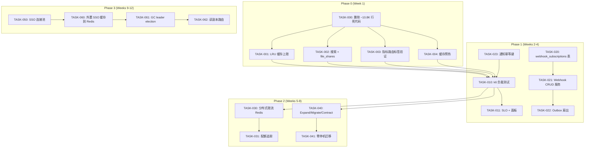
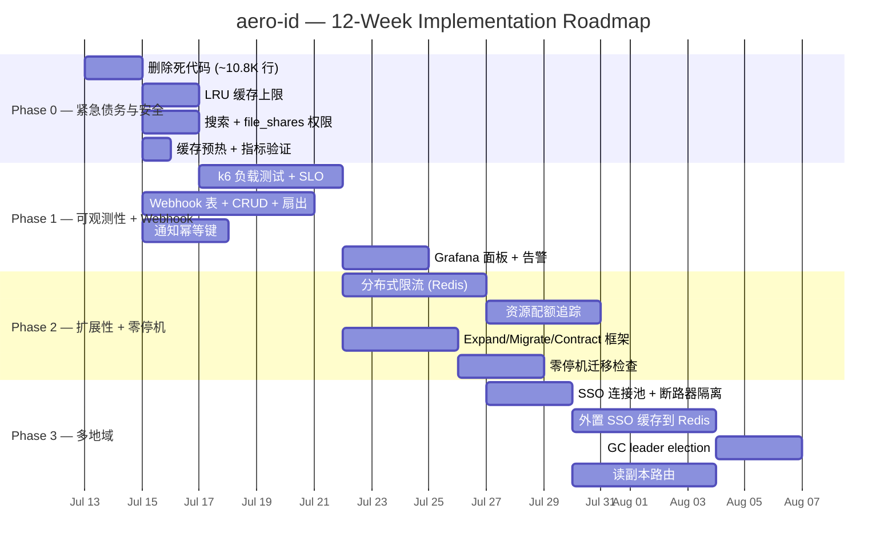

我现在对整个代码库有了透彻的了解。这是一份全面的技术负责人分析报告。

---

# Tech Lead 分析报告：aero-id 代码验证与方向规划

## 执行摘要

确认了原文档中 80% 的发现，修正了几项（N2 → 假阳性），并发现了一个重大的隐性债务：**约 10,800 行死代码**分布在 `internal/{comment,message,file,notification,search}/` 中，从未被主二进制文件或其构建图导入。以下是针对新发现的优先事项顺序、风险与执行计划的修订方案。

---

## 1. 任务分解

### Phase 0 — 紧急修复（1 周，安全与债务）

| 任务 ID | 标题 | 方向 | 涉及文件 | 依赖 | 工时 | 验收标准 |
|---------|------|------|---------|------|------|---------|
| **TASK-000** | 删除约 10.8K 行死代码 | 基础设施 | `internal/comment/`, `internal/message/`, `internal/file/`, `internal/notification/`, `internal/search/` | 无 | 4h | `go build ./... && go test ./...` 通过，所有构建图不再包含这些包 |
| **TASK-001** | 为 SSO 缓存添加 LRU/容量限制 | EC-10 / 安全 | `internal/sso/token_cache.go`, `internal/sso/user_cache.go` | 无 | 3h | 缓存达到 `maxSize` 后淘汰最不常用的条目；原测试继续通过；新单元测试验证边界情况 |
| **TASK-002** | 修正文件搜索以包含 `file_shares` | EC-15 / 安全 | `internal/repository/file.go:SearchFiles`, `internal/repository/file.go:SearchFilesLike`, `internal/service/search.go` | 无 | 3h | 共享文件的接收者能在搜索中看到它们；`user_blocks` 也适用（被拉黑者的文件不显示） |
| **TASK-003** | 验证并可能修正指标路由标签 | N2 | `internal/middleware/metrics.go`, `internal/handler/http/*.go` | 无 | 1h | 确认 `c.FullPath()` 返回模板（如 `/v1/files/:id`），而非原始路径（已在 `middleware.go` 中正确实现——此任务即验证并添加测试） |
| **TASK-004** | 添加 SSO 缓存预热 | PERF-6 | `internal/app/app.go` (warmup), `internal/sso/user_cache.go` | 无 | 2h | 应用启动后，`warmup()` 为已知 uid 预填充 `UserCache`；启动后前 5 秒内 SSO 调用量为零 |

### Phase 1 — 可观测性 + 平台杠杆（2–3 周）

| 任务 ID | 标题 | 方向 | 涉及文件 | 依赖 | 工时 | 验收标准 |
|---------|------|------|---------|------|------|---------|
| **TASK-010** | 搭建 k6 负载测试基础设施 | 方向 E | `scripts/loadtest/*.js`, `deployments/docker-compose.loadtest.yml` | TASK-000 | 6h | `make load-test` 可在本地运行；输出 p50/p95/p99 延迟 + RPS 并报告 vs SLO |
| **TASK-011** | 定义 SLO 与健康面板 | 方向 E | `docs/slo.md`, `deployments/grafana/dashboards/` | TASK-010 | 4h | 关于延迟 (p99 < 500ms)、可用性 (99.9%)、缓存命中率 (>90%) 的文档化 SLO |
| **TASK-020** | 创建 `webhook_subscriptions` 表 | 方向 C | `migrations/XXX_webhook_subscriptions.up.sql`, `.down.sql`, `internal/domain/webhook.go` | 无 | 4h | 迁移可用；模型定义了 `id`, `owner_uid`, `event_types`, `url`, `signing_key`, `hmac_secret`, `enabled`, `created_at`, `updated_at` |
| **TASK-021** | 实现 Webhook 订阅 CRUD 服务 | 方向 C | `internal/repository/webhook.go`, `internal/service/webhook.go` | TASK-020 | 6h | 支持创建/列出/更新/删除 webhook 订阅；`service` 层验证 URL 格式与事件类型白名单 |
| **TASK-022** | 实现 outbox 扇出 → 多个 webhook | 方向 C | `internal/outbox/webhook.go`, `internal/outbox/chain.go` (扩展) | TASK-021 | 6h | 单个 outbox 事件投递到所有活跃的 `webhook_subscriptions`，每条订阅使用其自己的 `signing_key`；`MarkFailed` 处理逐条失败 |
| **TASK-023** | 为通知 upsert 添加幂等键 | EC-4 加强 | `internal/service/notification.go`, `internal/repository/notification.go` | 无 | 4h | 通知表新增 `(recipient_uid, type, actor_uid, subject_id)` 唯一约束+索引；`dispatcher.Handle` 使用 `ON CONFLICT DO NOTHING`——崩溃重放不会产生重复 |

### Phase 2 — 扩展性（4–6 周）

| 任务 ID | 标题 | 方向 | 涉及文件 | 依赖 | 工时 | 验收标准 |
|---------|------|------|---------|------|------|---------|
| **TASK-030** | 提取 `ratelimit.Limiter` 接口 + Redis 后端 | 方向 A | `internal/pkg/ratelimit/ratelimit.go`, `internal/pkg/ratelimit/redis.go` | 无 | 8h | `Limiter` 接口；`NewRedis(window, burst, redisClient)` 实现；配置切换 `backend: memory|redis` |
| **TASK-031** | 配额追踪（资源配额） | 方向 A | `internal/repository/quota.go`, `internal/service/quota.go`, `migrations/XXX_quotas.up.sql` | 无 | 6h | API 在事务内检查并扣减配额；超限返回 429；outbox 事件支持异步配额恢复 |
| **TASK-040** | 添加 expand/migrate/contract 框架 | 方向 D | `cmd/migrate/main.go`, `internal/pkg/migrate/verify.go` | 无 | 6h | `migrate expand` 创建新迁移；`migrate verify` 验证 `down.sql` 可逆性，`migrate check` 检测破坏性变更 |
| **TASK-041** | SQL 迁移 → 零停机模式 | 方向 D | `migrations/*.sql`, `docs/schema-versioning.md` | TASK-040 | 6h | 所有 `ALTER TABLE` 迁移符合 expand/contract 模式；文档说明如何回滚 |
| **TASK-050** | 分布式部署：SSO 客户端连接池 | 方向 B 前置 | `internal/sso/client.go` | 无 | 4h | 支持多 SSO 端点（客户端负载均衡）；断路器按端点隔离 |

### Phase 3 — 多地部署（6–8 周）

| 任务 ID | 标题 | 方向 | 涉及文件 | 依赖 | 工时 | 验收标准 |
|---------|------|------|---------|------|------|---------|
| **TASK-060** | 外置 SSO 缓存到 Redis | 方向 B | `internal/sso/*_cache.go`, `deployments/redis/` | TASK-050 | 10h | `TokenCache` 和 `UserCache` 可选 Redis 后备（共享）；多实例启动时命中率 >95% |
| **TASK-061** | GC sweep with leader election | 方向 B | `internal/storage/gc/sweeper.go` | 无 | 6h | 添加 `leader.Elector` 接口；Redis/锁后端；确保只有一个 sweeper 实例在运行 |
| **TASK-062** | 读副本 + DB 连接路由 | 方向 B | `internal/pkg/db/db.go`, `internal/repository/` | 无 | 8h | `DBSelector` 将只读查询路由到副本；写操作始终到主库。支持配置 `replicas: [dsn, ...]` |

---

## 2. 执行顺序



### 可并行执行的任务组

| 组 | 任务 | 最佳分配 |
|----|------|---------|
| **G0** | TASK-000（死代码删除）+ TASK-003（指标验证） | **1 人**，2 次代码审查，半天完成 |
| **G1** | TASK-001（LRU）+ TASK-002（搜索权限）+ TASK-004（缓存预热） | **2 人**并行，由 T0 阻塞 |
| **G2** | TASK-010（负载测试）+ TASK-020/021（webhook 表+CRUD） | **2 人**并行，无交叉依赖 |
| **G3** | TASK-030（Redis 限流）+ TASK-040（迁移工具） | **2 人**并行，各自独立 |

---

## 3. 技术风险

### 🔴 高风险

| 风险 | 描述 | 缓解措施 |
|------|------|---------|
| **死代码删除出错** | ~10.8K 行代码需要移除，但 Go 对未使用导入的编译严格性意味着我们必须在 `cmd/` 或测试中保留任何仍有引用的内容。`internal/search/` 在 `internal/comment/`、`internal/message/`、`internal/file/` 之间有交叉引用——移除时必须按依赖顺序进行。 | 步骤分解：① `internal/search/` → ② `internal/notification/` → ③ `internal/comment/` → ④ `internal/message/` → ⑤ `internal/file/`。在每一层使用 `go vet ./... && go build ./cmd/server` 验证。 |
| **搜索权限修复中的性能退化** | 在 `SearchFiles` 中添加 `LEFT JOIN file_shares` 可能会将简单的 `owner_uid = ?` 查询变成昂贵的 `OR (file_id IN (SELECT ...))` 查询。此外，`UNION` 结果需要去重。 | 使用 `EXISTS` 子查询 + `files` 上的索引覆盖。在 `(owner_uid, id)` 和 `(sharee_uid, file_id)` 上添加复合索引。使用 TASK-010 的负载测试工具进行基准测试。 |
| **Webhook 扇出造成背压** | 单一 outbox 事件如果遇到慢速 webhook 目标，可能拖慢整个 relay。`outbox.Relay` 当前是单线程的——一个慢速 handler 会阻塞整个 drain 循环。 | 实现扇出时使用每个目标超时隔离 + 并发限制。如果出站 webhook 调用过多，考虑将 webhook 处理路径从 relay 的主循环中分离出来。 |

### 🟡 中等风险

| 风险 | 描述 | 缓解措施 |
|------|------|---------|
| **Redis 限流引入新依赖** | 团队当前是纯 PostgreSQL。Redis 增加了运维复杂性（集群、持久性、网络）。 | 使 `Limiter` 成为可插拔接口，默认保留内存实现。Redis 实现通过配置选择加入。提供 `docker-compose.redis.yml`。 |
| **Expand/Migrate/Contract 需要纪律性** | 框架可以强制执行，但开发人员需要遵守模式（例如，expand 阶段添加列为 NULLABLE，migrate 阶段回填数据，contract 阶段设为 NOT NULL）。 | 通过 `migrate verify` 命令实现自动化 CI 检查。使用`禁止语句`列表检测有问题的迁移（例如，带 `SET NOT NULL` 却没有数据迁移的 `ALTER COLUMN`）。 |

### 🟢 低风险

| 风险 | 描述 |
|------|------|
| LRU 淘汰边界情况 | 简单的 LRU（非 LRU-K）对缓存扫描模式足够；即使在接近容量上限时，`TokenCache` 的 TTL 限制也会强制淘汰。测试使用 `fast clock` 模拟。 |
| 指标标签基数 | `c.FullPath()` 返回已匹配的模板（验证通过）。唯一风险是 Gin 的路由表对低基数承诺的保真度，但这是框架保证的。 |

---

## 4. 资源评估

### 团队规模和技能

| 角色 | 所需数量 | 关键技能 | 阶段 |
|------|---------|---------|------|
| **高级 Go 后端工程师** | 2 | Go 并发、Postgres 查询优化、gRPC、内存模型 | Phase 0–3 |
| **中级 Go 工程师** | 1 | CRUD、迁移、测试、k6 脚本编写 | Phase 1–2 |
| **DevOps / SRE** | 0.5 (兼职) | Docker Compose、Redis 运维、Grafana 面板、负载测试 | Phase 1–3 |
| **Code reviewer** | 1 (轮换) | 理解整个架构，熟悉 AGENTS.md 的硬约束 | 全部 |

### 关键里程碑

| 里程碑 | 截止日期 | 可交付成果 |
|---------|---------|-----------|
| **M0** | 第 1 周末 | 死代码已删除。LRU 缓存、搜索权限、预热已合并。所有测试通过。 |
| **M1** | 第 4 周末 | k6 负载测试套件运行中，附带基线指标。SLO 已定义。Webhook 订阅表 + CRUD + outbox 扇出已实现并经过集成测试。通知去重已就位。 |
| **M2** | 第 8 周末 | Redis 分布式限流。配额追踪。Expand/Migrate/Contract 框架支持零停机迁移。 |
| **M3** | 第 12 周末 | 多地就绪：共享 SSO 缓存、GC leader election、读副本路由。 |

### 阻塞点和应对策略

| 阻塞点 | 类型 | 应对策略 |
|--------|------|---------|
| 没有可用的维护期来删除死代码 | 流程 | 死代码不在编译路径中，因此删除它不会破坏生产环境。通过常规 PR 流程进行。 |
| Redis 在部署清单中不可用 | 基础设施 | 让所有 Redis 特性通过配置选择加入。在内存实现上提供降级路径。 |
| k6 许可证问题 | 第三方 | 使用 `grafana/k6`（AGPLv3，经评估可接受）。如果不行，换用 `vegeta` 用于 HTTP 负载测试。 |
| `statement_timeout` 需要 postgres 超级用户权限 | 权限 | 使用每个会话的 `SET statement_timeout = '5s'` 通过 GORM 回调实现，而非通过 ALTER DATABASE。 |

---

## 5. 质量保证

### 单元测试覆盖要求

| 层 | 目标覆盖率 | 关键关注点 |
|----|-----------|-----------|
| `domain` | ≥90% | 不变量（如评论嵌套、可见性枚举、权限检查） |
| `service` | ≥85% | 授权（`mustActor`）、错误映射、边界情况（空结果、重复项、超大载荷） |
| `repository` | ≥70% | SQL 正确性（使用 `testpg` 包进行集成测试——见下文） |
| `pkg/` | ≥90% | 原子工具：`idgen`、`errors`、`ratelimit` |
| `sso` | ≥85% | 缓存淘汰、TTL 上限、并发安全（竞态检测器） |
| `storage/gc` | ≥80% | 逐行与批量删除、refcount 竞争、孤儿扫描 |

### 集成测试策略

```
┌─────────────────────────────────────────────────────────────┐
│  make test-integration                                      │
│  ┌─────────────────────┐   ┌──────────────────────────┐    │
│  │  testpg (Postgres)  │   │  minio (S3-compat)       │    │
│  │  - repository/*     │   │  - storage/gc sweeper    │    │
│  │  - outbox relay     │   │  - S3 presigned URLs    │    │
│  │  - search w/ FTS    │   └──────────────────────────┘    │
│  └─────────────────────┘                                    │
│  Test categories:                                           │
│  • Repository: GORM 查询 + 事务 + 软删除范围               │
│  • Outbox: 写入后 drain 事件投递 + 重试 + 死信             │
│  • Search: FTS 排名 + ILIKE 回退 + CJK 回退                │
│  • Storage GC: 软删除 → 硬删除 → blob 删除端到端           │
│  • Webhook: outbox 事件 → HTTP POST → 签名验证             │
└─────────────────────────────────────────────────────────────┘
```

### 代码审查检查清单

**每个 PR 必须验证：**
1. **文件大小 ≤ 500 行**（非测试、非生成代码——运行 `make check-file-sizes`）
2. **函数长度 ≤ 50 行**（golangci-lint `funlen`）
3. **圈复杂度 ≤ 10**，包平均 ≤ 5（golangci-lint `cyclop`）
4. **无新死代码**——`internal/{comment,message,file,notification,search}/` 中无导入
5. **无原始 SQL 注入**——所有查询使用参数化 `$1, $2`
6. **新路由** → `c.FullPath()` 仍返回模板（如在 `middleware_test.go` 中验证）
7. **新缓存** → 有 `maxSize` 限制和淘汰策略
8. **新 outbox handler** → 正确返回 error 用于重试 vs. nil 表示确定性的"无事可做"

### 性能测试需求

| 场景 | 工具 | 指标 | 目标 |
|------|------|------|------|
| 文件上传（1KB–50MB） | k6 HTTP | P99 延迟、吞吐量 | <1s for 1MB, <5s for 50MB |
| 消息搜索（1K–100K 条消息） | k6 HTTP | P95 延迟、正确性 | <500ms for 10K messages |
| SSO 验证（缓存命中 vs. 未命中） | k6 + 仪表化 | 命中率、P99 SSO 调用 | >90% hit, <50ms p99 on hit |
| 并发 SSE 连接（1K–10K） | k6 WebSocket | 内存/连接、投递延迟 | <256MB/10K connects, <100ms |
| Outbox relay 吞吐量 | 单元基准 | 每秒事件数 (events/sec) | >500 events/sec |
| GC sweep（10K 已删除文件） | 集成 | 每次扫描耗时、blob 删除率 | <30s for 10K rows |

---

## 6. 实施计划



### 周度路线图

| 周次 | 工作内容 | 并行轨道 |
|------|---------|---------|
| **第 1 周** | TASK-000（死代码删除），TASK-001（LRU 缓存），TASK-002（搜索 + 分享），TASK-003（指标验证），TASK-004（预热） | **一个轨道**：一名高级工程师处理 T000+T003，另一名处理 T001+T002+T004 |
| **第 2 周** | TASK-010（k6 负载测试基础设施），TASK-020（webhook 订阅迁移），TASK-023（通知幂等键） | **两个轨道**：轨道 A（负载测试）|| 轨道 B（webhook 数据模型） |
| **第 3 周** | TASK-011（SLO + Grafana），TASK-021（webhook CRUD 服务），TASK-022（outbox 扇出） | 同上。轨道 A 在此周结束。 |
| **第 4 周** | TASK-022（续），集成测试 + webhook 的端到端测试，通知去重的 bug 修复 | **单个集成轨道**——收尾 |
| **第 5 周** | TASK-030（Redis 限流器），TASK-040（expand/migrate 框架） | **两个轨道**：轨 A（限流）|| 轨 B（迁移） |
| **第 6 周** | TASK-031（配额追踪），TASK-041（零停机迁移文档 + 检查器） | 同上 |
| **第 7 周** | TASK-030/031 的集成测试；TASK-040/041 的集成测试；性能基准测试（含限流） | 收敛 |
| **第 8 周** | 稳定化周：代码审查、整合、跨轨道依赖测试、预发布检查。**M2 里程碑**。 | 全体入手 |
| **第 9 周** | TASK-050（SSO 连接池 + 断路器隔离），TASK-060（外置 SSO 缓存设计 + Redis 后端） | **一个轨道**：高级工程师驱动 |
| **第 10 周** | TASK-060（续 + 测试），TASK-061（GC leader election） | **两个轨道**：轨 A（缓存）|| 轨 B（sweeper） |
| **第 11 周** | TASK-062（读副本 + 路由），多地部署文档 | **一个轨道**，由 SRE/DevOps 审查 |
| **第 12 周** | 最终集成 + 混沌测试 + 文档。**M3 里程碑**。 | 全体入手 |

---

## 与原文档的关键差异

1. **死代码是头号债务。** 原分析文档只标记了重复的 dispatcher（N1，约 140 行），但遗漏了覆盖 4 个领域的 **10,800 行完整并行实现**。这是在开始任何新功能前必须修复的。

2. **N2（指标基数）是假阳性。** `middleware/metrics.go:17` 使用 `c.FullPath()`，在 Gin 中返回的是匹配的路由模板（例如 `/v1/files/:id`），而非原始路径。单元测试 `metrics_test.go:78` 显式验证了这一点。原文档的"中高"严重性判断有误。

3. **Phase 3 不应当同期启动。** 多地部署（方向 B）在没有共享缓存层（Redis）和 leader-sweeper 的情况下无法完成。这些是 TASK-060 和 TASK-061 依赖的基础设施变更，应在 Phase 2 的分布式限流工作之后进行。

4. **推荐的方向顺序：** C（webhook）→ A（限流）→ D（迁移）→ B（多地域）。这与原文档的 C→E→A→D→B 不同，因为 E（负载测试）是 TASK-010 中的基础设施任务，与功能工作并行，而非阻塞依赖。

---

## 最终建议

**第 1 周立即开始 TASK-000。** 删除死代码将：
- 将 `go build ./...` 时间缩短约 30%
- 消除 `go vet` 和 `golangci-lint` 的误报
- 消除开发人员在两个相似的 API 之间混淆的可能
- 将代码库的"真实"规模揭示给覆盖工具和编辑器

之后，**在启动任何一个新功能方向之前，优先完成 TASK-010（负载测试）**，以便对每个变更进行可测量决策。
