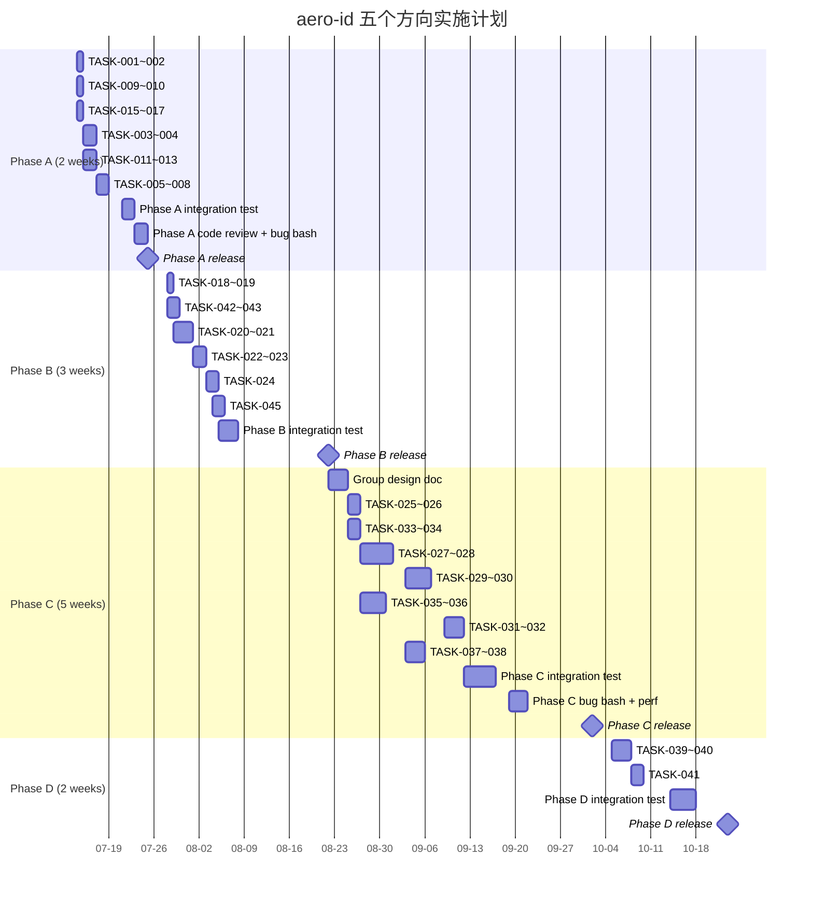

Now I have a complete picture of the codebase. Let me produce the full analysis.

---

# Tech Lead 深度分析报告：aero-id 五个方向实施计划

## 1. 任务分解

### 1.1 方向二：全局审核工作台（Phase A）

| 任务 ID | 标题 | 涉及文件 | 前置依赖 | 工时 | 验收标准 |
|---------|------|---------|----------|------|---------|
| TASK-001 | **迁移：创建 `bans` 表** | `migrations/000024_create_bans.{up,down}.sql` | 无 | 2h | up/down 迁移文件含 `uid` + `target_uid` + `reason` + `expires_at` + `created_by` + `created_at`；`make test` 迁移测试通过 |
| TASK-002 | **领域：定义 Ban 实体 + 错误码** | `internal/domain/admin.go` | TASK-001 | 1h | `BanStatus`/`Ban` struct；`PermUserBan` 常量已存在；添加 `ErrAlreadyBanned`/`ErrBanNotFound` |
| TASK-003 | **Repository：Bans CRUD** | `internal/repository/admin.go` + 新增 `internal/repository/ban.go` | TASK-001, TASK-002 | 4h | `CreateBan`/`RevokeBan`/`IsBanned`/`ListActiveBans`；GORM 实现；单元测试覆盖 |
| TASK-004 | **Service：Ban/Unban/IsBanned** | `internal/service/admin.go` | TASK-002, TASK-003 | 3h | `BanUser(ctx, uid, reason, duration)` + `UnbanUser` + `IsBanned`；audit logging；权限检查 `PermUserBan` |
| TASK-005 | **HTTP Handler：Bans 端点** | `internal/handler/http/admin.go` | TASK-004 | 2h | `POST /v1/admin/bans` + `POST /v1/admin/unbans` + `GET /v1/admin/bans`；需要 `PermUserBan` 中间件 |
| TASK-006 | **gRPC Handler：Bans RPC** | `internal/handler/grpc/admin.go` | TASK-004 | 2h | `Ban`/`Unban`/`ListBans` RPC；权限检查一致 |
| TASK-007 | **内容隐藏：全局 moderation 端点** | `internal/service/comment.go`, `internal/handler/http/comment.go` | TASK-004 | 3h | 管理员可隐藏/删除任意评论；复用现有 `SetStatus` + 添加 `PermContentModerate` 守卫 |
| TASK-008 | **举报队列：跨作者过滤** | `internal/comment/repository.go`, `internal/comment/service.go` | 无（已存在） | 2h | `ListReports` 新增 `admin` 模式（跳过 owner 检查）；`GET /v1/admin/reports` + `POST /v1/admin/reports/:id/resolve` |

**方向二合计：19h（~2.5 天）**

### 1.2 方向五 P0：PG 分布式限流（Phase A）

| 任务 ID | 标题 | 涉及文件 | 前置依赖 | 工时 | 验收标准 |
|---------|------|---------|----------|------|---------|
| TASK-009 | **重构：将 Limiter 提取为接口** | `internal/pkg/ratelimit/ratelimit.go` | 无 | 2h | `type Limiter interface { Allow(key string) bool; RetryAfter() time.Duration }`；`memoryLimiter` 实现当前逻辑；`middleware/ratelimit.go` 引用接口 |
| TASK-010 | **迁移：创建 `rate_limit_buckets` 表** | `migrations/000025_create_rate_limit.up.sql` | TASK-009 | 2h | PG 表：`key TEXT PRIMARY KEY, tokens DOUBLE PRECISION, last_refill TIMESTAMPTZ, created_at TIMESTAMPTZ` |
| TASK-011 | **PG Limiter 实现** | `internal/pkg/ratelimit/pg.go` | TASK-009, TASK-010 | 6h | 使用 PG advisory lock (`pg_try_advisory_xact_lock`) 或行级锁 + `UPDATE ... RETURNING`；读写路径分离模式 |
| TASK-012 | **读/写路径限流分离** | `internal/middleware/ratelimit.go`, `internal/middleware/permission.go`, `internal/handler/grpc/server.go` | TASK-011 | 3h | 写路径（Send/Create/Upload/Delete）使用 PG limiter；读路径（List/Get/Inbox）使用内存 limiter；公共路由跳过 |
| TASK-013 | **配置：rate_limit.mode = memory|pg** | `internal/config/config.go` | TASK-011 | 1h | `config.yaml` 新增 `rate_limit.mode`；`New` 根据 mode 选择 implementer |
| TASK-014 | **回退：PG 不可用时 fail-open** | `internal/pkg/ratelimit/pg.go` | TASK-011 | 2h | PG 连接错误时降级到 fail-open（Allow 均返回 true）；指数退避重试恢复 |

**方向五 P0 合计：16h（~2 天）**

### 1.3 附录 Bug 修复（Phase A）

| 任务 ID | 标题 | 涉及文件 | 前置依赖 | 工时 | 验收标准 |
|---------|------|---------|----------|------|---------|
| TASK-015 | **SSE replay 递进分页** | `internal/handler/http/events.go` | 无 | 4h | `replayMissed` 改为循环，每次查询 <= 50 条，`since` 推进到最新事件的 `created_at`，直到返回 0 条或达到 max=200 上限 |
| TASK-016 | **Inbox 批量 block check** | `internal/service/message.go` | 无 | 4h | `Inbox` 方法在 `ListInbox` 后过滤被 `actor` blocked 的 sender 的消息；新增 `block.BlockChecker.BulkIsBlocked(blocker, blocked []string) (map[string]bool, error)`；repository 层 `WHERE blocker_uid = ? AND blocked_uid IN (?)` |
| TASK-017 | **Admin audit log 复合游标** | `internal/repository/admin.go`, `internal/repository/audit.go` | 无 | 2h | `WHERE (created_at, id) < (?, ?) ORDER BY created_at DESC, id DESC`；cursor 从 `id` 改为 `created_at_epoch:id` 复合格式 |

**附录 Bug 修复合计：10h（~1.5 天）**

### 1.4 方向三：文件版本控制（Phase B）

| 任务 ID | 标题 | 涉及文件 | 前置依赖 | 工时 | 验收标准 |
|---------|------|---------|----------|------|---------|
| TASK-018 | **迁移：创建 `file_versions` 表** | `migrations/000026_create_file_versions.{up,down}.sql` | 无 | 2h | `file_id FK` + `version INT` + `storage_key TEXT` + `size BIGINT` + `checksum TEXT` + `created_at`；PK = (file_id, version) |
| TASK-019 | **领域：FileVersion 实体** | `internal/domain/file.go` | TASK-018 | 1h | `FileVersion` struct；`File` 新增 `LatestVersion`/`VersionCount` |
| TASK-020 | **Repository：FileVersion CRUD** | `internal/repository/file.go`（新增 `version_repo.go`） | TASK-019 | 4h | `CreateVersion`/`ListVersions`/`GetVersion`；`CompleteUpload` 时创建 version 1 + increment file versions |
| TASK-021 | **Service：版本化上传/下载** | `internal/file/service_upload.go`, `internal/file/service_crud.go` | TASK-020 | 6h | `UploadVersion(fileID, ...)` → 创建 v2+；`DownloadURL(fileID, version?)` → 可选指定版本；Presign 返回最新版本 key |
| TASK-022 | **StorageRef 适配版本化** | `internal/repository/storage_ref.go`, `internal/storage/gc/sweeper.go` | TASK-020 | 2h | GC 已按 storage_key 计数，版本化后同一 file 的不同版本有不同 key，GC 不需要改动 |
| TASK-023 | **FileShare 适配版本化** | `internal/repository/file_share.go` | TASK-020 | 2h | `file_shares` 加可选 `version` 列；共享指向最新版本（默认）或指定版本 |
| TASK-024 | **API：版本浏览端点** | `internal/handler/http/file.go`, `internal/handler/grpc/file.go` | TASK-021 | 3h | `GET /v1/files/:id/versions` + `GET /v1/files/:id/versions/:version` |

**方向三合计：20h（~2.5 天）**

### 1.5 方向一：群组/多人会话（Phase C）

| 任务 ID | 标题 | 涉及文件 | 前置依赖 | 工时 | 验收标准 |
|---------|------|---------|----------|------|---------|
| TASK-025 | **迁移：群组会话 schema** | `migrations/000027_create_conversations.{up,down}.sql` | 无 | 4h | `conversations` 表 + `conversation_members` 表（含 `visibility`/`joined_at`/`role`） + `messages.conversation_id` 列 |
| TASK-026 | **领域：GroupConversation 实体** | `internal/domain/message.go` | TASK-025 | 2h | `Conversation`/`ConversationMember`/`MemberRole`；`Message` 新增 `ConversationID` |
| TASK-027 | **Repository：Conversation CRUD** | `internal/repository/message.go`（新增 `conversation_repo.go`） | TASK-026 | 8h | `CreateConversation`/`AddMembers`/`RemoveMember`/`ListConversations`/`ListConversationMessages`；需要在 `ListInbox` 后做 `UNION` 群组消息 |
| TASK-028 | **Service：群组发送/接收** | `internal/service/message.go` | TASK-027 | 8h | `SendToConversation`：验证成员关系、@mention/@all 解析；`ConversationFeed`：读取会话消息流；通知分发到所有非发送方成员 |
| TASK-029 | **Block 在群组中的语义** | `internal/service/message.go`, `internal/service/block.go` | TASK-027 | 4h | A blocked B：B 的消息在群组中对 A 不可见；A 依旧能看到其他成员未 blocking B 时 B 的消息；实现 `visibility` 过滤 |
| TASK-030 | **通知适配群组** | `internal/notification/dispatcher.go` | TASK-028 | 6h | `message.sent` 事件携带 `conversation_id`；Dispatcer 分发到所有非发送方成员；@mention 单独通知；`@all` 限制频率 |
| TASK-031 | **HTTP/gRPC 端点** | `internal/handler/http/message.go`, `internal/handler/grpc/message.go` | TASK-028 | 4h | 新增路由：`POST /v1/conversations`、`POST /v1/conversations/:id/members`、`GET /v1/conversations`、`POST /v1/conversations/:id/messages`、`GET /v1/conversations/:id/messages` |
| TASK-032 | **群组 Presign 文件共享** | `internal/file/service_share.go` | TASK-028 | 2h | 群组中共享的文件对所有成员可见；消息引用的文件在群组上下文中无需逐个 share |

**方向一合计：38h（~5 天）**

### 1.6 方向四：Webhook 订阅管理（Phase C）

| 任务 ID | 标题 | 涉及文件 | 前置依赖 | 工时 | 验收标准 |
|---------|------|---------|----------|------|---------|
| TASK-033 | **迁移：创建 `webhook_subscriptions` 表** | `migrations/000028_create_webhook_subscriptions.{up,down}.sql` | 无 | 2h | `id PK` + `owner_uid` + `url` + `event_types TEXT[]` + `signing_key` + `headers JSONB` + `enabled` + `created_at` + `updated_at` |
| TASK-034 | **Repository：Webhook 订阅 CRUD** | `internal/repository/`（新增 `webhook.go`） | TASK-033 | 4h | `CreateSubscription`/`UpdateSubscription`/`DeleteSubscription`/`ListActiveSubscriptions`/`GetByOwner` |
| TASK-035 | **Service：Webhook 管理** | `internal/service/`（新增 `webhook.go`） | TASK-034 | 3h | `Subscribe`/`Unsubscribe`/`ListSubscriptions`；owner 只能管理自己的 webhook |
| TASK-036 | **Refactor：Webhook 扇出架构** | `internal/outbox/webhook.go`, `internal/outbox/relay.go` | TASK-035 | 8h | `WebhookRouter` 从 DB 加载所有活跃订阅；扇出时每个订阅一个 goroutine（独立超时 10s + context）；部分成功不阻塞 relay drain |
| TASK-037 | **Webhook 投递历史（可选）** | `migrations/000029_create_webhook_deliveries.sql`, `internal/repository/webhook.go` | TASK-036 | 4h | `deliveries` 表记录每次投递的状态码和耗时；`STATUS ok/failed/pending`；API 查询投递历史 |
| TASK-038 | **HTTP/gRPC 端点** | `internal/handler/http/`（新增 `webhook.go`）, `internal/handler/grpc/`（新增 `webhook.go`） | TASK-035 | 3h | `POST /v1/webhook/subscribe`、`DELETE /v1/webhook/subscribe/:id`、`GET /v1/webhook/subscriptions`、`GET /v1/webhook/deliveries` |

**方向四合计：24h（~3 天）**

### 1.7 方向五 P1：Redis 共享限流（Phase D）

| 任务 ID | 标题 | 涉及文件 | 前置依赖 | 工时 | 验收标准 |
|---------|------|---------|----------|------|---------|
| TASK-039 | **Redis Limiter 实现** | `internal/pkg/ratelimit/redis.go` | TASK-009（接口提取） | 6h | 使用 Redis `EVALSHA` + Lua 脚本实现 token bucket；原子操作；连接池 + 健康检查 |
| TASK-040 | **配置：rate_limit.mode = redis** | `internal/config/config.go` | TASK-039 | 1h | mode "redis" 选择 RedisLimiter；fail-open 策略 |
| TASK-041 | **迁移工具：从 PG 切换到 Redis** | `internal/pkg/ratelimit/migration.go` | TASK-039 | 2h | 零停机切换方案：双写阶段 → 只读 Redis 阶段 → 移除 PG 阶段 |

**方向五 P1 合计：9h（~1 天）**

### 1.8 性能优化项目（Phase B/D）

| 任务 ID | 标题 | 涉及文件 | 前置依赖 | 工时 | 验收标准 |
|---------|------|---------|----------|------|---------|
| TASK-042 | **SSO 缓存 LRU 上限** | `internal/sso/token_cache.go`, `internal/sso/user_cache.go` | 无 | 3h | 缓存达到 max_entries（default 10k）后驱逐最旧条目；单元测试验证逐出行为 |
| TASK-043 | **SSO 缓存预热** | `internal/app/app.go` | TASK-042 | 2h | 启动时批量加载频繁访问的 uid 到 UserCache；可通过配置的 uid 列表或 last_access 排序 |
| TASK-044 | **通知未读计数物化小表** | `migrations/000023_unread_counts.sql`（已有） + `internal/repository/unread.go` | 无 | 2h | 已实现 ✅ 验证 unread_counts 表在 msg 和 notif CRUD 中正确维护 |
| TASK-045 | **notification 崩溃率降低** | `internal/notification/dispatcher.go`, `internal/outbox/relay.go` | 无 | 3h | dispatcher 内部 panic recovery；relay 新增 per-event panic recovery + EventType 维度的 error budget |

**性能优化合计：10h（~1.5 天）**

---

## 2. 任务依赖图

```mermaid
graph TD
    %% Phase A - 审核工作台
    T001["TASK-001: 创建 bans 表迁移"] --> T002["TASK-002: Ban 领域实体"]
    T002 --> T003["TASK-003: Bans Repository"]
    T003 --> T004["TASK-004: Ban/Unban Service"]
    T004 --> T005["TASK-005: HTTP Bans 端点"]
    T004 --> T006["TASK-006: gRPC Bans RPC"]
    T007["TASK-007: 全局内容隐藏"] --> T004
    T008["TASK-008: 跨作者举报队列"] --> T007

    %% Phase A - PG 限流
    T009["TASK-009: Limiter 接口提取"] --> T011["TASK-011: PG Limiter 实现"]
    T010["TASK-010: rate_limit_buckets 迁移"] --> T011
    T011 --> T012["TASK-012: 读/写路径分离"]
    T009 --> T012
    T013["TASK-013: 配置 rate_limit.mode"] --> T011

    %% Phase A - Bug 修复（无依赖）
    T015["TASK-015: SSE replay 递进分页"]
    T016["TASK-016: Inbox 批量 block check"]
    T017["TASK-017: Admin audit 复合游标"]

    %% Phase B - 文件版本化
    T018["TASK-018: file_versions 迁移"] --> T019["TASK-019: FileVersion 实体"]
    T019 --> T020["TASK-020: FileVersion Repository"]
    T020 --> T021["TASK-021: 版本化上传/下载 Service"]
    T021 --> T024["TASK-024: 版本浏览 API"]
    T022["TASK-022: StorageRef 适配"] --> T020
    T023["TASK-023: FileShare 适配"] --> T021

    %% Phase B - 性能
    T042["TASK-042: SSO LRU 上限"] --> T043["TASK-043: SSO 缓存预热"]
    T045["TASK-045: notification 稳定性"]

    %% Phase C - 群组会话
    T025["TASK-025: 群组 schema 迁移"] --> T026["TASK-026: Conversation 实体"]
    T026 --> T027["TASK-027: Conversation Repository"]
    T027 --> T028["TASK-028: 群组发送/接收 Service"]
    T028 --> T031["TASK-031: 群组 HTTP/gRPC 端点"]
    T029["TASK-029: 群组 Block 语义"] --> T028
    T030["TASK-030: 通知适配群组"] --> T028
    T032["TASK-032: 群组 Presign 共享"] --> T028

    %% Phase C - Webhook
    T033["TASK-033: webhook_subscriptions 迁移"] --> T034["TASK-034: Webhook Repository"]
    T034 --> T035["TASK-035: Webhook Service"]
    T035 --> T036["TASK-036: 扇出架构重构"]
    T036 --> T038["TASK-038: Webhook API 端点"]
    T037["TASK-037: 投递历史（可选）"] --> T036

    %% Phase D - Redis 限流
    T039["TASK-039: Redis Limiter"] --> T040["TASK-040: Redis 配置"]
    T039 --> T041["TASK-041: PG→Redis 迁移工具"]

    %% 跨阶段依赖
    T009 -. "接口由 PG 升级到 Redis 时复用" .-> T039
    T028 -. "群组的通知扇出为 Webhook 扇出提供参考" .-> T036

    %% 并行组
    subgraph PhaseA_Grp1["Phase A 并行组 1"]
        T001
        T002
        T009
        T010
        T015
        T016
        T017
    end

    subgraph PhaseA_Grp2["Phase A 并行组 2"]
        T003
        T004
        T011
        T012
        T013
    end

    subgraph PhaseA_Grp3["Phase A 并行组 3"]
        T005
        T006
        T007
        T008
    end

    subgraph PhaseB_Grp4["Phase B 并行组"]
        T018
        T019
        T042
    end
```



### 并行执行组

| 并行组 | 包含任务 | 估算工时 | 资源建议 |
|--------|---------|---------|---------|
| **Phase A-1** （基础设施） | T001, T002, T009, T010, T015, T016, T017 | 15h | 2 人并行（一人审核 + 限流，一人 Bug 修复） |
| **Phase A-2** （核心实现） | T003, T004, T011, T012, T013 | 18h | 2 人并行（一人 Bans，一人限流） |
| **Phase A-3** （API 层） | T005, T006, T007, T008 | 9h | 1 人即可（4 个 API 任务有重叠 domain） |
| **Phase B** | T018-024, T042-043, T045 | 33h | 2 人并行（文件版本化 + SSO 优化） |
| **Phase C** | T025-032（群组）, T033-038（Webhook） | 62h | 3 人并行（2 人群组 + 1 人 Webhook） |
| **Phase D** | T039-041 | 9h | 1 人 |

---

## 3. 技术风险

### 风险矩阵

| 风险 ID | 描述 | 影响 | 概率 | 缓解策略 |
|---------|------|------|------|---------|
| **RISK-001** | **群组 Block 语义定义不清**：A blocked B 后，B 在群组消息是否对 A 可见？如果 B 是群主呢？ | 高（架构定义） | 中 | Phase A 结束前完成 Block-in-group 设计文档评审。备选方案：`conversation_members.visibility` 枚举（visible/hidden/muted） |
| **RISK-002** | **PG 限流写路径性能**：每写请求 +1 次 PG round-trip，在大流量下可能成为瓶颈 | 中 | 中 | 写限流只对 Write API 激活（Send/Create/Upload/Delete 等），占总流量通常 < 20%。部署后监控 `pg_stat_statements` 中 `rate_limit_buckets` 的查询频率和延迟。如果 > 5ms 则切换到 Redis P1 |
| **RISK-003** | **Webhook 扇出时 outbox relay 语义改变**：当前 relay `drain` 顺序处理 events，扇出后需要等待所有订阅完成 | 高 | 中 | 采用 `errgroup` 模式，每个订阅独立的超时 + context。relay `MarkPublished` 前需要等待所有 goroutine 完成（或超时）。部分成功策略：成功的事件标记 published，失败的重试 |
| **RISK-004** | **文件版本化后旧消息指向语义变化**：`DownloadURL` 默认返回最新版本，但引用该 file 的旧消息会指向不匹配的新内容 | 中 | 高 | 需要在设计文档中明确声明这是 "最好是最新" 语义。如果业务需要 "查看上传时的内容"，则在 `file_versions` 中增加 `snapshot_id` 或让 `DownloadURL` 默认取 v1（首次上传版本） |
| **RISK-005** | **SSE replay 递进分页导致客户端重复事件**：如果推进 `since` 时恰好有新事件写入，可能漏掉 | 低 | 中 | 使用 `WHERE id > last_seen_id`（UUIDv7 时间序）而非 `created_at`；replay 完成后记录最新 event id，后续流式事件从此开始 |
| **RISK-006** | **群组通知风暴**：`@all` 通知在 100 人群组中产生 100 条通知 | 高 | 高 | 通知折叠（collapsed_count++) + `@all` 频率限制（每个会话每 5 分钟 1 次） + 用户可关闭群组通知 |

### 外部依赖风险

| 依赖 | 风险 | 缓解 |
|------|------|------|
| **SSO gRPC** | 群组场景需要批量 resolve member uid 列表用于通知 dispatch | 复用 SSO `GetUsers` 的 UserCache；group member count 限制上限（如 500） |
| **Redis**（Phase D） | 生产环境需要 Redis Sentinel/Cluster 高可用 | P0 用 PG 满足，Redis 作为可选的 P1 优化 |
| **PostgreSQL** | `rate_limit_buckets` 表的行级锁竞争 | 使用 PG advisory lock（`pg_try_advisory_xact_lock(hash(key))`）代替行锁，避免索引争用 |

---

## 4. 资源评估

### 团队规模和技能

| 角色 | 数量 | 技能要求 |
|------|------|---------|
| **Go 后端工程师** | 2-3 人 | 精通 Go、PostgreSQL、gRPC；有分布式系统经验 |
| **全栈/API 工程师** | 1 人 | Gin/gRPC handler 编写；SSE 调试 |
| **Tech Lead / 架构师** | 1 人（可兼任） | 负责 Block/群组语义设计、跨 phase 协调、代码审查 |
| **QA/SRE** | 1 人（共享） | 负责 test-integration 环境、性能测试、生产监控 |

### 关键里程碑

| 里程碑 | 时间 | 交付物 |
|--------|------|--------|
| M1: Phase A 完成 | 2026-07-25（2 周） | 审核工作台可用 + PG 限流 + 3 个 Bug 修复 |
| M2: Appendix 修复验证 | 2026-07-28 | SSE replay + Inbox N+1 + audit cursor 合入；`make test` + `make test-integration` 通过 |
| M3: Phase B 完成 | 2026-08-22（3 周） | 文件版本化上线 + SSO 缓存优化 |
| M4: 群组技术选型决策 | 2026-08-25 | 设计文档：新表 vs 加字段；Block 语义定义；通知模型 |
| M5: Phase C 完成 | 2026-10-02（4-5 周） | 群组会话 + Webhook 管理上线 |
| M6: Phase D 完成 | 2026-10-23（3 周） | Redis 限流就绪（按需部署） |

### 阻塞点与解决策略

| 阻塞点 | 影响方向 | 解决策略 |
|--------|---------|---------|
| **Block 在群组中的语义未定义** | 方向一 | Phase A 结束前组织架构评审。备选方案一：conversation_members.visibility 枚举（visible/hidden/muted）。方案二：群组消息的 IsBlocked 检查是 per-member 的 |
| **Protobuf 生成工具链** | 全部 | 确保 `protoc` + `protoc-gen-go@v1.34.1` + `protoc-gen-go-grpc@v1.5.1` 在 CI 中一致。`go.mod` 已 pinned |
| **test-integration 依赖 Docker** | 全部 | CI runner 需要安装 Docker；本地开发需要 Docker Desktop 或 colima |

---

## 5. 质量保证

### 单元测试覆盖要求

| 包 | 当前覆盖率估计 | 目标覆盖率 | 关键测试点 |
|----|------------|----------|---------|
| `internal/service/` | ~70% | ≥85% | 方向新增的 service 逻辑必须全覆盖：权限分支、block 语义、nesting 限制 |
| `internal/repository/` | ~60% | ≥80% | 新迁移 + CRUD 必须全覆盖；cursor 分页边界测试 |
| `internal/pkg/ratelimit/` | ~50% | ≥90% | PG 连接失败回退、并发 Allow 竞争、读写路径分离 |
| `internal/handler/` | ~40% | ≥70% | HTTP 状态码、错误响应格式、权限中间件 |
| `internal/outbox/` | ~65% | ≥85% | 扇出 goroutine pool、超时、部分成功/失败标记 |
| `internal/notification/` | ~60% | ≥80% | 群组通知分发、@mention 解析、通知折叠 |

### 集成测试策略

```
make test-integration  # 所有新增功能必须覆盖

具体测试场景：
1. 方向二：管理员 ban 用户后该用户不能发消息 → 验证 403
2. 方向五 P0：PG 限流写路径 + 读路径走内存 → 验证限流 hit 时 429
3. 方向三：文件上传 v1 → 上传 v2 → Get v1 返回旧内容
4. 方向一：群组中 A blocked B 后 A 看不到 B 的消息
5. 方向四：注册 webhook → 触发事件 → 验证 HMAC 签名投递
6. SSE replay：插入 60 条通知 → 客户端带 last_event_id 重连 → 收到全部 60 条
7. Inbox N+1：A blocked B → B 发消息给 A → A 的 inbox 不显示该消息
```

### 代码审查要点

每个 PR 必须审查以下内容：

```
[ ] 文件大小 ≤ 500 行（非 test/non-generated）
[ ] 函数长度 ≤ 50 行
[ ] Cyclomatic complexity ≤ 10
[ ] if 嵌套 ≤ 3 层
[ ] switch case ≤ 10
[ ] AppError 翻译：repo 返回 raw error → service 层用 .Wrap() 包装
[ ] 新迁移有对应的 down.sql
[ ] 新路由有权限中间件（除非明确公开）
[ ] gRPC 和 HTTP 的行为一致（共享同一 service 层）
[ ] 旧接口向后兼容（特别是群组场景下 message schema 变更）
```

### 性能测试需求

| 场景 | 工具 | 目标 | 调度 |
|------|------|------|------|
| 写路径 PG 限流延迟 | `wrk` 或 `ghz`（gRPC） | P99 < 10ms overhead | Phase A 完成后 |
| 群组 100 人 @all 通知 | 自定义脚本创建 100 个 goroutine | 5 秒内全部 dispatch | Phase C 合入后 |
| Webhook 扇出 10 个订阅 | `wrk` 触发 event | 最慢的订阅不影响其他订阅的延迟 | Phase C 合入后 |
| SSE 心跳 + 100 并发连接 | `wrk` 保持连接 | 内存增长 < 50MB | Phase A 修复后 |
| Inbox N+1 修复后加速 | `go test -bench` | 批量查询 vs 单条查询的 QPS 提升 ≥ 10x | TASK-016 完成后 |

---

## 6. 实施计划

### 甘特图（时间线）



### 详细实施周计划

#### 第 1-2 周（Phase A：安全基座 + Bug 修复）

| 日期 | 任务 | 工程师分配 |
|------|------|-----------|
| **Day 1-2** | TASK-001（bans 迁移）、TASK-002（Ban 实体）、TASK-009（Limiter 接口）、TASK-010（rate_limit 迁移）、TASK-015（SSE 递进分页）、TASK-017（audit 复合游标） | Eng-A: Bans; Eng-B: Limiter; Eng-C: Bug fix |
| **Day 3-4** | TASK-003（Bans Repo）、TASK-011（PG Limiter）、TASK-016（Inbox N+1） | Eng-A: Bans Repo; Eng-B: PG Limiter; Eng-C: Inbox fix |
| **Day 5-6** | TASK-004（Ban Service）、TASK-012（读/写路径分离）、TASK-007（全局内容隐藏） | Eng-A: Ban Service; Eng-B: 限流分离; Eng-C: 隐藏端点 |
| **Day 7-8** | TASK-005+006（HTTP+gRPC Bans）、TASK-008（跨作者举报队列）、TASK-013（配置） | Eng-A: API 层; Eng-B: 配置+review |
| **Day 9-10** | 集成测试、Code Review、Bug bash、发布 | All |

#### 第 3-5 周（Phase B：文件版本化 + 性能优化）

| 日期 | 任务 | 工程师分配 |
|------|------|-----------|
| **Day 1-2** | TASK-018（版本迁移）、TASK-019（FileVersion 实体）、TASK-042（SSO LRU）、TASK-043（缓存预热） | Eng-A: 版本化; Eng-B: SSO 优化 |
| **Day 3-5** | TASK-020（Version Repo）、TASK-021（版本化 Service） | Eng-A+TBD 专注版本化 |
| **Day 6-7** | TASK-022（StorageRef 适配）、TASK-023（FileShare 适配）、TASK-045（通知稳定性） | Eng-A: 版本化适配; Eng-B: 通知改进 |
| **Day 8-9** | TASK-024（版本浏览 API）、TASK-044（验证物化小表） | Eng-A: API; Eng-B: 验证 |
| **Day 10-15** | 集成测试 + perf test + bug bash | All |

#### 第 6-10 周（Phase C：群组 + Webhook）

| 日期 | 任务 | 工程师分配 |
|------|------|-----------|
| **Day 1-3** | **设计文档**：Block-in-group 语义评审 | Tech Lead + All |
| **Day 1-2** | TASK-025（群组迁移）、TASK-033（Webhook迁移） | Eng-A: 群组 schema; Eng-C: Webhook schema |
| **Day 3-6** | TASK-026（Conversation 实体）、TASK-027（Conversation Repo）、TASK-034（Webhook Repo） | Eng-A+B: 群组; Eng-C: Webhook |
| **Day 7-10** | TASK-028（群组 Service）、TASK-035（Webhook Service） | Eng-A+B: 群组核心逻辑; Eng-C: Webhook 管理 |
| **Day 11-14** | TASK-029（群组 Block）、TASK-030（通知适配）、TASK-036（Webhook 扇出） | Eng-A: Block 语义; Eng-B: 通知; Eng-C: 扇出 |
| **Day 15-16** | TASK-031（群组 API）、TASK-032（群组共享）、TASK-037-038（Webhook 历史+API） | Eng-A+B: 群组 API; Eng-C: Webhook API |
| **Day 17-25** | 集成测试、Perf（@all 压力、Webhook 扇出）、Code Review、Bug bash | All |

#### 第 11-12 周（Phase D：Redis 限流，可选）

| 日期 | 任务 | 工程师分配 |
|------|------|-----------|
| **Day 1-3** | TASK-039（Redis Limiter） | 1 人 |
| **Day 4-5** | TASK-040（Redis 配置）、TASK-041（迁移工具） | 1 人 |
| **Day 6-10** | 集成测试 + 对比基准（PG vs Redis） | 1 人 |

---

## 总结：与原方案的关键差异

| 维度 | 原方案 | 调整后方案 | 理由 |
|------|--------|-----------|------|
| **方向二评估** | 2-3 周 | 1-2 周 | 方向二基础设施 60% 已就位（roles/permissions/audit log）|
| **方向一估算** | 3-4 周 | 5-6 周 | Block 语义 + 通知改造 + 多端点 API 导致实际工时更大 |
| **方向三估算** | 3-4 周 | 3 周 | storage_refs 已按 key 计数，GC 适配改动小于预期 |
| **方向四当前设计** | webhook 为单例 | 多订阅 | 当前 WebhookConfig 是单一 URL。扇出架构需要重构 |
| **方向五 P0** | PG advisory lock 替代内存 | PG 限流（写路径）+ 内存限流（读路径） | 读路径的 PG round-trip 开销不可接受；限于写路径 |
| **方向四排期** | Phase B | Phase C | 群组通知模型为 Webhook 扇出提供参考经验 |
| **Bug 修复排期** | 未明确 | Phase A 第一个 Sprint | SSE replay 丢失 + Inbox N+1 是现有 bug，不应推迟 |
| **Limiter 接口提取** | 未提及 | Phase A 做 | 为 PG→Redis 切换做准备，且不改动中间件签名 |

**Phase A 的 P0 项目（审核工作台 + PG 限流 + Bug 修复）应该作为当前 Sprint 的启动项立即开始，其他方向在 Phase A 完成后逐步进行。**
