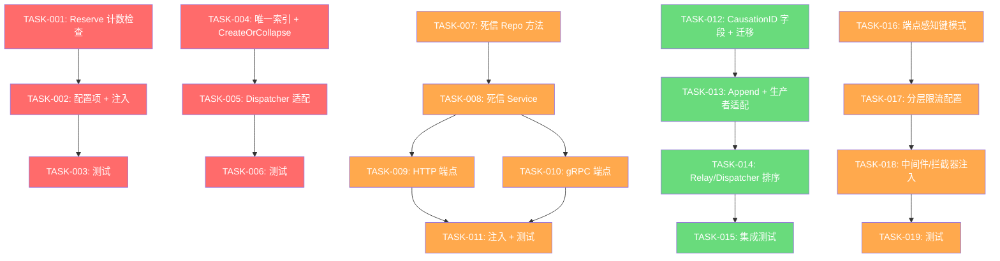
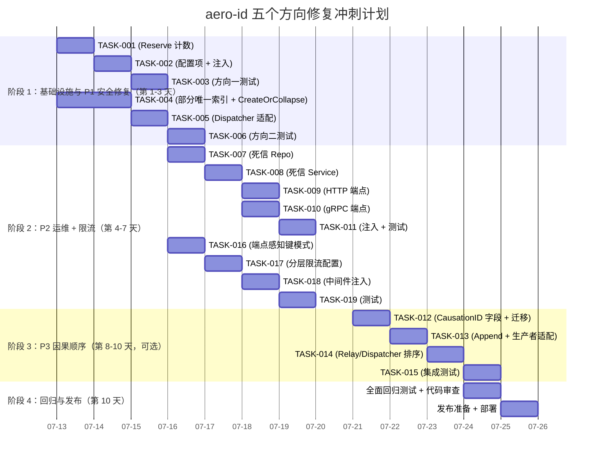

现在我拥有全面的代码库理解。以下是完整的 Tech Lead 分析。

---

# Tech Lead 分析报告：aero-id 五个安全隐患与设计缺陷

## 1. 任务分解

### 方向一：Idempotency Key 存储耗尽攻击面

| 任务 ID | 任务标题 | 涉及文件 | 前置依赖 | 预估工时 | 验收标准 |
|---------|----------|----------|----------|----------|----------|
| TASK-001 | 在 `Reserve()` 中增加每用户活跃键数上限检查 | `internal/idempotency/store.go` | — | 3h | `Reserve()` 在 INSERT 前执行 `SELECT COUNT(*) WHERE uid=? AND expires_at > now()`；超过阈值返回 `ErrTooManyKeys`；调用方（HTTP 中间件）翻译为 429 |
| TASK-002 | 新增 `max_keys_per_user` 配置项及其校验 | `configs/config.yaml`、`internal/config/config.go`、`internal/app/app.go` | TASK-001 | 1h | 配置读取并注入 `GormStore`；默认值 1000；`<=0` 表示无限制 |
| TASK-003 | 单元测试 + 集成测试 | `internal/idempotency/store_test.go`、`internal/middleware/idempotency_test.go` | TASK-002 | 2h | 测试用例覆盖：未超限时正常创建、超限时拒绝、超限后用不同 endpoint 不受影响、清理过期后计数下降 |

**小计：6h**

### 方向二：通知折叠竞态条件

| 任务 ID | 任务标题 | 涉及文件 | 前置依赖 | 预估工时 | 验收标准 |
|---------|----------|----------|----------|----------|----------|
| TASK-004 | 新增部分唯一索引 + 重构折叠核心逻辑 | `migrations/000024_collapse_unique.up.sql`、`internal/repository/notification.go` | — | 4h | 迁移在 `(recipient_uid, type, actor_uid) WHERE read_at IS NULL` 上添加部分唯一索引；新增 `CreateOrCollapse()` 方法使用 `INSERT ... ON CONFLICT DO UPDATE SET collapsed_count = collapsed_count + 1` 原子操作 |
| TASK-005 | 更新 `NotificationDispatcher.Handle()` 使用新的原子折叠 | `internal/service/notification.go` | TASK-004 | 2h | `Handle()` 将 `Create()` + `FindRecentByTypeAndActor()` 替换为单个 `CreateOrCollapse()` 调用；消除幽灵行竞态 |
| TASK-006 | 更新折叠测试 | `internal/notification/dispatcher_test.go`、`internal/service/notification_test.go` | TASK-005 | 2h | 现有折叠测试通过；新增竞态场景测试（并发折叠请求）；无幽灵行产生 |

**小计：8h**

### 方向三：Outbox Dead Letter 队列运维盲区

| 任务 ID | 任务标题 | 涉及文件 | 前置依赖 | 预估工时 | 验收标准 |
|---------|----------|----------|----------|----------|----------|
| TASK-007 | 新增死信仓库方法 | `internal/outbox/repository.go`、`internal/outbox/outbox.go` | — | 2h | `ListDeadLetters(ctx, limit)` 按 `last_retry_at DESC` 返回；`RetryDeadLetter(ctx, id)` 清除 `dead_letter=true` 和 `published_at`；`CountDeadLetters(ctx)` |
| TASK-008 | 新增死信服务层 | `internal/service/admin.go`（扩展）或 `internal/service/outbox_admin.go` | TASK-007 | 2h | 服务方法：`ListDeadLetters`、`RetryDeadLetter`、`CountDeadLetters`；权限检查：要求 `PermDeadLetterRead` / `PermDeadLetterWrite` |
| TASK-009 | 新增 HTTP 管理端点 | `internal/handler/http/admin.go`、`internal/domain/permissions.go` | TASK-008 | 2h | `GET /v1/admin/dead-letters`、`POST /v1/admin/dead-letters/:id/retry`；权限中间件保护 |
| TASK-010 | 新增 gRPC 管理端点 | `internal/handler/grpc/admin.go`、`api/proto/aero_id/v1/aero_id.proto` | TASK-008 | 2h | 新增 `AdminService/ListDeadLetters` 和 `AdminService/RetryDeadLetter` RPC；`make proto` 后 `*.pb.go` 提交 |
| TASK-011 | 组合根中注入 + 集成测试 | `internal/app/app.go`、`internal/outbox/repository_integration_test.go` | TASK-009, TASK-010 | 2h | `AdminHandler` 构造时传入 `outboxRepo`；`NewRelay` 死信计数作为度量指标暴露；测试验证完整流程 |

**小计：10h**

### 方向四：跨事件类型因果顺序违反

| 任务 ID | 任务标题 | 涉及文件 | 前置依赖 | 预估工时 | 验收标准 |
|---------|----------|----------|----------|----------|----------|
| TASK-012 | 为事件添加因果追踪字段 + 迁移 | `internal/outbox/outbox.go`、`migrations/000025_causation.up.sql` | — | 2h | 向 `Event` 添加 `CausationID *uuid.UUID`、`CorrelationID uuid.UUID`；迁移列可为空；`NewEvent` 参数更新 |
| TASK-013 | 更新 `Append` 及生产者以传递因果关系 | `internal/outbox/repository.go`、`internal/repository/message.go`、`internal/repository/comment.go` | TASK-012 | 3h | 创建事件的各服务在写入 outbox 时传递 `CausationID`；消息发送/评论回复场景填入对应的父事件 ID |
| TASK-014 | 更新 relay/dispatcher 以尊重因果顺序 | `internal/outbox/relay.go`、`internal/service/notification.go` | TASK-013 | 3h | `FetchUnpublished` 新增 `ORDER BY causation_id NULLS FIRST, created_at` 选项；`Handle()` 中延迟处理有未满足因果依赖的事件 |
| TASK-015 | 集成测试：因果顺序保证 | `internal/outbox/relay_test.go`、`internal/notification/dispatcher_test.go` | TASK-014 | 2h | 测试用例：事件 B（因果依赖于 A）在 A 之前写入；relay 确保 A 先被处理；B 的 dispatch 延迟至 A 完成后 |

**小计：10h**

### 方向五：Rate Limiter 粒度缺口

| 任务 ID | 任务标题 | 涉及文件 | 前置依赖 | 预估工时 | 验收标准 |
|---------|----------|----------|----------|----------|----------|
| TASK-016 | 设计端点感知的速率限制键模式 | `internal/middleware/ratelimit.go`、`internal/handler/grpc/server.go` | — | 2h | 键格式扩展为 `uid:<uid>:<method_group>`（如 `uid:xxx:message.send`）；为两类端点定义端点组：常规（默认 20rps）和高成本（如消息发送、文件上传：5rps） |
| TASK-017 | 新增分层速率限制配置 | `configs/config.yaml`、`internal/config/config.go`、`internal/pkg/ratelimit/ratelimit.go` | TASK-016 | 2h | 配置 `rate_limit.endpoints: [{route: "message.send", rps: 5}]`；`Limiter` 支持 `NamedLimiter` 包装器聚合多个桶 |
| TASK-018 | 将端点感知的限制注入中间件/拦截器 | `internal/middleware/ratelimit.go`、`internal/handler/grpc/server.go` | TASK-017 | 2h | HTTP：中间件根据路由 + 方法选择正确的限制器；gRPC：拦截器根据 `info.FullMethod` 选择 |
| TASK-019 | 测试：分层限流 | `internal/pkg/ratelimit/ratelimit_test.go`、`internal/middleware/middleware_test.go`、`internal/handler/grpc/server_test.go` | TASK-018 | 2h | 不同端点组共享全局桶但拥有独立桶；高成本端点超出限制时仍允许常规端点通过 |

**小计：8h**

---

### 总量汇总

| 方向 | 任务数 | 总工时 |
|------|--------|--------|
| 方向一：Idempotency Key DoS | 3 | 6h |
| 方向二：通知折叠竞态 | 3 | 8h |
| 方向三：死信队列运维 | 5 | 10h |
| 方向四：因果顺序 | 4 | 10h |
| 方向五：限流粒度 | 4 | 8h |
| **总计** | **19** | **42h** |

---

## 2. 执行顺序

### 优先级分级

- **P0（阻止性）**：无。当前问题不影响基本服务可用性；
- **P1（本周内完成）**：方向一（安全 DoS）、方向二（幽灵通知数据正确性）；
- **P2（下个迭代完成）**：方向三（运维盲区）、方向五（限流粒度缺口）；
- **P3（排期）**：方向四（因果顺序——技术债务，需要设计变更）；

### 任务依赖图

### 可并行执行的任务组

| 并行组 | 包含任务 | 说明 |
|--------|----------|------|
| **组 A**（P1） | TASK-001, TASK-004 | 两方向无共享文件，可同时由两人并行开始 |
| **组 B**（P1） | TASK-002, TASK-005 | 在组 A 完成后开始，亦可并行 |
| **组 C**（P1） | TASK-003, TASK-006 | 各自的测试，可并行 |
| **组 D**（P2） | TASK-007, TASK-016 | 方向三与方向五基础设施并行 |
| **组 E**（P2） | TASK-008, TASK-009 或 TASK-010, TASK-017 | 服务层完成后 HTTP 和 gRPC 端点可同时实现 |
| **组 F**（P3） | TASK-012 | 方向四独立，可在第一阶段结束后启动 |

---

## 3. 技术风险

### 3.1 高风险项

| 风险 | 方向 | 等级 | 分析 |
|------|------|------|------|
| **方向二竞态窗口**：即使使用 `ON CONFLICT DO UPDATE`，如果部分唯一索引在事务提交时检查，仍存在并发间隙 | 二 | 🔴 **高** | Postgres 的 `ON CONFLICT DO UPDATE` 需要唯一索引的**并发支持**。部分唯一索引 `WHERE read_at IS NULL` 仅在读未提交以下的隔离级别有效。解决方案：使用 `SELECT ... FOR UPDATE` 锁定行或接受 `SERIALIZABLE` 隔离级别。更安全的做法是在 `CreateOrCollapse` 中使用可延迟的唯一约束 |
| **方向三 gRPC proto 修改**：需要重新生成 `*.pb.go`，要求 protoc 工具链版本匹配 | 三 | 🟡 **中** | 文档已注明 protoc 版本 pin。但团队中若有人使用不同的 protoc 版本，生成的代码可能不同。应 CI 流水线化且 `make proto` 输出需提交 |
| **方向四因果顺序**：跨表的因果链（如消息发送→通知→后续回复）可能产生死锁 | 四 | 🔴 **高** | 在当前基于 `created_at` 的简单排序中引入因果依赖可能导致 relay 死锁（事件 A 等待事件 B，事件 B 等待事件 A）。需设计无环 DAG 验证。建议：使用 `CorrelationID` 聚合因果组，relay 在每个组内按 `created_at` 排序 |
| **方向五配置向后兼容**：现有用户可能未配置端点限流 | 五 | 🟢 **低** | 可通过配置默认值（未配置时退回到全局桶）轻松缓解 |

### 3.2 外部依赖

| 依赖 | 影响方向 | 应对策略 |
|------|----------|----------|
| Postgres 版本需支持部分唯一索引 | 二 | 已在 PG 9.5+ 支持，aero-id 的最低要求是 PG 13（当前足够） |
| protoc + protoc-gen-go 版本锁定 | 三 | 将 `make proto` 命令锁定到 `go.mod` 指定的版本 |
| SSO 对用户解析的无序性 | 四 | 因果顺序仅影响内部事件处理；SSO 用户解析独立，不受影响 |

### 3.3 性能瓶颈

| 场景 | 影响 | 优化策略 |
|------|------|----------|
| TASK-001 中 `Reserve()` 新增 COUNT 查询 | 每写请求多 1 次 DB 查询 | 使用索引覆盖扫描 (`idx_idempotency_expires` + `uid`)；若 QPS > 1000，考虑在内存中维护近似计数器或使用 Redis |
| TASK-004 中 `ON CONFLICT DO UPDATE` 在竞争激烈时 | 少数行需要等待锁 | 在通知的预期低写入速率下（最多每秒数十次），这不是问题 |
| TASK-014 中因果排序 | 可能延迟事件处理 | 设置因果超时（如 30s）：若父事件在该时间内未出现，仍独立处理子事件。记录警告 |

### 3.4 测试覆盖难点

| 难点 | 方向 | 解释 |
|------|------|------|
| 竞态条件复现 | 二、四 | 并发碰撞在测试中极难稳定触发。建议使用 `go test -race` 配合 `time.Sleep` 原子操作中的手动屏障，而非依赖确定性调度 |
| 集成测试中的死信场景 | 三 | 需要 mock outbox 处理器返回错误达 `maxRetries` 次。使用 `outbox.HandlerFunc` 模拟 |
| 因果顺序验证 | 四 | 需要多个事件具有跨类型的因果链，并验证 relay 的输出顺序。建议使用 `go test -count=100 -race` |

---

## 4. 资源评估

### 4.1 团队组成

| 角色 | 技能要求 | 负责方向 | 工作量 |
|------|----------|----------|--------|
| **高级后端工程师 A** | Go、GORM、Postgres、安全敏感代码 | 方向一 + 方向三 | 16h |
| **高级后端工程师 B** | Go、并发、微服务、API 设计 | 方向二 + 方向五 | 16h |
| **高级后端工程师 C**（可选，若时间紧张） | Go、事件驱动架构、系统设计 | 方向四 | 10h |
| **QA / 测试工程师** | Go 测试、集成测试、竞态检测 | 跨方向验证 | 混合（~10h） |

**建议**：2 名高级工程师 + 1 名 QA，迭代周期为 2 周（10 个工作日）。若只有 2 名工程师，方向四推迟至下个迭代。

### 4.2 关键里程碑

| 里程碑 | 时间点 | 交付物 | 验收门禁 |
|--------|--------|--------|----------|
| **M1：P1 安全修复完成** | 第 3 天末 | TASK-001 ~ TASK-006 | `make test && make lint` 通过；安全测试覆盖方向一 DoS 场景 |
| **M2：P2 运维 + 限流完成** | 第 7 天末 | TASK-007 ~ TASK-011, TASK-016 ~ TASK-019 | 新管理端点可用；限流按端点生效 |
| **M3（可选）：因果顺序完成** | 第 10 天末 | TASK-012 ~ TASK-015 | 集成测试验证因果交付；`make test-integration` 通过 |
| **M4：全面回归 + 发布** | 第 10 天末 | 全部代码合并 | `make test && make lint && make test-integration` 通过；code review 全部完成 |

### 4.3 阻塞点与解决策略

| 阻塞点 | 影响 | 策略 |
|--------|------|------|
| 方向二部分唯一索引竞态 | 阻塞 TASK-005 | 回退方案：使用应用级锁（`SELECT pg_advisory_xact_lock`）包裹 `CreateOrCollapse`；或在 `Handle()` 中仅对折叠窗口进行乐观重试 |
| 方向四设计不确定性 | 阻塞方向四所有任务 | 在冲刺开始前完成 RFC（请求评论）设计文档；邀请团队会议 1 小时达成一致 |
| 方向三 proto 生成不一致 | 阻塞 CI | CI 流水线添加 `make proto` + `git diff --exit-code` 检查 proto 生成文件是否与源码一致 |

---

## 5. 质量保证

### 5.1 单元测试覆盖要求

| 方向 | 底线覆盖 | 关键测试场景 |
|------|----------|-------------|
| 方向一 | ≥ 90%（新代码行） | 正常 Reserve、达到限制、限制到期后恢复、同时使用不同端点、并发 Reserve 竞争 |
| 方向二 | ≥ 90% | `CreateOrCollapse` 原子性、同一窗口内折叠、窗口外不折叠、并发折叠请求 |
| 方向三 | ≥ 85% | `ListDeadLetters` 分页、`RetryDeadLetter` 重置状态、权限拒绝、跨页游标 |
| 方向四 | ≥ 85% | 因果依赖正确排序、缺失父事件的超时回退、循环依赖检测（若实现） |
| 方向五 | ≥ 90% | 全局和端点特定桶独立工作、端点桶为空时回退到全局、配置关闭时失败开放 |

### 5.2 集成测试策略

| 方向 | 测试策略 | 测试命令 |
|------|----------|----------|
| 方向一 | 使用 `testpg` 和真正的 Postgres 实例；创建大量 idempotency 键验证上限 | `go test -tags=integration -run TestIdempotency ./internal/idempotency/` |
| 方向二 | 使用 `testpg` 创建多条通知，验证折叠后行数而非计数 | `go test -tags=integration -run TestNotificationCollapse ./internal/repository/ -count=1 -race` |
| 方向三 | 模拟 outbox relay 将所有事件发送到死信；验证管理员 API 可恢复 | `go test -tags=integration -run TestDeadLetter ./internal/outbox/` |
| 方向四 | 在具有因果链的单个事务中插入多个 outbox 事件；验证 relay 输出顺序 | `go test -tags=integration -run TestCausalityOrdering ./internal/outbox/ -count=100` |
| 方向五 | 无集成测试必要（纯内存）；使用同步基准测试验证性能 | 无 test-integration 需要 |

### 5.3 代码审查要点

| 审查焦点 | 相关人员 | 检查内容 |
|----------|----------|----------|
| **方向一：安全影响** | 安全团队（若有）或高级工程师 A | `COUNT` 查询是否使用索引？限制是否可配置？拒绝响应是否泄漏内部状态？ |
| **方向二：数据完整性** | 高级工程师 B | `CreateOrCollapse` 事务隔离级别？是否存在可导致计数不同的竞争路径？新行是否仍创建用于审计？ |
| **方向三：API 设计** | 两名工程师 | RESTful 命名惯例？gRPC 方法与 HTTP 方法是否在语义上一致？错误响应是否一致？ |
| **方向四：架构影响** | 整个团队 | 因果追踪是否增加不必要的复杂性？是否有更简单的解决方案（如在通知处理程序中确保特定顺序）？ |
| **方向五：性能** | 高级工程师 B | 协调多个限制器的`NamedLimiter` 的锁开销？在基准测试下是否增加显著延迟？ |

### 5.4 性能测试要求

| 场景 | 工具 | 目标 |
|------|------|------|
| 方向一：Idempotency 高负载 | `wrk` / `vegeta` | 在 1000 键/秒下，p99 延迟增长 < 5ms（因 COUNT 查询） |
| 方向五：限流器吞吐量 | `go test -bench=.` | 每个 `Allow()` 调用 < 500ns（基准当前约 200ns，需验证开销） |

---

## 6. 实施计划

### 6.1 时间线（冲刺为 10 个工作日，2 名工程师）

### 6.2 详细阶段说明

#### 阶段 1：基础设施与 P1 安全修复（第 1-3 天）

**Day 1（工程师 A + B 并行）**
- 工程师 A：实现 TASK-001（`Reserve()` 中的 COUNT 检查）。注意使用 `SELECT COUNT(*) WHERE uid = ? AND expires_at > NOW()` 的索引覆盖扫描。
- 工程师 B：实现 TASK-004（迁移 + `CreateOrCollapse` 仓库方法）。查看现有 `notification.go` 测试中的 `notificationRowToDomain` 和 `notificationDomainToRow` 辅助函数，确保与 `ON CONFLICT` 路径兼容。

**Day 2**
- 工程师 A：TASK-002（配置注入）+ 开始 TASK-003（测试）。
- 工程师 B：TASK-005（Dispatcher 适配）+ 开始 TASK-006（测试）。

**Day 3**
- 工程师 A + B：完成 TASK-003 和 TASK-006。**里程碑 M1**：合并分支。运行 `make test && make lint`。

#### 阶段 2：P2 运维 + 限流（第 4-7 天）

**Day 4-5**
- 工程师 A：TASK-007 → TASK-008 → TASK-009（死信栈）。
- 工程师 B：TASK-016 → TASK-017（限流基础设施）。

**Day 6**
- 工程师 A：TASK-010（gRPC 端点）+ 开始 TASK-011（注入）。
- 工程师 B：TASK-018（中间件注入）+ 开始 TASK-019（测试）。

**Day 7**
- 工程师 A + B：完成 TASK-011 和 TASK-019。**里程碑 M2**：合并分支。`make test && make lint` 通过。

#### 阶段 3：因果顺序（第 8-10 天，可选）

仅在 P1/P2 后仍有时间时进行。若时间不足，降级为 RFC + 设计文档。

**Day 8**
- 指定工程师（建议 A）：TASK-012。设计因果关系字段。注意避免循环依赖。

**Day 9**
- 工程师 A：TASK-013 + TASK-014。生产者的 `Append` 调用需要从领域事件创建代码中传递 `CausationID`。

**Day 10**
- 工程师 A：TASK-015。集成测试 + 代码审查。**里程碑 M3**。

#### 阶段 4：回归与发布（第 10 天下午）

**所有工程师**
- `make test && make lint && make check-file-sizes && make lint-strict && make test-integration`
- 完成全部代码审查
- 更新 CHANGELOG / 发布说明
- 创建发布标签

### 6.3 回滚计划

若任何 P1 修复（方向一或二）对生产产生负面影响：

1. **方向一**：将 `max_keys_per_user` 配置值设为 `0`（禁用限制，恢复原始行为）
2. **方向二**：移除 `CreateOrCollapse` 调用的迁移，恢复原始 `Create()` + `FindRecentByTypeAndActor` 模式。注意：唯一索引只能在回滚迁移时删除
3. 所有迁移均需提供下迁脚本（`*.down.sql`）

---

## 附录：关键架构决策记录

### ADR-001：方向二使用部分唯一索引而非应用级锁

**状态**：提议  
**上下文**：当前折叠逻辑存在竞态，因为 `Create()` 和 `IncrementCollapsedCount()` 之间没有原子性。  
**决策**：添加部分唯一索引 `(recipient_uid, type, actor_uid) WHERE read_at IS NULL` 并使用 `INSERT ... ON CONFLICT DO UPDATE`。  
**后果**：消除了应用级锁的复杂性；需要迁移。嵌套事务场景（在现有 `Create()` 事务内）需要仔细处理事务语义。  
**替代方案**：`SELECT ... FOR UPDATE`（锁开销）；`pg_advisory_xact_lock`（并发性降低）。

### ADR-002：方向三死信管理使用现有 AdminService

**状态**：提议  
**上下文**：死信队列是运维关注点，需要管理权限。  
**决策**：以现有 `AdminService` 和 `AdminHandler` 模式为基础。新增 `PermDeadLetterRead` 和 `PermDeadLetterWrite` 权限。  
**后果**：将死信管理代码与审计日志等其他管理功能放在一起文件大小可能超出 500 行限制。监察 `admin.go`，必要时拆分出 `admin_deadletter.go`。

### ADR-003：方向五使用分层限流器（`NamedLimiter`）

**状态**：提议  
**上下文**：当前单一全局 `Limiter` 对所有端点一视同仁。  
**决策**：引入 `NamedLimiter` 包装器，聚合一个全局桶 + 多个命名桶。中间件根据路由选择命名桶。  
**后果**：仍然基于内存（每实例）。若需跨实例同步，后续可扩展使用 Redis。
