现在我已对代码库有了全面理解。下面是基于分析文档的 Tech Lead 全面分析。

---

# Tech Lead 分析报告：aero-id 平台化基础设施五大方向

> **分析依据**: `docs/requirements/2026-07-10-fifth-wave-platform-extensions.md`
> **代码基线**: current `main` (22 packages, 180+ source files, 22 migrations)
> **日期**: 2026-07-12

---

## 1. 任务分解

### 方向③：数据生命周期统一治理（P0 — 立即启动）

| 任务ID | 任务标题 | 涉及文件 | 前置依赖 | 预估工时 |
|--------|---------|---------|---------|---------|
| LIFECYCLE-001 | `retention_policies` 表设计 + 迁移 | `migrations/000023_retention_policies.up.sql`, `.down.sql`, `internal/domain/retention.go` | — | 3h |
| LIFECYCLE-002 | `EntityExecutor` 接口 + `LifecycleSweeper` 骨架 | `internal/lifecycle/sweeper.go`, `internal/lifecycle/interface.go` | LIFECYCLE-001 | 4h |
| LIFECYCLE-003 | File 实体执行器 | `internal/file/lifecycle.go` | LIFECYCLE-002 | 2h |
| LIFECYCLE-004 | Message 实体执行器 | `internal/message/lifecycle.go` | LIFECYCLE-002 | 2h |
| LIFECYCLE-005 | Comment 实体执行器 | `internal/comment/lifecycle.go` | LIFECYCLE-002 | 2h |
| LIFECYCLE-006 | Notification 实体执行器 | `internal/notification/lifecycle.go` | LIFECYCLE-002 | 2h |
| LIFECYCLE-007 | AuditLog + Outbox 实体执行器 | `internal/audit/lifecycle.go`, `internal/outbox/lifecycle.go` | LIFECYCLE-002 | 2h |
| LIFECYCLE-008 | SSO De-provisioning 钩子端点 | `internal/lifecycle/handler_sso.go`, `api/proto/aero_id/v1/lifecycle.proto`, `internal/handler/grpc/aeropb/`, `internal/handler/http/lifecycle.go` | LIFECYCLE-002 | 4h |
| LIFECYCLE-009 | GDPR Export 端点 | `internal/lifecycle/handler_export.go`, `internal/lifecycle/service_export.go` | LIFECYCLE-003, LIFECYCLE-004, LIFECYCLE-005 | 4h |
| LIFECYCLE-010 | GDPR Delete 端点 | `internal/lifecycle/handler_delete.go`, `internal/lifecycle/service_delete.go` | LIFECYCLE-003–006 | 3h |
| LIFECYCLE-011 | Legal Hold 管理端点 | `internal/lifecycle/handler_legal.go`, 修改 `retention_policies` 表 | LIFECYCLE-001 | 2h |
| LIFECYCLE-012 | `LifecycleSweeper` 注册到 `app.go` | `internal/app/app.go`, `configs/config.yaml` | LIFECYCLE-002, LIFECYCLE-003–007 | 2h |
| LIFECYCLE-013 | 集成测试：Sweeper 功能 | `internal/lifecycle/sweeper_integration_test.go` | LIFECYCLE-012 | 4h |
| LIFECYCLE-014 | 集成测试：SSO de-provisioning | `internal/lifecycle/deprovision_integration_test.go` | LIFECYCLE-008 | 3h |

### 方向⑤：变更安全与预发布治理（P0 — 立即启动）

| 任务ID | 任务标题 | 涉及文件 | 前置依赖 | 预估工时 |
|--------|---------|---------|---------|---------|
| SAFETY-001 | 迁移预演：`DryRun()` 方法 | `internal/pkg/migrate/dryrun.go`, `internal/pkg/migrate/migrate.go` | — | 3h |
| SAFETY-002 | `shadow-migrate` CLI 工具 | `cmd/shadow-migrate/main.go`, `Makefile`（`make shadow-migrate`） | SAFETY-001 | 3h |
| SAFETY-003 | Schema 一致性检查包 | `internal/pkg/schemadiff/diff.go` | — | 4h |
| SAFETY-004 | `check-schema-diff` CLI + Make 集成 | `cmd/check-schema-diff/main.go`, `Makefile`（`make check-schema-diff`） | SAFETY-003 | 2h |
| SAFETY-005 | `GET /debug/config` 端点 | `internal/handler/http/debug.go`, `configs/config.yaml`（管理端口） | — | 2h |
| SAFETY-006 | 配置漂移检测工具 | `cmd/check-config-drift/main.go`, `Makefile` | SAFETY-005 | 2h |
| SAFETY-007 | Proto 兼容性（`buf breaking` 集成） | `Makefile`（`make check-proto-compat`）, `buf.yaml`, `.github/workflows/ci.yml` | — | 2h |
| SAFETY-008 | CI 门禁集成 | `.github/workflows/ci.yml`（集成 SAFETY-002/004/006/007） | SAFETY-002, SAFETY-004, SAFETY-006, SAFETY-007 | 2h |
| SAFETY-009 | 集成测试：Schema diff 端到端 | `internal/pkg/schemadiff/diff_test.go` | SAFETY-003 | 3h |

### 方向①：Webhook 交付平台化（P1）

| 任务ID | 任务标题 | 涉及文件 | 前置依赖 | 预估工时 |
|--------|---------|---------|---------|---------|
| WEBHOOK-001 | `webhook_subscribers` 表 + outbox_events 扩展迁移 | `migrations/000024_webhook_subscribers.up.sql`, `.down.sql` | — | 3h |
| WEBHOOK-002 | `internal/webhook/domain` — 实体定义 | `internal/webhook/subscriber.go` | WEBHOOK-001 | 2h |
| WEBHOOK-003 | `internal/webhook/repository` | `internal/webhook/repository.go` | WEBHOOK-002 | 3h |
| WEBHOOK-004 | `internal/webhook/service` — 订阅者 CRUD | `internal/webhook/service.go` | WEBHOOK-003 | 3h |
| WEBHOOK-005 | 多订阅者递送引擎（替换单 endpoint WebhookHandler） | `internal/webhook/deliverer.go`, 修改 `internal/outbox/webhook.go` | WEBHOOK-004 | 4h |
| WEBHOOK-006 | HTTP handler：订阅者 CRUD + 密钥轮换 | `internal/webhook/handler_http.go` | WEBHOOK-004 | 3h |
| WEBHOOK-007 | gRPC handler：订阅者 CRUD + 密钥轮换 | `internal/webhook/handler_grpc.go`, `api/proto/aero_id/v1/webhook.proto`, `internal/handler/grpc/aeropb/` | WEBHOOK-004 | 3h |
| WEBHOOK-008 | 递送历史 API | `internal/webhook/handler_history.go`, `internal/webhook/service_history.go` | WEBHOOK-005 | 3h |
| WEBHOOK-009 | 事件重放 API | `internal/webhook/service_replay.go` | WEBHOOK-005, WEBHOOK-008 | 2h |
| WEBHOOK-010 | 密钥轮换安全设计（双签名过渡期） | `internal/webhook/key_rotation.go`, 修改 `internal/webhook/deliverer.go` | WEBHOOK-005 | 3h |
| WEBHOOK-011 | Webhook 递送指标（metrics 扩展） | `internal/pkg/metrics/metrics.go`（添加 webhook 指标），`internal/webhook/deliverer.go` | WEBHOOK-005 | 2h |
| WEBHOOK-012 | 背压保护 + 自动暂停 | `internal/webhook/backpressure.go`, 修改 `internal/webhook/deliverer.go` | WEBHOOK-005 | 3h |
| WEBHOOK-013 | 集成测试：递送引擎 + 多订阅者 | `internal/webhook/deliverer_integration_test.go` | WEBHOOK-012 | 4h |
| WEBHOOK-014 | 向后兼容适配：旧单 endpoint 配置映射到首条 subscriber | `internal/app/app.go`, `internal/webhook/compat.go` | WEBHOOK-004 | 2h |

### 方向②：结构化文件元数据查询（P1）

| 任务ID | 任务标题 | 涉及文件 | 前置依赖 | 预估工时 |
|--------|---------|---------|---------|---------|
| META-001 | GIN 索引迁移 | `migrations/000025_meta_gin_index.up.sql`, `.down.sql` | — | 1h |
| META-002 | Meta 查询参数解析器 | `internal/file/meta_query.go`（操作符映射：`__gt`, `__gte`, `__lt`, `__lte`, `__contains`, `__exists`, `__in`） | — | 3h |
| META-003 | Repository 扩展：`ListByOwner` 支持动态 meta 条件 | `internal/file/repository.go` | META-001, META-002 | 3h |
| META-004 | Service 层：meta 参数验证 + 安全限制 | `internal/file/service_crud.go`（`List` 方法扩展） | META-003 | 2h |
| META-005 | HTTP handler：解析 `meta.*` 查询参数 | `internal/file/handler_http.go`（`List` 方法） | META-004 | 1h |
| META-006 | gRPC handler + proto 扩展 | `internal/file/handler_grpc.go`, `api/proto/aero_id/v1/aero_id.proto`（`ListFilesRequest` 扩展） | META-004 | 2h |
| META-007 | 集成测试：meta 查询端到端 | `internal/file/repository_integration_test.go` | META-006 | 3h |

### 方向④：集合式资源模型（P2）

| 任务ID | 任务标题 | 涉及文件 | 前置依赖 | 预估工时 |
|--------|---------|---------|---------|---------|
| COLLECT-001 | collections + collection_members 表迁移 | `migrations/000026_collections.up.sql`, `.down.sql` | — | 2h |
| COLLECT-002 | 集合 Domain 实体 | `internal/collection/domain.go`, `internal/domain/collection.go` | COLLECT-001 | 1h |
| COLLECT-003 | Repository：集合 CRUD + 成员管理 | `internal/collection/repository.go` | COLLECT-002 | 4h |
| COLLECT-004 | Service：集合业务逻辑 + 权限检查 | `internal/collection/service.go` | COLLECT-003 | 4h |
| COLLECT-005 | HTTP handler | `internal/collection/handler_http.go` | COLLECT-004 | 3h |
| COLLECT-006 | gRPC handler + proto | `internal/collection/handler_grpc.go`, `api/proto/aero_id/v1/collection.proto`, `internal/handler/grpc/aeropb/` | COLLECT-004 | 3h |
| COLLECT-007 | 批操作（批量可见性修改、批量导出） | `internal/collection/service_batch.go` | COLLECT-004 | 3h |
| COLLECT-008 | 分享系统多态扩展（集合可分享） | `internal/collection/service_share.go`, 修改 `internal/file/repository_share.go` | COLLECT-004 | 3h |
| COLLECT-009 | 搜索集成（结果中标明集合归属） | `internal/search/service.go`, `internal/collection/service_search.go` | COLLECT-004 | 2h |
| COLLECT-010 | 资源软删时集合成员标记 | `internal/collection/service.go`（hook into file/message/comment delete paths） | COLLECT-004, LIFECYCLE-003/004/005 | 2h |
| COLLECT-011 | 集成测试 | `internal/collection/service_integration_test.go` | COLLECT-010 | 4h |

---

## 2. 执行顺序与依赖图

```mermaid
graph TD
    %% Direction 3: Data Lifecycle (P0)
    LIFECYCLE-001 --> LIFECYCLE-002
    LIFECYCLE-002 --> LIFECYCLE-003
    LIFECYCLE-002 --> LIFECYCLE-004
    LIFECYCLE-002 --> LIFECYCLE-005
    LIFECYCLE-002 --> LIFECYCLE-006
    LIFECYCLE-002 --> LIFECYCLE-007
    LIFECYCLE-003 --> LIFECYCLE-009
    LIFECYCLE-004 --> LIFECYCLE-009
    LIFECYCLE-005 --> LIFECYCLE-009
    LIFECYCLE-006 --> LIFECYCLE-010
    LIFECYCLE-003 --> LIFECYCLE-010
    LIFECYCLE-004 --> LIFECYCLE-010
    LIFECYCLE-005 --> LIFECYCLE-010
    LIFECYCLE-002 --> LIFECYCLE-008
    LIFECYCLE-001 --> LIFECYCLE-011
    LIFECYCLE-002 --> LIFECYCLE-012
    LIFECYCLE-003 --> LIFECYCLE-012
    LIFECYCLE-004 --> LIFECYCLE-012
    LIFECYCLE-005 --> LIFECYCLE-012
    LIFECYCLE-006 --> LIFECYCLE-012
    LIFECYCLE-007 --> LIFECYCLE-012
    LIFECYCLE-012 --> LIFECYCLE-013
    LIFECYCLE-012 --> LIFECYCLE-014

    %% Direction 5: Change Safety (P0)
    SAFETY-001 --> SAFETY-002
    SAFETY-003 --> SAFETY-004
    SAFETY-005 --> SAFETY-006
    SAFETY-002 --> SAFETY-008
    SAFETY-004 --> SAFETY-008
    SAFETY-006 --> SAFETY-008
    SAFETY-007 --> SAFETY-008
    SAFETY-003 --> SAFETY-009

    %% Direction 1: Webhook Platform (P1)
    WEBHOOK-001 --> WEBHOOK-002
    WEBHOOK-002 --> WEBHOOK-003
    WEBHOOK-003 --> WEBHOOK-004
    WEBHOOK-004 --> WEBHOOK-005
    WEBHOOK-004 --> WEBHOOK-006
    WEBHOOK-004 --> WEBHOOK-007
    WEBHOOK-004 --> WEBHOOK-014
    WEBHOOK-005 --> WEBHOOK-008
    WEBHOOK-005 --> WEBHOOK-009
    WEBHOOK-005 --> WEBHOOK-010
    WEBHOOK-005 --> WEBHOOK-011
    WEBHOOK-005 --> WEBHOOK-012
    WEBHOOK-012 --> WEBHOOK-013

    %% Direction 2: Meta Query (P1)
    META-001 --> META-003
    META-002 --> META-003
    META-003 --> META-004
    META-004 --> META-005
    META-004 --> META-006
    META-006 --> META-007

    %% Direction 4: Collections (P2)
    COLLECT-001 --> COLLECT-002
    COLLECT-002 --> COLLECT-003
    COLLECT-003 --> COLLECT-004
    COLLECT-004 --> COLLECT-005
    COLLECT-004 --> COLLECT-006
    COLLECT-004 --> COLLECT-007
    COLLECT-004 --> COLLECT-008
    COLLECT-004 --> COLLECT-009
    COLLECT-004 --> COLLECT-010
    COLLECT-010 --> COLLECT-011

    %% Cross-direction dependencies
    LIFECYCLE-003 --> COLLECT-010
    LIFECYCLE-004 --> COLLECT-010
    LIFECYCLE-005 --> COLLECT-010

    subgraph P0_Immediate["P0 立即启动"]
        LIFECYCLE-001
        LIFECYCLE-002
        LIFECYCLE-003
        LIFECYCLE-004
        LIFECYCLE-005
        LIFECYCLE-006
        LIFECYCLE-007
        LIFECYCLE-008
        SAFETY-001
        SAFETY-003
        SAFETY-005
    end

    subgraph P1_Next["P1 下一迭代"]
        WEBHOOK-001
        WEBHOOK-002
        META-001
        META-002
    end

    subgraph P2_Future["P2 长期规划"]
        COLLECT-001
        COLLECT-002
    end
```



### 可并行执行的任务组

| 组 | 任务 | 原因 |
|----|------|------|
| **组A** | LIFECYCLE-001, SAFETY-001, SAFETY-003, SAFETY-005, WEBHOOK-001, META-001, META-002, COLLECT-001 | 无外部依赖，可以同时开始 |
| **组B** | LIFECYCLE-003/004/005/006/007 | LIFECYCLE-002 完成后可以全并行 |
| **组C** | SAFETY-002, SAFETY-004, SAFETY-006, SAFETY-007 | 各自独立，可并行 |
| **组D** | WEBHOOK-006, WEBHOOK-007, WEBHOOK-014 | WEBHOOK-004 完成后可并行 |
| **组E** | COLLECT-005/006/007/008/009/010 | COLLECT-004 完成后可全并行 |

---

## 3. 技术风险

### 🔴 高风险

| 风险 | 方向 | 描述 | 缓解策略 |
|------|------|------|----------|
| **级联删除顺序** | ③ | `CascadeDelete` 涉及 files/messages/comments/notifications/audit — 顺序错误导致外键冲突或孤儿数据 | 在 LIFECYCLE-002 中定义严格的有向无环图（DAG）删除顺序：comment → message → file → notification → audit。先在 `EntityExecutor` 接口中增加 `DependsOn() []string` 方法 |
| **大表 DDL 锁** | ② | `ALTER TABLE files ADD COLUMN` 或 `CREATE INDEX CONCURRENTLY` 在生产环境可能长时间锁表 | GIN 索引使用 `CREATE INDEX CONCURRENTLY`（不阻塞写入），但需要更多时间和资源。添加 `IF NOT EXISTS` 保护。迁移必须在下线窗口或副本上先验证 |
| **Webhook 递送顺序保证** | ① | 多订阅者场景下，同一订阅者的事件必须按创建顺序送达，但不同订阅者可并行 | Deliverer 使用 per-subscriber goroutine + 有界 channel，每个 subscriber 内部单线程处理。使用 `sync.Mutex` per subscriber 保证顺序 |
| **GDPR 删除与 SSO de-provision 竞态** | ③ | 当 SSO de-provision 请求与用户自己的 GDPR 删除请求同时到达时，可能重复删除或数据状态不一致 | 使用分布式锁（基于 uid 的 advisory lock `pg_advisory_xact_lock`）或 outbox 事件序列化 de-provision 请求，幂等键去重 |

### 🟡 中风险

| 风险 | 方向 | 描述 | 缓解策略 |
|------|------|------|----------|
| **ORM ↔ Migration diff 误报** | ⑤ | GORM auto-migrate 创建了隐含索引（如外键索引），导致 schema diff 报告"多余索引" | `schemadiff` 允许配置忽略列表（`ignored_indexes`, `ignored_constraints`），并在首次运行时记录基线 |
| **Key 轮换过渡期兼容性** | ① | 消费者可能同时处理旧密钥和新密钥签名的事件，需要明确的升级指引 | 过渡期 72h，双签名头 `X-Event-Signature`（旧）和 `X-Event-New-Signature`（新）。在 `POST /rotate-key` 响应中返回 `rotation_expires_at` |
| **Meta 查询的 SQL 注入** | ② | `meta->>'key'` 的 key 来自用户输入，可能包含恶意 SQL | 严格验证 key 命名：仅允许 `[a-zA-Z_][a-zA-Z0-9_.]*`，总长度限制 64 字符。值使用参数化查询（`?` 占位符），绝不拼接 |
| **Shadow Migration 对不可回滚 DDL 的处理** | ⑤ | `CREATE INDEX CONCURRENTLY` 不能运行在事务中 | `DryRun` 跳过此类语句并记录警告。单独检测 `CONCURRENTLY` 关键字，在非事务连接上验证语法 |

### 🟢 低风险

| 风险 | 方向 | 描述 | 缓解策略 |
|------|------|------|----------|
| **集合资源删除标记** | ④ | 集合中的资源被软删后，集合成员表需要同步标记 | 在 file/message/comment 的 Delete service 中 emit outbox event → collection 监听并标记 `entity_deleted=true` |
| **配置漂移检测的密钥泄露** | ⑤ | `/debug/config` 如果暴露了签名密钥等敏感信息 | 仅返回密钥的 SHA-256 哈希，且端点绑定管理端口（非业务端口） |
| **通知表清理优先** | ③ | 通知表无限增长是已知问题，在 lifecycle sweeper 部署前需要紧急止血 | 在 LIFECYCLE-006 中作为第一个 executor 实现，部署时间优先 |

---

## 4. 资源评估

### 开发团队

| 角色 | 人数 | 技能要求 | 覆盖方向 |
|------|------|---------|---------|
| **资深后端 Go 工程师** | 2 | GORM, PostgreSQL DDL, gRPC/protobuf, gin | 所有方向，分别负责 P0 两个方向 |
| **平台/基础设施工程师** | 1 | CI/CD, Docker, Makefile, `buf`, golangci-lint, shell script | 方向⑤ 变更安全 + CI 门禁 |
| **运维/数据工程师** | 1 | PostgreSQL 调优, 大表 DDL, 数据迁移, 性能分析 | 方向③ 生命周期 + 方向② 索引优化 |

**最优团队**：3 人（1 资深后端 + 1 平台工程师 + 1 后端）

### 关键里程碑

| 里程碑 | 节点 | 交付内容 |
|--------|------|---------|
| **M0: 基础设施就绪** | Day 3 | 所有表的 migration 已创建并通过预演；`LifecycleSweeper` 骨架通过单元测试；Schema diff 工具能正常运行 |
| **M1: P0 核心功能完成** | Day 8 | 方向③ 各实体执行器完成 + SSO de-provisioning 端点可用；方向⑤ 所有安全检查工具集成到 CI |
| **M2: P1 核心功能完成** | Day 14 | 方向① 多订阅者 webhook 递送引擎通过集成测试；方向② meta 查询 API 可通过 HTTP/gRPC 使用 |
| **M3: 集成测试通过** | Day 18 | 所有 5 个方向的集成测试覆盖主要路径和边界情况；`make test` + `make test-integration` 全绿 |
| **M4: 发布就绪** | Day 20 | 文档更新、配置示例、CI 门禁全部就绪；变更安全工具在 PR 上自动注释 |

### 阻塞点与解决策略

| 阻塞点 | 方向 | 解决策略 |
|--------|------|----------|
| **PostgreSQL 版本兼容性** | ② | `CREATE INDEX CONCURRENTLY` 需要 PG 11+；GIN 索引需要 `gin__int_ops` 等扩展。确认生产 PG 版本 ≥ 13（推荐 15+） |
| **SSO 团队合作接口** | ③ | SSO de-provisioning 需要 SSO 团队在删除用户时调用 aero-id 的 webhook 端点。需要跨团队 API 契约对齐（proto / OpenAPI），提前沟通 |
| **`buf` 工具链安装** | ⑤ | CI 环境需要 `buf` CLI。添加 `Makefile` 中自动安装命令：`go install github.com/bufbuild/buf/cmd/buf@latest` 或使用 Docker 镜像 |
| **GIN 索引对写入性能的影响** | ② | JSONB GIN 索引在 UPDATE/DELETE 时性能开销约 10-15%。需要在预发布环境做写入压测，观察 P99 延迟变化 |

---

## 5. 质量保证

### 单元测试覆盖（`make test` 门禁）

| 包 | 要求覆盖率 | 关键测试用例 |
|----|-----------|-------------|
| `internal/lifecycle` | ≥ 80% | `EntityExecutor` 每个接口方法；`PurgeExpired` 边界（零行、达到 limit、legal_hold 跳过）；`CascadeDelete` 的多实体顺序 |
| `internal/webhook` | ≥ 75% | 订阅者 CRUD；递送引擎重试逻辑；双签名过渡期切换；背压自动暂停/恢复；事件重放范围边界 |
| `internal/file` (meta) | ≥ 85% | 所有 7 种 meta 操作符的 SQL 生成；SQL 注入检测；空值/缺失键处理；参数数量限制 |
| `internal/collection` | ≥ 75% | 集合 CRUD 权限检查；重复添加拒绝；资源删除后成员标记；批操作原子性 |
| `internal/pkg/schemadiff` | ≥ 85% | 检测新增表/列/索引；忽略白名单；误报场景（GORM 隐含索引）；空数据库对比 |

### 集成测试策略（`make test-integration`）

```
方向③ lifecycle：
  - sweeper_integration_test.go：
    TestSweeper_PurgeExpired_DeletesRowsOlderThanRetention
    TestSweeper_PurgeExpired_RespectsLegalHold
    TestSweeper_CascadeDelete_RemovesAllUserData
    TestSweeper_CascadeDelete_RespectsCascadeOrder
    TestSweeper_AnonymizeUID_ReplacesAllReferences
  
方向① webhook：
  - deliverer_integration_test.go：
    TestDeliverer_DeliversToMultipleSubscribers
    TestDeliverer_RetriesOnFailure_ExponentialBackoff
    TestDeliverer_DeadLetterExhaustsRetries
    TestDeliverer_DualSignatureTransition
    TestDeliverer_Backpressure_PausesSlowSubscriber
  
方向② meta query：
  - repository_integration_test.go 扩展：
    TestListByOwner_WithMetaEquals
    TestListByOwner_WithMetaRange
    TestListByOwner_WithMetaContains
    TestListByOwner_WithMetaExists
    TestListByOwner_WithMultipleConditions

方向④ collection：
  - service_integration_test.go：
    TestCollection_CreateAndList
    TestCollection_AddMembers_BatchAtomic
    TestCollection_RemoveMember_ResourceUnchanged
    TestCollection_ResourceDeleted_MemberMarked

方向⑤ safety：
  - diff_test.go：
    TestSchemaDiff_DetectsNewTable
    TestSchemaDiff_DetectsMissingColumn
    TestSchemaDiff_IgnoresWhitelistedPatterns
```

### 代码审查要点

| 审查点 | 方向 | 重点检查内容 |
|--------|------|-------------|
| **SQL 注入** | ② | meta key 验证逻辑；参数化查询使用 `?` 而不是 `fmt.Sprintf` |
| **事务边界** | ①③④ | 递送历史记录是否与事件递送在同一事务中；级联删除是否使用事务；批量添加集合成员是否原子 |
| **Goroutine 安全** | ① | per-subscriber goroutine 的启动/停止；`sync.Mutex` 或 channel 的使用；没有 data race |
| **向后兼容** | ① | 旧 `WebhookConfig` 单 endpoint 配置是否自动转换为第一条 subscriber；proto 字段使用 `optional` |
| **资源清理** | ③④ | `t.Cancel()` / `defer` 确保测试资源释放；`LifecycleSweeper.Stop()` 方法有超时保护 |
| **500 行文件限制** | 所有 | 新增 `internal/webhook/` 等包必须拆分到多个文件（domain / repository / service / deliverer / handler） |
| **函数长度 ≤ 50 行** | 所有 | 尤其注意 `deliverer.go` 的递送循环和 `lifecycle/sweeper.go` 的 `Run` 方法 |

### 性能测试需求

| 场景 | 方向 | 测试工具 | 目标 |
|------|------|---------|------|
| **Webhook 递送吞吐** | ① | `vegeta` 或 `k6` | 100 个并发订阅者，每个 10 QPS 递送成功，P95 延迟 < 2s |
| **Meta 查询响应时间** | ② | `pgbench` + 自定义查询 | 100 万行文件表，GIN 索引下复杂 meta 查询 < 50ms |
| **级联删除规模** | ③ | `go test -bench` | 删除一个 10 万条数据的用户，总耗时 < 30s |
| **并构建存压力** | ④ | `k6` | 100 并发用户同时创建集合和添加成员，无超时/冲突 |

---

## 6. 实施计划

### 甘特图

```
Week 1 (Jul 13-17)    |  Week 2 (Jul 20-24)     |  Week 3 (Jul 27-31)     |  Week 4 (Aug 3-5)
★ = 里程碑

方向③ Lifecycle ──────────────────────────────────────────────
  LIFECYCLE-001  ■■
  LIFECYCLE-002    ■■
  LIFECYCLE-003      ■
  LIFECYCLE-004      ■
  LIFECYCLE-005      ■
  LIFECYCLE-006      ■
  LIFECYCLE-007      ■
  LIFECYCLE-008          ■■
  LIFECYCLE-009          ■■
  LIFECYCLE-010          ■■
  LIFECYCLE-011            ■
  LIFECYCLE-012            ■
  LIFECYCLE-013              ■■
  LIFECYCLE-014              ■■
                          ★M1

方向⑤ Safety ─────────────────────────────────────────────────
  SAFETY-001  ■
  SAFETY-003  ■
  SAFETY-005  ■
  SAFETY-002    ■
  SAFETY-004    ■
  SAFETY-006    ■
  SAFETY-007    ■
  SAFETY-008      ■
  SAFETY-009      ■■
                ★M0

方向① Webhook ────────────────────────────────────────────────
  WEBHOOK-001      ■
  WEBHOOK-002       ■
  WEBHOOK-003       ■■
  WEBHOOK-004         ■■
  WEBHOOK-005           ■■
  WEBHOOK-006             ■
  WEBHOOK-007             ■
  WEBHOOK-008             ■
  WEBHOOK-009               ■
  WEBHOOK-010               ■■
  WEBHOOK-011               ■
  WEBHOOK-012               ■■
  WEBHOOK-013                 ■■
  WEBHOOK-014                 ■
                          ★M2

方向② Meta Query ────────────────────────────────────────────
  META-001  ■
  META-002  ■
  META-003    ■
  META-004    ■
  META-005      ■
  META-006      ■
  META-007        ■
                ★M2

方向④ Collections ────────────────────────────────────────────
  COLLECT-001        ■
  COLLECT-002        ■
  COLLECT-003          ■■
  COLLECT-004            ■■
  COLLECT-005              ■
  COLLECT-006              ■
  COLLECT-007              ■
  COLLECT-008              ■
  COLLECT-009              ■
  COLLECT-010              ■
  COLLECT-011                ■■
                          ★M3

Integration Testing ───────────────────────────────────────────
  Cross-feature tests                           ■■■
                                                ★M3

Release Prep ─────────────────────────────────────────────────
  Docs / Config / Final CI                                        ★★M4
```

### 阶段执行方案

#### 阶段 1：基础设施搭建（Day 1–3）

**目标**：建立所有方向的基础数据表 + 工具链

| 日期 | Dev A（资深后端） | Dev B（后端） | Dev C（平台工程师） |
|------|-------------------|---------------|-------------------|
| Day 1 | LIFECYCLE-001: `retention_policies` 表 + domain | WEBHOOK-001: `webhook_subscribers` 表 + outbox 扩展 | SAFETY-001: `DryRun()` + SAFETY-003: `schemadiff` 包 |
| Day 2 | LIFECYCLE-002: `EntityExecutor` 接口 + `LifecycleSweeper` 骨架 | META-001: GIN 索引 + META-002: meta 解析器 | SAFETY-005: `/debug/config` + SAFETY-007: `buf` 集成 |
| Day 3 | 协助 Dev B 完成跨实体接口 | WEBHOOK-002: domain + WEBHOOK-003: repository | SAFETY-002: `shadow-migrate` CLI + SAFETY-004: `check-schema-diff` CLI |

**验证门禁**：
- `make check-file-sizes` 通过
- 所有迁移文件在沙箱数据库上通过 `shadow-migrate --check-only`
- Schema diff 能检测到已知差异

#### 阶段 2：核心功能实现（Day 4–10）

**目标**：P0 方向 core logic 完成 + P1 方向核心功能完成

| 日期 | Dev A | Dev B | Dev C |
|------|-------|-------|-------|
| Day 4 | LIFECYCLE-003: File executor + LIFECYCLE-004: Message executor | WEBHOOK-004: subscriber CRUD service | SAFETY-006: 配置漂移检测 + SAFETY-008: CI 门禁 |
| Day 5 | LIFECYCLE-005: Comment executor + LIFECYCLE-006: Notification executor | WEBHOOK-005: 多订阅者递送引擎 | SAFETY-009: Schema diff 集成测试 |
| Day 6 | LIFECYCLE-007: Audit+Outbox executor + LIFECYCLE-008: SSO de-provision 钩子 | WEBHOOK-005 cont'd + META-003: repo 扩展 | 开始 API 文档 + 配置示例 |
| Day 7 | LIFECYCLE-009: GDPR export + LIFECYCLE-010: GDPR delete | WEBHOOK-006: HTTP handler + WEBHOOK-007: gRPC handler | 协助 Dev B WEBHOOK-010: key rotation |
| Day 8 | LIFECYCLE-011: Legal hold + LIFECYCLE-012: app.go 注册 | META-004: service + META-005: HTTP handler | WEBHOOK-011: metrics + WEBHOOK-012: backpressure |
| Day 9 | LIFECYCLE-013: sweeper 集成测试 | META-006: gRPC+proto + META-007: 集成测试 | WEBHOOK-013: 递送引擎集成测试 |
| Day 10 | LIFECYCLE-014: de-provision 集成测试 | WEBHOOK-014: 向后兼容适配 | Code review + bug bash |

#### 阶段 3：集成测试与优化（Day 11–15）

**目标**：所有方向交叉测试通过 + 性能基线

| 日期 | 活动 |
|------|------|
| Day 11 | 方向③ + 方向⑤ 完全集成测试；修复发现的 bug |
| Day 12 | 方向① 递送引擎压力测试（100 并发送达）；调整 backpressure 参数 |
| Day 13 | 方向② GIN 索引性能验证（100 万行数据集）；方向④ 开始实现 |
| Day 14 | 方向④ 全部完成 + 集成测试；collection ↔ lifecycle 交叉测试 |
| Day 15 | 全量 `make test-integration` 通过；性能基线文档化 |

#### 阶段 4：发布准备（Day 16–20）

**目标**：文档、配置、CI、上线检查清单

| 日期 | 活动 |
|------|------|
| Day 16 | `docs/` 更新（新 API 文档、配置说明、迁移指南） |
| Day 17 | `configs/config.yaml` 示例更新（`lifecycle`, `webhook.subscribers` 配置段） |
| Day 18 | 变更安全工具在 demo PR 上验证（提交含破坏性 proto 变更的 PR → CI 拦截） |
| Day 19 | 上线检查清单：SSO 团队 API 契约确认、DBA 审核 migration SQL、容量评估 |
| Day 20 | 部署计划 + 回滚方案 + 监控 dashboard 更新（Grafana 添加 webhook/lifecycle 面板） |

---

## 总结：执行建议

### 为什么 P0 先做方向③ + 方向⑤

1. **方向③（数据生命周期）** 解决的是**合规风险**（GDPR + SSO de-provisioning）+ **存储成本**（通知表无限增长）。这是时间敏感的安全问题。
2. **方向⑤（变更安全）** 是**预防性投入**。每个部署都可能引入 migration bug、schema drift 或 breaking change。在团队并行开发 5 个方向的背景下，CI 中的安全检查能提前拦截大量问题。
3. 这两个方向**技术独立**，可以分配给 2 个工程师并行推进。

### 执行建议

- **前 3 天**: Dev A(生命周期) + Dev C(变更安全) 并行推进 P0。Dev B 做 P1 的表迁移和非核心技术债务，避免空闲等待。
- **Day 4–8**: Dev A + Dev B 汇聚到 P1（Webhook + Meta Query），同时 Dev C 继续完善 CI 门禁。
- **Day 11–15**: 全部汇入集成测试，Dev B 开始方向④ Collection。
- **Day 16–20**: 文档 + 发布准备。

### 不建议的路径

- ❌ **同时并行 5 个方向的全量开发** — 团队只有 3 人，分散精力导致每个方向都浅尝辄止
- ❌ **方向④ Collection 提前到 P1** — 它依赖 lifecycle 的文件/message/comment 删除钩子（COLLECT-010），且有最高的用户感知价值但最低的技术风险，适合在 P0/P1 稳定后再开发
- ❌ **纯用工具做 safety 而不做代码改造** — `buf breaking` 还需要 proto 基线管理；`schemadiff` 需要理解 GORM auto-migrate 的行为模式；不是即插即用的配置
