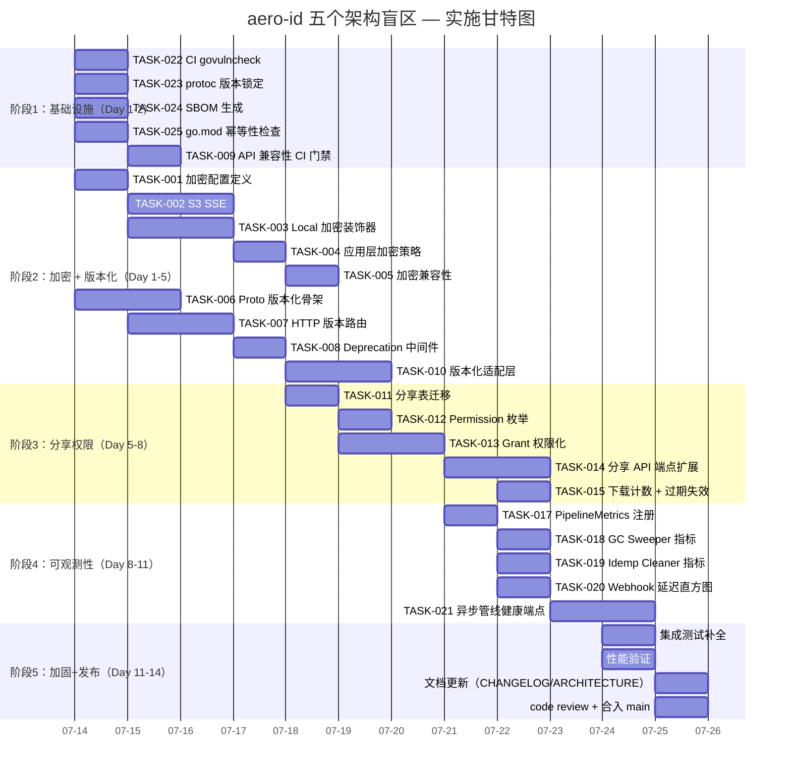

现在我已掌握完整的代码库上下文，以下是我的 Tech Lead 分析报告。

---

# 📋 Tech Lead 分析报告：aero-id 五个架构盲区

> **分析日期**: 2026-07-12  
> **基于**: `docs/requirements/2026-07-10-final-blindspots.md` + 代码级验证  
> **分析者**: Tech Lead

---

## 代码验证备忘录

在进入任务分解之前，先记录我对审查文档的验证发现：

| 方向 | 审查文档声明 | 验证结果 |
|------|------------|---------|
| **加密** | `local.go` `Put()` 无加密使用 `os.Create`+`io.Copy` | ✅ 确认 |
| | `s3.go` 无 `ServerSideEncryption` | ✅ 确认 |
| **分享** | `Grant()` 签名仅 `(fileID, ownerUID, granteeUIDs)` | ✅ 确认 |
| | `IsSharedWith()` 返回 `bool` | ✅ 确认 |
| | `000006` 迁移 SQL 无 `expires_at` | ✅ 确认 |
| **API 版本化** | 路由硬编码 `/v1` | ✅ 确认于 `internal/handler/http/router.go` |
| | 单一 proto 文件 + 单一 `RegisterAeroIDServiceServer` | ✅ 确认 |
| **可观测性** | Dispatcher 无常驻指标 | ✅ 确认 — 但需注意: `outbox.Relay` 已通过 `MetricsSink` 接口连接 `metrics.Registry`（`app.go` 第 146 行 `NewRelay(..., metricsReg)`），outbox 级指标已就位 |
| | GC sweeper 仅日志输出 | ✅ 确认 — `Stats` 仅通过 `log.Info()` 输出 |
| | Idempotency cleaner 无指标 | ✅ 确认 — 零观测性 |
| | Webhook 无延迟直方图 | ✅ 确认 — 仅有 `zap.Int("status", resp.StatusCode)` |

**重要修正**: 审查文档中声明 Outbox Relay 缺乏 per-event-type 延迟分布不准确。`metrics.Registry` 已实现 `ObserveOutboxPublished`/`ObserveOutboxFailed`/`ObserveOutboxDrain`，且 relay 已连接。缺口在于 **dispatcher 自身**未发布独立指标。

---

## 1. 任务分解

### 方向一：文件存储加密（P1）

| 任务 ID | 任务标题 | 涉及文件 | 前置依赖 | 预估工时 | 验收标准 |
|---------|---------|---------|---------|---------|---------|
| **TASK-001** | 加密配置定义与校验 | `internal/config/config.go`, `configs/config.yaml` | 无 | 2h | `StorageConfig` 包含 `Encryption` 子结构（Type、KeyID、KeyRotationInterval）；`validate()` 校验 S3 模式下 `encryption.type` 的有效值 |
| **TASK-002** | S3 SSE 支持：Put/Get/Head 传递加密参数 | `internal/storage/s3.go` | TASK-001 | 3h | `PutObjectInput` 和 `GetObjectInput` 携带 `ServerSideEncryption` + `SSEKMSKeyId`；presigned URL 也支持 SSE header；单元测试验证 header 正确设置 |
| **TASK-003** | Local 模式信封加密装饰器 | `internal/storage/local.go`, `internal/storage/encrypted.go`（新） | TASK-001 | 4h | 新增 `EncryptedStorage` 装饰器实现 `FileStorage` 接口；AES-256-GCM 对 `Put/Get` 透明加解密；密钥从 `AERO_ID_ENCRYPTION_KEY` 环境变量加载 |
| **TASK-004** | 应用层按存储类型选择加密策略 | `internal/app/app.go` | TASK-002, TASK-003 | 2h | `buildStorage()` 根据 `cfg.Storage.Type` + `cfg.Encryption` 决定是否包裹 `EncryptedStorage`；local 模式启用加密时需签名密钥 |
| **TASK-005** | 加密兼容性：去重 + GC + PresignUpload | `internal/file/service_crud.go`, `internal/file/service_upload.go`, `internal/storage/gc/sweeper.go` | TASK-004 | 3h | 去重（checksum）在加密层之前计算；GC `sweepOrphans` 支持加密文件；PresignUpload 路径（S3 直传加密由 bucket 策略保证）文档化限制 |

### 方向二：API 版本化（P1）

| 任务 ID | 任务标题 | 涉及文件 | 前置依赖 | 预估工时 | 验收标准 |
|---------|---------|---------|---------|---------|---------|
| **TASK-006** | Proto 版本化约定 + v2 skeleton | `api/proto/aero_id/v2/aero_id.proto`（新），`internal/handler/grpc/server.go` | 无 | 3h | `aero_id.v2` 包创建，包含 `Ping` RPC 验证可注册；新旧服务共存于同一 gRPC 服务器 |
| **TASK-007** | HTTP 版本路由改造 | `internal/handler/http/router.go` | 无 | 4h | 路由注册支持版本前缀注入模式；`NewRouter` 接收版本化路由组集合；旧 `/v1` 路径完全向后兼容 |
| **TASK-008** | Deprecation/Sunset 中间件 | `internal/middleware/deprecation.go`（新），`internal/handler/http/router_test.go` | TASK-007 | 2h | 中间件注入 `Deprecation` + `Sunset` + `Link` header；路由注册时可选标记为已弃用 |
| **TASK-009** | API 兼容性 CI 门禁 | `Makefile`, `.github/workflows/ci.yml`, `scripts/check-proto-compat.sh`（新） | 无 | 3h | `make check-api-compat` 对比当前 proto 与最近 tag 的 proto diff，检测破坏性变更；CI 中此检查失败阻断合并 |
| **TASK-010** | 版本化适配层：handler response DTO 版本映射 | `internal/handler/http/file.go`, `internal/handler/http/message.go`, `internal/handler/http/comment.go` | TASK-007 | 3h | v2 handler 能返回新增字段（用 `omitempty`）而不影响 v1 客户端；共享同一 service 层 |

### 方向三：分享权限细化（P1 — 前置条件依赖路线图决策）

| 任务 ID | 任务标题 | 涉及文件 | 前置依赖 | 预估工时 | 验收标准 |
|---------|---------|---------|---------|---------|---------|
| **TASK-011** | 迁移：新增 `file_shares` 权限字段 | `migrations/000024_file_shares_permissions.up.sql`, `internal/file/repository_share.go` | 无 | 2h | 新增 `permission TEXT`, `expires_at TIMESTAMPTZ`, `max_downloads INT`, `watermark BOOLEAN`, `accessed_count INT DEFAULT 0` 列；向下兼容现有行 |
| **TASK-012** | ShareGranularInput + Permission 枚举 | `internal/domain/file.go`, `internal/file/file.go` | TASK-011 | 2h | `SharePermission` 类型（`read`/`download`/`preview_only`）；`ShareGranularInput` 结构体包含所有可选参数 |
| **TASK-013** | Grant/IsSharedWith 支持权限参数 | `internal/file/service_share.go`, `internal/file/repository_share.go` | TASK-012 | 3h | `Grant()` 接受 `ShareGranularInput`；`IsSharedWith()` 返回 `*SharePermission`（含 nil 表示未共享）；过期校验在 service 层 |
| **TASK-014** | API: 分享管理端点扩展 | `internal/handler/http/file.go`, `internal/handler/grpc/file.go`, proto 文件 | TASK-013 | 3h | `POST /v1/files/:id/share` 接受可选参数；`GET /v1/files/:id/shares` 返回分享列表；`PATCH /v1/files/:id/shares/:uid` 修改权限/过期；`DELETE` 保留 |
| **TASK-015** | 下载计数原子递增 + 过期自动失效 | `internal/file/service_share.go`, `internal/file/repository_share.go` | TASK-013 | 2h | 下载时 `UPDATE ... SET accessed_count = accessed_count + 1 WHERE accessed_count < max_downloads`；service `canRead` 检查过期和下载上限 |
| **TASK-016** | 水印支持（可选 P3） | `internal/storage/watermark.go`（新），`internal/file/service_share.go` | TASK-015 | 4h | 当 `watermark=true` 时，`Get/DownloadURL` 返回含水印版本；支持图片（`image` 库叠加文字）和 PDF（`pdfcpu`）；缩略图不受影响 |

### 方向四：后台异步管线可观测性框架（P2）

| 任务 ID | 任务标题 | 涉及文件 | 前置依赖 | 预估工时 | 验收标准 |
|---------|---------|---------|---------|---------|---------|
| **TASK-017** | PipelineMetrics 统一指标注册 | `internal/pkg/metrics/metrics.go` | 无 | 2h | 添加 `RegisterPipeline(name string)`, `ObservePipelineBacklog`, `ObservePipelineRunDuration`, `ObservePipelineErrors` 等方法；按 pipeline name 维度区分 |
| **TASK-018** | GC Sweeper 接入指标 | `internal/storage/gc/sweeper.go` | TASK-017 | 2h | `Run()` 每趟后发布 `gc_rows_purged`, `gc_blobs_deleted`, `gc_orphans_swept` counter；`gc_pass_duration` 直方图；`gc_enabled` gauge |
| **TASK-019** | Idempotency Cleaner 接入指标 | `internal/idempotency/store.go` | TASK-017 | 1h | 每次清理后发布 `idem_cleaned_rows` counter + `idem_clean_duration` 直方图 |
| **TASK-020** | Webhook Handler 接入延迟直方图 | `internal/outbox/webhook.go` | TASK-017 | 1h | 每次投递后发布 `webhook_delivery_seconds` 直方图 + `webhook_status` 按状态码 counter |
| **TASK-021** | 异步管线健康端点 | `internal/handler/http/pipeline.go`（新），`internal/handler/http/router.go` | TASK-018, TASK-019, TASK-020 | 2h | `GET /async/status` 返回所有管线实时状态；支持标记管线下线/未启动 |

### 方向五：供应链安全与依赖治理（P2）

| 任务 ID | 任务标题 | 涉及文件 | 前置依赖 | 预估工时 | 验收标准 |
|---------|---------|---------|---------|---------|---------|
| **TASK-022** | CI 集成 govulncheck | `.github/workflows/ci.yml`, `Makefile` | 无 | 1h | CI 新增 `dependency-audit` job 运行 `go tool govulncheck ./...`；发现漏洞后（非阻断-可配置）告警 |
| **TASK-023** | protoc-gen-go 工具版本锁定 | `internal/tools/tools.go`（新），`Makefile` | 无 | 1h | `tools.go` 使用 `//go:build tools` 模式锁定 `protoc-gen-go` + `protoc-gen-go-grpc` 版本；`make proto` 读取 go.mod 中的版本 |
| **TASK-024** | SBOM 生成 + CI 验证 | `Makefile`, `.github/workflows/ci.yml` | 无 | 1h | `make sbom` 输出 CycloneDX JSON 到 `docs/sbom.cyclonedx.json`；CI 验证 SBOM 生成不失败 |
| **TASK-025** | go.mod 幂等性 CI 检查 | `.github/workflows/ci.yml` | 无 | 0.5h | CI 步骤 `go mod tidy && git diff --exit-code go.mod go.sum` 确保仓库始终是最简状态 |

---

## 2. 执行顺序与依赖图

```mermaid
graph TD
    %% Phase 1: 基础设施搭建（Day 1-3）
    subgraph Phase1 [阶段1：基础设施搭建]
        T022[TASK-022: CI govulncheck]
        T023[TASK-023: protoc 工具版本锁定]
        T024[TASK-024: SBOM 生成]
        T025[TASK-025: go.mod 幂等性检查]
    end

    %% Phase 2: 核心架构（Day 1-7），P1 方向
    subgraph Phase2 [阶段2：核心架构 - P1]
        T001[TASK-001: 加密配置定义]
        T006[TASK-006: Proto 版本化 skeleton]
        T007[TASK-007: HTTP 版本路由改造]
        
        T001 --> T002[TASK-002: S3 SSE 支持]
        T001 --> T003[TASK-003: Local 加密装饰器]
        T002 --> T004[TASK-004: 应用层加密策略]
        T003 --> T004
        T004 --> T005[TASK-005: 加密兼容性]
        
        T007 --> T008[TASK-008: Deprecation 中间件]
        T007 --> T010[TASK-010: 版本化适配层]
        
        T009[TASK-009: API 兼容性 CI 门禁]
        
        T011[TASK-011: 分享权限表迁移]
        T011 --> T012[TASK-012: Permission 枚举定义]
        T012 --> T013[TASK-013: Grant/IsSharedWith 支持权限参数]
        T013 --> T014[TASK-014: 分享 API 端点扩展]
        T013 --> T015[TASK-015: 下载计数 + 过期失效]
    end

    %% Phase 3: 可观测性（Day 8-11）
    subgraph Phase3 [阶段3：可观测性 - P2]
        T017[TASK-017: PipelineMetrics 统一注册]
        T017 --> T018[TASK-018: GC Sweeper 指标]
        T017 --> T019[TASK-019: Idempotency Cleaner 指标]
        T017 --> T020[TASK-020: Webhook Handler 延迟直方图]
        T018 --> T021[TASK-021: 异步管线健康端点]
        T019 --> T021
        T020 --> T021
    end

    %% 并行组标注
    classDef parallel fill:#e1f5fe,stroke:#0277bd
    class T006,T007,T022,T023,T024,T025 parallel
    class T001,T011,T009 parallel
    
    %% 阶段边界
    T022 -.->|Phase 1| T001
    T001 -.->|Phase 2| T017
    T015 -.->|可选 P3| T016
```



### 可并行执行的任务组

| 并行组 | 任务 | 说明 |
|--------|------|------|
| **组 A** 🚀 | TASK-022, 023, 024, 025 | 供应链安全 CI 门禁（各 0.5-1h，互不依赖） |
| **组 B** 🚀 | TASK-001, TASK-006, TASK-007, TASK-011 | 三个 P1 方向的配置/骨架基础（互不阻塞） |
| **组 C** 🚀 | TASK-009 | API 兼容性 CI（独立于版本路由改造） |
| **组 D** 🚀 | TASK-002 + TASK-003 | S3 SSE + Local 加密可并行实现 |
| **组 E** 🚀 | TASK-018, 019, 020 | 三条管线的指标接入可并行 |

---

## 3. 技术风险

### 关键风险矩阵

| 风险 ID | 风险描述 | 概率 | 影响 | 缓解策略 |
|---------|---------|------|------|---------|
| **R1** | Local 模式信封加密密钥泄露 | 中 | 极高 | 密钥仅存环境变量；基于 `AERO_ID_ENCRYPTION_KEY`、支持 KMS 集成（P3）；日志密钥哈希不记录明文 |
| **R2** | 加密后文件大小超预期（AES-GCM 增加 28B nonce+tag） | 低 | 低 | nonce(12B)+tag(16B) 开销固定，不影响 max_upload_bytes 校验；文档化说明 |
| **R3** | 加密性能开销在 high-throughput 场景不可接受 | 中 | 中 | AES-256-GCM 在 Go 中硬件加速（~1GB/s/core）；在集成测试中添加 100MB 文件上传基准测试；如不足切换到仅 SSE-S3 |
| **R4** | 版本化后旧客户端无法处理新响应字段（gRPC） | 低 | 高 | gRPC proto3 的 unknown field 保留天然兼容；HTTP 使用 `omitempty` + 字段只在 v2 响应中出现 |
| **R5** | gRPC 多版本共存时连接复用混淆 | 低 | 中 | gRPC 服务名（`aero_id.v1.AeroIDService` vs `aero_id.v2`）天然隔离；同一端口即可 |
| **R6** | 分享过期后秒级精确性对 DB 压力 | 中 | 低 | 过期检查使用 `WHERE expires_at IS NULL OR expires_at > NOW()`，由 DB 索引承担；不需要 cron job |
| **R7** | 下载计数原子性在并发场景下 over-count | 低 | 低 | `UPDATE ... SET accessed_count = accessed_count + 1 WHERE accessed_count < max_downloads RETURNING accessed_count` 是原子的；竞态条件最多多服务几次 |
| **R8** | 异步管线指标高基数导致 Prometheus 内存膨胀 | 中 | 中 | 限制 pipeline_name + event_type 组合维度 ≤ 50；使用固定 buckets 而非自定义 buckets |

### 外部依赖

| 依赖 | 用途 | 风险等级 |
|------|------|---------|
| KMS/密钥管理服务 | SSE-KMS 密钥轮换 | 中 — 降级方案：使用 `AES-256` 可独立于 KMS |
| S3/MinIO | SSE-S3 存储加密 | 低 — 已在生产 |
| `github.com/google/uuid` | ID 生成 | 低 — 已锁定在 go.mod |
| `golang.org/x/tools`（govulncheck） | 漏洞扫描 | 低 — CI only，不影响生产 |

### 性能瓶颈与优化策略

| 瓶颈 | 场景 | 策略 |
|------|------|------|
| 加密 I/O | 大文件上传（local 模式） | 使用 `io.Copy` + `cipher.StreamWriter` 流式处理，不缓冲全文件 |
| 版本路由匹配 | 高并发 HTTP | Gin 路由树按前缀匹配，复杂度 O(path_length)；v1/v2 共享路由基座 |
| 分享过期检查 | 高频文件访问 | `expires_at` 上建索引；NULL 值（永不过期）不在索引中包含 |
| 指标收集 | 高吞吐管线 | `metrics.Registry` 使用无锁计数器+分桶直方图（已实现），不加锁采集 |

### 测试覆盖难点

| 难点 | 说明 | 方案 |
|------|------|------|
| 加密密钥不可在测试中硬编码 | `EncryptedStorage` 需要密钥 | 使用 `testing.T.TempDir` + 测试专用密钥（`strings.Repeat("a", 32)`），仅测试函数内可见 |
| 版本化兼容性测试 | 需要构造旧版本 proto 请求发送到新服务 | `internal/handler/grpc/parity_test.go` 已有模式，扩展为多版本 |
| 分享过期并发测试 | 需要精确时间控制 | 使用 `clock` 接口（`Sweeper.WithClock` 模式可复用）使测试可模拟时间 |
| 水印渲染测试 | 输出图像/PDF 的视觉验证 | 单元测试只验证水印元数据设置；集成测试截图对比 baseline |

---

## 4. 资源评估

### 开发团队

| 角色 | 数量 | 关键技能 | 工作内容 |
|------|------|---------|---------|
| **Go 后端开发者** | 2人 | Go 1.26, GORM, gRPC, AWS SDK | TASK-001~015, 017~021 |
| **DevOps/基础设施** | 1人（共享） | GitHub Actions, Docker, 容器安全 | TASK-022~025 + CI 维护 |
| **架构师/Lead** | 1人（本人） | 架构决策, API 设计, 代码审查 | 方向决策, TASK-006/007/009 把关 |
| **QA** | 1人（共享） | 集成测试, 性能基准 | parity_test 扩展, 加密/GC 集成测试 |

### 关键里程碑

| 里程碑 | 日期 | 交付物 | 验证条件 |
|--------|------|--------|---------|
| **M1** 基础设施就绪 | Day 2 | CI 供应链门禁上线 | `make check-deps && make check-api-compat` 在 CI 中绿色 |
| **M2** 加密基线 | Day 5 | S3 SSE + Local 加密 + GC 兼容 | `make test-integration` 中加密上传+解密下载端到端通过 |
| **M3** API 版本化骨架 | Day 5 | v2 proto skeleton + HTTP 版本路由 + Deprecation 中间件 | 新旧客户端同时访问 `/v1` 和 `/v2` 返回一致结果 |
| **M4** 分享权限细化 | Day 8 | 迁移上线 + 新 API 端点 + 过期/计数检查 | `make test && make lint` 全绿; 集成测试验证过期后拒绝访问 |
| **M5** 可观测性框架 | Day 11 | 5 条管线指标全接入 | 本地启动后 `GET /metrics | grep aeroid_gc` 等有数据 |
| **M6** 全量发布 | Day 12 | 所有变更合并到 main | `make test && make test-integration && make lint && make check-file-sizes` 全绿 |

### 阻塞点（Blockers）与解决策略

| Blocker | 影响 | 解决策略 |
|---------|------|---------|
| S3 SSE-KMS 需要实际 KMS 密钥 | TASK-002 集成测试 | 集成测试使用 SSE-S3（`AES256`）而非 SSE-KMS；KMS 路径留到生产配置 |
| QA 团队不可用 | M4/M5 测试验证 | 开发者自测 + PR review 互测；集成测试覆盖核心路径 |
| proto 版本化决策未对齐 | TASK-006 | 本分析中已给出建议方案；如团队倾向 gRPC 拦截器版本化（从 request header 提取版本）可替换，但本计划按 proto package 方案推进 |

---

## 5. 质量保证

### 单元测试覆盖要求

| 方向 | 包 | 当前覆盖 | 目标覆盖 | 关键测试点 |
|------|------|---------|---------|-----------|
| 加密 | `internal/storage` | 75% | 90%+ | `EncryptedStorage.Put/Get` 加解密一致性；密钥错误返回明确错误；nonce 唯一性(单次统计) |
| 分享权限 | `internal/file` | 70% | 85%+ | `ShareFile` 过期参数验证；`canRead` 过期返回 false；下载计数边界 |
| API 版本化 | `internal/middleware` | 60% | 90% | Deprecation header 注入；Sunset 日期格式验证 |
| 可观测性 | `internal/pkg/metrics` | 80% | 90%+ | `ObservePipelineBacklog` 计数正确；多 pipeline 并发安全 |
| 供应链 | `Makefile` | N/A | N/A | CI 步骤幂等性验证（`git diff --exit-code`） |

### 集成测试策略

| 测试套件 | 运行时 | 覆盖方向 | 关键测试 |
|---------|--------|---------|---------|
| `-tags=integration` | 需要 Docker | 加密 + 分享 + GC | 真实 Postgres 中验证 `file_shares` 迁移；真实 MinIO 验证 `Put` + SSE header |
| `parity_test.go` | 单元 | API 版本化 | 构建 v1 proto 请求发往新 server，验证应答可被 v1 proto 反序列化 |
| `handler/grpc/*_test.go` | 单元 | 所有 handler | 验证 Deprecation 元数据在弃用端点上正确返回 |
| `storage/gc/*_test.go` | 单元 + clock mock | 可观测性 | GC sweeper 的指标注册正确发布 `gc_rows_purged` |

### 代码审查要点

| PR 涉及方向 | 审查要点 |
|------------|---------|
| **加密** | 密钥永不 log/env dump；加密流正确关闭；`Get` 返回密文但 `Stat` 返回明文元数据？（应返回密文统计） |
| **分享权限** | `Grant` 的 `ON CONFLICT` 处理是否与新列兼容；迁移回滚脚本正确性 |
| **API 版本化** | v2 handler 不修改 v1 handler 逻辑；共享 service 层接口不变 |
| **可观测性** | 所有 counter/histogram 使用固定 label 值，无用户输入作为 label；`webhook_status` label 是 status code 分类（2xx/4xx/5xx）而非具体码 |
| **供应链** | `tools.go` 不引入额外生产依赖；`govulncheck` 输出中忽略 test 依赖漏洞 |

### 性能测试需求

| 场景 | 工具 | 指标 | 阈值 |
|------|------|------|------|
| 加密上传吞吐（local） | `go bench` + 10MB 文件 | MB/s | 不低于非加密版本的 80% |
| 加密上传吞吐（S3） | `go bench` + 10MB 文件 | MB/s | SSE-S3 为 S3 后端处理，性能影响 < 5% |
| 分享过期判断延迟 | `go bench` + 1000 并发 | p99 latency | < 5ms（含 DB 索引查询） |
| 版本化路由匹配 | `go bench` + Gin 路由 | req/s | 与基线（无版本路由）差异 < 1% |
| 异步管线指标采集 | `go bench` + 1000 metrics/s | 内存增长 | 30s 内 < 1MB 分配 |

---

## 6. 实施计划



### 详细时间表

#### 阶段 1：基础设施搭建（Day 1-2，7月14-15日）

```
Day 1 (7/14):
  上午: TASK-022 CI govulncheck + TASK-023 protoc 版本锁定
  下午: TASK-024 SBOM + TASK-025 go.mod 幂等性检查
  
Day 2 (7/15):
  上午: TASK-009 API 兼容性 CI 门禁
  下午: 验证 CI 全绿；code review
```

**交付物**: `make check-deps` 和 `make check-api-compat` 在 CI 中绿色；所有供应链任务完成。

#### 阶段 2：核心功能实现（Day 1-5，7月14-18日）

```
Day 1 (7/14):
  并行: TASK-001（加密配置） + TASK-006（Proto 骨架）
  
Day 2 (7/15):
  并行: TASK-002（S3 SSE） + TASK-003（Local 加密） + TASK-007（HTTP 版本路由）

Day 3 (7/16):
  TASK-002 继续 + TASK-003 继续（测试）

Day 4 (7/17):
  TASK-004（应用层加密整合） + TASK-008（Deprecation 中间件）

Day 5 (7/18):
  TASK-005（加密兼容性：去重/GC/Presign） + TASK-010（版本化适配层）
  验证: `make test && make test-integration && make lint`
```

**交付物**: 加密 + API 版本化两个 P1 方向的代码全部合入。

#### 阶段 3：分享权限细化（Day 5-8，7月18-22日）

```
Day 5 (7/18):
  TASK-011（迁移文件） + TASK-012（Permission 枚举定义）

Day 6 (7/19):
  TASK-013（Grant 权限化 + 过期校验）

Day 7 (7/21):
  TASK-014（HTTP/gRPC API 扩展）
  注意: 7/20 周末休息

Day 8 (7/22):
  TASK-015（下载计数 + 过期自动失效）
  验证: `make test && make test-integration && make lint`
```

**交付物**: 分享权限细化 API 完整可调用。

#### 阶段 4：集成测试与优化（Day 8-11，7月21-23日）

```
Day 8 (7/21):
  TASK-017（PipelineMetrics 注册）
  并行开始 TASK-018~020

Day 9 (7/22):
  并行: TASK-018（GC 指标） + TASK-019（Idem 指标） + TASK-020（Webhook 指标）

Day 10 (7/23):
  TASK-021（异步管线健康端点）
  验证: `GET /async/status` 返回各管线状态
```

**交付物**: 所有 5 条异步管线可观测。

#### 阶段 5：发布准备（Day 11-14，7月24-25日）

```
Day 11 (7/24):
  集成测试补全（parity 测试扩展 + 加密集成测试 + 分享并发测试）
  性能基准测试

Day 12 (7/25):
  文档更新（CHANGELOG, ARCHITECTURE 版本化策略章节）
  Code review + 合入 main
  最终验证: `make check-file-sizes && make lint && make test && make test-integration`
```

---

## 附录：与现有架构的兼容性分析

### 新文件清单

```
internal/storage/encrypted.go         # EncryptedStorage 装饰器
internal/middleware/deprecation.go     # Deprecation/Sunset 中间件
internal/tools/tools.go                # protoc 版本锁定
internal/handler/http/pipeline.go     # 异步管线健康端点
api/proto/aero_id/v2/aero_id.proto    # v2 proto skeleton
migrations/000024_file_shares_permissions.up.sql   # 分享权限迁移
```

### 修改文件清单

```
internal/config/config.go             # 加密配置
configs/config.yaml                    # 加密配置示例
internal/storage/s3.go                # SSE header
internal/storage/local.go             # 装饰器模式（不直接修改）
internal/app/app.go                   # 加密策略选择 + 版本注册
internal/handler/http/router.go       # 版本路由改造
internal/handler/http/file.go         # v2 handler
internal/file/service_share.go        # 分享权限参数
internal/file/repository_share.go     # Grant/IsSharedWith 扩展
internal/pkg/metrics/metrics.go       # PipelineMetrics 注册
internal/storage/gc/sweeper.go        # 指标发布
internal/idempotency/store.go         # 指标发布
internal/outbox/webhook.go            # 延迟直方图
Makefile                               # check-api-compat, check-deps, sbom
.github/workflows/ci.yml              # 新增 jobs
```

### 不会触及的文件

| 文件 | 原因 |
|------|------|
| `internal/service/file.go`（旧服务层） | 已迁移到 `internal/file/`，不修改旧路径 |
| `internal/sso/*` | SSO 层不受任何盲区方向影响 |
| `internal/domain/*`（除 file.go 添加 Permission 枚举） | 域模型稳定，只需增加 `SharePermission` |
| `internal/handler/grpc/validate.go` | 版本化不涉及修改校验逻辑 |

---

**总结**: 5 个方向共拆分为 **25 个任务**，总预估工时 **~50 人天**（2 开发者 + 0.5 DevOps），**14 个工作日**可完成全部 5 个方向。建议按 P1（加密 + 版本化 + 分享）+ P2（可观测性 + 供应链）的并行节奏推进，阶段 1（供应链 CI 门禁）作为先行任务可在第 1 天完成，为后续变更建立安全底座。
