现在我已全面了解代码库和五个扩展方向。以下是我的 Tech Lead 分析。

---

# Tech Lead 分析报告：五个架构级扩展方向

## 1. 任务分解

以下将五个功能方向拆解为可交付的开发任务。每个任务预计 2-4 小时，均包含明确的验收标准。

### 方向五 — HTTP 请求体大小限额（P0）

| 任务 ID | 标题 | 涉及文件 | 前置依赖 | 预估工时 | 验收标准 |
|---------|------|---------|---------|---------|---------|
| **TASK-001** | 实现 `BodySizeLimit` 中间件 | `internal/middleware/bodylimit.go`（新文件） | 无 | 1h | 中间件封装 `http.MaxBytesReader`，超过限制时返回 413；低于读取超时 |
| **TASK-002** | 将中间件接入路由 + 添加配置 | `internal/handler/http/router.go`, `configs/config.yaml` | TASK-001 | 1h | 路由全局默认大小限制生效；文件上传路由的限制不低于 service 层限制 |
| **TASK-003** | 为路由层添加 gRPC `MaxCallRecvMsgSize` | `internal/handler/grpc/server.go`, `configs/config.yaml` | 无 | 1h | gRPC 默认接收消息大小限制可配置，默认 4MB |
| **TASK-004** | 单元测试 + 集成测试 | `internal/middleware/bodylimit_test.go`, `internal/handler/http/router_test.go` | TASK-001, TASK-002, TASK-003 | 1.5h | 测试覆盖：413 返回、正常请求通过、大请求拒绝、gRPC 限制、配置解析 |

**方向五汇总：4 个任务，4.5 小时，全轨道无阻塞。**

### 方向一 — 异步链路追踪连续性（P1）

| 任务 ID | 标题 | 涉及文件 | 前置依赖 | 预估工时 | 验收标准 |
|---------|------|---------|---------|---------|---------|
| **TASK-005** | 在 Event 结构体中添加 Trace Context | `internal/outbox/outbox.go` | 无 | 0.5h | `Event` 增加 `Traceparent` 字段；`NewEvent` 接受 `ctx context.Context` 参数 |
| **TASK-006** | 添加迁移脚本增加 `outbox_events.trace_id` / `span_id` 列 | `migrations/000021_outbox_trace_columns.up.sql`, `migrations/000021_outbox_trace_columns.down.sql` | TASK-005 | 1h | 迁移可安全应用于空表及已有数据的表；向下迁移可回滚 |
| **TASK-007** | 更新 Repository 读写 trace 列 | `internal/outbox/repository.go` | TASK-005, TASK-006 | 1h | `Append` 将 trace 列写入表中；`FetchUnpublished` 读取到 `Event` 结构体 |
| **TASK-008** | 在 `newEvent()` 调用点注入 trace context | `internal/service/message.go`, `internal/service/comment.go`, `internal/service/file.go`（以及其他产生 event 的服务） | TASK-005 | 1.5h | 所有 `newEvent()` 调用均从调用处的 `ctx` 提取并传递 traceparent |
| **TASK-009** | 在 Relay 中为每个 event 建 root span 或恢复 traceparent | `internal/outbox/relay.go` | TASK-005, TASK-007 | 2h | `drain()` 中每个 event 的 handler 调用都带有正确的 trace context（若 event 有 traceparent，则恢复；若没有，则创建 root span） |

**方向一汇总：5 个任务，6 小时。与方向四共享 outbox 层变更。**

### 方向四 — 死信事件生命周期管理（P1）

| 任务 ID | 标题 | 涉及文件 | 前置依赖 | 预估工时 | 验收标准 |
|---------|------|---------|---------|---------|---------|
| **TASK-010** | 添加死信查询的 Repository 方法 + 迁移索引 | `internal/outbox/repository.go`, `migrations/000022_outbox_dead_letter_index.up.sql` | 无 | 1.5h | `FetchDeadLetters(ctx, page, eventType)` 返回分页列表；`PurgeDeadLetters(ctx, before)` 清除指定时间前的事件；迁移添加 `(dead_letter, event_type, created_at)` 索引 |
| **TASK-011** | 添加死信重试/清除的 Repository 方法 | `internal/outbox/repository.go` | TASK-010 | 1h | `RetryDeadLetter(ctx, id)` 重置 `dead_letter=false, retry_count=0`；不会将已成功事件改回死信 |
| **TASK-012** | 新增死信管理 HTTP/gRPC 端点 | `internal/handler/http/outbox.go`（新文件）, `internal/handler/grpc/outbox.go`（新文件） | TASK-010, TASK-011 | 3h | 双协议实现：`GET/POST/DELETE /v1/admin/outbox/dead-letters`；普通用户 403，admin 角色可操作 |
| **TASK-013** | 扩展 metrics：死信计数、重试计数 | `internal/pkg/metrics/metrics.go`, `internal/outbox/relay.go` | TASK-010 | 1h | Prometheus 暴露 `aeroid_outbox_dead_letter_total`, `aeroid_outbox_dead_letter_retried_total`；死信产生时 inc |
| **TASK-014** | 添加 Prometheus 告警规则 | `deploy/prometheus/alerts.yml`（新文件） | TASK-013 | 0.5h | 规则定义：`15m 内 dead_letter_total 增量 > 0` 触发 warning 告警 |
| **TASK-015** | 死信事件归档（可选，合规场景） | `internal/outbox/archiver.go`（新文件）, `migrations/000023_outbox_dead_letter_archive.up.sql` | TASK-011 | 2h | 死信在标记后自动复制到 `outbox_dead_letter_archive` 表；有独立的保留策略 |

**方向四汇总：6 个任务，9 小时（不含归档则为 7 小时）。核心 5 个任务与方向一仅共享 outbox 模型变更，互不阻塞。**

### 方向三 — 跨实例 SSE 推送（P1）

| 任务 ID | 标题 | 涉及文件 | 前置依赖 | 预估工时 | 验收标准 |
|---------|------|---------|---------|---------|---------|
| **TASK-016** | 添加定期轮询回退的客户端指南 + 服务端扩展 `ListSince` 分页 | `internal/handler/http/events.go`, `internal/notification/repository.go` | 无 | 2h | SSE 端点新增 `since` 参数（已有 `ListSince`）；文档记录客户端应每 30s 拉取一次 |
| **TASK-017** | 定义 `Broadcaster` 接口 + Redis Pub/Sub 实现 | `internal/hub/broadcaster.go`（新文件）, `internal/hub/redis.go`（新文件） | 无 | 3h | `Broadcaster` 接口：`Publish(ctx, uid, type, data)` / `Subscribe(ctx, uid) → chan`；`RedisBroadcaster` 实现完整；连接中断可重连 |
| **TASK-018** | 适配 Hub 订阅机制感知外部广播 | `internal/hub/hub.go`, `internal/hub/adapter.go` | TASK-017 | 2h | Hub 在 `Subscribe` 时也订阅 Redis channel；`Publish` 同时写入本地 + Redis |
| **TASK-019** | 添加 Redis 配置并注入 | `configs/config.yaml`, `internal/app/app.go`, `internal/config/config.go` | TASK-018 | 1.5h | 配置节 `sse.redis.url` 可选；不存在时降级到纯本地推送 |
| **TASK-020** | 集成测试：多进程 SSE 广播验证 | `internal/hub/redis_test.go`（+build integration） | TASK-017, TASK-018, TASK-019 | 3h | 两个 testcontainer Redis 模拟多实例场景；A 实例 publish → B 实例可收到 |

**方向三汇总：5 个任务，11.5 小时。其中 TASK-016 为低成本临时方案，可在 TASK-017~020 之前单独发布。**

### 方向二 — 存储 GC TOCTOU 竞态（P2）

| 任务 ID | 标题 | 涉及文件 | 前置依赖 | 预估工时 | 验收标准 |
|---------|------|---------|---------|---------|---------|
| **TASK-021** | 添加存储一致性检查 Job | `internal/storage/gc/consistency.go`（新文件） | 无 | 2.5h | 扫描所有 `storage_key` 不为空的行；对每个唯一 key 执行 `Stat()`；对不存在的 blob 标记为 `file.status=corrupted` |
| **TASK-022** | 添加 `corrupted` 状态与查询支持 | `internal/domain/file.go`, `internal/repository/file.go`, `migrations/000024_file_corrupted.up.sql` | TASK-021 | 1.5h | `files` 表增加 `status` 列（默认 `active`，选项 `active/corrupted`）；添加查询损坏文件的 Repository 方法 |
| **TASK-023** | 在 Sweeper 中添加 FOR UPDATE 选项（可选） | `internal/storage/gc/sweeper.go` | 无 | 2h | 配置选项 `use_row_lock: true` 启用时，`countLive` 使用 `SELECT ... FOR UPDATE` 防止并发写入 |
| **TASK-024** | 修复引用计数时序：在行创建之前先递增 ref | `internal/service/file.go` | 无 | 1.5h | `Create` 流程中 ref 递增在行创建/更新之前完成；GC 窗口缩小到 transactions 级别 |
| **TASK-025** | 添加灰度开关与 GC 健康指标 | `configs/config.yaml`, `internal/pkg/metrics/metrics.go`, `internal/storage/gc/sweeper.go` | TASK-021, TASK-024 | 1h | 指标 `aeroid_storage_gc_consistency_errors_total`；`gc.enabled` 可动态配置 |
| **TASK-026** | GC 竞态集成测试 | `internal/storage/gc/sweeper_test.go`（+build integration） | TASK-023, TASK-024 | 3h | 用测试容器 Postgres + 模拟存储，启动并发上传 + GC 验证不产生孤儿 |

**方向二汇总：6 个任务，11.5 小时。优先级最低（P2），因为 GC 默认关闭。**

---

## 2. 执行顺序与依赖图

```mermaid
graph TD
    %% 方向五 — P0 零依赖
    subgraph "Phase 0 [P0: 4.5h — 立即实施]"
        T001[TASK-001: BodySizeLimit 中间件]
        T002[TASK-002: 路由集成 + 配置]
        T003[TASK-003: gRPC MaxCallRecvMsgSize]
        T004[TASK-004: 测试]
        T001 --> T002
        T001 --> T003
        T002 --> T004
        T003 --> T004
    end

    %% 方向一 — P1
    subgraph "Phase 1a [P1: Trace + Dead Letter — 共享 outbox 变更]"
        direction LR
        T005[TASK-005: Event 增加 Traceparent]
        T006[TASK-006: 迁移 outbox 增加 trace 列]
        T007[TASK-007: Repository 读写 trace 列]
        T008[TASK-008: 各服务注入 trace context]
        T009[TASK-009: Relay 中恢复/创建 span]
    end

    subgraph "Phase 1b [P1: Dead Letter — 可并行于 1a 之后]"
        T010[TASK-010: 死信查询+迁移索引]
        T011[TASK-011: 死信重试/清除]
        T012[TASK-012: 管理 API 端点]
        T013[TASK-013: 死信 metrics + 告警]
        T014[TASK-014: Prometheus 告警规则]
        T015[TASK-015: 死信归档表]
    end

    T005 --> T006
    T005 --> T007
    T006 --> T008
    T007 --> T009
    T010 --> T011
    T011 --> T012
    T011 --> T013
    T013 --> T014
    T012 --> T015

    %% 方向三 — P1
    subgraph "Phase 1c [P1: SSE 跨实例广播]"
        T016[TASK-016: 客户端轮询回退]
        T017[TASK-017: Broadcaster 接口+Redis 实现]
        T018[TASK-018: Hub 适配外部广播]
        T019[TASK-019: Redis 配置+注入]
        T020[TASK-020: 集成测试]
    end

    T016 -.->|独立发布| T017
    T017 --> T018
    T018 --> T019
    T019 --> T020

    %% 方向二 — P2
    subgraph "Phase 2 [P2: GC 竞态修复 — 长期]"
        T021[TASK-021: 一致性检查 Job]
        T022[TASK-022: corrupted 状态支持]
        T023[TASK-023: FOR UPDATE 选项]
        T024[TASK-024: ref 递增时序修复]
        T025[TASK-025: 灰度开关+指标]
        T026[TASK-026: GC 竞态集成测试]
    end

    T021 --> T022
    T024 --> T021
    T023 --> T026
    T022 --> T025
    T024 --> T025
    T025 --> T026

    %% 并行组标记
    style T005 fill:#d4e6f1,stroke:#2874a6
    style T010 fill:#f9e79f,stroke:#b7950b
    style T016 fill:#d5f5e3,stroke:#1e8449
    style T021 fill:#fadbd8,stroke:#c0392b
```



### 可并行执行的任务组

| 并行组 | 任务 | 原因 |
|--------|------|------|
| **组 A** | TASK-001, TASK-003 | BodySizeLimit 中间件和 gRPC 限制互不依赖，可同步开发 |
| **组 B** | TASK-005, TASK-010 | Event 模型变更和死信 Repository 方法在代码上独立，但共享 outbox 模型变更需注意合并顺序 |
| **组 C** | TASK-008, TASK-011 | 服务层注入 trace context（多文件改动）和死信重试 Repository 方法完全独立 |
| **组 D** | TASK-009, TASK-012, TASK-017 | Relay 改造、死信 API、Redis 广播器三者无代码耦合 |

---

## 3. 技术风险

### 3.1 高影响风险

| # | 风险 | 方向 | 可能性 | 影响 | 缓解策略 |
|---|------|------|--------|------|---------|
| R1 | **traceparent 注入增加 Event 结构体大小** — 序列化/反序列化 55 字节串，对高吞吐 outbox 有微性能影响 | 方向一 | 低 | 低 | 加 `omitempty` 标签，空串时不存储。非空时仅在 event 产生和消费时额外解析，非热点路径 |
| R2 | **死信管理 API 的授权模型** — 死信操作（查询/重试/清除）需要 admin 权限，但当前 admin 角色粒度较粗 | 方向四 | 中 | 中 | 复用已有 `middleware.Permission` 与 `adminSvc`；新端点加上 `require_admin` 角色检查 |
| R3 | **Redis Broadcaster 引入新依赖** — 多副本部署必须运维 Redis；Redis 宕机时 SSE 降级为本地推送 | 方向三 | 中 | 高 | Broadcaster 接口设计为 optional（nil 时降级本地）；使用 Redis Sentinel 或 Cluster 提高可用性 |
| R4 | **GC 行锁影响 files 表写入吞吐** — `SELECT ... FOR UPDATE` 在高并发上传场景可能成为瓶颈 | 方向二 | 中 | 高 | `use_row_lock` 配置为 optional（默认关闭）；一致性检查 Job 作为主要防线 |
| R5 | **引用计数时序修复引入新竞态** — 将 ref 递增提前到行创建之前，可能导致 ref 计数 > 实际行数（上传失败时 ref 未递减） | 方向二 | 中 | 中 | 在 upload 失败/回滚路径中添加 ref 递减逻辑；one-gate cleanup（defer 模式） |

### 3.2 性能分析

- **BodySizeLimit**: 零性能影响 — `http.MaxBytesReader` 在 LimitReader 之上只增加一次 `if` 检查
- **Trace Context 注入**: 每事件增加 55 字节 payload + 2 次 string parse（relay 端），批量 100 个 event 下增加 < 0.1ms 处理时间
- **死信查询**: `dead_letter + event_type + created_at` 复合索引确保查询高效；高频场景（数百万死信）才需要归档
- **Redis Pub/Sub**: 每个通知推送产生 `O(N)` 次 Redis 消息（N 为该用户的连接数），每个连接 1 个 channel。单个用户 < 5 个设备的场景下可忽略，需关注的是百万人同时在线时的 Redis 吞吐
- **一致性检查 Job**: 全表扫描 `storage_key`，应在低峰期运行（如凌晨 2 点），扫描频率不高于每日一次

### 3.3 测试难点

| 场景 | 难度 | 策略 |
|------|------|------|
| GC TOCTOU 竞态验证 | 🔥🔥🔥🔥🔥 | 需要精确控制并发时序 — 使用 `sync.WaitGroup` + channel 在检查/删除之间插桩等待；集成测试中协调两个 goroutine |
| 死信重试幂等性 | 🔥🔥🔥 | 死信重试若 handler 有副作用，使用 `Handler` mock 验证只调用一次 |
| 跨实例 SSE 广播 | 🔥🔥🔥 | 需要两个 testcontainer Postgres 实例或一个 Redis；验证 A 发布 → B 接收 |
| Trace Context 跨协程传播 | 🔥🔥 | 使用 `go.opentelemetry.io/otel` mock span exporter 验证 relay 创建的 span 有正确的 parent |

---

## 4. 资源评估

### 4.1 开发人员技能要求

| 技能等级 | 方向 | 人数 | 说明 |
|---------|------|------|------|
| **初级** (1-2 年 Go) | 方向五、方向四（核心 Repository 之外） | 1 | BodySizeLimit 中间件、死信 API 端点、metrics 扩展 — 有 Gin/gRPC 基础即可 |
| **中级** (2-4 年 Go) | 方向一、方向四（核心变更） | 1-2 | OTel 追踪上下文传播、Outbox 模型变更、迁移脚本、配置注入 |
| **高级** (4+ 年) | 方向二（并发竞态）、方向三（分布式广播） | 1 | 需要并发编程、Redis/NATS 经验、分布式系统事务边界理解 |

**建议团队配置**：2 名全栈 Go 开发 + 1 名高级开发（兼任 Tech Lead/Reviewer），全职投入 2 周即可完成所有 P0+P1 方向。

### 4.2 关键里程碑

| 里程碑 | 目标日期 | 交付内容 | 验证方式 |
|--------|---------|---------|---------|
| **M0 — 基础安全加固** | Day 1 | BodySizeLimit 中间件 + 测试 + 文档 | `make test && make lint`；手动 curl 测试 413 返回 |
| **M1 — 不可见变可见** | Day 3 | Trace context 注入 + 死信管理 API + 指标 | 端到端链路在 Jaeger 中可见；可查询/重试死信 |
| **M2 — 实时不丢失** | Day 5 | SSE 广播 + Redis 集成（可选）+ 客户端轮询降级 | 双实例测试 SSE 事件送达率 > 99% |
| **M3 — 数据完整性加固** | Day 10 | GC 一致性检查 + ref 时序修复 | 并发上传 + GC 测试验证无误删 |
| **M4 — 发布检查** | Day 12 | 全量回归测试、文档更新、性能压测 | `make test-integration` 通过；无 regressions |

### 4.3 阻塞点（Blockers）

| # | 阻塞点 | 影响方向 | 解决策略 |
|---|--------|---------|---------|
| B1 | **无 Redis 可用** — 方向三的 Redis Pub/Sub 需要运维搭建 | 方向三 | TASK-016（客户端轮询降级）先发布，Redis 方案后推。**不影响项目发布。** |
| B2 | **SSO 无 admin 角色端点** — 死信管理的授权依赖 admin role 检查 | 方向四 | 验证 `adminSvc` 已有 `PermissionChecker`（见 app.go:217 `grpcsrv.WithPermissionChecker(adminSvc)`）；如需扩展先提交小 PR |
| B3 | **Jaeger/OTel Collector 不可用于测试** — trace context 注入端到端验证需要测试 collector | 方向一 | 使用 `go.opentelemetry.io/otel/exporters/stdout/stdouttrace` 做单元测试；集成测试使用 `memory.Exporter` |

---

## 5. 质量保证

### 5.1 单元测试覆盖要求

| 任务 | 包 | 最低覆盖要求 | 关键测试用例 |
|------|---|------------|-------------|
| TASK-001 | `middleware` | 90%+ | 正常请求通过；超过限制返回 413；limit=0 表示无限；`ShouldBindJSON` 在限制下正常返回 |
| TASK-004 | `middleware` | 90%+ | 各种配置组合；route-specific override；gRPC 限制 |
| TASK-005~009 | `outbox`, `service` | 85%+ | event 有/无 traceparent；relay 正确恢复/创建 span；relay 从 `context.Background()` 启动时不 panic |
| TASK-010~012 | `outbox`, `handler/http`, `handler/grpc` | 85%+ | 死信列表分页；重试后 event 被 relay 再次 pick up；purge 不影响正在重试的事件 |
| TASK-017~018 | `hub` | 80%+ | Redis 断线重连；本地+Redis 双重发布；退订后不再收到广播 |
| TASK-021~024 | `storage/gc` | 85%+ | 一致性检查发现损坏 blob；`FOR UPDATE` 防止并发冲突；ref 时序正确 |

### 5.2 集成测试策略

```
方向五: internal/middleware/bodylimit_test.go   (integration build tag)
  - 启动 test Gin server → 发送大请求 → 验证 413
  - 验证 config 驱动的 route-specific limits

方向一: internal/outbox/relay_test.go           (integration build tag)
  - 启动 testcontainer Postgres
  - 写入含 traceparent 的 event → relay 处理 → 验证 span tree

方向四: internal/outbox/repository_test.go      (integration build tag)
  - 启动 testcontainer Postgres
  - 死信事件管理全流程：创建失败→死信→查询→重试→成功发布

方向三: internal/hub/redis_test.go              (integration build tag)
  - 启动 testcontainer Redis
  - 两个 hub 实例；publish 到实例A → 验证实例B收到
  - Redis 断开 → 降级到本地推送

方向二: internal/storage/gc/sweeper_test.go     (integration build tag)
  - 启动 testcontainer Postgres
  - goroutine A: 并发上传文件；goroutine B: 运行 GC
  - 验证所有 blob 都存在（一致性 Job 复查）
```

### 5.3 代码审查要点

| 审查焦点 | 方向 | 具体检查项 |
|---------|------|-----------|
| **安全** | 五 | BodySizeLimit 是否覆盖所有 API 路由（包括文件上传的 service 层限制 > HTTP 层限制） |
| **可观测性** | 一 | Event 的 Traceparent 是否在所有 `newEvent()` 调用点正确注入；Relay 中失败场景不影响 span |
| **幂等性** | 四 | `RetryDeadLetter` 并发调用不会导致事件被处理两次；死信重试后的死信禁止再重试 |
| **并发安全** | 二 | `countLive` 到 `Delete` 之间的 FOR UPDATE 锁范围；ref 递增/递减在回滚路径中正确恢复 |
| **降级** | 三 | Redis 断线后不 panic；Broadcaster= nil 时无缝降级到本地推送 |
| **配置** | 全部 | 新增配置项均有合理的默认值 + `AERO_ID_*` 环境变量覆盖 |

### 5.4 性能测试需求

| 场景 | 方向 | 目标 | 方法 |
|------|------|------|------|
| 大 JSON 请求拒绝 | 五 | 1GB 请求不导致 OOM | `wrk` 并发 50 个连接，发送 100MB payload，监控 RSS 内存 |
| Outbox 高吞吐 trace 注入 | 一 | 10K events/s 时吞吐下降 < 3% | 基准测试：有/无 traceparent 字段的 relay drain 循环 |
| 死信表大容量查询 | 四 | 100 万行时分页查询 < 100ms | 预填充死信事件表 + `EXPLAIN ANALYZE` |
| SSE+Redis 延迟 | 三 | P99 推送延迟 < 100ms | `redis-benchmark` + 业务模拟 |
| GC 并发上传 | 二 | GC 运行时上传吞吐降 < 10% | 并发上传 + GC 同步运行，监控 P99 延迟 |

---

## 6. 实施计划

### 甘特图（按里程碑展示）

```
周 1         周 2
| MON | TUE | WED | THU | FRI | MON | TUE | WED | THU | FRI |
|-----|-----|-----|-----|-----|-----|-----|-----|-----|-----|
[M0: 基础安全加固 — 0.5 天]
T001 ■                               [BodySizeLimit 中间件]
T002  ■                              [路由集成]
T003  ■                              [gRPC 限制]
T004   ■■■                           [测试 + 文档]
                                       
[M1: 不可见变可见 — 2 天]           
T005   ■                             [Event Traceparent]
T006    ■                            [迁移脚本]
T007    ■■                           [Repository 读写]
T008     ■■■                         [服务层注入]
T009      ■■                         [Relay 改造]
T010    ■■■                          [死信 Repository]
T011      ■                          [死信重试/清除]
T012       ■■■                       [死信 API 端点]
T013        ■■                       [Metrics 扩展]
T014         ■                       [告警规则]

[M2: 实时不丢失 — 2 天]
T016        ■                        [客户端轮询回退]
T017         ■■■                     [Broadcaster+Redis]
T018          ■■                     [Hub 适配]
T019           ■                      [配置注入]
T020            ■■■                  [集成测试]

[M3: 数据完整性加固 — 2 天]
T021            ■■■                  [一致性检查 Job]
T022             ■■                  [corrupted 状态]
T023              ■■                 [FOR UPDATE 选项]
T024               ■                 [ref 时序修复]
T025                ■■               [灰度开关+指标]
T026                 ■■■             [GC 集成测试]

[M4: 发布检查 — 1 天]
[全量回归测试]
[文档更新]
[性能压测]
```

### 阶段 1：基础设施搭建（Day 0-0.5）

**目标**：完成零依赖安全修复，建立代码基础。

- 实施 TASK-001~004（方向五）
- 交付：`internal/middleware/bodylimit.go`, 路由集成, 测试
- **Gate**: `make test && make lint` 通过
- **此时可随时部署上线**，没有破坏性变更

### 阶段 2：核心功能实现（Day 0.5-3）

**目标**：异步路径可观测 + 死信管理 — 对线上零影响。

**并行工作流 A** — Trace 连续性（方向一）
- Day 0.5-1: TASK-005~007（模型变更 + 迁移）
- Day 1-2: TASK-008~009（注入 + Relay 改造）
- 交付：异步路径链路在 Jaeger 中可见

**并行工作流 B** — 死信管理（方向四）
- Day 0.5-1.5: TASK-010~011（Repository 层）
- Day 1.5-2.5: TASK-012~014（API + 指标 + 告警）
- Day 2.5-3: TASK-015（可选归档）
- 交付：死信全生命周期可查可管

**Gate**: `make test-integration` 通过；单实例端到端验证

### 阶段 3：实时通信增强（Day 3-5）

**目标**：SSE 推送在多副本部署下可靠送达。

- Day 3-3.5: TASK-016（客户端轮询回退 — 独立于 Redis 方案发布）
- Day 3.5-4.5: TASK-017~018（Broadcaster 接口 + Redis 实现）
- Day 4.5-5: TASK-019~020（配置注入 + 集成测试）
- **Gate**: 双 testcontainer Redis 实例验证跨进程推送

### 阶段 4：数据完整性加固 + 发布准备（Day 5-10）

**目标**：GC TOCTOU 竞态无数据损坏风险，可安全启用。

- Day 5-6.5: TASK-021~022（一致性检查 Job + corrupted 状态）
- Day 6.5-8: TASK-023~025（行锁 + ref 时序 + 指标）
- Day 8-10: TASK-026（竞态集成测试）+ M4 发布准备
- **Gate**: 并发上传 + GC 同步运行 24h 零损坏

### 阶段 4b：发布检查（Day 10-12）

- 全量回归测试：`make test && make test-integration && make lint`
- 文档更新：
  - `README.md` 添加 BodySizeLimit 配置说明
  - `docs/dead-letter.md` 运维操作手册
  - `docs/sse-multi-instance.md` 多副本部署指南
- 性能压测：确认在预期负载下无退化
- 灰度发布计划：
  - 方向五：直接上线，零影响
  - 方向一：gRPC 追踪可选（已有 `tracing.enabled: false`），上线后透明度
  - 方向四：API 端点只对 admin 可见，不影响普通用户
  - 方向三：Redis 配置 optional，无 Redis 则降级本地推送
  - 方向二：`gc.enabled: false` 默认，一致性 Job 先行上线

---

## 总结：执行建议

| 优先级 | 方向 | 建议 | 分配 |
|--------|------|------|------|
| **P0** 🚨 | 方向五：BodySizeLimit | **今日就做**，单人 4.5h 完成 | 任意后端工程师 |
| **P1** ⚡ | 方向一：Trace 连续性 | 下周启动，与方向四共享代码评审 | 中级 Go 工程师 |
| **P1** ⚡ | 方向四：死信管理 | 与方向一同周进行，不同 Sprint | 中级 Go 工程师 |
| **P1** ⚡ | 方向三：SSE 跨实例 | 方向一/四之后，或在多副本部署前 | 高级 Go 工程师 |
| **P2** ☁️ | 方向二：GC TOCTOU | 长期维护，仅在启用 GC 前需要 | 高级 Go 工程师 |

**关键 takeaway**：五个方向互相独立，不存在不可解耦的依赖链。最明智的策略是**立即执行 P0 方向五**，然后**并行推进方向一和方向四**（共享 outbox 模型变更但开发者独立），再以方向三收尾。方向二作为持续改进项目，与主线并发进行。

整个计划（P0+P1 四个方向）预计 **2 名全栈 Go 开发 + 1 名高级开发在 2 周内完成**，且每个阶段都有可部署的增量交付值。
