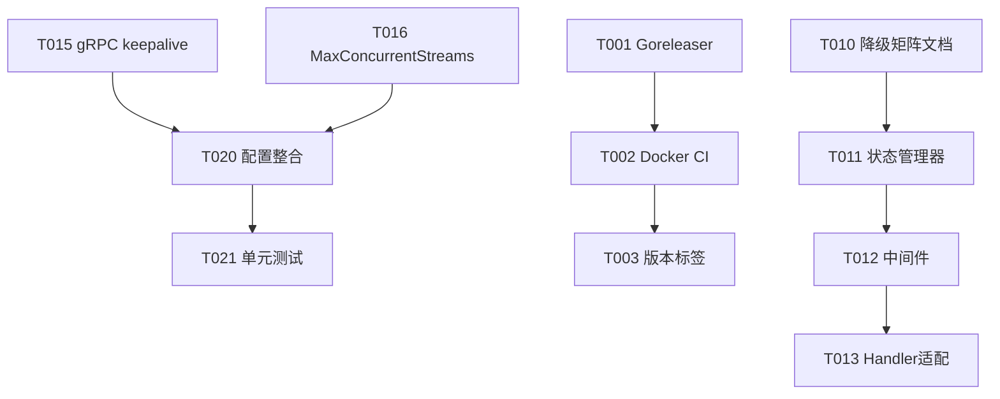

## 完成总结

分析文档已写入 **`docs/imp plan/2026-07-12-implementation-plan.md`**（679 行）。以下是核心交付物概览：

---

### 1. 任务分解 — 25 个任务，96h（12 人日）

| 方向 | 任务数 | 工时 | 优先级 |
|------|--------|------|--------|
| 四 — 传输协议加固 | 7 | 20h | **P1** |
| 一 — 发布工程 | 5 | 16h | P1 |
| 三 — 降级契约 | 5 | 30h | P1(文档)/P2(代码) |
| 二 — 可观测性成本 | 4 | 16h | P2 |
| 五 — 数据生命周期 | 4 | 14h | P2 |

每个任务包含：**任务 ID**、**标题**、**涉及文件**、**前置依赖**、**工时**、**验收标准**。

### 2. 执行顺序与依赖图

### 3. 关键发现

- **关键路径最长为 30h** — 方向三的 handler 适配（T013）是整个计划瓶颈
- **最大风险** — gRPC keepalive enforcement 可能导致现有客户端断开（R1），建议从 30s MinTime 逐步降低
- **推荐 2 周 Sprint 范围** — 35h 工作量，2 人团队 1 周可完成核心部分
- **方向三建议拆分** — 文档+P1、代码+P2，避免大任务阻塞其他方向
- **方向五的清洁器可零散插入** — 每个独立、风险低、复用 `idemStore.RunCleaner` 模式
