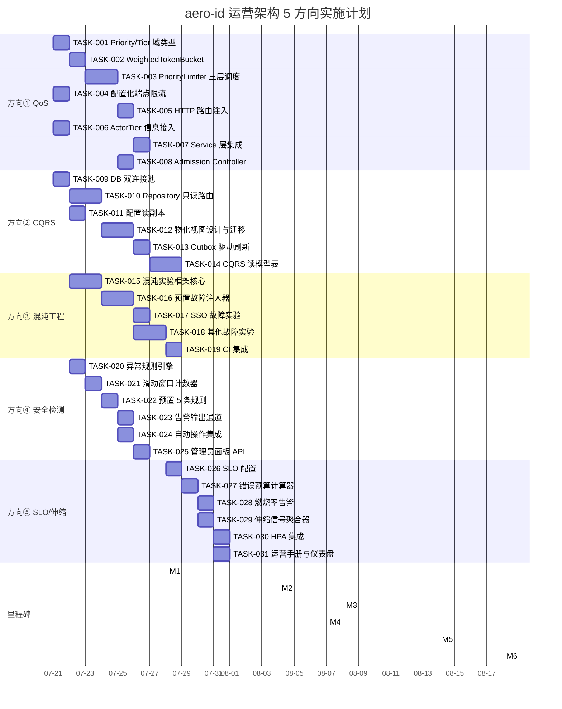

我已经完整阅读了分析文档（710 行 / 33,869 字节），现在以 Tech Lead 视角给出深入的技术实现和项目管理分析。

---

# Tech Lead 分析报告：aero-id 运营架构 5 大方向

> **分析基准**: `docs/requirements/2026-07-10-operational-architecture-blindspots-remaining-high-value.md`
> **项目约束**: Go 1.26, GORM, 文件 ≤500 行, 函数 ≤50 行, 圈复杂度 ≤10, if 嵌套 ≤3
> **日期**: 2026-07-12

---

## 1. 任务分解

### 方向 ①：请求优先级与差异化 QoS（P1，3-4 周）

| 任务 ID | 标题 | 涉及文件 | 前置依赖 | 工时(h) | 验收标准 |
|---------|------|---------|---------|---------|---------|
| TASK-001 | **定义 Priority/Tier 域类型** — `pkg/ratelimit` 中添加 `Priority` 枚举（Critical→Batch），`ActorTier` 枚举（Free/Premium/Admin），`LimitResult` 结构体 | `internal/pkg/ratelimit/priority.go`（新文件） | 无 | 2 | 类型定义完整，通过 `go vet`；优先级权重映射可配置 |
| TASK-002 | **重构 TokenBucket → WeightedTokenBucket** — 支持 `weight(端点)` 参数，高权重操作消耗更多 token | `internal/pkg/ratelimit/ratelimit.go` | TASK-001 | 4 | 原有 `Allow()` 接口向后兼容；权重大时提前触发限流 |
| TASK-003 | **实现 PriorityLimiter 三层调度** — global → endpoint-weighted → priority-based admission；实现 `systemLoad()` 感知 | `internal/pkg/ratelimit/priority_limiter.go`（新文件） | TASK-002 | 6 | 单元测试覆盖：普通流量通过、低优先级被拒绝、高负载降级场景 |
| TASK-004 | **配置化端点限流规则** — 在 `config.yaml` 新增 `rate_limit.endpoints` 和 `rate_limit.tiers` 节；`config.Load` 解析 | `internal/config/config.go`, `configs/config.yaml` | 无 | 2 | 配置缺失时 fallback 到 `default_rps`；env override 支持 |
| TASK-005 | **HTTP 路由注入端点级限流** — 改造 `router.go` 中的中间件链，支持 per-route 差异化 rate limit 中间件 | `internal/handler/http/router.go`, `internal/middleware/ratelimit.go` | TASK-003 + TASK-004 | 4 | 路由配置生效；`/v1/messages` 和 `/v1/search` 不同配额；HTTP 429 返回 JSON 而非纯文本 |
| TASK-006 | **ActorTier 信息接入** — 方案 A：扩展 SSO `ValidateToken` 返回值包含 tier；方案 B：本地 `uid_tiers` 小表，API-versioning 兼容 | `internal/sso/client.go`, `internal/domain/tier.go`（新文件） | 无 | 4 | SSO 返回新字段时自动使用；SSO 不返回时 fallback 到 `TierFree` |
| TASK-007 | **Service 层集成 PriorityLimiter** — 在 `service/file.go`、`message.go`、`notification.go` 等关键路径注入限流调用 | `internal/service/file.go`, `message.go`, `search.go`, `notification.go` | TASK-003 + TASK-006 | 4 | 核心端点通过集成测试；限流触发时返回 `AppError(BadRequest\|TooManyRequests)` |
| TASK-008 | **压力感知 Admission Controller** — 实现 CPU/P99 延迟采集回路，动态调整 admission 阈值 | `internal/middleware/admission.go`（新文件）, `internal/pkg/metrics/metrics.go` | TASK-003 | 3 | CPU > 80% 连续 3 个采样周期后低优先级被拒绝；恢复后解除 |

**方向①总计：29h（~4 天）**

---

### 方向 ②：读负载卸载与 CQRS 演进（P1，1-8 周渐进）

| 任务 ID | 标题 | 涉及文件 | 前置依赖 | 工时(h) | 验收标准 |
|---------|------|---------|---------|---------|---------|
| TASK-009 | **DB 双连接池改造** — `DB` 结构体分离 `writer`/`reader`；新增 `Writer()`/`Reader()` 方法；配置支持 `database.writer` / `database.reader` | `internal/pkg/db/db.go`, `internal/config/config.go` | 无 | 4 | 只设 writer 时向后兼容（reader == writer）；二者独立连接池 |
| TASK-010 | **Repository 只读查询路由** — 为每个 repo 的读方法（`ListBy*`, `Get*`, `Inbox`, `Search`）标记并改用 `Reader()` | `internal/repository/message.go`, `comment.go`, `notification.go`, `file.go`, `admin.go` | TASK-009 | 6 | 所有读操作走 reader 连接池；写事务内读操作仍走 writer（读写一致性） |
| TASK-011 | **配置中心读副本设置** — 在 `configs/config.yaml` 中添加 `database.reader` 节 | `configs/config.yaml` | TASK-009 | 1 | 文档更新；`make test` 通过 |
| TASK-012 | **高频查询物化视图设计与迁移** — 创建 `inbox_view`/`notification_feed_view` 物化视图；编写 `up/down` 迁移；repo 层查询改为从物化视图读取 | `internal/repository/migration/xxx.up.sql`, `xxx.down.sql`, `internal/repository/message.go` | TASK-010 | 6 | 查询性能提升 ≥10×（单元断言）；刷新间隔可配置 |
| TASK-013 | **Outbox 驱动视图刷新** — 在 outbox relay 事件处理器中添加物化视图刷新触发；刷新失败时退避重试 | `internal/outbox/relay.go`, `internal/repository/materialized.go`（新文件） | TASK-012 | 4 | 写操作后 5s 内读模型可见；刷新异常不阻塞写路径 |
| TASK-014 | **CQRS 读模型表设计与事件消费** — 创建反范式化的 `inbox_entries`/`comment_feeds` 表；实现 outbox 事件 → 读模型更新 | `internal/repository/cqrs/`（新包）, `internal/domain/events.go` | TASK-013 | 8 | 读写数据最终一致（<1s 延迟）；写路径零变更 |

**方向②总计：29h（~4 天，Phase 1+2），Phase 3 额外 8h**

---

### 方向 ③：混沌工程与弹性验证框架（P2，~4 周）

| 任务 ID | 标题 | 涉及文件 | 前置依赖 | 工时(h) | 验收标准 |
|---------|------|---------|---------|---------|---------|
| TASK-015 | **Chaos Experiment 框架核心** — `Experiment` 结构体、`FaultInjector`/`Assertion` 接口、`Run()`/`Cleanup()` 编排 | `internal/chaos/experiment.go`（新文件） | 无 | 6 | 单机可执行 Experiment；故障注入后 assert 通过/失败 |
| TASK-016 | **预置故障注入器实现** — `LatencyFault`, `UnavailableFault`, `PoolExhaustionFault`；SSO/DB/Storage 三类目标 | `internal/chaos/faults.go`（新文件） | TASK-015 | 6 | 每个故障注入器有独立单元测试；支持超时回退 |
| TASK-017 | **混沌实验场景 1-2：SSO 故障** — SSO 不可用 60s + SSO 高延迟 30s 实验；验证断路器 + serve-stale 组合行为 | `internal/chaos/experiments/sso_test.go`（新文件） | TASK-016 | 4 | 断路器在 N 次后打开；缓存令牌继续 serve-stale；恢复后正确重置 |
| TASK-018 | **混沌实验场景 3-5：DB/Outbox/Storage 故障** — 连接池耗尽、outbox 延迟、S3 间歇故障实验 | `internal/chaos/experiments`（新包） | TASK-016 | 8 | 每个场景验证特定弹性机制组合行为；输出指标断言报告 |
| TASK-019 | **Staging 环境混沌编排与 CI 集成** — `Makefile` 添加 `make chaos` 命令；故障注入工具（tc/chaos-mesh/docker）配置说明 | `Makefile`, `deployments/chaos/`（新目录） | TASK-017 + TASK-018 | 4 | `make chaos` 在 staging 上执行全部 5 个实验并输出通过/失败 |

**方向③总计：28h（~4 天）**

---

### 方向 ④：审计日志驱动的安全异常检测（P2，~3 周）

| 任务 ID | 标题 | 涉及文件 | 前置依赖 | 工时(h) | 验收标准 |
|---------|------|---------|---------|---------|---------|
| TASK-020 | **异常规则引擎定义** — `AnomalyRule` 结构体、`RuleDetector` 接口、规则匹配调度器（goroutine + ticker） | `internal/security/anomaly.go`（新文件）, `internal/domain/anomaly.go`（新文件） | 无 | 4 | 规则可动态添加；滑动窗口计数器正确统计 |
| TASK-021 | **滑动窗口计数器实现** — 基于 ring buffer 或 sorted set 的滑动窗口；支持 1m/5m/10m 窗口 | `internal/security/sliding_window.go`（新文件） | TASK-020 | 3 | 窗口边界事件正确处理；内存消耗 ≤ 10MB/10K events |
| TASK-022 | **预置 5 条检测规则** — `rapid_block_flip` / `mass_file_share` / `mass_file_delete` / `mass_report` / `concurrent_session_anomaly` | `internal/security/rules.go`（新文件） | TASK-021 | 4 | 每条规则有独立单元测试（正常 + 异常 case）；阈值可配置 |
| TASK-023 | **告警输出通道** — outbox 事件（webhook）+ `audit_alerts` 表落盘 + SSE 推送管理员面板 | `internal/security/alert.go`（新文件）, `internal/repository/audit_alert.go`（新文件） | TASK-022 | 4 | 三种通道均验证；错误不阻塞检测主路径 |
| TASK-024 | **自动操作集成** — 规则触发 `rate_limit` / `temporarily_block` 动作时，调用对应 service 方法 | `internal/security/auto_action.go`（新文件）, `internal/service/block.go` | TASK-022 | 3 | 自动 block 有 audit 记录；rate limit 升级立即生效 |
| TASK-025 | **管理员告警面板 API** — `GET /v1/admin/alerts`（列表+过滤），`PATCH /v1/admin/alerts/:id/resolve` | `internal/handler/http/admin.go`, `internal/service/admin_alerts.go`（新文件） | TASK-023 | 4 | CRUD 测试完整；分页/排序与现有 admin API 风格一致 |

**方向④总计：22h（~3 天）**

---

### 方向 ⑤：SLO 框架与自动化伸缩（P2，~3 周）

| 任务 ID | 标题 | 涉及文件 | 前置依赖 | 工时(h) | 验收标准 |
|---------|------|---------|---------|---------|---------|
| TASK-026 | **SLO 配置定义与解析** — `slo.yaml` 文件格式、`SLOService` 结构体、`config.LoadSLO()` 解析 | `internal/config/slo.go`（新文件）, `configs/slo.yaml`（新文件） | 无 | 3 | 缺失文件不 panic，用 default SLO；env override 支持 |
| TASK-027 | **错误预算计算器** — `ErrorBudget` 结构体、`CalculateErrorBudget()`、`classifyBudget()` 状态机（green/yellow/red） | `internal/observability/budget.go`（新文件） | TASK-026 | 4 | 预算计算与 Prometheus 指标一致；28d 窗口滑动正确 |
| TASK-028 | **燃烧率告警引擎** — 基于 burn rate 的二级告警（page 10×/5m, ticket 2×/30m）；goroutine + 定时评估 | `internal/observability/burnrate.go`（新文件） | TASK-027 | 4 | 燃烧率超过阈值触发告警通道；恢复后自动解除 |
| TASK-029 | **伸缩信号聚合器** — 从 RED 指标/CPU/Outbox 延迟/连接池使用率聚合伸缩信号；输出 `ScalingSignal` | `internal/observability/scaler.go`（新文件） | TASK-027 | 4 | 聚合器输出可在 Prometheus 中观测；5 种信号各覆盖 |
| TASK-030 | **HPA 集成文档与配置** — Kubernetes HPA manifest 示例；`Makefile` 添加 `make scaling-up`/`scaling-down` 模拟命令 | `deployments/k8s/hpa.yaml`（新文件）, `Makefile` | TASK-029 | 2 | HPA manifest 通过 `kubectl dry-run` |
| TASK-031 | **运营手册与仪表盘** — 基于 Prometheus + Grafana 的 SLO 仪表盘 JSON 模板；runbook 场景文档化 | `deployments/grafana/dashboards/slo.json`（新文件）, `docs/runbook/slo.md`（新文件） | TASK-028 | 4 | 仪表盘包含：错误预算面板、燃烧率面板、伸缩信号面板 |

**方向⑤总计：21h（~3 天）**

---

> **全量任务汇总**：31 个任务，~129 工时（约 16 人天）

---

## 2. 执行顺序与依赖图

```mermaid
graph TD
    %% 方向①: QoS
    T001["TASK-001: Priority/Tier 域类型"]
    T002["TASK-002: WeightedTokenBucket"]
    T003["TASK-003: PriorityLimiter 三层调度"]
    T004["TASK-004: 配置化端点限流"]
    T005["TASK-005: HTTP 路由注入限流"]
    T006["TASK-006: ActorTier 信息接入"]
    T007["TASK-007: Service 层集成限流"]
    T008["TASK-008: Admission Controller"]

    %% 方向②: CQRS
    T009["TASK-009: DB 双连接池"]
    T010["TASK-010: Repository 只读路由"]
    T011["TASK-011: 配置读副本"]
    T012["TASK-012: 物化视图"]
    T013["TASK-013: Outbox 驱动刷新"]
    T014["TASK-014: CQRS 读模型表"]

    %% 方向③: 混沌工程
    T015["TASK-015: 混沌实验框架核心"]
    T016["TASK-016: 预置故障注入器"]
    T017["TASK-017: SSO 故障实验 1-2"]
    T018["TASK-018: DB/Outbox/Storage 实验 3-5"]
    T019["TASK-019: CI 集成"]

    %% 方向④: 安全异常检测
    T020["TASK-020: 异常规则引擎"]
    T021["TASK-021: 滑动窗口计数器"]
    T022["TASK-022: 预置 5 条规则"]
    T023["TASK-023: 告警输出通道"]
    T024["TASK-024: 自动操作集成"]
    T025["TASK-025: 管理员面板 API"]

    %% 方向⑤: SLO/伸缩
    T026["TASK-026: SLO 配置"]
    T027["TASK-027: 错误预算计算器"]
    T028["TASK-028: 燃烧率告警"]
    T029["TASK-029: 伸缩信号聚合器"]
    T030["TASK-030: HPA 集成"]
    T031["TASK-031: 运营手册与仪表盘"]

    %% 依赖边
    T001 --> T002 --> T003 --> T008
    T004 --> T005
    T003 --> T005
    T006 --> T007
    T003 --> T007
    T005 --> T007
    T008 --> T007

    T009 --> T010 --> T012 --> T013 --> T014
    T011 --> T010

    T015 --> T016 --> T017 --> T019
    T016 --> T018 --> T019

    T020 --> T021 --> T022 --> T023 --> T025
    T022 --> T024

    T026 --> T027 --> T028 --> T031
    T027 --> T029 --> T030

    %% 跨方向弱依赖（建议顺序）
    T008 -.-> T009  %% QoS priority admission 需要一个稳定的读路径
    T017 -.-> T028  %% 混沌实验验证需要 SLO 指标作为断言基线
```

### 可并行执行的任务组

| 并行组 | 任务列表 | 同时开工所需人员 |
|--------|---------|----------------|
| **组 A** (基础设施) | TASK-001 + TASK-004 + TASK-009 + TASK-015 + TASK-020 + TASK-026 | 3 人（每人 2 个方向） |
| **组 B** (核心实现) | TASK-002→003 + TASK-010→012 + TASK-016 + TASK-021→022 + TASK-027 | 3-4 人 |
| **组 C** (集成验证) | TASK-005←008 + TASK-013→014 + TASK-017→019 + TASK-023→025 + TASK-028→031 | 3 人 |

---

## 3. 技术风险

### 3.1 优先级限流与 ActorTier 的信息来源（高影响）

| 风险 | 描述 | 缓解策略 |
|------|------|---------|
| **SSO 不返回 tier** | 当前 SSO `ValidateToken` 只返回 uid。要获取 actor tier 需要 SSO 团队配合扩展 proto | 方案 A（优先）：SSO 扩展 `ValidateResponse` 加 `tier` 字段；方案 B（fallback）：本地 `uid_tiers` 小表 + 迁移脚本，SSO 不可用时本地配置兜底 |
| **tier 信息过时** | SSO 返回的 token 中 tier 可能滞后（免费→付费后旧 token 仍标记 free） | 方案 C：token 中嵌入 `issued_at`，service 层加 TTL 检查，过期后调用 SSO 刷新；注意 O(token 验证) 的延迟 |
| **配置爆炸** | 每个端点 × 每个 tier × weighted bucket 参数组合 → 配置项爆炸 | 约定：端点类分 4 类（core/normal/batch/admin），tier 3 级，权重收敛到 5 级（1/2/5/10/20） |

### 3.2 CQRS 最终一致性陷阱（高影响）

| 风险 | 描述 | 缓解策略 |
|------|------|---------|
| **写后读一致性** | 用户写一条消息后立即刷新页面，读副本尚未同步 → 看不到刚发的消息 | 写操作走 writer 时同步返回，写入 outbox 后更新缓存；读副本查询带 optional `write_after` 参数强制路由到 writer |
| **物化视图刷新竞争** | 高频写场景下并发 refresh 导致死锁或 MV 不一致 | 使用 `REFRESH MATERIALIZED VIEW CONCURRENTLY`；限制 refresh 最小间隔（默认 30s） |
| **迁移回退困难** | CQRS 读模型一旦上线，回退到统一数据库需要完整的数据反向同步 | Phase 1 保留原始查询作为 read-through fallback；Phase 3 前做好回退演练 |

### 3.3 混沌工程破坏性（中影响）

| 风险 | 描述 | 缓解策略 |
|------|------|---------|
| **实验波及生产** | 故障注入失控影响真实用户 | 严格限定 staging 环境；`chaos` 命令必须有 `--target=staging` 参数，生产环境禁止 |
| **工具链不稳定** | Chaos Mesh / tc 配置复杂，CI 环境不可用 | 提供 Docker Compose 本地演练模式；fault injector 实现 `Simulate()` 方法（不依赖系统工具）用于单元测试 |
| **断言误报** | 系统行为与预期不符但实际没 bug（指标噪声） | 每个实验重复 3 次取多数结论；Assertion 支持 `tolerance` 参数 |

### 3.4 安全异常检测误报（中影响）

| 风险 | 描述 | 缓解策略 |
|------|------|---------|
| **误伤正常用户** | 批量举报规则阈值过低 → 真实用户被临时 block | 阈值初始从宽松开始（3σ 基准），上线后一周回归调优；自动 block 仅限 `critical` 级别，其他级别只 alert |
| **滑动窗口内存膨胀** | 高 TPS 下 ring buffer 占用过多内存 | 限制最大事件数（5K events / actor）；超限时合并窗口（从 per-event 降级到 per-minute bucket） |
| **并发 session 检测精度** | 同一用户从两个 IP 访问 (手机+笔记本) 被误判为撞库 | 只检测 `geo distance > 1000km` + `timestamp diff < 5min` 的会话；支持白名单 |

### 3.5 SLO 燃烧率实效性（低影响）

| 风险 | 描述 | 缓解策略 |
|------|------|---------|
| **窗口边界抖动** | 错误预算在 28d 窗口翻转时突变 | 使用指数加权移动平均（EWMA）做平滑；告警基于持续燃烧率而非瞬时值 |
| **HPA 信号延迟** | 从指标采集到 scaling 决策有 1-2 分钟延迟 | Prometheus + KEDA 接 HPA，指标采集间隔 15s；手动 override 入口保留 |

---

## 4. 资源评估

### 4.1 开发人员技能要求

| 角色 | 所需技能 | 人数 | 负责方向 |
|------|---------|------|---------|
| **Staff/Senior Backend (Go)** | 分布式系统、限流/CQRS 架构、GORM、PostgreSQL 性能调优、K8s HPA | 1-2 人 | 方向①②⑤ — 架构设计与核心实现 |
| **Senior Backend (Go)** | Go 并发、测试、CI/CD、安全审计 | 1 人 | 方向③④ — 混沌框架 + 异常检测 |
| **DevOps/Platform** | K8s、Prometheus/Grafana、Chaos Mesh、staging 环境维护 | 0.5 人（共享） | 方向③⑤ — 混沌编排 + SLO/HPA 基础设施 |

**最小团队：2 名 Go 后端 + 0.5 名 DevOps = 2.5 FTE**

### 4.2 关键里程碑

| 里程碑 | 时间 | 交付物 | 通过标准 |
|--------|------|--------|---------|
| **M1: QoS 核心就绪** | 第 2 周末 | PriorityLimiter + 端点级配置 + 路由注入 | `make test` + `make lint` 通过；3 个端点差异化限流端到端验证 |
| **M2: 读负载卸载** | 第 3 周末 | DB 双连接池 + 物化视图 + 只读路由 | `make test-integration` 通过（需 Docker + pg 副本） |
| **M3: 混沌框架** | 第 5 周末 | 5 个实验场景全部可执行 | `make chaos` 在 staging 上全部 green |
| **M4: 安全检测上线** | 第 6 周末 | 规则引擎 + 5 条规则 + 管理员面板 API | 模拟异常事件流触发告警 |
| **M5: SLO 仪表盘** | 第 7 周末 | 错误预算 + 燃烧率 + 伸缩信号均可在 Grafana 查看 | 运行 3 天后数据连贯 |
| **M6: 完整发布** | 第 8 周末 | 所有 5 个方向集成完成 | `make test && make lint && make chaos` 全部通过 |

### 4.3 阻塞点（Blockers）与解决策略

| # | 阻塞描述 | 所属方向 | 解决策略 | 升级时间点 |
|---|---------|---------|---------|-----------|
| B1 | SSO 团队未实现 tier 字段 | ① | TASK-006 方案 B（本地表）作为主方案，SSO 扩展为可选 | 第 1 周前提需求给 SSO；第 2 周无回复切方案 B |
| B2 | 生产环境无 Postgres 只读副本 | ② | 使用同一实例 + 不同连接池模拟分离（伪只读），配置留空 reader.host = writer.host | 第 2 周 DevOps 创建只读副本 |
| B3 | Staging 环境不存在 | ③ | 使用 Docker Compose 本地全栈环境 + `tc` 注入；Chaos Mesh 可选 | 第 3 周前 DevOps 提供 staging namespace |
| B4 | Prometheus 指标无法访问当前 error count | ⑤ | 在 metrics registry 中新增 `aeroid_slo_errors_total` 和 `aeroid_slo_total_requests` counter；不依赖 Prometheus 远程读 | 无外部依赖 |

---

## 5. 质量保证

### 5.1 单元测试覆盖要求

| 层 | 最低覆盖率 | 强制规则 | 重点测试用例 |
|----|-----------|---------|-------------|
| **domain** (新类型) | 90%+ | 必须 | Priority/Tier 枚举边界、权重映射、状态转换 |
| **pkg/ratelimit** | 85%+ | 必须 | 多 goroutine 并发安全、权重大小顺序、降级路径、热点 key 隔离 |
| **service** (新/改) | 80%+ | 必须 | 限流触发时返回正确 AppError、ActorTier 缺失时 fallback |
| **repository** (改) | 70%+ | 推荐 | writer/reader 路由验证、物化视图回退、事务一致性 |
| **security/anomaly** | 90%+ | 必须 | 滑动窗口跨边界、规则匹配、告警去重、并发安全 |
| **chaos** | 80%+ | 必须 | 故障注入恢复、断言错误处理、超时回退 |
| **observability** | 80%+ | 必须 | 错误预算计算精度、燃烧率边界、伸缩信号组合逻辑 |

### 5.2 集成测试策略

| 测试类型 | 测试对象 | 工具 | 场景 |
|---------|---------|------|------|
| **GORM 集成** | 方向② 物化视图、方向④ audit_alerts 表 | `internal/repository/testpg`（已有） | 迁移 up/down、视图创建、并发 refresh |
| **端到端限流** | 方向① PriorityLimiter + HTTP 路由 | `httptest.Server` + 自定义 client | 三端加权、ActorTier 差异化、降级模式 |
| **混沌实验** | 方向③ 5 个实验场景 | `internal/chaos` 框架 + Docker Compose | SSO 不可用、DB 连接池耗尽、存储延迟 |
| **异常检测管道** | 方向④ 全链路（审计→检测→告警） | `testcontainers-go` + 模拟事件流 | 单规则触发、多规则并发、告警去重 |

### 5.3 代码审查要点

| 审查模块 | 重点关注 |
|---------|---------|
| **pkg/ratelimit** | 并发安全性（`sync.Mutex` vs `sync.RWMutex`）、token 计算 overflow、`Allow()` 返回值正确性 |
| **pkg/db (writer/reader)** | 写事务内读操作不走 reader、连接池泄漏（`*gorm.DB` 被拷贝时的 panic） |
| **chaos/experiment.go** | 超时回退（`context.WithTimeout`）、故障注入后 Cleanup 可重复调用 |
| **security/sliding_window.go** | ring buffer 指针绕回、goroutine 泄漏（ticker 退出） |
| **observability/budget.go** | 浮点数精度、28d 窗口滑动时边界事件不重复计数 |
| **config 新节** | 环境变量覆盖链、缺失值 panic vs fallback、与现有 config 结构体风格一致 |

### 5.4 性能测试需求

| 测试场景 | 目标 | 工具 | 通过标准 |
|---------|------|------|---------|
| **QoS 限流基准** | 10K RPM 混合负载，验证优先级的请求被正确处理 | `ghz` + 定制 Go client | premium 请求通过率 >= 95%，free 请求在 overload 时被拒绝 |
| **CQRS 读性能** | 10K 消息 inbox 查询 vs 物化视图查询 | `go test -bench` | 物化视图 P99 <= 5ms（基线：原始 JOIN 查询 P99 >= 50ms） |
| **滑窗计数器内存** | 10K events/min 持续 1h | `pprof` | 内存增量 <= 50MB |
| **错误预算计算速度** | 1000 个服务 × 28d 数据 | 微基准 | 每服务 < 5ms |

---

## 6. 实施计划

### 甘特图（Mermaid Gantt）



### 阶段详细计划

#### 阶段 1：基础设施 & 并行启动（第 1 周，7/21—7/25）

| 天 | 开发 A | 开发 B | DevOps |
|----|--------|--------|--------|
| 一 | TASK-001 (Priority/Tier 域) | TASK-009 (DB 双连接池) | 创建只读副本（若无可模拟） |
| 二 | TASK-002 (WeightedTokenBucket) | TASK-010 (Repository 只读路由) + TASK-011 | 准备 staging namespace |
| 三 | TASK-003 (PriorityLimiter 三层调度) | TASK-012 (物化视图设计) | — |
| 四 | TASK-003 完成 + TASK-004 (配置化) | TASK-012 完成 + 迁移 up/down | 部署 Prometheus + Grafana |
| 五 | TASK-005 (HTTP 路由注入) | TASK-013 (Outbox 驱动刷新) | 配置 HPA RBAC |

**可并行启动的辅助任务**：TASK-006 (ActorTier, 开发 A 周五切入), TASK-015 (混沌框架, 开发 B 周五切入), TASK-020 (规则引擎, 开发 A 第二天并行)

#### 阶段 2：核心功能实现（第 2-3 周，7/28—8/07）

| 周 | 开发 A | 开发 B |
|----|--------|--------|
| W2 | TASK-006 + TASK-007 (Service 集成) + TASK-008 (Admission) + TASK-015 (混沌框架) | TASK-014 (CQRS 读模型) + TASK-016 (故障注入器) |
| W3 | TASK-017 + TASK-018 (混沌实验) + TASK-026 + TASK-027 (SLO 框架) | TASK-021~TASK-024 (安全检测规则+告警) + TASK-029 (伸缩信号) |

**阶段 2 末里程碑**：M2（第 3 周末），M3 和 M4（第 3-4 周末）

#### 阶段 3：集成验证与优化（第 4-5 周，8/04—8/14）

| 周 | 开发 A | 开发 B | DevOps |
|----|--------|--------|--------|
| W4 | TASK-028 (燃烧率告警) + TASK-019 CI 集成 | TASK-025 (管理员面板 API) + TASK-030 (HPA) | chaos staging 环境稳定化 |
| W5 | TASK-031 (仪表盘+runbook) + 全量集成测试 | 修复集成测试发现的缺陷 | 混沌实验 CI pipeline 打通 |

**性能测试窗口**：W4 后半周执行 5.4 节全部性能测试，W5 前半周完成调优。

#### 阶段 4：发布准备（第 6-7 周，8/14—8/28）

| 周 | 活动 |
|----|------|
| W6 | **生产预发布**：QoS 配置灰度（先开放 `free` tier 限流，观察业务指标）；CQRS Phase 1 只读副本接入；安全检测静默模式（只告警不自动操作） |
| W6 末 | **错误预算基线建立**：28d 窗口开始，评估当前 SLO 合规率 |
| W7 | **全功能发布**：QoS 完整（含 admission control）、安全检测自动操作打开（critical 级别）、混沌实验 as Code |
| W7 末 | **M6：完整发布完成**，进入维护期 |

### 关键交付物清单

```
internal/pkg/ratelimit/
├── priority.go              # TASK-001: Priority, ActorTier 类型
├── ratelimit.go             # TASK-002: WeightedTokenBucket
└── priority_limiter.go      # TASK-003: PriorityLimiter

internal/pkg/db/
└── db.go                    # TASK-009: Writer()/Reader()

internal/chaos/
├── experiment.go            # TASK-015: 框架
├── faults.go                # TASK-016: 故障注入器
└── experiments/             # TASK-017+018: 5 个场景

internal/security/
├── anomaly.go               # TASK-020: 规则引擎
├── sliding_window.go        # TASK-021: 滑动窗口
├── rules.go                 # TASK-022: 5 条规则
├── alert.go                 # TASK-023: 告警通道
└── auto_action.go           # TASK-024: 自动操作

internal/observability/
├── budget.go                # TASK-027: 错误预算
├── burnrate.go              # TASK-028: 燃烧率告警
└── scaler.go                # TASK-029: 伸缩信号

configs/slo.yaml             # TASK-026: SLO 配置

deployments/k8s/hpa.yaml     # TASK-030: HPA
deployments/grafana/dashboards/slo.json  # TASK-031
docs/runbook/slo.md          # TASK-031
```

---

## 总结性技术建议

1. **第一周最重要决策**：确定 TASK-006 ActorTier 的实现路径（方案 A vs B）。这个决策影响 QoS 的完整度和 SSO 团队的依赖。**建议直接走方案 B（本地 tier 表）**，SSO 扩展作为二期优化。本地表可以通过管理 API 维护，不阻塞 QoS 上线。

2. **CQRS 不要跳步**：从 Phase 1 (只读副本) → Phase 2 (物化视图) → Phase 3 (事件驱动读模型) 的渐进路径是不可跳过的。直接 Phase 3 会引入最终一致性的调试成本，而 Phase 1 只需要多一条连接字符串。**Phase 1 在代码层面仅需 2 天，可以立即落地。**

3. **混沌实验的三七原则**：70% 的价值来自 SSO 断路器 + 存储重试两个实验的通过。如果时间紧张，优先确保 TASK-017 的 SSO 实验做深（覆盖断路器打开 + serve-stale + 恢复三个状态），其他实验做浅（只验证 fallback 存在）。

4. **安全检测的误报控制**：上线初期的 **1 周静默模式**（只告警不自动操作）至关重要。利用这周收集基线数据，调优阈值，避免误伤用户。建议生产上线第 1 周后 manual review 确认阈值。

5. **SLO 框架先于 HPA**：HPA 的信号质量取决于 SLO 定义的准确性。建议先跑 2 周 SLO 数据再接通自动伸缩。手动伸缩 + SLO 仪表盘是 HPA 之前的合理中间态。

6. **代码规范约束**：31 个任务中，注意 AGENTS.md 的硬约束——每个新文件 ≤500 行、函数 ≤50 行、圈复杂度 ≤10。特别是：
   - `priority_limiter.go`（TASK-003）：建议拆分为 `limiter.go`（核心调度）+ `admission.go`（压力感知）
   - `sliding_window.go`（TASK-021）：ring buffer 实现控制在 200 行内，超过则拆出 `event.go`
   - `experiment.go`（TASK-015）：`Run()` 方法容易膨胀，建议拆出 `step.go` 编排器

**总工期估算：6-7 周（含性能调优 + 灰度发布），2 名 Go 后端 + 0.5 DevOps，约 16 人天净编码工作量。**
