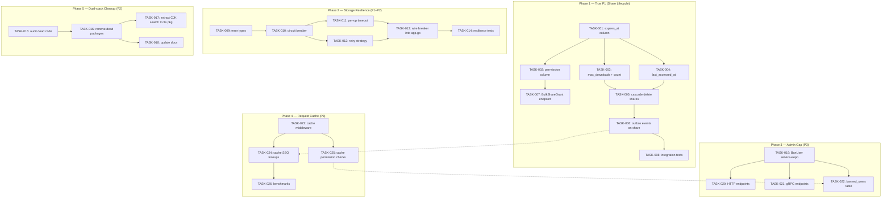

Now I have a complete picture of the codebase. Here is the comprehensive Tech Lead analysis.

---

# Tech Lead Analysis: aero-id Post-Verification Implementation Plan

## 1. Task Decomposition

Each task is sized to **2–4 hours** for a competent Go developer familiar with the codebase. Files are referenced from the **production codebase** (`internal/repository/`, `internal/service/`, not the dead-code new stack).

### Direction 3: Share Lifecycle (P1 — True Gap)

| ID | Title | Files | Deps | Hours | Acceptance Criteria |
|---|---|---|---|---|---|
| TASK-001 | Add `expires_at` column to `file_shares` table | `migrations/000024_share_expiry.up.sql`, `.down.sql`, `internal/repository/file_share.go` | None | 2 | Migration adds `expires_at TIMESTAMPTZ` nullable; repo `Grant` accepts optional expiry; `IsSharedWith` excludes expired rows; `ListFilesSharedWith` excludes expired rows |
| TASK-002 | Add `permission` column (enum: read/view/download) | `migrations/000025_share_permission.up.sql`, `internal/domain/file.go`, `internal/repository/file_share.go`, `internal/service/file_share.go` | TASK-001 | 2 | New `SharePermission` domain type; `Grant` accepts permission level; `IsSharedWith` returns available permission; service enforces minimum permission on download |
| TASK-003 | Add `max_downloads` and `download_count` columns | `migrations/000026_share_limits.up.sql`, `internal/repository/file_share.go` | TASK-001 | 2 | `max_downloads INT` nullable; `download_count INT DEFAULT 0`; `CountDownload` increment method; share auto-revokes when limit reached |
| TASK-004 | Add `last_accessed_at` column and update on download | `internal/repository/file_share.go`, `internal/service/file.go` (`DownloadURL`), `internal/service/file_presign.go` | TASK-001 | 2 | `last_accessed_at` updated whenever a shared file is accessed; exposed in share list response |
| TASK-005 | Cascade-delete share rows when file is soft-deleted | `internal/service/file.go` (`Delete` method) | TASK-001 | 2 | `FileService.Delete` calls `shares.RevokeAll(ctx, id)` before soft-deleting the file row; unused share rows are not left orphaned |
| TASK-006 | Emit outbox event on share Grant/Revoke | `internal/service/file_share.go` (outbox injection), `internal/domain/audit.go` (new action types `AuditFileShareGrant`/`AuditFileShareRevoke` — already exist), `internal/outbox/` | TASK-005 | 3 | Share Grant/Revoke transactions write to `outbox_events`; relay delivers to notification dispatcher; recipients receive "file shared with you" type notification |
| TASK-007 | Add `BulkShareGrant` endpoint for batch sharing | `internal/handler/http/file.go`, `internal/handler/grpc/file.go` (proto message update), `internal/service/file_share.go` | TASK-006 | 3 | New endpoint accepts `file_id` + `[]grantee_uid` + `permission` + `expires_at`; batch inserts in one round-trip; audit logged per grantee |
| TASK-008 | Write integration tests for share lifecycle | `internal/repository/file_share_integration_test.go`, `internal/service/file_test.go` | TASK-001–007 | 3 | Coverage: grant with expiry, download after expiry rejected, max_downloads reached → access denied, cascade delete, outbox emission |

### Direction 5: Storage Circuit Breaker (P1–P2 — True Gap)

| ID | Title | Files | Deps | Hours | Acceptance Criteria |
|---|---|---|---|---|---|
| TASK-009 | Define storage error types | `internal/storage/storage.go` | None | 1 | Add `ErrStorageDown`, `ErrRateLimited`, `ErrTimeout` sentinel errors; `IsStorageDown()`, `IsRateLimited()` helpers |
| TASK-010 | Implement storage circuit breaker | `internal/storage/breaker.go` (new), `internal/storage/breaker_test.go` | TASK-009 | 4 | Circuit breaker wrapping `storage.FileStorage`; configurable threshold/cooldown/half-open; state metrics exported |
| TASK-011 | Add per-operation timeout to storage backend calls | `internal/storage/s3.go`, `internal/storage/local.go` | None | 2 | Each `Put`/`Get`/`Delete` accepts `context.Context` (already does); wire `context.WithTimeout` from configurable per-op timeouts |
| TASK-012 | Add retry strategy for transient storage errors | `internal/storage/retry.go` (new), `internal/storage/retry_test.go` | TASK-010 | 3 | Exponential backoff + jitter on `Put`, `Delete`; max 3 retries; non-retryable errors (`ErrNotFound`) skip retry |
| TASK-013 | Wire breaker into composition root | `internal/app/app.go` (`buildStorage`) | TASK-010, TASK-012 | 1 | Storage backend wrapped in breaker + retry in `New`; config keys added for breaker threshold, cooldown, per-op timeout; metrics wired |
| TASK-014 | Test storage resilience under failure | `internal/storage/` integration tests with injected failures | TASK-010–013 | 3 | Breaker opens after threshold; half-open probes work; retry succeeds after transient failure; metrics reflect state changes |

### Direction 1: Dual-stack Cleanup (P2 — Maintenance Debt)

| ID | Title | Files | Deps | Hours | Acceptance Criteria |
|---|---|---|---|---|---|
| TASK-015 | Audit new stack for unreachable code | `internal/file/*.go`, `internal/comment/*.go`, `internal/message/*.go`, `internal/notification/*.go`, `internal/block/*.go`, `internal/search/*.go`, `internal/preference/*.go` | None | 3 | `internal/app/app.go` verified as sole composition root; all unused packages documented; `go vet ./...` clean |
| TASK-016 | Remove dead-code domain packages | Remove `internal/file/`, `internal/comment/`, `internal/message/`, `internal/notification/`, `internal/block/`, `internal/search/`, `internal/preference/` packages | TASK-015 | 2 | `go build ./...` succeeds; `go test ./...` passes; no imports of removed packages remain |
| TASK-017 | Move CJK-search fallback from old repo to domain-level FTS strategy | `internal/repository/comment.go`, `internal/repository/file.go`, `internal/service/search.go` | TASK-016 | 2 | `SearchCommentsLike`/`SearchFilesLike` extracted to a shared `fts` package with strategy pattern; old repos delegate |
| TASK-018 | Update docs to reflect single-stack architecture | `README.md`, `docs/superpowers/specs/2026-05-22-aero-id-design.md` | TASK-016 | 1 | All references to dual-stack removed; architecture diagram updated |

### Direction 2: Admin — BanUser/UnbanUser Gap (P3)

| ID | Title | Files | Deps | Hours | Acceptance Criteria |
|---|---|---|---|---|---|
| TASK-019 | Add BanUser/UnbanUser to admin service | `internal/service/admin.go`, `internal/repository/admin.go`, `internal/domain/admin.go` | None | 3 | New `BanUser(ctx, uid, reason, duration)` and `UnbanUser(ctx, uid)` methods; `HasPermission(ctx, actor, "user.ban")` checked; audit logged |
| TASK-020 | Add `/v1/admin/users/:uid/ban` and `/v1/admin/users/:uid/unban` HTTP endpoints | `internal/handler/http/admin.go` | TASK-019 | 2 | Routes registered under `RequirePermission(domain.PermUserBan)`; request validation; response matches existing admin conventions |
| TASK-021 | Add `BanUser`/`UnbanUser` gRPC endpoints | `internal/handler/grpc/admin.go`, `api/proto/aero_id/v1/aero_id.proto` | TASK-019 | 2 | Proto messages defined; gRPC stubs regenerated with `make proto`; method-permission mapping registered |
| TASK-022 | Add banned_users table and block check on login/request | `migrations/000027_banned_users.up.sql`, `internal/domain/admin.go`, `internal/middleware/auth.go` | TASK-019 | 3 | Table `banned_users(uid PK, reason, banned_by, banned_at, expires_at)`; middleware checks ban status; banned users get 403 with reason |

### Direction 4: Request-scoped Cache (P3)

| ID | Title | Files | Deps | Hours | Acceptance Criteria |
|---|---|---|---|---|---|
| TASK-023 | Implement request-scoped cache middleware | `internal/pkg/cache/request.go` (new), `internal/pkg/cache/request_test.go` | None | 2 | Context-keyed sync.Map; middleware populates from request; `Get`/`Set`/`Clear` per-request |
| TASK-024 | Cache repeated SSO user lookups | `internal/sso/client.go` (user resolution path) | TASK-023 | 2 | SSO `BatchResolve` results cached per-request; eliminates duplicate gRPC calls within the same HTTP/gRPC handler |
| TASK-025 | Cache repeated permission checks | `internal/service/admin.go` (`HasPermission`) | TASK-023 | 1 | `HasPermission` calls cached per-request; same uid+perm pair fetched once |
| TASK-026 | Add benchmark to validate cache benefit | `internal/pkg/cache/request_bench_test.go` | TASK-023 | 1 | Benchmark shows ≥5x reduction in redundant backend calls |

---

## 2. Execution Order



**Can be parallelized:**

- **Group A (Phase 1):** TASK-001 → TASK-002 → TASK-003 → TASK-004 → TASK-005 → TASK-006 → TASK-008 (sequential chain, strong deps)
- **Group B (Phase 2):** TASK-009 → TASK-010 → TASK-011+TASK-012 → TASK-013 → TASK-014 (mostly sequential)
- **Group C (Phase 3):** TASK-019 → TASK-020+TASK-021 → TASK-022 (can run in parallel with Phase 1 & 2)
- **Group D (Phase 4):** TASK-023 → TASK-024+TASK-025 → TASK-026 (independent of everything else)
- **Group E (Phase 5):** TASK-015 → TASK-016 → TASK-017+TASK-018 (independent, low urgency)

**Recommended parallel execution:** Phase 1 + Phase 2 by **one senior dev each** → Phase 3 + Phase 4 by a **second mid-level dev** → Phase 5 by **anyone during slack time**.

---

## 3. Technical Risks

### High Risk

| Risk | Direction | Severity | Mitigation |
|---|---|---|---|
| **Share expiry + permission creates data inconsistency with existing rows** | 3 | High | Run a backfill migration that sets `expires_at = NULL` and `permission = 'read'` for all existing rows; make both columns `NOT NULL` only after backfill validated |
| **Circuit breaker on storage wraps all operations; incorrect state transitions could cascade** | 5 | High | Start in metrics-only mode (trip but don't actually short-circuit) for one week in staging; log state changes; trip only after 3 consecutive failures within a 30s window |
| **Outbox emission on share Grant/Revoke adds write amplification** | 3 | Medium | Share operations are infrequent (< 1% of write volume); Monitor relay lag; set outbox `max_retries` low (3) to avoid dead-letter pileup |
| **Banned_users check on every request adds latency** | 2 | Medium | Cache in-memory with 30s TTL; the middleware hits a tiny index lookup. If the banned list grows past 10K entries, consider Redis-backed blocklist |
| **Dead code removal (TASK-016) may break CI or tests referencing removed packages** | 1 | Low | `grep -rn 'internal/file\|internal/comment\|etc' .` to find all cross-references before deletion. Remove in two commits: first mark dead, second delete |

### Medium Risk

| Risk | Mitigation |
|---|---|
| **New stack has ~11,798 lines and some may contain useful refactoring ideas** | Audit for any business logic not present in old stack (e.g., FTS strategy diff); extract to old stack before deleting |
| **Proto changes for admin gRPC endpoints require `make proto` with pinned toolchain** | Verify `protoc-gen-go@v1.34.1` and `protoc-gen-go-grpc@v1.5.1` installed; CI must run `make proto` check |
| **Request cache key collisions across goroutines** | Use `context.WithValue` with typed key per domain; sync.Map per-middleware; clear on response |

### Performance Considerations

| Scenario | Concern | Mitigation |
|---|---|---|
| Share list query with expiry filter | Full table scan on `file_shares` after adding `expires_at` | Add `CREATE INDEX CONCURRENTLY idx_shares_expires ON file_shares(expires_at) WHERE expires_at IS NOT NULL` |
| Storage breaker in half-open state | First probe request always passes through | Set probe interval to 5x normal request timeout; use a cheap `HeadBucket` call |
| Banned user check | Sequential query per request | In-memory cache with background refresh; accept 30s staleness |

---

## 4. Resource Assessment

### Team Recommendation

| Role | Count | Allocation | Responsibilities |
|---|---|---|---|
| Senior Go Backend Dev (S1) | 1 | 100% | Phase 1 (Share lifecycle) — highest risk, touches domain logic |
| Senior Go Backend Dev (S2) | 1 | 50% | Phase 2 (Storage resilience) — concurrency + distributed systems expertise |
| Mid-level Go Dev (M1) | 1 | 50% | Phase 3 (Admin BanUser) + Phase 4 (Request cache) |
| Junior Dev / Intern (J1) | 1 | 25% | Phase 5 (Dead code removal) documentation — well-defined, low risk |

Total: **~3.25 FTE over 4–5 weeks**

### Key Milestones

| Milestone | Deliverables | Target Week |
|---|---|---|
| M1 — Share schema migration applied | All 4 new columns in `file_shares`; existing rows backfilled | Week 1 |
| M2 — Share lifecycle complete | Cascade delete, outbox events, `BulkShareGrant` endpoint, integration tests | Week 3 |
| M3 — Storage hardened | Breaker + retry + per-op timeout + tests running in CI | Week 3 |
| M4 — Admin BanUser shipped | HTTP + gRPC + banned_users middleware; all tests pass | Week 4 |
| M5 — Cache layer | Request-scoped cache middleware + SSO/permission caching + benchmarks | Week 4 |
| M6 — Dual-stack cleanup | Dead packages removed; `go build ./...` and `go test ./...` pass; docs updated | Week 5 |

### Blockers

| Blocker | Impacted Tasks | Resolution Strategy |
|---|---|---|
| **No `protoc` toolchain** in developer environments | TASK-021 | Add `Makefile` targets to auto-install pinned `protoc` + plugins via `go install`; document in `CONTRIBUTING.md` |
| **No staging environment** for breaker metrics-only mode | TASK-010–014 | Run integration tests with a mock storage backend that can inject failures; the breaker behavior is fully testable in-process |
| **Share data inconsistency** — existing grants have no expiry/permission | TASK-001–002 | Run backfill migration in a separate MR before the feature migration; rollback strategy documented |

---

## 5. Quality Assurance

### Unit Test Coverage Requirements

| Package | Existing Coverage | Target | Critical Paths to Cover |
|---|---|---|---|
| `internal/service/file_share.go` | ~40% | ≥80% | Grant with expiry, RevokeAll (cascade), download-count enforcement, expired access rejection |
| `internal/service/admin.go` | ~55% | ≥80% | BanUser, UnbanUser, ban expiry, self-ban rejection, permission check on ban |
| `internal/storage/breaker.go` | 0% (new) | ≥90% | Trip on threshold, half-open probe, reset on success, stay open on probe failure, metrics emission |
| `internal/storage/retry.go` | 0% (new) | ≥90% | Retry on transient errors, skip retry on permanent, max attempts, backoff calculation |
| `internal/pkg/cache/request.go` | 0% (new) | ≥90% | Get/Set/Clear, no cross-contamination between requests, concurrent access safety |

### Integration Test Strategy

| Test Scope | Backing | Required | Notes |
|---|---|---|---|
| Share lifecycle | Real Postgres (`testpg`) | Yes | File create → share grant → access → file delete → share cascade verified |
| Storage breaker | In-memory mock storage | Yes | Mock that fails on command; verify breaker state transitions |
| Banned user middleware | Real Postgres | Yes | Ban user → assert 403 on subsequent requests → unban → assert 200 |
| Request cache | No backend needed | Yes (unit) | Concurrent goroutines; verify no cross-request leakage |

### Code Review Checklist

For every PR in this plan, reviewers **must** verify:

1. **`make check-file-sizes` passes** — no file exceeds 500 lines. If a new file approaches 400 lines, discuss a split.
2. **`make lint` passes** — specifically `funlen` (≤50 lines/function) and `cyclop` (≤10 complexity). Flag any function approaching 40 lines for early extraction.
3. **No dead code leaves the new stack** — if the PR touches a package from the old production stack, verify equivalent code does not also exist in the new (dead) stack.
4. **Error handling follows conventions** — repo returns raw → service wraps in `*AppError` → handler renders. No raw `gorm.ErrRecordNotFound` past the service layer.
5. **Migrations are paired** — every `*.up.sql` has a matching `*.down.sql`.
6. **Proto changes regenerate** — if `.proto` files changed, `make proto` was run, and `*.pb.go` changes are committed.

### Performance Test Requirements

| Scenario | Tool | Threshold | When |
|---|---|---|---|
| Share list with 100K shared files | `go test -bench=.` under `internal/repository/` | P99 < 200ms | After TASK-004 |
| Storage breaker circuit-open latency | Unit test with HTTP-observed latency | < 5ms overhead when open | After TASK-010 |
| Request cache hit ratio (SSO lookups) | `go test -bench=.` on cache package | ≥ 80% hit rate on handler with 3+ cached lookups | After TASK-024 |
| Ban check flood (1000 req/s) | `wrk -t4 -c100` against `/v1/admin` | P99 < 50ms, 0 errors | After TASK-022 |

---

## 6. Implementation Plan

### Phase 1: Share Lifecycle (Week 1–3)

```
Week 1    |████████████████████|  TASK-001 (expires_at)
          |                    |  TASK-002 (permission)
          |                    |  TASK-003 (max_downloads)
Week 2    |████████████████████|  TASK-004 (last_accessed_at)
          |                    |  TASK-005 (cascade delete)
          |                    |  TASK-006 (outbox events)
Week 3    |████████████████████|  TASK-007 (BulkShareGrant endpoint)
          |                    |  TASK-008 (integration tests)
```

**Owner:** S1 (senior)

**Checkpoints:**
- End of Week 1: Migration + backfill applied in staging; all 4 new columns present and nullable.
- End of Week 2: Service logic complete (cascade, outbox, expiry enforcement); unit tests passing.
- End of Week 3: Integration tests passing; `make test && make lint` green.

**Rollback plan:** Revert the 4 migrations in reverse order (`000026 → 000025 → 000024`) — all columns are nullable so the down migration is a safe `ALTER TABLE DROP COLUMN`.

### Phase 2: Storage Resilience (Week 2–3, runs in parallel with Phase 1)

```
Week 2    |████████████████████|  TASK-009 (error types)
          |                    |  TASK-010 (breaker)
          |                    |  TASK-011 (per-op timeout)
Week 3    |████████████████████|  TASK-012 (retry strategy)
          |                    |  TASK-013 (wire into app.go)
          |                    |  TASK-014 (resilience tests)
```

**Owner:** S2 (senior, 50%)

**Checkpoints:**
- Mid Week 2: Breaker implementation code-reviewed and unit-tested in isolation.
- End of Week 3: Wired into `app.go`; staging deployment with breaker in metrics-only mode; all tests pass.

**Risk:** Low. The breaker wraps a well-defined interface (`FileStorage`), is composable (decorator pattern), and has no external dependencies.

### Phase 3: Admin BanUser (Week 3–4, can start after Phase 1 Week 1)

```
Week 3    |████████████████████|  TASK-019 (BanUser service + repo)
          |                    |  TASK-020 (HTTP endpoints)
Week 4    |████████████████████|  TASK-021 (gRPC endpoints)
          |                    |  TASK-022 (banned_users table + middleware)
```

**Owner:** M1 (mid-level, 50%)

**Checkpoints:**
- End of Week 3: Service + repo + HTTP tests passing.
- Mid Week 4: gRPC + middleware + integration tests passing.

**Note:** The `user.ban` permission is already seeded in the `admin` role (migration 000022). No migration change needed there.

### Phase 4: Request Cache (Week 4, can parallelize with Phase 3)

```
Week 4    |████████████████████|  TASK-023 (cache middleware)
          |                    |  TASK-024 (cache SSO lookups)
          |                    |  TASK-025 (cache permission checks)
          |                    |  TASK-026 (benchmarks)
```

**Owner:** M1 (mid-level, 50% — same person as Phase 3, time-shifting)

**Checkpoints:**
- End of Week 4: Benchmarks show ≥5x reduction; all tests pass.

**Design principle:** The cache MUST be request-scoped (context-based, not global). This avoids stale data between requests and requires no TTL/invalidation logic.

### Phase 5: Dual-stack Cleanup (Week 5, during any slack time or as a learning task)

```
Week 5    |████████████████████|  TASK-015 (audit dead code)
          |                    |  TASK-016 (remove packages)
          |                    |  TASK-017 (extract CJK search)
          |                    |  TASK-018 (update docs)
```

**Owner:** J1 (junior, 25%) with S1 review

**Checkpoints:**
- Mid Week 5: `grep -rn` confirms no imports of removed packages exist.
- End of Week 5: `go build ./... && go test ./... && make lint` all green; docs committed.

**Critical instruction:** Do not delete the packages in a single commit. First commit: mark all internal function signatures for the new-stack packages with `// Deprecated: unused — see internal/repository/` comments. Delete in a second commit after CI passes.

---

## Summary

| Phase | Tasks | Hours | Calendar Days | Owner | Priority |
|---|---|---|---|---|---|
| 1 — Share Lifecycle | 8 | 19 | 15 | S1 | P1 |
| 2 — Storage Resilience | 6 | 14 | 10 | S2 (50%) | P1–P2 |
| 3 — Admin BanUser | 4 | 10 | 10 | M1 (50%) | P3 |
| 4 — Request Cache | 4 | 6 | 5 | M1 (50%) | P3 |
| 5 — Dual-stack Cleanup | 4 | 8 | 5 | J1 (25%) | P2 |
| **Total** | **26** | **57** | **~25 working days** | **~3.25 FTE** | |

The **critical path** runs through Phase 1 (Share Lifecycle) and Phase 2 (Storage Resilience). Everything else can be parallelized or deferred. Phase 5 is a safe entry-point for a junior developer to learn the codebase with minimal risk.

**Recommended start:** Begin TASK-001 (Share expiry migration) and TASK-009 (Storage error types) on Day 1 — they have zero shared dependencies and both unlock downstream work.
