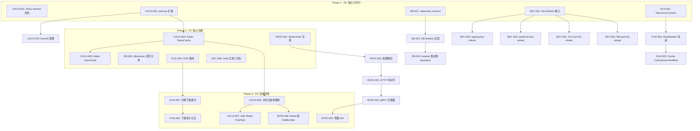
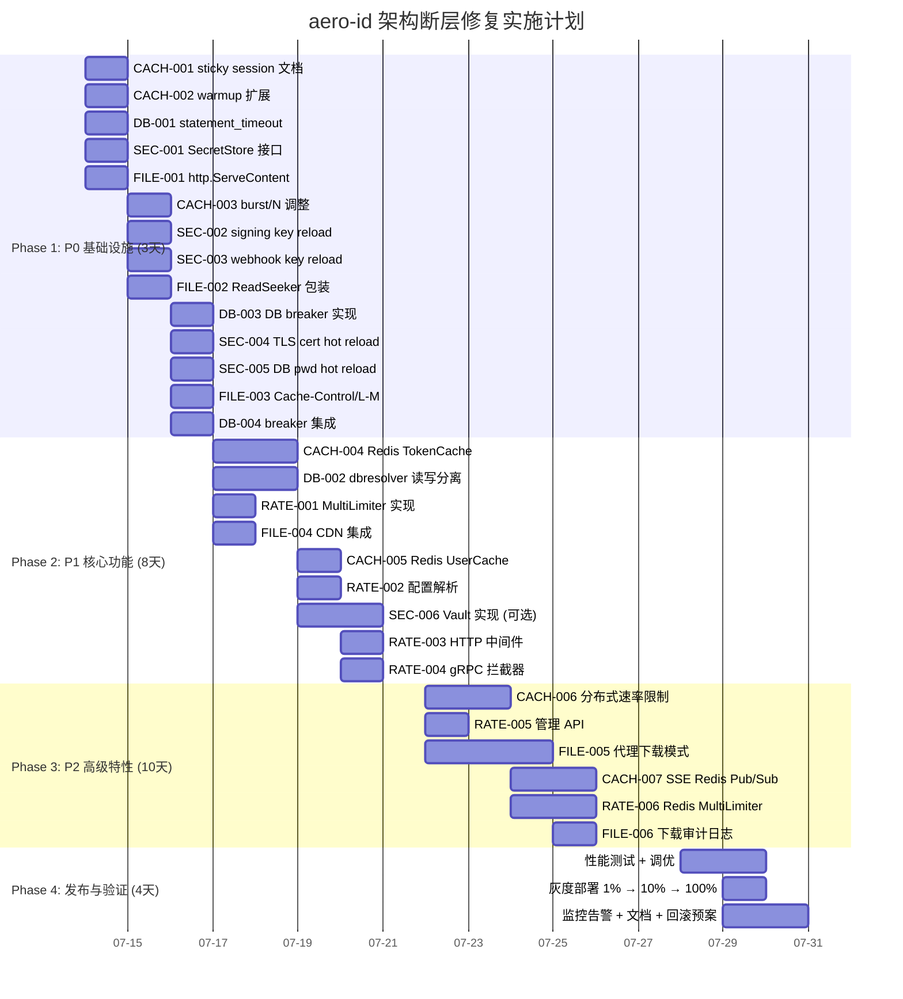

现在我掌握了充分的信息。以下是根据分析文档和代码库扫描生成的 Tech Lead 分析报告。

---

# Tech Lead 分析报告：aero-id 生产级多副本架构断层

## 目录

1. [任务分解](#1-任务分解)
2. [执行顺序与依赖图](#2-执行顺序与依赖图)
3. [技术风险](#3-技术风险)
4. [资源评估](#4-资源评估)
5. [质量保证](#5-质量保证)
6. [实施计划](#6-实施计划)

---

## 1. 任务分解

### 约定

- **工时**：每个任务 2–4 小时，复杂任务进一步拆分为子步骤。
- **涉及文件**：基于 `main` 分支代码扫描的现有文件路径。
- **前置依赖**：标注必须在前完成的任务 ID。

---

### 方向一：缓存一致性与粘滞路由（Cache Coherence & Sticky Routing）

| 任务 ID | 标题 | 涉及文件 | 前置依赖 | 工时 |
|---------|------|---------|---------|------|
| **CACH-001** | 配置 sticky session 运维文档 + 负载均衡配置模板 | `ops/lb/envoy.yaml` (新建), `docs/operations/sticky-session.md` (新建) | 无 | 2h |
| **CACH-002** | 扩展 warmup() 预填充 SSO 连接 + 单次 ValidateToken | `internal/app/app.go` | 无 | 2h |
| **CACH-003** | 调整速率限制默认 burst 按副本数降低（配置文档说明） | `configs/config.yaml`, `configs/config.example.yaml` | 无 | 1h |
| **CACH-004** | Redis-backed TokenCache 实现 | `internal/sso/token_cache.go`, `internal/sso/redis_cache.go` (新建), `internal/config/config.go`, `go.mod` (新增 go-redis) | CACH-002 | 6h |
| **CACH-005** | Redis-backed UserCache 实现 | `internal/sso/user_cache.go`, `internal/sso/redis_cache.go` | CACH-004 | 4h |
| **CACH-006** | 分布式速率限制（Redis Lua 滑动窗口） | `internal/pkg/ratelimit/redis_limiter.go` (新建), `internal/pkg/ratelimit/ratelimit.go` (interface 提取) | CACH-004, RATE-003 | 8h |
| **CACH-007** | SSE Hub Redis Pub/Sub 桥接 | `internal/hub/hub.go`, `internal/hub/redis_bridge.go` (新建), `internal/app/app.go` | CACH-004 | 6h |

---

### 方向二：数据库连接治理

| 任务 ID | 标题 | 涉及文件 | 前置依赖 | 工时 |
|---------|------|---------|---------|------|
| **DB-001** | 设置 `statement_timeout` + 慢查询日志 | `internal/pkg/db/db.go`, `internal/config/config.go` | 无 | 2h |
| **DB-002** | 集成 `gorm.io/plugin/dbresolver` 实现读写分离 | `internal/pkg/db/db.go`, `internal/config/config.go`, `internal/repository/*.go`（可按需添加读方法注解） | DB-001 | 6h |
| **DB-003** | 实现 DB circuit breaker（复用 `sso/breaker.go` 模式） | `internal/pkg/db/breaker.go` (新建), `internal/pkg/db/db.go` | DB-001 | 4h |
| **DB-004** | 熔断集成到 repository 层——Query/Exec 包装 | `internal/pkg/db/breaker.go`, `internal/repository/*.go`（各 repository 的查询方法） | DB-003 | 4h |

---

### 方向三：凭据轮换基础设施

| 任务 ID | 标题 | 涉及文件 | 前置依赖 | 工时 |
|---------|------|---------|---------|------|
| **SEC-001** | 定义 `SecretStore` 接口 + 文件系统实现（SIGHUP 重载） | `internal/config/secret.go` (新建), `internal/config/config.go` | 无 | 4h |
| **SEC-002** | 重构 `internal/storage/signing.go` 使用 `SecretStore` + 双 key 过渡 | `internal/storage/signing.go`, `internal/storage/local.go`, `internal/app/app.go` | SEC-001 | 4h |
| **SEC-003** | Webhook signing_key 改造为动态重载 | `internal/outbox/webhook.go`, `internal/config/config.go`, `cmd/server/main.go`（SIGHUP handler） | SEC-001 | 3h |
| **SEC-004** | TLS 证书热加载（gRPC `GetConfigForClient` 回调） | `internal/sso/dial.go`, `internal/sso/client.go` | SEC-001 | 4h |
| **SEC-005** | DB password 热加载（GORM `dsn` 动态更新） | `internal/pkg/db/db.go`, `internal/app/app.go` | SEC-001 | 3h |
| **SEC-006** | HashiCorp Vault 实现 SecretStore（可选替代方案） | `internal/config/vault_secret.go` (新建), `go.mod` | SEC-001 | 6h |

---

### 方向四：可组合速率限制策略

| 任务 ID | 标题 | 涉及文件 | 前置依赖 | 工时 |
|---------|------|---------|---------|------|
| **RATE-001** | 定义 `MultiLimiter` 结构 + 三层级联桶算法 | `internal/pkg/ratelimit/multi_limiter.go` (新建) | 无 | 4h |
| **RATE-002** | 配置定义 + 解析（`RateLimitConfig` 扩展） | `internal/config/config.go`, `configs/config.yaml` | RATE-001 | 2h |
| **RATE-003** | 集成到 HTTP 中间件（路由感知） | `internal/middleware/ratelimit.go` | RATE-002 | 3h |
| **RATE-004** | 集成到 gRPC 拦截器（fullMethod 分解） | `internal/handler/grpc/server.go` | RATE-002 | 3h |
| **RATE-005** | 管理 API：`GET /rate-limits/status` + 动态配置 | `internal/handler/http/admin.go`, `internal/config/config.go` | RATE-003, RATE-004 | 4h |
| **RATE-006** | Redis 后端分布式版本（可选 P2） | `internal/pkg/ratelimit/redis_multi_limiter.go` (新建) | CACH-006, RATE-001 | 6h |

---

### 方向五：文件下载管线优化

| 任务 ID | 标题 | 涉及文件 | 前置依赖 | 工时 |
|---------|------|---------|---------|------|
| **FILE-001** | Local 下载 handler 改用 `http.ServeContent`（ETag + Range + 304） | `internal/handler/http/file.go`（`Download` 方法） | 无 | 3h |
| **FILE-002** | Local 存储后端实现 `io.ReadSeeker` 包装 + ETag 计算 | `internal/storage/local.go`（新增 `ReadSeekCloser` 包装） | FILE-001 | 3h |
| **FILE-003** | 增加 `Cache-Control` 和 `Last-Modified` 头 | `internal/handler/http/file.go` | FILE-001 | 1h |
| **FILE-004** | S3 CDN 集成（CloudFront/Cloudflare 配置 + presigned URL 缓存参数） | `internal/storage/s3.go`, `docs/operations/cdn-setup.md` (新建), 运维配置 | 无 | 4h |
| **FILE-005** | 代理下载模式（可选 P2） | `internal/handler/http/file.go`, `internal/storage/proxy.go` (新建), `internal/storage/storage.go` (interface 扩展) | FILE-001, FILE-004 | 8h |
| **FILE-006** | 下载审计日志（proxy 模式下记录 `actor_uid`, `file_id`, `timestamp`） | `internal/audit/repository.go`, `internal/handler/http/file.go` | FILE-005 | 3h |

---

## 2. 执行顺序与依赖图

### 全局依赖关系

```
                                          ┌──────────────────────────────────────────────┐
                                          │               PHASE 1 (P0)                   │
                                          │  ~3 days, 最大并行度                        │
                                          └──────────────────────────────────────────────┘

  ┌──────────┐     ┌──────────┐     ┌──────────┐     ┌──────────┐     ┌──────────┐
  │ CACH-001 │     │ CACH-002 │     │ DB-001   │     │ SEC-001  │     │ FILE-001 │
  │ sticky   │     │ warmup   │     │ stmt_t/o │     │ Secret   │     │ ServeCon │
  │ session  │     │ 扩展     │     │          │     │ Store    │     │ tent     │
  └──────────┘     └──────────┘     └──────────┘     └──────────┘     └──────────┘
       │               │                                   │                │
       │               │                                   │                │
       ▼               ▼                                   ▼                ▼
  ┌──────────┐     ┌──────────┐                     ┌──────────┐     ┌──────────┐
  │ CACH-003 │     │ CACH-004 │                     │ SEC-002  │     │ FILE-002 │
  │ burst N  │     │ Redis    │                     │ signing  │     │ ReadSeek │
  │          │     │ Token    │                     │ reload   │     │ er       │
  └──────────┘     │ Cache    │                     └──────────┘     └──────────┘
                   └──────────┘                          │                │
                        │                                │                │
                        ▼                                ▼                ▼
                   ┌──────────┐                     ┌──────────┐     ┌──────────┐
                   │ CACH-005 │                     │ SEC-003  │     │ FILE-003 │
                   │ Redis    │                     │ webhook  │     │ Cache    │
                   │ User     │                     │ reload   │     │ Control  │
                   │ Cache    │                     └──────────┘          │
                   └──────────┘                          │                │
                        │                                │                │
                        ▼                                ▼                ▼
                   ┌──────────┐                     ┌──────────┐     ┌──────────┐
                   │ CACH-006 │                     │ SEC-004  │     │ FILE-004 │
                   │ Redis RL │                     │ TLS hot  │     │ CDN      │
                   └──────────┘                     │ reload   │     │          │
                        │                           └──────────┘     └──────────┘
                        ▼                                │
                   ┌──────────┐                          ▼
                   │ CACH-007 │                     ┌──────────┐
                   │ SSE      │                     │ SEC-005  │
                   │ Pub/Sub  │                     │ DB pwd   │
                   └──────────┘                     │ reload   │
                                                    └──────────┘
                        ┌───────────────────────────────────────┐
                        │          PHASE 2 (P1)                 │
                        │  ~1 week                              │
                        └───────────────────────────────────────┘

  ┌──────────┐     ┌──────────┐     ┌──────────┐     ┌──────────┐
  │ RATE-001 │     │ DB-002   │     │ DB-003   │     │ SEC-006  │
  │ Multi    │     │ dbreso   │     │ DB       │     │ Vault    │
  │ Limiter  │     │ lver     │     │ breaker  │     │ impl     │
  └──────────┘     └──────────┘     └──────────┘     └──────────┘
       │                │                │
       ▼                ▼                ▼
  ┌──────────┐     ┌──────────┐     ┌──────────┐
  │ RATE-002 │     │ DB-004   │     │          │
  │ config   │     │ 集成     │     │          │
  └──────────┘     └──────────┘     │          │
       │                            │          │
       ▼                            ▼          ▼
  ┌──────────┐
  │ RATE-003 │
  │ HTTP     │
  └──────────┘
       │
       ▼
  ┌──────────┐                     ┌───────────────────────────────────────┐
  │ RATE-004 │                     │          PHASE 3 (P2)                 │
  │ gRPC     │                     │  ~2 weeks                             │
  └──────────┘                     └───────────────────────────────────────┘
       │
       ▼
  ┌──────────┐     ┌──────────┐     ┌──────────┐     ┌──────────┐
  │ RATE-005 │     │ RATE-006 │     │ FILE-005 │     │ FILE-006 │
  │ mgmt API │     │ Redis    │     │ proxy    │     │ audit    │
  │          │     │ distrib  │     │ download │     │ log      │
  └──────────┘     └──────────┘     └──────────┘     └──────────┘
```

### Mermaid 依赖图



### 并行执行组

| 组 | 任务 ID | 可并行原因 |
|----|---------|-----------|
| **Group A**（P0 起步） | CACH-001, CACH-002, DB-001, SEC-001, FILE-001 | 互不依赖，修改不同包 |
| **Group B**（P0 续） | CACH-003, SEC-002, SEC-003, SEC-004, SEC-005, FILE-002 | 仅依赖 Group A 的某个起点 |
| **Group C**（P1 起步） | CACH-004, DB-002, RATE-001, FILE-004, SEC-006 | 各自设计独立 |
| **Group D**（P1 续） | CACH-005, DB-003, RATE-002, RATE-003, RATE-004 | 依赖 Group C 各起点 |
| **Group E**（P2） | CACH-006, CACH-007, RATE-005, RATE-006, FILE-005, FILE-006 | 高级特性可并行开发 |

---

## 3. 技术风险

### 3.1 高影响风险

| # | 风险 | 影响方向 | 概率 | 影响 | 缓解策略 |
|---|------|---------|------|------|---------|
| R1 | **Redis 成为新单点瓶颈** | CACH-004~007 | 中 | 高 | Redis Sentinel/Cluster 配置；客户端侧本地缓存兜底（`singleflight` + 短 TTL）；应用侧做退化降级（fallback to 进程内缓存） |
| R2 | **`http.ServeContent` 改造破坏 presigned URL 语义** | FILE-001~003 | 低 | 高 | 使用 `httptest` 全覆盖测试：Range 请求、304、正常下载；验证 presigned URL 仍为唯一授权凭据 |
| R3 | **SIGHUP 信号被容器编排系统劫持** | SEC-002~005 | 中 | 中 | K8s 中默认 SIGHUP 被忽略；需用 `pod lifecycle hook`（`preStop` 或 `postStart`）或文件变化事件（`fsnotify`）替代；实现备用轮询机制 |
| R4 | **DB 读写分离导致 read-after-write 不一致** | DB-002 | 中 | 高 | 在主库写入后立即从库查询可能读到旧数据；`dbresolver` 设置 `SetMaxDelayAcceptable`；关键 RPC（如写入后立即 Get）用 `staleness_ok=false` 标记强制走主库 |
| R5 | **MultiLimiter 多层判断引入额外延迟** | RATE-001~004 | 低 | 中 | 每层只是内存原子操作 + 一次桶检查，预期 <10µs；但三层串联为 30µs；需在压测中验证 p99 影响 |
| R6 | **gRPC 拦截器中获知路由信息较困难** | RATE-004 | 中 | 中 | gRPC UnaryServerInfo 包含 `FullMethod`（如 `/aero.FileService/Upload`），可从其中提取端点名；但 HTTP 部分需从 gin.Context 的 route path 取 |
| R7 | **Redis Pub/Sub 与 SSE 重连语义冲突** | CACH-007 | 高 | 中 | Redis Pub/Sub 不持久化消息；副本 A 在断开重连期间的消息丢失；需补充 Kafka/NATS 或额外消息持久化方案 |

### 3.2 技术难点详析

**难点 1：双 key 过渡期的签名验证逻辑**

`signing.go` 中的 `verifyPresignedURL` 目前只接受一个 `signingKey`。双 key 过渡需要：

```go
// 验证时先用 newKey 校验，失败后用 oldKey 重试
// 签名时只用 newKey
func verifyPresignedURL(rawURL string, now time.Time, newKey, oldKey string) error {
    if err := verifySingle(rawURL, now, newKey); err == nil {
        return nil
    }
    if oldKey != "" {
        return verifySingle(rawURL, now, oldKey)
    }
    return errors.New("presign: bad signature")
}
```

难点在于：滚动部署期间不同副本可能持有不同 key 组合。需确保轮换开始到完成的窗口期内所有副本同时接受新旧两把 key。建议在 `SecretStore.Watch` 回调中统一更新 `newKey` 和 `oldKey`，并在配置中增加 `signing_keys.active` 和 `signing_keys.previous` 字段。

**难点 2：SSE 跨副本推送的至少一次语义**

Redis Pub/Sub 是 fire-and-forget，副本重启期间的推送丢失。可行的折衷方案：

1. **短期**（P0）：纯粘滞路由 + hard 依赖负载均衡层。副本 B 产生通知后，通过 notification 表的 `poll` 来兜底——SSE 连接断开时客户端侧 fallback 到 HTTP polling。
2. **长期**（P2）：每条通知写入 notification 表后，通过 outbox relay 触发 Redis Pub/Sub，副本收到后优先查本地缓存中的活跃订阅列表。

**难点 3：`dbresolver` 与现有 `repository/*.go` 的集成**

现有的每个 Repository 构造时接受 `*gorm.DB`，直接调用 `db.Where(...).Find(...)`。引入读写分离后：

```go
// 方法 A（推荐）：在 db.go 中暴露两个 *gorm.DB：
type DB struct {
    Writer *gorm.DB  // 主库
    Reader *gorm.DB  // 从库（dbresolver 自动负载均衡）
}

// Repository 按场景选择：
func (r *MessageRepo) Search(ctx, query) {
    r.db.Reader.Model(&Message{}).Where(...).Find(...)
}
```

但这需要修改所有 Repository 的构造签名。估算变更涉及约 12 个 Repository。可采用中间方案：先只在 `db.go` 中暴露 `DB()` 和 `ReadDB()` 两个方法，Repository 层面逐步迁移，不做全量重构。

### 3.3 外部依赖

| 依赖 | 用途 | 风险等级 | 已有经验 |
|------|------|---------|---------|
| Redis ≥ 7.0 | 分布式缓存 + 速率限制 + SSE 桥接 | ⚠️ 新依赖 | 运维团队有 Redis 运维经验 |
| `gorm.io/plugin/dbresolver` | 读写分离 | ✅ 成熟库 | 项目已在用 GORM |
| HashiCorp Vault | 凭据管理 | ⚠️ 可选, 新依赖 | 无 |
| CloudFront/Cloudflare | CDN | ✅ 仅配置 | 有 S3 运维经验 |

### 3.4 性能瓶颈与优化策略

| 场景 | 瓶颈 | 优化策略 |
|------|------|---------|
| 缓存预热后 SSO 调用 | `TokenCache` 冷启动 | P0 warmup + P1 Redis 持久化缓存 |
| 搜索查询阻塞 | DB 连接池满 | DB-001 (5s timeout) → DB-002 (读副本) → DB-003 (熔断) |
| 大文件并发下载 | Go 进程内存+goroutine | P0 Range 请求 → P1 CDN → P2 proxy |
| 速率限制判断 | 三层桶检查 | 如果实测 >50µs，用布隆过滤器预判拒绝 |
| SSE 跨副本延迟 | Redis Pub/Sub 延迟 | 监控延迟，必要时用本地 topic partition |

---

## 4. 资源评估

### 4.1 开发团队

| 角色 | 人数 | 技能要求 | 负责方向 |
|------|------|---------|---------|
| **Backend 工程师 A**（高级） | 1 | Go, GORM, 分布式系统, Redis | 方向一（缓存）、方向二（DB 治理） |
| **Backend 工程师 B**（高级） | 1 | Go, 安全工程, TLS/mTLS, gRPC | 方向三（凭据轮换）、方向四（限流） |
| **Backend 工程师 C**（中级+） | 1 | Go, HTTP/REST, Gin, S3 | 方向五（文件下载）、通用测试 |
| **运维/SRE** | 0.5 | K8s, Envoy/ALB, Redis, CDN | sticky session, CDN, Vault, Redis 集群 |
| **QA** | 0.5 | 性能测试, 集成测试 | 压测场景设计、benchmark 执行 |

> **最低配置**：2 名后端（A+B）在核心 P0 阶段已经足够，C 可在 P1 开始时加入。SRE 和 QA 为共享角色。

### 4.2 关键里程碑

| 里程碑 | 时间 | 交付物 | 验证条件 |
|--------|------|--------|---------|
| **M1: P0 基础设施** | 第 1–3 天 | 粘滞路由文档 + warmup + statement_timeout + SecretStore + ServeContent | 3 副本部署后 SSO 负载无尖峰；DB 慢查询不堵塞；SIGHUP 可换 key |
| **M2: P0 上线检查点** | 第 4 天 | 所有 P0 代码 review + 合入 `main` | `make test && make lint` 通过；staging 环境 3 副本运行 24h 无退步 |
| **M3: P1 核心功能** | 第 5–12 天 | Redis TokenCache/UserCache + dbresolver + MultiLimiter + CDN 配置 | 集成测试覆盖；p99 延迟无退化 |
| **M4: P1 上线检查点** | 第 13–14 天 | 性能测试报告 | 日均百万请求压测通过（p99 < 200ms, error rate < 0.1%） |
| **M5: P2 高级特性** | 第 15–26 天 | 分布式限流 + SSE Pub/Sub + 代理下载 + 审计日志 + 管理 API | 全功能 E2E 测试通过 |
| **M6: 发布** | 第 27–30 天 | 生产部署 + 监控告警 + 回滚预案 | 生产灰度 1% → 10% → 100% |

### 4.3 阻塞点与解决策略

| 阻塞点 | 影响任务 | 解决策略 |
|--------|---------|---------|
| Redis 集群环境就绪 | CACH-004~007, RATE-006 | 提前与 SRE 沟通资源需求；P0 阶段用单实例 Redis 开发测试，P1 上线前完成集群部署 |
| K8s sessionAffinity 配置权限 | CACH-001 | 提供 Envoy/ALB 配置模板 + 快速验证脚本，SRE 仅需 apply |
| 容器环境下 SIGHUP 不可用 | SEC-002~005 | 实现双重机制：优先 `fsnotify` 监听挂载点，fallback 到 30s 周期轮询 |
| dbresolver 需要至少一个 PG 只读副本 | DB-002 | 开发测试阶段用同一个实例的 `host=...&dbname=..._readonly` 模拟；生产前由 DBA 准备 read replica |

---

## 5. 质量保证

### 5.1 单元测试覆盖要求

| 包 / 模块 | 最低覆盖率 | 关键测试用例 |
|-----------|-----------|-------------|
| `internal/pkg/ratelimit/multi_limiter.go` | 95% | 三层桶命中/拒绝；全局满但用户空；不同 route 独立计数；配置 disabled 时 pass-through |
| `internal/config/secret.go` | 90% | SIGHUP 信号触发 reload；双 key 同时验证；并发读写安全；旧 key 过期后拒绝 |
| `internal/hub/hub.go`（修改后） | 95% | Redis Pub/Sub 消息投递到本地 hub；副本重启不丢失订阅 state（用 mock redis） |
| `internal/storage/signing.go` | 95% | 双 key 验证；old key 过期后拒绝；HMAC 边界值（空、超长、特殊字符） |
| `internal/pkg/db/breaker.go` | 90% | 复用 `sso/breaker.go` 的测试模式；三态转换；半开后 success/failure |
| `internal/handler/http/file.go` | 90% （download） | Range 请求（`bytes=0-100`、`bytes=-100`、`bytes=0-`、多段）；`If-None-Match` 返回 304；`If-Modified-Since` |
| `internal/handler/grpc/server.go` | 90% | rate limit interceptor 按 fullMethod 分层 |
| `internal/storage/local.go` | 90% | `io.ReadSeeker` 包装；`Seek` 正确性 |

### 5.2 集成测试策略

```
                    ┌──────────────────────────────────────────────────────┐
                    │              集成测试分层                             │
                    ├──────────────────────────────────────────────────────┤
                    │  Layer 1: 服务层测试（已有模式）                       │
                    │  - internal/service/*_test.go 使用 mock repository    │
                    │  - 新增：MultiLimiter 与 service 的集成                │
                    ├──────────────────────────────────────────────────────┤
                    │  Layer 2: 仓库层测试（integration tag）               │
                    │  - internal/repository/testpg 提供真实 PG              │
                    │  - 新增：dbresolver 路由验证（通过标记查询验证）        │
                    │  - 新增：breaker 在 DB 故障时的行为                     │
                    ├──────────────────────────────────────────────────────┤
                    │  Layer 3: 端到端传输测试（integration tag）            │
                    │  - Docker Compose 启动完整堆栈（PG + Redis + MinIO）   │
                    │  - 测试：3 副本场景下的 SSE 送达 + 限流 + 缓存一致    │
                    │  - 测试：Range 请求完整下载 + 断点续传                  │
                    ├──────────────────────────────────────────────────────┤
                    │  Layer 4: 压测（单独的 benchmark 套件）               │
                    │  - ghz / k6 脚本在 benchmarks/ 目录                    │
                    │  - 场景：混合负载（70% 读 + 20% 写 + 10% 搜索）       │
                    │  - 指标：p50/p95/p99 延迟, error rate, 缓存命中率      │
                    └──────────────────────────────────────────────────────┘
```

关键集成测试场景：

```go
// 新增集成测试（/internal/handler/http/file_download_test.go）
func TestDownloadRangeSupport(t *testing.T) {
    // Given: 上传一个 10KB 文件
    // When: 发送 Range: bytes=100-199
    // Then: 状态码 206, Content-Range 正确, body 为对应 100 字节
}

func TestDownloadETagCacheHit(t *testing.T) {
    // Given: 已下载并获取 ETag
    // When: 发送 If-None-Match: "<etag>"
    // Then: 状态码 304, body 为空
}

// 新增集成测试（/internal/sso/redis_cache_test.go）
func TestTokenCacheCrossReplica(t *testing.T) {
    // Given: Redis 集群, 两个 SSO client
    // When: client A Set token → uid
    // Then: client B Get 相同 token → 同一 uid
}
```

### 5.3 代码审查要点

| 方向 | 审查重点 | 典型问题 |
|------|---------|---------|
| 缓存 | Redis 连接泄漏；TTL 设置不当；序列化选型 | 不使用 `encoding/json` 频繁序列化小对象→用 `protobuf` 或 `msgpack` |
| DB 治理 | 熔断阈值是否太低导致误触发；读写分离后的一致性问题 | 主从延迟 > 1s 时用户看到自己刚上传的文件不存在 |
| 凭据轮换 | 轮换期间旧凭据仍在使用的窗口期 | SIGHUP 信号处理不当导致 key 在写入时切换，token 验证竞态 |
| 限流 | 多层桶顺序（先全局还是先用户）；配置校验 | 误配置 `global.rps=500, per_user.rps=20` 但用户桶未生效 |
| 文件下载 | ETag 生成策略是否唯一；Range 请求偏移校验 | 负偏移、超出文件大小的 Range 应该返回 `416 Range Not Satisfiable` |

### 5.4 性能测试需求

| 测试场景 | 并发数 | 目标 | 工具 |
|---------|-------|------|------|
| 混合 RPC 负载（方向一+二） | 500 并发持续 30min | p99 < 200ms, 错误率 < 0.1% | `ghz` 或 `k6` |
| 限流器基准（方向四） | 1000 并发 | 单层 < 5µs, 三层 < 15µs（p99） | Go `benchstat` |
| 大文件并行下载（方向五） | 100 并发下载 50MB 文件 | 吞吐 > 500MB/s（local mode） | `wrk` / `hey` |
| 凭据轮换无中断（方向三） | 持续 200 RPS 下触发轮换 | 0 请求失败 | 自定义脚本 |
| SSE 跨副本延迟（方向一） | 持续推送 100 events/s | p99 延迟 < 100ms | 自定义 + Prometheus |
| Redis 故障恢复 | 运行时 kill Redis | 自动降级 + 恢复后缓存重建 < 30s | Chaos Engineering |

---

## 6. 实施计划

### 详细时间表



### 阶段交付标准

#### 阶段 1：P0 基础设施（3 天）

```
完成标志：所有 P0 任务提 PR，CI 通过，staging 环境 3 副本验证

验收检查清单：
□ Sticky session 文档完成 + 负载均衡配置模板已提交至 ops/
□ warmup() 在启动时执行 SSO HealthCheck + 一条 ValidateToken（触发 singleflight）
□ statement_timeout = '5s' 在 db.Open() 中设置
□ 慢查询日志：所有超过 200ms 的查询记录到 zap.Warn
□ SecretStore 接口定义 + 文件系统实现 + SIGHUP 注册
□ SIGNING_KEY 双 key 过渡（active + previous）——新签名用 active，验证用 active+previous
□ http.ServeContent 替换 io.Copy: Range, ETag, Last-Modified, 304 完整支持
□ Rate limit burst 配置注释修改为 "per-replica，全局需乘以 N"
□ DB circuit breaker 实现（复用 sso/breaker.go）——threshold, cooldown, half-open
□ Breaker 已包装 repository 中所有 Query / Exec 调用
□ TLS 证书热加载（GetConfigForClient）
□ DB password 热加载（dsn 动态更新，使用 SecretStore）
□ 所有 P0 修改通过 make test && make lint
```

#### 阶段 2：P1 核心功能（8 天）

```
完成标志：集成测试通过，性能测试达标

验收检查清单：
□ Redis TokenCache 读写通过、TTL 与原来一致、stale 逻辑保留
□ Redis UserCache 批量查询优化（MGET + pipeline）
□ dbresolver 配置：主库写入/从库读取（write/read 分离），staleness_ok 标记
□ dbresolver 集成测试：写入后立即通过 staleness_ok=false 走主库
□ MultiLimiter 三层结构：global → per_route → per_user
□ 配置解析：yaml + env override
□ HTTP 中间件按路由路径（c.FullPath()）匹配 per_route 桶
□ gRPC 拦截器按 fullMethod 匹配 per_route 桶
□ CDN 配置：S3 presigned URL 增加缓存参数，CloudFront/Cloudflare 配置文档
□ Vault 实现（可选）：SecretStore 接口的 Vault 版本
□ 性能测试报告：p99 < 200ms, 错误率 < 0.1%
```

#### 阶段 3：P2 高级特性（10 天）

```
完成标志：全功能 E2E 测试通过

验收检查清单：
□ Redis Lua 滑动窗口限流（替代进程内桶）
□ SSE Hub Redis Pub/Sub：副本 A 发布 → 所有副本收到 → 推送给本地订阅者
□ 管理 API：GET /rate-limits/status 返回实时桶状态和拒绝计数
□ Redis 版 MultiLimiter（可选 P2）
□ 代理下载模式（mode=proxy）：aero-id 中转 S3 + Range/ETag/304
□ 下载审计日志：actor_uid, file_id, timestamp, bytes_sent, file_size
□ Chaos 测试：Redis 故障时自动降级到进程内缓存
```

#### 阶段 4：发布准备（4 天）

```
完成标志：生产环境健康运行 72h

验收检查清单：
□ 性能基准测试通过（p99, p95, 吞吐量）
□ Grafana dashboard 更新：缓存命中率、breaker state、限流拒绝率、凭据轮换事件
□ PagerDuty/告警规则：breaker open、缓存命中率 < 50%、凭据轮换失败
□ 回滚预案文档（rollback steps for each direction）
□ 灰度部署：1%（1h）→ 10%（2h）→ 100%（观察 24h）
□ 操作手册更新：sticky session 配置、CDN 刷新、凭据轮换 SOP
```

---

## 附录：AGENTS.md 约束合规检查

| 约束 | 本计划中是否违反 | 说明 |
|------|----------------|------|
| 文件 ≤ 500 行 | ⚠️ 需注意 | `internal/app/app.go` 目前 ~260 行，引入 dbresolver + Redis 后可能接近 400 行 → 建议在 P1 前将 `warmup()` `buildStorage()` 拆分到独立文件 |
| 函数 ≤ 50 行 | ⚠️ 需注意 | `New()` 目前 ~120 行，计划增加依赖注入逻辑 → 建议将 `initSSO()`, `initDB()`, `initLimiter()`, `initStorage()` 提取为独立函数 |
| 循环复杂度 ≤ 10 | ✅ 无风险 | 新增逻辑主要为分支判断，不会显著增加复杂度 |
| if-嵌套 ≤ 3 | ✅ 无风险 | MultiLimiter 和 breaker 控制流清晰 |
| 单一职责 | ⚠️ 需注意 | `internal/config/config.go` 当前 `validate()` 包含 ~12 个 if 检查 → 新增凭据轮换配置后考虑拆分为 `config_validate.go` |

建议在 P0 代码提交前执行一次 **`make check-file-sizes && make lint`** 扫描，防止新增代码触发硬限制。
