现在我有了完整的代码验证上下文和原始分析文档。以下是基于 `docs/requirements/2026-07-12-aero-id-global-architecture-scan-high-value-extensions.md` 的 Tech Lead 深度分析报告。

---

# Tech Lead 分析报告：全局架构扫描 — 高价值扩展方向

> **评审人**: Tech Lead  
> **评审日期**: 2026-07-12  
> **分析对象**: `docs/requirements/2026-07-12-aero-id-global-architecture-scan-high-value-extensions.md`  
> **代码基线**: `main` branch @ 2026-07-12  

---

## 0. 代码验证摘要

对文档核心声明的逐条验证结果：

| 文档声明 | 实际代码 | 状态 |
|---------|---------|------|
| `hub.Pusher` 接口在 `internal/hub/hub.go:151`，仅含 `Publish(uid, eventType, data)` | `hub.go:151` — `type Pusher interface { Publish(uid, eventType, data string) }` | ✅ 准确 |
| Dispatcher 已注入 `hub.Pusher` | `dispatcher.go:18` — `pusher hub.Pusher`，`:74-76` 调用 | ✅ 准确 |
| Outbox Repository 有 `FetchUnpublished`、`MarkFailed`、`MarkPublished`、`PurgeDeadLetters` | `repository.go:74`, `:91`, `:106`, `:127` | ✅ 准确 |
| `outbox.Relay` 无 gauge 记录死信数，仅有计数器 | `relay.go` 中确认 | ✅ 准确 |
| 消息模型是严格的 1:1（`from_uid`/`to_uid`） | `domain/message.go:7-8` — `FromUID`/`ToUID` | ✅ 准确 |
| `service/message.go` `Send` 只接受单 `ToUID` | `service/message.go` — 签名 `Send(ctx, msg *Message, actorUID string)` 无可变 `ToUID` | ✅ 准确 |
| Block 检查在 `message.send` | `service/message.go:72` — `s.blocks.IsBlocked(ctx, in.ToUID, actor)` | ✅ 准确 |
| `conversations` 路由已存在（1:1 旧端点） | `handler/http/message.go:35-36` — `/conversations/:uid` 和 `/conversations/:uid/read` | ✅ 准确 |
| `internal/outbox/webhook.go` 集成测试缺失 | `webhook_test.go` **存在**，但检查发现是单元测试（mock handler），非集成测试 | ⚠️ 部分准确 |
| `actorKey`/`WithActor`/`ActorFrom` 在 `service.go` 和 `domain/actor.go` 重复 | `service.go`(283行) 和 `actor.go`(28行) 中确有多余实现 | ✅ 准确，需重构 |

**结论**: 文档代码引用整体准确，技术建议基于可靠的代码观察。

---

## 1. 任务分解

### 方向一：推送通知通道 — FCM / APNs 集成（7 任务，P1）

| 任务 ID | 标题 | 涉及文件 | 前置依赖 | 工时 |
|---------|------|---------|---------|------|
| TASK-101 | `device_tokens` 表迁移 + Model | `migrations/xxxxxx_device_tokens.up.sql`, `internal/domain/device.go`（新） | 无 | 2h |
| TASK-102 | Device Token Repository（CRUD + FindByUID + DeleteByToken） | `internal/repository/device.go`（新） | TASK-101 | 3h |
| TASK-103 | 设备注册端点 `POST /v1/devices` + `DELETE /v1/devices/:token` | `internal/handler/http/device.go`（新）, `internal/service/device.go`（新）, `api/proto/aero_id.proto`（gRPC 扩展） | TASK-102 | 3h |
| TASK-104 | `internal/push/` Adapter 接口 + FCM 实现 | `internal/push/adapter.go`, `internal/push/fcm.go`（新）, `configs/config.yaml` | 无 | 4h |
| TASK-105 | Dispatcher 集成推送通道（在 SSE 推送外异步调用 push.Adapter） | `internal/notification/dispatcher.go`, `internal/push/dispatcher.go`（新） | TASK-104 | 3h |
| TASK-106 | Token 失效处理（FCM `NotRegistered` → 自动删除、日志告警） | `internal/push/fcm.go`, `internal/repository/device.go` | TASK-105 | 2h |
| TASK-107 | 推送限流（令牌桶，600 QPS FCM 限制）+ 静默时段检查集成 | `internal/push/ratelimit.go`（新）, `internal/push/fcm.go` | TASK-105 | 2h |

### 方向二：死信队列运维与 Outbox 可观测性（5 任务，P0）

| 任务 ID | 标题 | 涉及文件 | 前置依赖 | 工时 |
|---------|------|---------|---------|------|
| TASK-201 | Outbox Repository 扩展：`FetchDeadLetters(page)` + `ReplayEvent(id)` | `internal/outbox/repository.go` | 无 | 2h |
| TASK-202 | Admin 死信管理 HTTP/gRPC 端点（list + replay + purge） | `internal/handler/http/admin_deadletter.go`（新）, `internal/handler/grpc/ops_deadletter.go`（新） | TASK-201 | 3h |
| TASK-203 | Outbox 延迟/死信仪表化：`ObserveOutboxDeadLetter` 计数器 + gauge | `internal/outbox/metrics.go`（新或扩展现有）, `internal/outbox/relay.go` | 无 | 2h |
| TASK-204 | Relay 启动时记录死信数 gauge + 告警规则接入 | `internal/outbox/relay.go`, `internal/outbox/metrics.go` | TASK-203 | 1h |
| TASK-205 | 死信保留策略配置 + 自动清理 Job | `configs/config.yaml`, `cmd/worker/main.go`（扩展）, `internal/outbox/repository.go` | TASK-201 | 2h |

### 方向三：多对多会话 / 群组消息（10 任务，P1）

| 任务 ID | 标题 | 涉及文件 | 前置依赖 | 工时 |
|---------|------|---------|---------|------|
| TASK-301 | `conversations` + `conversation_members` 表迁移 + Domain | `migrations/xxxxxx_conversations.up.sql`, `internal/domain/conversation.go`（新） | 无 | 3h |
| TASK-302 | Conversation Repository（CRUD + member 管理 + 查询列表） | `internal/repository/conversation.go`（新） | TASK-301 | 4h |
| TASK-303 | Message 添加可空 `conversation_id` + 迁移 | `migrations/xxxxxx_add_conversation_id.up.sql`, `internal/domain/message.go`, `internal/repository/message.go` | TASK-301 | 2h |
| TASK-304 | 创建群组 Service + Handler（`POST /v1/conversations`） | `internal/service/conversation.go`（新）, `internal/handler/http/conversation.go`（新） | TASK-302 | 3h |
| TASK-305 | 群成员管理（添加/移除/角色）Service + Handler | `internal/service/conversation.go`, `internal/handler/http/conversation.go` | TASK-302 | 3h |
| TASK-306 | 群组发消息（message.Send 扩展 `conversation_id` 参数） | `internal/service/message.go`（改造）, `internal/repository/message.go` | TASK-303 | 4h |
| TASK-307 | 群消息查询 + Block 过滤 + 可见性检查 | `internal/service/message.go`, `internal/repository/message.go` | TASK-306 | 3h |
| TASK-308 | 群消息通知（Outbox 事件 → 通知所有群成员） | `internal/service/message.go`, `internal/outbox/events.go`, `internal/notification/dispatcher.go` | TASK-306 | 3h |
| TASK-309 | 向后兼容：旧 1:1 会话端点别名 + 数据回填 | `internal/handler/http/message.go`, `cmd/tools/backfill_conversations/main.go`（新） | TASK-301, TASK-302 | 4h |
| TASK-310 | 1:1 会话自动创建（首次发消息时）+ 非群组 message 的 `conversation_id` 填充 | `internal/service/message.go` | TASK-303, TASK-306 | 2h |

### 方向四：文件版本管理与内容管道（9 任务，P2）

| 任务 ID | 标题 | 涉及文件 | 前置依赖 | 工时 |
|---------|------|---------|---------|------|
| TASK-401 | `file_versions` 表迁移 + Domain + Repository | `migrations/xxxxxx_file_versions.up.sql`, `internal/domain/file_version.go`（新）, `internal/repository/file_version.go`（新） | 无 | 3h |
| TASK-402 | `file_thumbnails` 表迁移 + Domain + Repository | `migrations/xxxxxx_file_thumbnails.up.sql`, `internal/domain/file_thumbnail.go`（新）, `internal/repository/file_thumbnail.go`（新） | 无 | 2h |
| TASK-403 | File Create 写入 Version 1 + 发布 `file.version.created` 事件 | `internal/service/file.go`, `internal/outbox/events.go` | TASK-401 | 3h |
| TASK-404 | Content Pipeline Worker 框架（sub outbox event → handler registry） | `internal/worker/pipeline.go`（新）, `cmd/worker/main.go`（新） | TASK-403 | 4h |
| TASK-405 | 缩略图生成 Handler（imaging 库，3 种尺寸） | `internal/worker/handler_thumbnail.go`（新） | TASK-404 | 4h |
| TASK-406 | 版本管理端点：列出版本、上传新版本、下载特定版本 | `internal/handler/http/file_version.go`（新）, `internal/service/file_version.go`（新） | TASK-401, TASK-404 | 4h |
| TASK-407 | 缩略图获取 GET 端点（未就绪返回 404/占位图） | `internal/handler/http/file_thumbnail.go`（新）, `internal/service/file.go` | TASK-402, TASK-405 | 2h |
| TASK-408 | GC 扩展：purge 检查所有版本引用 | `internal/service/file_gc.go`, `internal/repository/file_version.go` | TASK-401 | 2h |
| TASK-409 | 病毒扫描集成框架（ClamAV socket）+ 扫描结果更新 `file.status` | `internal/worker/handler_virus.go`（新）, `internal/domain/file.go`（字段扩展） | TASK-404 | 3h |

### 方向五：跨资源统一活动流（8 任务，P2）

| 任务 ID | 标题 | 涉及文件 | 前置依赖 | 工时 |
|---------|------|---------|---------|------|
| TASK-501 | `activity_entries` 表迁移 + Domain | `migrations/xxxxxx_activity_entries.up.sql`, `internal/domain/activity.go`（新） | 无 | 2h |
| TASK-502 | Activity Entry Repository（写入 + cursor 分页查询 + 按 actor/type 过滤） | `internal/repository/activity.go`（新） | TASK-501 | 3h |
| TASK-503 | Follow（关注）表迁移 + Domain + Repository | `migrations/xxxxxx_follows.up.sql`, `internal/domain/follow.go`（新）, `internal/repository/follow.go`（新） | 无 | 3h |
| TASK-504 | Follow 端点和 Service（follow/unfollow/list followers/following） | `internal/handler/http/follow.go`（新）, `internal/service/follow.go`（新） | TASK-503 | 3h |
| TASK-505 | 活动流写入：Outbox Relay 中 fan-out 写入 `activity_entries`（方案 B：轻量 + actor_activity 合并） | `internal/outbox/relay.go`, `internal/service/feed.go`（新） | TASK-501, TASK-502 | 4h |
| TASK-506 | 活动流读取端点 `GET /v1/feed`（Block 过滤 + ACL + 已删内容处理） | `internal/handler/http/feed.go`（新）, `internal/service/feed.go` | TASK-502, TASK-503, TASK-505 | 3h |
| TASK-507 | 活动聚合/去重逻辑（连续同类事件合并） | `internal/service/feed.go` | TASK-506 | 2h |
| TASK-508 | 活动流权限模型（查看他人流 + Block 互斥 + 可见内容检查） | `internal/service/feed.go`, `internal/service/block.go` | TASK-506 | 2h |

### 次级技术债务修复（4 任务，P1/P2 混合）

| 任务 ID | 标题 | 涉及文件 | 前置依赖 | 工时 |
|---------|------|---------|---------|------|
| TASK-601 | `actorKey`/`WithActor`/`ActorFrom` 去重（保留 `domain/actor.go` 版本） | `internal/service/service.go`, `internal/domain/actor.go`, 所有调用方约 15 处 import | 无 | 2h |
| TASK-602 | `OutboxConfig.Webhook.Timeout` 改为 `time.Duration` 类型 | `internal/config/config.go`, `internal/outbox/webhook.go` | 无 | 1h |
| TASK-603 | SSE Hub channel 缓冲区可配置 | `internal/hub/hub.go`, `configs/config.yaml`, `internal/config/config.go` | 无 | 1h |
| TASK-604 | 设备注册端点增加独立 rate limit | `internal/middleware/ratelimit.go`, `internal/handler/http/device.go` | TASK-103 | 1h |

---

## 2. 执行顺序与并行策略

```mermaid
graph TD
    %% ====== Phase 1: Quick Wins (Sprint 1) ======
    subgraph Phase1[Sprint 1: Quick Wins & Foundation]
        T201[TASK-201: FetchDeadLetters + ReplayEvent]
        T203[TASK-203: Outbox 仪表化]
        T204[TASK-204: Relay 死信 gauge + 告警]
        T601[TASK-601: actorKey 去重]
        T602[TASK-602: Timeout 类型修复]
        T603[TASK-603: Hub 缓冲区可配置]
        T101[TASK-101: device_tokens 表]
        T301[TASK-301: conversations 表 + domain]
        T401[TASK-401: file_versions 表]
        T402[TASK-402: file_thumbnails 表]
        T501[TASK-501: activity_entries 表]
        T503[TASK-503: follows 表]
    end

    %% ====== Phase 2: Core Logic (Sprint 2-3) ======
    subgraph Phase2[Sprint 2-3: Core Logic]
        T202[TASK-202: Admin 死信端点]
        T205[TASK-205: 死信保留策略]
        T102[TASK-102: Device Token Repo]
        T302[TASK-302: Conversation Repo]
        T303[TASK-303: Message + conversation_id]
        T304[TASK-304: 创建群组 Service+Handler]
        T305[TASK-305: 群成员管理]
        T403[TASK-403: File Create 写入 Version 1]
        T502[TASK-502: Activity Repo]
        T504[TASK-504: Follow 端点和 Service]
    end

    %% ====== Phase 3: Feature Completion (Sprint 4-5) ======
    subgraph Phase3[Sprint 4-5: Feature Completion]
        T103[TASK-103: 设备注册端点]
        T104[TASK-104: push.Adapter + FCM]
        T306[TASK-306: 群组发消息]
        T307[TASK-307: 群消息查询+Block过滤]
        T308[TASK-308: 群消息通知]
        T404[TASK-404: Worker 框架]
        T405[TASK-405: 缩略图 Handler]
        T406[TASK-406: 版本管理端点]
        T505[TASK-505: 活动流写入]
        T604[TASK-604: 设备端点 rate limit]
    end

    %% ====== Phase 4: Integration & Polish (Sprint 6-7) ======
    subgraph Phase4[Sprint 6-7: Integration & Polish]
        T105[TASK-105: Dispatcher + push 集成]
        T106[TASK-106: Token 失效处理]
        T107[TASK-107: 推送限流+静默时段]
        T309[TASK-309: 向后兼容+数据回填]
        T310[TASK-310: 1:1 会话自动创建]
        T407[TASK-407: 缩略图端点]
        T408[TASK-408: GC 扩展]
        T409[TASK-409: 病毒扫描]
        T506[TASK-506: 活动流读取端点]
        T507[TASK-507: 活动聚合/去重]
        T508[TASK-508: 活动流权限模型]
    end

    %% Direction 1 dependencies
    T101 --> T102 --> T103
    T103 --> T104
    T104 --> T105
    T105 --> T106
    T105 --> T107
    T103 --> T604

    %% Direction 2 dependencies
    T201 --> T202
    T201 --> T205
    T203 --> T204

    %% Direction 3 dependencies
    T301 --> T302
    T301 --> T303
    T302 --> T304
    T302 --> T305
    T303 --> T306
    T306 --> T307
    T306 --> T308
    T302 --> T309
    T303 --> T310
    T310 --> T306

    %% Direction 4 dependencies
    T401 --> T403
    T401 --> T406
    T401 --> T408
    T402 --> T407
    T403 --> T404
    T404 --> T405
    T404 --> T409
    T405 --> T407

    %% Direction 5 dependencies
    T501 --> T502
    T503 --> T504
    T502 --> T505
    T504 --> T505
    T505 --> T506
    T506 --> T507
    T506 --> T508
```

### 并行任务组

| 组 | 任务 | 最低并行人力 | Sprint | 说明 |
|----|------|------------|--------|------|
| **G1** | TASK-101, T201, T203, T301, T401, T402, T501, T503, T601, T602, T603 | 3 人 | Sprint 1 | 所有基础设施建设 + 技术债务修复，互不阻塞 |
| **G2** | TASK-102, T202, T205, T302, T303, T403, T502, T504 | 2-3 人 | Sprint 2-3 | 各方向的 Repository/Service 核心逻辑 |
| **G3** | TASK-103, T304, T305, T404, T405 | 2 人 | Sprint 4 | 方向一/三/四的功能端点 + 方向四的 Worker |
| **G4** | TASK-104, T306, T307, T308, T406, T505 | 2-3 人 | Sprint 5 | 高复杂度功能（推送引擎、群组消息、活动流写入） |
| **G5** | TASK-105, T106, T107, T309, T310, T407, T408, T409, T506, T507, T508, T604 | 2 人 | Sprint 6-7 | 集成收尾、数据回填、权限完善 |

---

## 3. 技术风险

### 3.1 高优先级风险

| 风险 ID | 描述 | 影响方向 | 可能性 | 严重度 | 缓解策略 |
|---------|------|---------|--------|--------|---------|
| **R1** | FCM/APNs 需要 SSO 团队提供 Firebase 凭据和项目配置，跨团队阻塞 | 方向一 | 高 | 中 | 先落地 `device_tokens` 表和注册端点（TASK-101~103），推送引擎作为可选后期集成；抽象 `push.Adapter` 接口，FCM 实现可 mock 测试 |
| **R2** | 群组消息 10k+ 大群的 fan-out 通知行写入性能 | 方向三 | 中 | 高 | 批量 insert（每批 500），异步写入，消息级别限流；设计时预留批量/延迟写的能力，不要在请求路径中同步写通知 |
| **R3** | 文件版本存储成本膨胀：每次上传完整 blob | 方向四 | 高 | 中 | 跨版本 checksum 去重（TASK-403 中 `file_versions.checksum` 已记录）；默认版本上限 50，LRU 淘汰；dedup 可在 `File.Create` 中复用已有 `checksum` 去重逻辑 |
| **R4** | 活动流写入路径的写放大（influencer 10k+ followers） | 方向五 | 中 | 高 | 采用文档建议的方案 B/C：先写 `actor_activity` 时间线，读取时做 fan-in merge，避免 fan-out write；引入异步合并窗口 |
| **R5** | 文件内容管道 Worker 故障/阻塞导致缩略图永远无法生成 | 方向四 | 中 | 中 | Worker 独立部署 + 超时/重试 + 死信；文件缩略图状态支持手动触发重新处理（admin 端点） |
| **R6** | ClamAV 部署与集成复杂度（socket 路径、更新、性能） | 方向四 | 中 | 中 | 将 ClamAV 扫描作为可选的 pluggable handler（`handler_virus.go`），不出现在默认配置中；先只提供框架 + stub handler |
| **R7** | 现有 /v1/conversations/:uid 路径与新群组 conversations 端点冲突 | 方向三 | 高 | 高 | 路由设计需区分：旧端点保留为 `/v1/direct-conversations/:uid` 别名；新端点 `/v1/conversations` 作为群组列表。需考虑客户端兼容 |
| **R8** | 推送通知静默时段已在 dispatcher 层面判断，但 push 通道也需尊重 | 方向一 | 低 | 低 | `preference.IsAllowed` 已在 service 层调用（`notification/dispatcher.go` 已有 `WithDispatcherPreferenceChecker`），推送通道直接继承同一 checker 即可 |

### 3.2 技术债务依赖风险

| 风险 ID | 描述 | 影响 | 缓解 |
|---------|------|------|------|
| **R9** | `actorKey` 去重（TASK-601）与正在开发的任何方向代码产生 import 冲突 | 所有方向 | 优先在 Sprint 1 的第一天完成，避免后续多分支冲突 |
| **R10** | 现有 Conversation 端点返回的是简单的 message 列表，无 `ConversationSummary` 概念 | 方向三 | TASK-310 需确保 1:1 会话自动创建的 `ConversationSummary` 字段与旧端点一致 |

---

## 4. 资源评估

### 4.1 团队组成

| 角色 | 所需人数 | 关键技能 | 主要负责方向 |
|------|---------|---------|-------------|
| **后端 Go 工程师** | 2 人 | Go 1.26、GORM、gRPC、Postgres | 方向二/三/四核心逻辑 |
| **全栈/后端工程师** | 1 人 | Go、FCM/APNs 集成、消息队列概念 | 方向一推送 + 方向五活动流 |
| **DevOps/基础设施工程师** | 0.5 人 | Docker、CI/CD、ClamAV、可观测性 | 方向四 Worker 部署 + 死信告警集成 |
| **Tech Lead / 架构师** | 1 人 (兼职) | 系统设计、代码审查、跨团队协调 | 架构决策、R1 跨团队协调、代码审查 |

**最低开发团队**: 3 名全职开发 + 1 名兼职 Tech Lead

### 4.2 关键里程碑

| 里程碑 | 时间 | 交付物 | 验收标准 |
|--------|------|--------|---------|
| **M1: Quick Wins** | Sprint 1 结束 (1 周) | 死信查询 API + 仪表化 + 技术债务修复 + 所有新表迁移 | 死信端点可用，`actorKey` 去重完成，所有 migration 上 ✅ |
| **M2: Core Logic** | Sprint 3 结束 (3 周) | 推送设备注册、Conversation CRUD、File Version 1 写入、Activity Repo | 各方向的 Repository + Service 核心通过 UT |
| **M3: Feature Complete** | Sprint 5 结束 (5 周) | FCM 推送、群组消息、缩略图生成、Follow 系统 | 所有功能端点在 dev 环境验证通过 |
| **M4: Integration** | Sprint 7 结束 (7 周) | 全部 43 任务完成，`make test && make lint && make test-integration` 全绿 | 集成测试覆盖推送、群组通知、活动流权限 |

### 4.3 阻塞点与解决策略

| Blocking | 描述 | 属主 | 解决策略 |
|----------|------|------|---------|
