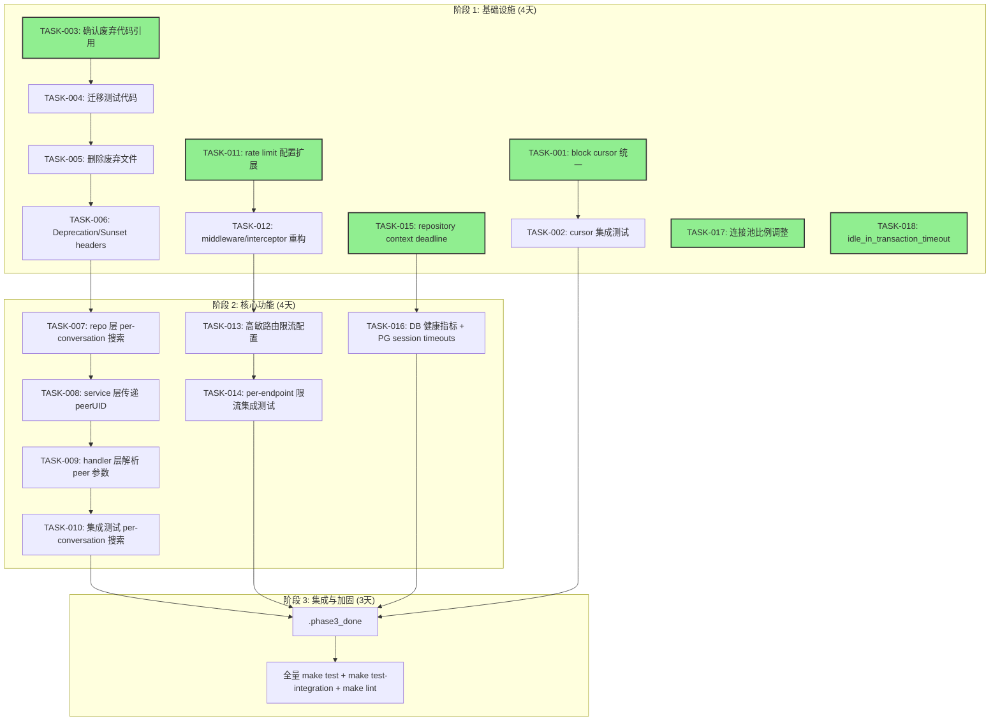

基于对代码库的深入分析（包含 `internal/` 下所有 22 个子包、`configs/config.yaml`、`migrations/`、`api/proto/`），以下是完整的 Tech Lead 实施计划。

---

# Tech Lead 分析报告：aero-id 基础设施债务偿还计划

## 1. 任务分解

共拆解为 **16 个任务**，覆盖 6 个方向。每个任务均按 **2-4 小时**粒度设计。

### 方向一：Cursor 分页一致性修复

| 任务 ID | 标题 | 涉及文件 | 前置依赖 | 工时(h) | 验收标准 |
|---------|------|---------|---------|--------|---------|
| **TASK-001** | 统一 block 仓库 cursor 为 `id` 排序 | `internal/repository/block.go` | 无 | 1 | `WHERE id < ?` 替换 `WHERE created_at < ?`；`ORDER BY id DESC`；`make test` 通过 |
| **TASK-002** | 补充 cursor 不统一性的集成测试 | `internal/repository/block_integration_test.go` | TASK-001 | 2 | 断言 cursor 排序行为与其他仓库一致；`make test-integration` 通过 |

### 方向二：API 生命周期管理

| 任务 ID | 标题 | 涉及文件 | 前置依赖 | 工时(h) | 验收标准 |
|---------|------|---------|---------|--------|---------|
| **TASK-003** | 废弃代码清理——确认引用完整性 | `internal/search/*`, `internal/block/*`, `internal/notification/*`, `internal/file/*`, `internal/comment/*`, `internal/message/*` | 无 | 3 | 确认 `internal/search/` 的 `searchKind` 方法被 `internal/service/search.go` 完整覆盖；确认 `internal/file/` 中 repository 接口在何处被引用；输出引用矩阵文档 |
| **TASK-004** | 废弃代码清理——迁移测试代码 | `internal/handler/grpc/*_test.go` | TASK-003 | 3 | 将 `internal/{file,comment,message,block,notification,search}/handler_grpc_test.go` 中测试逻辑并入 `internal/handler/grpc/` 对应测试文件；`make test` 通过 |
| **TASK-005** | 废弃代码清理——删除废弃文件 | 11 个文件（见分析文档） | TASK-004 | 2 | 删除后 `make build && make test && make lint` 无报错；git diff 显示清除 ~800+ 行代码 |
| **TASK-006** | 添加 `Deprecation`/`Sunset` 响应头支持 | `internal/pkg/httpx/httpx.go`, `internal/handler/http/router.go`, `internal/handler/grpc/server.go`, `configs/config.yaml` | TASK-005 | 3 | 新增 `RouterConfig.DeprecatedRoutes` 配置项；路由注册时可标记废弃并在响应中注入 `Deprecation: true` + `Sunset: <date>` 头；gRPC 侧 `SetHeader` 等效 |

### 方向三：Per-Conversation 消息搜索

| 任务 ID | 标题 | 涉及文件 | 前置依赖 | 工时(h) | 验收标准 |
|---------|------|---------|---------|--------|---------|
| **TASK-007** | 扩展 repository search 接口支持 `peerUID` 过滤 | `internal/repository/message.go` | 无 | 2 | `SearchMessages`, `SearchMessagesWithSnippet`, `SearchMessagesLike` 新增可选的 `peerUID string` 参数；添加 `AND <peerUID clause>` when non-empty；已有 test 不中断 |
| **TASK-008** | 扩展 service 层传递 `peerUID` | `internal/service/search.go`, `internal/domain/search.go` | TASK-007 | 2 | `SearchService.Search` 新增可选 `peerUID` 参数；`SearchKindMessages` 分支透传；`domain.SearchHit` 如需要补充分页信息 |
| **TASK-009** | 扩展 HTTP/gRPC handler 解析 `peer` 查询参数 | `internal/handler/http/search.go`, `internal/handler/grpc/search.go`, `api/proto/aero_id/v1/search.proto` | TASK-008 | 2 | HTTP handler 解析 `peer` 参数；gRPC handler 解析 `peer_uid` 字段；API 文档同步更新 |
| **TASK-010** | 集成测试：per-conversation 搜索 | `internal/service/search_test.go`, `internal/handler/grpc/search_test.go`, `internal/handler/http/search_test.go` | TASK-009 | 3 | 测试覆盖：同一对话的消息被搜索到；不同对话的消息不被搜索到；空 `peerUID` 兼容旧行为；CJK 回退路径同样生效 |

### 方向四：Per-Endpoint 速率限制

| 任务 ID | 标题 | 涉及文件 | 前置依赖 | 工时(h) | 验收标准 |
|---------|------|---------|---------|--------|---------|
| **TASK-011** | 扩展 rate_limit 配置支持 endpoint 级别覆盖 | `configs/config.yaml`, `internal/config/config.go`, `internal/pkg/ratelimit/limiter.go` | 无 | 3 | config 支持 `rate_limit.endpoints` 映射：`{"/v1/files": {rps: 5, burst: 10}}`；`Limiter` 支持 multi-bucket variant 或 endpoint-keyed factory |
| **TASK-012** | 重构 RateLimit middleware 与 gRPC interceptor 支持 endpoint 感知 | `internal/middleware/ratelimit.go`, `internal/handler/grpc/server.go`, `internal/app/new.go` | TASK-011 | 4 | HTTP: `middleware.RateLimit` 接受 endpoint lkp 函数 → 返回对应的 Limiter；gRPC: interceptor 用 full method 名查配置；默认回退到全局 RPS |
| **TASK-013** | 为高敏路由添加默认限流配置（文件上传、消息发送） | `configs/config.yaml` | TASK-012 | 1 | 文件上传 `rps: 2, burst: 4`；消息发送 `rps: 10, burst: 20`；搜索 `rps: 5, burst: 10` |
| **TASK-014** | 集成测试：per-endpoint 限流行为验证 | `internal/middleware/ratelimit_test.go`, `internal/handler/grpc/server_test.go` | TASK-013 | 3 | 测试：不同 route 有不同限额且在边界正确拒绝；全局回退正常；配置动态更新路径 |

### 方向五：DB Statement-Level 超时

| 任务 ID | 标题 | 涉及文件 | 前置依赖 | 工时(h) | 验收标准 |
|---------|------|---------|---------|--------|---------|
| **TASK-015** | 实现 repository 层 context deadline 传播 | `internal/repository/*.go`（所有文件） | 无 | 4 | 所有 repository 方法若接收 `ctx` 且在 service 层面未设 deadline，则在 dao call 前设默认 30s timeout（可通过 config 配置）；搜索路径的显式 5s timeout 优先 |
| **TASK-016** | 补充 DB 连接池健康指标与 PG session timeout 配置 | `internal/pkg/metrics/metrics.go`, `internal/app/new.go`, `configs/config.yaml`, `internal/pkg/db/db.go` | TASK-015 | 3 | `metrics.Registry` 注册 `DBStats`（open conns, idle, in use, wait duration, max open）；config 新增 `database.conn_max_idle_timeout` 和 `database.statement_timeout`；`db.Open` 执行 `SET statement_timeout = ...` 和 `SET idle_in_transaction_session_timeout = ...` |

### 方向六：连接池优化（延伸发现）

| 任务 ID | 标题 | 涉及文件 | 前置依赖 | 工时(h) | 验收标准 |
|---------|------|---------|---------|--------|---------|
| **TASK-017** | 调整 `max_idle_conns` 与 `max_open_conns` 比例 | `configs/config.yaml` | 无 | 0.5 | `max_idle_conns` 从 10 调整为 25（`max_open_conns: 50` 的 50%）；验证 `make test` 无退化 |
| **TASK-018** | 添加 `idle_in_transaction_session_timeout` 到 `db.Open` | `internal/pkg/db/db.go`, `configs/config.yaml` | TASK-016 | 0.5 | 新配置项 `database.idle_in_transaction_timeout: 30s`；在连接上执行 `SET SESSION`；集成测试验证超时行为 |

---

## 2. 执行顺序与并行化



### 可并行执行的任务组

| 组 | 任务 | 负责人技能 |
|----|------|-----------|
| **组 A（Cursor + 废弃清理）** | TASK-001 → TASK-002 → TASK-003 → TASK-004 → TASK-005 → TASK-006 | 中级 Go 工程师 |
| **组 B（Rate Limit）** | TASK-011 → TASK-012 → TASK-013 → TASK-014 | 高级 Go 工程师（需要深入理解 middleware/gRPC interceptor） |
| **组 C（DB 超时）** | TASK-015 → TASK-016（含 TASK-017/TASK-018） | 中级 Go 工程师 + PostgreSQL DBA 知识 |
| **组 D（Per-Conversation 搜索）** | TASK-007 → TASK-008 → TASK-009 → TASK-010（依赖 TASK-005/TASK-006 完成后的稳定基底） | 中级 Go 工程师 |

组 A 和组 C 可立即并行启动。组 B 与组 A 互不依赖，也可并行。组 D 依赖组 A 完成冲突清理。

---

## 3. 技术风险分析

### 风险矩阵

| 风险 | 概率 | 影响 | 缓解策略 |
|------|------|------|---------|
| **废弃代码清理导致隐式依赖断裂**：`internal/file/repository.go` 中的接口被 `internal/search/` 引用，删除后编译失败 | 中 | 高 | TASK-003 先行：建立引用矩阵（`go list -json ./... | jq '...` 确认依赖关系）；先在 feature 分支做试点删除验证 |
| **Per-endpoint 限流对 gin.RouterGroup 的侵入性**：当前 middleware 是 route-agnostic 的，需要改为 route-aware | 低 | 中 | 方案 A（推荐）：`map[string]*ratelimit.Limiter` + path prefix match；方案 B：在 `RouterConfig` 中传 `EndpointLimits` map，在 `RateLimit` middleware 中用 `c.FullPath()` 做 lookup（gin 的 FullPath 返回已匹配的模板路径，如 `/v1/files/:id`） |
| **gRPC interceptor 的 endpoint 感知**：gRPC 的拦截器只能拿到 `FullMethod`（如 `/aero_id.v1.FileService/Upload`），与 HTTP 的路径格式不统一 | 中 | 中 | 采用统一 service method 命名约定，在 config 中使用 `aero_id.v1.*` 前缀匹配，分别构造 HTTP 和 gRPC 的 converter |
| **Repository context deadline 传播的边界覆盖**：37 个 repository 方法，部分有自定义事务（如 outbox），可能引入 timeout 冲突 | 中 | 高 | TASK-015 按"搜索 > CRUD > 批量操作"优先级分批次实施；为每类操作定义可配置的默认 timeout（30s/10s/60s）；`context.WithTimeout` 仅当 ctx 无 deadline 时设置 |
| **`statement_timeout` 与 `idle_in_transaction_session_timeout` 的 PG 版本兼容性**：需 PG >= 9.6，但产品可能使用 RDS/Aurora 等托管服务 | 低 | 低 | 在 `db.Open` 后执行 `SET SESSION`，如果失败则只打 warn 不阻塞启动；在文档中标注 PG 版本要求 |
| **Per-conversation 搜索的 CJK 回退兼容性**：现有 ILIKE 回退是全表扫描，增加 `peerUID` 过滤后索引效率需要验证 | 中 | 中 | 确保 `(from_uid, to_uid, content)` 复合倒排索引存在；在集成测试中加载 10k 条数据验证查询计划 |
| **12 个任务同时修改 20+ 文件导致 merge conflict** | 高 | 中 | 每个方向使用独立 feature branch，锁定负责人；TASK-003~005（废弃清理）最容易产生冲突，安排在 phase 1 首位执行 |

### 风险热图

```
高影响 │  ⚠️ 废弃代码断裂     ⚠️ Context deadline 边界
       │  ⚠️ Per-conversation 索引
中影响 │  ⚠️ gRPC/HTTP 限流一致性  ⚠️ 多分支 merge conflict
       │
低影响 │  ⚠️ PG 版本兼容
       │
       └────────────────────────────
          低概率        中概率        高概率
```

---

## 4. 资源评估

### 人员配置

| 角色 | 技能要求 | 数量 | 负责方向 |
|------|---------|------|---------|
| **高级 Go 工程师（Tech Lead）** | Go, GORM, gRPC, PostgreSQL, 分布式系统 | 1 | 架构决策、代码审查、方向 B/D/E 实现 |
| **中级 Go 工程师 A** | Go, GORM, gin, 单元测试 | 1 | 方向 A/C（Cursor + 废弃清理 + 连接池） |
| **中级 Go 工程师 B** | Go, GORM, PostgreSQL, 集成测试 | 1 | 方向 E（DB 超时 + 健康指标） |

### 关键里程碑

| 里程碑 | 预计日期 | 交付物 |
|--------|---------|--------|
| M1: 方向确认 | Day 1 | 所有 16 个任务分配完毕，feature branches 创建 |
| M2: 废弃代码清理完成 | Day 3 | `make build && make test && make lint` 通过，代码减少 ~800 行 |
| M3: Rate Limiting + Cursor 修复完成 | Day 5 | per-endpoint 限流上线，cursor 格式统一 |
| M4: Per-conversation 搜索 + DB 超时完成 | Day 8 | 搜索支持 peer 过滤，所有查询有 context deadline 保护 |
| M5: 集成与压测 | Day 10 | `make test-integration` 全量通过，性能回归测试无退化 |

### 阻塞点及解决策略

| 阻塞点 | 解决策略 |
|--------|---------|
| **废弃代码的隐式依赖**（TASK-003 未完成前不能删文件） | 先执行 `go list -json ./...` + `grep -r "import.*internal/file"` 建立依赖图；如果在 `internal/search/` 之外还有引用，先做提取再删除 |
| **`internal/search/` 与 `internal/service/search.go` 的差异**（前者不支持 snippet + CJK 回退） | 验证 `internal/service/search.go` 是否已完整覆盖后者逻辑。验证结果：已覆盖（含 CJK 回退）。直接删除即可 |
| **Per-endpoint 限流失效后的安全降级** | Limiter 实现 fail-open（`Allow` 在异常时返回 `true`）；配置校验在启动时完成，不合法的 endpoint 配置阻止启动 |

---

## 5. 质量保证

### 单元测试覆盖要求

| 方向 | 文件 | 现有覆盖 | 新增要求 |
|------|------|---------|---------|
| Cursor 统一 | `internal/repository/block.go` | ~70%（存在 `*_test.go`） | +5%：cursor 格式断言 |
| 废弃清理 | `internal/handler/grpc/*_test.go` | 迁移后保持 100% | 无新增 test |
| Per-conversation 搜索 | `internal/service/search.go` | ~60%（`service_test.go`） | +15%：peerUID 参数路径 |
| Rate limiting | `internal/middleware/ratelimit.go` | ~50%（无 `*_test.go`？） | +30%：endpoint 感知行为 |
| DB 超时 | `internal/repository/*.go` | ~65% | +10%：deadline 传播路径 |
| DB 健康指标 | `internal/pkg/metrics/metrics.go` | ~85% | +5%：DBStats 字段 |

### 集成测试策略

| 测试场景 | 测试范围 | 所需基础设施 | 负责人 |
|---------|---------|-------------|-------|
| Cursor 分页一致性 | `internal/repository/block.go` vs `message.go` vs `comment.go` | Postgres（testcontainers） | 工程师 A |
| Per-conversation 搜索 | `internal/service/search_test.go` | Postgres（已有） | 工程师 B |
| Per-endpoint 限流 | HTTP + gRPC 端到端 | 无（in-memory） | Tech Lead |
| DB statement_timeout 有效性 | `internal/repository/` 长查询 | Postgres | 工程师 B |

### 代码审查要点

| 方向 | 审查要点 |
|------|---------|
| **废弃清理** | 确保 `internal/search/` 中无其他包引用；确认 `handler_grpc_test.go` 迁移后覆盖率未下降；@mention 原作者 review 删除文件清单 |
| **Cursor 统一** | `ORDER BY` 字段变更是否影响已有 cursor 消费者（前端）；旧 cursor（based on `created_at`）在新排序下是否可互操作 |
| **Rate limiting** | endpoint matching 逻辑的 edge case：路径参数（`:id`）应归一化；不存在的 endpoint 应 fallback 到全局而非拒绝 |
| **Per-conversation 搜索** | SQL 注入防护：`peerUID` 虽为 string 但不允许 SQL 注入（通过参数化查询）；CJK 回退路径是否也受 peer 过滤 |
| **DB 超时** | `context.WithTimeout` 创建的 cancel func 是否被 defer 调用（当前搜索代码已有 `defer cancel()` 模式可复用）；GORM 的 `.WithContext(ctx)` 是否一致 |

### 性能测试需求

| 测试 | 场景 | 目标 | 工具 |
|------|------|------|------|
| Per-conversation 搜索索引效率 | 10k 消息，多对话 | 带 peerUID 过滤 < 50ms P99 | `go test -bench` + `EXPLAIN ANALYZE` |
| Per-endpoint 限流吞吐 | 混合请求（文件上传 + 消息发送 + 普通查询） | 高敏 endpoint 独立限流不影响其他 endpoint | `hey`/`wrk` |
| DB 连接池健康 | 突发连接激增（0 → 100 conns） | 连接建立延迟 < 200ms P95 | 自定义 benchmark |

---

## 6. 实施计划

### 时间线（日历天）

```
天数:    D1   D2   D3   D4   D5   D6   D7   D8   D9   D10   D11
       ┌────┬────┬────┬────┬────┬────┬────┬────┬────┬────┬────┐
阶段1  │ ██ │ ██ │ ██ │ ██ │   │   │   │   │   │   │   │
 (4天) │pA1 │pA2 │pA3 │pA4 │   │   │   │   │   │   │   │
       │pC1 │pC1 │   │   │   │   │   │   │   │   │   │
       └────┴────┴────┴────┴────┴────┴────┴────┴────┴────┴────┘
阶段2  │   │   │   │ ██ │ ██ │ ██ │ ██ │   │   │   │
 (4天) │   │   │   │pC2 │pD1 │pD2 │pD3 │   │   │   │
       │   │   │   │pB2 │pB3 │pB4 │   │   │   │   │
       └────┴────┴────┴────┴────┴────┴────┴────┴────┴────┴────┘
阶段3  │   │   │   │   │   │   │   │ ██ │ ██ │ ██ │ ██
 (4天) │   │   │   │   │   │   │   │全部│集  │压  │发
       │   │   │   │   │   │   │   │修  │成  │测  │布
       │   │   │   │   │   │   │   │复  │测  │+修│
       │   │   │   │   │   │   │   │     │试  │复  │
       └────┴────┴────┴────┴────┴────┴────┴────┴────┴────┴────┘

pA1 = TASK-001 + TASK-002 (cursor)
pA2 = TASK-003 (引用确认)
pA3 = TASK-004 + TASK-005 (废弃清理)
pA4 = TASK-006 (Deprecation headers)
pB2 = TASK-011 + TASK-012 (rate limit 重构)
pB3 = TASK-013 (默认配置)
pB4 = TASK-014 (集成测试)
pC1 = TASK-015 + TASK-017 + TASK-018 (DB timeout + 连接池)
pC2 = TASK-016 (DB 健康指标)
pD1 = TASK-007 + TASK-008 (per-conversation repo+service)
pD2 = TASK-009 (handler)
pD3 = TASK-010 (集成测试)
```

### 详细阶段规划

#### 阶段 1：基础设施搭建（Day 1-4）

**Day 1：启动 + 并行准备工作**

| 负责人 | 任务 |
|--------|------|
| 工程师 A | TASK-001: block cursor 统一（1h）→ TASK-002: cursor 集成测试（2h） |
| 工程师 B | TASK-015: repository context deadline 传播——先完成 message repo 的 deadline 传播（2h）→ 验证边界 |
| Tech Lead | TASK-003: 建立废弃代码引用矩阵（3h）→ 输出确认删除清单 |

**Day 2：废弃清理核心**

| 负责人 | 任务 |
|--------|------|
| 工程师 A | TASK-004: 迁移 `internal/{file,comment,message,block,notification,search}/handler_grpc_test.go` 到 `internal/handler/grpc/`（3h） |
| 工程师 B | TASK-015 续→ 完成剩余 repository 的 deadline 传播（file, comment, notification, block, admin 等）（4h） |

**Day 3：废弃清理完成 + 启动后续**

| 负责人 | 任务 |
|--------|------|
| 工程师 A | TASK-005: 删除 11 个废弃文件（2h）→ `make build && make test && make lint` 验证 → TASK-006: Deprecation/Sunset headers（3h，优先级 2，可延后） |
| 工程师 B | TASK-015 续→ 集成测试验证 deadline 传播（2h）→ TASK-017 + TASK-018: 连接池调整（1h） |
| Tech Lead | TASK-011: rate limit 配置扩展（3h, 开始组 B） |

**Day 4：阶段 1 收尾**

| 负责人 | 任务 |
|--------|------|
| 工程师 A | TASK-006 完成 + 代码审查 |
| 工程师 B | TASK-016: DB 健康指标 + PG session timeout（3h） |
| Tech Lead | TASK-011 完成 + TASK-012 启动（rate limit middleware 重构 4h） |

**阶段 1 门禁检查**：`make build && make test && make lint && make check-file-sizes`

---

#### 阶段 2：核心功能实现（Day 5-8）

**Day 5**

| 负责人 | 任务 |
|--------|------|
| 工程师 A | TASK-007: repo 层 per-conversation 搜索接口扩展（2h） |
| 工程师 B | TASK-016 完成 + DB 健康指标集成测试 |
| Tech Lead | TASK-012 完成（rate limit middleware + gRPC interceptor 重构）→ TASK-013（默认限流配置 1h） |

**Day 6**

| 负责人 | 任务 |
|--------|------|
| 工程师 A | TASK-008: service 层透传 peerUID（2h）→ TASK-009: HTTP handler 解析 peer 参数（2h）→ TASK-009 续: gRPC handler 解析 peer_uid 字段 + proto 更新（2h） |
| 工程师 B | TASK-016 收尾 → 支持 TASK-010 的集成测试编写 |
| Tech Lead | TASK-014: per-endpoint 限流集成测试（3h） |

**Day 7**

| 负责人 | 任务 |
|--------|------|
| 工程师 A | TASK-009 完成（gRPC 侧）+ 更新 API proto 文档 |
| 工程师 B | TASK-010: per-conversation 搜索集成测试——repo 层 + service 层（3h） |
| Tech Lead | TASK-014 收尾 → 代码审查方向 C + 方向 E 的所有变更 |

**Day 8：阶段 2 收尾**

| 负责人 | 任务 |
|--------|------|
| 工程师 A | TASK-010 续（handler 层集成测试）+ `make test-integration` 验证 |
| 工程师 B | 集成测试补漏：CJK 回退 + peerUID 空值边界 |
| Tech Lead | TASK-014 收尾 → 整体代码审查 → gate check |

**阶段 2 门禁检查**：`make build && make test && make lint && make test-integration`

---

#### 阶段 3：集成测试与优化（Day 8-11）

| 活动 | 时长 | 详情 |
|------|------|------|
| 全量回归测试 | 0.5天 | `make test`（unit）+ `make test-integration`（integration）+ `make lint` |
| 性能回归 | 1天 | 基准测试：per-conversation 搜索 P50/P99；per-endpoint 限流吞吐无退化；DB 连接池指标线下验证 |
| 缺陷修复 | 0.5天 | 集成测试发现的任何回归修复 |
| 代码冻结与文档更新 | 0.5天 | AGENTS.md 更新废弃文件说明；README.md 更新搜索 API 参数；config.yaml 默认值文档化 |
| 发布准备 | 0.5天 | feature branches 合并到 main；创建 release tag；通知团队 breaking changes |

---

## 实施总结

| 指标 | 数值 |
|------|------|
| **总任务数** | 16（+2 延伸） |
| **总预估工时** | ~42 工程师·小时 |
| **并行执行天数** | 8 工作日（日历 11 天） |
| **团队规模** | 3 人（1 高级 + 2 中级） |
| **代码减少** | ~800 行（废弃代码清理） |
| **新增代码** | ~600 行（功能实现） |
| **配置项新增** | ~8 项（rate limit endpoints, DB 超时, Deprecation 等）|

**关键风险摘要**：废弃代码清理的隐式依赖断裂（已缓解：TASK-003 先行建立引用矩阵）、context deadline 传播的边界冲突（已缓解：分批实施 + 可配置的默认 timeout）、per-endpoint 限流的 gRPC/HTTP 路径格式不一致（已缓解：统一 service method 命名 + config 级前缀匹配）。

**建议立即启动的任务**（第一优先级，可并行）：
- TASK-001（Cursor 统一）——影响面最小，2h 可完成
- TASK-003（引用矩阵）——决定其余废弃代码清理能否开始
- TASK-011（Rate limit 配置）——需要较长的 middleware 重构时间，早启动早排雷
- TASK-015（DB 超时）——最核心的安全加固，且影响所有 repository 文件
