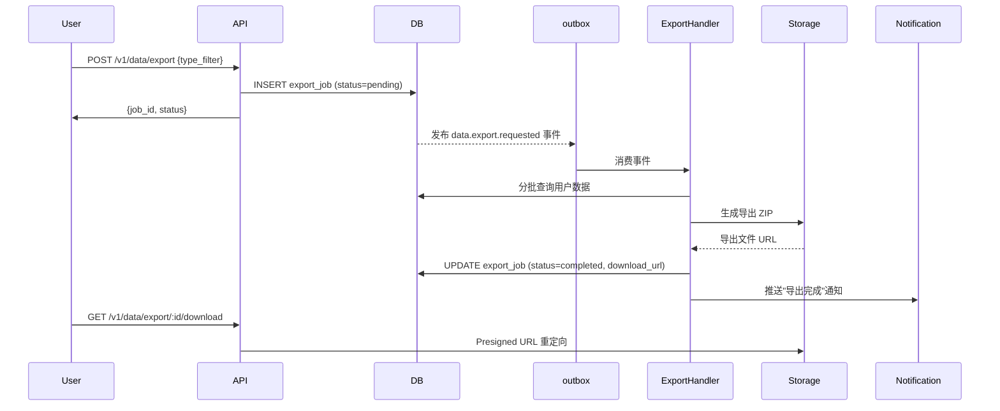

# 架构师分析：aero-id 架构现状与扩展方向

## 1. 架构评估

### 1.1 当前架构的优势

aero-id 的架构决策表现出高度的**工程成熟度和克制力**。以下几个设计决策值得肯定：

**事务性 Outbox 模式的选择**是架构中最关键的正确性决策。通过将领域事件与业务行写入同一数据库事务，系统避免了分布式系统中最常见的"发消息时写库成功但消息丢失"问题。`internal/outbox/` 的 `Repository.Append(ctx, tx, e)` 接收调用方事务，GORM 的 `*gorm.DB` 作为事务载体向下穿透——这是一个典型且正确的实现选择。

**分层耦合度控制**是第二大优势。Service 层对 repository/storage/sso 的依赖全部通过接口（Go interface），而非具体类型。`internal/repository/` 的 `outboxRepository` 接口、`internal/storage/storage.go` 的 `FileStorage` 接口、`internal/service/service.go` 的 `UserDirectory` 接口——这些抽象层让单测可以在不需要 Postgres/S3/SSO 的情况下验证业务逻辑。

**双传输共享 Service 层**的决策在 38+ RPC 的规模下验证了其正确性。HTTP handler 和 gRPC handler 的差异仅在于 I/O 序列化/反序列化，业务行为完全同构。这是"端口与适配器"架构在微服务规模下的务实应用。

**不引入 Redis/RabbitMQ**的决策在 MVP 阶段是正确的。内存缓存（`UserCache`、`TokenCache`、`ratelimit.Limiter`）避免了运维复杂度，`SELECT ... LIMIT N` 轮询的 relay 在单实例下足够可靠。

### 1.2 关键架构债务

尽管整体架构质量很高，以下六个问题构成了**从"单体成熟服务"到"可水平扩展平台"**的阻塞性债务：

#### 债务一：实例粘性状态（Instance-affine State）

三个核心组件维护**纯进程内状态**，无法在多实例部署中正确工作：

| 组件 | 状态 | 问题 |
|------|------|------|
| `ratelimit.Limiter` | 内存 token bucket | 水平扩展后，攻击者可以每个实例消耗满额配额，总吞吐 N 倍于预期 |
| `UserCache` / `TokenCache` | `map[string]entry` + TTL | 每个实例独立缓存，命中率随实例数线性下降；缓存不一致 |
| `notifRateLimiter` | 内存滑动窗口 | 同 rate limiter：多实例下限流失效 |

**遗留背景**：设计文档（`2026-05-22`）明确写了"短 TTL 内存缓存够用"。这个假设在单实例、低流量场景下成立。但当部署扩展到 3+ 实例准备应对生产流量时，缓存命中率降至 `1/N`、限流失效、`UserCache` 无界增长（`map[string]userEntry` 无淘汰机制，`sweepExpired` 只清除过期条目但无容量上限）三个问题同时浮出水面。

#### 债务二：Outbox 中继的非幂等处理

这是验证报告指出的核心风险。`outbox.Relay.drain()` 的流程是：

```
FetchUnpublished(limit=100)             ← 无 FOR UPDATE / SKIP LOCKED
  → for each event: handler.Handle()
  → MarkPublished(ids)
```

当两个实例的 relay 同时调用 `FetchUnpublished`，它们拿到**相同的事件**。两个实例都执行 `handler.Handle()` → `NotificationDispatcher` 写入通知行 → 推送 SSE → 发送 Webhook。最严重的后果是：

1. **重复的通知行**：`notificationFor()` 每次调用都生成新的 `idgen.NewID()`，两个实例创建不同的行
2. **重复的 SSE 推送**：SSE 订阅者收到两次 `message.received`
3. **重复的 Webhook 调用**：外部系统收到两次相同的回调
4. **CollapsedCount 被低估**：两个实例各自创建新行，而不是合并到同一行

现有的幂等键机制（`idempotency`）解决的是**客户端重试**问题，不是**服务端去重**问题。Outbox 事件没有幂等键。

#### 债务三：乐观并发控制的完全缺失

所有 `Update*` 方法使用无条件的 `Updates(map)` 调用，后写胜出。`internal/repository/comment.go`、`internal/file/repository.go`、`internal/message/repository.go` 无一例外。

这在**编辑场景**下会产生静默覆盖：两个用户同时编辑同一评论，后提交者的修改覆盖先提交者，双方都不会收到冲突提示。`Conflict` AppError 已存在（HTTP 409 / gRPC AlreadyExists），但在整个系统中没有被用于并发冲突。

#### 债务四：跨实体引用完整性的缺失

三条引用链没有任何维护机制：

- **Comment → File/Message**（`TargetID`）：文件删除后，引用它的评论成为孤儿
- **Message → File**（`FileID`）：附件删除后，消息中的 `FileID` 成为悬挂指针
- **Notification → Subject**（`SubjectID`）：消息/评论删除后，推送的通知指向 404

现有的 `storage/gc/sweeper.go` 只处理**存储层的二进制 blob GC**，完全不处理业务层的引用完整性。这是两个不同层次的正确性问题。

#### 债务五：无 DLQ 管理面

`outbox.Event` 有 `DeadLetter bool` 字段，`MarkFailed` 在 `retryCount >= maxRetries` 时标记 `dead_letter = true`。但没有任何 API 可以：

- 查询有多少死信（`SELECT COUNT(*) WHERE dead_letter = true`）
- 读取死信内容（`SELECT * WHERE dead_letter = true ORDER BY created_at`）
- 重放死信（将 `dead_letter` 置回 `false + retry_count = 0`）
- 丢弃死信（`DELETE WHERE dead_letter = true`）

死信事件一旦产生就永久沉睡在数据库中，运维人员没有工具对其进行干预。

#### 债务六：SSO 依赖的级联失效影响

当前架构中，`ssoClient` 用于**每一次请求的 token 鉴权**（通过 auth 中间件/拦截器）。虽然 `TokenCache` + circuit breaker + stale-cache 提供了 SSO 不可用时的容错，但如果 SSO **长时间**宕机（超过 `staleFor`），所有新请求会立即失败。这是一个**硬依赖**。

`UserCache` 的 `GetMany` 在 fetcher 出错时直接返回错误，不提供过期回退。这意味着列表接口（需要展示发送者昵称/头像）在 SSO 不可用时会整体失败，而不是优雅降级。

### 1.3 关键设计决策的复盘

| 决策 | 当时正确吗？ | 现在需要重新评估吗？ |
|------|------------|-------------------|
| 无 Redis/消息队列 | ✅ MVP 阶段正确 | ⚠️ 扩展到 3+ 实例时需要重新评估 |
| 纯内存 rate limiter | ✅ 单实例正确 | ❌ 多实例下需要共享限流 |
| 无乐观锁 | ❌ 从最初就应引入 | 版本字段是最低成本的一致性保障 |
| 无会话表 | ✅ MVP 阶段合理 | ⚠️ 消息产品化的关键缺失 |
| Outbox 轮询式 relay | ✅ 单实例正确 | ⚠️ 多实例需要 `FOR UPDATE SKIP LOCKED` 或消息队列 |
| 无用户数据导出 | ✅ 非 MVP 需求 | ❌ GDPR 合规是企业级必须 |

---

## 2. 扩展方向

### 方向一：分布式基础设施层（P0）

**为什么需要**：当前所有架构债务中，实例粘性状态是最根本的。没有共享限流、共享缓存、分布式排他，水平扩展会持续产生正确性问题。这是所有其他扩展方向的前提。

**核心挑战**：
- 引入 Redis 作为共享状态后端，是架构中最有侵入性的变更
- 需要设计缓存失效策略（write-through vs write-behind）
- Redis 成为新的高可用依赖，需要 Sentinel/Cluster 保障

**预期的架构变更**：

```
当前：outbox.Relay → DB (无锁轮询)
      ratelimit.Limiter → 内存 map
      UserCache → 内存 map

目标：outbox.Relay → DB + SELECT ... FOR UPDATE SKIP LOCKED
      ratelimit.Limiter → Redis 滑动窗口 (GCRA/Token Bucket)
      UserCache → Redis 缓存 + 本地 L1 缓存 (通过 singleflight 回源)
```

**实施选项对比**：

| 选项 | 复杂度 | 一致性 | 运维成本 | 推荐 |
|------|--------|--------|---------|------|
| A: 引入 Redis 做共享状态 | 高 | 强 | 中（需维护 Redis） | ⭐ |
| B: PostgreSQL 代替 Redis（`pg_advisory_lock` 做分布式锁 + 共享限流通过 `FOR UPDATE` 做计数器） | 中 | 强 | 低（无新依赖） | 如果团队不想运维 Redis |
| C: Cloud-vendor 托管 Redis (ElastiCache/Memorystore) | 低 | 最终一致 | 低 | 如果有云环境 |

**推荐**：选项 A（Redis），因为：
- Redis 的 `SET NX EX` + `SCRIPT LOAD` / `FCALL` 可以原子化实现分布式限流和排他锁
- `EXPIRE` + `LRU` 自然解决无界增长问题（当前 `UserCache` 的最大问题）
- 限流的 `GCRA` 算法在 Redis 中有成熟的 Lua 实现

**对现有系统的影响**：
- `ratelimit.Limiter` 需要抽象为 `RateLimitBackend` 接口，支持内存 + Redis 两种实现
- `UserCache` 需要引入 Redis 实现，保留内存实现作为 L1 缓存
- `outbox.Relay.drain()` 需要改为 `FOR UPDATE SKIP LOCKED` 查询，或在 relay 启动时使用 Redis 分布式锁协调查房
- **没有外部 API 变更**，这是一个完全透明的内部重构

---

### 方向二：乐观并发控制 + 跨实体引用系统（P0）

**为什么需要**：数据完整性是系统的核心信任基础。两个问题在根源上相关——都需要在写入路径中注入一致性检查。

**子方向 2a：版本戳乐观锁**

目标是最小侵入地消除"静默覆盖"问题。核心设计决策：

**版本字段位置**：

| 选项 | 做法 | 优点 | 缺点 |
|------|------|------|------|
| A: DB 列 + GORM `BeforeUpdate` 钩子 | `version INT` 列，钩子自动追加 `WHERE version = ?` | 零业务代码侵入 | 钩子的全局性可能影响非期望的行 |
| B: Repository 层显式传递 | 每个 `Update*` 方法增加 `expectedVersion` 参数 | 明确、可控 | 调用链路传递负担 |
| C: 领域层 `Entity` 携带 `Version` | Domain struct 增加 `Version int`，repository 读取后使用 | 类型安全 | 需要改动 domain 定义 |

**推荐**：**C + A 结合**：
- Domain 实体增加 `Version int` 字段（实体层表达意图）
- Repository 的 `Update*` 方法显式检查 `WHERE version = ?`
- 版本冲突返回 `apperr.Conflict("entity.version_conflict", ...)` → HTTP 409 / gRPC AlreadyExists
- 响应头增加 `ETag: <version>`，请求头支持 `If-Match` 条件更新

**子方向 2b：引用完整性维护系统**

三类引用链需要不同的策略：

| 引用链 | 策略 | 一致性模型 |
|--------|------|-----------|
| Comment → File/Message（目标删除时） | **软标记**：目标删除时，目标服务发 outbox 事件 → 独立的引用清理 Handler → 标记关联 Comment 为 `status = orphaned` | 最终一致（outbox 保证） |
| Message → File（附件） | **展示层处理**：`Get` file 时返回轻量占位（`status: "deleted"`），不隐藏消息 | 读时检查 |
| Notification → Subject | **异步清理**：针对已分发的通知，当引用实体被删除时发 `notification.orphan_cleanup` 事件 | 最终一致 |

关键设计决策：**不要在源删除操作中同步级联**。当前 `service.file.Delete` 不应递归查询哪些 Comment/Message 引用了该文件。相反，应该通过 outbox 发布 `file.deleted` 事件，由专门的 `ReferenceGCHandler` 处理。这保持了删除操作的 O(1) 语义，将级联工作卸载到后台。

**对现有系统的影响**：
- 每个核心实体增加 `version INT` 列（需要迁移 000024+）
- `Update*` 方法增加版本检查——最影响 repository 层的改动
- 新增 `ReferenceGCHandler` 实现 `outbox.Handler` 接口
- 新增 `reference_gc` 告警指标：orphan 发现率、清理延迟
- **API 层面**：新增 ETag 响应头 + If-Match 条件更新支持，向后兼容

---

### 方向三：Outbox 去重 + DLQ 管理面（P1）

**为什么需要**：多实例下 outbox 重复处理直接产生**业务错误**（重复通知、重复 webhook），DLQ 管理面的缺失让运维人员无法恢复故障事件。两个问题可以统一解决。

**子方向 3a：Outbox 事件去重**

最小侵入方案：**在 NotificationDispatcher 中实现幂等消费**。

当前的 `notificationFor()` 每次生成新的 `domain.Notification{ID: idgen.NewID()}`。如果在写入前先检查 `SELECT 1 FROM notifications WHERE subject_type = ? AND subject_id = ? AND recipient_uid = ?`，当已存在时跳过创建，就可以实现幂等性。

更好的方案是**Outbox 事件级别去重**：为每个事件生成一个**稳定的事件 ID**（基于 `(aggregate_type, aggregate_id, event_type, payload_hash)` 的确定性 UUIDv5），在 `Relay.drain()` 中使用 `INSERT ... ON CONFLICT DO NOTHING` 将事件 ID 写入 `processed_events` 表。这样即使两个 relay 实例拿到了同一事件，也只有一个能成功标记为已处理。

**子方向 3b：DLQ 管理 API**

新增运维端点（鉴权为 admin）：

```
GET    /v1/admin/outbox/dead-letters          # 分页列出死信
POST   /v1/admin/outbox/dead-letters/:id/replay  # 重放单条死信（dead_letter=false, retry_count=0）
DELETE /v1/admin/outbox/dead-letters/:id      # 丢弃单条死信
POST   /v1/admin/outbox/dead-letters/batch    # 批量操作（replay/discard）
```

后端操作：
- 重放：`UPDATE outbox_events SET dead_letter = false, retry_count = 0, last_retry_at = NULL, published_at = NULL WHERE id = ?`
- 丢弃：`UPDATE outbox_events SET dead_letter = true, published_at = now() WHERE id = ?`（让 relay 不再捡起，但保留审计）

**对现有系统的影响**：
- 新增 `processed_events` 表 + 迁移
- `NotificationDispatcher.Handle` 增加幂等检查
- `Relay` 增加可选的事件级去重模式（通过配置开关，向后兼容单实例场景）
- 新增 admin handler + service + gRPC/HTTP 端点
- 新增 DLQ 告警指标：dead_letter_count、oldest_dead_letter_age

---

### 方向四：会话/对话元数据模型（P1-P2）

**为什么需要**：消息功能从"原型级"到"产品级"的关键缺失。当前 `ListInbox` 返回扁平消息列表而非按发送方分组的会话列表，`ListConversation(ctx, withUID)` 直接在 `(from_uid, to_uid)` 上查询——没有会话实体。

**核心设计决策**：

**方案 A：新增 conversations + conversation_participants 表**（推荐）

```
conversations: {id UUID, kind SMALLINT, subject TEXT, created_at, updated_at}
conversation_participants: {conversation_id UUID, uid TEXT, role SMALLINT, 
                            pinned BOOLEAN, muted BOOLEAN, archived_at, last_read_at}
messages: {..., conversation_id UUID [FK]}
```

**方案 B：消息聚合视图**（不新建表，只在查询层做聚合）

- 优点：无 Migration，无数据迁移
- 缺点：无法支持 `pinned`/`muted`/`archived` 等会话级状态；`ListInbox` 仍需要子查询或窗口函数；不可扩展至群聊

**推荐方案 A**，原因：
- 会话级元数据（pin、mute、archive、last_read_at）需要一个持久化存储
- 会话是可扩展群聊的基础（`kind = 2: group`）
- `conversation_id` 是消息索引的天然 Sharding Key
- 数据迁移是**一次性的**：通过分析现有 `messages` 表为每对 `(uidA, uidB)` 创建一条 conversation 行

**对现有系统的影响**：
- 新增 2-3 张表 + 迁移
- 现有 `messages` 表增加可空 `conversation_id` 列（向后兼容旧数据）
- **API 新增**：
  - `GET /v1/conversations` — 会话列表（替代现在的 `GET /v1/messages?inbox`）
  - `GET /v1/conversations/:id/messages` — 分页获取会话消息（替代 `GET /v1/conversations/:uid`）
  - `PUT /v1/conversations/:id/pin` / `mute` / `archive` / `leave`
  - `GET /v1/conversations/:id` — 会话详情（参与者、元数据）
- **API 变更**：现有 `GET /v1/messages?inbox=true` 可以保留但标记为 deprecated
- **通知系统**：通知聚合从消息级升级为会话级（"用户 B 给你发了 3 条消息"）

---

### 方向五：数据可移植性 + 用户级导出（P2）

**为什么需要**：GDPR/CCPA 合规是企业级应用的基本要求。当前系统只有逐条操作，用户无法以标准化格式导出自己的全部数据。

**核心设计决策**：

**导出采用异步模式**（导出是重量级操作，不应阻塞请求路径）：



**接口设计**：

```
POST   /v1/data/export                        # 创建导出任务
GET    /v1/data/export/:id/status              # 查询进度
GET    /v1/data/export/:id/download            # 下载（presigned URL，限时）
GET    /v1/data/exports                        # 列出历史导出任务
```

**第一期限定**：
- 仅支持导出（Import 为第二期，难度高约 5 倍）
- 导出格式：每个类型一个子目录的 ZIP（files/ 含清单 JSON + 文件下载 URL，messages/ 为 JSON，comments/ 为 JSON）
- 文件不包含二进制 blob，只包含元数据 + 下载 URL（避免单次导出 GB 级流量）
- 导出任务最大存活期 7 天，过期自动清理

**对现有系统的影响**：
- 新增 `export_jobs` 表 + 迁移
- 新增 `ExportHandler` 实现 `outbox.Handler` 接口
- 复用现有的通知系统推送完成通知
- 复用现有的 local/s3 presigned URL 机制做下载
- 新增 storage 接口方法：`ListObjectsByPrefix`（如果选择包含文件二进制）

---

## 3. 接口设计建议

### 3.1 关键抽象层

当前架构缺少三个关键抽象：

**1. `storage.CacheBackend` 接口**

```go
type CacheBackend interface {
    Get(ctx context.Context, key string) ([]byte, error)
    Set(ctx context.Context, key string, value []byte, ttl time.Duration) error
    Delete(ctx context.Context, key string) error
    // 可选：批量操作、原子 CAS
}
```

现有 `UserCache` / `TokenCache` / `ratelimit.Limiter` 都使用进程内 `map`。如果需要切换为 Redis，逐个替换成本高且风险大。引入统一的 `CacheBackend` 接口可以让：
- 内存实现（当前，零依赖）
- Redis 实现（切换，需运维 Redis）
- Multi-tier 实现（本地 L1 + Redis L2）

**2. `outbox.Consumer` 接口（补充当前 Handler 的不足）**

当前 `outbox.Handler` 只有一个 `Handle(ctx, event) error` 方法。缺少：
- 消费者幂等标识：`ConsumerID() string`（用于去重表）
- 批处理能力：`HandleBatch(ctx, events []*Event) error`（批量写入减少 DB 往返）

**3. `data.ExportBackend` 接口**

将导出/导入逻辑抽象为独立的后端，与存储分离：

```go
type ExportBackend interface {
    CreateExport(ctx context.Context, job *ExportJob) error
    AppendData(ctx context.Context, jobID string, dataType string, data []byte) error
    FinalizeExport(ctx context.Context, jobID string) (downloadURL string, err error)
}
```

### 3.2 向后兼容策略

每个扩展方向都遵循以下原则：

| 原则 | 实施 |
|------|------|
| **增量迁移** | 任何新表/新列都允许为空，旧代码路径并行运行 |
| **Deprecation 头** | API 变更时响应头增加 `X-Sunset: <date>` |
| **可选能力** | 新功能默认关闭，通过配置/feature flag 启用 |
| **语义版本化** | 重大 API 变更走 `/v2/` 前缀 |

具体示例：
- 乐观锁：不改现有 API 签名，只在响应增加 ETag 头。前端可自主选择是否使用 `If-Match`
- 会话模型：现有 `GET /v1/conversations/:uid` 继续工作（内部改为查 `conversation_id`），新增的会话级 API 使用独立路径
- 分布式限流：`ratelimit.Limiter` 的 `Allow(key string) bool` 接口不变，后端从内存切换为 Redis 时对调用方透明

---

## 4. 技术选型

### 4.1 现有技术栈评估

| 技术 | 当前角色 | 是否替换 |
|------|---------|---------|
| Gin | HTTP 框架 | ✅ 保留 |
| gRPC + protobuf | 内部 RPC | ✅ 保留 |
| GORM | ORM | ⚠️ 考虑在 Repository 层引入 `sqlx` 替代复杂查询 |
| PostgreSQL 16 | 数据存储 | ✅ 保留 |
| golang-migrate | 迁移工具 | ✅ 保留 |
| zap | 日志 | ✅ 保留 |
| viper | 配置 | ✅ 保留 |
| testcontainers-go | 集成测试 | ✅ 保留 |

### 4.2 新增技术栈建议

| 需求 | 选项 | 推荐 |
|------|------|------|
| 共享缓存 / 分布式限流 | Redis / KeyDB / Dragonfly | **Redis 7+**（最成熟，生态最丰富） |
| 异步消息队列 | RabbitMQ / NATS / Redis Streams / pg_amqp / 保持现有轮询 | **保持轮询 + 增加 `SKIP LOCKED`**（引入消息队列的收益在当前阶段不足以抵消运维成本） |
| 分布式锁 | Redis Redlock / PostgreSQL advisory lock / etcd | **PostgreSQL advisory lock**（零新依赖） |
| 数据导出工具包 | 自建 / 使用 `archive/zip` 标准库 | **自建**（标准库已覆盖需求） |

**关于引入 Redis 的决策依据**：

| 维度 | 评估 |
|------|------|
| **必要性** | 3+ 实例水平扩展后，没有共享缓存/限流无法提供一致的行为 |
| **替代方案** | PG advisory locks + `FOR UPDATE` 可替代 80% 功能，但限流的原子计数器在 PG 下性能不如 Redis |
| **运维成本** | 托管 Redis（ElastiCache/Memorystore）可降至接近零 |
| **团队熟悉度** | Redis 是 Go 生态中最成熟的缓存后端，`go-redis/redis` API 稳定 |
| **风险** | 新增依赖增加故障域；Redis 宕机需要降级策略 |

**降级策略**：当 Redis 不可用时，限流降级为本地内存限流（宽松模式），缓存降级为直接回源 SSO（类似当前的 `UserCache` miss 行为）。

**关于不引入消息队列的决策依据**：

当前 Outbox 轮询模式的问题可以通过 `FOR UPDATE SKIP LOCKED` + 事件级去重解决，不需要完整的消息队列基础设施。引入 RabbitMQ 或 NATS 的收益（更低延迟、更丰富的消费语义）在当前阶段不足以抵消运维复杂度（新增有状态组件、需要 HA 配置）。这个决策应每 6 个月重新评估一次。

### 4.3 自建 vs 采购

| 能力 | 自建 | 采购 | 推荐 |
|------|------|------|------|
| 数据导出 | ✅ archive/zip + 标准库，约 1 周 | ❌ 无成熟方案 | 自建 |
| 分布式限流 | ✅ Redis Lua 脚本，约 2 天 | ❌ 不适用 | 自建 |
| DLQ 管理 | ✅ CRUD + admin API，约 3 天 | ❌ 不适用 | 自建 |
| Webhook 资源订阅 | ✅ outbox 框架扩展，约 1 周 | ❌ 无通用方案 | 自建 |

---

## 5. 实施路线图

### 5.1 优先级矩阵

| 方向 | 业务价值 | 技术价值 | 实施成本 | 依赖关系 | 优先级 |
|------|---------|---------|---------|---------|-------|
| 分布式基础设施 | 高（水平扩展能力） | 高（所有扩展的基础） | 中（Redis + 重构） | 无 | **P0** |
| 乐观锁 + 引用完整性 | 高（数据信任） | 高（正确性基石） | 低（版本字段 + outbox handler） | 无 | **P0** |
| Outbox 去重 + DLQ 管理 | 高（生产可靠性） | 高（运维能力） | 低（去重表 + admin API） | 方向一（可选） | **P1** |
| 会话元数据 | 高（产品差异化） | 中（模型扩展） | 中（新表 + 迁移 + API） | 无 | **P1** |
| 数据可移植性 | 中（合规需求） | 中（异步工作流模式） | 中（导出 handler + ZIP） | 通知系统（已存在） | **P2** |

### 5.2 阶段划分

```
Phase 1 (P0) — 基础设施正确性 (6-8 周)
├── 1.1 乐观锁：所有核心实体增加 version 列 + repository 版本检查
├── 1.2 乐观锁：ETag 响应头 + If-Match 条件更新
├── 1.3 引用完整性：新增 ReferenceGCHandler，处理 file.deleted / message.deleted 事件
├── 1.4 分布式缓存：引入 CacheBackend 接口，内存实现不变
└── 1.5 分布式限流：引入 Redis 限流后端，保留内存作为降级

Phase 2 (P1) — 生产可靠性 (4-6 周)
├── 2.1 Outbox 去重：processed_events 表 + 确定性事件 ID
├── 2.2 Outbox 轮询：FetchUnpublished 改为 FOR UPDATE SKIP LOCKED
├── 2.3 DLQ 管理面：admin API (list/replay/discard)
└── 2.4 DLQ 监控：死信指标 + 告警规则

Phase 3 (P1) — 产品能力 (6-8 周)
├── 3.1 会话模型：conversations + conversation_participants 表
├── 3.2 数据迁移：为现有消息对自动创建会话
├── 3.3 会话级 API：pin/mute/archive/leave
├── 3.4 API 兼容：旧端点保留，新端点就绪
└── 3.5 通知聚合：会话级折叠

Phase 4 (P2) — 合规与生态 (4-6 周)
├── 4.1 异步导出框架：export_jobs 表 + ExportHandler
├── 4.2 导出端点：POST/GET + status + download
├── 4.3 通知集成：导出完成推送
├── 4.4 资源 Webhook：resource_webhooks 表 + outbox handler
└── 4.5 Webhook 管理 API：CRUD 订阅
```

### 5.3 里程碑

| 里程碑 | 时间 | 可交付物 | 验收标准 |
|--------|------|---------|---------|
| M1: 数据完整性 | 第 8 周 | 乐观锁 + 引用 GC | 两个用户同时编辑同一评论收到 409；删除文件后引用评论自动 orphaned |
| M2: 生产就绪 | 第 14 周 | 分布式限流 + Outbox 去重 + DLQ | 3 实例部署下限流正确叠加；zero duplicate notification；DLQ 可操作 |
| M3: 产品升级 | 第 22 周 | 会话模型 | 聊天列表显示会话、可置顶/静默/归档；旧 API 保持兼容 |
| M4: 合规完成 | 第 28 周 | 数据导出 + 资源 Webhook | 用户可导出全部数据为 ZIP；外部系统可订阅指定文件变更 |

### 5.4 风险和缓解策略

| 风险 | 概率 | 影响 | 缓解措施 |
|------|------|------|---------|
| Redis 成为单点故障 | 中 | 高 | 限流降级到本地模式；缓存直接回源；采用托管 Redis (HA) |
| 版本字段导致 GORM 自动更新错乱 | 中 | 中 | 显式 `Select()` 控制更新字段；`BeforeUpdate` 钩子中增加检查；测试覆盖 |
| 数据迁移（会话）长时间锁定 | 低 | 高 | 采用离线分批迁移 + 应用层双写方案；灰度切换 |
| 出口导出消耗大量存储/带宽 | 中 | 中 | 导出文件限时 (7d TTL)；阈值限制（单用户每月 N 次）；分片导出 |
| 多实例 Outbox 去重影响单实例延迟 | 低 | 低 | `processed_events` 使用 `UNIQUE` 约束 + `ON CONFLICT DO NOTHING`；去重为可选 feature flag |
| SSO 长时间故障导致所有写入失败 | 中 | 高 | `UserCache` 增加过期回退（即使过期也继续服务）；引入 SSO 健康度级别的降级策略 |

### 5.5 不做的内容

以下建议不在本路线图范围内，因为要么产品优先级不足，要么当前规模下不符合 YAGNI：

- **群聊**（多参与者对话）——依赖会话模型（Phase 3），但自身是 Phase 4+ 的独立扩展
- **数据导入**（`POST /v1/data/import`）——复杂度远高于导出，涉及 ID 重映射和引用冲突
- **弹性搜索集成**——PostgreSQL GIN + pgvector 当前足够
- **配置热更新**——viper 支持但当前无此需求
- **多租户数据隔离**——SSO 层面的多租户未落地，aero-id 不应先行

---

## 6. 总结

aero-id 的架构在 MVP 阶段做出了正确的权衡。以上五个扩展方向的根本问题是**规模假设的变化**：从"单实例、低流量、功能验证"到"多实例、生产流量、企业级可靠性"。

最重要的架构决策是 **Phase 1 的顺序**：先修正确性（乐观锁、引用 GC），再做扩展性（分布式基础设施）。正确的顺序是 outbox 去重 → 共享限流 → 会话模型 → 数据导出。不要在数据完整性基础不扎实的情况下增加新产品能力。

另外值得一提：当前文档生态（`docs/requirements/` 下 317 份文档）已出现显著的重叠和重复分析，建议引入 **ADR（Architecture Decision Records）** 机制来收敛讨论，避免同一天出现多份内容几乎相同的分析文档。
