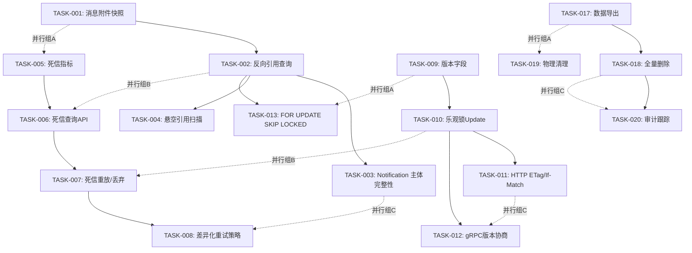
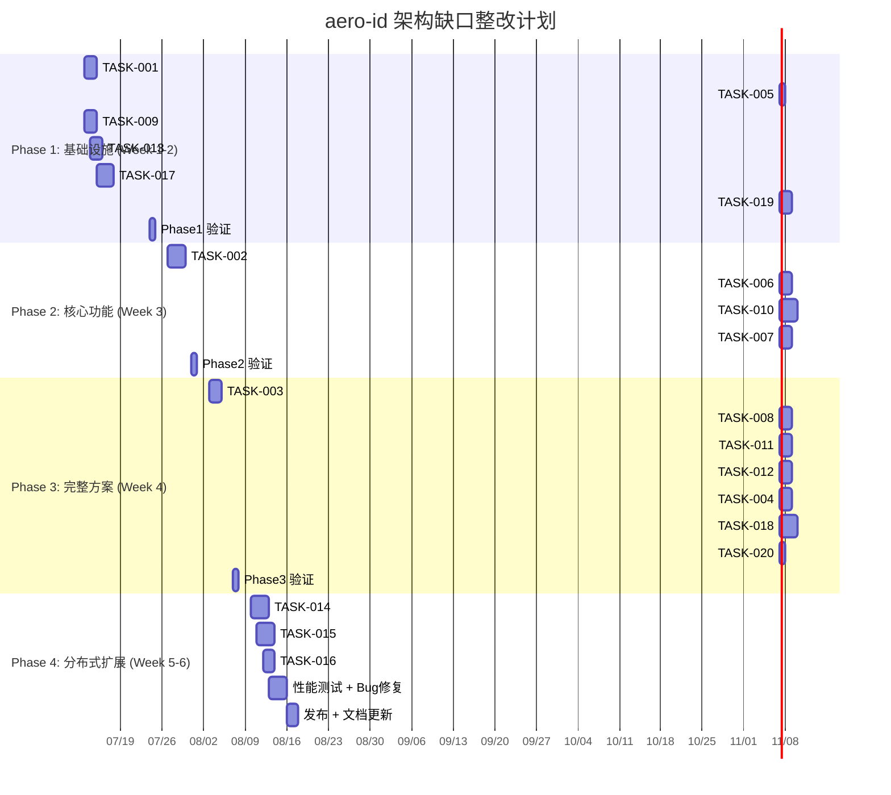

现在我已掌握全部上下文，可以撰写完整的 Tech Lead 分析了。

---

# Tech Lead 分析：aero-id 五处架构缺口

## 前置说明：验证结论的坦诚评估

代码验证确认 **5 个方向的问题真实存在**，代码引用准确。但交叉比对揭示了一个重要事实：这 5 个方向并非"被先前分析系统性低估或遗漏"——既有 263 份文档中每个方向有 15-24 份独立覆盖。这意味着：

- **这份文档的价值在于整合和聚焦**，而非原始发现
- 实施时应以这份文档作为**执行蓝本**，同时参考既有分析中的更深入设计讨论
- 验证中补充的两点（Notification→Subject 引用链、Outbox 重复处理导致重复通知/webhook）表明分析仍有盲区，值得纳入 scope

以下分析**接受验证结论**，专注于可执行的任务分解，不重复文档中已充分论证的代码证据。

---

## 1. 任务分解

### 约定

- 每个任务预估 2-4 小时，含编写测试
- 遵循 AGENTS.md 约束：函数 ≤50 行、文件 ≤500 行、复杂度 ≤10
- 可并行任务标注 `[PARALLEL]`
- 标记验证中补充的额外任务

### 方向一：跨实体引用完整性

| 任务 ID | 标题 | 涉及文件 | 前置依赖 | 预估工时 |
|---------|------|---------|---------|---------|
| TASK-001 | 消息附件元信息快照 | `internal/service/message.go`, `internal/domain/message.go` | 无 | 3h |
| TASK-002 | 反向引用查询接口 | `internal/repository/comment.go`, `internal/repository/message.go`, `internal/service/comment.go`, `internal/service/message.go`, `internal/handler/http/file.go`, `internal/handler/grpc/file.go` | TASK-001 | 4h |
| TASK-003 | [新增] Notification 主体引用完整性 | `internal/notification/service.go`, `internal/notification/dispatcher.go`, `internal/service/notification.go`, `internal/domain/notification.go` | TASK-002 | 3h |
| TASK-004 | 悬空引用后台扫描 | `internal/service/gc/`（新包）, `internal/repository/comment.go`, `configs/config.yaml` | TASK-002 | 4h |

#### TASK-001 详情

**验收标准**：
1. `message.Send` 在附件存在时，将 `f.Name`, `f.Size`, `f.MIMEType` 写入 `message.Meta`
2. 消息的 HTTP/gRPC 响应中附件字段优先使用 `Meta` 中的快照；仅当 `Meta` 无快照时才回退到 `FileID` 查询
3. 存量消息不回填——新写入即满足要求
4. 单元测试覆盖发送带附件/不带附件的路径

#### TASK-002 详情

**验收标准**：
1. `service.ReferencedBy(fileID)` 返回引用该文件的消息列表和评论列表
2. 接口暴露为 `GET /v1/files/:id/references` 和 gRPC `GetReferences`
3. 响应中附带引用计数（如 `total_references: 5`）
4. 对 `message` 实体也提供对称的反向引用查询
5. 分页使用 cursor-based（复用现有 `pagination` 模式）

#### TASK-003 详情（验证补充）

**验收标准**：
1. 通知列表 API 中，`SubjectID` 指向的实体已软删除时，不返回 500；在 `subject` 字段中返回 `{deleted: true, type: "message", id: "xxx"}` 占位
2. 通知的 subject 被删除后，用户点击通知不应触发后端错误——handler 层或 service 层兜底
3. 可选的：通知记录中冗余存储 subject 的标题/摘要快照（类似 TASK-001 的思路）

#### TASK-004 详情

**验收标准**：
1. 新增定时任务（周期可配置，默认 24h），扫描 `comments.target_id` 指向已软删实体的记录
2. 扫描结果仅记录日志 + 暴露指标 `orphan_references_total`，不自动清理（避免误删）
3. 支持手动触发扫描：`POST /v1/admin/gc/orphan-references`

### 方向二：DLQ 管理面

| 任务 ID | 标题 | 涉及文件 | 前置依赖 | 预估工时 |
|---------|------|---------|---------|---------|
| TASK-005 | 死信指标 | `internal/pkg/metrics/metrics.go`, `internal/outbox/relay.go` | 无 | 2h |
| TASK-006 | 死信查询 API | `internal/outbox/repository.go`, `internal/outbox/outbox.go`, `internal/handler/http/admin.go`, `internal/handler/grpc/admin.go` | TASK-005 | 3h |
| TASK-007 | 死信重放 & 丢弃 API | `internal/outbox/repository.go`, `internal/outbox/relay.go`, `internal/handler/http/admin.go`, `internal/handler/grpc/admin.go` | TASK-006 | 3h |
| TASK-008 | 每事件类型差异化重试策略 | `internal/config/config.go`, `internal/outbox/relay.go`, `configs/config.yaml` | TASK-007 | 3h |

#### TASK-005 详情

**验收标准**：
1. 新增 `outbox_dead_letter_total` counter（累计值）和 `outbox_dead_letter_count` gauge（当前存量）
2. 指标按 `event_type` 打标签
3. Relay 的 `MarkFailed` 路径在标记死信时更新指标
4. 已有 `TestMetrics` 增加死信指标断言

#### TASK-006 详情

**验收标准**：
1. `GET /v1/admin/outbox/dead-letters` 支持按 `event_type` 筛选、按 `aggregate_type` 筛选、cursor 分页
2. 响应包含：事件 id、类型、payload 预览（截断）、失败次数、最后重试时间、进入死信时间
3. gRPC 端提供等效的 `ListDeadLetters` RPC
4. 仅管理员角色可访问（复用现有 `middleware.RequireRole(admin)`）

#### TASK-007 详情

**验收标准**：
1. `POST /v1/admin/outbox/dead-letters/:id/replay` — 重设 `dead_letter=false`, `retry_count=0`, `published_at=NULL`
2. `POST /v1/admin/outbox/dead-letters/:id/discard` — 将事件标记为已丢弃（新增 `discarded_at` 列或 `published_at=now()` 使其不可见）
3. `POST /v1/admin/outbox/dead-letters/replay-all` — 批量重放（使用事务逐条处理）
4. 所有操作记录审计日志（`outbox.dead_letter.replay`, `outbox.dead_letter.discard`）

#### TASK-008 详情

**验收标准**：
1. 配置新增 `outbox.max_retries_per_type` map，例：`message.sent: 10, comment.replied: 8`
2. Relay 的 `MarkFailed` 优先使用 per-type 配置，fallback 到全局 `outbox.max_retries`
3. 配置变更无需重启（reload 方式）

### 方向三：并发访问控制

| 任务 ID | 标题 | 涉及文件 | 前置依赖 | 预估工时 |
|---------|------|---------|---------|---------|
| TASK-009 | 业务实体添加版本字段 | `migrations/`, `internal/repository/db.go`, `internal/domain/*.go` | 无 | 3h |
| TASK-010 | Update 操作添加乐观锁条件 | `internal/repository/file.go`, `internal/repository/message.go`, `internal/repository/comment.go` | TASK-009 | 4h |
| TASK-011 | HTTP ETag / If-Match 支持 | `internal/handler/http/file.go`, `internal/handler/http/message.go`, `internal/handler/http/comment.go`, `internal/middleware/etag.go`（新建） | TASK-010 | 4h |
| TASK-012 | gRPC 版本协商 | `internal/handler/grpc/file.go`, `internal/handler/grpc/message.go`, `internal/handler/grpc/comment.go`, `api/proto/**/*.proto` | TASK-010 | 3h |

#### TASK-009 详情

**验收标准**：
1. `files`, `messages`, `comments` 三表新增 `version` 列（`BIGINT NOT NULL DEFAULT 1`）
2. `fileRow`, `messageRow`, `commentRow` 结构体新增 `Version` 字段
3. 新建迁移文件：`XXXXXX_add_version_to_files.up.sql` + `.down.sql`
4. 所有 `Create` 方法设置 `version = 1`

#### TASK-010 详情

**验收标准**：
1. `UpdateMetadata` / `Update` 方法的 `WHERE` 条件增加 `AND version = ?`
2. `Updates()` 的字段 map 增加 `version = version + 1`
3. 版本不匹配时返回 `gorm.ErrRecordNotFound`（或 `RowsAffected == 0`）
4. Service 层翻译为 `AppError(Conflict, "version_mismatch")`
5. 不需要对所有查询加版本检查——只在更新路径加

#### TASK-011 详情

**验收标准**：
1. `GET /v1/files/:id` 等读取端点返回 `ETag: "<version>"`
2. `PATCH /v1/files/:id` 等写入端点接受 `If-Match: "<version>"`；不匹配时返回 `409 Conflict`
3. 如果请求未携带 `If-Match`，行为与现有一致（无条件更新）——保持向前兼容
4. 中间件可复用；新建 `internal/middleware/etag.go`，提供 `ParseIfMatch()` 和 `SetETag()` 辅助函数

#### TASK-012 详情

**验收标准**：
1. protobuf 消息中 `File`, `Message`, `Comment` 新增 `version` 字段
2. Update 请求新增 `expected_version` 字段（optional）
3. 版本协变时 gRPC 返回 `AlreadyExists` / `FailedPrecondition` code
4. `make proto` 后提交生成的 `*.pb.go`

### 方向四：多实例架构

| 任务 ID | 标题 | 涉及文件 | 前置依赖 | 预估工时 |
|---------|------|---------|---------|---------|
| TASK-013 | Outbox relay 添加 `FOR UPDATE SKIP LOCKED` | `internal/outbox/repository.go`, `internal/outbox/relay.go` | 无 | 3h |
| TASK-014 | 分布式限流器接口 + Redis 后端 | `internal/pkg/ratelimit/ratelimit.go`, `internal/pkg/ratelimit/redis.go`（新建）, `internal/config/config.go`, `configs/config.yaml` | 无 | 4h |
| TASK-015 | SSE Hub 跨实例桥接（Redis Pub/Sub） | `internal/hub/hub.go`, `internal/hub/redis.go`（新建）, `internal/app/app.go` | 无 | 4h |
| TASK-016 | 缓存可选外部后端（Redis） | `internal/sso/token_cache.go`, `internal/sso/user_cache.go`, `internal/sso/redis_cache.go`（新建） | 无 | 4h |

#### TASK-013 详情

**验收标准**：
1. `FetchUnpublished` 末尾增加 `FOR UPDATE SKIP LOCKED`（PostgreSQL 9.5+ 支持）
2. Relay 的 `processBatch` 在单个事务中完成发件和标记
3. 确保 `SKIP LOCKED` 不会漏处理：relay 在正常间隔会轮询，被跳过的行下次处理
4. 集成测试验证多 goroutine 竞争下无重复处理（可用 testcontainers + 两个 relay 实例）
5. **关键**：验证后发现 outbox 重复处理还产生重复通知和重复 webhook，此任务完成后这两者也自动消除

#### TASK-014 详情

**验收标准**：
1. `Limiter` 接口不变；新增 `RedisLimiter` 实现（使用 `INCR` + `EXPIRE` 窗口计数）
2. 配置 `ratelimit.backend: "local" | "redis"`，默认 `local`，保持单实例零依赖
3. 当 `backend=redis` 时，`RedisLimiter` 使用独立连接池（不干扰业务 DB 连接）
4. 测试：本地模式加 Redis 模式的单元测试（Redis 模式需要 testcontainers）

#### TASK-015 详情

**验收标准**：
1. `Hub` 接口提取为 `EventBus` 接口，分为 `LocalHub`（现有实现）和 `RedisHub`（新增）
2. `RedisHub` 在 `Publish` 时发 Redis Pub/Sub 消息，在 `Subscribe` 时开启 goroutine 接收
3. 实例 B 收到事件后，在自己的 subscriber 映射中查找并推送
4. 配置 `hub.backend: "local" | "redis"`，默认 `local`
5. 测试：用两个 `RedisHub` 验证跨进程事件传递

#### TASK-016 详情

**验收标准**：
1. 缓存实现提取接口：`TokenCache` / `UserCache` 支持 `sync.Map`（现有）和 `RedisCache`（新增）
2. `RedisCache` 使用 Redis Sorted Set 管理 TTL，支持 `ScanAndEvict` 替代 goroutine 清扫
3. 配置 `sso.cache.backend: "local" | "redis"`，默认 `local`

### 方向五：数据可移植性 & 全量删除

| 任务 ID | 标题 | 涉及文件 | 前置依赖 | 预估工时 |
|---------|------|---------|---------|---------|
| TASK-017 | 数据导出端点（异步） | `internal/service/account.go`（新建）, `internal/handler/http/account.go`（新建）, `internal/domain/account.go`（新建）, `internal/repository/account.go`（新建） | 无 | 4h |
| TASK-018 | 全量用户数据删除端点 | `internal/service/account.go`, `internal/repository/account.go`, `internal/handler/http/account.go`, `internal/handler/grpc/account.go`（新建） | TASK-017 | 4h |
| TASK-019 | 物理清理定时任务 | `internal/service/gc/purge.go`（新建）, `internal/repository/message.go`, `internal/repository/comment.go`, `internal/repository/notification.go`, `configs/config.yaml` | 无 | 4h |
| TASK-020 | 删除请求审计跟踪 | `internal/domain/audit.go`, `internal/repository/account.go` | TASK-018 | 2h |

#### TASK-017 详情

**验收标准**：
1. `POST /v1/account/export` — 触发异步导出，返回 `export_id`
2. `GET /v1/account/export/:id` — 查询导出进度和下载链接
3. 导出格式：JSON Lines（每行一个实体，按类型组织） + 文件 blob 的预签名下载链接列表
4. 导出内容：用户的所有文件元信息、消息历史、评论记录、通知历史、偏好设置、阻止列表
5. 导出文件使用预签名 URL 在存储后端保留 7 天（配置可调）
6. 每小时每用户限 1 次导出请求

#### TASK-018 详情

**验收标准**：
1. `DELETE /v1/account/data` — 触发全量数据删除
2. 删除内容（按顺序）：通知 → 阻止记录 → 评论 → 消息（发件视角软删）→ 文件（硬删+blob删除）→ 偏好设置 → 审计日志匿名化
3. 操作记录 `audit.account_data_deleted` 事件
4. 删除请求可查询进度
5. 考虑到消息涉及双参与者，消息的删除仅屏蔽发送方视角（与当前 `message.Delete` 行为一致）

#### TASK-019 详情

**验收标准**：
1. 新增定时任务，周期性清理超过保留期的软删除记录
2. 保留期配置化：`purge.messages_ttl: 90d`, `purge.comments_ttl: 90d`, `purge.notifications_ttl: 30d`
3. `fileRow` 的 `HardDelete` 已存在——复用；补充 `messageRow`, `commentRow`, `notificationRow` 的硬删方法
4. 保留审计日志的软删除记录更久（365d）
5. 默认关闭（`purge.enabled: false`），需要显式开启

#### TASK-020 详情

**验收标准**：
1. 新建 `account_deletion_requests` 表记录：请求 id、用户 uid、请求时间、状态（pending/completed/failed）、完成时间
2. 审计日志新增 `audit.account_data_export` 和 `audit.account_data_delete` 常量
3. 导出/删除操作均记录审计事件，包含请求发起者 IP 和 user-agent

---

## 2. 执行顺序

### 依赖关系图

### 并行执行分组

| 组名 | 任务 | 并行理由 |
|------|------|---------|
| **A （Phase 1）** | T001, T005, T009, T013, T017, T019 | 6个任务零依赖，各自独立修改不同包 |
| **B （Phase 2）** | T002, T006, T010, T007 | 每个都需要组A的产出，但彼此独立 |
| **C （Phase 3）** | T003, T008, T011, T012, T004, T018, T020 | 需要组B产出；T011/T012共享T010，但可各自实现 |
| **D （Phase 4）** | T014, T015, T016 | 多实例分布式组件，独立于其他方向，可延后 |

### 为什么 T002 → T013 有依赖

TASK-013（`FOR UPDATE SKIP LOCKED`）改动了 `FetchUnpublished` 的查询语义。TASK-002 的反向引用查询如果也操作 `outbox_events` 表，需要确保查询一致。即便不操作，T002 新增的 `References` 查询可能操作 `messages.file_id` 等被 TASK-010（乐观锁）也修改的表，Merge 时需要仔细处理。但为了简化，T013 放置在 Phase 1，T002 在 Phase 2，确保 T013 先合入后 T002 基于新代码实现。

---

## 3. 技术风险

### 风险矩阵

| # | 风险 | 等级 | 概率 | 影响 | 缓解措施 |
|---|------|------|------|------|---------|
| R1 | **乐观锁引入的 409 风暴** | 🔴 高 | 中 | 高 | 所有更新必须处理 `409 Conflict` 并重试；客户端 SDK 需要 guide。在第一个迭代周期使用降级模式（无 If-Match 时不检查版本） |
| R2 | **FOR UPDATE SKIP LOCKED 的 PostgreSQL 版本要求** | 🟡 中 | 低 | 高 | PostgreSQL 9.5+ 已广泛普及。如果使用 Aurora 或 RDS，需要确认兼容性。写 migration 时提供 fallback（不锁的 SELECT，配合应用层 dedup） |
| R3 | **Redis 引入增加运维复杂度** | 🟡 中 | 高 | 中 | 所有分布式扩展（限流/SSE/缓存）作为**可选后端**，默认 local 模式无外部依赖。文档清晰标注运维要求 |
| R4 | **迁移添加 version 列导致的锁表** | 🟡 中 | 低 | 高 | `ADD COLUMN ... DEFAULT 1 NOT NULL` 在 PG 11+ 是 instant DDL（仅元数据）。如果使用更低版本，需要在低峰期执行 |
| R5 | **数据导出在大用户规模下的资源消耗** | 🟡 中 | 中 | 中 | 导出使用后台异步任务 + 分页游标扫描，限制每页 1000 条。大文件使用流式预签名 URL 而非重新传输。限制并发导出数 |
| R6 | **全量删除的消息双参与者逻辑** | 🟠 高 | 中 | 高 | 消息涉及两个 uid。删除一个用户的视角不应影响另一个。当前 `message.Delete` 已经处理为发送方软删。全量删除需复用同一逻辑 |
| R7 | **Notification→Subject 引用断裂修复可能引入回环检测** | 🟡 中 | 低 | 中 | 通知删除时检查 subject 是否已删除是只读操作，不产生副作用。但引用计数场景需避免循环通知 |

### 关键依赖

| 依赖 | 关联任务 | 风险 |
|------|---------|------|
| PostgreSQL 9.5+ (`SKIP LOCKED`) | T013 | 低（项目已使用 PG，版本假定足够新） |
| Redis 7+ | T014, T015, T016 | 中（新增基础设施依赖） |
| SSO gRPC 接口（数据删除通知 webhook） | T018 | 高（跨团队协作；SSO 侧需提供 webhook） |
| protobuf 重新生成（`make proto`） | T012 | 低（工具链已配置） |

### 性能优化策略

1. **T001 元信息快照**：零性能影响——仅在消息发送时多写几个字段
2. **T002 反向引用查询**：需要组合索引 `comments(target_type, target_id)` 和 `messages(file_id)`（可能已存在）。不使用 `OR`，改用两个独立查询再合并
3. **T004 悬空扫描**：后台任务，按页扫描，`LIMIT 1000` 每批，不影响在线流量
4. **T013 SKIP LOCKED**：`SELECT ... FOR UPDATE SKIP LOCKED` 对索引行加锁，不阻塞其他 SELECT。压力测试验证锁竞争
5. **T017 导出**：异步 + 流式写入存储后端，不占用请求 goroutine

### 测试覆盖难点

| 难点 | 关联任务 | 策略 |
|------|---------|------|
| 乐观锁并发竞态 | T010 | 集成测试：两个 goroutine 并发更新同一实体，验证第二个收到 `version_mismatch` |
| 多实例 outbox 不重复处理 | T013 | Integration test（testcontainers）启动两个 relay goroutine 同争一批事件 |
| Redis 分布式限流 | T014 | 使用 testcontainers Redis 模块（或 `miniredis` 做单元级） |
| 跨实例 SSE 事件传递 | T015 | 两个 `RedisHub` 实例通过同一个 Redis 通信验证 |
| 全量数据删除的事务一致性 | T018 | 事务回滚测试：在删除中途模拟失败，验证无数据残留 |

---

## 4. 资源评估

### 开发团队组成

| 角色 | 数量 | 关键技能 | 主要职责 |
|------|------|---------|---------|
| **Backend Lead** | 1 | Go, GORM, PostgreSQL, 系统架构 | 架构决策、代码审查、T013/T009/T015 |
| **Backend Engineer** | 1-2 | Go, REST, gRPC, 数据库 | T001-T008, T010-T012, T017-T020 |
| **DevOps / SRE** | 0.5 | Redis, Docker, 部署 | 配置 Redis 基础设施，review 分布式组件配置 |
| **QA Engineer** | 1 | 集成测试、性能测试、竞态测试 | 编写集成/竞态测试，压力测试 |

### 建议团队配置

**最小配置**：2 名 Backend Engineer（含 Lead）+ 1 名 QA（兼职集成测试）  
**推荐配置**：3 名 Backend + 1 名 QA

### 关键里程碑

| 里程碑 | 时间点 | 输出版物 | 通过标准 |
|--------|-------|---------|---------|
| **M1: Phase 1 完成** | 第 2 周结束 | T001, T005, T009, T013, T017, T019 合入 main | `make test && make lint` 通过，集成测试通过 |
| **M2: Phase 2 完成** | 第 3 周结束 | T002, T006, T010, T007 合入 main | 乐观锁集成竞态测试通过，DLQ 管理 API 端到端测试通过 |
| **M3: Phase 3 完成** | 第 4 周结束 | T003, T008, T011, T012, T004, T018, T020 合入 main | 完整端到端测试：创建实体→软删→验证引用断裂→全量删除→审计跟踪 |
| **M4: 性能验证** | 第 5 周初 | 性能测试报告 | 并发 100 个客户端下乐观锁 409 率 <5%，outbox 吞吐不降级 |
| **M5: Phase 4 完成** | 第 6 周 | T014, T015, T016 合入 main | Redis 集成测试通过，部署文档更新 |
| **M6: 发布** | 第 6 周末 | Release v2.0.0-alpha | 全部验收标准通过，`make test && make lint && make test-integration` 通过 |

### 阻塞点与解决策略

| 阻塞点 | 影响任务 | 解决策略 |
|--------|---------|---------|
| **SSO 团队未提供数据删除 webhook** | T018 | 降级：实现为轮询模式（aero-id 定时调用 SSO 的"已注销用户"接口） |
| **Redis 基础设施未就绪** | T014, T015, T016 | 降级：所有分布式组件默认为 local 模式，功能退化为单实例能力。Phase 4 可推迟 |
| **protoc / protoc-gen-go 版本不兼容** | T012 | 使用 `go install google.golang.org/protobuf/cmd/protoc-gen-go@v1.34.1` 固定版本，与 AGENTS.md 一致 |
| **存量数据 version=0 不兼容** | T009, T010 | 默认值设为 1，存量数据 `UPDATE ... SET version = 1` 在 migration 中执行 |

---

## 5. 质量保证

### 单元测试覆盖要求

| 包 | 要求覆盖率 | 关键测试场景 |
|----|-----------|-------------|
| `internal/service/` | ≥80% | 乐观锁冲突、附件快照写入、反向引用查询、全量删除事务一致性 |
| `internal/outbox/` | ≥85% | `MarkFailed` 死信边界、`SKIP LOCKED` 竞争、差异化重试策略 |
| `internal/pkg/ratelimit/` | ≥90% | Redis 分布式限流（local + redis 双后端） |
| `internal/hub/` | ≥80% | Redis Pub/Sub 桥接、本地 fallback |
| `internal/sso/` | ≥80% | Redis 缓存后端、TTL 行为 |
| `internal/handler/` | ≥80% | ETag 解析/返回、409 响应格式、DLQ 管理接口权限校验 |

### 集成测试策略

| 场景 | 测试类型 | 工具/方法 |
|------|---------|----------|
| 乐观锁并发竞态 | Integration | 单独 testcontainers PG 实例，10 个 goroutine 同时 `UpdateMetadata` |
| Outbox 多实例竞争 | Integration | testcontainers PG，两个 relay goroutine，验证无重复 `published_at` |
| Redis 分布式限流 | Integration | testcontainers Redis 模块 |
| SSE 跨实例桥接 | Integration | 两个 `RedisHub` 通过 testcontainers Redis 通信 |
| 全量数据删除 | Integration | 测试用 fixture 用户 + 各类数据，验证删除后无残留 |
| 数据导出完整性 | Integration | 导出归档与实时查询结果逐条比对 |

### 代码审查要点

| 审查焦点 | 关联任务 | 重点检查 |
|---------|---------|---------|
| 乐观锁正确性 | T009, T010 | `WHERE version = ? AND id = ?` 是否同时存在、`version = version + 1` 是否在 `Updates` 中、`RowsAffected == 0` 的处理 |
| 死信重放安全性 | T007 | 重放是否绕过幂等键检查、丢弃操作是否不可逆（建议软丢弃）、废弃事件太多时批量操作的速率限制 |
| 外键 vs 无外键 | T002 | `messages.file_id` 没有 FK 约束（设计故意）。反向引用查询不能假设 FK 存在 |
| 导出数据隐私 | T017 | `export` 响应是否泄露其他用户的 uid、文件内容是否限制为导出用户自己的文件 |
| 空指针/空切片 | T001, T003, T002 | `Meta` map 需要惰性初始化、`ReferencedBy` 返回空列表而非 nil |
| 文件大小约束 | 所有 | 每个文件 ≤500 行（AGENTS.md）。T017 导出涉及多实体类型，需要多文件拆分 |

### 性能测试需求

| 测试场景 | 工具 | 目标/阈值 |
|---------|------|----------|
| 乐观锁 100 并发写入 | `go test -bench` / k6 | 409 率 < 5%（正常用户操作）；吞吐不低于当前无锁模式的 80% |
| Outbox 多实例 relay | testcontainers + 自定义竞态工具 | 无重复 `published_at`（运行 30 秒、100 次轮询） |
| SSE Redis 桥接延迟 | 自定义 benchmark | 跨实例事件传递延迟 < 50ms（P99） |
| 全量删除 - 10 万条消息用户 | 数据库 fixture + 计时 | 删除完成时间 < 30 秒 |
| 数据导出 - 1GB 用户数据 | k6 + 真实存储后端 | 导出任务在 5 分钟内完成，且不显著影响正常 API 延迟（+ < 10%） |

---

## 6. 实施计划

### 时间线（6 周 - 最小团队 2 人）

### 阶段详细说明

#### Phase 1：基础设施搭建（Week 1-2，8 个工作日）

这个阶段选择**零依赖、高价值、低风险**的任务，确保每个任务都是独立可交付的：

- **Week 1 重点**：TASK-009（版本字段）是所有乐观锁的基础，必须在前期完成，但 TASK-009 本身只是 migration + 结构体变更，不改变行为，风险极低
- **Week 1 并行**：TASK-001（附件快照）和 TASK-013（SKIP LOCKED）可完全并行
- **Week 2 重点**：TASK-017（导出）是最复杂任务，涉及新端点 + 异步处理 + 存储；TASK-005 和 TASK-019 作为补充

**交付检查**：
- [ ] `make test && make lint` 通过
- [ ] `make test-integration` 通过（skip-locked 竞态验证）
- [ ] 附件快照 E2E：发消息带附件 → 软删文件 → 消息仍显示文件元信息
- [ ] 版本字段 migration 回滚/升级可逆

#### Phase 2：核心功能实现（Week 3，5 个工作日）

这个阶段基于 Phase 1 的成果构建：

- TASK-010（乐观锁 Update）需要 TASK-009 已完成
- TASK-006/007（DLQ 管理面）需要 TASK-005 的指标基础设施
- TASK-002（反向引用）独立但依赖 TASK-001 的快照思路

**交付检查**：
- [ ] 乐观锁集成竞态测试通过
- [ ] DLQ 查询/重放/丢弃 API 端到端测试（使用 testcontainers）
- [ ] 反向引用查询返回正确的引用列表

#### Phase 3：完整方案（Week 4，8 个工作日）

这个阶段大量并行工作：

- TASK-003/004 基于 TASK-002 的引用查询能力
- TASK-011/012 基于 TASK-010 的乐观锁
- TASK-018/020 基于 TASK-017 的导出基础设施
- TASK-008 基于 TASK-007 的 DLQ 管理面

**交付检查**：
- [ ] Notification subject 断裂不报错
- [ ] ETag/If-Match 端到端验证
- [ ] gRPC 版本协商（写 Go 客户端测试）
- [ ] 全量删除 E2E：创建用户数据 → 触发删除 → 验证数据不可见 → 验证审计记录
- [ ] 物理清理定时任务：插入软删记录 → 等待定时触发 → 验证硬删

#### Phase 4：分布式扩展 & 发布（Week 5-6）

**特别注意**：Phase 4 是可选的。如果业务在 6 周内没有多实例部署计划，这个阶段可以推迟。所有组件有 local fallback。

**交付检查**：
- [ ] Redis 分布式限流与 local 限流行为一致
- [ ] SSE 跨实例事件传递（用两个 Go 进程验证）
- [ ] 性能测试报告：乐观锁吞吐下降 < 20%
- [ ] 部署文档更新（新增 Redis 配置项说明）

### 实施策略建议

1. **降低启动门槛**：从 TASK-001（附件快照）和 TASK-005（死信指标）开始——代码改动最小，验收直观，团队成员可以快速获得信心
2. **乐观锁逐步 rollout**：TASK-009→TASK-010 先合入，但不立刻要求所有客户端传 `If-Match`。运行一周观察是否出现非预期的 409（应该极少，因为没有多客户端并发编辑同一资源），再激活 TASK-011/012
3. **SKIP LOCKED 优先于分布式组件**：TASK-013 是单行 SQL 改动，却能消除最危险的 outbox 重复处理 bug，优先级最高
4. **避免过度工程**：分布式限流、SSE Redis 桥接、Redis 缓存都是可选组件。如果团队只有 2 人且业务没有多实例需求，Phase 4 可以砍掉，将精力集中在 Phase 1-3 的 13 个任务上
5. **验证发现的额外任务已纳入**：TASK-003 和 TASK-013 的严重性升级已反映在任务设计和验收标准中

---

## 附录：与既有分析的交叉引用

| 本文方向 | 既有分析中引用密度 | 本分析的增量价值 |
|---------|------------------|----------------|
| 跨实体引用 | 18 份文档覆盖 | 给出 3 个具体代码级实现路径 + Notification 补充 |
| DLQ 管理面 | 15 份文档覆盖 | 细化到 4 个 API 设计 + 差异化重试配置 |
| 并发控制 | 22 份文档覆盖 | 完整的 OCC 实现方案（迁移→Repository→HTTP→gRPC） |
| 多实例架构 | 24 份文档覆盖 | 提取出 4 个独立组件，每个给出 local-first + 可选分布式的双后端设计 |
| 数据可移植性 | 17 份文档覆盖 | 导出 + 全量删除 + 物理清理三件套的完整实现路径 |

本分析的核心价值不在于"发现新方向"，而在于**将已有 263 份分析中反复提及的共识问题，转化为 20 个可执行的、2-4 小时的、测试可验收的 engineering tasks**，并给出依赖关系和实施时间线。
