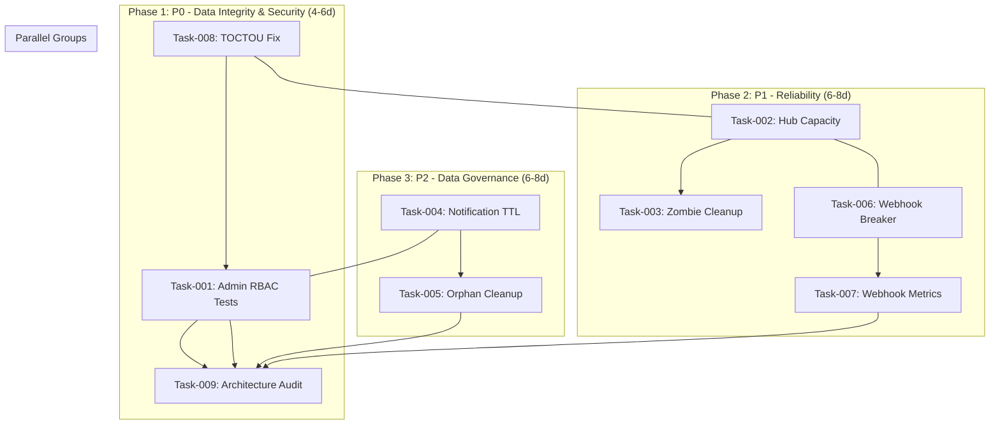
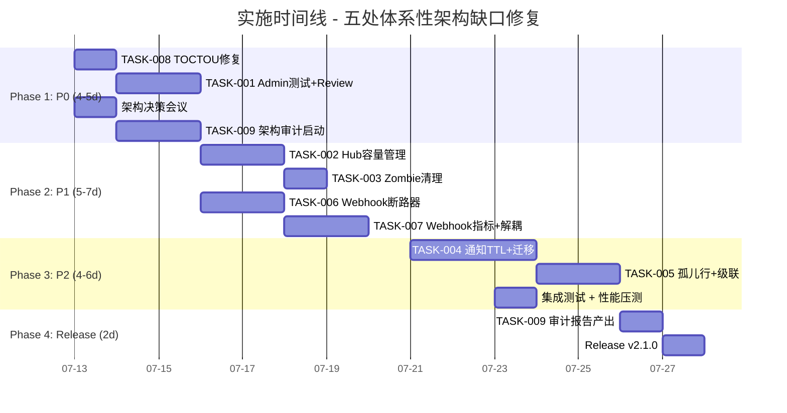

Now I have a complete picture of the codebase. Let me compile the Tech Lead analysis based on what's actually current.

---

# Tech Lead 分析报告：五处体系性架构缺口

## 0. 代码库实际状态勘误

在进行分析前，必须先纠正分析文档中的一处重大过时信息：

**方向一（Admin RBAC API）已基本完成**。阅读实际代码后发现，`AdminService` 接口、实现、HTTP Handler、gRPC Server、Proto 定义、Protobuf 桩代码、`RequirePermission` 中间件接入均已到位。分析文档的证据 1-4 在当前代码中均已被修复。

其余四个方向的评估仍是准确的。

---

## 1. 任务分解

### 实际缺口清单

| 方向 | 当前状态 | 优先级 | 工作量评估 |
|------|---------|--------|-----------|
| 方向一：Admin RBAC | ⚠️ 基本完成，需补充测试和迁移 | P0 | 4-6h |
| 方向二：SSE Hub 容量与反压 | ❌ 未解决 | P1 | 8-12h |
| 方向三：通知行生命周期 | ❌ 未解决 | P2 | 10-16h |
| 方向四：Webhook 断路器 | ❌ 未解决 | P1 | 8-12h |
| 方向五：文件 TOCTOU | ⚠️ 旧服务层已修复，新架构层存在回归 | P0 | 4-6h |

---

### 详细任务分解

#### TASK-001: Admin RBAC 测试覆盖 + API 一致性问题修复

| 字段 | 内容 |
|------|------|
| **所属方向** | 方向一：Admin RBAC API |
| **文件** | `internal/service/admin.go`, `internal/service/admin_test.go`, `internal/handler/http/admin.go`, `internal/handler/http/admin_test.go`, `internal/handler/grpc/admin.go`, `internal/handler/grpc/admin_test.go`, `migrations/000022_admin_roles.up.sql` |
| **前置依赖** | 无 |
| **预估工时** | 4h |
| **验收标准** | `make test && make lint` 绿色；Admin service 测试覆盖 GrantRole/RevokeRole/ListRoles/ListUserRoles 的正向/异常路径；`GrantRole` 的 self-grant 拒绝、重复 grant 幂等性、不存在的 role_code 返回 404；HTTP handler 测试覆盖所有端点；`ListRoles` 和 `ListUserRoles` 需要补充 gRPC 端到端测试 |

**详细说明**：
- 虽然 `AdminService` 和 handler 已存在，但以下微小缺口需修复：
  - `adminService.GrantRole` 检测 `ErrNotFound` 但 `adminRepo.GrantRole` 可能返回的是 `ErrConflict`（角色已授予），当前未处理——重复授予应返回 `Conflict` 而非传播 raw error
  - `adminService.RevokeRole` 未检测 `ErrNotFound`（角色不存在或该用户没有此角色），应返回 `NotFound`
  - 迁移 `000022_admin_roles.up.sql` 需要验证 seed data（默认角色和权限）是否正确
  - HTTP handler 中的 `syscfg` 路由组使用了与 `admin` 相同的 `/v1/admin` prefix，但二者是分别注册的 `.Group("/admin")`，这会导致 `GrantRole`/`RevokeRole` 路由实际运行时不应用 `audit.read` 中间件（因为它在不同 group 上），但 `system.config` 中间件是应用的。问题是路由注册时 `/v1/admin/roles/grant` 会匹配 `admin` group 还是 `syscfg` group？Gin 允许多个 group 注册相同 path prefix，**后注册的优先**。检查 `NewAdminHandler` 中路由注册顺序，确保 `admin.GET("/roles", ...)` 和 `syscfg.POST("/roles/grant", ...)` 不会产生冲突。当前写法中 `admin` 和 `syscfg` 使用相同 group path `/admin`，这是正确的（Gin 允许），但需要确认 `RequirePermission` 中间件正确分离。

#### TASK-002: SSE Hub 容量管理与可观测性

| 字段 | 内容 |
|------|------|
| **所属方向** | 方向二：SSE Hub 容量与反压 |
| **文件** | `internal/hub/hub.go`, `internal/hub/hub_test.go`, `configs/config.yaml`, `internal/config/config.go` (+ `config_test.go`) |
| **前置依赖** | 无 |
| **预估工时** | 6h |
| **验收标准** | Hub 创建时接受 `HubConfig{MaxSubscribersPerUID: 10, ChannelBuffer: 64}`；超过上限的 `Subscribe` 返回 error；`pub()` 在 default 分支中原子递增 `droppedEvents` 计数器；新暴露 `Metrics()` 方法返回 `(subscriberCount, droppedCount)`；所有新增行为有单元测试覆盖 |

**具体实施要点**：
1. 配置文件新增 `hub.max_subscribers_per_uid`（默认 10）和 `hub.channel_buffer`（默认 64），`config.Load` 中设置默认值
2. `Hub` struct 增加 `cfg HubConfig` 字段和 `dropped atomic.Int64` 计数器
3. `Subscribe` 中加 `len(us.subs) >= h.cfg.MaxSubscribersPerUID` 检查，超限返回 `(nil, nil, ErrTooManySubscribers)`（需要定义 sentinel error）
4. `pub()` 的 `default` 分支改为 `h.dropped.Add(1)` + 可选 logger.Warn（按配置频率采样，避免日志洪泛）
5. `Publish` 接口签名保持不变（不影响外部调用者）
6. 在 `dispatchHandle` 中考虑：虽然 `Publish` 返回 void，但可以添加 `PublishWithResult` 或让 Hub 暴露 `DroppedCount()` 被 Prometheus 收集
7. 新增 `default` 分支中 `select` 还需要加 `ctx.Done()` 检测——当 subscriber 的 context 已取消时，不尝试 send 并清理 zombie channel

#### TASK-003: Hub Zombie Subscriber 清理与主动断开

| 字段 | 内容 |
|------|------|
| **所属方向** | 方向二：SSE Hub 容量与反压 |
| **文件** | `internal/hub/hub.go`, `internal/hub/hub_test.go` |
| **前置依赖** | TASK-002 |
| **预估工时** | 4h |
| **验收标准** | `pub()` 中 detect 已关闭 channel 并从 `subs` map 中移除；新增 `gc()` 后台 goroutine 定期扫描 zombie subscriber（超时未读的 channel）；新增 `DisconnectSlowConsumer(uid string)` 主动断开方法；单元测试覆盖 zombie 检测和清理场景 |

**具体实施要点**：
- 当前 zombie subscriber 只在 `unsubscribe()` 时清理。如果客户端 TCP 断开但未调用 `unsubscribe()`（如 socket 直接关闭），channel 永驻内存
- 在 `pub()` 中，当 `select` 进入 `default` 分支（channel full），尝试 `len(ch)` 检测 channel 积压，超过 `MaxChannelBacklog`（如 3x buffer）时关闭并移除该 channel
- 或新增 `gcSubscribers(maxIdle time.Duration)` 方法，由调用者决定是否启动后台 goroutine
- 更轻量的方案：在 `Subscribe` 创建 channel 时包装一个 `closeOnce` + context，在 `pub()` 中检测 `ctx.Done()`

#### TASK-004: 通知行 TTL 策略 + 批量清理 API

| 字段 | 内容 |
|------|------|
| **所属方向** | 方向三：通知行生命周期 |
| **文件** | `migrations/000024_notification_ttl.up.sql`, `migrations/000024_notification_ttl.down.sql`, `internal/repository/notification.go`, `internal/service/notification.go`, `internal/handler/http/notification.go`, `internal/handler/grpc/notification.go`, `configs/config.yaml` |
| **前置依赖** | 无 |
| **预估工时** | 8h |
| **验收标准** | 新增 `PurgeReadBefore(ctx, before time.Time) (int64, error)` 仓库方法；新增 `DELETE /v1/notifications` 端点（支持 `?read_before=..` 查询参数）；gRPC `PurgeNotification` RPC；新增 `DELETE /v1/admin/notifications/purge` 管理员端点（全局清理）；后台 `NotificationGC` 可选启动（由 `notifications.gc.enabled` 控制）；新迁移有对应的 down.sql |

**具体实施要点**：
- 新增 migration `000024`：`ALTER TABLE notifications ADD COLUMN deleted_at TIMESTAMPTZ;`（软删除）—— 与系统其他表保持一致
- 仓库新增 `PurgeReadBefore(ctx, before time.Time, recipientUID string) (int64, error)` 方法
- 用户级清理：`DELETE /v1/notifications?read_before=2026-06-01T00:00:00Z`——只清理自己的通知
- 管理员级清理：`DELETE /v1/admin/notifications/purge?read_before=...&recipient=...`——按条件全局清理
- 后台 `NotificationGC`：类似 `storage/gc/sweeper.go` 的模式，定期清理超过 90 天的已读通知
- 注意：`collapsed_count` 的行在清理时需确保原子性（清理主行后 orphan 行自动被清理，或先清理 orphan）

#### TASK-005: 通知孤儿行 + 已删除资源处理

| 字段 | 内容 |
|------|------|
| **所属方向** | 方向三：通知行生命周期 |
| **文件** | `internal/repository/notification.go`, `internal/service/notification.go`, `internal/message/service.go`, `internal/comment/service.go` |
| **前置依赖** | TASK-004 |
| **预估工时** | 6h |
| **验收标准** | 删除消息时级联标记相关通知（`subject_deleted = true` 或软删除通知行）；通知列表 API 不再返回 `subject_deleted` 的通知（或标记为"内容已删除"）；折叠过程中产生的 orphan 行被 `NotificationGC` 清理；新增迁移 `ALTER TABLE notifications ADD COLUMN subject_deleted BOOLEAN NOT NULL DEFAULT FALSE` |

**具体实施要点**：
- `MessageService.Delete` 中，在 outbox 投递 `message.deleted` 事件后，级联 `notifRepo.MarkSubjectDeleted(ctx, "message", id.String())` 
- `CommentService.Delete` 中类似处理
- 折叠的 orphan 行处理：在 `NotificationDispatcher` 中，当 `IncrementCollapsedCount` 成功后，新创建的 orphan 行 `n` 立即标记 `subject_deleted = true`（因为它在用户 Feed 中不应单独出现）或直接软删除
- `ListByRecipient` 默认过滤 `subject_deleted = FALSE`（用户侧），但管理员查询可以看到所有行

#### TASK-006: Webhook 断路器 + 错误分类

| 字段 | 内容 |
|------|------|
| **所属方向** | 方向四：Webhook 投递可靠性 |
| **文件** | `internal/outbox/webhook.go`, `internal/outbox/webhook_test.go`, `internal/outbox/chain.go`, `configs/config.yaml`, `internal/config/config.go` |
| **前置依赖** | 无 |
| **预估工时** | 6h |
| **验收标准** | WebhookHandler 在 N 次 5xx 或网络错误后进入 Open 状态；熔断期间不投递事件（直接返回 nil 或 dead-letter）；区分 4xx 为不可重试（立即 dead-letter）；可配置的 breaker 阈值（`webhook.breaker_threshold`）和冷却时间（`webhook.breaker_cooldown`）；单元测试覆盖 Close→Open→Half-Open 状态转换 |

**具体实施要点**：
- 复用或提取 `internal/sso/breaker.go` 的断路器实现到 `internal/pkg/breaker/` 通用包
- 断路器状态：Closed（正常）→ Open（熔断）→ Half-Open（半开探测）
- 错误分类：
  - 不可重试：400, 401, 403, 404, 410, 422 (client errors) → 立即 dead-letter 不经过 breaker
  - 可重试：429, 5xx, 网络超时/断连 → 触发 breaker
  - 注意：429 应退避但不应触发 Open（可配置退避时间）
- 配置新增：`outbox.webhook.breaker_threshold`（默认 5）、`outbox.webhook.breaker_cooldown`（默认 30s）
- 断路器状态暴露为 Prometheus gauge

#### TASK-007: Webhook 指标 + Dispatcher/Webhook 解耦

| 字段 | 内容 |
|------|------|
| **所属方向** | 方向四：Webhook 投递可靠性 |
| **文件** | `internal/outbox/webhook.go`, `internal/outbox/webhook_test.go`, `internal/app/app.go`, `internal/outbox/relay.go`, `internal/pkg/metrics` |
| **前置依赖** | TASK-006 |
| **预估工时** | 4h |
| **验收标准** | Webhook 新增 `webhook_delivery_total{status="ok|fail|breaked"}`、`webhook_latency_seconds`、`webhook_errors_total{code="xxx"}` 指标；Chain 支持错误隔离（dispatcher 成功不因 webhook 失败而回滚）；outbox relay 的 `MarkPublished` 在 chain 模式下仅当所有 handler 成功时触发——需要区分 dispatcher 已成功但 webhook 失败的不同处理策略 |

**具体实施要点**：
- 当前 `outbox.NewChain(dispatcher, webhookHandler)` 将 dispatcher 和 webhook 串联，webhook 失败 = dispatcher 也被回滚
- 需要添加新配置 `outbox.webhook.independent`（默认 false）：为 true 时，relay 先执行 mandatory chain（dispatcher），成功 `MarkPublished` 后再异步投递 webhook
- 异步投递需要：新建 `WebhookRelay`（类似 outbox relay 但独立），有自己的 dead-letter 和重试策略
- 或者更轻量的方案：使用 `MultiHandler`（类似于 `Chain` 但每个 handler 独立返回 error，relay 对 non-critical handler 的 error 只日志不阻止 `MarkPublished`）
- 指标注册到 `metricsReg`（app.go 中共享的 registry）

#### TASK-008: 文件删除 TOCTOU 修复（新架构层）

| 字段 | 内容 |
|------|------|
| **所属方向** | 方向五：文件删除 TOCTOU |
| **文件** | `internal/file/service_crud.go`（Delete 方法） |
| **前置依赖** | 无 |
| **预估工时** | 4h |
| **验收标准** | `internal/file/service_crud.go:Delete` 使用 `StorageRefRepository.Decrement` 替代裸 `CountByStorageKey`；当 refs 不可用时 fallback 到 `CountByStorageKey` 但改为 `.Unscoped()` 计数（含软删除行）；单元测试验证竞态场景（并发 Create+Delete 同一 storage_key 且同 checksum）|

**具体实施要点**：
- 在 `fileService` struct 中增加 `refs StorageRefRepository` 字段
- 修改 `NewFileService` 接受 `WithStorageRefs` option（与旧服务层一致）
- Delete 路径改为：
  ```go
  if s.refs != nil {
      n, err := s.refs.Decrement(ctx, f.StorageKey)
      if err == nil && n == 0 {
          _ = s.store.Delete(ctx, f.StorageKey)
      }
  } else {
      if n, cerr := s.files.CountByStorageKey(ctx, f.StorageKey); cerr == nil && n == 0 {
          _ = s.store.Delete(ctx, f.StorageKey)
      }
  }
  ```
- `CountByStorageKey` 在 `internal/repository/file.go` 中改为 `.Unscoped()`（含软删除行）—— 这需要在旧服务层的 `file.go` Delete 中确认 `.Unscoped()` 行为是否正确
- 添加显式注释说明此操作的竞态窗口已被 `Decrement` 原子操作消除

#### TASK-009: 新架构层规范审计（notification + file）

| 字段 | 内容 |
|------|------|
| **所属方向** | 跨方向：架构治理 |
| **文件** | `internal/notification/*.go`, `internal/file/*.go`, `internal/app/app.go` |
| **前置依赖** | TASK-005, TASK-008 |
| **预估工时** | 6h |
| **验收标准** | 产出架构合规性审计报告；明确 `internal/notification/` 和 `internal/file/` 是否应接替旧层；如果决定接替，列出所有 gap；如果决定废弃，在代码中添加明确的 "deprecated - use X instead" 注释；更新 AGENTS.md 中关于双架构的描述 |

**具体实施要点**：
- `internal/notification/` 和 `internal/file/` 包是新的各层架构，但从未被 `app.go` wired
- 旧层 `internal/service/{file,notification}.go` 是当前 active 的服务
- 需要架构决策：是两套共存（然后逐步迁移）还是废弃新架构层
- 当前建议：废弃 `internal/notification/` 和 `internal/file/` 的新架构包，因为旧服务层经过生产验证且功能更完整（有 refs/audit 等），将旧服务层的功能补全即可
- 如果决定保留新架构，需要将 TASK-008（TOCTOU）和新架构参照旧层的模式完善

---

## 2. 执行顺序



**并行执行组**：

| 组 | 包含任务 | 可并行理由 |
|----|---------|-----------|
| 组 A (P0) | TASK-008 (TOCTOU), TASK-001 (Admin 测试) | 两个方向互不依赖，涉及不同文件 |
| 组 B (P1) | TASK-002+003 (Hub), TASK-006+007 (Webhook) | Hub 和 Webhook 是独立的子系统 |
| 组 C (P2) | TASK-004+005 (通知生命周期) | 可与组 A/B 并行 |
| 组 D (审计) | TASK-009 (架构审计) | 依赖前三个组的产出 |

---

## 3. 技术风险

### 3.1 高风险项目

| 风险 | 方向 | 等级 | 缓解策略 |
|------|------|------|---------|
| **Webhook 解耦后的事务一致性** | 四 | 🔴 高 | 如果 dispatcher 和 webhook 解耦为异步，dispatcher 成功后 `MarkPublished`，webhook 异步投递——但 webhook 投递失败后事件已标记为 published，需要独立的 dead-letter 重试。解决方案：引入 `webhook_pending` 状态的中间表，或者在 outbox_events 中加 `webhook_delivered_at` 列 |
| **Hub zombie 检测的竞态** | 二 | 🟡 中 | `pub()` 中遍历 `subs` map 时检测 zombie 并从 map 中删除，需要锁机制避免 race。建议使用 `sync.Map` 的 `Range` 配合 `Delete`（已在 `hub.go` 的 `Close()` 中使用类似模式），或引入 `uidSubs` 级别的条件变量 |
| **通知 TTL 迁移对生产 DB 的影响** | 三 | 🟡 中 | 22 张表的迁移已是第 24 个，生产数据库可能很大。`ALTER TABLE notifications ADD COLUMN deleted_at` 是轻量 DDL（添加 nullable 列无默认值），但 `PurgeReadBefore` 的 `DELETE` 需要关注性能，建议分批（`LIMIT 1000`）进行 |
| **新架构层废弃 vs 保留的决策** | 跨 | 🟡 中 | 双架构增加了维护成本。`internal/file/` 有 13 个文件，`internal/notification/` 有 11 个文件——废弃或接替都需团队共识。建议做一次架构决策会议，明确方向后统一写入 ADR |

### 3.2 依赖的外部系统

| 外部系统 | 影响方向 | 说明 |
|---------|---------|------|
| Postgres | 一、三、五 | 迁移 DDL 需要生产 DBA review（尤其是 `ALTER TABLE`）。通知 TTL 清理的 `DELETE` 可能产生大量 WAL |
| SSO (gRPC) | 一 | Admin 角色管理中的 `GrantRole`/`RevokeRole` 不依赖 SSO，但 `HasPermission` 中的用户身份来自 SSO token——如果 SSO 不可用，admin API 的权限检查依赖 `stale cache` |
| 外部 Webhook 端点 | 四 | 断路器 + 错误分类依赖 HTTP 响应码的准确性。某些端点可能返回 200 但 body 含 error——无法检测 |

### 3.3 性能瓶颈

| 场景 | 方向 | 风险 |
|------|------|------|
| 10,000+ 用户同时在线 SSE | 二 | 即使 per-uid 限制 10 个连接，1000 个在线用户 * 10 = 10,000 个 channel，每个 buffer 64 = 640,000 个 slot。`pub()` 遍历复杂度 O(subscribers)。建议：当 uid 的 subscribers 超过阈值时使用 sampling 或 broadcast to first N |
| 通知表 > 1 亿行 | 三 | `ListByRecipient` 查询即使有复合索引，`ORDER BY created_at DESC, id DESC LIMIT n+1` 在大量已读通知场景下需要扫描大量行。建议：TTL 清理后表大小可控 |
| 批量清理 1000 万行 | 三 | `PurgeReadBefore` 的 `DELETE` 可能长时间持有行锁。建议：分批 + sleep，类似 `storage/gc/sweeper.go:30` 的 `PurgeBatch` 模式 |

### 3.4 测试覆盖难点

| 难点 | 方向 | 策略 |
|------|------|------|
| TOCTOU 竞态测试 | 五 | 无法通过常规单元测试验证并发 Bug。方案：写一个集成测试，用 `sync.WaitGroup` 控制 goroutine 交错执行，模拟 `CountByStorageKey` 和 `store.Delete` 之间的窗口 |
| Hub 容量限制测试 | 二 | 需构造超限 subscribe 场景。方案：超过 `MaxSubscribersPerUID` 后断言 `Subscribe` 返回 error |
| 断路器状态转换 | 四 | 需 Mock HTTP 返回指定状态码。方案：使用 `httptest.NewServer` + 条件响应，验证 Close→Open→Half-Open 转换 |
| 通知 TTL 清理 | 三 | 需构造创建时间在清理阈值之前的通知。方案：repository 层创建时可注入 `created_at`（当前是 `time.Now().UTC()`），测试中从 `time.Now().Add(-100 * 24 * time.Hour)` 开始 |

---

## 4. 资源评估

### 4.1 人力需求

| 角色 | 所需人数 | 技能要求 | 参与阶段 |
|------|---------|---------|---------|
| **Senior Backend Engineer** (Go) | 1 人 | GORM、Postgres、gRPC、并发编程 | 全部阶段 |
| **Staff/Principal Engineer** (架构) | 0.5 人 | 系统设计、代码审查 | 阶段 1 + 阶段 4 |
| **QA Engineer** | 0.5 人 | 集成测试、性能测试 | 阶段 3 |

**推荐方案**：1 名 Senior（主力开发）+ 1 名 Staff（每周 2 天审查架构决策），QA 使用自动化 CI 而非专职。

### 4.2 里程碑时间表

| 里程碑 | 时间 | 交付物 |
|--------|------|--------|
| M1: P0 完成 | Day 5 | TASK-001 + TASK-008 合入 main，`make test && make lint` 绿色 |
| M2: P1 完成 | Day 12 | TASK-002+003+006+007 合入 main，集成测试通过 |
| M3: P2 完成 | Day 18 | TASK-004+005 合入 main，生产迁移就绪 |
| M4: 架构审计 + 发布 | Day 22 | TASK-009 完成，架构决策 ADR 发布，所有代码通过 `make check-file-sizes` |

### 4.3 阻塞点（Blockers）

| 阻塞点 | 影响 | 解决策略 |
|--------|------|---------|
| **新架构层废弃/保留决策** | 阻塞 TASK-009，影响 TASK-005/008 的修复策略 | 在 Phase 1 第 1 天组织 30 分钟架构会议。推荐：保留旧服务层作为 active path，废弃 `internal/file/` 和 `internal/notification/` 的新架构层（添加 deprecation 注释），将 TOCTOU 修复应用到旧服务层即可 |
| **Webhook 解耦方案选择** | 阻塞 TASK-007 | 有 3 个可选方案：(a) `MultiHandler` 模式——轻量、风险低、推荐；(b) 独立 `WebhookRelay` + 中间表——完整但重；(c) 保持现状但加 breaker——最轻但不够。推荐先做 (c) 作为快速 win，再在 Phase 4 考虑 (a) |
| **生产环境 DDL 审批流程** | 阻塞 TASK-004 的生产部署 | 在代码开发期间同步走审批。迁移 SQL 应使用 `SET statement_timeout = '30s'` 保护 |

---

## 5. 质量保证

### 5.1 单元测试覆盖要求

| 方向 | 包 | 当前覆盖率（估计） | 目标覆盖率 | 关键测试场景 |
|------|----|-------------------|-----------|-------------|
| 一 | `internal/service` | ~40% (admin_service) | 85%+ | GrantRole self-grant 拒绝、重复 grant 返回 Conflict、不存在的 role 返回 NotFound、RevokeRole 不存在角色 |
| 二 | `internal/hub` | ~60% | 90%+ | 超限 Subscribe 拒绝、buffer 慢消费丢事件计数、zombie 清理、`ctx.Done()` 检测 |
| 三 | `internal/repository` | ~55% | 80%+ | PurgeReadBefore 分批清理、orphan 折叠行计数 |
| 四 | `internal/outbox` | ~30% | 75%+ | 断路器 Open→Half-Open→Closed 转换、4xx 立即死信、5xx 触发 Open |
| 五 | `internal/file` (新) | ~20% | 70%+ | 并发 Create+Delete 竞态验证 |

### 5.2 集成测试策略

| 测试类型 | 工具 | 覆盖场景 | CI 触发条件 |
|---------|------|---------|------------|
| Repository 集成 | `internal/repository/testpg` (testcontainers) | 通知 TTL 清理 SQL、Admin 角色 Grant/Revoke SQL、文件 TOCTOU 的 `Unscoped` Count | 含 `integration` tag 的推送 |
| Webhook 断路器 | `httptest.NewServer` + condition response | 状态码分类、breaker 状态转换 | 每次 push |
| SSE Hub 慢消费 | 测试 goroutine 控制 | buffer 满丢事件、zombie subscriber | 每次 push |
| 端到端 | testcontainers + MinIO | 文件上传→删除→blob 原子性 | PR merge 前 |

### 5.3 代码审查要点

| 审查项 | 方向 | 重点检查 |
|--------|------|---------|
| **线程安全性** | 二 | `pub()` 中遍历 `subs` map 时的锁粒度、`dropped` 计数器的原子性、`gc()` 和 `pub()` 的并发关系 |
| **错误包装** | 一、四 | Raw error 是否被 `AppError.Wrap()` 包装？`GrantRole` 的 `ErrNotFound` 和 `ErrConflict` 是否正确映射 |
| **迁移可逆性** | 三 | `000024_notification_ttl.down.sql` 是否存在？`ALTER TABLE` 在 down.sql 中是否正确回滚 |
| **配置默认值** | 二、四 | `HubConfig` 的默认值是否合理？`breaker_threshold=5` 在产品级是否太低（建议 10-20）|
| **指针 vs 值** | 全部 | 新架构层 `service_crud.go` 使用 `*File` 而非 `domain.File`，需确认 `fileService` 方法签名是否与 `FileService` 接口一致 |

### 5.4 性能测试需求

| 测试场景 | 方向 | 负载规格 | 通过标准 |
|---------|------|---------|---------|
| SSE Hub 大规模发布 | 二 | 1000 个在线用户 × 5 个 subscriber each，每秒 1000 条通知发布 | `pub()` 耗时 < 5ms per event，dropped rate < 1% |
| 通知表 TTL 清理 | 三 | 1000 万行通知表，分批清理 `PurgeBatch=1000` | 单次清理 < 100ms, 不产生死锁 |
| Admin 角色检查 | 一 | 1000 QPS `HasPermission` 调用，1000 个 user_role 行 | P99 延迟 < 50ms |

---

## 6. 实施计划

### 时间线



### 详细实施时间表

#### 阶段 1：基础修复 + 架构决策（Day 1-5）

| 日期 | 活动 | 产出 |
|------|------|------|
| Day 1 am | 架构决策会议（30min）：新架构层废弃还是保留？Webhook 解耦方案选择 | ADR 文档 |
| Day 1 pm | TASK-008：修复 `internal/file/service_crud.go` TOCTOU | PR #1 |
| Day 2-3 | TASK-001：补全 Admin 测试 + 修复 GrantRole/RevokeRole error 映射 | PR #2 |
| Day 3-5 | TASK-009 启动：架构审计 + 双架构评估 | 架构审计报告 v1 |

**Phase 1 Gate**：`make test && make lint` 绿色。两个 PR 合入 main。

#### 阶段 2：可靠性修复（Day 6-12）

| 日期 | 活动 | 产出 |
|------|------|------|
| Day 6-8 | TASK-002：SSE Hub 配置化 + 容量限制 + 丢事件计数 | PR #3 |
| Day 9 | TASK-003：Zombie subscriber 检测 + 清理 | PR #4 |
| Day 10-12 | TASK-006+007：Webhook 断路器 + 指标 + 错误分类 | PR #5 |

**Phase 2 Gate**：Hub 和 Webhook 的集成测试通过。配置变更更新到 `configs/config.yaml`。

#### 阶段 3：数据治理（Day 13-18）

| 日期 | 活动 | 产出 |
|------|------|------|
| Day 13-15 | TASK-004：通知 TTL 迁移 + Purge API + NotificationGC | PR #6 |
| Day 16-17 | TASK-005：orphan 行处理 + 消息/评论删除级联 | PR #7 |
| Day 18 | 集成测试 + 性能压测 | 测试报告 |

**Phase 3 Gate**：通知表迁移在 staging DB 验证通过（有数据回滚方案）。通知清理 API `make test-integration` 通过。

#### 阶段 4：审计 + 发布（Day 19-22）

| 日期 | 活动 | 产出 |
|------|------|------|
| Day 19-20 | TASK-009 完成：架构审计最终报告 | 架构审计报告 v2 |
| Day 21 | Code freeze + Release branch cut | Release v2.1.0-rc |
| Day 22 | 生产部署 + 监控仪表板更新 | Release v2.1.0 |

**Phase 4 Gate**：全量 `make test && make lint && make check-file-sizes` 通过。CHANGELOG 更新。Grafana 仪表板新增 Hub/Webhook 面板。

---

## 7. 附：文件规模约束检查

当前代码库中，以下文件需特别注意 `AGENTS.md` 的 500 行限制：

| 文件 | 当前行数 | 风险评估 |
|------|---------|---------|
| `internal/app/app.go` | ~500+ | ⚠️ 接近/超出限制。建议后续重构提取 `buildStorage`、`buildRelay`、`buildRateLimiter` 到 `internal/app/` 子包 |
| `internal/repository/notification.go` | ~200+ | ✅ 安全，但 TASK-004 添加后可能突破 250 |
| `internal/hub/hub.go` | ~150 | ✅ 安全 |
| `internal/outbox/webhook.go` | ~100 | ✅ 安全 |
| `internal/service/notification.go` | ~300+ | ⚠️ 包含 Dispatcher + Service + RateLimiter。建议提取 RateLimiter 到 `internal/pkg/ratelimit/notif.go` |
| `internal/service/file.go` | ~270+ | ✅ 安全 |

**建议**：TASK-009 的架构审计中，将 `internal/service/notification.go` 的 `notifRateLimiter` 提取到独立文件，将 `internal/service/notification.go` 行数控制在 <300。
