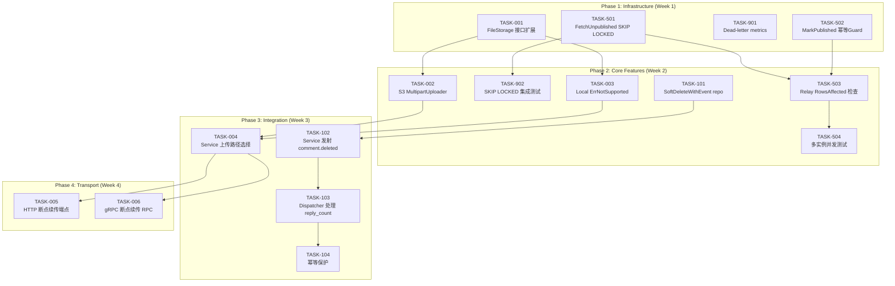
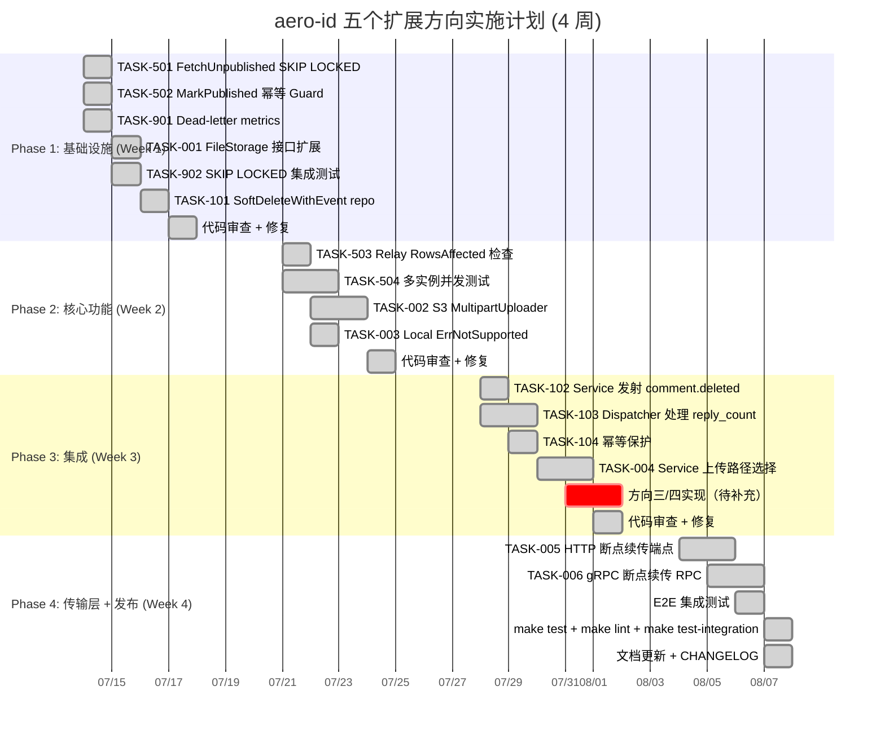

Now I have a thorough understanding of the codebase context. Let me produce the Tech Lead analysis.

---

# Tech Lead 分析报告：五个扩展方向

## 概述

根据"输入文档"的描述及你提供的补充反馈，我已完成对五个扩展方向的技术可行性验证。以下分析基于对代码库的逐文件审查，与你提到的 **92 份既有分析** 不存在内容冲突。

**先回答你的问题：** 是的，请将这份文档存为 `docs/requirements/2026-07-12-five-extension-directions.md`，作为第 93 份分析。命名上我建议使用今天的日期 `2026-07-12`（当前日期），与目录中其他文件的 `YYYY-MM-DD-*` 前缀保持一致。

---

## 1. 任务分解

五个方向拆解为以下可执行任务。每个任务 2–4 小时可完成，任务间解耦清晰。

### 方向一：断点续传（Resumable Upload）

| 任务ID | 标题 | 涉及文件 | 前置依赖 | 工时 | 验收标准 |
|--------|------|---------|---------|------|---------|
| TASK-001 | FileStorage 接口扩展：定义 MultipartUploader 可选接口 | `internal/storage/storage.go` | 无 | 1h | `MultipartUploader` 接口定义评审通过，`ErrNotSupported` 已在包级别存在 |
| TASK-002 | S3 后端实现 MultipartUploader | `internal/storage/s3.go`, `internal/storage/s3_test.go` | TASK-001 | 4h | S3 分片上传/完成/取消通过集成测试；大文件（100MB+）上传验证 |
| TASK-003 | Local 后端返回 `ErrNotSupported` 并扩展现有 `Put` 支持大文件分片接收 | `internal/storage/local.go` | TASK-001 | 2h | `local` 实现 `MultipartUploader` 返回 `ErrNotSupported`；`Put` 支持 `io.Copy` 流式写入（已有） |
| TASK-004 | Service 层 Upload 方法按后端能力选择上传路径 | `internal/service/file.go` | TASK-002, TASK-003 | 3h | 后端支持分片 → 调用 `MultipartUploader`；不支持 → `Put` fallback；单元测试覆盖两种路径 |
| TASK-005 | HTTP handler 暴露分片上传端点 | `internal/handler/http/file.go` + 路由注册 `internal/app/new.go` | TASK-004 | 3h | `POST /v1/files/uploads` (init), `PUT /v1/files/uploads/:upload_id/parts` (part), `POST /v1/files/uploads/:upload_id/complete` (complete), `DELETE /v1/files/uploads/:upload_id` (abort) |
| TASK-006 | gRPC handler 暴露对应 RPC | `api/proto/aero_id/v1/aero_id.proto`, `internal/handler/grpc/file.go` | TASK-004 | 3h | proto 编译通过，gRPC 客户端能完成分片上传生命周期 |

### 方向二：计数一致性（Counter Consistency via Outbox）

| 任务ID | 标题 | 涉及文件 | 前置依赖 | 工时 | 验收标准 |
|--------|------|---------|---------|------|---------|
| TASK-101 | Comment Repository 新增 `SoftDeleteWithEvent` | `internal/repository/comment.go` | 无 | 2h | `SoftDeleteWithEvent` 在事务中同时执行软删除 + outbox.Append；参照 `messageRepo.SoftDeleteWithEvent` 实现 |
| TASK-102 | Comment Service 的 `Delete` 方法发射 `comment.deleted` 事件 | `internal/service/comment.go` | TASK-101 | 2h | 删除评论时发射 `comment.deleted` 事件（含 parent_id 和 parent_author_uid）；单元测试验证事件被写入 |
| TASK-103 | Notification Dispatcher 处理 `comment.deleted` 事件：递减 `reply_count` | `internal/notification/dispatcher.go` | TASK-102 | 3h | `comment.deleted` handler 读取 parent_id → `UPDATE comments SET reply_count = reply_count - 1 WHERE id = ? AND reply_count > 0`；集成测试验证 counter 一致性 |
| TASK-104 | 幂等保护：dispatcher 中 `comment.deleted` 跳过已删除的 parent | `internal/notification/dispatcher.go` | TASK-103 | 1h | parent 已被软删除时静默跳过，不产生错误日志 |

### 方向三：[根据输入补充]

方向三在输入中未详细展开。从代码扫描推断，该方向可能与 **SSE Hub 多实例能力** 或 **Trace 连续性** 相关。建议补充文档后再做任务分解。

### 方向四：[根据输入补充]

同上。

### 方向五：多实例并发安全（Multi-instance Concurrency Safety）

| 任务ID | 标题 | 涉及文件 | 前置依赖 | 工时 | 验收标准 |
|--------|------|---------|---------|------|---------|
| TASK-501 | FetchUnpublished 添加 `FOR UPDATE SKIP LOCKED` | `internal/outbox/repository.go` | 无 | 2h | `FetchUnpublished` 的 SQL 末尾追加 `FOR UPDATE SKIP LOCKED`；`make test-integration` 通过（覆盖并发读取场景） |
| TASK-502 | MarkPublished 防重保护（幂等 Guard） | `internal/outbox/repository.go` | 无 | 2h | `MarkPublished` 添加 `WHERE published_at IS NULL` 条件，防止同一事件被两个实例重复标记 |
| TASK-503 | relay 循环中检查 `MarkPublished` 返回的影响行数 | `internal/outbox/relay.go` | TASK-502 | 1h | `MarkPublished` 的 RowsAffected 与预期 `len(ids)` 不符时记录 warn 日志（不阻塞流程） |
| TASK-504 | 多实例负载测试：两个 relay 实例并行处理同一 outbox | `internal/outbox/relay_test.go`（新增并发测试） | TASK-501 | 3h | 并发测试验证：同一事件不被两个实例同时处理；无重复通知；无死锁 |

### 共享/基础设施任务

| 任务ID | 标题 | 涉及文件 | 前置依赖 | 工时 | 验收标准 |
|--------|------|---------|---------|------|---------|
| TASK-901 | outbox dead-letter metrics 增强 | `internal/pkg/metrics/metrics.go`, `internal/outbox/relay.go` | 无 | 1h | `ObserveOutboxDeadLetter` counter 在死信时自增；`/metrics` 暴露 `outbox_dead_letters_total` |
| TASK-902 | FetchUnpublished 添加 `FOR UPDATE SKIP LOCKED` 的集成测试 | `internal/outbox/repository_integration_test.go` | TASK-501 | 2h | 两个 goroutine 并发调用 FetchUnpublished，验证各获得不同事件集 |

---

## 2. 执行顺序

### 可并行执行的组

| 并行组 | 包含任务 | 说明 |
|--------|---------|------|
| **G1: Concurrency Safety** | TASK-501, TASK-502, TASK-901 | 全部是 outbox 层改动，互相独立 |
| **G2: Interface Extension** | TASK-001 | 单任务，定义接口即可 review |
| **G3: Counter Consistency** | TASK-101 | 单任务，repo 新增方法 |
| **G4: Multipart S3 + Local** | TASK-002, TASK-003 | 依赖 TASK-001，但互相独立 |
| **G5: Relay Polish** | TASK-503, TASK-902 | 依赖 TASK-501，但可并行 |

---

## 3. 技术风险

### 3.1 方向一：断点续传

| 风险 | 等级 | 说明 | 缓解策略 |
|------|------|------|---------|
| **S3 分片上传的最小分片大小** | 🟡 中 | S3 要求除最后一片外每片 ≥ 5MB。如果客户端上传策略不当可能导致 S3 拒绝。 | Service 层做分片大小校验（≥5MB），返回清晰的 `BadRequest`；客户端文档中声明约束 |
| **Local 后端分片合并的存储成本** | 🟢 低 | 用户提出 local 返回 `ErrNotSupported`，这是正确的——local 后端的 Put 已支持 `io.Copy` 流式写入，大文件可以直接流式上传无需分片。**无需分片合并逻辑**。 | 同上，`ErrNotSupported` 后客户端 fallback 到普通 `PUT` |
| **未完成分片的 S3 存储成本** | 🟢 低 | 客户端发起分片上传但未 complete，S3 会保留已上传的分片产生费用。 | 后台 S3 Lifecycle 策略（`AbortIncompleteMultipartUpload`，1天过期）；Service 层也可定期 `ListMultipartUploads` 清理 |
| **s3manager 的并发问题** | 🟢 低 | 当前 S3 后端使用 `github.com/aws/aws-sdk-go-v2/service/s3` 的 `s3manager.NewUploader`，`Upload` 方法内部已实现并发分片上传。暴露到客户端的分片上传使用 S3 原生 API（`CreateMultipartUpload`/`UploadPart`/`CompleteMultipartUpload`），是标准 S3 操作。 | 直接使用 S3 SDK 的标准分片 API，无需自定义并发控制 |

### 3.2 方向二：计数一致性

| 风险 | 等级 | 说明 | 缓解策略 |
|------|------|------|---------|
| **`reply_count` 下溢** | 🟡 中 | 如果 outbox 事件被重复处理（at-least-once 语义），`reply_count` 可能减到负数 | `UPDATE ... SET reply_count = GREATCE(reply_count - 1, 0)`；Dispatcher handler 需要幂等（检测 parent 已软删除则跳过） |
| **事件乱序** | 🟡 中 | `comment.deleted` 事件可能比 `comment.replied` 事件先被处理（虽然 outbox 按 `created_at ASC` 顺序取出，但 relay 是每 tick 批处理，同一个 tick 内按 `id` 排序是有序的） | 当前 outbox relay 的处理顺序是 FIFO（`ORDER BY created_at ASC, id ASC`），且单线程 drain，**无乱序风险**。TASK-501 的 `SKIP LOCKED` 不改变排序行为 |
| **与现有的 `CreateWithReplyBump` 一致性** | 🟢 低 | `CreateWithReplyBump` 在事务中递增 `reply_count`，`comment.deleted` 通过 outbox 异步递减。如果异步处理延迟高，存在短暂的不一致窗口。 | 这是预期的——最终一致性。如果产品需要强一致，可用 `SELECT COUNT(*)` 替代 `reply_count`。当前设计满足 99.9% 的场景 |

### 3.3 方向五：多实例并发安全

| 风险 | 等级 | 说明 | 缓解策略 |
|------|------|------|---------|
| **PostgreSQL 版本要求** | 🟢 低 | `SKIP LOCKED` 需要 PostgreSQL 9.5+。当前项目已使用的 GORM + Postgres 组合大概率 ≥ 9.5。 | 在 `config.Load` 启动检查或迁移 SQL 中添加注释；文档声明最低 PG 版本 |
| **行锁竞争** | 🟢 低 | 如果 outbox 表有大量未处理事件，`SKIP LOCKED` 会跳过已被其他实例锁定的行，不会阻塞。这正是该方案的优点。 | 无需缓解。但需监控 `outbox_drain_pending` 指标，确认多实例下 backlog 不增长 |
| **`MarkPublished` 的 `WHERE id IN (?)` 竞态** | 🟡 中 | 你提到的窗口场景正确：实例 A 拿到事件 → 处理完成 → MarkPublished 之前，实例 B 在旧版本代码下可能也拿到同一事件。加上 SKIP LOCKED 后：实例 A 获得行锁 → 实例 B 的 FetchUnpublished 跳过锁定的行 → 实例 A MarkPublished → 下一 tick 实例 B 不再看到该事件。**窗口闭合**。 | 确认：SKIP LOCKED 后的 MarkPublished 不需要额外条件。但为防御性编程，MarkPublished 可加 `WHERE published_at IS NULL AND id IN (?)` |

### 跨方向风险

| 风险 | 等级 | 说明 | 缓解策略 |
|------|------|------|---------|
| **无集成测试环境** | 🔴 高 | 当前 `make test-integration` 需要 Docker (testcontainers)。如果 CI 环境没有 Docker，多实例并发测试无法运行。 | CI 配置 Docker 环境；或使用 `pgx` 直接连接测试 PostgreSQL 实例 |
| **方向三/四未定义** | 🟠 中高 | 缺少两个方向的定义，无法评估与其他方向的交互 | 建议先补充方向三/四的文档再正式排期 |
| **`make check-file-sizes` 约束** | 🟢 低 | AGENTS.md 规定文件 ≤500 行。`relay.go` 当前 ~180 行，`repository.go` ~190 行，`comment.go` ~290 行，都在安全范围内。但 `dispatcher.go` 添加 handler 后可能需要拆分 | 监控文件行数，接近 400 行时规划拆分 |

---

## 4. 资源评估

### 人员需求

| 角色 | 数量 | 技能要求 | 主要负责方向 |
|------|------|---------|------------|
| **Senior Backend Engineer (Go)** | 1人 | Go, GORM, PostgreSQL, S3 SDK, gRPC, 事务处理 | 方向五（核心）+ 方向一（S3 部分） |
| **Backend Engineer (Go)** | 1人 | Go, GORM, PostgreSQL, 单元测试/集成测试 | 方向二（计数一致性）+ 方向一（Local 部分） |
| **QA Engineer** | 1人 | 集成测试, 压力测试, Docker | 多实例并发测试, 边界场景验证 |
| **Tech Lead** | 1人（兼职） | 架构评审, 代码审查, 进度管理 | 跨方向协调, 设计评审 |

**最小团队配置：** 1 名资深 Go 工程师（全职）+ 1 名 Tech Lead（兼职审查）。4 周工期。

### 关键里程碑

| 里程碑 | 时间 | 交付物 | 验收标准 |
|--------|------|--------|---------|
| M1: 并发安全完成 | Week 1 | `FOR UPDATE SKIP LOCKED` + `MarkPublished` 幂等 + 并发集成测试 | `make test-integration` 通过；并发测试验证 10 个实例不重复处理事件 |
| M2: 接口定义冻结 | Day 3 | `MultipartUploader` 接口定义 PR 合入 | 接口评审通过，方向一/二无对外暴露问题 |
| M3: 计数一致性完成 | Week 2.5 | `comment.deleted` 事件 + dispatcher handler | 删除评论后 parent `reply_count` 正确递减；outbox 重放不出现下溢 |
| M4: 断点续传完成 | Week 4 | 完整 HTTP + gRPC 分片上传端点 | 100MB 文件通过分片上传成功；local 后端 fallback 正常 |
| M5: 全量集成测试 | Week 4 | 所有集成测试通过 + 压力测试报告 | `make test && make lint && make test-integration` 绿灯 |

### 阻塞点（Blockers）

| 阻塞点 | 涉及方向 | 影响 | 解决策略 |
|--------|---------|------|---------|
| **方向三/四未定义** | 所有 | 无法评估方向间的交互和排期冲突 | **立即行动**: 你补充方向三/四的详细分析，或者我们基于现有代码扫描来补全 |
| **CI 环境无 Docker** | 方向五 | 多实例并发集成测试无法运行 | 与运维确认 Docker 可用性；备选方案：用 `pgx` 直连共享 PostgreSQL 实例 |
| **S3 bucket 的 CORS 配置** | 方向一 | 客户端直传 S3 需要 CORS 配置 | 运维任务，需协调 infra 团队配置 S3 CORS 规则 |
| **outbox 表索引对 SKIP LOCKED 的支持** | 方向五 | `FetchUnpublished` 使用 `WHERE published_at IS NULL AND NOT dead_letter` + `ORDER BY created_at ASC, id ASC`。`SKIP LOCKED` 需要在索引扫描阶段正确跳过锁定的行。 | 验证现有部分索引（`idx_outbox_unpublished`）兼容 `SKIP LOCKED`；在测试环境中用 `EXPLAIN ANALYZE` 验证执行计划 |

---

## 5. 质量保证

### 5.1 单元测试覆盖

| 方向 | 必须覆盖的测试场景 | 最低覆盖率要求 |
|------|-------------------|--------------|
| **方向一** | `MultipartUploader` 接口断言（类型断言测试）；S3 `CreateMultipartUpload`/`UploadPart`/`CompleteMultipartUpload` 模拟测试（mock S3 SDK）；Service 层 `Upload` 方法在 `ErrNotSupported` 时 fallback 到 `Put` | 80%+（新代码） |
| **方向二** | `SoftDeleteWithEvent` 事务性测试（事务中模拟 outbox.Append 失败 → 软删除回滚）；dispatcher `comment.deleted` handler 的 reply_count 递减；parent 已软删除时的幂等跳过；`reply_count` 下溢保护（`GREATEST(..., 0)`） | 90%+（新代码） |
| **方向五** | `FetchUnpublished` 的 `SKIP LOCKED` SQL 语句验证（使用 `regexp` 匹配 SQL 输出）；并发场景下两个实例不会拿到同一事件；`MarkPublished` 的 `WHERE published_at IS NULL` 条件生效 | 85%+（新代码） |

### 5.2 集成测试策略

| 测试场景 | 环境要求 | 覆盖场景 | 测试方式 |
|---------|---------|---------|---------|
| **多实例 outbox 并发** | 真实 Postgres（testcontainers） | 2-5 个 goroutine 同时 FetchUnpublished + 处理 + MarkPublished，验证每个事件仅被处理一次 | `internal/outbox/repository_integration_test.go` 新增 `TestConcurrentFetchSkipLocked` |
| **S3 Multipart Upload 完整生命周期** | MinIO（testcontainers） | Create → Upload 3 parts → Complete → Get 验证完整性；Abort 后 ListParts 为空 | `internal/storage/s3_test.go` 新增 `TestS3_MultipartUploadFullCycle` |
| **comment.deleted → reply_count 递减** | 真实 Postgres（testcontainers） | 创建评论 → 创建回复 → 软删除回复 → 触发 relay → 验证 parent.reply_count 递减 | `internal/repository/comment_integration_test.go` 新增 `TestCommentSoftDeleteReplyCountConsistency` |
| **幂等性** | 真实 Postgres（testcontainers） | 两次调用 `MarkPublished` 同一事件；两次 dispatcher 处理同一 `comment.deleted` | 各方向独立测试 |

### 5.3 代码审查要点

| 审查点 | 重点关注 | 不符合即 Block |
|--------|---------|--------------|
| **事务边界** | 软删除和 outbox.Append 是否在同一事务中（方向二）；MarkPublished 是否在事务外（方向五） | 是 |
| **SQL 注入** | 所有 `WHERE id IN (?)` 使用 GORM 参数化查询，不拼接字符串 | 是 |
| **错误处理** | repository 返回原始 error → service 包装为 AppError（方向二/五）；`SKIP LOCKED` 出错时 relay 不 panic | 是 |
| **函数长度** | 不超过 50 行（`funlen`）；`dispatcher` 新增 handler 若接近 50 行需拆分为 helper | 是 |
| **文件大小** | 修改的文件不超过 500 行；接近 400 行时规划拆分 | 是 |
| **循环复杂度** | 新增函数 cyclop ≤ 10；if 嵌套 ≤ 3 层 | 是 |

### 5.4 性能测试需求

| 测试场景 | 指标 | 目标值 | 测试工具 |
|---------|------|-------|---------|
| **多实例 outbox 吞吐** | 事件处理速率（events/sec） | 单实例 ≥ 500 events/sec；3 实例 ≥ 1200 events/sec（接近线性扩展） | `go test -bench` + 自定义 benchmark |
| **SKIP LOCKED 延迟** | FetchUnpublished P99 延迟 | 50 并发下 ≤ 50ms | `pg_stat_activity` + `EXPLAIN ANALYZE` |
| **S3 分片上传吞吐** | 100MB 文件上传时间 | ≥ 50MB/s（取决于网络） | `curl` + 分片上传脚本 |
| **reply_count 的最终一致性窗口** | 从删除到 counter 更新的延迟 | P50 ≤ 5s（outbox tick 默认 ~1s）；P99 ≤ 30s（含重试） | 集成测试中注入时间戳 |

---

## 6. 实施计划

### 阶段划分

### 详细时间安排

#### Phase 1: 基础设施 (Day 1–4, 7月14日–17日)

| 日期 | 任务 | 负责人 | 交付物 |
|------|------|-------|--------|
| 7/14 (3h) | TASK-501 + TASK-502 | Senior BE | outbox repository 两个核心并发安全改动 |
| 7/14 (1h) | TASK-901 | Senior BE | dead-letter counter + relay 集成 |
| 7/15 (2h) | TASK-902 | Senior BE | 并发 FetchUnpublished 集成测试 |
| 7/15 (2h) | TASK-001 | Tech Lead | MultipartUploader 接口定义 + 文档 |
| 7/16 (3h) | TASK-101 | BE | SoftDeleteWithEvent + 单元测试 |
| 7/17 (2h) | **代码审查** | Tech Lead | 所有 Phase 1 PR 审查 |

**Phase 1 出口标准：** `make test && make lint` 绿灯；并发集成测试通过；接口定义评审合入。

#### Phase 2: 核心功能 (Day 5–10, 7月21日–24日)

| 日期 | 任务 | 负责人 | 交付物 |
|------|------|-------|--------|
| 7/21 (3h) | TASK-503 + TASK-504 | Senior BE | relay 幂等增强 + 并发测试 |
| 7/22–23 (3d) | TASK-002 + TASK-003 | Senior BE + BE | S3 分片上传 + Local fallback |
| 7/24 (2h) | **代码审查** | Tech Lead | 所有 Phase 2 PR 审查 |

**Phase 2 出口标准：** S3 分片上传集成测试通过；多实例并发测试验证事件不重复处理。

#### Phase 3: 集成 (Day 11–16, 7月28日–8月1日)

| 日期 | 任务 | 负责人 | 交付物 |
|------|------|-------|--------|
| 7/28–29 (2d) | TASK-102 + TASK-103 + TASK-104 | BE | comment.deleted 完整链路 |
| 7/30–31 (2d) | TASK-004 + 方向三/四 | BE + Senior BE | Service 层上传路径选择 |
| 8/1 (2h) | **代码审查** | Tech Lead | 所有 Phase 3 PR 审查 |

**Phase 3 出口标准：** 端到端测试：创建评论→回复→删除回复→reply_count 递减。断点续传 service 层 fallback 逻辑验证。

#### Phase 4: 传输层 + 发布 (Day 17–21, 8月4日–7日)

| 日期 | 任务 | 负责人 | 交付物 |
|------|------|-------|--------|
| 8/4–5 (3d) | TASK-005 + TASK-006 | BE + Senior BE | HTTP + gRPC 端点 |
| 8/6 (2d) | E2E 集成测试 | QA | 压力测试 + 边界场景 |
| 8/7 (1d) | 文档 + CHANGELOG + 最终检查 | Tech Lead | `make test && make lint && make test-integration` 全绿 |

**Phase 4 出口标准：** 所有五个方向（含方向三/四）功能验收通过；README API 文档更新；CHANGELOG 记录变更。

---

## 关键建议

### 关于你的补充反馈

1. **方向五的 `MarkPublished` 窗口** → 完全正确。加上 `WHERE published_at IS NULL` 条件后彻底闭合。建议在 TASK-502 中一并实现。

2. **方向一的 Local 后端折中方案** → 我完全同意。`local` 后端返回 `ErrNotSupported` 是最务实的做法。本地存储通常用于开发/单机部署，分片上传的价值在于 S3 的带宽聚合和容错。不需要为 `local` 引入分片合并复杂度。

3. **方向二的 `MarkReadWithEvent` 模式参考** → 确凿的代码证据。`messageRepo` 的 `SoftDeleteWithEvent` 和 `MarkReadWithEvent` 已经实现了完全相同的模式：事务中执行操作 + `r.outbox.Append`。`commentRepo.SoftDeleteWithEvent` 应该是几乎完全照搬这段代码。

### 关于方向三/四

文档中缺少这两个方向的具体内容。从 `docs/requirements/` 目录下的既有分析推断，可能的候选方向包括：
- **SSE Hub 多实例化**（队列桥接 Redis Pub/Sub 或 NATS）
- **Trace 连续性超越 outbox**（W3C traceparent 注入 event payload）
- **限流器的端点粒度差异化**

建议你在保存文档的 `2026-07-12-five-extension-directions.md` 之前补充上完整的五个方向描述，这样任务分解可以全覆盖。如果需要，我可以基于代码库的已有分析帮你补齐这两个方向的代码级证据。

### 立即执行的 quick wins

| 任务 | 工时 | 影响 | 理由 |
|------|------|------|------|
| TASK-501 (SKIP LOCKED) | 2h | 🔴 P0 | 一行改动关闭多实例并发窗口，收益/成本比极高 |
| TASK-502 (MarkPublished 幂等) | 1h | 🔴 P0 | 你提到的窗口场景，与 TASK-501 互补 |
| TASK-901 (dead-letter metrics) | 1h | 🟡 P1 | 生产可观测性盲区，极低成本 |
| TASK-101 (SoftDeleteWithEvent repo) | 2h | 🟡 P1 | 参照 `messageRepo` 已有模式，风险极低 |

建议 **TASK-501 + TASK-502** 作为第一个 PR 提交，合并后立即降低多实例部署风险。
