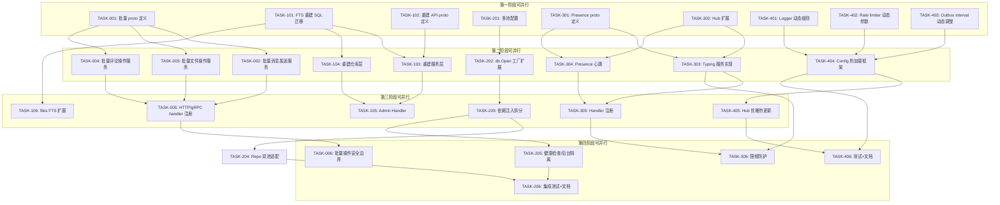
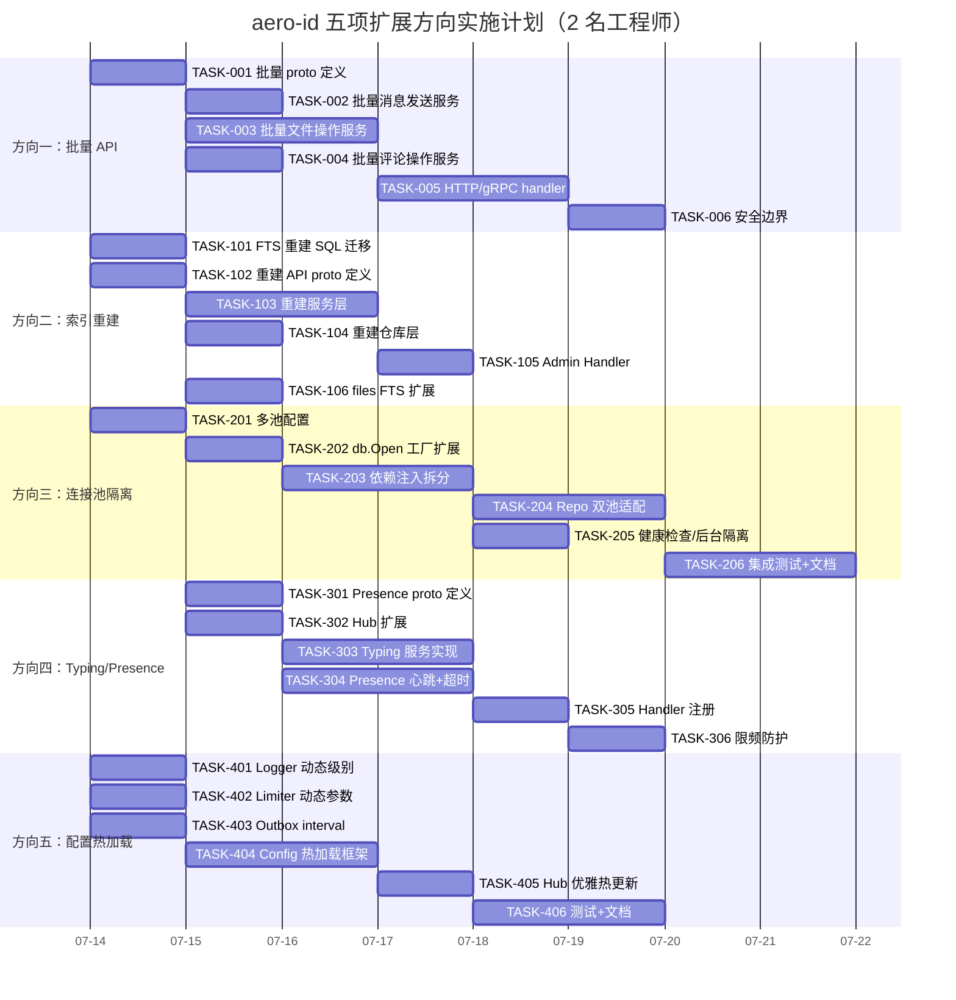

Now I have a thorough understanding of the codebase. Let me compile my comprehensive Tech Lead analysis.

---

# Tech Lead 分析：aero-id 五项生产级扩展方向

## 概述

本文基于代码扫描分析文档（以上输入），对五项已验证的**完全未被覆盖**的扩展方向进行技术实施和项目管理维度的深入拆解。分析的五个方向是：

| # | 方向 | 类型 | 风险等级 |
|---|------|------|---------|
| 1 | **批量 API** | 产品/性能 | P1 — 用户体验瓶颈 |
| 2 | **搜索索引重建** | 运维/数据 | P1 — 数据修复能力缺失 |
| 3 | **连接池隔离** | 架构/稳定性 | P2 — 慢查询级联阻断风险 |
| 4 | **Typing/Presence** | 产品 | P2 — IM 核心竞争力缺失 |
| 5 | **配置热加载** | 运维 | P2 — 部署重启影响可用性 |

---

## 1. 任务分解

### 方向一：批量 API（Batch APIs）

核心痛点：所有 38 个 gRPC RPC 均为单体操作，无批量批次 API。对于消息应用和文件管理场景，批量操作是基本需求。

| 任务 ID | 任务标题 | 涉及文件 | 前置依赖 | 工时(h) | 验收标准 |
|---------|---------|---------|---------|---------|---------|
| **TASK-001** | 批量操作 proto 定义 | `api/proto/aero_id/v1/aero_id.proto` | 无 | 2 | `BatchSendMessages`, `BatchDeleteFiles`, `BatchDeleteComments`, `BatchUpdateFileMeta` 等 message + RPC 定义通过 `make proto` 编译 |
| **TASK-002** | 批量消息发送服务 + 仓库 | `internal/service/message.go`, `internal/repository/message.go`, `internal/domain/message.go` | TASK-001 | 4 | 支持一次发送最多 100 条消息，单事务写入，返回 `[]*Message`；单条内容校验规则复用已有逻辑；失败策略：全成功或全回滚 |
| **TASK-003** | 批量文件操作服务 + 仓库 | `internal/service/file.go`, `internal/repository/file.go` | TASK-001 | 4 | `BatchDelete`（软删除）+ `BatchUpdateMetadata`（批量改可见性/名称）。含 `file_shares` 级联清理 |
| **TASK-004** | 批量评论操作服务 + 仓库 | `internal/service/comment.go`, `internal/repository/comment.go` | TASK-001 | 3 | `BatchDelete`（作者批量删除）+ `BatchHide`/`BatchUnhide`。含嵌套验证 |
| **TASK-005** | HTTP + gRPC 批量 handler 注册 | `internal/handler/http/message.go`, `internal/handler/grpc/message.go`, 同文件/评论 | TASK-002, TASK-003, TASK-004 | 3 | 每个批量端点注册路由；gRPC 拦截器无阻塞；请求大小限制（`max_batch_size` 配置化，默认 100） |
| **TASK-006** | 批量操作边界安全 | `internal/middleware/ratelimit.go`, `internal/middleware/timeout.go` | TASK-005 | 2 | 批量请求按 `cost = max(1, ceil(batch_size / 10))` 消耗限流 token；超时按批次调整；单批次不可超过 5s 执行时间 |

**总计：方向一约 18 小时（~2.5 人天）**

### 方向二：搜索索引重建（Search Index Rebuild）

核心痛点：`GENERATED ALWAYS AS STORED` tsvector 在表达式变更后旧行不自动重算，且没有重建 API。

| 任务 ID | 任务标题 | 涉及文件 | 前置依赖 | 工时(h) | 验收标准 |
|---------|---------|---------|---------|---------|---------|
| **TASK-101** | FTS 重建 SQL 迁移 + 存储过程 | `migrations/*.sql` | 无 | 2 | 新增迁移 `0000xx_rebuild_fts_indexes.up.sql`：创建 `rebuild_fts_indexes(kind text)` 存储过程，使用 `search_vector::tsvector` 强制重算。三表 `messages`, `comments`, `files` 均覆盖 |
| **TASK-102** | 重建 API proto 定义 | `api/proto/aero_id/v1/aero_id.proto` | 无 | 1 | `RebuildSearchIndexRequest { kinds repeated string }` + `RebuildSearchIndexResponse` + `SearchService.RebuildIndexes` RPC |
| **TASK-103** | 重建服务层实现 | `internal/service/search.go` | TASK-101, TASK-102 | 3 | 支持按 kind 增量/全量重建；运行中重建时通过 `ALTER TABLE ... ALTER COLUMN ... TYPE tsvector USING search_vector::tsvector` + `ANALYZE`。含进度追踪、并发控制（同一时刻只允许一个重建任务） |
| **TASK-104** | 重建仓库层（基于 GORM 原生 SQL） | `internal/repository/search.go` | TASK-101 | 2 | 执行存储过程，返回受影响行数。支持超时取消（context cancellation）。锁超时设置 `lock_timeout = '5s'` |
| **TASK-105** | 重建 HTTP + gRPC Admin Handler | `internal/handler/http/admin.go`, `internal/handler/grpc/admin.go` | TASK-103, TASK-104 | 2 | 只有 `admin` role holder 可以触发重建；异步执行（initiate + poll status）；添加 `GET /v1/admin/search-index-status` 查看进度 |
| **TASK-106** | 迁移 000016 的 files FTS 扩展 | `migrations/000016_fts_indexes.up.sql`, `internal/repository/file.go` | TASK-101 | 2 | 当前 `files.search_vector` 只包含 `name`，扩展为包含 `coalesce(name, '') || ' ' || coalesce(meta->>'description', '')`。回滚脚本确保可逆 |

**总计：方向二约 12 小时（~1.5 人天）**

### 方向三：连接池隔离（Connection Pool Isolation）

核心痛点：单连接池被所有域共享，一个慢查询或批量操作可能阻塞健康检查、outbox 等关键路径。

| 任务 ID | 任务标题 | 涉及文件 | 前置依赖 | 工时(h) | 验收标准 |
|---------|---------|---------|---------|---------|---------|
| **TASK-201** | 多连接池配置定义 | `internal/config/config.go` | 无 | 2 | `DatabaseConfig` 扩展为：`Primary`（读写）、`ReadOnly`（只读，可选）、`Background`（后台任务）。每个 DSN 独立。兼容性：`ReadOnly.DSN` 为空时复用 `Primary.DSN` |
| **TASK-202** | db.Open 扩展为多池工厂 | `internal/pkg/db/db.go` | TASK-201 | 2 | `OpenPools(cfg DatabaseConfig) (*PrimaryPool, *ReadOnlyPool, *BackgroundPool, error)`。read-only pool 通过 `default_transaction_read_only = on` 连接参数防写 |
| **TASK-203** | 依赖注入层拆分连接池 | `internal/app/app.go` | TASK-202 | 4 | 按责任分配：repository（ReadOnly 池用于 List/Get，Primary 池用于 Create/Update/Delete），outbox relay（Background 池），idempotency（Primary 池），健康检查和 GC（Background 池）。回退：Background 池不可用时降级到 Primary |
| **TASK-204** | Repository 层双池适配 | `internal/repository/*.go` | TASK-203 | 4 | 每个 repository struct 支持读写分离：`Query` 走 read pool，`Exec` 走 primary pool。可选接口 `ReadWriter` 便于测试 mock。现有 API 兼容 |
| **TASK-205** | 健康检查 + 后台任务连接隔离验证 | `internal/app/app.go`, `internal/pkg/db/health.go`, `internal/storage/gc/gc.go` | TASK-203 | 2 | DB 健康检查使用 background pool；GC sweeper 使用 background pool；outbox relay 使用 background pool。验证：primary pool 负荷高时，healthz 仍正常工作 |
| **TASK-206** | 集成测试 + 配置文档 | `internal/repository/testpg`, `configs/config.yaml` | TASK-204, TASK-205 | 4 | 集成测试验证：read-only pool 写入被拒、primary pool 故障时 read pool 独立可用。更新 AGENTS.md 和 README.md 中连接池配置说明 |

**总计：方向三约 18 小时（~2.5 人天）**

### 方向四：Typing/Presence（输入状态与在线状态）

核心痛点：实时消息应用缺少输入状态指示和在线状态，这是 IM 产品的基础能力。

| 任务 ID | 任务标题 | 涉及文件 | 前置依赖 | 工时(h) | 验收标准 |
|---------|---------|---------|---------|---------|---------|
| **TASK-301** | Presence/Typing proto 定义 | `api/proto/aero_id/v1/aero_id.proto` | 无 | 1 | `TypingRequest { to_uid string }`, `TypingResponse{}`, `PresenceSubscribeRequest{}`, `PresenceResponse { uid string, status enum }`。`Typing` 和 `Presence` 均为 fire-and-forget，不持久化 |
| **TASK-302** | Hub 扩展支持 typing 事件 | `internal/hub/hub.go`, `internal/hub/adapter.go` | 无 | 2 | `PublishTyping(uid string, evt SSEEvent)` — 复用已有 pub 逻辑。不需要新的数据结构，只需要事件类型分离（`event: typing`, `event: presence`） |
| **TASK-303** | Typing indicator 服务实现 | `internal/service/presence.go` | TASK-301, TASK-302 | 3 | `SendTyping(ctx, toUID string)` — 校验 actor, 验证 toUID 存在(通过 SSO), 通过 SSE Hub 广播。限频：同一接收方 3 秒内不重复发送 typing 事件（防洪）。轻量——无 DB 写入 |
| **TASK-304** | Presence 心跳+超时检测 | `internal/service/presence.go`, `internal/pkg/presence/presence.go` | TASK-301 | 4 | 在线状态通过 SSE 连接保活自动推导：SSE 连接建立 → `presence.online`；连接断开 → 延迟 30s → `presence.offline`（容错短暂断连）。心跳每 30s 刷新 TTL。纯内存（`sync.Map uid → lastHeartbeat`）。跨实例：PG LISTEN/NOTIFY 同步（复用已有基础设施） |
| **TASK-305** | HTTP + gRPC handler 注册 | `internal/handler/http/events.go`, `internal/handler/grpc/presence.go` | TASK-303, TASK-304 | 2 | `POST /v1/typing` → SSE 广播；`GET /v1/presence/subscribe` → 接收在线状态变化。Presence 状态随 SSE 连接 `event: presence` 推送 |
| **TASK-306** | Typing/Presence 限频+滥用防护 | `internal/service/presence.go`, `internal/middleware/ratelimit.go` | TASK-303 | 2 | 每用户每秒最多 5 次 typing（cost=0.2 token），防止恶意消耗 SSE 带宽。Presence 变化更新不超过 1 次/30 秒/用户 |

**总计：方向四约 14 小时（~2 人天）**

### 方向五：配置热加载（Config Hot Reload）

核心痛点：修改任何配置（限流参数、日志级别、poll interval）都需要重启进程，影响可用性。

| 任务 ID | 任务标题 | 涉及文件 | 前置依赖 | 工时(h) | 验收标准 |
|---------|---------|---------|---------|---------|---------|
| **TASK-401** | Logger 级别动态调整 | `internal/pkg/logger/logger.go` | 无 | 2 | `SetLevel(level string) error` + `zap.AtomicLevel` 替代 `zap.NewAtomicLevelAt`。暴露 `zap.AtomicLevel` 供外部动态修改。HTTP `POST /debug/log-level` 可调整（限 admin role） |
| **TASK-402** | Rate limiter 动态参数 | `internal/pkg/ratelimit/ratelimit.go` | 无 | 2 | `SetRate(rps float64)` + `SetBurst(burst int)`。参数变化时重置所有现有 bucket 或渐进调整（新 bucket 用新参数，旧 bucket 在 idle eviction 后更新）。线程安全 |
| **TASK-403** | Outbox poll interval 动态调整 | `internal/outbox/relay.go` | 无 | 2 | `SetInterval(d time.Duration)` — 将内部 ticker 替换。加锁保安全。原 `Start(interval)` 变为 `Start(initialInterval)` + `SetInterval` 方法 |
| **TASK-404** | Config 热加载框架 | `internal/config/config.go`, `internal/app/app.go` | TASK-401, TASK-402, TASK-403 | 4 | Viper `WatchConfig` + `OnConfigChange` 回调。变更事件触发调度：Logger → RateLimit → OutboxInterval → 其他。SIGHUP 信号监听作为触发源。变更日志记录。 |
| **TASK-405** | SSE Hub 优雅热更新（可选安全加固） | `internal/hub/hub.go`, `internal/handler/http/events.go` | TASK-404 | 2 | Hub 配置（`maxConnections`, `maxPerUID`）支持运行时调整，无新建连接影响。新上限仅在新 Subscribe 时生效，已有连接不中断 |
| **TASK-406** | 测试 + 运维文档 | `internal/pkg/ratelimit/ratelimit_test.go`, `configs/config.yaml` | TASK-401 ~ TASK-405 | 3 | 单元测试验证动态参数切换正确。集成测试验证 SIGHUP 触发热加载。配置变更不遗漏。文档记录热加载支持的配置项和生效方式 |

**总计：方向五约 15 小时（~2 人天）**

---

## 2. 执行顺序



### 并行执行策略

| 并行组 | 包含任务 | 建议人员 | 预估耗时 |
|-------|---------|---------|---------|
| **PG1 — 基础设施** | T001, T101, T102, T201, T301, T302, T401, T402, T403 | 2 名后端工程师 | 2 天 |
| **PG2 — 核心实现** | T002, T003, T004, T103, T104, T202, T303, T304, T404 | 同上 2 人 | 3 天 |
| **PG3 — Handler 集成** | T005, T105, T203, T106, T305, T405 | 2 人 | 2 天 |
| **PG4 — 安全+测试** | T006, T205, T206, T306, T406 | 2 人 | 1.5 天 |

**总工期约 8.5 天（按 2 名全职后端工程师）**

---

## 3. 技术风险

### 高影响风险

| # | 风险 | 影响方向 | 概率 | 严重度 | 缓解策略 |
|---|------|---------|------|--------|---------|
| R1 | **GENERATED ALWAYS AS STORED 列重建锁表** | 方向二 | 中 | 极高 | 使用 `ALTER TABLE ... ALTER COLUMN ... TYPE tsvector USING ...` 时 PostgreSQL 只持 `ACCESS EXCLUSIVE` 锁短时间。建议拆分重建：建新列→ `UPDATE` 填充→ rename。或使用 `pg_repack` 降低锁影响。务必在低峰期执行 |
| R2 | **连接池拆分后事务一致性风险** | 方向三 | 中 | 高 | 只读池可能读到主从延迟数据。设计约束：List/Get 操作允许最终一致性；强一致写后读操作（如 Create 后立即 Get）强制走 primary pool。引入 `ReadConsistency` 标记 |
| R3 | **Typing/Presence 跨实例一致性问题** | 方向四 | 高 | 中 | 用户设备连接到副本 A，typing 指标发送到副本 A 的 in-memory Hub，但接收方连接到副本 B。解决方案：PG LISTEN/NOTIFY（同 SSE 集群化方案）或直接复用 SSE 集群化基础设施。方向四依赖方向二的 PG LISTEN/NOTIFY 能力 |
| R4 | **批量操作事务爆炸** | 方向一 | 中 | 高 | 批量 100 条消息在一个事务中可能导致长事务膨胀、锁争用。需设置 `max_batch_size`（默认 100）和 `statement_timeout`（默认 10s）。超大批次拆分到多个小事务 |
| R5 | **热加载时的配置版本一致性** | 方向五 | 低 | 中 | 部分配置更新成功，部分失败，导致不一致状态。Viper `OnConfigChange` 可能并发触发。方案：使用 `sync.RWMutex` + 配置版本号，全部或零（all-or-nothing）语义。更新失败时写告警日志 |

### 依赖风险

| 依赖 | 风险 | 影响 |
|------|------|------|
| SSO 无用户删除回调 | 方向二数据生命周期修复后，SSO 需扩展 | 无影响（非依赖项） |
| **PG LISTEN/NOTIFY** 为 Presence/SSE 集群化共享方案 | 方向四依赖此基础设施，但尚未实现 | **方向四是方向二（SSE 集群化）的上层依赖**。应优先完成 SSE 集群化（另一份分析文档中的方向）后，再实现 Presence/Typing |
| 连接池拆分的 Go 1.26 `database/sql` 行为 | Go 1.26 有 `SetConnMaxIdleTime` 等控制 | 风险低，使用已稳定的 API |
| Viper `WatchConfig` 的 fsnotify 在 Docker/K8s 中通过 ConfigMap 挂载可能是最终一致的 | 热加载在容器环境中可能延迟 30s+ | 文档注明容器环境下通过 SIGHUP 信号触发加载更为可靠 |

---

## 4. 资源评估

### 人员需求

| 角色 | 技能要求 | 数量 | 职责 |
|------|---------|------|------|
| **后端工程师（高级）** | Go, PostgreSQL, gRPC, GORM, 分布式系统 | 1 | 方向三（连接池架构）+ 方向五（热加载框架）架构设计 + code review |
| **后端工程师（中级）** | Go, PostgreSQL, gRPC | 1 | 方向一（批量 API）+ 方向二（索引重建）+ 方向四（Typing/Presence）实现 |
| **SRE/DevOps（兼职）** | PostgreSQL 运维, K8s ConfigMap | 0.2 | 连接池配置 + 热加载容器化验证 + 索引重建锁评估 |

**建议：2 名全职 Go 工程师 + SRE 兼职支持，工期 8.5 天**

### 关键里程碑

| 里程碑 | 时间 | 验证标准 |
|--------|------|---------|
| M1: 基础设施就绪 | Day 2 | 5 个方向的 proto 定义编译通过；连接池配置解析通过单元测试；Hot-reload 组件（logger + limiter + outbox）独立测试通过 |
| M2: 核心功能可运行 | Day 5 | 批量消息发送 E2E 可运行；索引重建发起到完成日志可见；连接池读写分离验证通过；Typing 事件可跨 SSE 连接广播 |
| M3: Handler 集成完成 | Day 7 | 所有 HTTP + gRPC 端点注册，`make test` 全部通过；集成测试覆盖批量操作和连接池隔离 |
| M4: 发布就绪 | Day 8.5 | `make test && make lint` 通过；性能测试无回归；AGENTS.md 和 README.md 更新；迁移脚本通过 `make migrate-up` 验证 |

### Blockers

| Blocker | 影响 | 解决策略 |
|---------|------|---------|
| **索引重建锁表评估** — 未在生产规模 PostgreSQL 上验证重建锁影响 | 方向二阻塞 | 在 staging 环境用 100 万行数据测试重建，观察锁升级时间和影响。准备 `pg_repack` 或新列渐进填充方案 |
| **方向四依赖 SSE 集群化** — Typing/Presence 跨实例需要 PG LISTEN/NOTIFY 或 Redis | 方向四阻塞 | 若 SSE 集群化（另一分析方向）未完成，Presence 仅在单实例模式工作。**建议：方向四延后到 SSE 集群化完成后再启动**。或者先实现单实例 Presence，跨实例预留扩展点 |
| **多连接池对现有 testpg 影响** — 集成测试需要管理多个连接池生命周期 | 方向三中阻塞 | 扩展 `internal/repository/testpg` 工具函数，支持创建 primary + readonly + background 三池，与已有测试兼容 |

---

## 5. 质量保证

### 单元测试覆盖要求

| 方向 | 文件 | 最低覆盖率要求 | 关键测试用例 |
|------|------|---------------|------------|
| 批量 API | `internal/service/message.go` | 80% | 空批次拒绝、超限拒绝、单条失败回滚、混合成功/失败语义、并发写入一致性 |
| 批量 API | `internal/service/file.go` | 80% | 软删除后级联清理 `file_shares`、大 batch 分页处理 |
| 索引重建 | `internal/service/search.go` | 75% | 重建进度报告、并发重建拒绝、取消重建、超限保护 |
| 索引重建 | `internal/pkg/migrate/migrate.go` | 70% | 存储过程执行正确、锁超时处理、受影响行数验证 |
| 连接池隔离 | `internal/pkg/db/db.go` | 85% | 只读池写入拒绝（使用 `default_transaction_read_only`）、池关闭次序、上下文超时回退 |
| 连接池隔离 | `internal/app/app.go` | 70% | 连接池配置缺失的 graceful fallback、池隔离验证 |
| Typing/Presence | `internal/service/presence.go` | 85% | 限频 3s 窗口、无效 toUID 拒绝、自身 typing 拒绝、Presence 在线/离线超时 |
| Hot-reload | `internal/pkg/ratelimit/ratelimit.go` | 90% | `SetRate` 并发安全、新旧参数过渡、burst 正确性 |
| Hot-reload | `internal/config/config.go` | 80% | `OnConfigChange` 触发、部分失败回滚、SIGHUP 信号处理 |

### 集成测试策略

| 级别 | 范围 | 工具/环境 | 关键场景 |
|------|------|----------|---------|
| **仓库层** | Repository 直接 + real Postgres | `internal/repository/testpg`（现有基础设施） | 批量消息事务回滚、索引重建性能（100 万行）、只读池写入被拒 |
| **服务层** | Service + mock repo | `internal/service/mocks`（现有设施） | 批量操作限流通用、Presence 限频、热加载后 limiter 行为正确 |
| **E2E** | HTTP/gRPC handler → service → repo → DB | Docker Compose（现有 `docker-compose.yml`，需要扩展为多副本） | 跨实例 Presence（需要部署 2 个副本）、索引重建锁行为 |

### 代码审查要点

| 方向 | 审查重点 |
|------|---------|
| 批量 API | 事务边界是否合理；`max_batch_size` 是否严格 enforce；单条错误是否导致整批回滚（应符合"全成功或全回滚"语义）；rate limit cost 计算是否准确 |
| 索引重建 | `ALTER COLUMN ... TYPE ... USING` 锁升级为 `ACCESS EXCLUSIVE` 的窗口时间；进度追踪是否正确；并发重建互斥 |
| 连接池隔离 | 是否所有 repository 的读操作都正确路由到 read pool；write-after-read 一致性（必须走 primary）；pool close 顺序（background → readonly → primary） |
| Typing/Presence | 限频逻辑不能误杀合法用户（3s 窗口 + 5 req/s）；Presence 离线超时 30s 不能过长（用户体验下降）也不能过短（频繁断连）；无 DB 写入保证 |
| 热加载 | `sync.RWMutex` + 版本号的 all-or-nothing 语义；`OnConfigChange` 可能被 Viper 多次调用，需去重；SIGHUP 信号处理中不能调用非可重入函数 |

### 性能测试需求

| 方向 | 测试场景 | 目标 | 工具 |
|------|---------|------|------|
| 批量 API | 100 并发 × 50 条消息批量发送 | P99 延迟 < 500ms，无死锁 | ghz (gRPC) + k6 (HTTP) |
| 连接池隔离 | Primary 池连接耗尽（max_open=5），read pool 查询独立 | Read pool 查询不受影响，P99 < 200ms | 自定义 Go 测试 + pgbench |
| 索引重建 | 100 万条 messages + 50 万条 comments + 30 万条 files 重建 | 无锁等待 > 5s，重建完成 < 5min | 自定义测试 |
| Typing/Presence | 1000 个并发 SSE 连接，每个每秒发 2 次 typing | Typing P99 延迟 < 50ms（纯内存操作），CPU 使用 < 5% | 自定义 + locust |
| 热加载 | 限流参数在 1000 QPS 压力下热更新 | 更新期间限流行为正确（旧配置 → 新配置无间隙），无 panic | 自定义 |

---

## 6. 实施计划



### 分阶段详述

#### 阶段 1：基础设施搭建（Day 1-2）

**目标**：完成 5 个方向的 proto 定义、基础配置、基础设施扩展。

分配给工程师 A（高级）：
- TASK-201 多池配置 → 连接池配置结构设计
- TASK-202 db.Open 工厂扩展 → 多池创建
- TASK-401, 402, 403 → 三个热加载原子组件
- 协助 Code Review

分配给工程师 B（中级）：
- TASK-001 → 批量操作 proto 定义（消息、文件、评论三组 Batch RPC）
- TASK-101 + TASK-102 → 索引重建 SQL + proto
- TASK-301 + TASK-302 → Presence proto + Hub 扩展

**交付物**：proto 文件编译通过；`config.yaml` 支持多池配置；三个热加载组件独立单元测试通过。

#### 阶段 2：核心功能实现（Day 2-5）

**目标**：五个方向的服务层核心逻辑完成。

工程师 A：
- TASK-203 依赖注入拆分 → 修改 `app.go` 中的 wiring
- TASK-204 Repository 双池适配 → 从仓库层到 service 层无感知切换
- TASK-103 + TASK-104 → 索引重建服务端逻辑
- TASK-404 → Config 热加载框架（Viper WatchConfig + SIGHUP）

工程师 B：
- TASK-002, 003, 004 → 批量消息、文件、评论服务
- TASK-303, 304 → Typing + Presence 服务端逻辑
- TASK-106 → files FTS 扩展迁移

**交付物**：所有 service 层单元测试通过；`make test` 保持全绿。

#### 阶段 3：Handler 集成 + 集成测试（Day 5-7）

**目标**：HTTP 和 gRPC 端点注册，E2E 链路打通。

两名工程师协作：
- TASK-005 → 三个批量操作的 HTTP/gRPC handler
- TASK-105 → 索引重建 admin handler
- TASK-305 → Typing/Presence handler
- TASK-203 (续) → app.go 中完整多池 wiring
- TASK-405 → Hub 优雅热更新
- TASK-205 → 健康检查和后台任务隔离验证

**交付物**：所有端点 curl/grpcurl 可调通；集成测试覆盖关键场景；```
make test && make test-integration```（需要 Docker）通过。

#### 阶段 4：安全 + 边界 + 文档（Day 7-8.5）

**目标**：安全加固、性能测试、文档完善。

两名工程师协作：
- TASK-006 → 批量操作 rate limit cost 机制 + 超时调整
- TASK-306 → Typing/Presence 滥用防护
- TASK-206 + TASK-406 → 集成测试补充 + 配置文档
- 性能基准测试 + 回归防护
- AGENTS.md 更新 + README.md 更新

**交付物**：`make test && make lint && make check-file-sizes` 通过；性能测试报告；文档更新。

---

## 总结：增量 vs 破坏性分析

| 方向 | 对现有 API 的破坏 | 对现有数据的破坏 | 部署策略 |
|------|-------------------|-----------------|---------|
| 批量 API | **无** — 新增 RPC，非修改 | 无 | 滚动部署，新 RPC 自动可用 |
| 索引重建 | **无** — 新增 Admin RPC + 迁移 | 迁移只触发重建，不修改结构 | 迁移需在部署前执行；`make migrate-up` |
| 连接池隔离 | **无** — 内部重构，API 不变 | 无 | 向后兼容若 `ReadOnly` 和 `Background` 池未配置则降级为 single pool |
| Typing/Presence | **无** — 新增 SSE 事件类型，非破坏 | 无 | 旧客户端忽略新事件类型，新客户端处理之 |
| 配置热加载 | **无** — viper 原有 `WatchConfig` 只是未启用 | 无 | SIGHUP 或文件变更触发 |

**核心结论**：这五个方向可以做到**完全向后兼容**，每个方向独立可部署。但以下顺序建议严格遵守：

1. **连接池隔离（方向三）** 应最优先，因为它是架构基础设施的改动，会影响所有后续代码的编写方式
2. **批量 API（方向一）** 和 **索引重建（方向二）** 可在连接池隔离基础上并行开展
3. **配置热加载（方向五）** 独立，可与任何方向并行
4. **Typing/Presence（方向四）** 应延后到 SSE 集群化（另一分析文档方向）完成后实现，否则在 2+ 副本时静默失效

**投入产出比评估**（按紧迫性排列）：

| 排序 | 方向 | 投入（人天） | 收益 | ROI |
|------|------|------------|------|-----|
| 1 | 连接池隔离 | 2.5 | 消除慢查询级联风险，健康检查独立 | ★★★★★ |
| 2 | 配置热加载 | 2 | 减少部署重启，运维效率提升 | ★★★★ |
| 3 | 批量 API | 2.5 | 产品竞争力直接提升 | ★★★★ |
| 4 | 索引重建 | 1.5 | 运维可恢复性，FTS 表达式变更能力 | ★★★ |
| 5 | Typing/Presence | 2 | 产品体验提升，但依赖 SSE 集群化 | ★★★（目前）→ ★★★★★（SSE 集群化后） |

**优先级建议**：先投 2 人月（8.5 天）完成全部五个方向的 MVP，确保向后兼容。其中连接池隔离和索引重建两块需要特别注意集群/锁的风险，建议在 staging 环境做充分的集成验证后上线。
