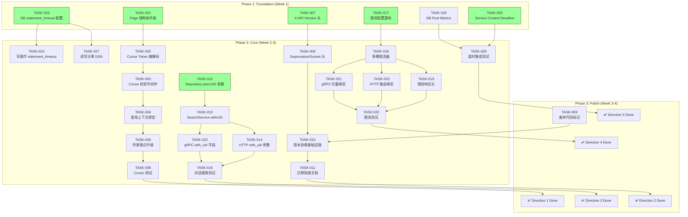
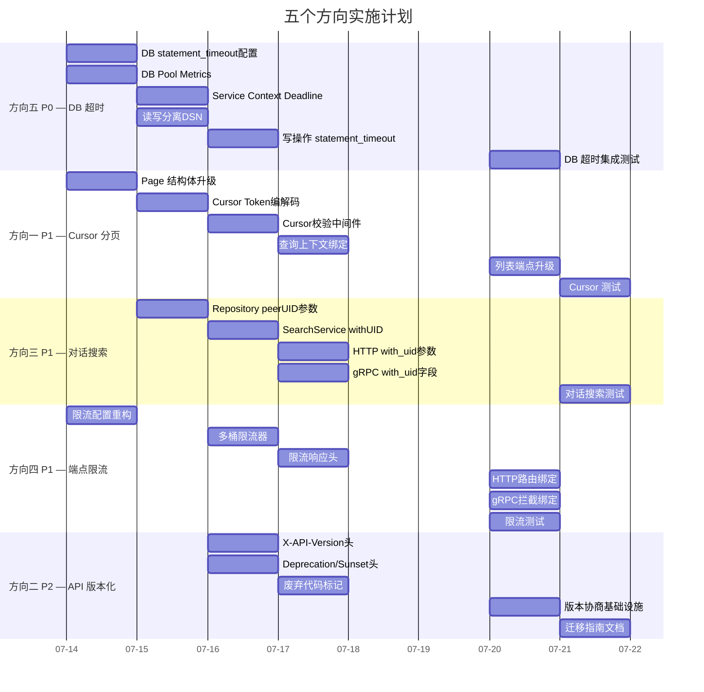

现在我已充分了解代码库。以下是 Tech Lead 分析。

---

# Tech Lead 分析：五个未系统性覆盖的高价值扩展方向

## 1. 任务分解

### 方向一：Cursor 分页生命周期管理（P1）

| 任务 ID | 任务标题 | 涉及文件 | 前置依赖 | 工时 |
|---------|---------|---------|---------|------|
| TASK-001 | 升级 `Page` 结构体，支持 Cursor 元数据 | `internal/domain/shared.go` | — | 2h |
| TASK-002 | 实现 Cursor Token 编解码工具（version + entity_type + query_hash + expires_at + uuid + HMAC） | `internal/pkg/cursor/cursor.go`（新建） | TASK-001 | 4h |
| TASK-003 | 实现 Cursor 校验中间件（格式、过期、查询上下文签名） | `internal/middleware/cursor.go`（新建） | TASK-002 | 3h |
| TASK-004 | 为所有列表端点计算查询上下文哈希并绑定到 Cursor | `internal/repository/*.go`（message, file, comment, notification 等） | TASK-002 | 4h |
| TASK-005 | 更新所有 HTTP/gRPC 列表端点使用新 Cursor Token | `internal/handler/http/*.go`, `internal/handler/grpc/*.go` | TASK-003, TASK-004 | 3h |
| TASK-006 | 单元测试 + 集成测试：Cursor 生命周期（过期、跨实体拒绝、查询上下文绑定） | `internal/pkg/cursor/cursor_test.go`, `internal/repository/*_test.go` | TASK-005 | 3h |

**验收标准**：
- Cursor Token 包含 expires_at 时间戳，过期后返回 `410 Gone`（HTTP）或 `codes.OutOfRange`（gRPC）
- Cursor Token 嵌入查询参数 HMAC，跨查询条件复用被拒绝
- 不同实体类型的 Cursor 互不通用
- 所有已有列表端点（inbox, conversation, files, comments, notifications）升级完毕
- 向后兼容：无 cursor 时不做校验

---

### 方向二：API 生命周期管理（P2）

| 任务 ID | 任务标题 | 涉及文件 | 前置依赖 | 工时 |
|---------|---------|---------|---------|------|
| TASK-007 | 新增 `X-API-Version` 响应头中间件 | `internal/middleware/apiversion.go`（新建） | — | 2h |
| TASK-008 | 实现 `Deprecation` / `Sunset` 响应头支持能力 | `internal/middleware/apiversion.go`, `internal/handler/http/router.go` | TASK-007 | 3h |
| TASK-009 | 标记废弃 Service 接口文件（`internal/{file,comment,message,block,notification}/service.go`）为 `// Deprecated` | `internal/file/service.go`, `internal/comment/service.go`, `internal/message/service.go`, `internal/block/service.go`, `internal/notification/service.go` | — | 1.5h |
| TASK-010 | 实现版本协商基础设施（Accept header 或 URL 前缀） | `internal/middleware/apiversion.go`, `internal/handler/http/router.go`, `internal/handler/grpc/server.go` | TASK-007 | 4h |
| TASK-011 | 添加 API 版本迁移指南（脚本 + 文档） | `docs/api-versioning.md`, `scripts/api-sunset.sh` | TASK-010 | 2h |

**验收标准**：
- 所有响应包含 `X-API-Version: 1.0` 头
- 可通过中间件配置注册废弃端点，自动附加 `Deprecation: true` + `Sunset: <date>` 头
- 废弃的 service 文件加了 `// Deprecated: use internal/service.Xxx` 注释
- 版本协商基础设施就绪，放入 `/v2/` 路由组不会破坏 /v1

---

### 方向三：对话内搜索（P1）

| 任务 ID | 任务标题 | 涉及文件 | 前置依赖 | 工时 |
|---------|---------|---------|---------|------|
| TASK-012 | Repository 层 `SearchMessages` 增加可选 `peerUID` 参数 | `internal/repository/message.go`（接口 + 实现） | — | 3h |
| TASK-013 | `SearchService` 接口 + 实现增加 `withUID` 参数 | `internal/service/search.go` | TASK-012 | 2h |
| TASK-014 | HTTP handler 增加 `?with_uid=` 查询参数 | `internal/handler/http/search.go` | TASK-013 | 2h |
| TASK-015 | gRPC proto + handler 增加 `with_uid` 字段 | `api/proto/aero_id/v1/search.proto`, `internal/handler/grpc/search.go`, `internal/handler/grpc/aeropb/` | TASK-013 | 3h |
| TASK-016 | 集成测试：对话内搜索（FTS + CJK ILIKE 回退） | `internal/repository/search_integration_test.go`, `internal/service/search_test.go` | TASK-014, TASK-015 | 3h |

**验收标准**：
- `GET /v1/search?q=xxx&with_uid=bob` 仅返回 Alice 和 Bob 对话间的消息
- `SearchMessages` SQL 在 `peerUID != ""` 时增加 `AND ((from_uid = ? AND to_uid = ?) OR (from_uid = ? AND to_uid = ?))` 过滤
- 无 `peerUID`（空字符串）时行为不变（全局搜索）
- gRPC `SearchRequest` 新增 `with_uid` 字段
- FTS 和 ILIKE 两种路径均支持对话级过滤

---

### 方向四：端点级限流差异化（P1）

| 任务 ID | 任务标题 | 涉及文件 | 前置依赖 | 工时 |
|---------|---------|---------|---------|------|
| TASK-017 | 重构 `rate_limit` 配置，支持端点规则 | `configs/config.yaml`, `internal/config/config.go` | — | 3h |
| TASK-018 | 实现多桶限流器（支持按端点路径选择桶） | `internal/pkg/ratelimit/ratelimit.go`, `internal/middleware/ratelimit.go` | TASK-017 | 4h |
| TASK-019 | 增加限流响应头（`X-RateLimit-Resource`, `X-RateLimit-Limit`, `X-RateLimit-Remaining`, `X-RateLimit-Reset`） | `internal/middleware/ratelimit.go` | TASK-018 | 3h |
| TASK-020 | HTTP 路由组绑定差异化限流器（读/写/上传/搜索分组） | `internal/handler/http/router.go` | TASK-018, TASK-019 | 3h |
| TASK-021 | gRPC 拦截器绑定差异化限流器 | `internal/handler/grpc/server.go` | TASK-018 | 3h |
| TASK-022 | 单元测试 + 集成测试：端点级限流 | `internal/middleware/ratelimit_test.go`, `internal/handler/grpc/server_test.go` | TASK-020, TASK-021 | 4h |

**验收标准**：
- 配置支持 `rate_limit.endpoints[].{pattern, rps, burst}` 数组
- 搜索请求（`GET /v1/search`）和文件上传（`POST /v1/files`）使用不同的桶，一个端点的爆发不影响其他端点
- 所有限流拒绝响应包含资源名称和配额信息头
- gRPC 中 `/aero_id.v1.SearchService/Search` 和 `/aero_id.v1.FileService/Upload` 使用独立桶
- 向后兼容：无端点规则时使用全局桶

---

### 方向五：DB Statement-Level 超时（P0）

| 任务 ID | 任务标题 | 涉及文件 | 前置依赖 | 工时 |
|---------|---------|---------|---------|------|
| TASK-023 | GORM 连接配置增加 `statement_timeout` 参数 | `internal/pkg/db/db.go`, `internal/config/config.go`, `configs/config.yaml` | — | 2h |
| TASK-024 | 在写操作 repository 方法中设置更长的 `statement_timeout` | `internal/repository/*.go`（message, file, comment, notification, block, admin 等） | TASK-023 | 3h |
| TASK-025 | Service 层为所有列表操作传播 Context Deadline | `internal/service/message.go`, `internal/service/file.go`, `internal/service/comment.go`, `internal/service/notification.go` | — | 4h |
| TASK-026 | 暴露数据库连接池 Metrics（`OpenConnections`, `InUse`, `Idle`, `WaitCount`, `WaitDuration`） | `internal/pkg/metrics/metrics.go`, `internal/app/app.go`, `configs/config.yaml` | — | 3h |
| TASK-027 | 配置可选的 `database.reader_dsn` 读/写分离 | `internal/config/config.go`, `internal/app/app.go`, `internal/pkg/db/db.go`, `configs/config.yaml` | TASK-023 | 4h |
| TASK-028 | 集成测试：查询超时行为验证 | `internal/repository/*_test.go`（集成测试） | TASK-023, TASK-025 | 3h |

**验收标准**：
- 读查询默认配置 `statement_timeout = '5s'`，写查询 `10s`
- 列表操作（`ListInbox`, `ListConversation`, `ListByTarget` 等）的 context 携带 deadline
- `/metrics` 端点暴露 `db_pool_open_connections`, `db_pool_in_use`, `db_pool_idle`, `db_pool_wait_count`, `db_pool_wait_duration_seconds`
- 配置 `database.reader_dsn` 后，读查询自动路由到 reader 连接池
- 慢查询超时后释放连接，不影响其他并发查询

---

## 2. 执行顺序



### 可并行执行的任务组

| 并行组 | 任务 | 负责人建议 |
|--------|------|-----------|
| **Group A**（P0 基础设施） | TASK-023, TASK-025, TASK-026 | 1 人（资深后端） |
| **Group B**（Cursor 基础设施） | TASK-001 | 1 人（可与 Group A 并行） |
| **Group C**（搜索 + 限流 + 版本化 基础设施） | TASK-012, TASK-017, TASK-007 | 1-2 人（可与 Group A/B 并行） |
| **Group D**（Cursor 核心实现） | TASK-002, TASK-003 | 1 人（依赖 TASK-001） |
| **Group E**（DB 深度加固） | TASK-024, TASK-027 | 1 人（依赖 TASK-023） |
| **Group F**（限流核心实现） | TASK-018 | 1 人（依赖 TASK-017） |
| **Group G**（搜索核心实现） | TASK-013 | 1 人（依赖 TASK-012） |
| **Group H**（Cursor 收尾 + 测试） | TASK-004, TASK-005, TASK-006 | 1 人（依赖 Group D） |
| **Group I**（限流收尾 + 测试） | TASK-019, TASK-020, TASK-021, TASK-022 | 1-2 人（依赖 Group F） |
| **Group J**（搜索收尾 + 测试） | TASK-014, TASK-015, TASK-016 | 1 人（依赖 Group G） |
| **Group K**（版本化收尾） | TASK-008, TASK-009, TASK-010, TASK-011 | 1 人（独立） |
| **Group L**（DB 收尾） | TASK-028 | 1 人（依赖 Group A + E） |

---

## 3. 技术风险

### 高风险项

| # | 风险 | 方向 | 影响 | 缓解策略 |
|---|------|------|------|---------|
| R1 | **Cursor HMAC 密钥轮转**：如果 `signing_key` 轮转，旧的 cursor token 立刻全部失效，已分页到一半的用户会看到 410。 | 方向一 | 中等 | Token 中嵌入 `key_id` 前缀，支持多密钥共存；轮转时新旧密钥同时生效一个 overlap 窗口 |
| R2 | **查询上下文哈希碰撞**：不同参数的查询可能计算出相同哈希，导致 cursor 被错误复用。 | 方向一 | 低 | 哈希基于 `normalizedQueryParams`（排序后 JSON），而非原始查询字符串 |
| R3 | **gRPC 端点路由匹配**：gRPC 端点名是 `.` 分隔的完全限定名（`/aero_id.v1.FileService/Upload`），而 HTTP 是 `/v1/files`，两套路径规则需要统一抽象。 | 方向四 | 中 | 定义一个 `EndpointPattern` 类型，同时匹配 HTTP path 和 gRPC fullMethod；或使用 tag/label 在注册时声明端点组 |
| R4 | **statement_timeout 与长查询冲突**：管理后台导出、Storage GC sweep 等操作可能超过 10s timeout。 | 方向五 | 低 | 管理操作使用独立 context（`context.WithoutCancel` 锚定超时），或者通过独立连接池执行 |
| R5 | **读/写分离引入最终一致性**：写后立即读可能读到 replica lag。 | 方向五 | 低 | 写操作后可通过 `context.WithValue` 标记"强制走主库"，replica 连接池仅用于纯读且对一致性敏感度低的查询 |
| R6 | **废弃 service 接口文件被误删**：`internal/{file,comment,...}/service.go` 虽然未在 `app.go` 中被引用，但可能有测试文件使用这些旧接口。 | 方向二 | 低 | 先加 `// Deprecated` 注释并搜索所有引用，确保没有残留测试使用者后再清理 |

### 外部依赖

| 依赖 | 影响 | 说明 |
|------|------|------|
| protoc + proto-gen-go 版本 | 方向三 | gRPC proto 修改后需 `make proto`，需确保 `protoc-gen-go` 版本与 `go.mod` 中 `google.golang.org/protobuf` 版本一致（v1.34.1） |
| Docker（testcontainers） | 方向三、五 | 集成测试需要 Docker，CI 环境必须配置 Docker-in-Docker |

### 性能瓶颈与优化策略

| 瓶颈 | 方向 | 策略 |
|------|------|------|
| Cursor Token 解码开销 | 方向一 | 编解码在 middleware 中完成，缓存解码结果到 `gin.Context` 避免重复解析 |
| DB 连接池 Metrics 采集开销 | 方向五 | `Stats()` 调用是 O(1) 的原子读取，采集频率控制在 10-15 秒一次，不要放在每个请求路径中 |
| 多桶限流器锁竞争 | 方向四 | 每个桶独立锁（分片），而非全局锁；参考 `sync.Map` 或 `shardedMap` 思路 |
| gRPC 拦截器链长度 | 方向四 | 限流拦截器在 auth 之后运行，确保已拿到 uid；拦截器顺序文档化，避免重复认证 |

### 测试覆盖难点

| 难点 | 方向 | 策略 |
|------|------|------|
| Cursor 过期时间测试 | 方向一 | 使用 `timeNow` 接口注入可控制时钟；测试中将 expires_at 设为过去时间 |
| 语句超时测试 | 方向五 | 通过 `pg_sleep()` 函数模拟慢查询；设置极短的 statement_timeout（如 100ms）来验证超时行为 |
| 限流差异化测试 | 方向四 | 使用速率极低的桶（0.001 rps）和可注入时钟，快速验证不同端点的桶隔离性 |

---

## 4. 资源评估

### 开发人员需求

| 角色 | 数量 | 核心技能 | 主要负责 |
|------|------|---------|---------|
| **资深后端工程师** | 1 | Go, PostgreSQL, gRPC, GORM, 分布式系统设计 | P0 方向（DB 超时）+ 架构评审 |
| **后端工程师 A** | 1 | Go, PostgreSQL, gin, 限流/安全 | 方向一（Cursor）+ 方向四（限流） |
| **后端工程师 B** | 1 | Go, GORM, gRPC, 搜索/全文检索 | 方向三（对话搜索）+ 方向二（版本化） |

*最少人力：2 人（1 资深 + 1 后端），4-5 个工作日完成所有 P0+P1。*

### 关键里程碑

| 里程碑 | 时间 | 交付物 |
|--------|------|--------|
| M1: 基础设施就绪 | Day 2 | DB 超时保护上线（P0），Cursor 编解码 + 限流配置重构完成 |
| M2: 核心功能冻结 | Day 5 | 所有 P1 方向的功能实现完成，通过单元测试 |
| M3: 集成测试通过 | Day 7 | 集成测试全部通过，`make test && make test-integration` 绿色 |
| M4: 发布准备 | Day 8 | 代码审查完成，性能测试报告输出，文档更新 |

### 阻塞点（Blockers）与解决策略

| 阻塞点 | 影响方向 | 解决策略 |
|--------|---------|---------|
| **B1**: 缺少 `cursor` 包的编解码轮子 | 方向一 | 选择短实现：`encoding/base64.RawURLEncoding` + `encoding/binary`，不使用外部依赖。2 小时内可完成 |
| **B2**: 限流端点模式匹配需要对齐 HTTP + gRPC 两套路径 | 方向四 | 定义一个 `EndpointRule` 结构体，`Pattern` 支持两种格式：`GET /v1/search`（HTTP）和 `/aero_id.v1.SearchService/Search`（gRPC），中间件/拦截器分别做模式匹配 |
| **B3**: proto 修改后需 protoc 工具链 | 方向三 | 确保开发环境安装 protoc + proto-gen-go@v1.34.1 + protoc-gen-go-grpc@v1.5.1；或在 CI 中运行 `make proto` 验证 |
| **B4**: 对话级搜索需要确认 GIN 索引是否支持 `(from_uid, to_uid) + search_vector` 联合过滤 | 方向三 | 查看 `idx_messages_fts` 是仅 `search_vector` 索引（`USING GIN(search_vector) WHERE deleted_at IS NULL`），搜索条件是 `from_uid OR to_uid AND search_vector @@ query`。PostgreSQL 的 GIN 索引可以处理 `AND` 条件组合，但最佳实践是创建一个 `(from_uid, to_uid, search_vector)` 复合索引或依赖查询规划器。实际执行计划需要在 `EXPLAIN ANALYZE` 中验证 |

---

## 5. 质量保证

### 5.1 单元测试覆盖要求

| 包 | 测试目标 | 最低覆盖率要求 | 关键测试场景 |
|----|---------|--------------|-------------|
| `internal/pkg/cursor` | Cursor Token 编解码 + 校验 | 95%+ | 正确编解码、HMAC 验证、过期拒绝、查询哈希不匹配拒绝、跨实体类型拒绝、空 token 降级 |
| `internal/pkg/ratelimit` | 多桶限流器 | 90%+ | 不同 key 隔离、同 key 限流、桶 refill、端点模式匹配、禁用时降级 |
| `internal/middleware` | RateLimit 中间件 + Cursor 中间件 | 85%+ | 限流响应头正确性、不同端点组桶隔离、cursor 过期返回 410 |
| `internal/service/search` | 对话内搜索 | 90%+ | withUID 参数透传、空 withUID 保持全局行为、权限校验（非参与者拒绝） |
| `internal/repository/message` | SearchMessages with peerUID | 85%+ | SQL 正确性（参与者过滤 + FTS 排序 + ILIKE 回退） |
| `internal/service/*` | Context Deadline 传播 | 85%+ | 所有列表操作验证 context 包含了 deadline |

### 5.2 集成测试策略

**测试环境**：testcontainers（PostgreSQL + MinIO），`//go:build integration`

| 测试套件 | 覆盖方向 | 测试数据 | 验证要点 |
|---------|---------|---------|---------|
| `cursor_integration_test.go` | 方向一 | 插入 50 条消息/文件/通知 | 分页正确性、cursor 过期后 410、跨实体 cursor 拒绝 |
| `search_conversation_test.go` | 方向三 | Alice→Bob 10 条消息，Alice→Carol 10 条消息 | with_uid=Bob 仅返回 Bob 对话结果；CJK 回退路径同样工作 |
| `ratelimit_endpoint_test.go` | 方向四 | 配置写入：搜索 5rps/上传 10rps | 搜索打满 6 rps 返回 429，上传仍可继续 |
| `db_timeout_test.go` | 方向五 | 使用 `pg_sleep(3)` 模拟慢查询 | `statement_timeout = '1s'` 的查询超时并释放连接 |

### 5.3 代码审查要点

| 审查要点 | 方向 | 重点检查 |
|---------|------|---------|
| Cursor Token 安全性 | 方向一 | HMAC 密钥来源（env only）、密钥泄漏风险、base64 无填充编码 |
| 查询上下文标准化 | 方向一 | 参数排序是否确定、是否忽略不可哈希参数（如 cursor 自身） |
| 限流端点模式匹配 | 方向四 | HTTP path 和 gRPC fullMethod 是否统一、通配符支持（`POST /v1/files/*`） |
| statement_timeout 范围 | 方向五 | 是否误给写事务也设置 5s 超时、管理操作是否豁免 |
| 废弃代码标记 | 方向二 | 所有旧接口文件是否检查了传入引用、测试文件是否有残留 |
| gRPC proto 向后兼容 | 方向三 | `with_uid` 字段是 optional，不会破坏现存客户端 |
| Context 链式传递 | 方向五 | service→repository 的 context 传递是否完整，`db.WithContext(ctx)` 是否正确使用 |

### 5.4 性能测试需求

| 场景 | 工具 | 指标 | 目标 |
|------|------|------|------|
| Cursor 编解码性能 | `go test -bench=.` 在 cursor 包 | ns/op, allocs/op | < 500ns/op, < 3 allocs/op |
| 多桶限流器并发 | `go test -bench=.` 在 ratelimit 包 | ops/sec under 100 goroutines | > 1M ops/sec（与当前全局锁实现同量级） |
| 对话级搜索延迟 | `make test-integration` + 慢查询日志 | P50/P99 查询耗时 | 与全局搜索在同一量级（±20%） |
| DB 连接池 Metrics 采集开销 | `/metrics` 端点压力测试 | CPU/MEM 增量 | < 0.1% CPU 增量 |

---

## 6. 实施计划

### 总计工时：约 70 人·时

- 方向五（P0）：15h
- 方向一（P1）：19h
- 方向三（P1）：13h
- 方向四（P1）：20h
- 方向二（P2）：12.5h
- **合计**：~79.5h

### 建议执行顺序（2 人并行，6 个工作日）

#### Week 1（Day 1-3）

```
Day 1 (Mon)
  Engineer A: TASK-023 (DB statement_timeout, 2h) + TASK-026 (DB Metrics, 3h)
  Engineer B: TASK-001 (Page struct, 2h) + TASK-017 (限流配置, 3h)

Day 2 (Tue)
  Engineer A: TASK-025 (Service Context Deadline, 4h) + TASK-027 (读写分离DSN, 4h)
  Engineer B: TASK-002 (Cursor Token编解码, 4h) + TASK-012 (Repository peerUID, 3h)

Day 3 (Wed) — M1: 基础设施就绪
  Engineer A: TASK-024 (写操作statement_timeout, 3h) + TASK-007 (X-API-Version, 2h) + 代码审查
  Engineer B: TASK-013 (SearchService withUID, 2h) + TASK-018 (多桶限流器, 4h)
```

#### Week 2（Day 4-6）

```
Day 4 (Thu)
  Engineer A: TASK-003 (Cursor校验中间件, 3h) + TASK-008 (Deprecation/Sunset, 3h)
  Engineer B: TASK-014 (HTTP with_uid, 2h) + TASK-015 (gRPC with_uid, 3h)

Day 5 (Fri) — M2: 核心功能冻结
  Engineer A: TASK-004 (查询上下文绑定, 4h) + TASK-009 (废弃代码标记, 1.5h)
  Engineer B: TASK-019 (限流响应头, 3h) + TASK-020 (HTTP路由绑定, 3h) + TASK-021 (gRPC拦截绑定, 3h)
  
Day 6 (Mon)
  Engineer A: TASK-005 (列表端点升级, 3h) + TASK-010 (版本协商, 4h)
  Engineer B: TASK-022 (限流测试, 4h) + TASK-028 (DB超时测试, 3h)
```

#### Week 3（Day 7-8）

```
Day 7 (Tue) — M3: 集成测试通过
  Engineer A: TASK-006 (Cursor测试, 3h) + TASK-016 (对话搜索测试, 3h)
  Engineer B: TASK-011 (迁移指南, 2h) + 全量集成测试运行 + Bug 修复
  
Day 8 (Wed) — M4: 发布准备
  Both: 性能测试 (2h) + 代码审查交叉 review (3h) + `make test && make test-integration && make lint` 全绿
```

### 甘特图



### 风险后备计划

| 风险场景 | 后备动作 | 影响 |
|---------|---------|------|
| TASK-005（列表端点升级）超出 3h | 优先升级高流量端点（inbox + conversation + files），低流量端点（notifications + admin）推后一天 | 不影响 M2 里程碑，低流量端点延后 1 天 |
| gRPC proto 修改后编译失败（工具链问题） | 手动编辑 `aeropb/*.pb.go`（仅追加 `WithUID` 字段，不修改现有逻辑），工具链修复后重新生成 | 2h 手工补丁 |
| 集成测试需要测试容器环境不可用 | 使用 Docker Compose 替代 testcontainers 手动启动 Postgres+MinIO | 增加 30 分钟环境准备 |
| 多桶限流器锁竞争超出预期 | 回退到读写分离 2 桶方案（简单 if-else），放弃更细粒度的端点分组 | 满足 P1 基本需求，失去精细分组能力 |

---

## 总结

### 快速胜利（Day 1 即可上线）

1. **TASK-023**（DB `statement_timeout` 配置）— 修改 `db.Open` 增加 `SET statement_timeout`，所有查询自动受益，0.5 天
2. **TASK-026**（DB Pool Metrics）— 暴露 5 个 Prometheus gauge，立即获得 DB 连接池可见性，0.5 天
3. **TASK-007**（`X-API-Version` 头）— 5 行中间件代码，建立版本可见习惯，0.5 天

### 高产品价值（Week 2）

4. **对话内搜索**（TASK-012→TASK-016）— 复用现有 FTS 基础设施，1.5 天完成，差距最小的产品功能
5. **Cursor 生命周期**（TASK-001→TASK-006）— 解决"分页静默终止"的生产问题，2.5 天

### 核心工程改进（Week 2）

6. **端点级限流**（TASK-017→TASK-022）— 从单桶到多桶，保护高成本操作，3 天
7. **上下文 Deadline 传播**（TASK-025）— 防止连接池耗尽，1 天

### 长期健康（Week 3）

8. **API 版本化**（TASK-007→TASK-011）— 为 v2 预留通路，2 天
