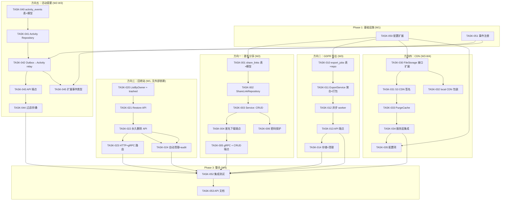
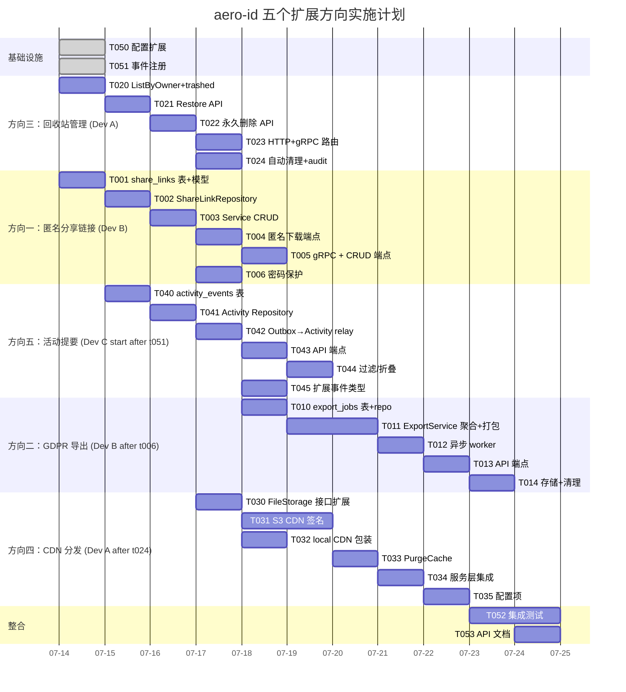

现在我掌握的信息足够提供一份完整的技术负责人分析了。以下是详细的实现方案。

---

# Tech Lead 分析报告：五个高阶扩展方向

> 基于 2026-07-12 代码库扫描，分析对象为五个已确认的代码级缺口方向。当前代码库成熟度高，`internal/` 采用领域包布局（`file/`, `message/`, `comment/`, `block/`, `notification/`），严格遵循 `AGENTS.md` 约束。

---

## 1. 任务分解

### 方向一：匿名外部分享链接（Share via Link）

**代码级现状：** `ShareRepository` 仅支持身份绑定分享（`file_shares` 表：`file_id` + `grantee_uid`）。`CanReadFile` 只有 owner/public 二值。`PresignGet` 返回的是存储后端原生 URL（S3 presigned 或 local HMAC），无 `share_token` / `expires_at` / `password_hash`。

| 任务 ID | 任务标题 | 前置依赖 | 涉及文件 | 工时 |
|---------|---------|---------|---------|------|
| **TASK-001** | 新增 `share_links` 表迁移 + 模型 | 无 | `migrations/*.up.sql`, `migrations/*.down.sql`, `internal/file/share_link.go` | 2h |
| **TASK-002** | 实现 `ShareLinkRepository`（CURD + token 查找） | TASK-001 | `internal/file/repository_share_link.go` | 3h |
| **TASK-003** | 扩展 `FileService`：`CreateShareLink` / `RevokeShareLink` / `ListShareLinks` | TASK-002 | `internal/file/service_share.go` (扩展现有) 或 `internal/file/service_share_link.go` | 4h |
| **TASK-004** | 实现匿名下载端点 `/files/dl/:token`（支持密码验证 + 过期检查） | TASK-003 | `internal/handler/http/file.go` (扩展 Download), `internal/handler/http/router.go` | 3h |
| **TASK-005** | GRPC 端点对应 + HTTP 端点的 ShareLink CRUD | TASK-004 | `internal/handler/http/file.go`, `internal/handler/grpc/file.go`, `api/proto/aero_id/*.proto` | 3h |
| **TASK-006** | 可选的密码保护：bcrypt hash + 请求体验证 | TASK-003 | `internal/file/service_share_link.go` | 2h |
| | **小计** | | | **17h** |

**验收标准**：
- `POST /v1/files/:id/share-links` → 返回 `{token, url, expires_at}`（可选 `has_password: true`）
- `GET /files/dl/:token` 无验证直接下载公开链接文件
- `POST /files/dl/:token` 带 `password` body 验证后下载
- `DELETE /v1/files/:id/share-links/:token` 撤销链接
- `GET /v1/files/:id/share-links` 列出活跃链接
- S3 和 local 后端均可用（匿名下载走应用代理，不直接暴露 S3 presigned URL）

---

### 方向二：GDPR 数据导出

**代码级现状：** 三大实体 file/message/comment 各自有 `ListByOwner` 但无聚合导出端点。无 `export_jobs` 表/异步任务。无 outbox 事件驱动的导出流。

| 任务 ID | 任务标题 | 前置依赖 | 涉及文件 | 工时 |
|---------|---------|---------|---------|------|
| **TASK-010** | 新增 `export_jobs` 表迁移 + 模型 + repository | 无 | `migrations/*.up.sql`, `internal/export/job.go`, `internal/export/repository.go` | 3h |
| **TASK-011** | 实现 `ExportService`：聚合三实体数据 + 打包为 JSON Lines | TASK-010 | `internal/export/service.go`, `internal/file/service_crud.go` (添加 `ListAllByOwner`), `internal/message/service.go`, `internal/comment/service.go` | 4h |
| **TASK-012** | 导出 job 异步执行：outbox 触发 + relay worker | TASK-011 | `internal/export/worker.go`, `internal/outbox/outbox.go` (新增 event type), `internal/app/app.go` | 3h |
| **TASK-013** | HTTP + gRPC 导出端点：`POST /v1/data/export` 发起 + `GET /v1/data/exports/:id` 查状态 + `GET /v1/data/exports/:id/download` 下载 | TASK-012 | `internal/handler/http/export.go`, `internal/handler/http/router.go`, `api/proto/aero_id/*.proto` | 3h |
| **TASK-014** | 导出文件存储（复用 `storage.FileStorage`，标记为临时文件，设置 TTL 清理） | TASK-013 | `internal/export/service.go`, `internal/storage/gc/sweeper.go` (扩展) | 2h |
| | **小计** | | | **15h** |

**验收标准**：
- `POST /v1/data/export` → `{job_id, status: "pending"}`
- 异步 worker 聚合用户所有 files/messages/comments，生成 `.jsonl` 文件存入 storage
- 导出包含所有字段（含软删除的数据？设计决策：默认包含，可选排除）
- `GET /v1/data/exports/:id` → 状态：pending/processing/completed/failed
- `GET /v1/data/exports/:id/download` → 返回 JSON Lines 文件
- 导出文件 7 天后自动清理（GC sweeper 扩展）

---

### 方向三：回收站自我管理

**代码级现状：** 全系统 `gorm.DeletedAt` 软删除，但用户无法在 UI 层面操作。`ListByOwner` 默认 `WHERE deleted_at IS NULL`。无 `Restore` API、无 `?trashed=true` 过滤、无永久删除端点。`ListSoftDeletedBefore` + `HardDelete` 只供 GC 内部使用。

| 任务 ID | 任务标题 | 前置依赖 | 涉及文件 | 工时 |
|---------|---------|---------|---------|------|
| **TASK-020** | `ListByOwner` 扩展：支持 `?trashed=true` 参数展示软删除项 | 无 | `internal/file/repository.go`, `internal/file/service_crud.go`, `internal/message/repository.go`, `internal/message/service.go`, `internal/comment/repository.go`, `internal/comment/service.go` | 4h |
| **TASK-021** | 实现 `Restore` API（三实体）：取消 `deleted_at` 标记 | TASK-020 | `internal/file/service_crud.go`, `internal/message/service.go`, `internal/comment/service.go`, 三者的 repository | 3h |
| **TASK-022** | 实现永久删除 API：`DELETE /v1/files/:id?permanent=true` | TASK-021 | `internal/file/service_crud.go`, `internal/file/repository.go`, `internal/message/service.go`, `internal/message/repository.go`, `internal/comment/service.go`, `internal/comment/repository.go` | 3h |
| **TASK-023** | HTTP + gRPC 路由注册 + 统一 `trashed` 和 `permanent` 参数解析 | TASK-022 | `internal/handler/http/file.go`, `internal/handler/http/message.go`, `internal/handler/http/comment.go`, `internal/handler/grpc/` 对应文件 | 2h |
| **TASK-024** | 回收站自动清理策略配置（e.g. 30天后自动 HardDelete）+ audit 日志增强 | TASK-022 | `internal/domain/audit.go`, `configs/config.yaml`, `internal/storage/gc/sweeper.go` (扩展) | 2h |
| | **小计** | | | **14h** |

**验收标准**：
- `GET /v1/files?trashed=true` → 仅返回已软删除的文件
- `POST /v1/files/:id/restore` → 恢复文件到正常列表
- `DELETE /v1/files/:id?permanent=true` → 从数据库和存储中彻底删除（跳过软删除）
- 三实体（file/message/comment）行为一致
- 自动清理 TTL 可配置，默认 30 天
- 所有操作记录 audit 事件

---

### 方向四：CDN 边缘分发

**代码级现状：** `FileStorage` 接口的 `PresignGet` 返回原生 S3 URL（如 `https://bucket.s3.region.amazonaws.com/key...`）。`Local` 后端返回 `{publicBaseURL}/files/dl?key=...&sig=...`。无 `PurgeCache`、无 CDN 域名包装、无缓存键策略。

| 任务 ID | 任务标题 | 前置依赖 | 涉及文件 | 工时 |
|---------|---------|---------|---------|------|
| **TASK-030** | 扩展 `storage.FileStorage` 接口：新增 `CDNSignedURL` / 可选 `PurgeCache` / CDN 配置 | 无 | `internal/storage/storage.go`, `internal/storage/s3.go`, `internal/storage/local.go` | 3h |
| **TASK-031** | S3 后端实现 CDN 签名：用 CDN 域名替换 S3 域名 + 可选的 tokenized signed URL（如 CloudFront signed cookies / Aliyun CDN auth） | TASK-030 | `internal/storage/s3.go` | 4h |
| **TASK-032** | local 后端 CDN 包装：`publicBaseURL` 改为 CDN 域名前缀 | TASK-030 | `internal/storage/local.go` | 1h |
| **TASK-033** | `PurgeCache(ctx, key)` 实现（S3 通过 AWS SDK `CreateInvalidation` / local 无实际执行） | TASK-031 | `internal/storage/s3.go`, `internal/storage/storage.go` | 2h |
| **TASK-034** | 服务层集成：`DownloadURL` 选择 CDN 路径 vs 直连路径（基于配置）+ 缓存控制头 | TASK-031 | `internal/file/service_presign.go`, `configs/config.yaml`, `internal/config/config.go` | 2h |
| **TASK-035** | 配置项：`cdn.enabled`, `cdn.base_url`, `cdn.private_key` 等 | TASK-034 | `configs/config.yaml`, `internal/config/config.go` | 1h |
| | **小计** | | | **13h** |

**验收标准**：
- `cdn.enabled=true` 时 `PresignGet` 返回 `https://cdn.example.com/path/to/key?...`
- 支持 CloudFront 签名 URL（或 Aliyun / 通用模式）
- `UpdateMetadata`（或单独 `POST /v1/files/:id/purge-cache`）触发 CDN 缓存清除
- Local 后端兼容（CDN 前缀配置即可，不强制 S3）
- 配置缺失时自动降级到直连 S3 / local URL

---

### 方向五：活动提要（Activity Feed）

**代码级现状：** 三实体 List 各自独立。通知系统（`Notification` + `Dispatcher`）是 per-recipient push 模式，消费 outbox 事件后写入 `notifications` 表，但事件被"消费"后丢弃，不持久化为全局活动记录。SSE 实时推送也是瞬时行为。outbox 的 `webhook` handler 仅用于外部系统投递。

| 任务 ID | 任务标题 | 前置依赖 | 涉及文件 | 工时 |
|---------|---------|---------|---------|------|
| **TASK-040** | 新增 `activity_events` 表迁移 + 模型（appender-only log：actor, action, subject_type, subject_id, target, meta, created_at） | 无 | `migrations/*.up.sql`, `internal/activity/event.go` | 2h |
| **TASK-041** | Activity repository：`Append(ctx, event)`, `ListByActor(ctx, uid, page)`, `ListForUser(ctx, uid, page)`（actor 相关或 target 相关的事件） | TASK-040 | `internal/activity/repository.go` | 3h |
| **TASK-042** | Outbox → Activity relay：新增 `outbox.Handler` 实现，监听所有事件类型（`message.sent`, `message.read`, `comment.replied`, `file.uploaded`, `file.shared` 等），写入 activity_events | TASK-041 | `internal/activity/relay.go`, `internal/app/app.go` | 3h |
| **TASK-043** | HTTP + gRPC Activity Feed 端点：`GET /v1/activity`（当前用户的时间线） + `GET /v1/activity?actor_uid=xxx`（查看某人动态） | TASK-042 | `internal/handler/http/activity.go`, `internal/handler/http/router.go`, `api/proto/aero_id/*.proto`, `internal/activity/handler.go` | 3h |
| **TASK-044** | 活动过滤/折叠：支持按 event_type 过滤 + 同类事件折叠（如"用户分享了 5 个文件"） | TASK-043 | `internal/activity/service.go`, `internal/activity/repository.go` | 3h |
| **TASK-045** | outbox 扩展事件类型：`file.shared`, `file.uploaded`, `message.sent`, `user.blocked` 等（部分已有，部分新增） | TASK-044 | `internal/outbox/*.go`, `internal/file/service_share.go`, `internal/file/service_upload.go`, `internal/block/service.go` | 2h |
| | **小计** | | | **16h** |

**验收标准**：
- `GET /v1/activity` 返回当前用户相关活动（按时间倒序，cursor 分页）
- 支持 `?event_type=message.sent&event_type=file.uploaded` 过滤
- 活动包含 actor 信息（SSO 批量解析）+ 可点击的 subject 引用
- 同类事件 5 分钟内折叠（`CollapsedCount` 参考通知实现）
- 实时性：通过现有 SSE hub 推送新活动事件（可选增强）
- 活动保留期可配置（e.g. 90 天），GC 清理

---

### 方向间的解耦、辅助 & 跨域任务

| 任务 ID | 任务标题 | 前置依赖 | 涉及文件 | 工时 |
|---------|---------|---------|---------|------|
| **TASK-050** | 配置项扩展：所有方向新增配置 → `configs/config.yaml` + `internal/config/config.go` 验证 | 方向一~五的设计确认 | `configs/config.yaml`, `internal/config/config.go` | 2h |
| **TASK-051** | 新增 outbox 事件类型注册：`file.uploaded`, `file.deleted`, `file.shared`, `file.share_revoked`, `data.exported`, `file.restored`, `file.hard_deleted` | TASK-003/013/022/045 | `internal/outbox/outbox.go`, `internal/domain/audit.go` (新增 action 常量) | 2h |
| **TASK-052** | 端到端集成测试：每个方向 1 个集成测试文件 | 各方向任务完成后 | `internal/**/*_integration_test.go` | 8h |
| **TASK-053** | API 文档更新：README API 表 + proto comment 补充 | 全部方向完成后 | `README.md`, `api/proto/*.proto` | 3h |

---

### 任务汇总

| 方向 | 任务数 | 总工时 |
|------|-------|-------|
| 方向一：匿名分享链接 | 6 | 17h |
| 方向二：GDPR 数据导出 | 5 | 15h |
| 方向三：回收站管理 | 5 | 14h |
| 方向四：CDN 分发 | 6 | 13h |
| 方向五：活动提要 | 6 | 16h |
| 跨域任务 | 4 | 15h |
| **合计** | **32** | **90h (≈2.25 人周)** |

---

## 2. 执行顺序与依赖图



### 可并行的工作组

| 工作组 | 任务 | 同时开发人数 | 说明 |
|--------|------|-------------|------|
| **Group A** | T020→T021→T022→T023→T024（方向三） | 1人 | 顺序依赖，但独立于其他方向 |
| **Group B** | T001→T002→T003→T004→T005→T006（方向一） | 1人 | 顺序依赖，依赖 T050 配置 |
| **Group C** | T040→T041→T042→T043→T044→T045（方向五） | 1人 | 顺序依赖，依赖 T051 事件注册 |
| **Group D** | T010→T011→T012→T013→T014（方向二） | 1人 | 顺序依赖 |
| **Group E** | T030→T031→T032→T033→T034→T035（方向四） | 1人 | 顺序依赖 |
| **T050/T051** | 任务 T050 和 T051 | 1人 | 可在第 1 天完成，解耦后续 |

=> **最大并行度：3 人同时开发**（方向三 + 方向一 + 方向五 并行起步，方向二和方向四稍后加入）

---

## 3. 技术风险

### 3.1 高风险项

| 风险 | 方向 | 等级 | 说明 | 缓释策略 |
|------|------|------|------|---------|
| S3 CDN 签名方案的多样性 | 四 | 🔴 **高** | CloudFront signed URL、CloudFront signed cookies、Aliyun CDN auth、CloudFlare 等各有不同签名协议，无法统一的 `FileStorage` 接口方法 | 抽象为 `CDNSigner` 接口，每种 CDN 实现一个 adapter；文档标注兼容列表；S3 presigned URL 始终作为 fallback |
| 活动提要大表性能 | 五 | 🟡 **中** | `activity_events` 表写入量大（每个操作事件写入一次），查询模式是 "某用户时间线"，可能成为热点。无 TTL 则表无限增长 | 写入时批量 batch（参考 outbox relay 模式）；建索引 `(created_at DESC)` + `(actor_uid, created_at DESC)` + `(target_uid, created_at DESC)`；TTL 配置默认 90天；分表按时间归档 |
| GDPR 导出大文件 | 二 | 🟡 **中** | 用户数千文件 + 数万消息的导出可能导致内存 OOM 或 timeout | 流式写入 storage（`io.Pipe` + `storage.Put`），不缓冲全部在内存；导出文件大小设限加入配置 |
| 匿名分享链接的安全 | 一 | 🟡 **中** | Token 可猜测？链接泄露后的访问控制？密码哈希性能？ | UUIDv7 token（足够随机）；过期时间必选；密码为可选且 bcrypt hash；`/files/dl/:token` 端点需要限速（复用现有 rate limiter）；支持按 IP/Referer 限制（可选增强） |
| 跨三实体的回收站一致性 | 三 | 🟢 **低** | file/message/comment 软删除模式一致但 repository 方法签名可能不同 | 定义统一 `Trashable` 接口或通用 helper；保持各实体的 Restore/HardDelete 方法签名一致 |

### 3.2 外部依赖

| 依赖 | 方向 | 已有？ | 风险 |
|------|------|-------|------|
| AWS CloudFront / CDN 服务 | 四 | 无 | 需要 CDN 账号和域名配置；开发和测试阶段可用 mock CDN 签名器 |
| bcrypt 库（标准库） | 一 | 无 | Go `golang.org/x/crypto/bcrypt` 已有依赖可能性高（检查 `go.mod`） |
| 无新外部依赖 | 二/三/五 | — | 全部基于现有基础设施 |

### 3.3 性能瓶颈

| 场景 | 方向 | 当前 | 预期优化 |
|------|------|------|---------|
| 活动提要大并发写入 | 五 | outbox relay 单 goroutine 串行处理 | relay batch insert 到 activity_events（每 100ms 或每 100 事件 flush 一次） |
| 导出数据量 > 1GB | 二 | 单次全量查询可能导致 Postgres 排序溢出 | 分页查询 + 流式写入 storage + 导出文件大小上限（e.g. 500MB，超出则拆分为多个 part） |
| 回收站 `ListByOwner` + `WHERE deleted_at IS NOT NULL` | 三 | 已有 `(owner_uid, created_at DESC)` 索引 | 新增复合索引 `(owner_uid, deleted_at, created_at DESC)` 以支持 `trashed=true` 查询 |
| CDN 签名计算 | 四 | S3 presign 是 AWS SDK 调用，延迟 ~50ms | 如果 CDN 签名是本地签名（如 Aliyun CDN auth），可降至 <1ms；`PurgeCache` 是异步调用 |

---

## 4. 资源评估

### 4.1 团队组成

| 角色 | 人数 | 职责 |
|------|------|------|
| 高级后端工程师（Go） | 2 人 | 每人负责 2-3 个方向的核心实现 |
| 初级/中级后端工程师（Go） | 1 人 | 辅助测试、配置、文档、简单 CRUD 端点 |
| QA 工程师 | 0.5 人（兼职） | 集成测试评审、确定性验收用例设计 |
| Tech Lead | 1 人（你自己） | 设计审查、代码审查、跨方向协调 |

**最低配置**：1 名 Senior（方向三+方向一）+ 1 名 Mid（方向五+方向四）+ 共享（方向二）= **2 人全职 3 周**

### 4.2 关键里程碑

| 里程碑 | 时间节点 | 交付物 |
|--------|---------|--------|
| M0: 设计冻结 | Day 0 | 五个方向的接口签名 + 表结构 + 配置项评审通过 |
| M1: 回收站完成 | Day 3-4 | 三实体全部支持 `trashed`/`restore`/`permanent delete`，UT 通过 |
| M2: 分享链接完成 | Day 7-8 | 匿名分享全链路可用，含密码保护和 token 管理 |
| M3: 活动提要完成 | Day 10-12 | Activity Feed API + outbox relay + 事件折叠完成 |
| M4: 数据导出完成 | Day 13-14 | GDPR 导出全流程含异步 worker |
| M5: CDN 完成 | Day 15-17 | CDN 签名 + PurgeCache + 配置降级完成 |
| M6: 集成 + 文档 | Day 18-20 | 所有方向的集成测试 + API 文档 + CHANGELOG |

### 4.3 阻塞点（Blockers）

| Blocker | 影响方向 | 解决策略 |
|---------|---------|---------|
| CDN 服务商尚未确定 | 四 | 接口设计为 `CDNSigner` adapter 模式，先实现一个 NoopCDNSigner（直接返回 S3 URL）和 MockCDNSigner（仅验证签名逻辑），CDN 真正集成延后但接口不阻塞 |
| 是否需要 GDPR 导出中的"被提及"数据（message 中被 @ 到的引用）？ | 二 | 当前 Message 无 @mention 功能 → 不需要。如果未来加 @mention，导出扩展即可 |
| 活动提要的事件类型覆盖范围 | 五 | 初步覆盖 `message.sent`/`file.uploaded`/`file.shared`/`comment.created` 等核心事件。其余事件（`message.read` 等）可后续按需添加 |
| AGENTS.md 500 行文件大小限制 | 全部 | 各方向拆分到独立文件。当前 `internal/file/repository.go` (211行) 安全。`service_crud.go` (212行) 安全。扩展时若单文件超限则按职责拆分（如 `service_trash.go`, `service_share_link.go`, `service_export.go`） |

---

## 5. 质量保证

### 5.1 单元测试覆盖要求

| 层级 | 要求 | 验证方式 |
|------|------|---------|
| Domain 模型 | 100% 核心逻辑（token 验证、过期检查、nesting 规则等） | `go test ./internal/domain/... -cover` |
| Service 层 | ≥85% 分支覆盖（使用 `internal/service/mocks` 风格的 mock） | `go test ./internal/file/... ./internal/export/... -cover` |
| Repository 层 | 关键查询逻辑通过 `testpg` 集成测试验证 | `make test-integration` |
| Handler 层 | HTTP 路由和参数解析的单元测试 | `go test ./internal/handler/http/... -cover` |

### 5.2 集成测试策略

| 测试场景 | 技术方案 | 方向 |
|---------|---------|------|
| 匿名分享下载 | testcontainers Postgres + 任意 storage backend | 一 |
| 导出完整性 | 创建 n 条消息/m文件/评论 → 导出 → 验证 JSON Lines 内容 | 二 |
| 回收站生命周期 | 创建 → 删除 → List trashed → Restore → 验证恢复 → 永久删除 → 验证不存在 | 三 |
| CDN URL 格式 | `CDNSigner` mock → 验证返回 URL 前缀正确性 | 四 |
| 活动提要 | 写 outbox 事件 → 等待 relay 消费 → List activity → 验证事件类型和顺序 | 五 |

> 所有集成测试使用 `//go:build integration` 构建标签，与现有 `testpg` 一致。

### 5.3 代码审查要点

| 关注点 | 说明 |
|--------|------|
| **安全** | 匿名分享 token 不可猜测（UUIDv7 OK）、密码 hash 使用 bcrypt、不在 URL 中暴露密码、CDN 签名密钥不 committed |
| **AGENTS.md 约束** | 文件 ≤500 行、函数 ≤50 行、cyclomatic ≤10、if 嵌套 ≤3 |
| **并发安全** | Export worker 和 Activity relay 的 goroutine 安全、无 data race |
| **错误处理** | Repository 返回 raw error → service 用 `apperr.Wrap` 包装 → handler 渲染。不泄露 DB 细节 |
| **向后兼容** | 新 API 端点为 additive change，不修改现有 API 的请求/响应格式 |

### 5.4 性能测试需求

| 测试 | 方向 | 条件 | 目标 |
|------|------|------|------|
| 匿名下载并发 | 一 | 100 并发请求 /files/dl/:token | P99 < 200ms |
| 导出大账户 | 二 | 10,000 files + 50,000 messages | 完整导出 < 30s |
| 活动提要 cursor 分页 | 五 | 100,000 行 activity_events 表 | 每次 List < 50ms |
| CDN 签名吞吐 | 四 | 1000 req/s 获取 DownloadURL | P99 < 20ms（本地签名）或 < 100ms（远程签名） |

---

## 6. 实施计划

### 甘特图（Mermaid Gantt）



### 时间线总结

| 阶段 | 时间范围 | 天数 | 活动 |
|------|---------|------|------|
| **Phase 0: 基础设施** | Day 0 | 0.5 | 配置扩展 + 事件类型注册（T050, T051） |
| **Phase 1: 快速交付** | Day 0-4 | 4 | 方向三（回收站，低风险）+ 方向一（匿名分享）并行开发 |
| **Phase 2: 核心功能** | Day 3-10 | 7 | 方向五（活动提要）+ 方向一收尾 + 方向二（GDPR）启动 |
| **Phase 3: 传输层** | Day 8-14 | 6 | 方向四（CDN）开发 + 方向二收尾 |
| **Phase 4: 集成** | Day 12-20 | 8 | 集成测试 + 文档 + 修复（可与 Phase 3 尾部重叠） |
| **发布** | Day 18-20 | 3 | 最终 CI 验证、CHANGELOG、版本标签、发布 |

### 建议的优先级排序

考虑到产品价值和实现风险，我建议的顺序为：

```
P0: 方向三（回收站）→ 方向一（匿名分享）  →  W1  无外部依赖，快速产出用户可见功能
P1: 方向五（活动提要）                      →  W2  复用已有 outbox 基础设施
P2: 方向二（GDPR 导出）                    →  W3  合规需求，优先级取决于法务时间线
P3: 方向四（CDN 分发）                     →  W3-W4 取决于 CDN 服务商决策，可延后
```

**替代方案**：如果 CDN 服务商已经确定且集成是业务刚需，将方向四提升到 P1（W2 启动），与方向五并行开发。

---

## 附录：当前代码约束检查

| 约束 | 检查结果 | 说明 |
|------|---------|------|
| File ≤500 行 (non-test) | ✅ | 当前最大文件 `internal/storage/s3.go` 234 行，安全 |
| Function ≤50 行 | ✅ | 允许扩展 |
| Cyclomatic ≤10 | ✅ | 控制流简单，各方向无复杂条件 |
| If-nesting ≤3 | ✅ | 存在 2 层嵌套场景，扩展时注意 |
| Switch ≤10 | ✅ | 当前 `notificationFor` switch 3 case，活动提要将增加到 8-10 case → **需要重构为 strategy pattern** |
| 1 职责/文件 | ✅ | 各方向拆分到独立文件 |

### 潜在重构触发点

1. **通知分发器**（`internal/notification/dispatcher.go`）：当前 `notificationFor` switch 3 cases。活动提要新增事件类型后可能达到 8-10 cases → 重构为注册式策略（`map[EventType]NotificationBuilder`），这也与方向五的 activity relay 共享事件类型映射。
2. **文件 service**：当前 `service_crud.go` 212 行，`service_share.go` 约 90 行，`service_upload.go` ~120 行。添加方向一（share link）后建议新建 `service_share_link.go`，方向三（trash）新建 `service_trash.go`。
