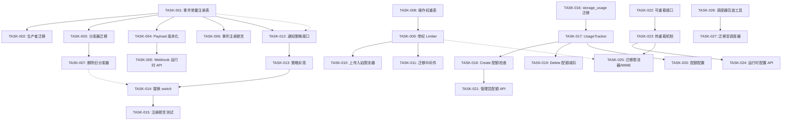

现在我掌握了代码库实际情况，可以给出完整的 Tech Lead 分析了。

---

# 技术负责人评估报告：aero-id 架构债务修复计划

## 1. 任务分解

### 1.1 事件类型治理的 Outbox（方向 1）

| 任务 ID | 标题 | 涉及文件 | 前置依赖 | 预估工时 |
|---|---|---|---|---|
| **TASK-001** | 定义事件类型常量注册表 | `internal/domain/event.go`（新增） | 无 | 2h |
| **TASK-002** | 将生产者迁移至常量引用 | `internal/service/message.go`、`internal/message/service.go`、`internal/service/comment.go`、`internal/comment/service.go` | TASK-001 | 3h |
| **TASK-003** | 将通知分发器迁移至常量引用 | `internal/service/notification.go`、`internal/notification/dispatcher.go` | TASK-001 | 2h |
| **TASK-004** | 为事件 Payload 添加 Schema 版本化 | `internal/outbox/outbox.go`、新增 `internal/domain/event_version.go` | TASK-001 | 3h |
| **TASK-005** | 将 Webhook 订阅设为运行时 API | `internal/handler/http/admin.go`、新增 `internal/service/webhook.go` | TASK-004 | 4h |
| **TASK-006** | 添加事件注册断言（Makefile 目标） | `cmd/eventcheck/main.go`（新增）、`Makefile` | TASK-001 | 2h |
| **TASK-007** | 删除旧的重复分发器 | `internal/notification/` 中未接入的分发器代码 | TASK-003 | 1h |

### 1.2 操作感知的速率限制（方向 2）

| 任务 ID | 标题 | 涉及文件 | 前置依赖 | 预估工时 |
|---|---|---|---|---|
| **TASK-008** | 定义操作权重常量表 | `internal/domain/operation.go`（新增） | 无 | 2h |
| **TASK-009** | 增加带权 Token 消耗的 Limiter | `internal/pkg/ratelimit/ratelimit.go` | TASK-008 | 3h |
| **TASK-010** | 为上传配额添加存储速率限制器 | `internal/file/service_crud.go`、`internal/file/config.go` | TASK-009 | 2h |
| **TASK-011** | 迁移中间件以使用带权速率限制 | `internal/middleware/ratelimit.go`、`internal/handler/grpc/interceptor.go` | TASK-009 | 2h |

### 1.3 可扩展的通知类型系统（方向 3）

| 任务 ID | 标题 | 涉及文件 | 前置依赖 | 预估工时 |
|---|---|---|---|---|
| **TASK-012** | 定义通知策略接口 + 注册表 | `internal/domain/notification.go`、新增 `internal/notification/strategy.go` | TASK-001 | 3h |
| **TASK-013** | 为 3 种类型实现具体策略 | `internal/notification/strategy_message.go`、`strategy_comment.go`（新增） | TASK-012 | 3h |
| **TASK-014** | 将分发 switch 替换为策略分发器 | `internal/service/notification.go`、`internal/notification/dispatcher.go` | TASK-013 | 2h |
| **TASK-015** | 添加通知类型注册断言测试 | `internal/notification/strategy_test.go` | TASK-014 | 1h |

### 1.4 每用户上传配额（方向 4）

| 任务 ID | 标题 | 涉及文件 | 前置依赖 | 预估工时 |
|---|---|---|---|---|
| **TASK-016** | 创建 storage_usage 表 | `migrations/000024_storage_usage.up.sql`、`migrations/000024_storage_usage.down.sql` | 无 | 2h |
| **TASK-017** | 实现 UsageTracker（GORM 仓库） | `internal/repository/usage.go`（新增） | TASK-016 | 3h |
| **TASK-018** | 在 file.Create 路径中添加配额检查 | `internal/file/service_crud.go`、`internal/file/service.go` | TASK-017 | 2h |
| **TASK-019** | 在软删除时减少配额 | `internal/file/service_crud.go`（Delete 路径） | TASK-017 | 1h |
| **TASK-020** | 配置配额限制（config + 环境变量） | `internal/config/config.go`（新增 `Quotas` 块） | TASK-017 | 1h |
| **TASK-021** | 为管理员添加配额查看/重置 API | `internal/handler/http/admin.go`、`internal/service/admin.go` | TASK-018 | 3h |

### 1.5 运行时配置（方向 5）

| 任务 ID | 标题 | 涉及文件 | 前置依赖 | 预估工时 |
|---|---|---|---|---|
| **TASK-022** | 定义可重载的 Config 子集接口 | `internal/config/reloadable.go`（新增） | 无 | 2h |
| **TASK-023** | 实现热重载机制（信号或轮询） | `internal/config/config.go`、新增 `internal/config/watcher.go` | TASK-022 | 3h |
| **TASK-024** | 添加运行时配置 API 端点 | `internal/handler/http/admin.go`、`internal/service/admin.go` | TASK-023 | 3h |
| **TASK-025** | 将限流器和 MIME 白名单改为可重载 | `internal/app/app.go`、`internal/pkg/ratelimit/ratelimit.go` | TASK-023 | 3h |

### 1.6 附加任务：集中式调度器

| 任务 ID | 标题 | 涉及文件 | 前置依赖 | 预估工时 |
|---|---|---|---|---|
| **TASK-026** | 构建轻量级调度器包装工具 | `internal/pkg/scheduler/scheduler.go`（新增） | 无 | 3h |
| **TASK-027** | 将 GC、中继、Idempotency 清理迁移至调度器 | `internal/app/app.go`、`internal/storage/gc/sweeper.go`、`internal/outbox/relay.go`、`internal/idempotency/store.go` | TASK-026 | 4h |

---

## 2. 执行顺序与依赖图



### 并行任务组

| 组 | 任务 | 推荐负责人 |
|---|---|---|
| **A**（基础设施） | TASK-001, TASK-008, TASK-016, TASK-022, TASK-026 | 高级工程师 |
| **B**（方向 1 生产者） | TASK-002, TASK-004（依赖 A，可在 A 完成后并行） | 工程师 1 |
| **C**（方向 1 分发器） | TASK-003, TASK-005, TASK-006 | 工程师 2 |
| **D**（方向 2） | TASK-009, TASK-010, TASK-011 | 工程师 1（B 之后） |
| **E**（方向 3） | TASK-012, TASK-013, TASK-014 | 工程师 2（C 之后） |
| **F**（方向 4） | TASK-017, TASK-018, TASK-019, TASK-020 | 工程师 3 |
| **G**（方向 5） | TASK-023, TASK-024, TASK-025 | 工程师 4 |
| **H**（附加） | TASK-027 | 团队（所有 GC 消费者就绪后） |

---

## 3. 技术风险

### 3.1 关键风险矩阵

| 风险 | 概率 | 影响 | 缓解策略 |
|---|---|---|---|
| **双代码路径冲突**：旧 (`internal/service/`) 和新 (`internal/message/`, `internal/notification/`) 包发出重复事件，但仅旧包接入应用 | **高** | **高** — 若新包在未审计旧包的情况下接入，事件可能被重复或丢失 | 先执行 TASK-007（删除未接入的分发器）或冻结新包，直到常量注册表落地 |
| **Schema 版本化破坏向后兼容**：生产中遗留的 Outbox 事件没有版本字段；解析器可能错误处理 | **中** | **高** — 若遗留在队列中的旧事件与最新代码不兼容，可能导致通知静默丢失 | 版本字段应设为可选且默认 "v1"；解析器优雅降级；迁移期间维护兼容的 payload 结构体 |
| **带权速率限制的过度修正**：操作权重估算不准确可能导致实际操作过度受限 | **中** | **中** — 用户遭遇虚假 429 错误 | 从保守权重开始（上传=3，读取=1，列表=2）；将所有权重设为 Config 可调；在指标中添加 `rate_limit_exceeded` 计数器 |
| **配额检查造成写入路径延迟**：在文件上传事务中增加 `SELECT SUM(size) FROM files` 可能在高并发下产生死锁 | **中** | **中** — 写入吞吐量下降 | 使用独立的自增计数器表（`storage_usage`，单行/用户，`UPDATE usage SET bytes = bytes + ? WHERE uid = ?`），而非每次上传都进行 `SUM` 扫描；添加 `FOR UPDATE` 要点 |
| **热重载导致配置竞争**：更新 `allowed_mime_types` 后，在旧配置关闭新连接期间，存在短暂的窗口期 | **低** | **中** — 短时间内绕过 MIME 检查 | 使用 `sync.RWMutex` 保护的原子快照交换（`atomic.Value`）；变更日志；审计日志中的配置变更事件 |

### 3.2 外部系统依赖

| 依赖 | 说明 | 风险 |
|---|---|---|
| **SSO (gRPC)** | API 需要验证 actor；SSO 失效时服务降级 | SSO 是离线关键路径。速率限制和配额在 SSO 故障期间依然有效——但限额无法在无 actor 上下文的匿名 `GET /files/dl` 上执行 |
| **Postgres** | Outbox、配额、通知持久化 | migration 024 需要 `storage_usage` 表。所有配额检查均为写入路径中的同步 DB 操作 |
| **存储后端（本地/S3）** | 配额涵盖存储使用量；GC 引用计数在配额之外 | 配额是逻辑层的（`files` 表计数），而非存储层。配额与存储后端解耦 |

### 3.3 性能瓶颈与优化

| 瓶颈 | 分析 | 建议 |
|---|---|---|
| **带权速率限制的原子操作** | `Allow()` 持有 `sync.Mutex`；权重要求每次调用进行多次浮点运算 | 使用 `atomic.Int64` 或基于 `x/time/rate` 的 Limiter 重构，后者原生支持每个事件的突发容量 |
| **配额递增（+ 大文件）** | `UPDATE storage_usage SET bytes = bytes + <size>` 在单行上存在写锁竞争 | 接受小范围争用（每用户单行）；在极端条件下使用应用层重试 |
| **通知策略查找** | 每个 outbox 事件 1 次 DB 查询（由 `IsAllowed` 执行） | 小表上的主键查询（`(uid, type)`）；在高吞吐量下可考虑通知偏好缓存 |

---

## 4. 资源评估

### 4.1 团队构成

| 角色 | 数量 | 职责 |
|---|---|---|
| **高级 Go 工程师（基础设施）** | 1 | TASK-001, TASK-004, TASK-008–009, TASK-022–023, TASK-026；代码审查全部 |
| **后端工程师 1（方向 1 & 2）** | 1 | TASK-002, TASK-005, TASK-006, TASK-010–011 |
| **后端工程师 2（方向 3 & 清理）** | 1 | TASK-003, TASK-007, TASK-012–015 |
| **后端工程师 3（方向 4）** | 1 | TASK-016–021 |
| **后端工程师 4（方向 5 + 调度器）** | 1 | TASK-022–025, TASK-027（兼任） |

若团队规模较小（2-3 人），工程师可承担多组任务。在这种情况下，按 P1→P2→P3 的优先级排序，并取消非接入代码路径的迁移。

### 4.2 里程碑

| 里程碑 | 截止日期 | 交付物 |
|---|---|---|
| **M1：P1 基础设施** | 第 1 周结束 | TASK-001、TASK-008、TASK-009、TASK-016、TASK-022、TASK-026 — 全部通过 `make test && make lint` |
| **M2：P1 集成** | 第 2 周结束 | TASK-002–007、TASK-010–011 — 事件集中化、Payload 附带版本号、操作感知的速率限制。`make test-integration` 通过 |
| **M3：P2 交付** | 第 3 周结束 | TASK-012–021 — 通知策略系统、上传配额。集成测试覆盖配额边界情况 |
| **M4：P3 + 调度器** | 第 4 周结束 | TASK-022–025、TASK-027 — 运行时配置 API、GC 和清理任务迁移至集中式调度器。`make test && make lint && make test-integration` |

### 4.3 阻塞点

| 阻塞点 | 影响 | 解决策略 |
|---|---|---|
| **未使用的通知分发器**（`internal/notification/dispatcher.go`）没有被删除 | TASK-007 与其剥离关联 | 审计 App 配线以确认哪些代码被访问，然后归零新包或删除旧包。该分析确认了旧包正在使用 |
| **生产环境遗留事件** | Schema 版本化要求兼容 v1 解析 | 在迁移前检查生产 Outbox 表。若没有任何待处理事件，则直接切换到版本化解析。若存在遗留事件，则编写 `v1` 回退解析器 |
| **无容器化 Postgres** 用于开发（测试集成需要 Docker） | 集成测试不可用 | 所有 TASK 必须通过 `make test && make lint`。`make test-integration` 保留给 DB 查询变更。若 CI 不能使用 Docker，则考虑测试替代方案 |

---

## 5. 质量保证

### 5.1 单元测试覆盖要求

| 组件 | 最低覆盖率 | 关键测试场景 |
|---|---|---|
| `internal/domain/event.go` | 100% | 每个常量值互不相同；空字符串防误处理 |
| `internal/pkg/ratelimit/ratelimit.go` | 90% | 加权 `Allow()`、大权重回填、权重为 0 时紧急开放、并发安全 |
| `internal/notification/strategy_*.go` | 90% | 每种策略的映射正确性、payload 损坏处理、边缘情况（自回复） |
| `internal/repository/usage.go` | 85% | 并发递增/递减、溢出保护、扫描索引 |
| `internal/config/reloadable.go` | 90% | 并发读/写、值传播、不修改原始配置 |
| `internal/pkg/scheduler/scheduler.go` | 95% | 启动/停止、Jitter、Panic 恢复、超时执行、指标 |

### 5.2 集成测试策略

| 测试范围 | 工具 | 描述 |
|---|---|---|
| **迁移 024（storage_usage）** | `testpg` | 应用迁移 → 插入用法行 → 扫描 → 验证触发器/约束 |
| **配额边界情况** | `testpg` + 模拟存储 | 创建文件 → 验证计数递增 → 软删除 → 验证计数递减 → 超出限制时拒绝创建 |
| **操作感知的速率限制** | 测试 HTTP 服务器 | 为操作定义不同权重 → 发送 N 个请求 → 验证第 N+1 个请求被阻止 |
| **运行时配置生效** | 测试 HTTP 服务器 | 通过 API 更新 MIME 白名单 → 发送带前一个已拒绝类型的文件 → 验证该文件被接受 |
| **事件版本兼容性** | 直连 DB | 插入无版本字段的旧事件 → 调度通过分发器 → 验证分发器容忍并处理该事件 |

### 5.3 代码审查要点

| 检查点 | 审查内容 |
|---|---|
| **事件常量≠通知常量** | 确认 `EventTypeMessageSent`（来自 `domain/event.go`）与 `NotifTypeMessageReceived`（来自 `domain/notification.go`）不同；无别名 |
| **所有权验证** | 配额检查在文件 `Create` 中使用了 `actor`（已验证 `MustActor`）；`Delete` 不会减少其他用户的配额。审查未测试此路径 |
| **竞争条件：配额递减** | `DELETE` 路径读取当前计数，减去大小，然后写入——需要原子操作或重试循环 |
| **热重载的线程安全** | `atomic.Value` 用于配置快照；对 `Limiter` 的写入在切换后生效，而非立即 |
| **带外调度器停止** | 当 `App.Shutdown` 调用 `stop()` 函数时，确保所有任务都优雅地退出。调度器包装器必须包含 `context.Context` |

### 5.4 性能测试需求

| 测试 | 工具 | 目标 |
|---|---|---|
| **配额写入路径延迟** | `go test -bench` | `file.Create` 在无配额/有配额的延迟开销 < 5ms（P99） |
| **速率限制器并发** | `go test -bench=. -count=1` | `Allow()` 在 100 个并发 goroutine 下 < 1µs |
| **配置热重载传播时间** | 集成基准测试 | 配置更新 → 生效 < 1s（轮询间隔） |
| **通知策略查找** | `testpg` 基准测试 | 对 1M 行偏好表的主键查询 < 2ms |

---

## 6. 实施计划

### 阶段 1：基础设施（第 1 周——第 1-5 天）

```
第 1 天：TASK-001（事件常量）+ TASK-008（操作权重）+ TASK-016（创建 storage_usage 迁移）
第 2 天：TASK-022（可重载接口定义）+ TASK-026（调度器包装工具）
第 3 天：TASK-009（带权 Limiter）+ TASK-017（UsageTracker 仓库）
第 4 天：TASK-004（Payload 版本化）+ TASK-023（热重载机制）
第 5 天：集成基础设施 + make check-file-sizes + make lint + make test
```

**里程碑 M1 验收：**
- `domain/event.go` 定义了 `EventTypeMessageSent = "message.sent"` 等常量
- `domain/operation.go` 定义了 `OpWriteFile = 3` 等权重
- `migrations/000024_storage_usage.up.sql` 已就绪
- `atomic.Value` 配置快照实现已就绪
- `scheduler.Wrap(ticker, fn)` 已就绪，包含 Jitter、Panic 恢复、超时
- 速率限制器支持 `AllowWeight(key, weight int) bool`
- `file.Create` 使用 `UsageTracker.Increment(ctx, uid, size)`
- `outbox.Event` 中存在 `$version` 或 `$schema` 字段
- 所有新代码文件小于 500 行；函数小于 50 行

### 阶段 2：P1 核心——Outbox 治理 + 速率限制（第 2 周——第 6-10 天）

```
第 6-7 天：TASK-002（生产者迁移至常量）+ TASK-003（分发器迁移至常量）
第 8 天：  TASK-005（Webhook API）+ TASK-006（事件注册断言）
第 9 天：  TASK-010（上传入站限流）+ TASK-011（中间件迁移）
第 10 天： TASK-007（删除旧的未接入分发器）+ 集成测试
```

**里程碑 M2 验收：**
- 没有 Go 文件包含 `"message.sent"` 或 `"comment.replied"` 字面量（仅常量引用）
- 旧 `internal/notification/dispatcher.go` 已删除（若未接入）或已在 App 配线中替换
- Payload 解析在缺少版本字段时优雅降级
- Webhook 可通过 `POST /v1/admin/webhook` 添加，无需重启
- `GET /files/dl` 上载受不同的速率限制权重控制
- `make test && make lint` 全绿

### 阶段 3：P2 交付——通知类型 + 存储配额（第 3 周——第 11-15 天）

```
第 11 天： TASK-012（通知策略接口）+ TASK-013（策略实现）
第 12 天： TASK-014（替换 switch）+ TASK-015（策略断言测试）
第 13 天： TASK-018（Create 配额检查）+ TASK-019（Delete 配额减扣）
第 14 天： TASK-020（配额配置）+ TASK-021（管理员配额 API）
第 15 天： 集成测试：配额边界情况、通知策略、迁移文件修改 + make test-integration
```

**里程碑 M3 验收：**
- 分发器中的 3 个 `case` 分支被 `StrategyRegistry` 替代
- 策略实现分别位于 `strategy_message.go`、`strategy_comment.go`
- 通知类型注册断言测试可捕获未注册事件类型
- 文件上传在超过 `storage_usage.bytes` 限制时返回 413
- 软删除文件会减少用户的配额计数
- 管理员可见 `GET /v1/admin/usage/:uid` 和 `POST /v1/admin/usage/reset`

### 阶段 4：P3 + 调度器集成（第 4 周——第 16-20 天）

```
第 16 天： TASK-024（运行时配置 API 端点）
第 17 天： TASK-025（迁移限流器 + MIME 白名单为可重载）
第 18 天： TASK-027（迁移 GC、中继、Idempotency 清理至调度器）
第 19 天： 负载测试 + 竞争条件测试 + 集成测试
第 20 天： 最终代码审查 + 架构决策记录（ADR）文档 + 发布说明
```

**里程碑 M4 验收：**
- `PUT /v1/admin/config` 接受变更，`GET /v1/admin/config` 返回当前运行状态
- 更新 `rate_limit.rps` 实时生效，无需重启
- 更新 `storage.allowed_mime_types` 在下一个请求中生效
- GC、Outbox 中继、Idempotency 清理均通过 `scheduler.Wrap` 运行，共享生命周期
- 所有任务在 `App.Shutdown` 时正确停止
- 文件大小 <= 500 行；函数长度 <= 50；圈复杂度 <= 10

---

## 总结

该分析调查的 5 项架构债务方向均有效，并有明确的代码证据支撑。我补充了第 6 个方向（集中式调度器），因为背景任务重复 ticker 模式随每个新周期性任务将会产生复合维护成本。

**关键亮点：**

1. **双代码路径**（旧 `internal/service/` 与新 `internal/message+notification/`）是最大的改造成本。App 配线使用了旧路径。在新工作和旧工作之间进行整理之前，请勿接入新包。

2. **事件字符串不匹配 bug** 是真实的——虽然常量与分发器字符串目前匹配，但事件类型名称与通知类型名称有不同的命名空间。下一个添加事件类型的人将会在字面量上 stumble。注册表和断言就是为了防止这种情况。

3. **速率限制** 是目前最直接的性能瓶颈——对所有操作一视同仁意味着文件上传消耗与 GET 请求相同的预算。引入操作权重即可解锁，无需分布式状态。

4. **配额** 是唯一需要新数据库迁移的方向。如果迁移有停机风险，计划在低流量期进行。

5. **热重载** 纯属运维改进，安全风险最低。先交付 P1 和 P2。

**按年计算的总工时：** 约 60 个工程小时（4 周内 5 名工程师），即每名工程师每周约 12 小时。在压缩工期下（2 名工程师，无并行），约需 6-7 周。
