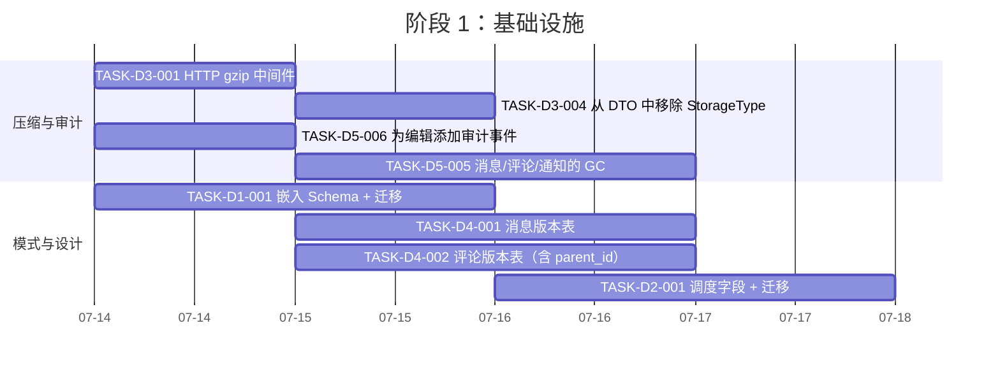
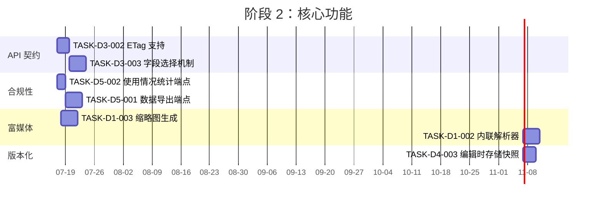
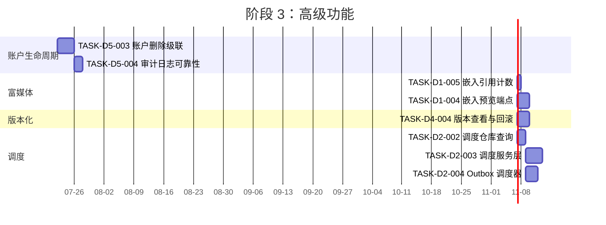
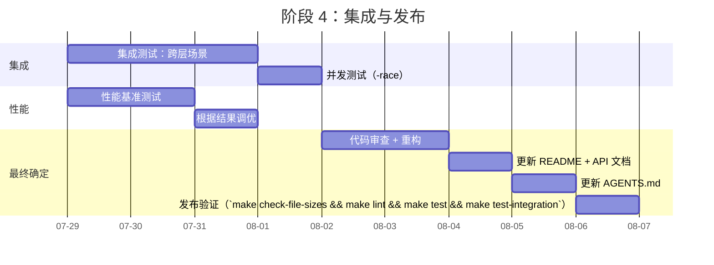

现在我对代码库有了透彻的了解。让我编制完整的 Tech Lead 分析。

---

# Tech Lead 分析：Aero-ID 功能差距

## 1. 任务分解

### 方向三：API 消费者契约与传输优化（P0 — 快速见效）

| 任务 ID | 标题 | 涉及文件 | 前置依赖 | 预估工时 | 验收标准 |
|---------|-------|-----------|----------------|--------|------------------|
| **TASK-D3-001** | HTTP 压缩中间件 | `internal/handler/http/router.go`, `go.mod` | 无 | 1h | `GET /v1/...` 响应在客户端发送 `Accept-Encoding: gzip` 时包含 `Content-Encoding: gzip`。 |
| **TASK-D3-002** | GET 端点的 ETag/条件请求 | `internal/handler/http/{file,message,comment}.go`, `internal/pkg/httpx/`（新工具），`internal/domain/{file,message,comment}.go`（添加 `ETag()` 方法） | 无 | 3h | 每个 `GET` 端点发出 `ETag` 头；当 `If-None-Match` 匹配时返回 `304 Not Modified`。`file.UpdatedAt`、`message.EditedAt`（或 `CreatedAt`）和 `comment.UpdatedAt` 用作隐式 ETag。 |
| **TASK-D3-003** | 字段选择机制 | `internal/pkg/fields/`（新包），`internal/handler/http/search.go`，`internal/handler/http/{file,message,comment}.go` 中序列化路径 | TASK-D3-002 | 4h | `GET /v1/files?fields=id,name,size` 仅返回请求的字段。`fields` 查询参数的解析具有幂等安全性。搜索命中支持字段选择。 |
| **TASK-D3-004** | 从 DTO 中移除 `StorageType` 序列化 | `internal/handler/http/file.go`（`fileResponse` 结构体） | 无 | 0.5h | `fileResponse` 不再序列化 `storage_type`。新迁移添加配置选项。现有客户端不受影响。 |

### 方向五：用户数据可移植性与账户生命周期（P0.5 — 合规性覆盖）

| 任务 ID | 标题 | 涉及文件 | 前置依赖 | 预估工时 | 验收标准 |
|---------|-------|-----------|----------------|--------|------------------|
| **TASK-D5-001** | 数据导出端点 | `internal/service/service.go`（`DataService` 接口），`internal/service/data.go`（新），`internal/handler/http/data.go`（新），`internal/handler/http/router.go` | 无 | 4h | `GET /v1/export` 在后台生成一个 JSON 文件（消息、评论、文件、通知），并返回一个 presigned 下载 URL。大型导出在带状态轮询的异步作业中处理。 |
| **TASK-D5-002** | 使用情况统计端点 | `internal/domain/usage.go`（新），`internal/repository/usage.go`（新），`internal/service/data.go`（扩展现有） | 无 | 2h | `GET /v1/account/usage` 返回消息数、评论数、文件数、总存储字节数，并按类型细分。 |
| **TASK-D5-003** | 账户删除级联 | `internal/service/data.go`（`DeleteAccount`），`internal/repository/{message,comment,file,notification,block}_account.go`（新级联方法），`internal/handler/http/data.go`，`internal/handler/grpc/data.go` | TASK-D5-002 | 4h | `DELETE /v1/account` 将 actor 的所有数据排入删除队列，通过 outbox 执行：软删除消息、评论、文件（实际文件通过 GC 清除）、通知和块。使用事务性 outbox 事件确保幂等性。 |
| **TASK-D5-004** | 审计日志可靠性：账户操作 | `internal/service/data.go`，`internal/outbox/`，`internal/service/service.go`（`AuditLogger` 契约文档） | TASK-D5-003 | 2h | 账户删除使用与 `MarkRead` 相同的事务性 outbox 模式，而非 fire-and-forget `_ = s.audit.Log()`。删除前会发出 `account.deletion.initiated` 事件。 |
| **TASK-D5-005** | 消息/评论/通知的 GC | `internal/storage/gc/sweeper.go`（扩展），`internal/repository/gc.go`（新），`internal/config/config.go` | 无 | 3h | 为消息/评论/通知添加软删除行的定期硬删除，保留期可配置（与文件 GC 相同的模式）。旧的已读通知会在不同保留期后清除。 |
| **TASK-D5-006** | 为编辑添加审计事件 | `internal/service/message.go`（`Edit()`），`internal/service/comment.go`（`Edit()`），`internal/domain/audit.go`（常量） | 无 | 1h | 编辑消息或评论会发出类型为 `message.edit` / `comment.edit` 的审计事件，记录 actor、subject_id 和新内容的前 100 个字符（摘要）。 |

### 方向一：富媒体嵌入（P1 — 需要基础设施成果）

| 任务 ID | 标题 | 涉及文件 | 前置依赖 | 预估工时 | 验收标准 |
|---------|-------|-----------|----------------|--------|------------------|
| **TASK-D1-001** | 嵌入 Schema + 迁移 | `migrations/000024_create_embeds.*.sql`，`internal/domain/embed.go`（新实体） | 无 | 2h | `embeds` 表包含 `id`、`message_id`、`embed_type`（`file`/`image`/`link`/`mention`）、`file_id`（可为空）、`url`（可为空）、`metadata`（JSONB）、`created_at`。存储引用计数重用 `storage_refs`。 |
| **TASK-D1-002** | 消息发送时的内联解析器 | `internal/message/parser.go`（新），`internal/service/message.go`（在 `Send()` 中调用） | TASK-D1-001 | 4h | 解析 `Message.Content` 中的 Markdown `[file:uuid]`、`[image:uuid]`、`@mention` 和原始 URL。将解析后的嵌入写入 `embeds` 表（与消息插入在同一事务中）。 |
| **TASK-D1-003** | 文件缩略图生成 | `internal/storage/thumbnail.go`（新），`internal/service/file.go`（扩展），`internal/config/config.go`，`migrations/000025_add_file_preview.*.sql` | 无 | 4h | 上传图片时，在后台生成缩略图（最大 256x256）并保存为 `{storage_key}_thumb`。`File` 模型获取 `HasPreview` 布尔字段。 |
| **TASK-D1-004** | 嵌入预览端点 | `internal/handler/http/embed.go`（新），`internal/handler/http/router.go`，`internal/service/embed.go`（新） | TASK-D1-002，TASK-D3-003 | 3h | `GET /v1/messages/:id/embeds` 返回解析后的嵌入数组。每个嵌入都带有预览数据（文件缩略图 URL 或链接 OpenGraph 元数据）。字段选择过滤嵌入数据。 |
| **TASK-D1-005** | 为嵌入预览添加引用计数 | `internal/repository/storage_ref.go`（扩展），`internal/repository/embed.go`（新） | TASK-D1-001 | 1h | 当嵌入引用文件时，`storage_refs` 中的引用计数会递增。当嵌入被删除（编辑）或消息被软删除时，计数会递减。 |

### 方向四：实体变更历史与内容版本化（P1 — 依赖 D3 字段选择）

| 任务 ID | 标题 | 涉及文件 | 前置依赖 | 预估工时 | 验收标准 |
|---------|-------|-----------|----------------|--------|------------------|
| **TASK-D4-001** | 消息编辑历史表 + 迁移 | `migrations/000026_create_message_versions.*.sql`，`internal/domain/message.go`（`MessageVersion` 实体） | 无 | 2h | `message_versions` 表包含 `id`、`message_id`、`version`、`content`、`created_at`。版本从 1 开始递增。 |
| **TASK-D4-002** | 评论编辑历史表 + 迁移 | `migrations/000027_create_comment_versions.*.sql`，`internal/domain/comment.go`（`CommentVersion` 实体，保存 `parent_id`） | 无 | 2h | `comment_versions` 表包含 `id`、`comment_id`、`version`、`content`、`parent_id`（保存），`created_at`。保存嵌套深度以便回滚不会破坏 `ErrNestingTooDeep`。 |
| **TASK-D4-003** | 修改编辑以存储快照 | `internal/service/message.go`（`Edit()`），`internal/service/comment.go`（`Edit()`），`internal/repository/message.go`，`internal/repository/comment.go` | TASK-D4-001，TASK-D4-002 | 3h | 编辑通过 `UpdateContent` 事务性地插入版本行。消息获取 `version_count` 显示字段。 |
| **TASK-D4-004** | 版本查看/回滚端点 | `internal/handler/http/{message,comment}.go`，`internal/service/message.go`，`internal/service/comment.go` | TASK-D4-003 | 3h | `GET /v1/messages/:id/versions` 列出版本（元数据，不含完整内容，除非字段选择指定）。`POST /v1/messages/:id/versions/:version/restore` 将内容回滚到该版本并递增版本历史。 |
| **TASK-D4-005** | 为编辑添加审计事件（已移至 D5-006，见上文） | — | — | — | — |

### 方向二：消息调度、草稿与发送控制（P2 — 依赖 D4 版本化）

| 任务 ID | 标题 | 涉及文件 | 前置依赖 | 预估工时 | 验收标准 |
|---------|-------|-----------|----------------|--------|------------------|
| **TASK-D2-001** | 消息模型 + 迁移中的调度字段 | `migrations/000028_add_scheduling.*.sql`，`internal/domain/message.go`（添加 `Status`、`ScheduledAt`、`ExpiresAt`） | 无 | 2h | Message 获取 `Status`（`draft`/`scheduled`/`sent`/`recalled`）、`ScheduledAt`（可为空）、`ExpiresAt`（可为空）。 |
| **TASK-D2-002** | 草稿/调度仓库查询 | `internal/repository/message.go`（`ListDrafts`、`ListScheduled`、`MarkRecalled`） | TASK-D2-001 | 2h | `ListDrafts(ctx, uid)` 返回发送方的草稿。`ListScheduled(ctx, before)` 返回应在此时间之前发送的已调度消息。`MarkRecalled(ctx, id)` 设置状态和 `recalled_at`。 |
| **TASK-D2-003** | 调度/草稿/召回服务层 | `internal/service/message.go`（`SaveDraft`、`Schedule`、`Recall`），`internal/service/service.go`（扩展 `MessageService` 接口） | TASK-D2-002 | 4h | `SaveDraft` 不发送。`Schedule` 设置 `ScheduledAt`。`Recall`（仅限发送方）阻止发送方的收件箱中显示已召回消息（软删除，但添加状态检查）。 |
| **TASK-D2-004** | Outbox 调度器用于延迟发送 | `internal/outbox/scheduler.go`（新），`internal/app/app.go`（启动调度器 goroutine） | TASK-D2-002 | 3h | 类似于 outbox relay 的调度器轮询带有 `ScheduledAt <= now` 且 `Status = scheduled` 的消息，并通过常规的 `Send` 路径发送它们。 |
| **TASK-D2-005** | 草稿 → 已调度 → 已发送的版本化转换 | `internal/service/message.go`（扩展 `SaveDraft` 以写入版本 1），`internal/service/draft.go` | TASK-D4-003，TASK-D2-003 | 2h | 草稿在创建时隐式成为 `message_versions` 中的版本 1。编辑草稿会创建版本 2。已调度状态是版本 n。已发送状态是其自己的版本历史条目。 |

---

## 2. 执行顺序

```mermaid
graph TD
    %% Phase 1: Quick wins (P0)
    subgraph "阶段 1: 基础设施（4.5h）"
        D3_1["TASK-D3-001<br/>HTTP 压缩<br/>(1h)"]
        D3_4["TASK-D3-004<br/>移除 StorageType<br/>(0.5h)"]
        D5_5["TASK-D5-005<br/>消息/评论 GC<br/>(3h)"]
        D5_6["TASK-D5-006<br/>编辑审计事件<br/>(1h)"]
    end

    %% Phase 2: Core compliance & API improvements
    subgraph "阶段 2: 合规性 + API 契约（13h）"
        D3_2["TASK-D3-002<br/>ETag 支持<br/>(3h)"]
        D3_3["TASK-D3-003<br/>字段选择<br/>(4h)"]
        D5_1["TASK-D5-001<br/>数据导出端点<br/>(4h)"]
        D5_2["TASK-D5-002<br/>使用情况统计<br/>(2h)"]
    end

    %% Phase 3: Account lifecycle
    subgraph "阶段 3: 账户生命周期管理（8h）"
        D5_3["TASK-D5-003<br/>账户删除级联<br/>(4h)"]
        D5_4["TASK-D5-004<br/>事务性审计日志<br/>(2h)"]
    end

    %% Phase 4: Versioning
    subgraph "阶段 4: 版本化（10h）"
        D4_1["TASK-D4-001<br/>消息版本表<br/>(2h)"]
        D4_2["TASK-D4-002<br/>评论版本表<br/>(2h)"]
        D4_3["TASK-D4-003<br/>编辑时存储快照<br/>(3h)"]
        D4_4["TASK-D4-004<br/>版本查看/回滚<br/>(3h)"]
    end

    %% Phase 5: Rich media
    subgraph "阶段 5: 富媒体嵌入（14h）"
        D1_1["TASK-D1-001<br/>嵌入 Schema<br/>(2h)"]
        D1_2["TASK-D1-002<br/>内联解析器<br/>(4h)"]
        D1_3["TASK-D1-003<br/>缩略图生成<br/>(4h)"]
        D1_5["TASK-D1-005<br/>嵌入引用计数<br/>(1h)"]
        D1_4["TASK-D1-004<br/>嵌入预览 API<br/>(3h)"]
    end

    %% Phase 6: Scheduling
    subgraph "阶段 6: 消息调度（13h）"
        D2_1["TASK-D2-001<br/>调度字段<br/>(2h)"]
        D2_2["TASK-D2-002<br/>调度仓库查询<br/>(2h)"]
        D2_3["TASK-D2-003<br/>调度服务层<br/>(4h)"]
        D2_4["TASK-D2-004<br/>Outbox 调度器<br/>(3h)"]
        D2_5["TASK-D2-005<br/>草稿版本化<br/>(2h)"]
    end

    %% Dependencies
    D3_2 --> D3_3
    D5_2 --> D5_1
    D5_3 --> D5_4
    D1_1 --> D1_2
    D1_2 --> D1_4
    D1_3 --> D1_4
    D1_1 --> D1_5
    D4_1 --> D4_3
    D4_2 --> D4_3
    D4_3 --> D4_4
    D2_1 --> D2_2
    D2_2 --> D2_3
    D2_2 --> D2_4
    D4_3 --> D2_5
    D2_3 --> D2_5
    D3_3 --> D1_4
    D5_5 --> D3["（并行）"]

    %% Style for parallel groups
    classDef phase1 fill:#c6efce,stroke:#2b6f3e
    classDef phase2 fill:#b4d5ea,stroke:#1f4e79
    classDef phase3 fill:#fce4d6,stroke:#c0504d
    classDef phase4 fill:#e2d9f3,stroke:#5b3a8c
    classDef phase5 fill:#fff2cc,stroke:#9a7c3f
    classDef phase6 fill:#f2dcdb,stroke:#963634

    class D3_1,D3_4,D5_5,D5_6 phase1
    class D3_2,D3_3,D5_1,D5_2 phase2
    class D5_3,D5_4 phase3
    class D4_1,D4_2,D4_3,D4_4 phase4
    class D1_1,D1_2,D1_3,D1_4,D1_5 phase5
    class D2_1,D2_2,D2_3,D2_4,D2_5 phase6
```

**并行执行组：**

| 组 | 任务 | 所需人员 |
|-----|------|-------------|
| **A** | D3-001（gzip），D3-004（移除 StorageType），D5-005（GC），D5-006（审计编辑） | 1 名后端工程师 |
| **B** | D5-001（导出），D5-002（使用情况） | 1 名后端工程师 |
| **C** | D3-002（ETag） | 1 名后端工程师 |
| **D** | D1-001（嵌入 schema），D4-001（消息版本），D4-002（评论版本），D2-001（调度字段） | 2 名后端工程师（schema 设计） |
| **E** | D1-003（缩略图），D3-003（字段选择） | 1 名后端工程师 + 1 名全栈工程师 |
| **F** | D1-002（解析器），D4-003（快照），D2-002（调度仓库） | 2 名后端工程师 |
| **G** | D5-003（删除），D2-003（调度服务） | 1 名高级后端工程师 |
| **H** | D1-004（预览），D1-005（引用计数），D4-004（回滚），D2-004（调度器） | 2 名后端工程师 |

---

## 3. 技术风险

### 高风险项目

| 风险 | 方向 | 描述 | 缓解措施 |
|------|-----------|-------------|--------------|
| **R1：消息编辑中的并发** | D4 | 两个并发编辑可能都读取版本 2，都写入版本 3，导致内容丢失。`message_versions` 表需要乐观锁（`version` 上的 `ON CONFLICT DO NOTHING`）。 | 在 `UpdateContent` 中使用 `WHERE version = ?` 进行单语句更新；如果受影响行数为 0 则使用 `ErrConflict`。编辑时需要读取当前版本。 |
| **R2：字段选择 + ACL 交互** | D3 | `CanReadFile()` 中的 ACL 逻辑可能返回仅包含权限而非内容的子集字段。如果客户端请求 `fields=storage_key` 但未经过授权怎么办？ | 字段选择必须**在** ACL 检查之后应用。服务层应始终验证权限，然后 handler 在序列化期间应用字段选择。切勿让字段选择绕过授权。 |
| **R3：账户删除的审计可靠性** | D5 | 14 个现有的 fire-and-forget `_ = s.audit.Log()` 调用在账户删除级联期间可能会静默失败。将审计日志改为事务性 outbox 事件需要新的 `audit_events` outbox 表。 | 引入 `outbox_event` 类型的 `audit.event`。创建一个专用的 audit outbox handler，将事件写入 `audit_log` 表。这将审计日志保证从 best-effort 提升为 exactly-once。 |
| **R4：回滚破坏嵌套约束** | D4 | 将评论回滚到具有不同 `parent_id` 的版本可能会创建无效的嵌套深度。`CommentVersion` 必须存储版本制作时的 `parent_id`，回滚必须还原该 `parent_id` 以及内容，并通过 `ValidateNewComment` 重新验证。 | 在 `CommentVersion` 中存储 `parent_id` 和 `root_id`。回滚调用 `ValidateNewComment` 进行及时检查；如果失败则拒绝回滚。 |
| **R5：缩略图生成性能** | D1 | 图片上传生成缩略图会延长请求延迟。对 10MB+ 的大图片进行解码会占用内存。 | 将缩略图生成卸载到后台作业（通过 outbox，类型为 `file.thumbnail.needed`）。初始实现可以同步生成 256x256 子采样缩略图，并设置超时限制（Go 的 `image/jpeg.Decode` 支持选项式分辨率缩放）。 |
| **R6：嵌入引用计数与 GC 的竞争** | D1 | 嵌入式文件预览在 GC 清除被引用文件后仍可能存在。`storage_refs` 表已经通过计数处理了这个问题，但嵌入创建和 ref 递增必须发生在同一事务中。 | 在插入嵌入行的同一事务中递增 `storage_refs`。GC 在删除 blob 之前检查计数。 |
| **R7：Outbox 调度器在崩溃后至少发送一次** | D2 | 已调度消息在应用程序在调度器轮询之后、发送之前崩溃的情况下，可能会被发送两次。 | 使用 `UPDATE ... WHERE status = 'scheduled' AND scheduled_at <= now()` 的原子状态转换。如果 `UPDATE` 影响 0 行，则跳过。幂等发送路径（状态检查）。 |

### 低风险项目

| 风险 | 方向 | 缓解措施 |
|------|-----------|--------------|
| **R8：gzip 与 gRPC 冲突** | D3 | HTTP 传输层：gRPC 使用自己的压缩。`gin-contrib/gzip` 仅影响 HTTP；gRPC 流不受影响。 |
| **R9：大导出的存储压力** | D5 | 异步导出带有临时文件 + 到期自动清理。使用带限制的流式 JSON 生成器，而非将所有内容加载到内存中。 |
| **R10：现有测试失败** | 所有 | 所有 change 在迁移和重构测试都必须通过 `make test && make lint`。为所有新代码添加单元测试（目标：> 80% 覆盖率）。 |

### 外部依赖

| 依赖 | 用途 | 风险 |
|----------|---------|------|
| `gin-contrib/gzip` `v1.2` | HTTP gzip 中间件 | 低 — 未使用的依赖，在 `go.mod` 中作为可选项 |
| Go `image/jpeg` / `image/png`（标准库） | 缩略图生成 | 无 — 标准库 |
| SSO gRPC 服务 | 令牌验证，用户解析 | 中 — D5-003（账户删除）需要账户数据遍历，如果没有 SSO 协调，这将不完整 |

---

## 4. 资源评估

### 团队规模和技能要求

| 角色 | 技能 | 所需数量 |
|------|-------|-------------|
| **高级后端工程师** | Go、GORM、Postgres、gRPC、系统设计 | 1（团队负责人） |
| **后端工程师 1** | Go、REST API、测试（单元测试 + 集成测试） | 1 |
| **后端工程师 2** | Go、SQL、任务调度、后台作业 | 1 |
| **全栈工程师** | Go、前端基础（API 契约设计）、OpenAPI 规范 | 0.5（兼职） |

**并行执行中最多 3 名工程师同时工作**（参见第 2 节的执行组）。

### 关键里程碑

| 里程碑 | 产出 | 预计时间 |
|-----------|--------|-------------|
| **M1：快速见效** | gzip、ETag、GC 扩展、审计编辑事件 | 第 1-2 天 |
| **M2：合规性基线** | 数据导出、使用情况统计、字段选择 | 第 3-5 天 |
| **M3：账户生命周期** | 账户删除级联、事务性审计日志 | 第 6-8 天 |
| **M4：版本化就绪** | 版本表、编辑快照、查看/回滚 API | 第 9-12 天 |
| **M5：富媒体基础** | 嵌入 schema、解析器、缩略图、引用计数 | 第 11-15 天 |
| **M6：调度完整** | 草稿/调度/召回、outbox 调度器、版本化草稿 | 第 14-18 天 |
| **M7：集成 + 发布** | 集成测试、性能测试、文档更新、发布验证 | 第 17-20 天 |

### 阻塞点与解决策略

| 阻塞点 | 影响 | 策略 |
|--------|--------|----------|
| SSO 团队需要提供 `DELETE /v1/account` gRPC 端点以通知外部系统 | D5-003 不完整 | 使 aero-id 的账户删除尽可能独立：软删除 aero-id 拥有的所有数据。如果 SSO 提供 webhook，使用 outbox webhook 接收通知。如果没有，记录需要外部清理。 |
| 缩略图生成中的 Go 图片解码内存消耗 | D1-003 期间性能不佳 | 实施后备策略：在标准解码前使用 `jpeg.Decode` 进行子采样缩放（`DecodeOptions` 中的 `DCTDecodeScale`）。对于大于 4096x4096 的图片，跳过缩略图并记录警告。 |
| gin-contrib/gzip 与身份验证中间件的交互 | gzip 可能压缩错误响应，使调试困难 | 始终在 auth 中间件**之后**注册 gzip 中间件，这样错误响应不会被双重编码。测试 401/403 响应。 |

---

## 5. 质量保证

### 单元测试覆盖要求

| 层 | 目标覆盖率 | 重点领域 |
|-----|---------------|-----------------|
| **Domain 实体** | 100% 分支 | 嵌入解析、版本模型、ValiateNewComment 与 version->parent_id 映射 |
| **Service 层** | > 90% 分支 | 所有新服务方法（SaveDraft、Schedule、Recall、Export、DeleteAccount、Edit 版本化、ListVersions、RestoreVersion） |
| **Repository 层** | > 80% 语句 | 新查询（ListDrafts、ListScheduled、CreateVersion、ListVersions、HardDeleteMessagesOlderThan） |
| **Handler 层** | > 70% 语句 | 新端点（压缩、ETag、字段选择、导出、使用情况、版本、嵌入预览） |

### 集成测试策略

| 测试套件 | 覆盖范围 | 运行工具 |
|------------|----------|-----------|
| **存储库集成**（`//go:build integration`） | 所有新仓库方法针对真实 Postgres 实例测试 | `make test-integration`（testcontainers） |
| **存储集成** | S3 和本地后端的缩略图生成 | `make test-integration` |
| **跨层场景** | 完整请求周期：HTTP → 服务 → 仓库 → DB → DTO | 在 testcontainers 中使用 `httptest.Server` 和真实 DB 的 `handler/*_test.go` |
| **并发测试** | 并发编辑（乐观锁冲突）、并发调度器轮询 | Service 层中的 `go test -race` |
| **回滚兼容性** | 版本化前后编辑现有无版本记录 | 数据迁移集成测试 |

### 代码审查要点

1. **方向三字段选择**：确保 `fields` 查询参数在 ACL 检查**之后**应用。验证 `CanReadFile()` 在序列化之前被调用。
2. **方向四版本化**：验证乐观锁 `WHERE version = ?` 子句。回滚不会创建无效的嵌套深度。确保 `Edit()` 中的审计事件在提交之前发出。
3. **方向五账户删除**：验证所有 14 个审计调用点都正确迁移到事务性 outbox 模式或保持明确的 fire-and-forget 状态（对于非关键审计）。检查级联不会因第 3 行的 `gorm.ErrRecordNotFound` 而中止。
4. **方向一嵌入解析器**：Markdown 解析不能在用户提供的输入上 panic。验证引用计数在事务边界处递增/递减。
5. **架构约束**：任何文件都不超过 500 行（非测试/生成）。任何函数不超过 50 行。任何函数的圈复杂度不超过 10。**如果超过，立即重构**。

### 性能测试需求

| 场景 | 关注点 | 负载规范 | 通过标准 |
|----------|-----------|---------------|--------------|
| 带 gzip 的 HTTP 列表端点 | 压缩吞吐量与延迟 | 100 个并发客户端请求 200 条消息的收件箱 | P99 < 300ms，压缩比 > 3:1 |
| 带字段选择的 GET 端点 | 序列化减少 | 对 10KB 文件负载请求 `fields=id,name` | 与完整响应相比，响应体减少 > 80% |
| 版本化编辑 | 写吞吐量 | 50 个并发用户编辑不同消息 | 无死锁，P99 < 200ms |
| 缩略图生成 | 图片上传延迟影响 | 并发上传 10 张 5MB JPEG 图片 | P99 上传 + 缩略图 < 2s（或使用后台作业时上传 < 500ms） |
| 数据导出 | 大型工作集的内存 | 导出拥有 10K+ 条消息 + 500 个文件的用户 | 峰值 RSS < 256MB，超时 < 30s |
| 出站调度器轮询 | DB 轮询压力 | 1000 个待发送的已调度消息，轮询间隔 5s | 每次轮询 < 10ms DB 查询时间 |

---

## 6. 实施计划

### 阶段 1：基础设施搭建（第 1-2 天）

**门控**：`make test && make lint`。所有新迁移向上和向下都能正常工作。

### 阶段 2：核心功能实现（第 3-8 天）

**门控**：所有集成测试通过（`make test-integration`）。字段选择在批量替换 DTO 之前在单个端点上进行手动验证。

### 阶段 3：高级功能与集成（第 9-15 天）

**门控**：`go test -race ./...` 无数据竞争。对账户删除级联进行彻底的集成测试。

### 阶段 4：集成、测试与发布准备（第 16-20 天）

**发布门控**：
- `make check-file-sizes` ✅
- `make lint` ✅（包括 `funlen`、`cyclop`）
- `make test` ✅
- `make test-integration` ✅
- `go test -race ./...` ✅
- 代码审查所有 PR 均批准
- `AGENTS.md` 更新以反映已完成的方向
- API 文档更新

### 总工时摘要

| 阶段 | 天数 | 人工总工时 | 并行工程 |
|-------|------|-------------|-------------------|
| 阶段 1：基础设施 | 2 | 8 | 2 名工程师 |
| 阶段 2：核心功能 | 6 | 24 | 2-3 名工程师 |
| 阶段 3：高级功能 | 7 | 28 | 2-3 名工程师 |
| 阶段 4：集成与发布 | 5 | 12 | 2 名工程师 |
| **总计** | **20 个日历日** | **72 个工程工时** | **每阶段最多 3 名工程师** |

---

## 关键建议

1.  **优先处理阶段 1 快速见效**：gzip（TASK-D3-001，1h）和 ETag（TASK-D3-002，3h）提供了即时带宽节省，几乎零风险。同时启动 GC（D5-005）和审计编辑（D5-006）。
2.  **在字段选择（D3-003）之前启动数据导出（D5-001）**：导出不需要字段选择基础设施，并且立即提供合规性覆盖。字段选择可以稍后丰富导出，作为增量改进。
3.  **核心模式驱动 D1 → D4 → D2 顺序**：嵌入 schema、版本表和调度字段共享类似的迁移模式。在编码之前设计所有三个 schema 以保持一致性（UUIDv7 PK、`created_at`、GORM 软删除兼容性）。
4.  **不要编写一次性代码**：版本表、嵌入解析器和调度器应作为内部通用包（`internal/pkg/editor`、`internal/pkg/parser`、`internal/pkg/scheduler`）构建，而不是在服务层内联。
5.  **监控文件大小约束**：`internal/service/message.go` 目前为 394 行。添加版本化、调度和草稿功能会推高此限制。在超过 500 行之前计划拆分为 `message_crud.go`、`message_schedule.go` 和 `message_version.go`。
