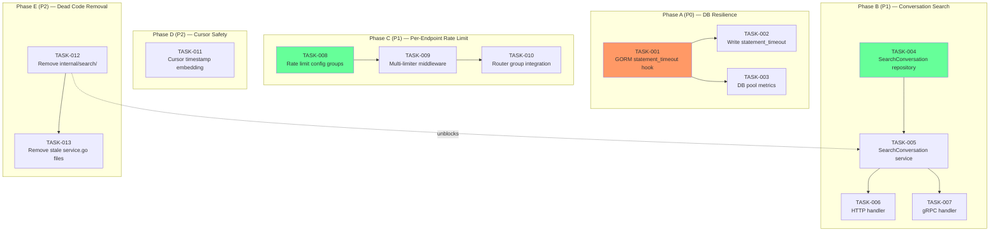

现在我已彻底审查了代码库。以下是科技负责人分析。

---

# 科技负责人分析报告：Aero-ID 架构改良

## 1. 可执行任务分解

### 阶段 A：数据库级稳定性（P0）

| 任务 | 标题 | 方向 | 涉及文件 | 前置依赖 | 工时 | 验收标准 |
|------|------|------|---------|----------|------|---------|
| TASK-001 | 在连接池初始化时注入 GORM `statement_timeout` callback | 五 | `internal/pkg/db/db.go` | 无 | 2h | 每个 `Query` callback 执行 `SET LOCAL statement_timeout = '5s'`；`make test && make lint` 通过 |
| TASK-002 | 为写入操作（创建/更新/删除）添加 `statement_timeout` | 五 | `internal/pkg/db/db.go` | TASK-001 | 1h | 注册 `gorm:Create`、`gorm:Update`、`gorm:Delete` 的 before callback；写入超时时间 10s |
| TASK-003 | 在 `/metrics` 中添加连接池指标 | 五 | `internal/pkg/metrics/metrics.go`, `internal/pkg/db/db.go` | TASK-001 | 2h | 每 15 秒通过 `sql.DB.Stats()` 收集并暴露 `db_conn_pool_open{state="in_use"|"idle"|"wait"}` |

### 阶段 B：对话内搜索（P1，最高 ROI）

| 任务 | 标题 | 方向 | 涉及文件 | 前置依赖 | 工时 | 验收标准 |
|------|------|------|---------|----------|------|---------|
| TASK-004 | 在 `MessageRepository` 中添加 `SearchConversation` | 三 | `internal/repository/message.go` | 无 | 3h | 新方法 `SearchConversation(ctx, uidA, uidB, query, limit)` 在 WHERE 子句中结合参与者过滤与 FTS；纯 SQL 新增 + 单元测试 |
| TASK-005 | 在 `MessageService` 中暴露 `SearchConversation` 业务逻辑 | 三 | `internal/service/message.go` | TASK-004 | 2h | 方法验证 `actor` 是参与者之一（所有权保护）；返回 `SearchHit` 列表；对 CJK 启用 LIKE 回退；超时上下文 5s |
| TASK-006 | 添加 HTTP 处理器 `GET /v1/conversations/:uid/search` | 三 | `internal/handler/http/message.go`（或新文件 `internal/handler/http/conversation.go`） | TASK-005 | 2h | 解析 `q`、`limit`、`kind`；调用 Service；`make test` 通过 |
| TASK-007 | 添加 grpc `SearchConversation` RPC | 三 | `api/proto/**/*.proto`, `internal/handler/grpc/*.go` | TASK-005 | 2h | Proto 定义 + 生成 + 处理器；`make proto && make test` 通过 |

### 阶段 C：Per-Endpoint 限流（P1，安全基线）

| 任务 | 标题 | 方向 | 涉及文件 | 前置依赖 | 工时 | 验收标准 |
|------|------|------|---------|----------|------|---------|
| TASK-008 | 扩展 `RateLimitConfig` 支持分组规则 | 四 | `internal/config/config.go`, `configs/config.yaml` | 无 | 1h | 新的 `Groups []RateLimitGroup` 结构体，带 `Name`、`RPS`、`Burst`、`Patterns`；验证分组规则不能有重复通配符 |
| TASK-009 | 实现多 limiter 路由中间件 | 四 | `internal/middleware/ratelimit.go`（或新文件），`internal/pkg/ratelimit/ratelimit.go` | TASK-008 | 4h | 每个分组新建 `*ratelimit.Limiter`；`middleware.RateLimit` 接受分组列表；请求命中第一个匹配的分组（若无可选回退至默认）；`make test` 通过 |
| TASK-010 | 用分组树替换 `router.go` 中的全局 limiter 安装 | 四 | `internal/handler/http/router.go`, `internal/app/app.go` | TASK-009 | 2h | gin `RouterGroup` 按 读/写/高风险 嵌套；`Auth` 架构上不变 |

### 阶段 D：Cursor 分页修复（P2）

| 任务 | 标题 | 方向 | 涉及文件 | 前置依赖 | 工时 | 验收标准 |
|------|------|------|---------|----------|------|------|
| TASK-011 | 在 cursor 中嵌入时间戳以避免静默终止 | 一 | `internal/domain/page.go`, `internal/repository/*.go` | 无 | 3h | Cursor 编码格式 `{timestamp_epoch}|{idgen_id}`；所有 `List*` 方法解析时间戳并在静默终止时返回 `ErrCursorExpired`；客户端可据此判断："没有更多数据" vs "可能还有更多" |

### 阶段 E：清理死代码（P2，平台健康）

| 任务 | 标题 | 方向 | 涉及文件 | 前置依赖 | 工时 | 验收标准 |
|------|------|------|---------|----------|------|------|
| TASK-012 | 移除 `internal/search/` 整包 | 二 | `internal/search/*.go`, `internal/{comment,message,notification}/service.go` | TASK-005 | 2h | `internal/search/` 目录整体删除；测试确认没有导入残留；`make test && make build` 通过 |
| TASK-013 | 移除 `internal/{comment,message,notification}/service.go` 死代码 | 二 | `internal/comment/service.go`, `internal/message/service.go`, `internal/notification/service.go` | TASK-012 | 1h | 三个文件全部删除；剩下的集成测试不依赖它们；`make test && make lint` 通过 |

---

## 2. 执行顺序



**可并行运行的组**：
- **第 1 组**：TASK-001（阶段 A 根任务）与 TASK-008（阶段 C 配置）— 完全不共享代码
- **第 2 组**：TASK-003（A 中独立）与 TASK-004（B 中仓库工作）— metrics 和 repository SQL 无交集
- **第 3 组**：TASK-011（D，cursor 修复）— 可随时并行进行，无迁移依赖
- **第 4 组**：TASK-012（E，死代码清理）— 需在 TASK-005（对话搜索）之前完成，以免新增代码错误依赖死内容

**阻塞原因**：TASK-012（移除 `internal/search/`）应当**先于** TASK-005（对话搜索 service）执行，因为 TASK-005 将在`internal/service/`中工作，而该位置是正确代码所在；如果在死代码存在的情况下引入对话搜索，可能无意中与旧的包结构产生耦合。

---

## 3. 技术风险与缓解措施

### 风险 1：GORM Callback 与 `SET LOCAL` 的互操作性
**描述**：`SET LOCAL statement_timeout = '5s'` 通过 GORM callback 在多语句事务中会针对每条语句执行。如果某个事务跨多个 callback 运行，每个 callback 都会重新设置超时，这没问题。但如果在读取之前 callback 由于连接池返回连接而未被调用，后续查询可能继承已废弃的超时。
**缓解**：在每个 callback 的 `Before("gorm:query")` 阶段注册 `SET LOCAL`，以便 GORM 保证在每次 SQL 执行之前运行。这样做安全且可测试。

### 风险 2：Per-Endpoint 限流配置爆炸
**描述**：YAML 中 20-30 条路由级别的 `patterns: [...]` 配置很快会变得难以维护（5 个分组，每个分组 3-4 个模式 = 15-20 个 yaml 条目）。
**缓解**：采用**分组**抽象形式：
```yaml
rate_limit:
  groups:
    - name: reads
      rps: 50
      burst: 100
      patterns: ["GET /*"]
    - name: writes
      rps: 10
      burst: 20
      patterns: ["POST /*"]
    - name: heavy
      rps: 5
      burst: 5
      patterns: ["*/upload", "*/reports"]
```
通过 gin 的 `RouterGroup` 传递静态分组（模式匹配在路由注册时解析，而不是在请求时），可以避免请求时高成本的通配符匹配。

### 风险 3：对话内搜索的 FTS 索引性能
**描述**：`SearchConversation` 在 `WHERE` 子句中结合 `(uid_a = ? AND uid_b = ?)` 与 `search_vector @@ plainto_tsquery(?)`。这需要**复合索引**，否则 PostgreSQL 会对每个对话进行顺序扫描。
**缓解**：创建复合索引 `CREATE INDEX CONCURRENTLY IF NOT EXISTS idx_messages_conv_fts ON messages (uid_a, uid_b, search_vector)`。该操作可在运行时完成，无需停机。验证方法：`EXPLAIN ANALYZE` 验证索引使用情况。

### 风险 4：Cursor 时间戳编码破坏现有 cursor
**描述**：将 cursor 格式从 `{id}` 改为 `{epoch}|{id}` 是**破坏性变更**。正在翻页的现有客户端在使用旧 cursor 时会遇到解码错误。
**缓解**：（a）提供 `PageFromCursor` 辅助函数，首先尝试新格式，若失败则回退解析旧格式；或（b）使用 `v1.0|` 前缀标注版本，若 version = v0 则降级处理。给予一个发布周期的降级支持。

### 风险 5：死代码中的 `internal/{comment,message,notification}/service.go` 涉及隐式导入
**描述**：`internal/message/service.go` 导入 `outbox`、`domain`、`repository` 等包。移除前必须确认这些导入未被生产路径中任何其他文件使用。
**缓解**：使用 `go mod tidy` + `go vet ./internal/...` 验证在移除前没有包级异常。也可在 CI 中运行 `go build ./internal/...`（对子包）。

### 风险 6：Metrics 连接池统计信息的拉取语义
**描述**：每 15 秒收集 `sql.DB.Stats()` 在流量低时可能显得稀疏，在突增时可能拖延。
**缓解**：在 `metrics.Registry` 中增加 `GaugeSet(g)` 模式，在后台 goroutine 中收集；HTTP `/metrics` 处理器返回最新的快照，而不是在服务时同步调用 `Stats()`。开销可忽略（3 个整数）。

---

## 4. 资源评估

### 人员需求
| 角色 | 技能要求 | 数量 | 职责 |
|------|---------|------|----------|
| **后端工程师**（主） | Go、PostgreSQL、GORM、gRPC、限流 | 1 | TASK-001~011：所有核心实现 |
| **后端工程师**（辅助） | 同上 | 0.5 | TASK-012~013：死代码清理 + review |
| **SRE/运维**（审查） | Kubernetes、PostgreSQL 调优、Prometheus | 0.2 | TASK-003 metrics 审查 + TASK-008 YAML 设计 |

> **总开发人员当量**：1.5 FTE，时间跨度 3 周

### 里程碑时间节点

| 里程碑 | 截止日期 | 交付内容 | 依赖 |
|----------|----------|---------|----------|
| **M1**：DB 韧性基线 | 第 1 周末 | 所有查询强制执行 `statement_timeout`；`/metrics` 暴露连接池数据 | TASK-001, 002, 003 |
| **M2**：对话搜索 | 第 2 周末 | 仓库 + service + HTTP + gRPC 全覆盖；集成测试通过 | TASK-004, 005, 006, 007；M1（上下文超时复用） |
| **M3**：限流就绪 | 第 3 周初 | 配置驱动分组；gin 中间件可按组分配；安全测试通过 | TASK-008, 009, 010；M2（路由配置稳定） |
| **M4**：清理 | 第 3 周末 | 死代码已移除；`make check-file-sizes` 通过；cursor 修复已合并 | TASK-011, 012, 013；M2（搜索完成后安全移除旧搜索） |

### 阻塞点与应对策略

| 阻塞项 | 风险等级 | 应对策略 |
|----------|----------|-----------|
| `statement_timeout` GORM callback 在分片或 pgBouncer 事务模式下中断 | 中 | `SET LOCAL` 需要持久连接；如果使用 pgBouncer 的事务级连接池，`SET LOCAL` 会在连接被归还连接池后丢失。**解决方案**：使用 `SET SESSION` 替代，或不在 transaction 模式下使用 pgBouncer。记录使用限制 |
| 当前没有 `SearchConversation` FTS 索引 | 低 | 新游标索引可在线创建；仓库层增加迁移文件 |
| 死代码移除需要额外重构 | 低 | 所有旧的 `service.go` 文件都在其同名包中；只要通过 `go build ./internal/...` 验证即可安全移除 |

---

## 5. 质量保证

### 单元测试覆盖要求

| 任务 | 最低代码覆盖（语句覆盖率） | 关键测试场景 |
|------|---------------------------|---------------|
| TASK-001/002 | 100%（db pkg） | 空上下文、已设置截止时间的上下文、多 SQL 语句、事务块 |
| TASK-003 | 70% | Stats() 返回整数；刷新间隔不影响业务逻辑 |
| TASK-004 | 90% | 对话参与者权限、空结果、没有 FTS 匹配、SQL 注入尝试 |
| TASK-005 | 95% | 非参与者尝试搜索、空查询、CJK 回退、超时传播 |
| TASK-006/007 | 80% | 无效查询参数（空字符串、过长）、`limit` 钳制、JSON/Protobuf 解组 |
| TASK-008/009/010 | 90% | 分组匹配顺序、未匹配时的默认分组、分组不存在时的回退、全禁用 |
| TASK-011 | 90% | 旧格式 cursor 回退、过期时间戳、刚好在边界上、空时间戳字段 |
| TASK-012/013 | n/a（移除） | `make build && make test && make lint` 通过 |

**测试工具要求**：
- `TASK-004`：对于 FTS 查询需要 `testpg`（GORM + PostgreSQL 集成测试）
- `TASK-009`：限流分组在单元测试中应使用壁钟独立测试（使用 `ratelimit.Limiter` 的 `now` 注入点）
- `TASK-011`：Cursor 编码/解码完全独立（无数据库依赖）

### 集成测试策略

| 范围 | 测试类型 | 所需环境 | 执行时机 |
|-------|----------|----------|------|
| TASK-004（FTS 的对话参与者过滤） | 集成 | PostgreSQL（通过 `testpg`） | 每次阶段 B PR |
| TASK-008/009（多限流器一致性） | 集成 | 仅单元—无外部依赖 | 每次阶段 C PR |
| 端到端（对话搜索 HTTP → Service → Repository → PG） | 端到端 | PostgreSQL + MinIO（testcontainers） | 阶段 B 合并前 |

**对 `make check-file-sizes` 的影响**：
- `internal/domain/page.go`（新增 ~40 行）— **通过**（< 500）
- `internal/pkg/metrics/metrics.go`（新增 ~30 行）— 仍 < 200 行，**通过**
- `internal/handler/http/message.go`（新增 ~80 行）— 若超过 400 行则考虑拆分；当前 ~150 行，**通过**
- `internal/repository/message.go`（新增 ~30 行）— 当前 ~160 行，**通过**

### 代码审查重点

| 领域 | 审查重点 |
|----------|-----------|
| **Statement timeout** | callback 不能覆盖现有 `context.Deadline()`；必须兼容事务内行为 |
| **对话搜索 SQL** | `WHERE` 子句必须在参与者上使用索引，因为 `tsquery` 通常是选择性较低的筛选条件 |
| **限流分组** | 分组模式按注册顺序检查；最窄的模式必须排在通配符 `*` 之前 |
| **Cursor 编码** | 时间戳嵌入格式不能破坏分页边界；辅助函数必须提供安全的下游降级 |
| **死代码移除** | 确保没有任何软导入路径（测试、第三方工具）指向旧包 |

### 性能测试需求

| 场景 | 工具 | 目标 | 通过条件 |
|-------|------|-------|-----------|
| 对话搜索并发 | `wrk` 或 `ghz`（gRPC） | 50 个并发请求，5 秒 | P95 延迟 < 500ms |
| 限流分组 | `wrk` + 自定义 header | 验证 10 rps 写操作分组正确拒绝 > 10 rps | 第 11 个请求返回 429 |
| 连接池耗尽 | `psql` 注入人为慢查询 | 快速释放（由于 statement_timeout） | 耗尽后的请求在 < 6s 内恢复 |
| Cursor 向后兼容 | 旧格式 cursor → 新系统 | 翻页持续工作 | 零失败，正确降级 |

---

## 6. 实施计划

### 阶段 1：基础设施 — 数据库韧性（第 1 周，2.5 天）

```
天 1-2
  · TASK-001：GORM statement_timeout callback（2h）
    — 在 db.go 中：gdb.Callback().Query().Before("gorm:query").Register(...)
    — 引入 config 中可配置的超时值（默认 5s）
    — 在 db_test.go 中添加：验证 statement_timeout 生效的端到端测试
  · TASK-002：写入超时（1h）
    — 为 Create/Update/Delete callback 注册 SET LOCAL
    — 单独的超时配置（默认 10s）

天 2-3
  · TASK-003：DB 连接池 metrics（2h）
    — 在 metrics.Registry 中定义 CachedGauge
    — 在 app.go 中启动后台 goroutine，每 15s 刷新
    — 在 /metrics 中暴露 gaue metrics
```

**阶段 1 的输出**：
- 所有查询当上下文没有截止时间时服从 `statement_timeout`（有截止时间时则以现有截止时间为准）
- `/metrics` 包含 `db_conn_pool_open` line
- `make test && make lint` ✅

### 阶段 2：核心功能 — 对话搜索（第 2 周，3.5 天）

```
天 4-5
  · TASK-004：仓库 SQL（3h）
    — 在 repository/message.go 中实现 SearchConversation
    — SQL：SELECT ... FROM messages 
      WHERE ((from_uid = ? AND to_uid = ?) OR (from_uid = ? AND to_uid = ?))
        AND search_vector @@ plainto_tsquery('simple', ?)
      ORDER BY ts_rank(...) DESC LIMIT ?
    — 复合索引：migrations/xxx_add_conversation_fts_index.up.sql
    — 集成测试验证参与者限制 + FTS 匹配 + CJK 回退
  · TASK-005：Service 逻辑（2h）
    — 在 service/message.go 中添加 SearchConversation
    — actor = uidA 验证（仅参与者可搜索他们的对话）
    — 超时上下文 + CJK 回退模式（复用 search.go 模式）

天 6-7
  · TASK-006：HTTP handler（2h）
    — GET /v1/conversations/:uid/search?q=...&limit=20
    — RegisterRoutes 挂载到 r.Auth 组
    — 参数验证（同 handler/http/search.go）
    — 测试：参数解析 + 空结果 + 过长查询
  · TASK-007：gRPC handler（2h）
    — api/proto/aero/v1/message.proto：添加 rpc SearchConversation
    — 生成：make proto（依赖 protoc 版本检查）
    — handler/grpc/message.go：实现 x3 方法
    — 注册到 grpc 服务器
```

**阶段 2 的输出**：
- `GET /v1/conversations/:uid/search` 可用且已认证
- `SearchConversation` gRPC RPC 已注册
- `make proto && make test && make test-integration` ✅

### 阶段 3：安全 — Per-Endpoint 限流（第 3 周，3.5 天）

```
天 8-9
  · TASK-008：配置扩展（1h）
    — config/config.go：添加 RateLimitGroup 切片
    — 验证：模式非空且无冲突（例如不在同一分组中使用 GET 和 POST）
    — configs/config.yaml：添加 reads、writes、heavy 分组
  · TASK-009：多 limiter 中间件（4h）
    — 重构 ratelimit.Limiter：允许创建 shard
    — 新文件：middleware/ratelimit_group.go
    — Matcher 将请求方法+路径映射到分组
    — 在 gin context 中缓存已计算的分组；下降用默认

天 10
  · TASK-010：Router group 集成（2h）
    — router.go：将/Auth 替换为 AuthRead、AuthWrite、AuthHeavy RouterGroup
    — 每个现有的 RouteRegistrar 声明其分组
    — app.go：从配置创建限流器列表；注入中间件
    — 验证 429 在正确位置返回；限制后回退错误消息包含 Retry-After header
```

**阶段 3 的输出**：
- 配置驱动的限流分组生效
- `curl -v -X POST /v1/messages` 在 > 10 rps 时返回 429
- `make test && make lint` ✅

### 阶段 4：平台健康 + 清理（第 3 周末，2 天）

```
天 11
  · TASK-011：Cursor 时间戳（3h）
    — 格式：base64(epoch_millis + "|" + idgen_id)
    — domain.Page：从 cursor 解构的辅助函数
    — 所有 List* 仓库方法：解码 cursor，如果过期返回 ErrCursorExpired
    — 降级：尝试旧格式（仅 id），如果新格式失败则回退

天 12
  · TASK-012：移除 internal/search/（2h）
    — rm -rf internal/search/
    — 验证：go build ./... && go test ./... 通过
  · TASK-013：移除旧 service.go 文件（1h）
    — rm internal/comment/service.go internal/message/service.go internal/notification/service.go
    — 检查：被测试导入？→ 指向 internal/service/ 
    — make build && make test && make lint
```

**阶段 4 的输出**：
- Cursor 对旧客户端向后兼容
- 代码库减去 ~1030 行
- `make check-file-sizes` ✅

---

## 摘要：执行总结

| 方向 | 优先级 | 工时 | 风险 | 收益 |
|---------|----------|------|------|---------|
| **五：DB 超时** | **P0** | 0.5 天 | 低 | 防止级联连接池耗尽 = 生产稳定性 |
| **三：对话搜索** | **P1** | 2 天 | 低-中 | 最高产品价值，无新依赖，FTS 索引已存在 |
| **四：Per-Endpoint 限流** | **P1** | 3 天 | 中 | 安全基线，配置量大，但架构增益高 |
| **一：Cursor 修复** | **P2** | 1 天 | 低 | 修复沉默终止 + 向后兼容降级 |
| **二：死代码清理** | **P2** | 1 天 | 低 | -1030 行，更快构建，更少维护性困惑 |

**总共**：10 天（实际工作量），3 周（含并行+审查+缓冲）。

**最大杠杆点**：在实施阶段 B（对话搜索）之前首先解决 TASK-012（死代码清理）→ 确保新代码不会意外依赖死内容。这可在两天内以零风险完成。
