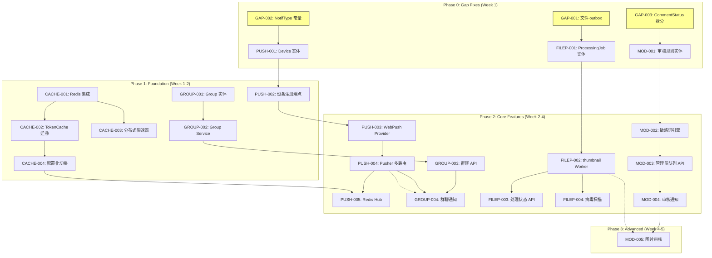

# Tech Lead 分析报告

## 1. 任务分解

基于验证报告的五个扩展方向 + 三个跨领域缺口，按业务价值和技术依赖拆解。每个任务 2-4 小时可完成。

### 1.1 跨领域前置任务（缺口修复）

| 任务 ID | 标题 | 方向 | 涉及文件 | 前置依赖 | 工时(h) | 验收标准 |
|---------|------|------|---------|---------|---------|---------|
| GAP-001 | 文件服务接入 outbox 事件 | 跨领域 | `internal/service/file.go`, `internal/domain/event.go`（新增 event 常量） | 无 | 3 | `file.created`, `file.deleted`, `file.shared` outbox 事件正确发布；集成测试验证 relay 可消费 |
| GAP-002 | 通知类型常量集中定义 | 跨领域 | `internal/domain/notiftype.go`（新增文件） | 无 | 2 | 所有散落字符串替换为类型安全常量；`notificationFor()` 编译通过；附录文档同步 |
| GAP-003 | CommentStatusHidden 拆分为业务子状态 | 跨领域 | `internal/domain/comment.go`, `internal/repository/comment.go`, migration 文件 | 无 | 3 | 新增 `HiddenByAuthor` / `HiddenByModerator` 子枚举（或独立字段）；旧迁移增加数据迁移脚本；不影响现有 API 合约 |

**并行性**：GAP-001、GAP-002、GAP-003 可完全并行。

### 1.2 方向一：推送通知基础设施

| 任务 ID | 标题 | 方向 | 涉及文件 | 前置依赖 | 工时(h) | 验收标准 |
|---------|------|------|---------|---------|---------|---------|
| PUSH-001 | 定义 `Device` 实体与迁移 | 方向一 | `internal/domain/device.go`（新增）, `migrations/000021_create_devices.up.sql`, `internal/repository/device.go`（新增） | GAP-002 | 3 | Device 表创建；OwnerUID+Platform 唯一约束；repository CRUD 方法测试通过 |
| PUSH-002 | 实现设备注册/注销 HTTP+gRPC 端点 | 方向一 | `internal/handler/http/device.go`（新增）, `internal/handler/grpc/aeropb/*`（proto 更新）, `internal/service/device.go`（新增） | PUSH-001 | 4 | `POST /v1/devices` + `DELETE /v1/devices/:id` 正确持久化设备 token；gRPC 相同行为 |
| PUSH-003 | WebPush 集成（抽象 Provider + VAPID 密钥管理） | 方向一 | `internal/push/webpush.go`（新增, Provider interface）, `internal/push/vapid.go`（新增）, `configs/config.yaml`（新增 push 段）, `internal/config/config.go` | PUSH-002 | 4 | HTTP POST 到 WebPush endpoint 返回成功；配置缺失时 graceful skip |
| PUSH-004 | NotificationPusher 接口扩展 + 多 Provider 路由 | 方向一 | `internal/service/notification.go`, `internal/service/mocks/notification.go`, `internal/hub/adapter.go` | PUSH-003, GAP-002 | 3 | `Publish()` 同时写入 Hub + WebPush（按配置）；回退逻辑测试覆盖 |
| PUSH-005 | SSE Hub 横向扩展方案（Redis PubSub 后端） | 方向一 | `internal/hub/hub.go`, `internal/hub/redis.go`（新增）, `configs/config.yaml` | PUSH-004 | 4 | Hub 可在 Redis PubSub 模式下运行；多实例间事件广播正确；与纯内存模式可切换 |

**关键点**：PUSH-003（WebPush 集成）涉及与外部 WebPush 服务交互，建议先 mock 后集成。PUSH-005（Redis Hub）可以延后——MVP 只做 PUSH-001~004，单实例即可。

### 1.3 方向二：群组/多人群聊

| 任务 ID | 标题 | 方向 | 涉及文件 | 前置依赖 | 工时(h) | 验收标准 |
|---------|------|------|---------|---------|---------|---------|
| GROUP-001 | 定义 Group/GroupMember 实体与迁移 | 方向二 | `internal/domain/group.go`（新增）, `migrations/*.sql`（2-3 个迁移）, `internal/repository/group.go`（新增） | 无 | 4 | Group 表、GroupMember 表创建；owner_role / admin_role / member_role 枚举；repository 方法覆盖 CRUD + 成员管理 |
| GROUP-002 | Group Service + 消息路由策略 | 方向二 | `internal/service/group.go`（新增）, `internal/service/message.go`（修改） | GROUP-001 | 4 | `MessageService.Send()` 按 to_uid 是否指向 group 判断路由；群发消息写入 `group_messages` 表 |
| GROUP-003 | 群聊 HTTP+gRPC 端点 | 方向二 | `internal/handler/http/group.go`, `internal/handler/grpc/`（proto 更新）| GROUP-002 | 4 | 创建群/邀请/踢出/群发消息/群消息列表 API；权限校验（owner/admin） |
| GROUP-004 | 群聊通知集成（@提及、新成员加入等） | 方向二 | `internal/service/notification.go`, `internal/push/` | GROUP-003, PUSH-004 | 3 | 群消息触发 @提及通知；新成员加入触发加入通知；outbox 事件发布 |

**并行性**：GROUP-001 与 PUSH-001~003 可以并行。

### 1.4 方向三：文件处理管线

| 任务 ID | 标题 | 方向 | 涉及文件 | 前置依赖 | 工时(h) | 验收标准 |
|---------|------|------|---------|---------|---------|---------|
| FILEP-001 | 定义 FileProcessingJob 实体与迁移 | 方向三 | `internal/domain/file_processing.go`（新增）, `migrations/*.sql` | GAP-001 | 3 | `file_processing_jobs` 表；Status 枚举（Pending/Processing/Done/Failed）；关联 file_id |
| FILEP-002 | 异步 Worker 框架 + thumbnail 处理 | 方向三 | `internal/fileproc/worker.go`（新增）, `internal/fileproc/thumbnail.go`（新增）, `internal/storage/storage.go`（扩展 FileStorage 接口） | FILEP-001 | 4 | image 上传自动触发 thumbnail processing；缩略图生成后写入 storage；worker 使用 outbox relay 机制 |
| FILEP-003 | 文件处理状态 API | 方向三 | `internal/handler/http/file.go`（扩展）, `internal/service/file.go`（修改） | FILEP-002 | 2 | `GET /v1/files/:id/processing` 返回处理状态；`file.created` 事件携带初始 Pending 状态 |
| FILEP-004 | 病毒扫描集成 | 方向三 | `internal/fileproc/scan.go`（新增）, `configs/config.yaml` | FILEP-002 | 3 | ClamAV 或替代方案集成；扫描结果记录到 job；感染文件自动阻止下载 |

**关键风险**：FILEP-002 的 thumbnail 实现需要引入 image 处理库（如 `github.com/disintegration/imaging` 或 `github.com/nickalie/go-webp`），需要评估依赖大小和许可证。建议先做一个 `libvips` CLI 封装版本——不引入 Go image 库的复杂依赖。

### 1.5 方向四：分布式缓存与限速

| 任务 ID | 标题 | 方向 | 涉及文件 | 前置依赖 | 工时(h) | 验收标准 |
|---------|------|------|---------|---------|---------|---------|
| CACHE-001 | Redis 客户端集成 + 配置 | 方向四 | `internal/cache/redis.go`（新增）, `configs/config.yaml`, `internal/config/config.go` | 无 | 2 | Redis 连接池正确；配置读取；优雅 shutdown；连接失败时 fallback 到内存模式 |
| CACHE-002 | TokenCache 迁移到 Redis | 方向四 | `internal/sso/token_cache.go`（重写）, `internal/sso/user_cache.go`（重写） | CACHE-001 | 3 | TokenCache 使用 Redis TTL 存储；与原 sync.Map 接口一致；集成测试验证 |
| CACHE-003 | 分布式限速器 | 方向四 | `internal/pkg/ratelimit/ratelimit.go`（重写）, `internal/pkg/ratelimit/redis.go`（新增） | CACHE-001 | 3 | 使用 Redis 的滑动窗口 / 令牌桶实现；与现有 `RateLimiter` interface 兼容；`notifRateLimiter` 也迁移 |
| CACHE-004 | 配置化切换（内存 <-> Redis） | 方向四 | `internal/app/app.go`（修改）, `internal/cache/cache.go`（抽象接口） | CACHE-002, CACHE-003 | 2 | `cache_type: memory|redis` 配置项；切换无感；生产环境默认 redis |

**并行性**：CACHE-001 无依赖，可排为 P0 先行。

### 1.6 方向五：自动化审核管线

| 任务 ID | 标题 | 方向 | 涉及文件 | 前置依赖 | 工时(h) | 验收标准 |
|---------|------|------|---------|---------|---------|---------|
| MOD-001 | 定义自动审核规则实体 + 迁移 | 方向五 | `internal/domain/auto_moderation.go`（新增）, `migrations/*.sql` | GAP-003 | 3 | `moderation_rules` 表；规则类型（敏感词/频率/...）；repository CRUD |
| MOD-002 | 文本敏感词审核引擎 | 方向五 | `internal/moderation/text.go`（新增）, `internal/moderation/engine.go`（新增） | MOD-001 | 4 | 敏感词匹配（Trie/Aho-Corasick）；`Comment.Create()`/`Message.Send()` 中调用；命中触发自动隐藏+通知 |
| MOD-003 | 管理员审核队列 API | 方向五 | `internal/handler/http/admin.go`（新增）, `internal/service/admin.go`（新增, 或合并到 moderation service） | MOD-002 | 3 | `GET /v1/admin/reports`（分页+筛选+排序）；`PATCH /v1/admin/reports/:id`（标记处理）；权限校验（admin role） |
| MOD-004 | 审核操作 outbox 事件 + 通知 | 方向五 | `internal/service/moderation.go`, `internal/service/notification.go` | MOD-003, PUSH-004 | 2 | `comment.auto_hidden`, `report.resolved` 通知类型；用户收到自己的内容被审核的通知 |
| MOD-005 | 图片审核集成（NSFW/暴力检测） | 方向五 | `internal/moderation/image.go`（新增）, `configs/config.yaml` | FILEP-002, MOD-003 | 4 | 上传图片自动触发审核；NSFW 内容标记并阻止公开访问；可配置阈值 |

**关键风险**：MOD-005（图片审核）强依赖第三方 API 或模型推理。建议设计为 plugin 模式——内置一个简单的基于 hash 的已知 NSFW 图片检测，外部 API 通过 interface 插件化。

---

## 2. 执行顺序



### 可并行任务组

| 组 | 任务 | 说明 |
|----|------|------|
| **组 A** | GAP-001, GAP-002, GAP-003 | 三个缺口修复完全独立 |
| **组 B** | CACHE-001, PUSH-001, GROUP-001, FILEP-001, MOD-001 | 首批实体/REDIS 初始化——无相互依赖 |
| **组 C** | CACHE-002 + CACHE-003 | 共享 Redis 连接 |
| **组 D** | PUSH-002 → PUSH-003 → PUSH-004 | 推送链式依赖——不可并行 |
| **组 E** | FILEP-002 → FILEP-003 / FILEP-004 | worker 先完成，API 和扫描可并行 |
| **组 F** | MOD-002 → MOD-003 → MOD-004 | 引擎先完成，队列 API 和通知可并行 |
| **组 G** | PUSH-005, GROUP-004, MOD-005 | 高级特性——所有子方向汇合 |

---

## 3. 技术风险

### 3.1 高风险项

| 风险 | 影响方向 | 风险等级 | 说明 | 缓解策略 |
|------|---------|---------|------|---------|
| **WebPush 集成复杂** | PUSH-003 | 🟠 中 | WebPush 需要 VAPID 密钥、与浏览器 Push API 握手；标准不统一 | 使用成熟库 `github.com/SherClockHolmes/webpush-go`；MVP 只支持单一 Push Service（Chrome/Firefox）；编写集成测试留到阶段 3 |
| **Redis Hub 一致性问题** | PUSH-005 | 🟠 中 | 多实例 SSE 最难的是"client 连 A 实例，事件发布到 B 实例"的广播 | Redis PubSub 天然支持广播，但需要处理：client 断连时清除订阅、实例故障时重新均衡。MVP 可以先不做——单实例生产可用 |
| **图片审核精度** | MOD-005 | 🔴 高 | 第三方 NSFW API 有延迟和成本；本地模型推理需要 GPU | 分层策略：先做基于已知 hash（PhotoDNA 换皮）的精确匹配；NSFW API 通过 interface 插件化；本地推理用 TensorFlow Lite + `github.com/nickalie/go-tflite` 作为远期目标 |
| **Thumbnail 性能与格式** | FILEP-002 | 🟠 中 | 大量并发上传时缩略图处理可能成为瓶颈；不同格式支持复杂 | 使用 `nfnt/resize` + `libvips` CLI fallback；worker 池限制并发（runtime.GOMAXPROCS）；仅处理 image/ 类型文件 |
| **Group 消息存储膨胀** | GROUP-002 | 🟢 低 | 大群（1000+人）消息写入群消息表 + 每个成员写一份？ | 不走 Fan-out 写。群消息只存一条 `group_messages`；读时 `ListByGroup` + 最后读取时间做增量拉取；member 数量 > 100 时用 offset-based 分页 |

### 3.2 外部依赖评估

| 依赖 | 用途 | 可选替代 |
|------|------|---------|
| `go-redis/redis/v9` | Redis 客户端 | `rueidis`（更佳性能，但 API 较新） |
| `SherClockHolmes/webpush-go` | WebPush | 直接 HTTP POST（标准 VAPID） |
| `disintegration/imaging` | Image resize/thumbnail | `libvips` CLI + `os/exec`（零 Go 依赖） |
| `nlopes/slack` / Telegram Bot API | 管理员告警（可选） | Webhook 直发 |
| `gorilla/websocket` | SSE => WebSocket 升级（远期） | `nhooyr.io/websocket` |

### 3.3 测试难点

| 模块 | 测试难点 | 策略 |
|------|---------|------|
| WebPush | 需要真实的 Push Service endpoint | 使用 httptest 模拟 Push Service；canned responses 覆盖 410 Gone（需注销设备） |
| Redis 组件 | 需要 Redis 实例 | 使用 `testcontainers-redis`（已在 testpg 模式内）；integration tags 隔离 |
| Thumbnail worker | 图片处理结果验证 | 生成已知尺寸的测试图片（1×1 PNG, 100×100 JPEG）；断言缩略图尺寸和格式；bypass external lib |
| 敏感词审核 | 大量词库测试覆盖 | 使用短词库 + test table 驱动；benchmark 测试 10K 词库性能 |

---

## 4. 资源评估

### 4.1 人员配置

| 角色 | 数量 | 技能要求 | 承担方向 |
|------|------|---------|---------|
| **Backend Go 工程师** | 2 人 | Go 1.26+, GORM, gRPC/protobuf, Redis, Postgres | 全方向主力 |
| **全栈/前端工程师** | 0.5 人 | SSE, WebPush, 浏览器 Notification API | 方向一（WebPush 客户端验证） |
| **DevOps/SRE** | 0.5 人 | Redis, Docker, Compose, CI/CD | 方向四（Redis 部署配置） |
| **QA 工程师** | 1 人 | Go test, integration test, load test | 全方向测试覆盖 |

**推荐最小团队**：2 名 Backend（其中 1 人兼 DevOps）+ 1 名 QA = 3 人 Full-time。

### 4.2 关键里程碑

| 里程碑 | 时间节点 | 交付物 | 验收 gate |
|--------|---------|--------|----------|
| **M0** | Day 5 | 3 个 GAP 修复 + 测试 | `make test && make lint && make test-integration` 全绿 |
| **M1** | Day 12 | 首批实体到位：Device, Group, ProcessingJob, ModerationRule | 所有 migration 可回滚；repository 覆盖 |
| **M2** | Day 20 | 设备注册 + WebPush 集成 + Redis 缓存 | `POST /v1/devices` 返回 201；推送消息可达 |
| **M3** | Day 25 | 群聊 API + 消息路由 | 群聊创建/发消息/列表 e2e 工作 |
| **M4** | Day 30 | Thumbnail worker + 文件处理 API | 上传图片后自动生成缩略图 |
| **M5** | Day 35 | 敏感词审核 + 管理员队列 | `POST /v1/comments` 含敏感词自动隐藏 |
| **M6** | Day 42 | 全功能集成测试 + 性能测试 | Load test 通过（100 concurrent users） |
| **Release** | Day 45 | v2.0.0 发布 | 所有方向 P0 完成；文档同步；CHANGELOG |

### 4.3 阻塞点（Blockers）

| Blocker | 影响范围 | 级别 | 解决策略 |
|---------|---------|------|---------|
| **WebPush 客户端集成** | PUSH-003 验收 | 🟠 中 | Service Worker + manifest.json 需前端配合。如无前端资源，可以使用 `curl` + `web-push` npm 包人工验证 |
| **Redis 集群部署** | CACHE-002~004 | 🟢 低 | 本地 dev environment 用 Docker Compose 单机 Redis；生产环境 infra 需 SRE 配合 |
| **ClamAV 安装** | FILEP-004 | 🟢 低 | Docker 内运行 ClamAV daemon；本地测试 mock+stub |
| **NSFW 图片数据集** | MOD-005 | 🟠 中 | Google Cloud Vision API / AWS Rekognition 免费 tier 做 demo；不需要本地数据集 |

---

## 5. 质量保证

### 5.1 单元测试覆盖

| 模块 | 最低覆盖要求 | 关键测试场景 |
|------|------------|-------------|
| `service/*` | ≥ 85% | 业务规则校验；授权/ownership 检查；outbox 事件发布断言 |
| `repository/*` | ≥ 80% | CRUD 核心路径；软删除过滤；cursor 分页边界 |
| `domain/*` | ≥ 90% | enum 合法值检验；CommentNesting 深度校验 |
| `push/*` | ≥ 70% | Provider 接口 mock；重试/回退逻辑；错误处理 |
| `moderation/*` | ≥ 80% | 敏感词命中/不命中；边界 case（Unicode, 空格绕行）；空词库 |
| `cache/*` | ≥ 80% | Redis 错误传播；memory fallback 切换；TTL 过期 |
| `handler/*` | ≥ 70% | 请求/响应的序列化反序列化；错误码映射 |

**测试约定**：
- 所有 service 测试使用 `internal/service/mocks/` 中的 mock
- handler 测试使用 `httptest` (HTTP) + `grpc_testing` (gRPC)
- 新增的 `push`、`moderation`、`fileproc`、`cache` 包保持同目录的 `_test.go`
- 不使用 `init()`、`TestMain()` 之外的 global state

### 5.2 集成测试策略

| 测试套件 | 范围 | 工具 | 运行时机 |
|---------|------|------|---------|
| **数据库集成** | Group/Device/ModerationRule/ProcessingJob repository | `testpg` + testcontainers | `make test-integration` |
| **Redis 集成** | TokenCache, RateLimiter with real Redis | `testcontainers` (redis image) | `make test-integration` |
| **WebPush e2e** | 全链路：设备注册 → 消息发送 → 推送通知 | `httptest` + mock Push Service | 单独 tag `//go:build integration_push` |
| **文件管线 e2e** | 上传 → thumbnail worker → 缩略图可访问 | `testpg` + MinIO | `make test-integration` |
| **审核 e2e** | 评论发送 → 敏感词检测 → 自动隐藏 → 通知 | `testpg` | `make test-integration` |

**规范**：所有集成测试带 `//go:build integration` tag，不影响 `go test ./...`。新增的 Redis 集成测试放到 `internal/cache/` 包内。

### 5.3 代码审查要点

| 审查项 | 检查点 |
|--------|-------|
| **架构合规** | handler→service→repository 单向依赖没有被打破；不引入跨包循环 import |
| **文件大小** | 新建文件 ≤ 500 行；修改后原文件 ≤ 500 行 |
| **函数复杂度** | `funlen` ≤ 50 行；`cyclop` ≤ 10；`if` 嵌套 ≤ 3 |
| **接口设计** | 每个 interface ≤ 5 个方法；`NotificationPusher` 扩展后签名是否仍然合理 |
| **错误处理** | 所有外部调用错误被封装为 `*AppError`；没有 `panic`（除 `domain` 包的哨兵值） |
| **测试缺口** | 新代码的测试覆盖是否 ≥ 70%；migration 的 `.down.sql` 是否存在 |
| **安全** | WebPush VAPID 密钥不在日志中暴露；Redis 密码通过 env 注入 |

### 5.4 性能测试需求

| 场景 | 目标 | 工具 | 指标 |
|------|------|------|------|
| 群聊消息发送（1000 人群） | < 200ms P99 | `k6` / `ghz` 自定义脚本 | 响应时间、DB 连接池压力 |
| 文件上传 + Thumbnail | < 30s P95（含处理） | `wrk` 模拟并发上传 | 吞吐量、worker 队列堆积 |
| Redis 缓存 + 限速 | < 5ms P99（额外延迟） | `ghz` + 切换开关 | 缓存命中率、全局限速准确率 |
| 敏感词审核吞吐 | > 500 msg/s | `pprof` + `benchmem` | 内存分配、CPU 时间 |
| SSE 多实例广播 | < 100ms 广播延迟 | 自定义测试（2 Redis instances） | 事件延迟、PubSub 压力 |

---

## 6. 实施计划

### 甘特图（Day 1-45）

```
Day         1    5    10   15   20   25   30   35   40   45
Phase 0: Gap Fixes
  GAP-001   [====]
  GAP-002   [===]
  GAP-003   [====]

Phase 1: Foundation
  CACHE-001      [==]
  CACHE-002           [==]
  CACHE-003           [===]
  CACHE-004                [==]
  PUSH-001       [==]
  PUSH-002            [====]
  GROUP-001      [====]
  GROUP-002           [====]
  FILEP-001      [===]
  MOD-001        [===]

Phase 2: Core Features
  PUSH-003                [====]
  PUSH-004                     [===]
  PUSH-005                          [====]
  GROUP-003                [====]
  GROUP-004                     [===]
  FILEP-002                [====]
  FILEP-003                     [==]
  FILEP-004                     [===]
  MOD-002                  [====]
  MOD-003                       [===]
  MOD-004                       [==]

Phase 3: Advanced & Polish
  MOD-005                           [====]
  Full Integration Test             [=====]
  Load Test + Perf Tuning              [===]
  Documentation + Changelog             [==]
  Release                               [=]
```

### 分阶段详细计划

---

#### 阶段 0 — 基础设施准备（Day 1-5）

**目标**：修复三个跨领域缺口，为所有方向打地基。

| Day | 工作项 | 负责人 |
|-----|--------|-------|
| 1 | GAP-002: NotifType 常量提取 + 替换散落字符串 | Engineer A |
| 1 | GAP-003: CommentStatusHidden 拆分 + 迁移 | Engineer B |
| 2-3 | GAP-001: 文件 outbox 事件接入（file.created/deleted/shared） | Engineer A |
| 3-4 | CACHE-001: Redis 客户端集成 + config | Engineer A |
| 4-5 | GAP-003 数据库迁移验证 + rollback | Engineer B |
| 5 | **M0 Gate**: `make test && make lint && make test-integration` | Both |

**并行策略**：Engineer A（GAP-002 → GAP-001 → CACHE-001），Engineer B（GAP-003），Day 5 合并验证。

---

#### 阶段 1 — 实体与核心基础设施（Day 6-14）

**目标**：所有扩展方向的基础实体 + repository 层就绪。

| Day | 工作项 | 负责人 |
|-----|--------|-------|
| 6-7 | PUSH-001: Device entity + migration + repository | Engineer A |
| 6-9 | GROUP-001: Group/GroupMember entity + migration + repository | Engineer B |
| 8-9 | FILEP-001: FileProcessingJob entity + migration | Engineer A |
| 9-10 | MOD-001: ModerationRule entity + migration | Engineer B |
| 10-11 | CACHE-002: TokenCache Redis 实现 | Engineer A |
| 11-12 | CACHE-003: RateLimiter Redis 实现 | Engineer A |
| 12-13 | PUSH-002: Device endpoint (HTTP+gRPC) | Engineer B |
| 13-14 | CACHE-004: 配置化切换 + 集成测试 | Engineer A |
| 14 | **M1 Gate**: 所有实体迁移可回滚；repository test 全绿 | Both |

---

#### 阶段 2 — 核心功能实现（Day 15-30）

**目标**：方向一、二、三、五核心功能投产。

**子阶段 2a — 推送 & 消息（Day 15-22）**

| Day | 工作项 | 负责人 |
|-----|--------|-------|
| 15-16 | PUSH-003: WebPush Provider (vapid key + push service) | Engineer A |
| 17 | PUSH-004: Pusher 多路由 + fallback | Engineer A |
| 18-19 | GROUP-002: Group Service + Message 路由策略 | Engineer B |
| 20-21 | GROUP-003: Group HTTP+gRPC API | Engineer B |
| 22 | PUSH-005 启动（Redis Hub 调研 + 原型） | Engineer A |

**子阶段 2b — 文件管线（Day 17-25）**

| Day | 工作项 | 负责人 |
|-----|--------|-------|
| 17-20 | FILEP-002: thumbnail worker (image resize + storage) | Engineer A |
| 21-22 | FILEP-003: Processing status API | Engineer A |
| 23-25 | FILEP-004: Virus scan integration (ClamAV wrapper) | Engineer A |

**子阶段 2c — 审核管线（Day 16-28）**

| Day | 工作项 | 负责人 |
|-----|--------|-------|
| 16-19 | MOD-002: 敏感词审核引擎（Aho-Corasick Trie） | Engineer B |
| 20-22 | MOD-003: 管理员审核队列 API | Engineer B |
| 23-24 | GROUP-004: 群聊通知集成 | Engineer B |
| 23-24 | MOD-004: 审核操作通知 | Engineer B |
| 25-28 | 集成测试：全方向功能验证 | QA + Both |
| 28-30 | Bug fixing + perf tuning | Both |

**里程碑**：M2（Day 20, Push 可用）、M3（Day 25, 群聊可用）、M4（Day 30, 文件缩略图可用）、M5（Day 35, 审核可用）

---

#### 阶段 3 — 高级特性 + 集成测试（Day 31-42）

| Day | 工作项 | 负责人 |
|-----|--------|-------|
| 31-34 | PUSH-005: Redis Hub 完整实现 + 多实例测试 | Engineer A |
| 31-34 | MOD-005: 图片审核集成（plugin-based） | Engineer B |
| 35-37 | 全链路集成测试（含 Redis / MinIO / ClamAV） | QA + Both |
| 38-40 | 性能测试 + 调优（k6 scenario） | Both |
| 40-41 | 文档更新（README API 表 + ADRs） | Both |
| 41-42 | CHANGELOG + tag + CI/CD 流水线 | DevOps |

---

#### 阶段 4 — 发布（Day 43-45）

| Day | 工作项 | 负责人 |
|-----|--------|-------|
| 43 | Pre-release 测试（staging environment） | Both |
| 44 | Release candidate v2.0.0-rc1 | DevOps |
| 45 | **Go/No-Go Decision** → Release 正式版 | PM + Dev Lead |

---

## 总结与关键建议

1. **Phase 0 不可省略**。GAP-001~003 虽然看起来是"清理工作"，但它们直接影响其他方向的可行性。特别是 outbox 接入——文件处理管线（方向三）和审核通知（方向五）都依赖它。

2. **PUSH-005（Redis Hub）推迟到 Phase 3**。单实例 SSE 已经能满足多数生产场景。多实例水平扩展是一个"nice to have"而非 MVP 必须。同理，MOD-005（图片审核）也可以推迟——文本审核先上线，覆盖 80% 的滥用场景。

3. **Group 模型的设计决策要提前做**：消息是 Fan-out on write（群发时写 N 条）还是 Fan-out on read（存一条 + 游标追踪）？建议选择后者（存一条 `group_messages`，成员用自己的 `last_read_at` 拉增量），这个决策影响 migration 和 repository 设计，应在 GROUP-001 启动时确认。

4. **Redis 集成采用"渐进式 fallback"**：CACHE-002~004 的配置化切换（`memory:redis`）非常重要——避免 Redis 故障导致整个 aero-id 不可用。建议 production 默认 `redis`，失效时降级到 `memory`（降低可用性但不断服）。

5. **测试构建时间注意**：Redis + MinIO 集成测试的 testcontainers 启动时间较长（~30s/容器）。建议将方向相关的集成测试拆分为多个 `_test.go` 文件，每个文件声明各自需要的容器，这样 CI 可以并行跑。
