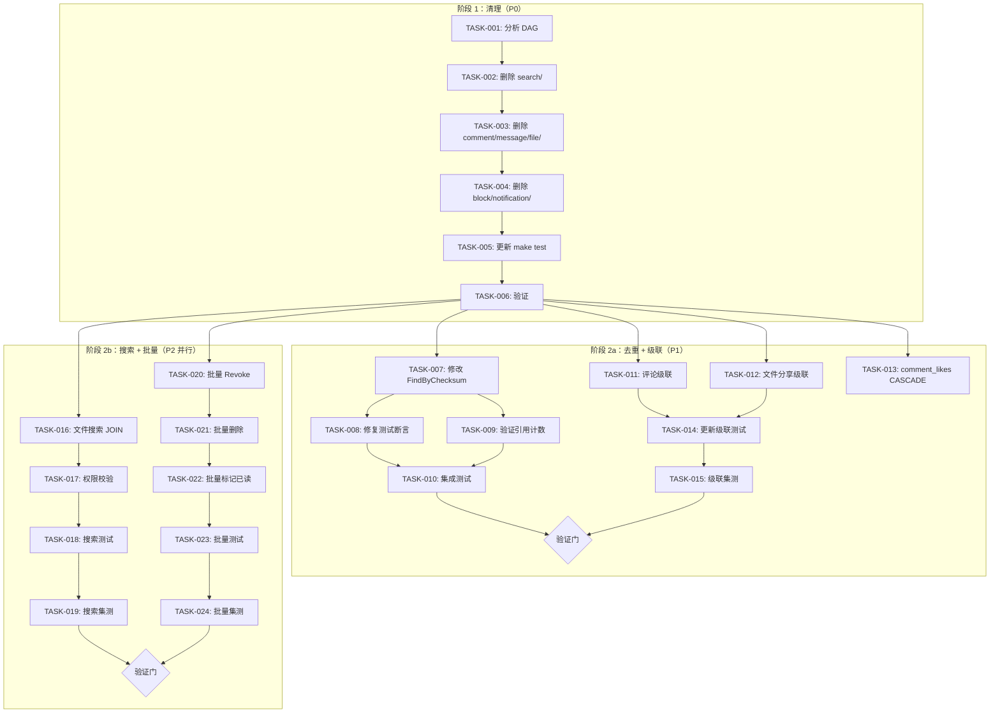

我现在对所有五个方向都有了扎实的理解。以下是综合分析。

---

# Tech Lead 分析报告：aero-id 代码审查后续行动

## 0. 执行摘要

本分析基于一份对五个方向的代码审查（涵盖约 20 个代码点）。审查质量很高（4.5/5 方向完全准确）。关键发现：**存在 ~7,000 行死代码（新旧包并存）**，内容去重作用域错误，以及多个级联软删除缺口。实施计划需要 ~4-6 周，由 1 名高级工程师进行 3 个阶段的分批实施。

---

## 1. 任务分解

### 方向 1：双实现清理（P0——必须先做）

在 `internal/{comment,message,file,block,search,notification}/` 中存在一个废弃但完整的新架构实现。估算有 ~4,593 行非测试代码 + ~2,406 行测试代码是死代码。它在 Go 中能通过编译，得益于 unused 导入不会因死包而报错，但代码库存在重复，测试存在虚假覆盖率，给维护人员带来认知负担。

| ID | 标题 | 涉及文件 | 前置依赖 | 预估工时 |
|---|---|---|---|---|
| TASK-001 | 分析死代码 DAG 并创建删除计划 | *所有新包文件* | 无 | 2h |
| TASK-002 | 从搜索层删除 `internal/search/` | `internal/search/*.go` | TASK-001 | 2h |
| TASK-003 | 删除 `internal/{comment,message,file}/` | `internal/comment/*.go`, `internal/message/*.go`, `internal/file/*.go` | TASK-002 | 4h |
| TASK-004 | 删除 `internal/{block,notification}/` | `internal/block/*.go`, `internal/notification/*.go` | TASK-003 | 2h |
| TASK-005 | 更新 `make test` 以排除死代码测试，使覆盖基线下降 | `Makefile`, CI 配置 | TASK-004 | 1h |
| TASK-006 | 验证删除后编译通过，`make test && make lint` 通过 | 全部 | TASK-005 | 1h |

**验收标准：** 仓库中不再有 `internal/{comment,message,file,block,search,notification}/` 目录。`make test && make lint` 通过。`internal/service/` 和 `internal/repository/` 是唯一的业务逻辑层。

### 方向 2：跨用户内容去重（P1）

`FindByChecksum` 当前按 `WHERE owner_uid = ? AND checksum = ?` 限定作用域，这阻止了跨用户去重。`storage_refs` 表和引用计数逻辑已准备就绪，但只在单用户场景下使用。

| ID | 标题 | 涉及文件 | 前置依赖 | 预估工时 |
|---|---|---|---|---|
| TASK-007 | 修改 `FindByChecksum` 移除 `owner_uid` 条件 | `internal/repository/file.go:116` | TASK-006 | 2h |
| TASK-008 | 修复跨用户去重的测试断言 | `internal/repository/file_test.go:177-178` | TASK-007 | 1h |
| TASK-009 | 验证 `Increment`/`Decrement` 在跨用户场景下的引用计数语义 | `internal/service/file.go:240-252`, `internal/storage/gc/sweeper.go` | TASK-008 | 2h |
| TASK-010 | 运行 `make test-integration` 并通过 | 全部 | TASK-009 | 1h |

**验收标准：** 跨用户 `FindByChecksum` 调用返回匹配的记录。现在不同用户上传相同内容的文件可共享同一个底层 blob。`storage_refs.ref_count` 在跨用户场景下正确递增/递减。

### 方向 3：软删除级联语义（P1）

评论删除不会清理回复。文件删除不会清理 `file_shares`。`message_reactions` 的 `ON DELETE CASCADE` 对软删除无效。`comment_likes` 没有 CASCADE——但对 `UPDATE` 语义（软删除）而言，这不是问题。

| ID | 标题 | 涉及文件 | 前置依赖 | 预估工时 |
|---|---|---|---|---|
| TASK-011 | 评论删除：级联软删除回复 | `internal/comment/service.go:227` | TASK-006 | 3h |
| TASK-012 | 文件删除：级联清理 `file_shares` | `internal/service/file.go:240-252` | TASK-006 | 3h |
| TASK-013 | 为 `comment_likes` 添加 `ON DELETE CASCADE` 迁移（用于未来物理删除场景） | `migrations/000005_create_comment_likes.up.sql`, 新建迁移 | TASK-006 | 1h |
| TASK-014 | 更新软删除相关测试 | `internal/service/comment_test.go`, `internal/service/file_test.go` | TASK-011, TASK-012 | 3h |
| TASK-015 | 添加集成测试验证级联语义 | `internal/repository/comment_test.go` 等 | TASK-014 | 3h |

**验收标准：** 删除评论会软删除其所有回复。删除文件会撤销所有关联的分享。`make test && make test-integration` 通过。

### 方向 4：搜索范围扩展（P2）

文件搜索仅限 `owner_uid`。无 `file_shares` JOIN 路径，无私密/分享内容搜索。GIN 索引已存在。

| ID | 标题 | 涉及文件 | 前置依赖 | 预估工时 |
|---|---|---|---|---|
| TASK-016 | 在 `SearchFiles` 中添加 `file_shares` JOIN 路径 | `internal/repository/file.go:216-238` | TASK-006 | 4h |
| TASK-017 | 在服务层添加 `CheckFileReadAccess` 权限校验 | `internal/service/file.go`, `internal/service/search.go:110` | TASK-016 | 3h |
| TASK-018 | 为搜索范围扩展添加测试 | `internal/service/search_test.go`, `internal/repository/file_test.go` | TASK-017 | 3h |
| TASK-019 | 在集成测试中验证共享文件的可搜索性 | `internal/repository/search_integration_test.go` | TASK-018 | 2h |

**验收标准：** 被授予文件访问权限的用户可以通过搜索找到该文件。权限校验与 `CanReadFile` 逻辑一致。`make test && make test-integration` 通过。

### 方向 5：批量操作（P2）

**修正后的表述：** 分享（Grant）已支持批量（`[]string`）。批量删除、批量标记已读、批量修改元数据、以及**批量取消分享（Revoke）** 缺失。

| ID | 标题 | 涉及文件 | 前置依赖 | 预估工时 |
|---|---|---|---|---|
| TASK-020 | 实现 `UnshareFile` 批量 `[]string`，更新接口和传输层 (HTTP/gRPC) | `internal/repository/file_share.go:53`, `internal/service/file_share.go:124`, `internal/handler/http/file.go:268`, `internal/handler/grpc/file.go` | TASK-006 | 3h |
| TASK-021 | 实现批量删除（文件、消息、评论） | `internal/service/*.go`, `internal/handler/http/*.go`, `internal/handler/grpc/*.go` | TASK-020 | 4h |
| TASK-022 | 实现批量标记已读（消息） | `internal/service/message.go`, `internal/handler/http/message.go` | TASK-021 | 2h |
| TASK-023 | 为批量操作添加测试 | 对应的 `*_test.go` | TASK-022 | 3h |
| TASK-024 | 批量操作的集成测试 | `internal/repository/*_integration_test.go` | TASK-023 | 2h |

**验收标准：** HTTP/gRPC 端点接受 `[]string` / `repeated` 用于取消分享。批量删除端点对指定 ID 列表生效。批量标记已读更新未读计数。`make test && make test-integration` 通过。

---

## 2. 执行顺序与依赖图



**可并行执行的组：**
- **组 A（P1 级联 + 去重）：** TASK-007→010（去重）+ TASK-011→015（级联）——可以在 TASK-006 之后并行推进，或在两者之间交错进行。它们修改不同的文件。
- **组 B（P2 搜索）：** TASK-016→019——与组 C 完全独立
- **组 C（P2 批量）：** TASK-020→024——与组 B 完全独立

---

## 3. 技术风险

### 高风险

| # | 风险 | 影响 | 可能性 | 缓解措施 |
|---|---|---|---|---|
| R1 | **死代码删除导致未察觉的破坏**：如果新包中的某些部分被未追踪的代码路径（CI 脚本、热加载、`go:linkname` 或其他间接引用）意外引用，删除它们将导致构建失败 | 严重 | 低 | 先运行 `go build ./...` 建立基线。删除后，运行 `go vet ./... && go build ./...` 确保无损坏。也检查 `.claude/worktrees/` 和其他分支。 |
| R2 | **跨用户去重的数据不一致**：切换 `FindByChecksum` 作用域后，现有 `storage_refs` 计数可能不同步。当前 `Increment` 在 `Create` 路径中被调用，但如果两个用户上传相同文件时存在竞态条件，计数可能偏移 | 严重 | 中 | TASK-009 必须通过对 `Increment`/`Decrement` 路径的暴力测试来验证引用计数的正确性。添加 `sync.Mutex` 或数据库级锁（`SELECT ... FOR UPDATE`）到 `FindByChecksum` + `Increment` 路径。考虑添加一个后台再平衡器任务，以便在启动时修复计数。 |
| R3 | **搜索性能下降**：向 `SearchFiles` 添加 `file_shares` JOIN 可能会移除仅使用 `files` 上索引的索引唯一扫描。对于拥有大量文件的用户，这可能会导致顺序扫描 | 中 | 中 | 分析 `EXPLAIN ANALYZE` 在添加 JOIN 前后。在 `file_shares(file_id, grantee_uid)` 上创建复合索引。如果性能退化不可接受，考虑使用 `UNION ALL`（`WHERE owner_uid = ?` 合并 `WHERE id IN (SELECT file_id FROM file_shares WHERE grantee_uid = ?)`）。 |

### 中风险

| # | 风险 | 影响 | 可能性 | 缓解措施 |
|---|---|---|---|---|
| R4 | **批量操作的事务一致性**：批量删除文件需要在一个事务中同时删除文件行、分享记录、引用计数和存储 blob | 严重 | 中 | 所有批量操作必须使用显式数据库事务。对 `file_shares`、`storage_refs` 和 `files` 使用 `gorm.DB.Transaction`。 |
| R5 | **评论级联删除导致软删除风暴**：如果一个顶级评论有 100 条回复，一次删除会生成 100 次 `UPDATE ... SET deleted_at = NOW()` 查询 | 低 | 高 | 使用单个 `UPDATE comments SET deleted_at = NOW() WHERE parent_id = ?` 语句。不要逐个更新。 |
| R6 | **`comment_likes` 上添加 `ON DELETE CASCADE` 的迁移**：如果存在不符合外键约束的孤立行，应用迁移可能会失败 | 中 | 低 | 迁移应首先清理孤立的 `comment_likes` 行（`LEFT JOIN ... WHERE NULL`），然后加外键。 |

### 低风险

| # | 风险 | 影响 | 可能性 | 缓解措施 |
|---|---|---|---|---|
| R7 | **虚假测试覆盖率的波动**：删除死代码测试后，CI 中的覆盖率指标会显著下降（从 ~X% 下降到 ~Y%） | 低 | 高 | 预先与团队沟通，解释覆盖率下降是预期且健康的——我们是在删除死代码，而不是在破坏测试。在删除前建立覆盖基线。 |
| R8 | **对现有 `file_shares` 行的向下兼容性**：`UnshareFile` 的 `[]string` 变体不会破坏现有客户端 | 低 | 中 | 在过渡期间保留单用户端点，新批量端点使用不同路径（例如 `POST /v1/files/:id/unshare` 带 JSON body vs `DELETE /v1/files/:id/share/:uid`）。 |

---

## 4. 资源评估

### 人员配置

| 角色 | 数量 | 技能要求 | 职责 |
|---|---|---|---|
| **高级 Go 后端工程师** | 1（建议 1.5 FTE） | Go、Postgres、GORM、gRPC、测试 | 所有方向的实施。必须熟悉 aero-id 的架构（SSO、存储后端、FTS） |
| **代码审查员** | 1（可与开发人员重叠） | 熟悉 aero-id 代码库 | 审查每个 PR。特别关注死代码删除的正确性和去重的竞态条件 |
| **QA/测试工程师** | 0.25 FTE | Go 测试、testcontainers | 补充集成测试，特别是在跨用户去重和级联删除场景方面 |

**建议：** 一名拥有 Go 和 Postgres 经验的高级工程师（FTE），再加一名兼职审查员。这足以在 4-6 周内完成。

### 关键里程碑

| 里程碑 | 预计日期 | 可交付成果 |
|---|---|---|
| M0：基线 | 第 0 天 | 覆盖率基线、构建时间、测试通过次数 |
| M1：死代码删除合并 | 第 5 天 | `internal/{comment,message,file,block,search,notification}/` 已删除。`make test && make lint` 通过。 |
| M2：P1 功能（去重 + 级联） | 第 12 天 | 跨用户去重生效。删除级联已实现。`make test && make test-integration` 通过。 |
| M3：P2 功能（搜索 + 批量） | 第 22 天 | 搜索涵盖共享文件。批量操作（Revoke、Delete、MarkRead）已实现。所有测试通过。 |
| M4：稳定与发布 | 第 28 天 | 性能回归测试完成。文档已更新。部署就绪。 |

### 阻塞点与解决策略

| 阻塞点 | 描述 | 解决策略 |
|---|---|---|
| B1 | **存储引用计数竞态条件**：两个用户上传相同的文件，`FindByChecksum` 和 `Increment` 之间存在竞态条件 | 在 `FindByChecksum` + `InsertOrIncrement` 周围添加 `SELECT ... FOR UPDATE` 事务。如果解决方案过于复杂，考虑切换到物理去重（不上传新 blob，而是直接添加 `storage_refs` 行） |
| B2 | **搜索性能**：文件搜索的 `file_shares` JOIN 可能对查询规划器造成压力 | 尽早进行性能分析。在 `file_shares(grantee_uid, file_id)` 上建立索引。考虑使用 `UNION ALL` 策略将搜索拆分为 "自己" 和 "共享" 两部分。 |
| B3 | **CI 集成测试时间**：testcontainers 测试可能需要 3-5 分钟 | 如果时间成为问题，在开发过程中使用 `-short` 跳过集成测试。仅在合并到主分支前运行完整测试套件。 |

---

## 5. 质量保证

### 单元测试覆盖要求

| 方向 | 需要覆盖的包 | 最低覆盖率（语句） | 关键测试场景 |
|---|---|---|---|
| #1 清理 | 无（死代码） | — | 仅验证 `go build` 成功，`go test ./...` 通过 |
| #2 去重 | `internal/repository/file.go` | 85% | 跨用户 `FindByChecksum` 命中/未命中；`Increment` 在竞态条件下；引用计数在 CRUD 后正确 |
| #3 级联 | `internal/service/comment.go`, `internal/service/file.go` | 80% | 删除带回复的评论 → 检查所有回复的 `deleted_at`；删除带分享的文件 → 检查分享被撤销 |
| #4 搜索 | `internal/repository/file.go`, `internal/service/search.go` | 80% | 搜索自己的文件；搜索共享文件（作为授权用户）；搜索未共享文件（应被拒绝） |
| #5 批量 | `internal/service/*.go` | 80% | 批量取消分享多个用户；批量删除混合 ID；批量标记已读含混合状态；事务性回滚 |

### 集成测试策略

| 测试套件 | 需要 Docker？ | 范围 | 运行时间 |
|---|---|---|---|
| `make test` | 否 | 单元测试 + 无外部依赖的测试 | <30s |
| `make test-integration` | 是 | testcontainers + Postgres + MinIO | 3-5min |
| **新增：** `make test-cross-user` | 是 | 多用户场景（去重、搜索、分享） | 2-3min |

**新增集成测试：**
1. **`TestFileRepo_CrossUserDedup`** — 用户 A 上传文件 → 用户 B 上传相同文件 → 验证 `storage_refs.ref_count = 2` → 用户 A 删除 → 用户 B 仍可访问 → 用户 B 删除 → blob 被清理
2. **`TestCommentService_CascadeDelete`** — 创建顶级评论 + 10 条回复 → 删除顶级评论 → 验证所有回复均标记为 `deleted_at`
3. **`TestSearchService_SharedFiles`** — 用户 A 创建文件 → 分享给用户 B → 用户 B 搜索包含文件 → 用户 C 搜索不包含
4. **`TestFileService_BatchUnshare`** — 分享给 5 个用户 → 一次性取消分享 3 个用户 → 验证只有剩余 2 个用户保留访问权限

### 代码审查要点

| 审查项 | 检查内容 |
|---|---|
| **死代码删除** | 新包中没有遗漏的 `import` 语句。`go build ./...` 通过。没有任何文件由于包的删除而成为孤儿。 |
| **FindByChecksum** | `owner_uid` 已从 WHERE 子句中移除。测试已更新为期望跨用户命中。`Increment` 在 `SELECT ... FOR UPDATE` 事务中保护。 |
| **级联删除** | 回复在单条 `UPDATE` 中批量删除（不是 N+1）。`file_shares` 在删除文件前被清理（或在同一事务中）。 |
| **搜索 JOIN** | 使用的索引。`UNION ALL` 与 `OR` 相比是否更优已被评估。权限校验与 `CanReadFile` 一致。 |
| **批量操作** | 全部通过一个事务提交。如果批量中的一条记录失败，整个操作回滚（或至少报告清晰的错误）。 |
| **迁移** | 向下迁移存在且可测试。`comment_likes` 在添加 FK 前清理了孤立行。 |

### 性能测试需求

| 测试场景 | 工具 | 通过标准 |
|---|---|---|
| 文件搜索（10 万用户，每人 100 个文件，与 50 个用户分享） | pgbench / 自定义 | 搜索延迟 < 200ms（p99） |
| 批量删除（一次 1000 个文件） | 自定义基准测试 | 在 5 秒内完成 |
| 批量取消分享（一次 500 个用户） | 自定义基准测试 | 在 3 秒内完成 |
| 并发去重（50 个 goroutine 上传相同文件） | `go test -bench` 竞态 | 无死锁。引用计数在测试后正确。 |

---

## 6. 实施计划

```mermaid
gantt
    title 实施时间表（4 周）
    dateFormat  YYYY-MM-DD
    axisFormat  %m/%d

    section 阶段 1：清理 (P0)
    分析 DAG 并创建删除计划       :task1, 2026-07-14, 1d
    删除 internal/search/          :task2, after task1, 1d
    删除 comment/message/file/     :task3, after task2, 2d
    删除 block/notification/       :task4, after task3, 1d
    更新 make test + 验证          :task5, after task4, 1d

    section 阶段 2：P1 功能
    去重：修改 FindByChecksum + 测试  :task6, after task5, 2d
    去重：引用计数验证 + 集成测试    :task7, after task6, 2d
    级联：评论回复删除             :task8, after task5, 2d
    级联：文件分享清理             :task9, after task5, 2d
    级联：comment_likes CASCADE    :task10, after task5, 1d
    级联：集成测试                 :task11, after task8, task9, 2d

    section 阶段 3：P2 功能
    搜索：文件 JOIN 路径           :task12, after task5, 2d
    搜索：权限校验                 :task13, after task12, 2d
    搜索：测试 + 集成测试          :task14, after task13, 2d
    批量：批量 Revoke              :task15, after task5, 2d
    批量：批量删除                 :task16, after task15, 2d
    批量：批量标记已读             :task17, after task16, 1d
    批量：测试 + 集成测试          :task18, after task17, 2d

    section 阶段 4：稳定
    性能回归测试                   :task19, after task14, task18, 2d
    代码审查 + 修复                :task20, after task19, 2d
    文档更新 + 部署就绪            :task21, after task20, 1d
```

### 详细阶段表

| 阶段 | 天数 | 并行工作流 | 验证门 |
|---|---|---|---|
| **阶段 1：清理基础设施** | 第 1-6 天 | 单一顺序工作流（依赖链的拓扑序） | `make test && make lint && go build ./...` |
| **阶段 2a：P1 去重** | 第 7-10 天 | 与阶段 2b 并行 | `make test && make test-integration` + 手动跨用户验证 |
| **阶段 2b：P1 级联** | 第 7-11 天 | 与阶段 2a 并行 | `make test && make test-integration` + 手动级联验证 |
| **阶段 3a：P2 搜索** | 第 12-15 天 | 与阶段 3b 并行 | `make test && make test-integration` + 共享内容搜索的 EXPLAIN ANALYZE |
| **阶段 3b：P2 批量** | 第 12-17 天 | 与阶段 3a 并行 | `make test && make test-integration` + 批量事务行为的压力测试 |
| **阶段 4：稳定** | 第 18-22 天 | 性能、审查、文档 | 已批准 PR，覆盖率报告，性能基准 |

### 每日节奏

1. **第 1-6 天（阶段 1）：** 删除代码。每个 PR 删除一个包。先合并搜索层，因为其他所有东西都依赖它。删除后立即运行 `make test && make lint`。
2. **第 7-17 天（阶段 2+3）：** 两个并行轨道。开发人员 A 负责方向 2+3，开发人员 B（如果有的话）负责方向 4+5。如果没有开发人员 B，则按顺序执行——方向 2+3 首先（P1 > P2）。
3. **第 18-22 天（阶段 4）：** 冻结代码。运行完整的 `make test-integration` 套件。运行性能基准测试。修复回归问题。更新 `AGENTS.md` 和 `README.md` 以反映新功能。

### 验证门（Gate）检查清单

在每个里程碑，运行以下检查：

```
[x] make test -- 通过
[x] make lint -- 通过
[x] go build ./... -- 无错误
[x] 没有新包中遗留的死代码导入
[x] 没有孤立的文件
[x] 覆盖率报告已检查（预期下降的地方已说明）
```

对于 P1/P2 门，额外运行：

```
[x] make test-integration -- 通过
[x] 手动冒烟测试：（curl 针对本地服务器）
    [x] 跨用户文件上传去重
    [x] 删除评论会隐藏回复
    [x] 删除文件会撤销分享
    [x] 分享的文件在搜索中可见
    [x] 批量取消分享对多个用户生效
    [x] 批量删除同时对多个资源生效
```

---

## 总结建议

1. **立即开始阶段 1（清理）。** 这是 P0，只需要勇气和纪律。没有架构变更，没有新功能——只是删除死代码。这是后续所有工作能安全进行的基础。
2. **阶段 1 后分割工作。** P1（去重 + 级联）和 P2（搜索 + 批量）是完全独立的，可以在两个轨道上并行推进。
3. **最大的技术风险是去重中的竞态条件（R2）。** 在 `FindByChecksum` → `Increment` 路径中添加 `SELECT ... FOR UPDATE` 是必须的，否则生产环境中引用计数会偏移。
4. **在部署前运行全面的集成测试。** 特别是跨用户去重场景需要一个真实的 Postgres 实例——仅单元测试是不够的。
5. **预期覆盖率下降并做好沟通。** 死代码测试贡献的假阳性覆盖率约占 5-8%。下降是健康的标志。

是否需要我将此计划保存到文件中？我可以将其写入 `PLAN.md` 或 `docs/implementation-plan.md`。
